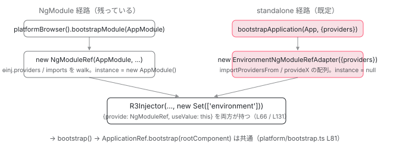

[目次](../README.md) › [NgModule の内側](README.md) › 第 18 回 / 全 18 回

# standalone が既定になった後の NgModule：何が残り、何を移行するか

> standalone ?? true の行（ɵɵdefineDirective / ɵɵdefinePipe / JIT / ngtsc）。standalone を declarations や bootstrap に入れたときのエラー（NGMODULE\_DECLARATION\_IS\_STANDALONE / NGMODULE\_BOOTSTRAP\_IS\_STANDALONE）。ng generate @angular/core:standalone の 3 モード（to-standalone / prune-modules / standalone-bootstrap）が何を書き換えるか。残る NgModule：ライブラリの forRoot、BrowserModule（内部）、TestBed、CommonModule。

angular/angular · 読了 約 12 分 · 基礎 · [サイトで読む（デモが動きます）](https://angular-deep-dive-cyan.vercel.app/chapter/ngmodule-to-standalone)

---

v19 から `standalone: true` は書かなくてよくなりました。この章では、その「既定」をランタイムとコンパイラのどの行が決めているか、standalone なクラスを `declarations` や `bootstrap` に入れたときにどの行で止まるか、そして `ng generate @angular/core:standalone` の 3 モードがコードを**どう書き換えるか**を、移行ツールのソースで確認します。最後に「書かなくてよい」と「無くなった」は別だということを、いま残っている NgModule の実物と、ランタイムが今も `NgModuleRef` を provide している行で見ます。

読む対象は `packages/core/src/render3/definition.ts`、`compiler-cli/src/ngtsc/annotations/directive/src/shared.ts`、`ngtsc/scope/src/local.ts`、`ngtsc/annotations/ng_module/src/handler.ts`、`packages/core/schematics/ng-generate/standalone-migration/` の `index.ts` / `to-standalone.ts` / `prune-modules.ts` / `standalone-bootstrap.ts` です。

1. 2 つの仕事
2. デコレータの実行
3. AOT の出力
4. コンパイルスコープ
5. exports の意味
6. JIT のスコープ計算
7. ɵinj → R3Injector
8. walkProviderTree
9. forRoot と ModuleWithProviders
10. providedIn の解決
11. bootstrapModule の全手順
12. BrowserModule の中身
13. standalone が import する NgModule
14. importProvidersFrom
15. 遅延モジュール
16. schemas
17. TestBed
18. **standalone 既定の後**（この章）

## 1. 既定を決めている 4 つの行

📄 `angular/packages/core/src/render3/definition.ts` L607–616 （▶ の行: 613）

```ts
607 │ }): PipeDef<T> {
608 │   return {
609 │     type: pipeDef.type,
610 │     name: pipeDef.name,
611 │     factory: null,
612 │     pure: pipeDef.pure !== false,
613 ▶     standalone: pipeDef.standalone ?? true,
614 │     onDestroy: pipeDef.type.prototype.ngOnDestroy || null,
615 │   };
616 │ }
```

📄 `angular/packages/core/src/render3/definition.ts` L618–634 （▶ の行: 618, 633）

```ts
618 ▶ function getNgDirectiveDef<T>(directiveDefinition: DirectiveDefinition<T>): DirectiveDef<T> {
619 │   const declaredInputs: Record<string, string> = {};
620 │ 
621 │   return {
622 │     type: directiveDefinition.type,
623 │     providersResolver: null,
624 │     viewProvidersResolver: null,
625 │     factory: null,
626 │     hostBindings: directiveDefinition.hostBindings || null,
627 │     hostVars: directiveDefinition.hostVars || 0,
628 │     hostAttrs: directiveDefinition.hostAttrs || null,
629 │     contentQueries: directiveDefinition.contentQueries || null,
630 │     declaredInputs: declaredInputs,
631 │     inputConfig: directiveDefinition.inputs || EMPTY_OBJ,
632 │     exportAs: directiveDefinition.exportAs || null,
633 ▶     standalone: directiveDefinition.standalone ?? true,
634 │     signals: directiveDefinition.signals === true,
```

ランタイム側は 2 行です。613 行目（パイプ）と 633 行目（ディレクティブ。`ɵɵdefineComponent` も 618 行目の `getNgDirectiveDef` を通るので同じ）、`standalone ?? true`。**コンパイラが `standalone` フィールドを出力しなければ true** です。では AOT コンパイラは何を出力するか。`@Component` の読み取り側を見ます。

📄 `angular/packages/compiler-cli/src/ngtsc/annotations/directive/src/shared.ts` L380–396 （▶ の行: 380, 382, 385–386, 388, 390, 393）

```ts
380 ▶   let isStandalone = implicitStandaloneValue;
381 │   let diagnostics: ts.Diagnostic[] | undefined;
382 ▶   if (directive.has('standalone')) {
383 │     const expr = directive.get('standalone')!;
384 │     const resolved = evaluator.evaluate(expr);
385 ▶     if (typeof resolved !== 'boolean') {
386 ▶       throw createValueHasWrongTypeError(expr, resolved, `standalone flag must be a boolean`);
387 │     }
388 ▶     isStandalone = resolved;
389 │ 
390 ▶     if (!isStandalone && strictStandalone) {
391 │       diagnostics = [
392 │         makeDiagnostic(
393 ▶           ErrorCode.NON_STANDALONE_NOT_ALLOWED,
394 │           expr,
395 │           `Only standalone components/directives are allowed when 'strictStandalone' is enabled.`,
396 │         ),
```

📄 `angular/packages/compiler-cli/src/ngtsc/core/src/compiler.ts` L479–484 （▶ の行: 482–484）

```ts
479 │     // Standalone by default is enabled since v19. We need to toggle it here,
480 │     // because the language service extension may be running with the latest
481 │     // version of the compiler against an older version of Angular.
482 ▶     this.implicitStandaloneValue =
483 ▶       this.angularCoreVersion === null ||
484 ▶       coreVersionSupportsFeature(this.angularCoreVersion, '>= 19.0.0');
```

1. **shared.ts 380 行目：初期値は `implicitStandaloneValue`**

   `@Component({...})` に `standalone` が無ければこの値がそのまま使われます。
2. **382〜388 行目：書いてあれば boolean に評価して採用**

   385〜386 行目、boolean 以外（たとえば変数経由で解決できない値）はエラー「standalone flag must be a boolean」。
3. **390〜396 行目：`strictStandalone` オプション**

   `angularCompilerOptions.strictStandalone` が true のプロジェクトでは `standalone: false` を書くこと自体が `NON_STANDALONE_NOT_ALLOWED` エラーになります。
4. **compiler.ts 482〜484 行目：`implicitStandaloneValue` の出所**

   `@angular/core` のバージョンが取れない、または `>= 19.0.0` なら true。コンパイラ（言語サービス拡張が新しいコンパイラで古い Angular を見ているケース）が core のバージョンで既定を切り替えるためです。v22 では常に true。

📄 `angular/packages/core/src/render3/jit/directive.ts` L400–411 （▶ の行: 405）

```ts
400 │     typeSourceSpan: null!,
401 │     usesInheritance: !extendsDirectlyFromObject(type),
402 │     exportAs: extractExportAs(metadata.exportAs),
403 │     providers: metadata.providers || null,
404 │     viewQueries: extractQueriesMetadata(type, propMetadata, isViewQuery),
405 ▶     isStandalone: metadata.standalone === undefined ? true : !!metadata.standalone,
406 │     isSignal: !!metadata.signals,
407 │     hostDirectives:
408 │       metadata.hostDirectives?.map((directive) =>
409 │         typeof directive === 'function' ? {directive} : directive,
410 │       ) || null,
411 │   };
```

JIT は 405 行目。`metadata.standalone === undefined ? true : !!metadata.standalone`。`undefined` なら true、書いてあれば boolean 化。AOT と同じ規則です。

📄 `angular/packages/compiler-cli/test/compliance/test_cases/r3_compiler_compliance/components_and_directives/standalone/imports.ts` L3–23 （▶ の行: 5, 12, 18–20）

```ts
 3 │ @Directive({
 4 │     selector: '[not-standalone]',
 5 ▶     standalone: false
 6 │ })
 7 │ export class NotStandaloneDir {
 8 │ }
 9 │ 
10 │ @Pipe({
11 │     name: 'nspipe',
12 ▶     standalone: false
13 │ })
14 │ export class NotStandalonePipe {
15 │   transform(value: any): any {}
16 │ }
17 │ 
18 ▶ @NgModule({
19 ▶   declarations: [NotStandaloneDir, NotStandalonePipe],
20 ▶   exports: [NotStandaloneDir, NotStandalonePipe],
21 │ })
22 │ export class NotStandaloneStuffModule {
23 │ }
```
*NgModule に属させたいときの書き方。standalone: false を明示する（コンパイラのテスト入力）。*

## 2. standalone を NgModule に入れたときに止まる行

### declarations に入れた

📄 `angular/packages/compiler-cli/src/ngtsc/scope/src/local.ts` L396–412 （▶ の行: 397–398, 401, 405, 407, 410–411）

```ts
396 │     // 2) add declarations.
397 ▶     for (const decl of ngModule.declarations) {
398 ▶       const directive = this.localReader.getDirectiveMetadata(decl);
399 │       const pipe = this.localReader.getPipeMetadata(decl);
400 │       if (directive !== null) {
401 ▶         if (directive.isStandalone) {
402 │           const refType = directive.isComponent ? 'Component' : 'Directive';
403 │           diagnostics.push(
404 │             makeDiagnostic(
405 ▶               ErrorCode.NGMODULE_DECLARATION_IS_STANDALONE,
406 │               decl.getOriginForDiagnostics(ngModule.rawDeclarations!),
407 ▶               `${refType} ${decl.node.name.text} is standalone, and cannot be declared in an NgModule. Did you mean to import it instead?`,
408 │             ),
409 │           );
410 ▶           isPoisoned = true;
411 ▶           continue;
412 │         }
```

[コンパイルスコープの章](04-ngmodule-compilation-scope.md)で読んだ `getScopeOfModuleInternal` の「2) declarations」の段階です。397〜398 行目で各 declaration のメタデータを取り、401 行目で `isStandalone` なら 405 行目の `NGMODULE_DECLARATION_IS_STANDALONE`（NG6008）を診断に積み、410 行目でスコープを poisoned にして 411 行目で `continue`。メッセージは 407 行目「Component X is standalone, and cannot be declared in an NgModule. Did you mean to import it instead?」。パイプも同じ（420〜430 行目）。

📄 `angular/packages/core/src/render3/jit/module.ts` L259–271 （▶ の行: 260, 271）

```ts
259 │   const errors: string[] = [];
260 ▶   const declarations = maybeUnwrapFn(ngModuleDef.declarations);
261 │   const imports = maybeUnwrapFn(ngModuleDef.imports);
262 │   flatten(imports)
263 │     .map(unwrapModuleWithProvidersImports)
264 │     .forEach((modOrStandaloneCmpt) => {
265 │       verifySemanticsOfNgModuleImport(modOrStandaloneCmpt, moduleType);
266 │       verifySemanticsOfNgModuleDef(modOrStandaloneCmpt, false, moduleType);
267 │     });
268 │   const exports = maybeUnwrapFn(ngModuleDef.exports);
269 │   declarations.forEach(verifyDeclarationsHaveDefinitions);
270 │   declarations.forEach(verifyDirectivesHaveSelector);
271 ▶   declarations.forEach((declarationType) => verifyNotStandalone(declarationType, moduleType));
```

📄 `angular/packages/core/src/render3/jit/module.ts` L330–339 （▶ の行: 334–335, 337）

```ts
330 │   function verifyNotStandalone(type: Type<any>, moduleType: NgModuleType): void {
331 │     type = resolveForwardRef(type);
332 │     // Check the pipe def first: a pipe that extends an abstract directive base class also has
333 │     // an (inherited) directive def, and we want the pipe's own `standalone` flag here.
334 ▶     const def = getPipeDef(type) || getComponentDef(type) || getDirectiveDef(type);
335 ▶     if (def?.standalone) {
336 │       const location = `"${stringifyForError(moduleType)}" NgModule`;
337 ▶       errors.push(generateStandaloneInDeclarationsError(type, location));
338 │     }
339 │   }
```

📄 `angular/packages/core/src/render3/jit/module.ts` L228–234 （▶ の行: 228–229, 231–232）

```ts
228 ▶ export function generateStandaloneInDeclarationsError(type: Type<any>, location: string) {
229 ▶   const prefix = `Unexpected "${stringifyForError(type)}" found in the "declarations" array of the`;
230 │   const suffix =
231 ▶     `"${stringifyForError(type)}" is marked as standalone and can't be declared ` +
232 ▶     'in any NgModule - did you intend to import it instead (by adding it to the "imports" array)?';
233 │   return `${prefix} ${location}, ${suffix}`;
234 │ }
```

JIT（`TestBed` や `ngJitMode`）では `verifySemanticsOfNgModuleDef` の 271 行目が declarations を 1 つずつ `verifyNotStandalone` に渡し、334〜335 行目でパイプ → コンポーネント → ディレクティブの順に def を取って `standalone` なら 337 行目で `generateStandaloneInDeclarationsError` のメッセージ（228〜234 行目）を積みます。334 行目のコメントどおり、パイプの def を先に見るのは「抽象ディレクティブを継承したパイプ」が `ɵdir` も持つからです。

### bootstrap に入れた

📄 `angular/packages/compiler-cli/src/ngtsc/annotations/ng_module/src/handler.ts` L476–483 （▶ の行: 477–480）

```ts
476 │       // Verify that the `@NgModule.bootstrap` list doesn't have Standalone Components.
477 ▶       for (const ref of bootstrapRefs) {
478 ▶         const dirMeta = this.metaReader.getDirectiveMetadata(ref);
479 ▶         if (dirMeta?.isStandalone) {
480 ▶           diagnostics.push(makeStandaloneBootstrapDiagnostic(node, ref, rawBootstrap));
481 │         }
482 │       }
483 │     }
```

📄 `angular/packages/compiler-cli/src/ngtsc/annotations/ng_module/src/handler.ts` L1350–1362 （▶ の行: 1352–1354, 1360）

```ts
1350 │   // Note: this error message should be aligned with the one produced by JIT.
1351 │   const message = //
1352 ▶     `The \`${componentClassName}\` class is a standalone component, which can ` +
1353 ▶     `not be used in the \`@NgModule.bootstrap\` array. Use the \`bootstrapApplication\` ` +
1354 ▶     `function for bootstrap instead.`;
1355 │   const relatedInformation: ts.DiagnosticRelatedInformation[] | undefined = [
1356 │     makeRelatedInformation(ngModuleClass, `The 'bootstrap' array is present on this NgModule.`),
1357 │   ];
1358 │ 
1359 │   return makeDiagnostic(
1360 ▶     ErrorCode.NGMODULE_BOOTSTRAP_IS_STANDALONE,
1361 │     getDiagnosticNode(bootstrappedClassRef, rawBootstrapExpr),
1362 │     message,
```

`NgModuleDecoratorHandler.analyze` の 477〜481 行目、`bootstrap` 配列の各参照について `isStandalone` なら `makeStandaloneBootstrapDiagnostic`。1360 行目で `NGMODULE_BOOTSTRAP_IS_STANDALONE`（NG6009）、メッセージは 1352〜1354 行目「... can not be used in the @NgModule.bootstrap array. Use the bootstrapApplication function for bootstrap instead.」。standalone なら `bootstrapModule` ではなく `bootstrapApplication` を使え、と言っています。ランタイムの経路の違いは [bootstrapModule の章](11-ngmodule-bootstrap-module.md)。

### 逆：standalone でないものを imports に入れた

📄 `angular/packages/compiler-cli/src/ngtsc/scope/src/util.ts` L37–46 （▶ の行: 37, 39, 41, 43–44）

```ts
37 ▶   let message = `The ${kind} '${ref.node.name.text}' appears in 'imports', but is not standalone and cannot be imported directly.`;
38 │   let relatedInformation: ts.DiagnosticRelatedInformation[] | undefined = undefined;
39 ▶   if (scope !== null && scope.kind === ComponentScopeKind.NgModule) {
40 │     // The directive/pipe in question is declared in an NgModule. Check if it's also exported.
41 ▶     const isExported = scope.exported.dependencies.some((dep) => dep.ref.node === ref.node);
42 │     const relatedInfoMessageText = isExported
43 ▶       ? `It can be imported using its '${scope.ngModule.name.text}' NgModule instead.`
44 ▶       : `It's declared in the '${scope.ngModule.name.text}' NgModule, but is not exported. ` +
45 │         'Consider exporting it and importing the NgModule instead.';
46 │     relatedInformation = [makeRelatedInformation(scope.ngModule.name, relatedInfoMessageText)];
```

📄 `angular/packages/compiler-cli/src/ngtsc/scope/src/util.ts` L57–62 （▶ の行: 58）

```ts
57 │   return makeDiagnostic(
58 ▶     ErrorCode.COMPONENT_IMPORT_NOT_STANDALONE,
59 │     getDiagnosticNode(ref, rawExpr),
60 │     message,
61 │     relatedInformation,
62 │   );
```

37 行目「The X appears in 'imports', but is not standalone and cannot be imported directly.」、58 行目 `COMPONENT_IMPORT_NOT_STANDALONE`（NG2011）。39〜46 行目が親切なところで、その X を宣言している NgModule が分かるときは「`exports` されているならその NgModule を import せよ（43 行目）」「されていないなら export してから（44〜45 行目）」と関連情報を付けます。JIT 側の同じ検査は [13 章](13-ngmodule-standalone-imports.md)で読んだ `verifyStandaloneImport` です。

## 3. 移行ツール：3 モードと、その順番

📄 `angular/packages/core/schematics/ng-generate/standalone-migration/README.md` L37–54 （▶ の行: 42–44, 51–54）

```md
37 │ ## Migration modes
38 │ 
39 │ The migration is made up the following modes that are intended to be run in the order they are
40 │ listed in:
41 │ 
42 ▶ 1. Convert declarations to standalone.
43 ▶ 2. Remove unnecessary NgModules.
44 ▶ 3. Switch to standalone bootstrapping API.
45 │ 
46 │ ### Convert declarations to standalone
47 │ 
48 │ In this mode, the migration will find all of the components, directives and pipes, and convert them
49 │ to standalone by removing `standalone: false` and adding any dependencies to the `imports` array.
50 │ 
51 ▶ **Note:** NgModules which bootstrap a component are explicitly ignored in this step, because they
52 ▶ are likely to be root modules and they would have to be bootstrapped using `bootstrapApplication`
53 ▶ instead of `bootstrapModule`. Their declarations will be converted automatically as a part of the
54 ▶ "Switch to standalone bootstrapping API" step.
```

📄 `angular/packages/core/schematics/ng-generate/standalone-migration/index.ts` L24–28 （▶ の行: 25–27）

```ts
24 │ enum MigrationMode {
25 ▶   toStandalone = 'convert-to-standalone',
26 ▶   pruneModules = 'prune-ng-modules',
27 ▶   standaloneBootstrap = 'standalone-bootstrap',
28 │ }
```

📄 `angular/packages/core/schematics/ng-generate/standalone-migration/index.ts` L125–160 （▶ の行: 125–126, 139–140, 151, 153）

```ts
125 ▶   if (schematicOptions.mode === MigrationMode.pruneModules) {
126 ▶     const result = pruneNgModules(
127 │       program,
128 │       host,
129 │       basePath,
130 │       rootNames,
131 │       sourceFiles,
132 │       printer,
133 │       undefined,
134 │       referenceLookupExcludedFiles,
135 │       knownInternalAliasRemapper,
136 │     );
137 │     pendingChanges = result.pendingChanges;
138 │     filesToRemove = result.filesToRemove;
139 ▶   } else if (schematicOptions.mode === MigrationMode.standaloneBootstrap) {
140 ▶     pendingChanges = toStandaloneBootstrap(
141 │       program,
142 │       host,
143 │       basePath,
144 │       rootNames,
145 │       sourceFiles,
146 │       printer,
147 │       undefined,
148 │       referenceLookupExcludedFiles,
149 │       knownInternalAliasRemapper,
150 │     );
151 ▶   } else {
152 │     // This shouldn't happen, but default to `MigrationMode.toStandalone` just in case.
153 ▶     pendingChanges = toStandalone(
154 │       sourceFiles,
155 │       program,
156 │       printer,
157 │       undefined,
158 │       knownInternalAliasRemapper,
159 │     );
160 │   }
```

README 42〜44 行目の順に実行する前提で、`mode` の値は 25〜27 行目の 3 つ。125〜160 行目の分岐で `pruneNgModules` / `toStandaloneBootstrap` / `toStandalone`（既定）が呼ばれます。README 51〜54 行目の注意が重要です。**`bootstrap` を持つ NgModule の declarations は 1 つ目のモードでは変換されず**、3 つ目のモードで一緒に変換されます。理由は、それらが `bootstrapModule` されるルートモジュールだからで、standalone にしてしまうと 2 節の NG6009 で止まるからです。

### モード 1：convert-to-standalone

📄 `angular/packages/core/schematics/ng-generate/standalone-migration/to-standalone.ts` L62–107 （▶ の行: 63, 67–68, 75–77, 85, 96, 99）

```ts
 62 │   for (const sourceFile of sourceFiles) {
 63 ▶     const modules = findNgModuleClassesToMigrate(sourceFile, typeChecker);
 64 │     const testObjects = findTestObjectsToMigrate(sourceFile, typeChecker);
 65 │ 
 66 │     for (const module of modules) {
 67 ▶       const allModuleDeclarations = extractDeclarationsFromModule(module, templateTypeChecker);
 68 ▶       const unbootstrappedDeclarations = filterNonBootstrappedDeclarations(
 69 │         allModuleDeclarations,
 70 │         module,
 71 │         templateTypeChecker,
 72 │         typeChecker,
 73 │       );
 74 │ 
 75 ▶       if (unbootstrappedDeclarations.length > 0) {
 76 ▶         modulesToMigrate.add(module);
 77 ▶         unbootstrappedDeclarations.forEach((decl) => declarations.add(decl));
 78 │       }
 79 │     }
 80 │ 
 81 │     testObjects.forEach((obj) => testObjectsToMigrate.add(obj));
 82 │   }
 83 │ 
 84 │   for (const declaration of declarations) {
 85 ▶     convertNgModuleDeclarationToStandalone(
 86 │       declaration,
 87 │       declarations,
 88 │       tracker,
 89 │       templateTypeChecker,
 90 │       program.getTsProgram(),
 91 │       declarationImportRemapper,
 92 │     );
 93 │   }
 94 │ 
 95 │   for (const node of modulesToMigrate) {
 96 ▶     migrateNgModuleClass(node, declarations, tracker, typeChecker, templateTypeChecker);
 97 │   }
 98 │ 
 99 ▶   migrateTestDeclarations(
100 │     testObjectsToMigrate,
101 │     declarations,
102 │     tracker,
103 │     templateTypeChecker,
104 │     typeChecker,
105 │   );
106 │   return tracker.recordChanges();
107 │ }
```

1. **63 行目：**ファイル内の `@NgModule` クラスを集める。
2. **67〜73 行目：**各 NgModule の `declarations` を取り、`filterNonBootstrappedDeclarations` で `bootstrap` に含まれるものを除く（README 51〜54 行目の実装）。
3. **85 行目：**残った declaration を 1 つずつ `convertNgModuleDeclarationToStandalone`（下）。
4. **96 行目：**NgModule 側を `migrateNgModuleClass`。中で `moveDeclarationsToImports` が `declarations` を `imports` に移す。
5. **99 行目：**`TestBed.configureTestingModule({declarations})` も同じく `imports` へ（[TestBed の章](17-ngmodule-testbed.md)）。

📄 `angular/packages/core/schematics/ng-generate/standalone-migration/to-standalone.ts` L125–156 （▶ の行: 125, 127–128, 130–131, 144–146, 156）

```ts
125 ▶   const directiveMeta = typeChecker.getDirectiveMetadata(decl);
126 │ 
127 ▶   if (directiveMeta && directiveMeta.decorator && !directiveMeta.isStandalone) {
128 ▶     let decorator = markDecoratorAsStandalone(directiveMeta.decorator);
129 │ 
130 ▶     if (directiveMeta.isComponent) {
131 ▶       const importsToAdd = getComponentImportExpressions(
132 │         decl,
133 │         allDeclarations,
134 │         tracker,
135 │         typeChecker,
136 │         program,
137 │         importRemapper,
138 │       );
139 │ 
140 │       if (importsToAdd.length > 0) {
141 │         const hasTrailingComma =
142 │           importsToAdd.length > 2 &&
143 │           !!extractMetadataLiteral(directiveMeta.decorator)?.properties.hasTrailingComma;
144 ▶         decorator = setPropertyOnAngularDecorator(
145 ▶           decorator,
146 ▶           'imports',
147 │           ts.factory.createArrayLiteralExpression(
148 │             // Create a multi-line array when it has a trailing comma.
149 │             ts.factory.createNodeArray(importsToAdd, hasTrailingComma),
150 │             hasTrailingComma,
151 │           ),
152 │         );
153 │       }
154 │     }
155 │ 
156 ▶     tracker.replaceNode(directiveMeta.decorator, decorator);
```

📄 `angular/packages/core/schematics/ng-generate/standalone-migration/to-standalone.ts` L450–479 （▶ の行: 450, 457–458, 463–464, 467, 471）

```ts
450 ▶ function markDecoratorAsStandalone(node: ts.Decorator): ts.Decorator {
451 │   const metadata = extractMetadataLiteral(node);
452 │ 
453 │   if (metadata === null || !ts.isCallExpression(node.expression)) {
454 │     return node;
455 │   }
456 │ 
457 ▶   const standaloneProp = metadata.properties.find((prop) => {
458 ▶     return isNamedPropertyAssignment(prop) && prop.name.text === 'standalone';
459 │   }) as ts.PropertyAssignment | undefined;
460 │ 
461 │   // In v19 standalone is the default so don't do anything if there's no `standalone`
462 │   // property or it's initialized to anything other than `false`.
463 ▶   if (!standaloneProp || standaloneProp.initializer.kind !== ts.SyntaxKind.FalseKeyword) {
464 ▶     return node;
465 │   }
466 │ 
467 ▶   const newProperties = metadata.properties.filter((element) => element !== standaloneProp);
468 │ 
469 │   // Use `createDecorator` instead of `updateDecorator`, because
470 │   // the latter ends up duplicating the node's leading comment.
471 ▶   return ts.factory.createDecorator(
472 │     ts.factory.createCallExpression(node.expression.expression, node.expression.typeArguments, [
473 │       ts.factory.createObjectLiteralExpression(
474 │         ts.factory.createNodeArray(newProperties, metadata.properties.hasTrailingComma),
475 │         newProperties.length > 1,
476 │       ),
477 │     ]),
478 │   );
479 │ }
```

📄 `angular/packages/core/schematics/ng-generate/standalone-migration/to-standalone.ts` L659–672 （▶ の行: 659, 665–666, 669–670）

```ts
659 ▶ export function findTemplateDependencies(
660 │   decl: ts.ClassDeclaration,
661 │   typeChecker: TemplateTypeChecker,
662 │   program: ts.Program,
663 │ ): Reference<NamedClassDeclaration>[] {
664 │   const results: Reference<NamedClassDeclaration>[] = [];
665 ▶   const usedDirectives = typeChecker.getUsedDirectives(decl);
666 ▶   const usedPipes = typeChecker.getUsedPipes(decl);
667 │ 
668 │   if (usedDirectives !== null) {
669 ▶     for (const dir of usedDirectives) {
670 ▶       results.push(dir.ref as Reference<NamedClassDeclaration>);
671 │     }
672 │   }
```

1. **127〜128 行目：standalone でないデコレータだけを `markDecoratorAsStandalone`**

   457〜465 行目、`standalone` プロパティが無い、または `false` 以外なら**何もしない**（463 行目のコメント「In v19 standalone is the default」）。`false` のときだけ 467 行目でそのプロパティを除いたメタデータを作り直します。`standalone: true` を書き足すのではなく、`false` を消す、です。
2. **130〜138 行目：コンポーネントなら `imports` を計算**

   `getComponentImportExpressions` が内部で `findTemplateDependencies`（659〜694 行目）を呼び、665〜666 行目の `TemplateTypeChecker.getUsedDirectives` / `getUsedPipes` で**テンプレートが実際に使っているもの**だけを集めます。NgModule の `imports` を丸写しするのではありません。
3. **144〜152 行目：`imports: [...]` をデコレータに書き足し、156 行目で置換**

📄 `angular/packages/core/schematics/ng-generate/standalone-migration/to-standalone.ts` L360–373 （▶ の行: 361–364）

```ts
360 │   // If there are no `imports`, create them with the declarations we want to copy.
361 ▶   if (!importsProp && declarationsToCopy.length > 0) {
362 ▶     properties.push(
363 ▶       ts.factory.createPropertyAssignment(
364 ▶         'imports',
365 │         ts.factory.createArrayLiteralExpression(
366 │           ts.factory.createNodeArray(
367 │             declarationsToCopy,
368 │             hasAnyArrayTrailingComma && declarationsToCopy.length > 2,
369 │           ),
370 │         ),
371 │       ),
372 │     );
373 │   }
```

📄 `angular/packages/core/schematics/ng-generate/standalone-migration/to-standalone.ts` L404–418 （▶ の行: 406, 411–412, 415）

```ts
404 │     // If we have an `imports` array and declarations
405 │     // that should be copied, we merge the two arrays.
406 ▶     if (prop === importsProp && declarationsToCopy.length > 0) {
407 │       // Only regular property assignments have initializers that we can merge
408 │       if (ts.isPropertyAssignment(prop)) {
409 │         let initializer: ts.Expression;
410 │ 
411 ▶         if (ts.isArrayLiteralExpression(prop.initializer)) {
412 ▶           initializer = ts.factory.updateArrayLiteralExpression(
413 │             prop.initializer,
414 │             ts.factory.createNodeArray(
415 ▶               [...prop.initializer.elements, ...declarationsToCopy],
416 │               prop.initializer.elements.hasTrailingComma,
417 │             ),
418 │           );
```

361〜373 行目、NgModule 側に `imports` が無ければ、移すべき declarations をそのまま `imports` プロパティとして作ります。既に `imports` があれば 406〜418 行目、その配列の末尾に足します（415 行目 `[...prop.initializer.elements, ...declarationsToCopy]`）。`exports` は触りません。standalone コンポーネントも NgModule から re-export できるからです（[exports の章](05-ngmodule-exports.md)）。

### モード 2：prune-ng-modules

📄 `angular/packages/core/schematics/ng-generate/standalone-migration/README.md` L133–139 （▶ の行: 135–139）

```md
133 │ A module is considered "safe to remove" if it:
134 │ 
135 ▶ - Has no `declarations`.
136 ▶ - Has no `providers`.
137 ▶ - Has no `bootstrap` components.
138 ▶ - Has no `imports` that reference a `ModuleWithProviders` symbol or a module that can't be removed.
139 ▶ - Has no class members. Empty constructors are ignored.
```

📄 `angular/packages/core/schematics/ng-generate/standalone-migration/prune-modules.ts` L616–641 （▶ の行: 616, 620–621, 626, 629, 634–635, 639–640）

```ts
616 ▶ function canRemoveClass(node: ts.ClassDeclaration, typeChecker: ts.TypeChecker): boolean {
617 │   const decorator = findNgModuleDecorator(node, typeChecker)?.node;
618 │ 
619 │   // We can't remove a declaration if it's not a valid `NgModule`.
620 ▶   if (!decorator || !ts.isCallExpression(decorator.expression)) {
621 ▶     return false;
622 │   }
623 │ 
624 │   // Unsupported case, e.g. `@NgModule(SOME_VALUE)`.
625 │   if (
626 ▶     decorator.expression.arguments.length > 0 &&
627 │     !ts.isObjectLiteralExpression(decorator.expression.arguments[0])
628 │   ) {
629 ▶     return false;
630 │   }
631 │ 
632 │   // We can't remove modules that have class members. We make an exception for an
633 │   // empty constructor which may have been generated by a tool and forgotten.
634 ▶   if (node.members.length > 0 && node.members.some((member) => !isEmptyConstructor(member))) {
635 ▶     return false;
636 │   }
637 │ 
638 │   // An empty `NgModule` call can be removed.
639 ▶   if (decorator.expression.arguments.length === 0) {
640 ▶     return true;
641 │   }
```

📄 `angular/packages/core/schematics/ng-generate/standalone-migration/prune-modules.ts` L671–686 （▶ の行: 676–679, 681, 685）

```ts
671 │   // We can't remove classes that have any `declarations`, `providers` or `bootstrap` elements.
672 │   // Also err on the side of caution and don't remove modules where any of the aforementioned
673 │   // properties aren't initialized to an array literal.
674 │   for (const prop of literal.properties) {
675 │     if (
676 ▶       isNonEmptyNgModuleProperty(prop) &&
677 ▶       (prop.name.text === 'declarations' ||
678 ▶         prop.name.text === 'providers' ||
679 ▶         prop.name.text === 'bootstrap')
680 │     ) {
681 ▶       return false;
682 │     }
683 │   }
684 │ 
685 ▶   return true;
686 │ }
```

1. **620〜621 行目：**`@NgModule` デコレータが無ければ消さない。
2. **626〜629 行目：**`@NgModule(SOME_VALUE)` のようにオブジェクトリテラルでなければ消さない（解析できない）。
3. **634〜635 行目：**クラスメンバがあれば消さない。空のコンストラクタだけは許す。`RouterModule` のように `constructor` で `inject` しているモジュールはここで残ります。
4. **639〜640 行目：**`@NgModule()`（引数無し）は消せる。
5. **646〜669 行目（引用の間）：**`imports` に識別子でない要素（`X.forRoot()` = `ModuleWithProviders`）があれば消さない。import 先の NgModule が消せないなら自分も消さない。
6. **676〜681 行目：**`declarations` / `providers` / `bootstrap` のどれかが空でない配列なら消さない。685 行目まで来たら消せる。

> [!NOTE]
> **ポイント**
>
> 「消せる NgModule」= **exports とただの imports しか無いもの**です。providers を持つモジュールは残ります。それをどう standalone 側に持ち込むかが [前章](14-ngmodule-import-providers-from.md)の `importProvidersFrom` で、モード 3 がそれを生成します。

### モード 3：standalone-bootstrap

📄 `angular/packages/core/schematics/ng-generate/standalone-migration/standalone-bootstrap.ts` L224–258 （▶ の行: 226, 229, 231, 233, 236–237, 239, 245, 247）

```ts
224 │   // Comment out the metadata so that it'll be removed when we run the module pruning afterwards.
225 │   // If the pruning is left for some reason, the user will still have an actionable TODO.
226 ▶   tracker.insertText(
227 │     moduleSourceFile,
228 │     analysis.metadata.getStart(),
229 ▶     '/* TODO(standalone-migration): clean up removed NgModule class manually. \n',
230 │   );
231 ▶   tracker.insertText(moduleSourceFile, analysis.metadata.getEnd(), ' */');
232 │ 
233 ▶   if (providers && ts.isPropertyAssignment(providers)) {
234 │     nodeLookup = nodeLookup || getNodeLookup(moduleSourceFile);
235 │ 
236 ▶     if (ts.isArrayLiteralExpression(providers.initializer)) {
237 ▶       providersInNewCall.push(...providers.initializer.elements);
238 │     } else {
239 ▶       providersInNewCall.push(ts.factory.createSpreadElement(providers.initializer));
240 │     }
241 │ 
242 │     addNodesToCopy(sourceFile, providers, nodeLookup, tracker, nodesToCopy, referenceResolver);
243 │   }
244 │ 
245 ▶   if (imports && ts.isPropertyAssignment(imports)) {
246 │     nodeLookup = nodeLookup || getNodeLookup(moduleSourceFile);
247 ▶     migrateImportsForBootstrapCall(
248 │       sourceFile,
249 │       imports,
250 │       nodeLookup,
251 │       moduleImportsInNewCall,
252 │       providersInNewCall,
253 │       tracker,
254 │       nodesToCopy,
255 │       referenceResolver,
256 │       typeChecker,
257 │     );
258 │   }
```

📄 `angular/packages/core/schematics/ng-generate/standalone-migration/standalone-bootstrap.ts` L333–365 （▶ の行: 333, 336–337, 342–343, 348, 359–361）

```ts
333 ▶   if (providers.length > 0 || modules.length > 0) {
334 │     const combinedProviders: ts.Expression[] = [];
335 │ 
336 ▶     if (modules.length > 0) {
337 ▶       const importProvidersExpression = tracker.addImport(
338 │         sourceFile,
339 │         'importProvidersFrom',
340 │         '@angular/core',
341 │       );
342 ▶       combinedProviders.push(
343 ▶         ts.factory.createCallExpression(importProvidersExpression, [], modules),
344 │       );
345 │     }
346 │ 
347 │     // Push the providers after `importProvidersFrom` call for better readability.
348 ▶     combinedProviders.push(...providers);
349 │ 
350 │     const providersArray = ts.factory.createNodeArray(
351 │       combinedProviders,
352 │       analysis.metadata.properties.hasTrailingComma && combinedProviders.length > 2,
353 │     );
354 │     const initializer = remapDynamicImports(
355 │       sourceFile.fileName,
356 │       ts.factory.createArrayLiteralExpression(providersArray, combinedProviders.length > 1),
357 │     );
358 │ 
359 ▶     args.push(
360 ▶       ts.factory.createObjectLiteralExpression(
361 ▶         [ts.factory.createPropertyAssignment('providers', initializer)],
362 │         true,
363 │       ),
364 │     );
365 │   }
```

1. **226〜231 行目：ルートモジュールのメタデータをコメントアウト**

   削除はしません。「TODO(standalone-migration): clean up removed NgModule class manually.」を頭に付けてブロックコメントで囲みます。モード 2 をもう一度走らせると消える形です。
2. **233〜243 行目：`providers` の要素はそのまま新しい呼び出しへ**

   配列リテラルなら要素を 1 つずつ（237 行目）、そうでなければ `...providers` のスプレッド（239 行目）。
3. **245〜258 行目：`imports` は `migrateImportsForBootstrapCall`**

   `RouterModule.forRoot` → `provideRouter`、`BrowserAnimationsModule` → `provideAnimations()` などへの書き換えは [前章 6 節](14-ngmodule-import-providers-from.md)で読みました。書き換えられなかった NgModule は `moduleImportsInNewCall` に残ります。
4. **336〜345 行目：残った NgModule を `importProvidersFrom(...)` 1 つに包む**

   348 行目で、その後ろに providers を並べます。「`importProvidersFrom` が先、`provideX` が後」という生成コードの並びはここで決まっています。
5. **359〜364 行目：`bootstrapApplication(Root, {providers: [...]})` を組み立てて `bootstrapModule` の呼び出しと置換**

> **🧪 DEMO — 3 モードを順に当てる**
>
> 小さな NgModule アプリに、上で読んだ規則を順に適用した結果です（変換は手書きの文字列。各ステップに実物の関数名と行を添えています）。「次のモード」を押すと README 42〜44 行目の順に進みます。
>
> ▶ [このデモはサイトで動かせます](https://angular-deep-dive-cyan.vercel.app/chapter/ngmodule-to-standalone)

## 4. 残る NgModule：どこに、なぜ

📄 `angular/packages/platform-browser/src/browser.ts` L295–316 （▶ の行: 295–297, 302, 307–308）

```ts
295 ▶ @NgModule({
296 ▶   providers: [...BROWSER_MODULE_PROVIDERS, ...TESTABILITY_PROVIDERS],
297 ▶   exports: [CommonModule, ApplicationModule],
298 │ })
299 │ export class BrowserModule {
300 │   constructor() {
301 │     if (typeof ngDevMode === 'undefined' || ngDevMode) {
302 ▶       const providersAlreadyPresent = inject(BROWSER_MODULE_PROVIDERS_MARKER, {
303 │         optional: true,
304 │         skipSelf: true,
305 │       });
306 │ 
307 ▶       if (providersAlreadyPresent) {
308 ▶         throw new RuntimeError(
309 │           RuntimeErrorCode.BROWSER_MODULE_ALREADY_LOADED,
310 │           `Providers from the \`BrowserModule\` have already been loaded. If you need access ` +
311 │             `to common directives such as NgIf and NgFor, import the \`CommonModule\` instead.`,
312 │         );
313 │       }
314 │     }
315 │   }
316 │ }
```

**BrowserModule**（platform-browser）。296 行目の providers は `bootstrapApplication` が使うものと同じ配列 `BROWSER_MODULE_PROVIDERS`（[BrowserModule の章](12-ngmodule-browser-module.md)）。302〜313 行目のコンストラクタで二重 import を検出します。`bootstrapModule` 経路の入口として残っていて、standalone アプリで書くことはありません。

📄 `angular/packages/common/src/common_module.ts` L24–28 （▶ の行: 24–26, 28）

```ts
24 ▶ @NgModule({
25 ▶   imports: [COMMON_DIRECTIVES, COMMON_PIPES],
26 ▶   exports: [COMMON_DIRECTIVES, COMMON_PIPES],
27 │ })
28 ▶ export class CommonModule {}
```

**CommonModule**。25〜26 行目、`COMMON_DIRECTIVES` と `COMMON_PIPES`（すべて standalone）を import して export するだけの「束」です。providers はありません。standalone コンポーネントで `imports: [CommonModule]` と書くと、[13 章](13-ngmodule-standalone-imports.md)の 2 節のとおり exported がコンパイルスコープに入り、テンプレートで使ったものと `CommonModule` 自身が `dependencies` に残ります。`NgIf` だけを import すればスコープも 1 つです。

📄 `angular/packages/router/src/router_module.ts` L98–107 （▶ の行: 98–100, 103, 105）

```ts
 98 ▶ @NgModule({
 99 ▶   imports: ROUTER_DIRECTIVES,
100 ▶   exports: ROUTER_DIRECTIVES,
101 │ })
102 │ export class RouterModule {
103 ▶   constructor() {
104 │     if (typeof ngDevMode === 'undefined' || ngDevMode) {
105 ▶       inject(ROUTER_FORROOT_GUARD, {optional: true});
106 │     }
107 │   }
```

📄 `angular/packages/router/src/router_module.ts` L182–187 （▶ の行: 182, 184–185）

```ts
182 ▶   static forChild(routes: Routes): ModuleWithProviders<RouterModule> {
183 │     return {
184 ▶       ngModule: RouterModule,
185 ▶       providers: [{provide: ROUTES, multi: true, useValue: routes}],
186 │     };
187 │   }
```

**RouterModule**。99〜100 行目は `ROUTER_DIRECTIVES` の束。103〜107 行目のコンストラクタが `ROUTER_FORROOT_GUARD` を inject します（二重 `forRoot` の検出。[forRoot の章](09-ngmodule-module-with-providers.md)）。`forChild`（182〜187 行目）は `ROUTES` の multi provider を 1 つ足すだけ。standalone では `Route.loadChildren` が `Routes` 配列を直接返せるので不要です（[遅延モジュールの章](15-ngmodule-lazy-module.md)）。

📄 `angular/packages/common/http/src/module.ts` L98–107 （▶ の行: 98, 105）

```ts
 98 ▶  * @deprecated use `provideHttpClient(withInterceptorsFromDi())` as providers instead
 99 │  */
100 │ @NgModule({
101 │   /**
102 │    * Configures the dependency injector where it is imported
103 │    * with supporting services for HTTP communications.
104 │    */
105 ▶   providers: [provideHttpClient(withInterceptorsFromDi(), withXhr())],
106 │ })
107 │ export class HttpClientModule {}
```

**HttpClientModule**。98 行目で deprecated。105 行目の中身は `provideHttpClient(withInterceptorsFromDi(), withXhr())` の 1 要素で、provideX の薄い包みになっています。

📄 `components/src/material/button/button-module.ts` L16–20 （▶ の行: 16–18）

```ts
16 ▶ @NgModule({
17 ▶   imports: [MatRippleModule, MatButton, MatMiniFabButton, MatIconButton, MatFabButton],
18 ▶   exports: [BidiModule, MatButton, MatMiniFabButton, MatIconButton, MatFabButton],
19 │ })
20 │ export class MatButtonModule {}
```

**ライブラリの NgModule**（angular/components の `MatButtonModule`）。17〜18 行目、standalone なコンポーネント 4 つと `MatRippleModule` を import し、`BidiModule` と 4 コンポーネントを export。providers は無し。Angular Material のコンポーネントはすべて standalone で、`MatButton` を直接 import しても、`MatButtonModule` を import しても、テンプレートで使った `MatButton` が `dependencies` に並ぶ点は同じです（モジュールの場合は `MatButtonModule` 自身が 1 要素増える）。モジュールは「まとめて import する便利さ」のために残っています。

📄 `angular/packages/core/testing/src/test_bed_compiler.ts` L198–204 （▶ の行: 202–203）

```ts
198 │   constructor(
199 │     private platform: PlatformRef,
200 │     private additionalModuleTypes: Type<any> | Type<any>[],
201 │   ) {
202 ▶     class DynamicTestModule {}
203 ▶     this.testModuleType = DynamicTestModule as any;
204 │   }
```

📄 `angular/packages/core/testing/src/test_bed_compiler.ts` L1027–1038 （▶ の行: 1027, 1029–1030, 1032–1033, 1035）

```ts
1027 ▶     const imports = [RootScopeModule, this.additionalModuleTypes, this.imports || []];
1028 │ 
1029 ▶     compileNgModuleDefs(
1030 ▶       this.testModuleType,
1031 │       {
1032 ▶         declarations: this.declarations,
1033 ▶         imports,
1034 │         schemas: this.schemas,
1035 ▶         providers,
1036 │       },
1037 │       /* allowDuplicateDeclarationsInRoot */ true,
1038 │     );
```

**TestBed**。202〜203 行目、`TestBedCompiler` のコンストラクタが空のクラス `DynamicTestModule` を作り、1029〜1038 行目で `configureTestingModule` に渡された `declarations` / `imports` / `schemas` / `providers` をこのクラスに `compileNgModuleDefs` で焼き込みます。standalone のテストでも、**テストの環境注入器は毎回この NgModule から作られます**（[TestBed の章](17-ngmodule-testbed.md)）。

## 5. 「書かなくてよい」と「無くなった」は違う

📄 `angular/packages/core/src/render3/ng_module_ref.ts` L62–69 （▶ の行: 63, 66, 68）

```ts
62 │     this._bootstrapComponents = maybeUnwrapFn(ngModuleDef!.bootstrap);
63 ▶     this._r3Injector = createInjectorWithoutInjectorInstances(
64 │       ngModuleType,
65 │       _parent,
66 ▶       [{provide: viewEngine_NgModuleRef, useValue: this}, ...additionalProviders],
67 │       stringify(ngModuleType),
68 ▶       new Set(['environment']),
69 │     ) as R3Injector;
```

📄 `angular/packages/core/src/render3/ng_module_ref.ts` L119–140 （▶ の行: 119, 121, 130–131, 134）

```ts
119 ▶ export class EnvironmentNgModuleRefAdapter extends viewEngine_NgModuleRef<null> {
120 │   override readonly injector: R3Injector;
121 ▶   override readonly instance = null;
122 │ 
123 │   constructor(config: {
124 │     providers: Array<Provider | EnvironmentProviders>;
125 │     parent: EnvironmentInjector | null;
126 │     debugName: string | null;
127 │     runEnvironmentInitializers: boolean;
128 │   }) {
129 │     super();
130 ▶     const injector = new R3Injector(
131 ▶       [...config.providers, {provide: viewEngine_NgModuleRef, useValue: this}],
132 │       config.parent || getNullInjector(),
133 │       config.debugName,
134 ▶       new Set(['environment']),
135 │     );
136 │     this.injector = injector;
137 │     if (config.runEnvironmentInitializers) {
138 │       injector.resolveInjectorInitializers();
139 │     }
140 │   }
```

66 行目、`NgModuleRef` のコンストラクタは `{provide: NgModuleRef, useValue: this}` を先頭に置いて `R3Injector` を作ります。119 行目、`bootstrapApplication` と `createEnvironmentInjector` が使う `EnvironmentNgModuleRefAdapter` は、**名前のとおり `NgModuleRef` を継承**し、121 行目で `instance = null`（モジュールクラスは無い）、131 行目でやはり `NgModuleRef` トークンを自分に向けます。standalone アプリでも `inject(NgModuleRef)` は成功し、`ApplicationRef.bootstrap` は `this._injector.get(NgModuleRef)` で取ったものを `ComponentFactory` に渡します（[ApplicationRef の章](../boot/10-boot-application-ref.md)）。68 行目と 134 行目、どちらも `new Set(['environment'])`。「環境注入器」とはランタイムにとって「NgModule 用の注入器」の別名であり、standalone はそれを**クラス無しで**作る道を増やしたものです。



*standalone 既定の後の地図。利用者が書くのは右側だけになったが、ランタイムの中心（R3Injector + NgModuleRef）は左右で同じ。*

## 聞かれそうな質問

**Q. standalone: true はもう書かなくていいですか？どの行が既定を決めていますか？**

書かなくてよいです。AOT は shared.ts 380 行目で `implicitStandaloneValue` を初期値にし、それは compiler.ts 482〜484 行目で core が 19 以上なら true。`standalone` フィールドが出力されないと、ランタイムの `standalone ?? true`（definition.ts 613 行目 / 633 行目）で true になります。JIT は jit/directive.ts 405 行目で同じ規則です。NgModule に属させたいときだけ `standalone: false` を書きます。

**Q. standalone なコンポーネントを declarations に入れたら、どの行で止まりますか？**

AOT では local.ts 401〜411 行目。`NGMODULE_DECLARATION_IS_STANDALONE`（NG6008）を診断に積み、その NgModule のスコープを poisoned にします。JIT では jit/module.ts 271 行目 → 330〜339 行目の `verifyNotStandalone` が `generateStandaloneInDeclarationsError`（228〜234 行目）のメッセージを `errors` に積みます。`bootstrap` に入れた場合は ng\_module/src/handler.ts 477〜481 行目で `NGMODULE_BOOTSTRAP_IS_STANDALONE`（NG6009）。

**Q. 移行ツールは何をどの順で書き換えますか？**

`ng generate @angular/core:standalone` を 3 回、`convert-to-standalone` → `prune-ng-modules` → `standalone-bootstrap` の順で（README 42〜44 行目、index.ts 24〜28 行目）。1 回目は `standalone: false` を消し（to-standalone.ts 463〜467 行目）、テンプレートが使っているものだけを `imports` に足し（659〜672 行目）、NgModule の `declarations` を `imports` に移す（361〜373 行目）。ただし `bootstrap` されるコンポーネントは除く（68〜73 行目）。2 回目は `declarations` / `providers` / `bootstrap` が空で、クラスメンバが無く、`imports` が識別子だけの NgModule を消す（prune-modules.ts 616〜686 行目）。3 回目は `bootstrapModule(AppModule)` を `bootstrapApplication(App, {providers: [importProvidersFrom(残ったモジュール), ...providers]})` に置換（standalone-bootstrap.ts 333〜365 行目）。

**Q. NgModule は無くなるのですか？何が残りますか？**

利用者が書く必要はほぼ無くなりましたが、ランタイムの概念としては残っています。`bootstrapApplication` が作る `EnvironmentNgModuleRefAdapter` は `NgModuleRef` の子クラス（ng\_module\_ref.ts 119 行目）で、`NgModuleRef` トークンを provide し（131 行目）、`ApplicationRef.bootstrap` はそれを使います。ライブラリ側では `CommonModule`（束）、`RouterModule`（`forChild` と二重 forRoot 検出）、`MatButtonModule` のような便利モジュール、deprecated の `HttpClientModule`、内部用の `BrowserModule`、`TestBed` の `DynamicTestModule` が残っています。

**Q. CommonModule を import するのと NgIf だけを import するのは何が違いますか？**

コンパイル時のスコープの広さが違います。`CommonModule` は `COMMON_DIRECTIVES` と `COMMON_PIPES` を全部 export する束（common\_module.ts 25〜26 行目）なので、import するとテンプレートでそのすべてが使える状態になります。出力される `dependencies` は、13 章 2 節で読んだ handler.ts 2100〜2101 行目のフィルタで「実際に使ったディレクティブ・パイプ + NgModule 自身」に絞られるので、どちらで書いても使った分だけが残り、`CommonModule` の場合はモジュール自身が 1 要素増えます。`@if` / `@for` の制御フローを使うなら、そもそも `NgIf` / `NgFor` は不要です。

**Q. strictStandalone とは何ですか？**

`angularCompilerOptions.strictStandalone: true` にすると、`standalone: false` を書いたディレクティブ・コンポーネントが shared.ts 390〜396 行目で `NON_STANDALONE_NOT_ALLOWED` になります。移行が終わったプロジェクトで「もう NgModule 用のクラスは作らない」を強制するためのオプションです。

## 読み終えて

- 既定は 4 行で決まる。AOT: shared.ts 380 行目 + compiler.ts 482〜484 行目（core ≥ 19 で true）。ランタイム: definition.ts 613 / 633 行目の `standalone ?? true`。JIT: jit/directive.ts 405 行目
- standalone を `declarations` に入れると NG6008（local.ts 405 行目）、`bootstrap` に入れると NG6009（handler.ts 1360 行目）、逆に非 standalone を `imports` に入れると NG2011（scope/util.ts 58 行目）
- 移行ツールは 3 モードを順に。`standalone: false` を消す / 使っている依存だけ `imports` に / declarations → imports / 空のモジュールを消す / `bootstrapModule` → `bootstrapApplication` + `importProvidersFrom`
- 残る NgModule は「束」（CommonModule、Mat\*Module）、「providers や constructor を持つもの」（RouterModule、BrowserModule）、「ツールが使うもの」（DynamicTestModule）
- ランタイムの中心は変わっていない。`EnvironmentNgModuleRefAdapter` は `NgModuleRef` であり、standalone は「クラス無しで環境注入器を作る道」

standalone になったコンポーネント自身の中身は、次のシリーズ [standalone コンポーネントの内側](../standalone/README.md)で 1 章ずつ読みます。

---

← 前: [TestBed.configureTestingModule は NgModule を作っている：DynamicTestModule と RootScopeModule](17-ngmodule-testbed.md)  
次: [standalone コンポーネントの概観：imports が ɵcmp の dependencies になり、依存解決と注入器を自分で持つ](../standalone/01-standalone.md) →
