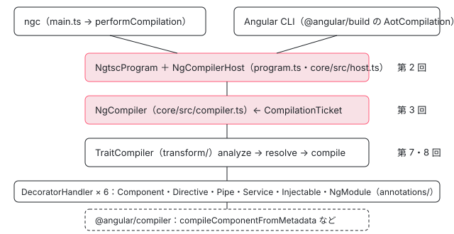

[目次](../README.md) › [ngtsc の内側](README.md) › 第 1 回 / 全 20 回

# ngtsc の全体像：tsc の横で動くもう 1 つのコンパイラ

> packages/compiler-cli/src/ngtsc のディレクトリの分担（core・transform・annotations・reflection・partial\_evaluator・imports・metadata・scope・incremental・cycles・typecheck・hmr・perf・diagnostics）と、ngc の入口 main.ts から NgtscProgram・NgCompiler・TraitCompiler・DecoratorHandler までの層。テンプレートのコンパイラ（@angular/compiler）との分担。各章へのリンク。

angular/angular · 読了 約 12 分 · 基礎 · [サイトで読む（デモが動きます）](https://angular-deep-dive-cyan.vercel.app/chapter/ngtsc-overview)

---

`ngc`（Angular のコンパイラのコマンド）を叩くと、TypeScript のコンパイラ `tsc` と同じ「読む・型を調べる・JS を書く」の流れの中で、Angular のデコレーターを読んで `ɵcmp` などの静的なフィールドを足す、もう 1 つのコンパイラが動きます。それが ngtsc です。この章では、`ngc` の入口から `NgtscProgram` を作るまでを行番号で追い、その奥にある層（`NgCompiler` → `TraitCompiler` → `DecoratorHandler` → `@angular/compiler`）と、`packages/compiler-cli/src/ngtsc/` のディレクトリの分担を 1 枚の地図にします。

読む対象は `packages/compiler-cli/src/bin/ngc.ts`・`main.ts`・`perform_compile.ts`・`transformers/program.ts` と `ngtsc/core/README.md` です。

1. **1. 全体像**（この章）
2. [2. NgtscProgram](02-ngtsc-program.md)
3. [3. NgCompiler とチケット](03-ngtsc-compiler-ticket.md)
4. [4. リフレクション](04-ngtsc-reflection.md)
5. [5. 静的な評価](05-ngtsc-partial-evaluator.md)
6. [6. 参照と import](06-ngtsc-references-imports.md)
7. [7. 解析](07-ngtsc-trait-analyze.md)
8. [8. 解決と出力](08-ngtsc-trait-resolve-compile.md)
9. [9. @Directive の handler](09-ngtsc-directive-handler.md)
10. [10. メタデータの登録](10-ngtsc-metadata-registry.md)
11. [11. .d.ts を読む](11-ngtsc-dts-metadata.md)
12. [12. JS の書き換え](12-ngtsc-ivy-transform.md)
13. [13. .d.ts の書き換え](13-ngtsc-dts-transform.md)
14. [14. 差分ビルド](14-ngtsc-incremental.md)
15. [15. 意味のグラフ](15-ngtsc-semantic-graph.md)
16. [16. import の循環](16-ngtsc-cycles.md)
17. [17. HMR](17-ngtsc-hmr.md)
18. [18. 診断と性能](18-ngtsc-diagnostics-perf.md)
19. [19. テストを書く](19-ngtsc-test-env.md)
20. [20. issue と PR を読む](20-ngtsc-issues.md)

## 1. ngc の入口：bin/ngc.ts から main へ

`npx ngc -p tsconfig.json` で動くのは、`@angular/compiler-cli` の `bin/ngc.ts` です。

📄 `angular/packages/compiler-cli/src/bin/ngc.ts` L10–28 （▶ の行: 11, 20, 22）

```ts
10 │ // Must be imported first, because Angular decorators throw on load.
11 ▶ import 'reflect-metadata';
12 │ 
13 │ import {NodeJSFileSystem, setFileSystem} from '../ngtsc/file_system';
14 │ import {main} from '../main';
15 │ 
16 │ async function runNgcComamnd() {
17 │   process.title = 'Angular Compiler (ngc)';
18 │   const args = process.argv.slice(2);
19 │   // We are running the real compiler so run against the real file-system
20 ▶   setFileSystem(new NodeJSFileSystem());
21 │ 
22 ▶   process.exitCode = main(args, undefined, undefined, undefined, undefined, undefined);
23 │ }
24 │ 
25 │ runNgcComamnd().catch((e) => {
26 │   console.error(e);
27 │   process.exitCode = 1;
28 │ });
```

1. **11 行目：`reflect-metadata` を最初に読む**

   コメントのとおり、デコレーターを読み込んだ時点で投げないための準備です。ngtsc 自身はデコレーターを実行せず、AST（構文木）として読みます（[第 4 回](04-ngtsc-reflection.md)）。
2. **20 行目：`setFileSystem(new NodeJSFileSystem())`**

   ngtsc の中のファイル操作は、すべて `file_system/` の `FileSystem` という抽象を通ります。テストでは同じ場所に `MockFileSystem` を入れ、Windows 風・macOS 風のパスでも同じテストを回します（テストと直し方の節）。ここで本物のディスクを差し込みます。
3. **22 行目：`main(args, …)`**

   引数を `main.ts` に渡し、戻り値を終了コードにします。

📄 `angular/packages/compiler-cli/src/main.ts` L32–64 （▶ の行: 39, 43, 48, 53–55, 57, 64）

```ts
32 │   let {
33 │     project,
34 │     rootNames,
35 │     options,
36 │     errors: configErrors,
37 │     watch,
38 │     emitFlags,
39 ▶   } = config || readNgcCommandLineAndConfiguration(args);
40 │   if (configErrors.length) {
41 │     return reportErrorsAndExit(configErrors, /*options*/ undefined, consoleError);
42 │   }
43 ▶   if (watch) {
44 │     const result = watchMode(project, options, consoleError);
45 │     return reportErrorsAndExit(result.firstCompileResult, options, consoleError);
46 │   }
47 │ 
48 ▶   let oldProgram: api.Program | undefined;
49 │   if (programReuse !== undefined) {
50 │     oldProgram = programReuse.program;
51 │   }
52 │ 
53 ▶   const {diagnostics: compileDiags, program} = performCompilation({
54 ▶     rootNames,
55 ▶     options,
56 │     emitFlags,
57 ▶     oldProgram,
58 │     customTransformers,
59 │     modifiedResourceFiles,
60 │   });
61 │   if (programReuse !== undefined) {
62 │     programReuse.program = program;
63 │   }
64 ▶   return reportErrorsAndExit(compileDiags, options, consoleError);
```

39 行目で、コマンドラインと tsconfig を読みます（中身は次の節の `readConfiguration`）。43〜46 行目は `--watch` のときの別の道です。48〜51 行目の `oldProgram` は、前回の `Program` を受け取ったときだけ入ります（`ngc` を 1 回だけ叩く普通の使い方では `undefined`）。53〜60 行目で `performCompilation` を呼び、64 行目で診断を表示して終了コードを決めます。

## 2. readConfiguration：angularCompilerOptions は 1 つの options に混ざる

📄 `angular/packages/compiler-cli/src/perform_compile.ts` L138–157 （▶ の行: 141–142, 151, 155）

```ts
138 │     const existingCompilerOptions: api.CompilerOptions = {
139 │       genDir: basePath,
140 │       basePath,
141 ▶       ...readAngularCompilerOptions(configFileName),
142 ▶       ...existingOptions,
143 │     };
144 │ 
145 │     const parseConfigHost = createParseConfigHost(host, fs);
146 │     const {
147 │       options,
148 │       errors,
149 │       fileNames: rootNames,
150 │       projectReferences,
151 ▶     } = ts.parseJsonConfigFileContent(
152 │       config,
153 │       parseConfigHost,
154 │       basePath,
155 ▶       existingCompilerOptions,
156 │       configFileName,
157 │     );
```

141 行目の `readAngularCompilerOptions` は、tsconfig の `angularCompilerOptions` を `extends` の先までたどって集めた 1 つのオブジェクトを返します。それを 151〜157 行目で `ts.parseJsonConfigFileContent` に**既存の compilerOptions として**渡す（155 行目）ので、結果の `options` には `target` と `strictTemplates` が同じ階層に並びます。ngtsc のコードが `this.options.strictTemplates` のように TypeScript の設定と同じ箱から Angular の設定を読めるのは、この混ぜ方のためです。142 行目の `existingOptions`（呼び出し側が渡した値）は最後に広げるので、tsconfig より強くなります。

## 3. performCompilation：作る → 診断 → emit

📄 `angular/packages/compiler-cli/src/perform_compile.ts` L280–313 （▶ の行: 285, 288, 291, 294, 302–303）

```ts
280 │   let program: api.Program | undefined;
281 │   let emitResult: ts.EmitResult | undefined;
282 │   let allDiagnostics: Array<ts.Diagnostic> = [];
283 │   try {
284 │     if (!host) {
285 ▶       host = ng.createCompilerHost({options});
286 │     }
287 │     if (modifiedResourceFiles) {
288 ▶       host.getModifiedResourceFiles = () => modifiedResourceFiles;
289 │     }
290 │ 
291 ▶     program = ng.createProgram({rootNames, host, options, oldProgram});
292 │ 
293 │     const beforeDiags = Date.now();
294 ▶     allDiagnostics.push(...gatherDiagnostics(program!));
295 │     if (options.diagnostics) {
296 │       const afterDiags = Date.now();
297 │       allDiagnostics.push(
298 │         createMessageDiagnostic(`Time for diagnostics: ${afterDiags - beforeDiags}ms.`),
299 │       );
300 │     }
301 │ 
302 ▶     if (!hasErrors(allDiagnostics)) {
303 ▶       emitResult = program!.emit({
304 │         emitCallback,
305 │         mergeEmitResultsCallback,
306 │         customTransformers,
307 │         emitFlags,
308 │         forceEmit,
309 │       });
310 │       allDiagnostics.push(...emitResult.diagnostics);
311 │       return {diagnostics: allDiagnostics, program, emitResult};
312 │     }
313 │     return {diagnostics: allDiagnostics, program};
```

1. **285 行目：ホストを作る**

   `ng.createCompilerHost` は TypeScript の `ts.CompilerHost`（ファイルを読み書きする窓口）を作ります。CLI のように自分でホストを渡す呼び出し側は、ここを通りません。
2. **288 行目：変わったリソースを知らせる口**

   `getModifiedResourceFiles` を生やします。`NgtscProgram` のコンストラクタがこれを読み、差分ビルドのチケットに渡します（[第 2 回](02-ngtsc-program.md)）。
3. **291 行目：`ng.createProgram`**

   中身は次の引用の 1 行です。
4. **294 行目：診断を集める**

   既定の `defaultGatherDiagnostics` が、下の順番で集めます。
5. **302〜309 行目：エラーが無ければ emit**

   エラーが 1 つでもあれば emit しません。`program.emit` の中で Angular の変換が TypeScript の emit に渡されます（[第 2 回](02-ngtsc-program.md)）。

📄 `angular/packages/compiler-cli/src/transformers/program.ts` L13–25 （▶ の行: 24）

```ts
13 │ export function createProgram({
14 │   rootNames,
15 │   options,
16 │   host,
17 │   oldProgram,
18 │ }: {
19 │   rootNames: ReadonlyArray<string>;
20 │   options: CompilerOptions;
21 │   host: CompilerHost;
22 │   oldProgram?: Program;
23 │ }): Program {
24 ▶   return new NgtscProgram(rootNames, options, host, oldProgram as NgtscProgram | undefined);
25 │ }
```

24 行目。`createProgram` は `NgtscProgram` を new するだけです。`api.Program` という型は View Engine（以前のコンパイラ）の時代の名残りで、いまの実装はこれ 1 つです。

📄 `angular/packages/compiler-cli/src/perform_compile.ts` L339–361 （▶ の行: 343, 347, 353–354, 359）

```ts
339 │   let checkOtherDiagnostics = true;
340 │   // Check parameter diagnostics
341 │   checkOtherDiagnostics =
342 │     checkOtherDiagnostics &&
343 ▶     checkDiagnostics([...program.getTsOptionDiagnostics(), ...program.getNgOptionDiagnostics()]);
344 │ 
345 │   // Check syntactic diagnostics
346 │   checkOtherDiagnostics =
347 ▶     checkOtherDiagnostics && checkDiagnostics(program.getTsSyntacticDiagnostics());
348 │ 
349 │   // Check TypeScript semantic and Angular structure diagnostics
350 │   checkOtherDiagnostics =
351 │     checkOtherDiagnostics &&
352 │     checkDiagnostics([
353 ▶       ...program.getTsSemanticDiagnostics(),
354 ▶       ...program.getNgStructuralDiagnostics(),
355 │     ]);
356 │ 
357 │   // Check Angular semantic diagnostics
358 │   checkOtherDiagnostics =
359 ▶     checkOtherDiagnostics && checkDiagnostics(program.getNgSemanticDiagnostics());
360 │ 
361 │   return allDiagnostics;
```

343 行目（設定）→ 347 行目（構文）→ 353〜354 行目（TypeScript の型と Angular の構造）→ 359 行目（Angular の意味＝テンプレートの型チェックなど）の順で、**前の段にエラーがあれば次の段を呼びません**（`checkOtherDiagnostics &&` の短絡）。TypeScript の型エラーがあるあいだはテンプレートの型チェックのエラーが出ないのは、この並びのためです。

## 4. その奥の層：NgCompiler・TraitCompiler・DecoratorHandler

`NgtscProgram` の中で何が起きるかは、`ngtsc/core/README.md` が 8 つの手順で書いています。

📄 `angular/packages/compiler-cli/src/ngtsc/core/README.md` L20–29 （▶ の行: 23, 25–26, 28–29）

```md
20 │ A compiler which integrates Angular compilation into this process follows a very similar flow, with a few extra steps:
21 │ 
22 │ 1. A `ts.CompilerHost` is created.
23 ▶ 2. That `ts.CompilerHost` is wrapped in an `NgCompilerHost`, which adds Angular specific files to the compilation.
24 │ 3. A `ts.Program` is created from the `NgCompilerHost` and its augmented set of root files.
25 ▶ 4. A `CompilationTicket` is created, optionally incorporating any state from a previous compilation run.
26 ▶ 5. An `NgCompiler` is created using the `CompilationTicket`.
27 │ 6. Diagnostics can be gathered from the `ts.Program` as normal, as well as from the `NgCompiler`.
28 ▶ 7. Prior to `emit`, `NgCompiler.prepareEmit` is called to retrieve the Angular transformers which need to be fed to `ts.Program.emit`.
29 ▶ 8. `emit` is called on the `ts.Program` with the Angular transformers from above, which produces JavaScript code with Angular extensions.
```

23 行目の `NgCompilerHost` と 28〜29 行目の emit は [第 2 回](02-ngtsc-program.md)、25〜26 行目の `CompilationTicket` と `NgCompiler` は [第 3 回](03-ngtsc-compiler-ticket.md)で読みます。その先は次の図の層になります。



*ngtsc の層。上が呼ぶ側、下が呼ばれる側。右の数字はこのシリーズの回*

- **ngc と CLI は同じ `NgtscProgram` を作ります。** CLI（`@angular/build`）は `performCompilation` を通らず、自分で `new NgtscProgram(…)` します（[cli-angular-compilation の章](../cli/03-cli-angular-compilation.md)）。言語サービスは `NgCompiler` を直接使い回します（[ls-compiler-factory の章](../ls/05-ls-compiler-factory.md)）。
- **`NgCompiler` が部品を組み立てます。** リフレクション・静的な評価・メタデータの読み手・スコープ・6 つの handler・`TraitCompiler`・型チェックを、最初に結果を求められたときに 1 回だけ作ります（[第 3 回](03-ngtsc-compiler-ticket.md)）。
- **`TraitCompiler` がファイルの中のクラスを handler に配ります。** 1 つのクラスと handler の組を trait（特性）と呼び、analyze → resolve → compile の 3 段で進めます（[compiler-entry の章](../compiler/02-compiler-entry.md)・[第 7 回](07-ngtsc-trait-analyze.md)）。
- **handler は「R3 のメタデータ」を作って `@angular/compiler` に渡します。** テンプレートの構文解析と、`ɵɵdefineComponent(…)` などの出力の式を作るのは `@angular/compiler` の側です。ngtsc は TypeScript のプログラムを読む側で、出力の式を TypeScript の AST に戻してクラスに足す側でもあります（[compiler-reify-emit の章](../compiler/16-compiler-reify-emit.md)）。

> [!TIP]
> **新卒エンジニアへ**
>
> 「R3 のメタデータ」は、`@angular/compiler` が受け取る入力の形の名前です（`R3ComponentMetadata`・`R3DirectiveMetadata` など。R3 は render3 の略で、Ivy の命令が入っている `packages/core/src/render3` と同じ名前です）。ngtsc の仕事を一言で言えば、TypeScript の AST を読んでこの形のオブジェクトを作り、返ってきた出力の式をクラスに書き戻すことです。

## 5. ディレクトリの分担

`packages/compiler-cli/src/ngtsc/` の下のディレクトリを、行数（test を除く .ts、2026-11-05 の 22.2.0-next.7）の多い順に並べます。役目は各ディレクトリの `index.ts` が export しているクラスと README から書きました。

| ディレクトリ | 行数 | 役目（主なクラス） | 読む回 |
| --- | --- | --- | --- |
| annotations | 13612 | デコレーターごとの `DecoratorHandler`（`ComponentDecoratorHandler` など 6 つ） | [9](09-ngtsc-directive-handler.md)・[compiler-entry](../compiler/02-compiler-entry.md) |
| typecheck | 12517 | テンプレートの型チェック（TCB）と拡張診断 | [typecheck シリーズ](../typecheck/01-typecheck-overview.md) |
| transform | 4018 | `TraitCompiler`・`ivyTransformFactory`・`DtsTransformRegistry` | [7](07-ngtsc-trait-analyze.md)・[8](08-ngtsc-trait-resolve-compile.md)・[12](12-ngtsc-ivy-transform.md)・[13](13-ngtsc-dts-transform.md) |
| translator | 3520 | @angular/compiler の出力の式を TypeScript の AST に訳す・`ImportManager` | [compiler-reify-emit](../compiler/16-compiler-reify-emit.md) |
| core | 3203 | `NgCompiler`・`NgCompilerHost`・設定の型（`core/api`） | [2](02-ngtsc-program.md)・[3](03-ngtsc-compiler-ticket.md) |
| docs | 2548 | API ドキュメントの抽出（`DocsExtractor`） | — |
| imports | 2051 | `Reference`・`ReferenceEmitter`・import の書き方 | [6](06-ngtsc-references-imports.md) |
| reflection | 1997 | `ReflectionHost`・`TypeScriptReflectionHost` | [4](04-ngtsc-reflection.md) |
| metadata | 1945 | `LocalMetadataRegistry`・`DtsMetadataReader` | [10](10-ngtsc-metadata-registry.md)・[11](11-ngtsc-dts-metadata.md) |
| scope | 1777 | NgModule と standalone のスコープ（`LocalModuleScopeRegistry`） | [ngmodule-compilation-scope](../ngmodule/04-ngmodule-compilation-scope.md) |
| file\_system | 1692 | `FileSystem` の抽象・`NodeJSFileSystem`・テスト用の `MockFileSystem` | この章の 1 節 |
| partial\_evaluator | 1638 | `PartialEvaluator`・`StaticInterpreter` | [5](05-ngtsc-partial-evaluator.md) |
| incremental | 1517 | `IncrementalCompilation`・意味のグラフ | [14](14-ngtsc-incremental.md)・[15](15-ngtsc-semantic-graph.md) |
| diagnostics | 1059 | `ErrorCode`・`FatalDiagnosticError` | [18](18-ngtsc-diagnostics-perf.md) |
| sourcemaps | 1005 | ソースマップの読み込みと合成 | — |
| indexer | 886 | コンポーネントの意味の情報（`getIndexedComponents`） | — |
| perf | 630 | 段ごとの時間と回数（`ActivePerfRecorder`） | [18](18-ngtsc-diagnostics-perf.md) |
| shims | 602 | shim（`.ngtypecheck.ts` など、ディスクに無いファイル） | [2](02-ngtsc-program.md) |
| hmr | 585 | HMR の更新モジュール | [17](17-ngtsc-hmr.md) |
| validation | 573 | `SourceFileValidator` | — |
| util | 419 | パスや TypeScript の小さな関数 | — |
| program\_driver | 385 | 型チェック用の `ts.Program` を作る `TsCreateProgramDriver` | [typecheck-program-driver](../typecheck/04-typecheck-program-driver.md) |
| cycles | 345 | `CycleAnalyzer`・`ImportGraph` | [16](16-ngtsc-cycles.md) |
| entry\_point | 329 | flat module index（`FlatIndexGenerator`） | [2](02-ngtsc-program.md) |
| resource | 302 | `templateUrl`・`styleUrls` を読む `AdapterResourceLoader` | [compiler-entry](../compiler/02-compiler-entry.md) |
| logging | 114 | `ConsoleLogger` | — |
| xi18n | 34 | i18n のメッセージの抽出の文脈 | [loc-compiler-options](../loc/08-loc-compiler-options.md) |

行数の半分近くを annotations と typecheck が占めます。**area: compiler の issue の多くはテンプレートの構文と型チェックの話**で、その外側（プログラム・handler・静的な評価・import・差分ビルド・循環・HMR・診断）がこのシリーズの範囲です（[第 20 回](20-ngtsc-issues.md)）。

## 6. DEMO：4 つのクラスを本物の ngc の道で emit する

> **🧪 DEMO — 入力の .ts と、出てきた .js・.d.ts（記録の再生）**
>
> これは記録です。@angular/compiler-cli 22.1.6 を Node で動かした結果です（@angular/compiler-cli 22.1.6 / TypeScript 6.0.3）。記録のスクリプトは、1 節〜3 節と同じ `setFileSystem` → `readConfiguration` → `performCompilation` の順に呼び、`angularCompilerOptions` に `strictTemplates: true` と `tracePerformance`（段ごとの時間をファイルに書く設定）を付けています。ブラウザでは何もコンパイルしません。
>
> 「記録を再生する」を押してください。
>
> ▶ [このデモはサイトで動かせます](https://angular-deep-dive-cyan.vercel.app/chapter/ngtsc-overview)

記録から読み取れることです。

1. **出力の .js は「元のクラス ＋ static フィールド」**

   `App` には `ɵfac` と `ɵcmp`、`Highlight` には `ɵdir`、`ShoutPipe` には `ɵpipe`、`Greeter` には `ɵprov` が足され、デコレーターそのものは消えて `ɵsetClassMetadata`（開発モードのときだけ動く）に移っています。`ɵɵdefineComponent(…)` の中身を組み立てたのは @angular/compiler です（[compiler-entry の章](../compiler/02-compiler-entry.md)）。
2. **.d.ts にも型が足される**

   `ɵɵComponentDeclaration<App, "app-root", …>` のような型が、このライブラリを使う側のコンパイラへの手紙になります。読む側は [第 11 回](11-ngtsc-dts-metadata.md)、書く側は [第 13 回](13-ngtsc-dts-transform.md)です。
3. **`InputTsFile` が 8**

   入力は 4 ファイルなのに 8 なのは、各ファイルの shim（`.ngtypecheck.ts`）が足されているからです（[第 2 回](02-ngtsc-program.md)のデモで一覧を見ます）。`InputDtsFile` の 265 は `@angular/core` と TypeScript の標準ライブラリの .d.ts です。
4. **時間の大半は TypeScript**

   `TypeScriptProgramCreate`（`ts.createProgram`）の 160.1 ms が最も長く、Angular の `Analysis`・`Resolve`・`Compile` は合わせて 20.9 ms です。`TcbUpdateProgram` は型チェック用のプログラムを作り直す時間です（[typecheck-program-driver の章](../typecheck/04-typecheck-program-driver.md)）。それぞれの段がどこで切り替わるかは [第 18 回](18-ngtsc-diagnostics-perf.md)で読みます。

📄 `scratchpad の記録スクリプト（overview.mjs、angular-deep-dive を cwd にして node で実行）`

```
// ngtsc-overview の記録: 小さなプロジェクトを、ngc と同じ道（readConfiguration → performCompilation）で emit する。
// 使い方: cd angular-deep-dive && node <このファイル> > overview.json
import {mkdirSync, rmSync, symlinkSync, writeFileSync, readFileSync} from 'node:fs';
import {createRequire} from 'node:module';
import {dirname, join, relative} from 'node:path';
import {fileURLToPath, pathToFileURL} from 'node:url';

// パッケージは cwd（angular-deep-dive）の node_modules から読む
const req = createRequire(join(process.cwd(), 'package.json'));
const load = (id) => import(pathToFileURL(req.resolve(id)).href);
const {
  NodeJSFileSystem,
  setFileSystem,
  readConfiguration,
  createCompilerHost,
  performCompilation,
  formatDiagnostics,
  VERSION,
} = await load('@angular/compiler-cli');
const ts = (await load('typescript')).default;

const tmp = join(dirname(fileURLToPath(import.meta.url)), 'tmp-overview');
rmSync(tmp, {recursive: true, force: true});
mkdirSync(join(tmp, 'src'), {recursive: true});
// @angular/core を解決させるため、このサイトの node_modules を指す
symlinkSync(join(process.cwd(), 'node_modules'), join(tmp, 'node_modules'), 'dir');

const inputs = {
  'src/greeter.service.ts': `import {Injectable} from '@angular/core';

@Injectable({providedIn: 'root'})
export class Greeter {
  greet(name: string): string {
    return 'Hello, ' + name;
  }
}
`,
  'src/shout.pipe.ts': `import {Pipe, PipeTransform} from '@angular/core';

@Pipe({name: 'shout'})
export class ShoutPipe implements PipeTransform {
  transform(value: string): string {
    return value.toUpperCase() + '!';
  }
}
`,
  'src/highlight.directive.ts': `import {Directive, input} from '@angular/core';

@Directive({
  selector: '[appHighlight]',
  host: {'[style.background]': 'color()'},
})
export class Highlight {
  readonly color = input('yellow', {alias: 'appHighlight'});
}
`,
  'src/app.component.ts': `import {Component, inject} from '@angular/core';
import {Greeter} from './greeter.service';
import {Highlight} from './highlight.directive';
import {ShoutPipe} from './shout.pipe';

@Component({
  selector: 'app-root',
  imports: [Highlight, ShoutPipe],
  template: '<p appHighlight="pink">{{ message | shout }}</p>',
})
export class App {
  protected readonly message = inject(Greeter).greet('ngtsc');
}
`,
};
for (const [name, text] of Object.entries(inputs)) writeFileSync(join(tmp, name), text);
writeFileSync(
  join(tmp, 'tsconfig.json'),
  JSON.stringify(
    {
      compilerOptions: {
        strict: true,
        target: 'ES2022',
        module: 'ES2022',
        moduleResolution: 'bundler',
        declaration: true,
        skipLibCheck: true,
        rootDir: 'src',
        outDir: 'out',
      },
      files: Object.keys(inputs),
      angularCompilerOptions: {strictTemplates: true, tracePerformance: 'perf.json'},
    },
    null,
    2,
  ),
);

// bin/ngc.ts と同じく、本物のファイルシステムを使う
setFileSystem(new NodeJSFileSystem());
const config = readConfiguration(join(tmp, 'tsconfig.json'));
// tracePerformance は相対パスなので、tmp を基準にする
config.options.tracePerformance = join(tmp, 'perf.json');

const host = createCompilerHost({options: config.options});
const outputs = {};
const write = host.writeFile;
host.writeFile = (fileName, data, ...rest) => {
  outputs[relative(tmp, fileName)] = data;
  write.call(host, fileName, data, ...rest);
};

const {diagnostics, program, emitResult} = performCompilation({
  rootNames: config.rootNames,
  options: config.options,
  host,
});

const perf = JSON.parse(readFileSync(join(tmp, 'perf.json'), 'utf8'));
const result = {
  compilerCli: VERSION.full,
  typescript: ts.version,
  angularCompilerOptions: {strictTemplates: true, tracePerformance: 'perf.json'},
  programClass: program?.constructor.name ?? null,
  emitSkipped: emitResult?.emitSkipped ?? null,
  diagnostics: formatDiagnostics(diagnostics).trim(),
  inputs,
  outputs: Object.fromEntries(Object.entries(outputs).sort(([a], [b]) => a.localeCompare(b))),
  // phases の時間はマイクロ秒（perf/src/clock.ts の timeSinceInMicros）。events は回数。
  perf: {phases: perf.phases, events: perf.events},
};
console.log(JSON.stringify(result, null, 2));
rmSync(tmp, {recursive: true, force: true});

```

## ここまでの呼び出し

- 👤 `npx ngc -p tsconfig.json` — あなたのターミナル
  - `runNgcComamnd()` — bin/ngc.ts — *20 行目で NodeJSFileSystem を差し込む*
    - `main(args)` — main.ts — *39 行目で設定を読む*
      - `readConfiguration()` — perform\_compile.ts — *angularCompilerOptions を options に混ぜる*
      - `performCompilation()` — perform\_compile.ts — *作る → 診断 → emit*
        - `createProgram()` → `new NgtscProgram()` — transformers/program.ts — *第 2 回*
          - `NgCompiler.fromTicket()` — ngtsc/core/src/compiler.ts — *第 3 回*
        - `defaultGatherDiagnostics()` — perform\_compile.ts — *設定 → 構文 → 型と構造 → Angular の意味*
          - `NgCompiler.getDiagnostics()` → 最初の解析 — core/src/compiler.ts — *TraitCompiler → DecoratorHandler（第 7 回）*
        - `program.emit()` — ngtsc/program.ts — *prepareEmit の変換を ts.Program.emit に*

## テストと直し方

### spec と describe

| spec | describe / it | bazel のターゲット |
| --- | --- | --- |
| test/perform\_compile\_spec.ts | describe `perform_compile`（16 行目）。it `should merge tsconfig "angularCompilerOptions"`（51）・`` should override options defined in tsconfig with those defined in `existingOptions` ``（80）・`…when extends is array`（204）など 9 件 | `//packages/compiler-cli/test:perform_compile` |
| src/ngtsc/core/test/compiler\_spec.ts | describe `NgCompiler`（52 行目）。7 件の it を `runInEachFileSystem` で 4 つのファイルシステムに回して 28 件 | `//packages/compiler-cli/src/ngtsc/core/test:test` |

📄 `angular/packages/compiler-cli/test/perform_compile_spec.ts` L25–57 （▶ の行: 30, 43–44, 53–55）

```ts
25 │   function writeSomeConfigs() {
26 │     support.writeFiles({
27 │       'tsconfig-level-1.json': `{
28 │           "extends": "./tsconfig-level-2.json",
29 │           "angularCompilerOptions": {
30 ▶             "annotateForClosureCompiler": true
31 │           }
32 │         }
33 │       `,
34 │       'tsconfig-level-2.json': `{
35 │           "extends": "./tsconfig-level-3.json",
36 │           "angularCompilerOptions": {
37 │             "skipMetadataEmit": true
38 │           }
39 │         }
40 │       `,
41 │       'tsconfig-level-3.json': `{
42 │           "angularCompilerOptions": {
43 ▶             "annotateForClosureCompiler": false,
44 ▶             "annotationsAs": "decorators"
45 │           }
46 │         }
47 │       `,
48 │     });
49 │   }
50 │ 
51 │   it('should merge tsconfig "angularCompilerOptions"', () => {
52 │     writeSomeConfigs();
53 ▶     const {options} = readConfiguration(path.resolve(basePath, 'tsconfig-level-1.json'));
54 ▶     expect(options.annotateForClosureCompiler).toBeTrue();
55 ▶     expect(options.annotationsAs).toBe('decorators');
56 │     expect(options.skipMetadataEmit).toBeTrue();
57 │   });
```

2 節の混ぜ方の確かめです。`tsconfig-level-1.json` → `-2` → `-3` と `extends` でつないで、53 行目で読むと、近い側の 30 行目の `annotateForClosureCompiler: true` が遠い側の 43 行目の `false` に勝ち（54 行目）、遠い側にしか無い 44 行目の `annotationsAs` も残ります（55 行目）。

### 手元で走らせた結果

📄 `ターミナル（../angular で）`

```
cd ~/angular-research/angular
pnpm bazel test //packages/compiler-cli/test:perform_compile --nocache_test_results --test_output=all
pnpm bazel test //packages/compiler-cli/src/ngtsc/core/test:test --nocache_test_results --test_output=all
```

📄 `出力（2026-11-05 に実行。抜粋。ログは scratchpad/ngtsc-logs/a-perform-compile.log・a-units.log）`

```
//packages/compiler-cli/test:perform_compile    9 specs, 0 failures   PASSED in 1.3s
//packages/compiler-cli/src/ngtsc/core/test:test  28 specs, 0 failures  PASSED in 1.4s
```

- `perform_compile` は 9 件で 2.5 秒（bazel の Elapsed）。core の 28 件は、ほかの 3 つの単体テストのターゲットと同時に走らせて 3.7 秒でした。
- core の件数が it の数の 4 倍なのは、`runInEachFileSystem` が `OS/X`・`Windows`・`Unix`・`Native` の 4 つの `MockFileSystem` で同じ describe を作るからです（1 節の `FileSystem` の抽象があるから、こう回せます）。

### 直すとしたら

- tsconfig の読み方（`extends`・`angularCompilerOptions`）の不具合は `perform_compile.ts` の `readConfiguration` と `getExtendedConfigPath` です。it は `perform_compile_spec.ts` の形（`support.writeFiles` で tsconfig を並べて読む）で足します。
- 診断の並び（どの段のエラーで止まるか）は `defaultGatherDiagnostics` です。CLI は自分の順番で診断を集めるので、ここを直しても `ng build` には効かないことに注意します（[cli-angular-compilation の章](../cli/03-cli-angular-compilation.md)）。
- 最近の変更では、45ebb127e32（2026-08-17、refactor）が `NgCompiler` の `addMessageTextDetails`（診断の文に `Find more at …/NGxxxx` の案内を足す関数）を書き換えました。前は案内のある番号を `COMPILER_ERRORS_WITH_GUIDES` という集合で調べ、`diag.messageText` に文字列を `+` で連結していました（入れ子の診断の文 `DiagnosticMessageChain` だと `"[object Object]. Find more at …"` になる書き方です）。後は番号そのものに印を付け（`ngErrorCode` が負の数を返す）、`errorCodeWithGuideFromDiagnosticCode` で判定し、入れ子のときは先頭の `messageText` にだけ足します。spec は `diagnostics/test/format_compiler_error_spec.ts`（新規、3 件）が足され、`ngtsc_spec.ts` などの期待する文が書き換わっています。番号の仕組みは [第 18 回](18-ngtsc-diagnostics-perf.md)で読みます。
- 本家に PR を出すことは勧めません。issue を読むときに「ngc だけで起きるのか、CLI でも起きるのか」を分けると、3 節の入口（`performCompilation`）の話か、その下の `NgtscProgram` 以降の話かが分かります（[第 20 回](20-ngtsc-issues.md)）。

## 聞かれそうな質問

**Q. ngtsc は tsc とは別にファイルを読み直しているのですか？**

読み直していません。`performCompilation` の 291 行目で作る 1 つの `NgtscProgram` の中に TypeScript の `ts.Program` があり、Angular の解析もその AST と型チェッカーを使います。プログラムに足されるのは shim のファイルだけで（[第 2 回](02-ngtsc-program.md)）、別に読むのは `templateUrl`・`styleUrls` の .html・.css です（resource/ の `AdapterResourceLoader`）。

**Q. `ng build` も main.ts を通りますか？**

通りません。CLI は `NgtscProgram` を自分で new するので、`main`・`performCompilation`・`defaultGatherDiagnostics`（339〜361 行目）は使いません。共通なのは `NgtscProgram` から下です。

**Q. TypeScript の型エラーを直したら、急にテンプレートのエラーが出てきました。**

ngc では `defaultGatherDiagnostics` が 353〜354 行目の段（TypeScript の型）にエラーがあると、359 行目の Angular の意味の段（テンプレートの型チェック）を呼ばないからです。前の段が通って初めて次の段が走ります。

**Q. tsconfig の `angularCompilerOptions` と `compilerOptions` は別々に保存されますか？**

1 つの `options` に混ざります。`readConfiguration` の 141 行目で集めた Angular の設定を、151〜157 行目で TypeScript の解析の「既存の設定」として渡すからです。

**Q. テンプレートの構文解析はどのディレクトリにありますか？**

ngtsc の中にはありません。`@angular/compiler`（`packages/compiler`）の `parseTemplate` で、ngtsc の annotations/component が呼びます（[compiler-entry の章](../compiler/02-compiler-entry.md)）。ngtsc はクラスとデコレーターを読み、R3 のメタデータを組み立てて渡す側です。

## 読み終えて

- ngc の道は `bin/ngc.ts` → `main` → `readConfiguration` → `performCompilation` → `new NgtscProgram`。CLI は最後の 1 つだけを共有します。
- 診断は「設定 → 構文 → 型と構造 → Angular の意味」の順で、前の段にエラーがあれば止まります。
- 層は `NgtscProgram` → `NgCompiler` → `TraitCompiler` → 6 つの `DecoratorHandler` → `@angular/compiler`。
- emit の結果は「元のクラス ＋ `ɵcmp` などの static フィールド」と、.d.ts の型の宣言です。

---

← 前: [issue と PR を読む：common の今](../cmn/20-cmn-issues.md)  
次: [NgtscProgram と NgCompilerHost：TypeScript のプログラムを包む](02-ngtsc-program.md) →
