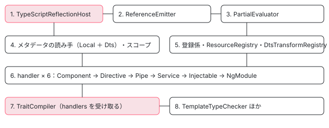

[目次](../README.md) › [ngtsc の内側](README.md) › 第 3 回 / 全 20 回

# NgCompiler とチケット：新しく作るか、前の結果から作るか

> CompilationTicket の 3 つの種類（Fresh・IncrementalTypeScript・IncrementalResource）と、それを作る 4 つの関数（freshCompilationTicket・incrementalFromCompilerTicket・incrementalFromStateTicket・resourceChangeTicket）、NgCompiler.fromTicket が new するか前のインスタンスを返すかを分ける行、遅れて作られる LazyCompilationState（ensureAnalyzed・analyzeSync・analyzeAsync）、makeCompilation が reflector・参照の書き手・評価器・メタデータの読み手・スコープ・6 つの handler・TraitCompiler を組み立てる順番と prepareEmit の変換の並び。resource-only の道が出力のテンプレートを新しくしないこと。

angular/angular · 読了 約 13 分 · 中核 · [サイトで読む（デモが動きます）](https://angular-deep-dive-cyan.vercel.app/chapter/ngtsc-compiler-ticket)

---

`NgCompiler` は Angular のコンパイルの本体です。でも `new NgCompiler(…)` とは書けません（コンストラクタは private）。必ず「チケット」（`CompilationTicket`）を作って `NgCompiler.fromTicket` に渡します。この章では、チケットの作り方 4 つと種類 3 つ、`fromTicket` が「新しく作る」「前の結果を引き継いで作る」「前のインスタンスをそのまま使う」を選ぶ行、そして最初に結果を求められたときにだけ部品を組み立てる `makeCompilation` の順番を追います。

読む対象は `packages/compiler-cli/src/ngtsc/core/src/compiler.ts` の 133〜1727 行目のうち、チケット・コンストラクタ・解析の入口・`prepareEmit`・`makeCompilation` です。

1. [1. 全体像](01-ngtsc-overview.md)
2. [2. NgtscProgram](02-ngtsc-program.md)
3. **3. NgCompiler とチケット**（この章）
4. [4. リフレクション](04-ngtsc-reflection.md)
5. [5. 静的な評価](05-ngtsc-partial-evaluator.md)
6. [6. 参照と import](06-ngtsc-references-imports.md)
7. [7. 解析](07-ngtsc-trait-analyze.md)
8. [8. 解決と出力](08-ngtsc-trait-resolve-compile.md)
9. [9. @Directive の handler](09-ngtsc-directive-handler.md)
10. [10. メタデータの登録](10-ngtsc-metadata-registry.md)
11. [11. .d.ts を読む](11-ngtsc-dts-metadata.md)
12. [12. JS の書き換え](12-ngtsc-ivy-transform.md)
13. [13. .d.ts の書き換え](13-ngtsc-dts-transform.md)
14. [14. 差分ビルド](14-ngtsc-incremental.md)
15. [15. 意味のグラフ](15-ngtsc-semantic-graph.md)
16. [16. import の循環](16-ngtsc-cycles.md)
17. [17. HMR](17-ngtsc-hmr.md)
18. [18. 診断と性能](18-ngtsc-diagnostics-perf.md)
19. [19. テストを書く](19-ngtsc-test-env.md)
20. [20. issue と PR を読む](20-ngtsc-issues.md)

## 1. チケットは 3 種類、作り方は 4 つ

📄 `angular/packages/compiler-cli/src/ngtsc/core/src/compiler.ts` L162–183 （▶ の行: 165–168, 175, 181–182）

```ts
162 │ /**
163 │  * Discriminant type for a `CompilationTicket`.
164 │  */
165 ▶ export enum CompilationTicketKind {
166 ▶   Fresh,
167 ▶   IncrementalTypeScript,
168 ▶   IncrementalResource,
169 │ }
170 │ 
171 │ /**
172 │  * Begin an Angular compilation operation from scratch.
173 │  */
174 │ export interface FreshCompilationTicket {
175 ▶   kind: CompilationTicketKind.Fresh;
176 │   options: NgCompilerOptions;
177 │   incrementalBuildStrategy: IncrementalBuildStrategy;
178 │   programDriver: ProgramDriver;
179 │   enableTemplateTypeChecker: boolean;
180 │   usePoisonedData: boolean;
181 ▶   tsProgram: ts.Program;
182 ▶   perfRecorder: ActivePerfRecorder;
183 │ }
```

📄 `angular/packages/compiler-cli/src/ngtsc/core/src/compiler.ts` L185–217 （▶ の行: 189, 191, 193, 201–203, 214）

```ts
185 │ /**
186 │  * Begin an Angular compilation operation that incorporates changes to TypeScript code.
187 │  */
188 │ export interface IncrementalTypeScriptCompilationTicket {
189 ▶   kind: CompilationTicketKind.IncrementalTypeScript;
190 │   options: NgCompilerOptions;
191 ▶   newProgram: ts.Program;
192 │   incrementalBuildStrategy: IncrementalBuildStrategy;
193 ▶   incrementalCompilation: IncrementalCompilation;
194 │   programDriver: ProgramDriver;
195 │   enableTemplateTypeChecker: boolean;
196 │   usePoisonedData: boolean;
197 │   perfRecorder: ActivePerfRecorder;
198 │ }
199 │ 
200 │ export interface IncrementalResourceCompilationTicket {
201 ▶   kind: CompilationTicketKind.IncrementalResource;
202 ▶   compiler: NgCompiler;
203 ▶   modifiedResourceFiles: Set<string>;
204 │   perfRecorder: ActivePerfRecorder;
205 │ }
206 │ 
207 │ /**
208 │  * A request to begin Angular compilation, either starting from scratch or from a known prior state.
209 │  *
210 │  * `CompilationTicket`s are used to initialize (or update) an `NgCompiler` instance, the core of the
211 │  * Angular compiler. They abstract the starting state of compilation and allow `NgCompiler` to be
212 │  * managed independently of any incremental compilation lifecycle.
213 │  */
214 ▶ export type CompilationTicket =
215 │   | FreshCompilationTicket
216 │   | IncrementalTypeScriptCompilationTicket
217 │   | IncrementalResourceCompilationTicket;
```

165〜169 行目、種類（`kind`）は `Fresh`・`IncrementalTypeScript`・`IncrementalResource` の 3 つです。比喩を 1 つだけ使うと、チケットは「どこから始めるかを書いた整理券」で、`NgCompiler` を作る人はその券を見て作り方を決めます。実物は、ただのオブジェクトです。

- **Fresh**（174〜183 行目）：`ts.Program`（181 行目）と設定だけ。前回のものは何も持ちません。
- **IncrementalTypeScript**（188〜198 行目）：新しいプログラム（191 行目）と、前回からの差分を計算済みの `IncrementalCompilation`（193 行目）を持ちます。
- **IncrementalResource**（200〜205 行目）：**前回の `NgCompiler` そのもの**（202 行目）と、変わったリソースのファイル名（203 行目）だけを持ちます。

このチケットを作る関数が 4 つあります。

📄 `angular/packages/compiler-cli/src/ngtsc/core/src/compiler.ts` L219–241 （▶ の行: 222, 232, 239）

```ts
219 │ /**
220 │  * Create a `CompilationTicket` for a brand new compilation, using no prior state.
221 │  */
222 ▶ export function freshCompilationTicket(
223 │   tsProgram: ts.Program,
224 │   options: NgCompilerOptions,
225 │   incrementalBuildStrategy: IncrementalBuildStrategy,
226 │   programDriver: ProgramDriver,
227 │   perfRecorder: ActivePerfRecorder | null,
228 │   enableTemplateTypeChecker: boolean,
229 │   usePoisonedData: boolean,
230 │ ): CompilationTicket {
231 │   return {
232 ▶     kind: CompilationTicketKind.Fresh,
233 │     tsProgram,
234 │     options,
235 │     incrementalBuildStrategy,
236 │     programDriver,
237 │     enableTemplateTypeChecker,
238 │     usePoisonedData,
239 ▶     perfRecorder: perfRecorder ?? ActivePerfRecorder.zeroedToNow(),
240 │   };
241 │ }
```

`freshCompilationTicket` は引数を詰めるだけです。239 行目、記録係を渡されなければ「いま」を 0 とする新しい記録係を作ります。

📄 `angular/packages/compiler-cli/src/ngtsc/core/src/compiler.ts` L243–273 （▶ の行: 255–257, 260, 262, 266）

```ts
243 │ /**
244 │  * Create a `CompilationTicket` as efficiently as possible, based on a previous `NgCompiler`
245 │  * instance and a new `ts.Program`.
246 │  */
247 │ export function incrementalFromCompilerTicket(
248 │   oldCompiler: NgCompiler,
249 │   newProgram: ts.Program,
250 │   incrementalBuildStrategy: IncrementalBuildStrategy,
251 │   programDriver: ProgramDriver,
252 │   modifiedResourceFiles: Set<AbsoluteFsPath>,
253 │   perfRecorder: ActivePerfRecorder | null,
254 │ ): CompilationTicket {
255 ▶   const oldProgram = oldCompiler.getCurrentProgram();
256 ▶   const oldState = oldCompiler.incrementalStrategy.getIncrementalState(oldProgram);
257 ▶   if (oldState === null) {
258 │     // No incremental step is possible here, since no IncrementalState was found for the old
259 │     // program.
260 ▶     return freshCompilationTicket(
261 │       newProgram,
262 ▶       oldCompiler.options,
263 │       incrementalBuildStrategy,
264 │       programDriver,
265 │       perfRecorder,
266 ▶       oldCompiler.enableTemplateTypeChecker,
267 │       oldCompiler.usePoisonedData,
268 │     );
269 │   }
270 │ 
271 │   if (perfRecorder === null) {
272 │     perfRecorder = ActivePerfRecorder.zeroedToNow();
273 │   }
```

📄 `angular/packages/compiler-cli/src/ngtsc/core/src/compiler.ts` L274–295 （▶ の行: 275, 277–280, 285, 288）

```ts
274 │ 
275 ▶   const incrementalCompilation = IncrementalCompilation.incremental(
276 │     newProgram,
277 ▶     versionMapFromProgram(newProgram, programDriver),
278 ▶     oldProgram,
279 ▶     oldState,
280 ▶     modifiedResourceFiles,
281 │     perfRecorder,
282 │   );
283 │ 
284 │   return {
285 ▶     kind: CompilationTicketKind.IncrementalTypeScript,
286 │     enableTemplateTypeChecker: oldCompiler.enableTemplateTypeChecker,
287 │     usePoisonedData: oldCompiler.usePoisonedData,
288 ▶     options: oldCompiler.options,
289 │     incrementalBuildStrategy,
290 │     incrementalCompilation,
291 │     programDriver,
292 │     newProgram,
293 │     perfRecorder,
294 │   };
295 │ }
```

1. **255〜256 行目：前回の「いまのプログラム」と、それに結び付いた記録を取り出す**

   `getCurrentProgram()` は型チェックで作り直したあとのプログラムです（[第 2 回](02-ngtsc-program.md)の 6 節）。記録は前回の `incrementalStrategy` から引きます。
2. **257〜269 行目：記録が無ければ、黙って Fresh に落とす**

   名前は「incremental」でも、返るのは Fresh のチケットです。そのとき設定は前回の `NgCompiler` のもの（262 行目）を使い回します。
3. **275〜282 行目：差分を計算する**

   `IncrementalCompilation.incremental` に、新旧のプログラムと記録と変わったリソースを渡し、「論理的に変わったファイル」の一覧を作ります。中身は [第 14 回](14-ngtsc-incremental.md)で読みます。**差分の計算はチケットを作るときに終わっている**ことに注意します。
4. **285〜294 行目：IncrementalTypeScript のチケット**

   288 行目、設定も前回の `NgCompiler` から引き継ぎます。新しい設定を渡す口はこの関数にはありません。

📄 `angular/packages/compiler-cli/src/ngtsc/core/src/compiler.ts` L297–323 （▶ の行: 301–303, 305, 316）

```ts
297 │ /**
298 │  * Create a `CompilationTicket` directly from an old `ts.Program` and associated Angular compilation
299 │  * state, along with a new `ts.Program`.
300 │  */
301 ▶ export function incrementalFromStateTicket(
302 ▶   oldProgram: ts.Program,
303 ▶   oldState: IncrementalState,
304 │   newProgram: ts.Program,
305 ▶   options: NgCompilerOptions,
306 │   incrementalBuildStrategy: IncrementalBuildStrategy,
307 │   programDriver: ProgramDriver,
308 │   modifiedResourceFiles: Set<AbsoluteFsPath>,
309 │   perfRecorder: ActivePerfRecorder | null,
310 │   enableTemplateTypeChecker: boolean,
311 │   usePoisonedData: boolean,
312 │ ): CompilationTicket {
313 │   if (perfRecorder === null) {
314 │     perfRecorder = ActivePerfRecorder.zeroedToNow();
315 │   }
316 ▶   const incrementalCompilation = IncrementalCompilation.incremental(
317 │     newProgram,
318 │     versionMapFromProgram(newProgram, programDriver),
319 │     oldProgram,
320 │     oldState,
321 │     modifiedResourceFiles,
322 │     perfRecorder,
323 │   );
```

`incrementalFromStateTicket` は、前回の `NgCompiler` を持っていない呼び出し側のための版です。前回のプログラム（302 行目）と記録（303 行目）を直接受け取り、設定も自分で渡します（305 行目）。使っているのは `NgTscPlugin` です（[第 2 回](02-ngtsc-program.md)の 8 節）。種類は IncrementalTypeScript なので、**作り方は 4 つでも種類は 3 つ**です。

📄 `angular/packages/compiler-cli/src/ngtsc/core/src/compiler.ts` L337–347 （▶ の行: 338–339, 342–343, 345）

```ts
337 │ export function resourceChangeTicket(
338 ▶   compiler: NgCompiler,
339 ▶   modifiedResourceFiles: Set<string>,
340 │ ): IncrementalResourceCompilationTicket {
341 │   return {
342 ▶     kind: CompilationTicketKind.IncrementalResource,
343 ▶     compiler,
344 │     modifiedResourceFiles,
345 ▶     perfRecorder: ActivePerfRecorder.zeroedToNow(),
346 │   };
347 │ }
```

`resourceChangeTicket` は前回の `NgCompiler` と変わったファイル名を包むだけで、差分の計算もしません。使っているのは言語サービスで、エディタで `.html` を書き換えたときにこれを作ります（[ls-compiler-factory の章](../ls/05-ls-compiler-factory.md)）。

| 関数 | できる kind | 前回から受け取るもの | 使う側 |
| --- | --- | --- | --- |
| `freshCompilationTicket` | Fresh | なし | `NgtscProgram`（前回なし）・`NgTscPlugin`・テスト |
| `incrementalFromCompilerTicket` | IncrementalTypeScript（記録が無ければ Fresh） | 前回の `NgCompiler` | `NgtscProgram`（前回あり）・言語サービス |
| `incrementalFromStateTicket` | IncrementalTypeScript | 前回の `ts.Program` と `IncrementalState` | `NgTscPlugin` |
| `resourceChangeTicket` | IncrementalResource | 前回の `NgCompiler` そのもの | 言語サービス |

## 2. NgCompiler.fromTicket：3 つの分かれ道

📄 `angular/packages/compiler-cli/src/ngtsc/core/src/compiler.ts` L410–451 （▶ の行: 419, 421, 427–428, 435, 441, 447–449）

```ts
410 │   /**
411 │    * Convert a `CompilationTicket` into an `NgCompiler` instance for the requested compilation.
412 │    *
413 │    * Depending on the nature of the compilation request, the `NgCompiler` instance may be reused
414 │    * from a previous compilation and updated with any changes, it may be a new instance which
415 │    * incrementally reuses state from a previous compilation, or it may represent a fresh
416 │    * compilation entirely.
417 │    */
418 │   static fromTicket(ticket: CompilationTicket, adapter: NgCompilerAdapter) {
419 ▶     switch (ticket.kind) {
420 │       case CompilationTicketKind.Fresh:
421 ▶         return new NgCompiler(
422 │           adapter,
423 │           ticket.options,
424 │           ticket.tsProgram,
425 │           ticket.programDriver,
426 │           ticket.incrementalBuildStrategy,
427 ▶           IncrementalCompilation.fresh(
428 ▶             versionMapFromProgram(ticket.tsProgram, ticket.programDriver),
429 │           ),
430 │           ticket.enableTemplateTypeChecker,
431 │           ticket.usePoisonedData,
432 │           ticket.perfRecorder,
433 │         );
434 │       case CompilationTicketKind.IncrementalTypeScript:
435 ▶         return new NgCompiler(
436 │           adapter,
437 │           ticket.options,
438 │           ticket.newProgram,
439 │           ticket.programDriver,
440 │           ticket.incrementalBuildStrategy,
441 ▶           ticket.incrementalCompilation,
442 │           ticket.enableTemplateTypeChecker,
443 │           ticket.usePoisonedData,
444 │           ticket.perfRecorder,
445 │         );
446 │       case CompilationTicketKind.IncrementalResource:
447 ▶         const compiler = ticket.compiler;
448 ▶         compiler.updateWithChangedResources(ticket.modifiedResourceFiles, ticket.perfRecorder);
449 ▶         return compiler;
450 │     }
451 │   }
```

1. **421〜433 行目：Fresh → new する**

   427〜429 行目で、ここで初めて `IncrementalCompilation.fresh`（差分の無い記録）を作り、各ファイルの版の表（`versionMapFromProgram`）を渡します。
2. **435〜445 行目：IncrementalTypeScript → new する**

   441 行目でチケットが持ってきた `incrementalCompilation` をそのまま渡します。**インスタンスは新しく作る**点が Fresh と同じです。前回のものは、記録を通して部分的に受け継ぐだけです。
3. **446〜449 行目：IncrementalResource → new しない**

   前回の `NgCompiler` の `updateWithChangedResources` を呼び、**同じインスタンスを返します**。

## 3. コンストラクタ：まだ何も解析しない

📄 `angular/packages/compiler-cli/src/ngtsc/core/src/compiler.ts` L453–463 （▶ の行: 453, 456, 459, 462）

```ts
453 ▶   private constructor(
454 │     private adapter: NgCompilerAdapter,
455 │     readonly options: NgCompilerOptions,
456 ▶     private inputProgram: ts.Program,
457 │     readonly programDriver: ProgramDriver,
458 │     readonly incrementalStrategy: IncrementalBuildStrategy,
459 ▶     readonly incrementalCompilation: IncrementalCompilation,
460 │     enableTemplateTypeChecker: boolean,
461 │     readonly usePoisonedData: boolean,
462 ▶     private livePerfRecorder: ActivePerfRecorder,
463 │   ) {
```

📄 `angular/packages/compiler-cli/src/ngtsc/core/src/compiler.ts` L486–516 （▶ の行: 486, 488–489, 492, 506, 512–513, 516）

```ts
486 ▶     this.constructionDiagnostics.push(
487 │       ...this.adapter.constructionDiagnostics,
488 ▶       ...verifyCompatibleTypeCheckOptions(this.options),
489 ▶       ...verifyEmitDeclarationOnly(this.options),
490 │     );
491 │ 
492 ▶     this.currentProgram = inputProgram;
493 │     this.closureCompilerEnabled = !!this.options.annotateForClosureCompiler;
494 │ 
495 │     this.entryPoint =
496 │       adapter.entryPoint !== null ? getSourceFileOrNull(inputProgram, adapter.entryPoint) : null;
497 │ 
498 │     const moduleResolutionCache = ts.createModuleResolutionCache(
499 │       this.adapter.getCurrentDirectory(),
500 │       // doen't retain a reference to `this`, if other closures in the constructor here reference
501 │       // `this` internally then a closure created here would retain them. This can cause major
502 │       // memory leak issues since the `moduleResolutionCache` is a long-lived object and finds its
503 │       // way into all kinds of places inside TS internal objects.
504 │       this.adapter.getCanonicalFileName.bind(this.adapter),
505 │     );
506 ▶     this.moduleResolver = new ModuleResolver(
507 │       inputProgram,
508 │       this.options,
509 │       this.adapter,
510 │       moduleResolutionCache,
511 │     );
512 ▶     this.resourceManager = new AdapterResourceLoader(adapter, this.options);
513 ▶     this.cycleAnalyzer = new CycleAnalyzer(
514 │       new ImportGraph(inputProgram.getTypeChecker(), this.delegatingPerfRecorder),
515 │     );
516 ▶     this.incrementalStrategy.setIncrementalState(this.incrementalCompilation.state, inputProgram);
```

📄 `angular/packages/compiler-cli/src/ngtsc/core/src/compiler.ts` L517–522 （▶ の行: 518–519, 521）

```ts
517 │ 
518 ▶     this.ignoreForDiagnostics = new Set(
519 ▶       inputProgram.getSourceFiles().filter((sf) => this.adapter.isShim(sf)),
520 │     );
521 ▶     this.ignoreForEmit = this.adapter.ignoreForEmit;
522 │ 
```

453 行目の `private constructor` が、チケットを通させる仕掛けです。コンストラクタがするのは、設定の確かめ（486〜490 行目。`constructionDiagnostics` は `getOptionDiagnostics()` でそのまま返す設定のエラー）、「いまのプログラム」の初期値（492 行目）、モジュールの解決係（506 行目）、リソースの読み込み係（512 行目）、循環の調べ係（513 行目）を作ることと、516 行目で**このプログラムに今回の記録を結び付ける**ことです。次のビルドの `incrementalFromCompilerTicket` の 256 行目は、ここで結び付けた記録を引きます。518〜520 行目で shim を診断の対象から外す集合を作ります（入力のファイル数を数える続きの行は [第 18 回](18-ngtsc-diagnostics-perf.md)）。**デコレーターを読む部品はまだ 1 つも無い**ことを覚えておきます。

## 4. LazyCompilationState：最初に求められたときだけ作る

📄 `angular/packages/compiler-cli/src/ngtsc/core/src/compiler.ts` L133–160 （▶ の行: 134–135, 137, 139–142, 147–148）

```ts
133 │ /**
134 ▶  * State information about a compilation which is only generated once some data is requested from
135 ▶  * the `NgCompiler` (for example, by calling `getDiagnostics`).
136 │  */
137 ▶ interface LazyCompilationState {
138 │   isCore: boolean;
139 ▶   traitCompiler: TraitCompiler;
140 ▶   reflector: TypeScriptReflectionHost;
141 ▶   metaReader: MetadataReader;
142 ▶   scopeRegistry: LocalModuleScopeRegistry;
143 │   typeCheckScopeRegistry: TypeCheckScopeRegistry;
144 │   exportReferenceGraph: ReferenceGraph | null;
145 │   dtsTransforms: DtsTransformRegistry;
146 │   aliasingHost: AliasingHost | null;
147 ▶   refEmitter: ReferenceEmitter;
148 ▶   templateTypeChecker: TemplateTypeChecker;
149 │   resourceRegistry: ResourceRegistry;
150 │   extendedTemplateChecker: ExtendedTemplateChecker | null;
151 │   templateSemanticsChecker: TemplateSemanticsChecker | null;
152 │   sourceFileValidator: SourceFileValidator | null;
153 │   jitDeclarationRegistry: JitDeclarationRegistry;
154 │   supportJitMode: boolean;
155 │ 
156 │   /**
157 │    * Only available in local compilation mode when option `generateExtraImportsInLocalMode` is set.
158 │    */
159 │   localCompilationExtraImportsTracker: LocalCompilationExtraImportsTracker | null;
160 │ }
```

134〜135 行目のコメントのとおり、`getDiagnostics` などで結果を求められて初めて作られる状態の型です。`TraitCompiler`（139 行目）・リフレクション（140 行目）・メタデータの読み手（141 行目）・スコープ（142 行目）・参照の書き手（147 行目）・テンプレートの型チェッカー（148 行目）が、ここにまとめて入ります。`NgCompiler` の `compilation` フィールドは最初 `null` で、次の 3 つの関数が埋めます。

📄 `angular/packages/compiler-cli/src/ngtsc/core/src/compiler.ts` L1024–1057 （▶ の行: 1025–1026, 1032–1034, 1038, 1043, 1049, 1053）

```ts
1024 │   private ensureAnalyzed(this: NgCompiler): LazyCompilationState {
1025 ▶     if (this.compilation === null) {
1026 ▶       this.analyzeSync();
1027 │     }
1028 │     return this.compilation!;
1029 │   }
1030 │ 
1031 │   private analyzeSync(): void {
1032 ▶     this.perfRecorder.inPhase(PerfPhase.Analysis, () => {
1033 ▶       this.compilation = this.makeCompilation();
1034 ▶       for (const sf of this.inputProgram.getSourceFiles()) {
1035 │         if (sf.isDeclarationFile) {
1036 │           continue;
1037 │         }
1038 ▶         this.compilation.traitCompiler.analyzeSync(sf);
1039 │       }
1040 │ 
1041 │       this.perfRecorder.memory(PerfCheckpoint.Analysis);
1042 │ 
1043 ▶       this.resolveCompilation(this.compilation.traitCompiler);
1044 │     });
1045 │   }
1046 │ 
1047 │   private resolveCompilation(traitCompiler: TraitCompiler): void {
1048 │     this.perfRecorder.inPhase(PerfPhase.Resolve, () => {
1049 ▶       traitCompiler.resolve();
1050 │ 
1051 │       // At this point, analysis is complete and the compiler can now calculate which files need to
1052 │       // be emitted, so do that.
1053 ▶       this.incrementalCompilation.recordSuccessfulAnalysis(traitCompiler);
1054 │ 
1055 │       this.perfRecorder.memory(PerfCheckpoint.Resolve);
1056 │     });
1057 │   }
```

1. **1025〜1026 行目：`ensureAnalyzed`**

   まだなら `analyzeSync` を呼ぶだけです。`getDiagnostics`・`prepareEmit`・`getComponentsWithTemplateFile` など、結果を返す関数の多くが最初にこれを呼びます。
2. **1033 行目：`makeCompilation()` で部品を全部作る**

   中身は 6 節。
3. **1034〜1039 行目：.d.ts でないファイルを 1 つずつ `traitCompiler.analyzeSync(sf)`**

   ファイルの中のデコレーター付きのクラスを handler に配って analyze します（[第 7 回](07-ngtsc-trait-analyze.md)）。
4. **1043 行目 → 1049 行目：`resolve()`**

   全部のファイルの analyze が済んでから、まとめて resolve します（スコープなど、全体を見ないと決まらない情報）。
5. **1053 行目：解析が成功したと記録する**

   ここで記録が「解析済み」になり、次のビルドで使えるようになります。emit を飛ばせるかの判断もここで計算されます（[第 14 回](14-ngtsc-incremental.md)）。

📄 `angular/packages/compiler-cli/src/ngtsc/core/src/compiler.ts` L777–811 （▶ の行: 781, 783–784, 787, 792, 800, 806, 809）

```ts
777 │   /**
778 │    * Perform Angular's analysis step (as a precursor to `getDiagnostics` or `prepareEmit`)
779 │    * asynchronously.
780 │    *
781 ▶    * Normally, this operation happens lazily whenever `getDiagnostics` or `prepareEmit` are called.
782 │    * However, certain consumers may wish to allow for an asynchronous phase of analysis, where
783 ▶    * resources such as `styleUrls` are resolved asynchronously. In these cases `analyzeAsync` must
784 ▶    * be called first, and its `Promise` awaited prior to calling any other APIs of `NgCompiler`.
785 │    */
786 │   async analyzeAsync(): Promise<void> {
787 ▶     if (this.compilation !== null) {
788 │       return;
789 │     }
790 │ 
791 │     await this.perfRecorder.inPhase(PerfPhase.Analysis, async () => {
792 ▶       this.compilation = this.makeCompilation();
793 │ 
794 │       const promises: Promise<void>[] = [];
795 │       for (const sf of this.inputProgram.getSourceFiles()) {
796 │         if (sf.isDeclarationFile) {
797 │           continue;
798 │         }
799 │ 
800 ▶         let analysisPromise = this.compilation.traitCompiler.analyzeAsync(sf);
801 │         if (analysisPromise !== undefined) {
802 │           promises.push(analysisPromise);
803 │         }
804 │       }
805 │ 
806 ▶       await Promise.all(promises);
807 │ 
808 │       this.perfRecorder.memory(PerfCheckpoint.Analysis);
809 ▶       this.resolveCompilation(this.compilation.traitCompiler);
810 │     });
811 │   }
```

`analyzeAsync` は同じことを非同期でします。違いは 800 行目の `analyzeAsync(sf)` が `Promise` を返すことがあり、806 行目で全部を待ってから resolve する点だけです。783〜784 行目のコメントのとおり、`styleUrls` の Sass のように**リソースを非同期でしか読めない呼び出し側は、ほかの API の前にこれを呼んで待つ**決まりです。`NgtscProgram.loadNgStructureAsync()` もこれを呼ぶだけで、CLI（`@angular/build` の `AotCompilation`）は `angularProgram.compiler.analyzeAsync()` を直接待ちます。

## 5. prepareEmit：TypeScript に渡す変換の並び

📄 `angular/packages/compiler-cli/src/ngtsc/core/src/compiler.ts` L817–835 （▶ の行: 820, 824, 826, 829, 831, 834）

```ts
817 │   prepareEmit(): {
818 │     transformers: ts.CustomTransformers;
819 │   } {
820 ▶     const compilation = this.ensureAnalyzed();
821 │ 
822 │     // Untag all the files, otherwise TS 5.4 may end up emitting
823 │     // references to typecheck files (see #56945 and #57135).
824 ▶     untagAllTsFiles(this.inputProgram);
825 │ 
826 ▶     const coreImportsFrom = compilation.isCore ? getR3SymbolsFile(this.inputProgram) : null;
827 │     let importRewriter: ImportRewriter;
828 │     if (coreImportsFrom !== null) {
829 ▶       importRewriter = new R3SymbolsImportRewriter(coreImportsFrom.fileName);
830 │     } else {
831 ▶       importRewriter = new NoopImportRewriter();
832 │     }
833 │ 
834 ▶     const defaultImportTracker = new DefaultImportTracker();
835 │ 
```

1. **820 行目：解析がまだなら、ここで走る**

   ngc では診断を先に集めるので、ここに来るころには済んでいます。
2. **824 行目：shim への参照を元に戻す**

   [第 2 回](02-ngtsc-program.md)の 4 節の戻しです。822〜823 行目のコメントのとおり、TS 5.4 で型チェックのファイルへの参照が出力に出た不具合（#56945・#57135）への手当てです。
3. **826〜832 行目：`@angular/core` 自身のビルドなら import を書き換える係を入れる**

   ふつうのアプリでは何もしない `NoopImportRewriter` です。

このあとの `before` の配列は、`ivyTransformFactory`（デコレーターを消して `ɵcmp` などを足す）→ `aliasTransformFactory` → `importPreservingTransformer` の順です（引用は [compiler-reify-emit の章](../compiler/16-compiler-reify-emit.md)）。JIT のままにする宣言があれば、その変換をファイルを絞って足します。

📄 `angular/packages/compiler-cli/src/ngtsc/core/src/compiler.ts` L886–920 （▶ の行: 888, 890, 895, 901–902, 905, 915–916, 919）

```ts
886 │ 
887 │     // Typescript transformer to add debugName metadata to signal functions.
888 ▶     before.push(signalMetadataTransform(this.inputProgram));
889 │ 
890 ▶     const afterDeclarations: ts.TransformerFactory<ts.SourceFile>[] = [];
891 │ 
892 │     // In local compilation mode we don't make use of .d.ts files for Angular compilation, so their
893 │     // transformation can be ditched.
894 │     if (
895 ▶       (this.options.compilationMode !== 'experimental-local' || this.emitDeclarationOnly) &&
896 │       compilation.dtsTransforms !== null
897 │     ) {
898 │       // If we are emitting declarations only, the script transformations are skipped by the TS
899 │       // compiler, so we have to add them to the afterDeclarations transforms to run their analysis
900 │       // because the declaration transform depends on their metadata output.
901 ▶       if (this.emitDeclarationOnly) {
902 ▶         afterDeclarations.push(...before);
903 │       }
904 │       afterDeclarations.push(
905 ▶         declarationTransformFactory(
906 │           compilation.dtsTransforms,
907 │           compilation.reflector,
908 │           compilation.refEmitter,
909 │           importRewriter,
910 │         ),
911 │       );
912 │     }
913 │ 
914 │     // Only add aliasing re-exports to the .d.ts output if the `AliasingHost` requests it.
915 ▶     if (compilation.aliasingHost !== null && compilation.aliasingHost.aliasExportsInDts) {
916 ▶       afterDeclarations.push(aliasTransformFactory(compilation.traitCompiler.exportStatements));
917 │     }
918 │ 
919 ▶     return {transformers: {before, afterDeclarations} as ts.CustomTransformers};
920 │   }
```

888 行目で signal の関数に `debugName` を足す変換（[signals-debug の章](../signals/18-signals-debug.md)）を最後に足します。`afterDeclarations`（.d.ts を書く前の変換）は、905 行目の `declarationTransformFactory`（[第 13 回](13-ngtsc-dts-transform.md)）が中心で、895 行目のとおりローカルコンパイルでは .d.ts の変換を省きます。901〜903 行目、.d.ts だけを出す設定では TypeScript が JS の変換を飛ばすので、`before` を丸ごと `afterDeclarations` にも積みます。919 行目でこの 2 つの配列を返し、`NgtscProgram.emit` がそれを TypeScript に渡します（[第 2 回](02-ngtsc-program.md)の 7 節）。

## 6. makeCompilation：部品を組み立てる順番

📄 `angular/packages/compiler-cli/src/ngtsc/core/src/compiler.ts` L1326–1359 （▶ の行: 1326, 1328, 1330, 1337–1338, 1348, 1351, 1357）

```ts
1326 ▶     const checker = this.inputProgram.getTypeChecker();
1327 │ 
1328 ▶     const reflector = new TypeScriptReflectionHost(
1329 │       checker,
1330 ▶       compilationMode === CompilationMode.LOCAL,
1331 │     );
1332 │ 
1333 │     // Construct the ReferenceEmitter.
1334 │     let refEmitter: ReferenceEmitter;
1335 │     let aliasingHost: AliasingHost | null = null;
1336 │     if (
1337 ▶       this.adapter.unifiedModulesHost === null ||
1338 ▶       (!this.options['_useHostForImportGeneration'] &&
1339 │         !this.options['_useHostForImportAndAliasGeneration'])
1340 │     ) {
1341 │       let localImportStrategy: ReferenceEmitStrategy;
1342 │ 
1343 │       // The strategy used for local, in-project imports depends on whether TS has been configured
1344 │       // with rootDirs. If so, then multiple directories may be mapped in the same "module
1345 │       // namespace" and the logic of `LogicalProjectStrategy` is required to generate correct
1346 │       // imports which may cross these multiple directories. Otherwise, plain relative imports are
1347 │       // sufficient.
1348 ▶       if (this.options.rootDirs !== undefined && this.options.rootDirs.length > 0) {
1349 │         // rootDirs logic is in effect - use the `LogicalProjectStrategy` for in-project relative
1350 │         // imports.
1351 ▶         localImportStrategy = new LogicalProjectStrategy(
1352 │           reflector,
1353 │           new LogicalFileSystem([...this.adapter.rootDirs], this.adapter),
1354 │         );
1355 │       } else {
1356 │         // Plain relative imports are all that's needed.
1357 ▶         localImportStrategy = new RelativePathStrategy(reflector);
1358 │       }
1359 │ 
```

コンパイルの方式（full・partial・local）を決める直前の行は [standalone-local-compilation の章](../standalone/06-standalone-local-compilation.md)が読んでいます。1326 行目で TypeScript の型チェッカーを取り、1328 行目で**最初の部品 `TypeScriptReflectionHost`** を作ります（[第 4 回](04-ngtsc-reflection.md)）。1330 行目、ローカルコンパイルかどうかを渡します。あとの部品は、ほぼすべてがこの `reflector` を受け取ります。1337〜1339 行目は、ホストが「ファイル名 → モジュール名」の変換（`fileNameToModuleName`）を持つかどうかで、import の書き方の方針を分けます。ふつうは持たないので、1348〜1357 行目の分かれ道に入ります。

📄 `angular/packages/compiler-cli/src/ngtsc/core/src/compiler.ts` L1360–1396 （▶ の行: 1362, 1364, 1366, 1370, 1376, 1379, 1383, 1389）

```ts
1360 │       // The CompilerHost doesn't have fileNameToModuleName, so build an NPM-centric reference
1361 │       // resolution strategy.
1362 ▶       refEmitter = new ReferenceEmitter([
1363 │         // First, try to use local identifiers if available.
1364 ▶         new LocalIdentifierStrategy(),
1365 │         // Next, attempt to use an absolute import.
1366 ▶         new AbsoluteModuleStrategy(this.inputProgram, checker, this.moduleResolver, reflector),
1367 │         // Finally, check if the reference is being written into a file within the project's .ts
1368 │         // sources, and use a relative import if so. If this fails, ReferenceEmitter will throw
1369 │         // an error.
1370 ▶         localImportStrategy,
1371 │       ]);
1372 │ 
1373 │       // If an entrypoint is present, then all user imports should be directed through the
1374 │       // entrypoint and private exports are not needed. The compiler will validate that all
1375 │       // publicly visible directives/pipes are importable via this entrypoint.
1376 ▶       if (this.entryPoint === null && this.options.generateDeepReexports === true) {
1377 │         // No entrypoint is present and deep re-exports were requested, so configure the aliasing
1378 │         // system to generate them.
1379 ▶         aliasingHost = new PrivateExportAliasingHost(reflector);
1380 │       }
1381 │     } else {
1382 │       // The CompilerHost supports fileNameToModuleName, so use that to emit imports.
1383 ▶       refEmitter = new ReferenceEmitter([
1384 │         // First, try to use local identifiers if available.
1385 │         new LocalIdentifierStrategy(),
1386 │         // Then use aliased references (this is a workaround to StrictDeps checks).
1387 │         ...(this.options['_useHostForImportAndAliasGeneration'] ? [new AliasStrategy()] : []),
1388 │         // Then use fileNameToModuleName to emit imports.
1389 ▶         new UnifiedModulesStrategy(reflector, this.adapter.unifiedModulesHost),
1390 │       ]);
1391 │ 
1392 │       if (this.options['_useHostForImportAndAliasGeneration']) {
1393 │         aliasingHost = new UnifiedModulesAliasingHost(this.adapter.unifiedModulesHost);
1394 │       }
1395 │     }
1396 │ 
```

2 番目の部品が `ReferenceEmitter`（クラスへの参照を、出力のファイルで使える式にする係）です。1362〜1371 行目、試す順番は「同じファイルの名前（1364）→ `@angular/core` のような絶対の import（1366）→ 相対パスの import（1370）」です（[第 6 回](06-ngtsc-references-imports.md)）。

📄 `angular/packages/compiler-cli/src/ngtsc/core/src/compiler.ts` L1397–1414 （▶ の行: 1397, 1400, 1402–1403, 1405–1406, 1408）

```ts
1397 ▶     const evaluator = new PartialEvaluator(
1398 │       reflector,
1399 │       checker,
1400 ▶       this.incrementalCompilation.depGraph,
1401 │     );
1402 ▶     const dtsReader = new DtsMetadataReader(checker, reflector);
1403 ▶     const localMetaRegistry = new LocalMetadataRegistry();
1404 │     const localMetaReader: MetadataReaderWithIndex = localMetaRegistry;
1405 ▶     const depScopeReader = new MetadataDtsModuleScopeResolver(dtsReader, aliasingHost);
1406 ▶     const metaReader = new CompoundMetadataReader([localMetaReader, dtsReader]);
1407 │     const ngModuleIndex = new NgModuleIndexImpl(metaReader, localMetaReader);
1408 ▶     const ngModuleScopeRegistry = new LocalModuleScopeRegistry(
1409 │       localMetaReader,
1410 │       metaReader,
1411 │       depScopeReader,
1412 │       refEmitter,
1413 │       aliasingHost,
1414 │     );
```

3 番目が `PartialEvaluator`（デコレーターの引数を動かさずに読む係、[第 5 回](05-ngtsc-partial-evaluator.md)）。1400 行目、ファイルの依存の表を渡すので、評価の途中で別のファイルの const を読むと「このファイルはあのファイルに依存する」と記録されます。1402 行目の `DtsMetadataReader`（.d.ts から読む、[第 11 回](11-ngtsc-dts-metadata.md)）と 1403 行目の `LocalMetadataRegistry`（このコンパイルで登録する、[第 10 回](10-ngtsc-metadata-registry.md)）を、1406 行目でこの順に重ねます。1408 行目から NgModule と standalone のスコープの係です（[ngmodule-compilation-scope の章](../ngmodule/04-ngmodule-compilation-scope.md)）。

📄 `angular/packages/compiler-cli/src/ngtsc/core/src/compiler.ts` L1426–1458 （▶ の行: 1427–1428, 1433, 1444, 1446, 1448, 1451, 1453, 1455）

```ts
1426 │     const semanticDepGraphUpdater = this.incrementalCompilation.semanticDepGraphUpdater;
1427 ▶     const metaRegistry = new CompoundMetadataRegistry([localMetaRegistry, ngModuleScopeRegistry]);
1428 ▶     const injectableRegistry = new InjectableClassRegistry(reflector, isCore);
1429 │     const hostDirectivesResolver = new HostDirectivesResolver(metaReader);
1430 │     const exportedProviderStatusResolver = new ExportedProviderStatusResolver(metaReader);
1431 │     const importTracker = new ImportedSymbolsTracker();
1432 │ 
1433 ▶     const typeCheckScopeRegistry = new TypeCheckScopeRegistry(
1434 │       scopeReader,
1435 │       metaReader,
1436 │       hostDirectivesResolver,
1437 │     );
1438 │ 
1439 │     // If a flat module entrypoint was specified, then track references via a `ReferenceGraph` in
1440 │     // order to produce proper diagnostics for incorrectly exported directives/pipes/etc. If there
1441 │     // is no flat module entrypoint then don't pay the cost of tracking references.
1442 │     let referencesRegistry: ReferencesRegistry;
1443 │     let exportReferenceGraph: ReferenceGraph | null = null;
1444 ▶     if (this.entryPoint !== null) {
1445 │       exportReferenceGraph = new ReferenceGraph();
1446 ▶       referencesRegistry = new ReferenceGraphAdapter(exportReferenceGraph);
1447 │     } else {
1448 ▶       referencesRegistry = new NoopReferencesRegistry();
1449 │     }
1450 │ 
1451 ▶     const dtsTransforms = new DtsTransformRegistry();
1452 │ 
1453 ▶     const resourceRegistry = new ResourceRegistry();
1454 │ 
1455 ▶     const deferredSymbolsTracker = new DeferredSymbolTracker(
1456 │       this.inputProgram.getTypeChecker(),
1457 │       this.options.onlyExplicitDeferDependencyImports ?? false,
1458 │     );
```

1427 行目で「登録する側」も 2 つ重ね（メタデータとスコープの両方に登録される）、1428 行目で `@Injectable` のクラスの登録係、1433 行目で型チェック用のスコープの係を作ります。1444〜1449 行目、flat module の入口があるときだけ、export の漏れを調べるための参照のグラフを作り、無ければ何もしない係で済ませます。1451 行目の `DtsTransformRegistry` は handler が .d.ts に足したい型を溜める場所、1453 行目の `ResourceRegistry` はどのコンポーネントがどのテンプレート・CSS を使うかの表です（7 節で使います）。

📄 `angular/packages/compiler-cli/src/ngtsc/core/src/compiler.ts` L1586–1610 （▶ の行: 1586–1588, 1602, 1610）

```ts
1586 ▶       // Pipe handler must be before injectable handler in list so pipe factories are printed
1587 ▶       // before injectable factories (so injectable factories can delegate to them)
1588 ▶       new PipeDecoratorHandler(
1589 │         reflector,
1590 │         evaluator,
1591 │         metaRegistry,
1592 │         ngModuleScopeRegistry,
1593 │         injectableRegistry,
1594 │         isCore,
1595 │         this.delegatingPerfRecorder,
1596 │         supportTestBed,
1597 │         compilationMode,
1598 │         !!this.options.generateExtraImportsInLocalMode,
1599 │         !!this.options.strictStandalone,
1600 │         this.implicitStandaloneValue,
1601 │       ),
1602 ▶       new ServiceDecoratorHandler(
1603 │         reflector,
1604 │         evaluator,
1605 │         isCore,
1606 │         this.delegatingPerfRecorder,
1607 │         supportTestBed,
1608 │         compilationMode,
1609 │       ),
1610 ▶       new InjectableDecoratorHandler(
```

handler の配列は Component → Directive → Pipe（1588 行目）→ Service（1602 行目）→ Injectable（1610 行目）→ NgModule の順です（Component の引数の並びは [compiler-entry の章](../compiler/02-compiler-entry.md)）。1586〜1587 行目のコメントのとおり、**Pipe を Injectable より前に置く**のは、出力の factory を Pipe の分が先に並ぶようにするためです（Injectable の factory が Pipe の factory に任せられるように）。1 つのクラスに複数のデコレーターがあるときにどの handler が勝つかは、配列の順ではなく各 handler の `precedence`（`HandlerPrecedence`）で決まります（[第 7 回](07-ngtsc-trait-analyze.md)）。

📄 `angular/packages/compiler-cli/src/ngtsc/core/src/compiler.ts` L1640–1657 （▶ の行: 1642, 1644–1646, 1648, 1651）

```ts
1640 │         this.emitDeclarationOnly,
1641 │       ),
1642 ▶     ];
1643 │ 
1644 ▶     const traitCompiler = new TraitCompiler(
1645 ▶       handlers,
1646 ▶       reflector,
1647 │       this.delegatingPerfRecorder,
1648 ▶       this.incrementalCompilation,
1649 │       this.options.compileNonExportedClasses !== false,
1650 │       compilationMode,
1651 ▶       dtsTransforms,
1652 │       semanticDepGraphUpdater,
1653 │       this.adapter,
1654 │       this.emitDeclarationOnly,
1655 │       !!this.options['_experimentalEmitIntermediateTs'],
1656 │     );
1657 │ 
```

1644 行目、handler の配列（1645）とリフレクション（1646）と差分の記録（1648）と .d.ts の変換の溜め場（1651）を `TraitCompiler` に渡します。このあと型チェッカーを作り、「型チェックで新しいプログラムができたら、それをいまのプログラムにする」通知の配線をします（引用は [typecheck-program-driver の章](../typecheck/04-typecheck-program-driver.md)）。

📄 `angular/packages/compiler-cli/src/ngtsc/core/src/compiler.ts` L1701–1727 （▶ の行: 1703–1704, 1707, 1709–1710, 1718）

```ts
1701 │ 
1702 │     const sourceFileValidator =
1703 ▶       this.constructionDiagnostics.length === 0
1704 ▶         ? new SourceFileValidator(reflector, importTracker, templateTypeChecker, typeCheckingConfig)
1705 │         : null;
1706 │ 
1707 ▶     return {
1708 │       isCore,
1709 ▶       traitCompiler,
1710 ▶       reflector,
1711 │       scopeRegistry: ngModuleScopeRegistry,
1712 │       dtsTransforms,
1713 │       exportReferenceGraph,
1714 │       metaReader,
1715 │       typeCheckScopeRegistry,
1716 │       aliasingHost,
1717 │       refEmitter,
1718 ▶       templateTypeChecker,
1719 │       resourceRegistry,
1720 │       extendedTemplateChecker,
1721 │       localCompilationExtraImportsTracker,
1722 │       jitDeclarationRegistry,
1723 │       templateSemanticsChecker,
1724 │       sourceFileValidator,
1725 │       supportJitMode,
1726 │     };
1727 │   }
```

最後に、ファイル単位の検査の係（1704 行目、設定のエラーが無いときだけ）を作り、1707〜1726 行目で 4 節の `LazyCompilationState` の形にまとめて返します。



*makeCompilation が作る順番。矢印は「受け取る」*

## 7. リソースだけが変わったとき：updateWithChangedResources

📄 `angular/packages/compiler-cli/src/ngtsc/core/src/compiler.ts` L541–577 （▶ の行: 545–546, 548–549, 555, 559, 563, 569, 574）

```ts
541 │   private updateWithChangedResources(
542 │     changedResources: Set<string>,
543 │     perfRecorder: ActivePerfRecorder,
544 │   ): void {
545 ▶     this.livePerfRecorder = perfRecorder;
546 ▶     this.delegatingPerfRecorder.target = perfRecorder;
547 │ 
548 ▶     perfRecorder.inPhase(PerfPhase.ResourceUpdate, () => {
549 ▶       if (this.compilation === null) {
550 │         // Analysis hasn't happened yet, so no update is necessary - any changes to resources will
551 │         // be captured by the initial analysis pass itself.
552 │         return;
553 │       }
554 │ 
555 ▶       this.resourceManager.invalidate();
556 │ 
557 │       const classesToUpdate = new Set<DeclarationNode>();
558 │       for (const resourceFile of changedResources) {
559 ▶         for (const templateClass of this.getComponentsWithTemplateFile(resourceFile)) {
560 │           classesToUpdate.add(templateClass);
561 │         }
562 │ 
563 ▶         for (const styleClass of this.getComponentsWithStyleFile(resourceFile)) {
564 │           classesToUpdate.add(styleClass);
565 │         }
566 │       }
567 │ 
568 │       for (const clazz of classesToUpdate) {
569 ▶         this.compilation.traitCompiler.updateResources(clazz);
570 │         if (!ts.isClassDeclaration(clazz)) {
571 │           continue;
572 │         }
573 │ 
574 ▶         this.compilation.templateTypeChecker.invalidateClass(clazz);
575 │       }
576 │     });
577 │   }
```

1. **545〜546 行目：記録係を新しいものに差し替える**

   チケットが持ってきた記録係に替えます。インスタンスは同じでも、時間はこの回の分だけが積まれます。
2. **549〜553 行目：まだ解析していなければ何もしない**

   最初の解析が新しいリソースを読むので、足りるからです。
3. **555 行目：読み込み係のキャッシュを捨てる**
4. **557〜566 行目：そのファイルを使うコンポーネントを集める**

   6 節の `ResourceRegistry` を引きます（559・563 行目）。
5. **569 行目・574 行目：そのクラスだけ、handler にリソースを読み直させ、型チェックの結果を捨てる**

   ほかのクラスの解析も、TypeScript のプログラムも、そのままです。

569 行目の先、`ComponentDecoratorHandler.updateResources` の頭はこうなっています。

📄 `angular/packages/compiler-cli/src/ngtsc/annotations/component/src/handler.ts` L1541–1547 （▶ の行: 1546–1547）

```ts
1541 │   updateResources(node: ClassDeclaration, analysis: ComponentAnalysisData): void {
1542 │     const containingFile = node.getSourceFile().fileName;
1543 │ 
1544 │     // If the template is external, re-parse it.
1545 │     const templateDecl = analysis.template.declaration;
1546 ▶     if (!templateDecl.isInline) {
1547 ▶       analysis.template = extractTemplate(
```

📄 `angular/packages/compiler-cli/src/ngtsc/annotations/component/src/handler.ts` L1028–1034 （▶ の行: 1028, 1030）

```ts
1028 ▶         meta: {
1029 │           ...metadata,
1030 ▶           template,
1031 │           encapsulation,
1032 │           changeDetection,
1033 │           styles,
1034 │           externalStyles,
```

📄 `angular/packages/compiler-cli/src/ngtsc/annotations/component/src/handler.ts` L1601–1606 （▶ の行: 1602–1603）

```ts
1601 │     const meta: R3ComponentMetadata<R3TemplateDependency> = {
1602 ▶       ...analysis.meta,
1603 ▶       ...resolution,
1604 │       defer,
1605 │       foreignImports,
1606 │     };
```

1547 行目で読み直したテンプレートを入れるのは `analysis.template` です。一方、出力を作る `compileFull` が `@angular/compiler` に渡すのは 1602 行目の `analysis.meta` で、その `template` は最初の analyze のとき 1030 行目で入れたものです。**このため、resource-only の道は型チェックと診断を新しくするが、emit の出力のテンプレートは新しくならない**ことが、行から読めます。デモの (3) で、記録でも確かめます。これを使う言語サービスは emit しないので、この道はそれで足ります。ngc と CLI は .html が変わっても `NgtscProgram` を作り直し、`incrementalFromCompilerTicket` に変わったリソースを渡す道（[第 2 回](02-ngtsc-program.md)の 5 節）を使います。

## 8. DEMO：同じプロジェクトを 3 回コンパイルする

> **🧪 DEMO — fresh・.ts の変更・.html だけの変更（記録の再生）**
>
> これは記録です。@angular/compiler-cli 22.1.6 を Node で動かした結果です（@angular/compiler-cli 22.1.6 / TypeScript 6.0.3）。プロジェクトは `app.component.ts`（`templateUrl: './app.component.html'`、`ShoutPipe` を import、`Greeter` を inject）・`shout.pipe.ts`・`greeter.service.ts` の 3 つです。(1) は `new NgtscProgram`、(2) は前回を渡した `new NgtscProgram`、(3) は `NgCompiler.fromTicket(resourceChangeTicket(…))` です。`ticket.kind` は、同じ引数で記録のスクリプトが作り直したチケットのものです。「論理的に変わったファイル」は `IncrementalCompilation` の private な `step` を JS から読みました。時間は `perfRecorder.finalize()` の段ごとの時間です。
>
> 「次のコンパイルへ」を押すと、1 回ずつ列が増えます。
>
> ▶ [このデモはサイトで動かせます](https://angular-deep-dive-cyan.vercel.app/chapter/ngtsc-compiler-ticket)

記録から読み取れることです。

1. **(1) Fresh：全部を analyze する**

   Component・Pipe・Injectable を 1 つずつ analyze し、3 つの .js を出します。差分の記録（`step`）は `null` です（2 節の 427〜429 行目）。
2. **(2) IncrementalTypeScript：変わったのは 1 ファイルでも、論理的には 2 ファイル**

   `shout.pipe.ts` だけを書き換えたのに、`app.component.ts` も「変わった」に入ります。`app.component.ts` が `shout.pipe.ts` を import していて、Pipe の中身がコンポーネントの出力に効きうるからです（依存の表は [第 14 回](14-ngtsc-incremental.md)）。`greeter.service.ts` の解析は使い回され（`TraitReuseAnalysis` 1）、その .js は出力されません。`Reconciliation` の段が出てくるのは 1 節の 275〜282 行目の差分の計算で、(1) と (3) にはありません。NgCompiler は new されています（2 節の 435 行目）。
3. **(3) IncrementalResource：同じインスタンス、解析は走らない**

   「前回と同じ NgCompiler か」が「はい」です（2 節の 447〜449 行目）。`Analysis` の段が無く、`ResourceUpdate` の段だけで、テンプレートの誤り（`nam`）は診断 1 件として出ます。ところが出力した `app.component.js` の template 関数は (2) と同じで、`<p>` がありません。7 節の 1030・1547・1602 行目のとおり、出力に使う `analysis.meta.template` が古いままだからです。「論理的に変わったファイル」が (2) と同じなのは、同じ `IncrementalCompilation` を持ち続けているからで、そのため `shout.pipe.js` も再び出力されています。

> [!WARNING]
> **ハマりどころ**
>
> (3) で emit したのは、記録のスクリプトが `prepareEmit()` の変換で `ts.Program.emit` を呼んだからで、本物の道具はこの組み合わせ（resource-only のチケットのあとに emit）を使いません。「.html を変えたのに出力が古い」という報告を読むときは、まず呼び出し側がどのチケットを作っているかを確かめます。

📄 `scratchpad の記録スクリプト（ticket.mjs、angular-deep-dive を cwd にして node で実行）`

```
// ngtsc-compiler-ticket の記録: 同じプロジェクトを 3 回コンパイルする。
//   (1) fresh            … new NgtscProgram(…)                    （program.ts 113-122 行目の枝）
//   (2) .ts を 1 つ変える … new NgtscProgram(…, oldProgram)        （program.ts 123-131 行目の枝）
//   (3) .html だけ変える … NgCompiler.fromTicket(resourceChangeTicket(…))（言語サービスと同じ道）
// 使い方: cd angular-deep-dive && node <このファイル> > ticket.json
import {mkdirSync, rmSync, symlinkSync, writeFileSync} from 'node:fs';
import {createRequire} from 'node:module';
import {dirname, join, relative} from 'node:path';
import {fileURLToPath, pathToFileURL} from 'node:url';

const req = createRequire(join(process.cwd(), 'package.json'));
const load = (id) => import(pathToFileURL(req.resolve(id)).href);
const {
  NgtscProgram,
  NgCompiler,
  NodeJSFileSystem,
  setFileSystem,
  createCompilerHost,
  freshCompilationTicket,
  incrementalFromCompilerTicket,
  resourceChangeTicket,
  TrackedIncrementalBuildStrategy,
  VERSION,
} = await load('@angular/compiler-cli');
const ts = (await load('typescript')).default;

// compiler.ts 165-169 行目の enum CompilationTicketKind の並び（0, 1, 2）
const KIND = ['Fresh', 'IncrementalTypeScript', 'IncrementalResource'];

const tmp = join(dirname(fileURLToPath(import.meta.url)), 'tmp-ticket');
rmSync(tmp, {recursive: true, force: true});
mkdirSync(join(tmp, 'src'), {recursive: true});
symlinkSync(join(process.cwd(), 'node_modules'), join(tmp, 'node_modules'), 'dir');
const put = (name, text) => writeFileSync(join(tmp, name), text);

put('src/shout.pipe.ts', `import {Pipe} from '@angular/core';
@Pipe({name: 'shout'})
export class ShoutPipe {
  transform(v: string) { return v.toUpperCase(); }
}
`);
put('src/greeter.service.ts', `import {Injectable} from '@angular/core';
@Injectable({providedIn: 'root'})
export class Greeter {
  name = 'ngtsc';
}
`);
put('src/app.component.ts', `import {Component, inject} from '@angular/core';
import {Greeter} from './greeter.service';
import {ShoutPipe} from './shout.pipe';
@Component({selector: 'app-root', imports: [ShoutPipe], templateUrl: './app.component.html'})
export class App {
  name = inject(Greeter).name;
}
`);
put('src/app.component.html', `<h1>{{ name | shout }}</h1>`);
setFileSystem(new NodeJSFileSystem());

const options = {
  strict: true,
  target: ts.ScriptTarget.ES2022,
  module: ts.ModuleKind.ES2022,
  moduleResolution: ts.ModuleResolutionKind.Bundler,
  declaration: true,
  skipLibCheck: true,
  rootDir: join(tmp, 'src'),
  outDir: join(tmp, 'out'),
  strictTemplates: true,
};
const rootNames = ['src/app.component.ts', 'src/greeter.service.ts', 'src/shout.pipe.ts'].map((f) =>
  join(tmp, f),
);

// 中身の同じファイルには同じ ts.SourceFile を返すホスト（CLI もファイルの SourceFile を使い回す）。
// これが無いと、毎回すべてのファイルが「変わった」ことになる。
const host = createCompilerHost({options});
const cache = new Map();
const getSourceFile = host.getSourceFile;
host.getSourceFile = (fileName, languageVersion, ...rest) => {
  const text = ts.sys.readFile(fileName);
  const hit = cache.get(fileName);
  if (hit !== undefined && hit.text === text) return hit.sf;
  const sf = getSourceFile.call(host, fileName, languageVersion, ...rest);
  if (sf !== undefined) cache.set(fileName, {text, sf});
  return sf;
};
let written = [];
host.writeFile = (fileName, data) => {
  written.push({file: relative(tmp, fileName), data});
};

const rel = (paths) => [...paths].map((p) => relative(tmp, p)).sort();
function stepOf(compiler) {
  // IncrementalCompilation の private な step（fresh なら null）を JS から読む
  const step = compiler.incrementalCompilation.step;
  return step === null ? null : {logicallyChangedTsFiles: rel(step.logicallyChangedTsFiles)};
}
function emitWith(compiler, tsProgram) {
  // NgtscProgram.emit と同じく、prepareEmit の変換を ts.Program.emit に渡す
  written = [];
  const {transformers} = compiler.prepareEmit();
  for (const sf of tsProgram.getSourceFiles()) {
    if (sf.isDeclarationFile || compiler.ignoreForEmit.has(sf)) continue;
    if (compiler.incrementalCompilation.safeToSkipEmit(sf)) continue;
    // program.ts 327 行目と同じく、書けた .ts を recordSuccessfulEmit に知らせる
    tsProgram.emit(sf, (fileName, data, bom, onError, sourceFiles) => {
      for (const written of sourceFiles ?? []) {
        if (!written.isDeclarationFile) compiler.incrementalCompilation.recordSuccessfulEmit(written);
      }
      host.writeFile(fileName, data);
    }, undefined, false, transformers);
  }
  return written;
}
const pickTemplate = (files) =>
  files
    .filter((w) => w.file === 'out/app.component.js')
    .map((w) => w.data.slice(w.data.indexOf('template:'), w.data.indexOf('dependencies:')).trim())[0] ?? null;

const scenes = [];

// (1) fresh
{
  const program = new NgtscProgram(rootNames, options, host);
  // program.ts 114-122 行目と同じ引数で、チケットだけをもう 1 つ作って kind を見る
  const ticket = freshCompilationTicket(
    program.getTsProgram(), options, new TrackedIncrementalBuildStrategy(),
    program.compiler.programDriver, null, false, false,
  );
  const diagnostics = program.getNgSemanticDiagnostics().length;
  written = [];
  program.emit();
  const perf = program.compiler.perfRecorder.finalize();
  scenes.push({
    id: 'fresh',
    title: '(1) はじめてのビルド',
    change: null,
    how: 'new NgtscProgram(rootNames, options, host)',
    ticketKind: KIND[ticket.kind],
    sameCompilerAsBefore: null,
    step: stepOf(program.compiler),
    diagnostics,
    emitted: written.map((w) => w.file).sort(),
    template: pickTemplate(written),
    perf: {phases: perf.phases, events: perf.events},
  });
  globalThis.prev = program;
}

// (2) .ts を 1 つ変える
{
  put('src/shout.pipe.ts', `import {Pipe} from '@angular/core';
@Pipe({name: 'shout'})
export class ShoutPipe {
  transform(v: string) { return v.toUpperCase() + '!'; }
}
`);
  const old = globalThis.prev;
  const program = new NgtscProgram(rootNames, options, host, old);
  const ticket = incrementalFromCompilerTicket(
    old.compiler, program.getTsProgram(), new TrackedIncrementalBuildStrategy(),
    program.compiler.programDriver, new Set(), null,
  );
  const diagnostics = program.getNgSemanticDiagnostics().length;
  written = [];
  program.emit();
  const perf = program.compiler.perfRecorder.finalize();
  scenes.push({
    id: 'ts',
    title: '(2) shout.pipe.ts の transform だけ変える',
    change: "src/shout.pipe.ts: v.toUpperCase() → v.toUpperCase() + '!'",
    how: 'new NgtscProgram(rootNames, options, host, oldProgram)',
    ticketKind: KIND[ticket.kind],
    sameCompilerAsBefore: program.compiler === old.compiler,
    step: stepOf(program.compiler),
    diagnostics,
    emitted: written.map((w) => w.file).sort(),
    template: pickTemplate(written),
    perf: {phases: perf.phases, events: perf.events},
  });
  globalThis.prev = program;
}

// (3) .html だけ変える
{
  // compiler_spec.ts の 'resource-only changes' と同じく、テンプレートに誤りを入れる（nam は無い）
  put('src/app.component.html', `<h1>{{ name | shout }}</h1><p>{{ nam }}</p>`);
  const old = globalThis.prev;
  const ticket = resourceChangeTicket(old.compiler, new Set([join(tmp, 'src/app.component.html')]));
  const compiler = NgCompiler.fromTicket(ticket, old.host);
  const diags = compiler.getDiagnostics();
  const diagnostics = diags.length;
  const messages = diags.map((d) => ts.flattenDiagnosticMessageText(d.messageText, '\n'));
  const files = emitWith(compiler, old.getTsProgram());
  const perf = compiler.perfRecorder.finalize();
  scenes.push({
    id: 'resource',
    title: '(3) app.component.html だけ変える',
    change: 'src/app.component.html: <p>{{ nam }}</p> を足す（nam というプロパティは無い）',
    how: 'NgCompiler.fromTicket(resourceChangeTicket(compiler, new Set([html])), host)',
    ticketKind: KIND[ticket.kind],
    sameCompilerAsBefore: compiler === old.compiler,
    step: stepOf(compiler),
    diagnostics,
    messages,
    emitted: files.map((w) => w.file).sort(),
    template: pickTemplate(files),
    perf: {phases: perf.phases, events: perf.events},
  });
}

console.log(JSON.stringify({compilerCli: VERSION.full, typescript: ts.version, scenes}, null, 2));
rmSync(tmp, {recursive: true, force: true});

```

## ここまでの呼び出し

- 👤 `new NgtscProgram(…, oldProgram?)` — ngtsc/program.ts — *第 2 回*
  - `freshCompilationTicket()` / `incrementalFromCompilerTicket()` — core/src/compiler.ts 222・247 — *後者は 275 行目で差分を計算*
  - `NgCompiler.fromTicket(ticket, host)` — core/src/compiler.ts 418 — *Fresh・IncrementalTypeScript は new、IncrementalResource は同じものを返す*
    - `private constructor()` — core/src/compiler.ts 453 — *516 行目で記録を結び付ける。解析はしない*
- 👤 `program.getNgSemanticDiagnostics()` など
  - `ensureAnalyzed()` → `analyzeSync()` — core/src/compiler.ts 1024・1031
    - `makeCompilation()` — core/src/compiler.ts — *reflector → refEmitter → evaluator → 読み手・スコープ → handler × 6 → TraitCompiler → 型チェッカー*
    - `traitCompiler.analyzeSync(sf)` × ファイル数 — transform/ — *第 7 回*
    - `resolveCompilation()` → `traitCompiler.resolve()` — core/src/compiler.ts 1047 — *第 8 回*
- 👤 `program.emit()`
  - `prepareEmit()` — core/src/compiler.ts 817 — *untag → before（ivy・alias・import 保持・JIT・signal）→ afterDeclarations（.d.ts）*

## テストと直し方

### spec と describe

| spec | describe / it | bazel のターゲット |
| --- | --- | --- |
| src/ngtsc/core/test/compiler\_spec.ts | describe `NgCompiler`（52 行目）の中の describe `resource-only changes`（376 行目）・it `should reuse the full compilation state for a resource-only change`（377 行目）。ほかに `getComponentsWithTemplateFile`（105）・`getResourceDependencies`（331）など | `//packages/compiler-cli/src/ngtsc/core/test:test` |
| test/ngtsc/incremental\_spec.ts ほか | IncrementalTypeScript の道（`NgtscProgram` を前回つきで作る）は結合テストで確かめます（[第 14 回](14-ngtsc-incremental.md)） | `//packages/compiler-cli/test/ngtsc:ngtsc` |

📄 `angular/packages/compiler-cli/src/ngtsc/core/test/compiler_spec.ts` L30–49 （▶ の行: 39, 44, 48）

```ts
30 │ function makeFreshCompiler(
31 │   host: NgCompilerHost,
32 │   options: NgCompilerOptions,
33 │   program: ts.Program,
34 │   programStrategy: ProgramDriver,
35 │   incrementalStrategy: IncrementalBuildStrategy,
36 │   enableTemplateTypeChecker: boolean,
37 │   usePoisonedData: boolean,
38 │ ): NgCompiler {
39 ▶   const ticket = freshCompilationTicket(
40 │     program,
41 │     options,
42 │     incrementalStrategy,
43 │     programStrategy,
44 ▶     /* perfRecorder */ null,
45 │     enableTemplateTypeChecker,
46 │     usePoisonedData,
47 │   );
48 ▶   return NgCompiler.fromTicket(ticket, host);
49 │ }
```

📄 `angular/packages/compiler-cli/src/ngtsc/core/test/compiler_spec.ts` L416–430 （▶ の行: 417, 420–421, 424, 427–428）

```ts
416 │         // Change the resource file and introduce an error.
417 ▶         fs.writeFile(TEMPLATE, `<h1>Resource</h2>`);
418 │ 
419 │         // Perform a resource-only incremental step.
420 ▶         const resourceTicket = resourceChangeTicket(compilerA, new Set([TEMPLATE]));
421 ▶         const compilerB = NgCompiler.fromTicket(resourceTicket, host);
422 │ 
423 │         // A resource-only update should reuse the same compiler instance.
424 ▶         expect(compilerB).toBe(compilerA);
425 │ 
426 │         // The new template error should be reported in component diagnostics.
427 ▶         expect(compilerB.getDiagnosticsForFile(componentSf, OptimizeFor.WholeProgram).length).toBe(
428 ▶           1,
429 │         );
430 │       });
```

テストは 39 行目で `freshCompilationTicket` を作り、48 行目で `fromTicket` に渡します（44 行目、記録係は `null` で、1 節の 239 行目が新しく作る）。resource-only の it は、417 行目でテンプレートに閉じタグの誤りを入れ、420〜421 行目で 1 節と 2 節の道を通り、424 行目で**同じインスタンス**であること、427〜429 行目で診断が 1 件に増えることを確かめます。デモの (3) はこの it と同じ形で、出力のテンプレートが古いままであることまで見ています。この it は出力を見ていません。

### 手元で走らせた結果

📄 `ターミナル（../angular で）`

```
cd ~/angular-research/angular
pnpm bazel test //packages/compiler-cli/src/ngtsc/core/test:test '--test_arg=--filter=resource-only changes' --nocache_test_results --test_output=all
```

📄 `出力（2026-11-05 に実行。ログは scratchpad/ngtsc-logs/a-core-resource.log）`

```
Ran 4 of 28 specs
4 specs, 0 failures
INFO: Elapsed time: 0.828s, Critical Path: 0.69s
//packages/compiler-cli/src/ngtsc/core/test:test                         PASSED in 0.6s
```

- it は 1 件ですが、`runInEachFileSystem` で 4 つのファイルシステムに回るので 4 件です。全体（28 件）のうち 4 件だけが走りました。

### 直すとしたら

- チケットの選び方の不具合は、`NgtscProgram` のコンストラクタ（[第 2 回](02-ngtsc-program.md)）と、この章の 4 つの関数と `fromTicket` です。単体の it は `compiler_spec.ts` の形（`NgCompilerHost.wrap` → `ts.createProgram` → チケット → `fromTicket`）で足します。
- 部品の組み立ての順番は `makeCompilation` です。新しい設定を handler に届けるときは、ここで `this.options` から読み、handler のコンストラクタの引数に足します（`ComponentDecoratorHandler` の引数は 50 個近くあり、並びを間違えやすいところです）。設定の追加は `core/api` の型と [typecheck-config の章](../typecheck/02-typecheck-config.md)も見ます。
- resource-only の道で出力のテンプレートが新しくならないことは、7 節の 3 つの行から読めます。`ComponentDecoratorHandler.updateResources` の中のコメント（styles について「主のコンパイラがこの道を使うようになったらテストを書く」という TODO）からも、この道を使うのが言語サービスだけである前提が読めます。直すなら `updateResources` で `analysis.meta.template` も入れ替え、`compiler_spec.ts` の it に出力の確かめを足す形になりますが、使う側がいない道なので、issue が無いまま直す理由は弱いです。
- 本家に PR を出すことは勧めません。CLI の watch で「.html の変更が反映されない」という issue を読むときは、CLI が `NgtscProgram` を作り直しているか（IncrementalTypeScript の道か）を先に確かめます（[cli-cache-watch の章](../cli/10-cli-cache-watch.md)・[第 20 回](20-ngtsc-issues.md)）。

## 聞かれそうな質問

**Q. なぜ NgCompiler を直接 new させないのですか？**

コンストラクタが 453 行目で private だからです。「新しく作るか、前の結果を使うか、前のインスタンスをそのまま使うか」を呼び出し側に考えさせず、チケットの作り方を選ぶだけで済むようにしています（`core/README.md` の「`NgCompiler` and incremental compilation」の節にも同じ趣旨が書かれています）。

**Q. incrementalFromCompilerTicket を呼べば、必ず差分ビルドになりますか？**

なりません。前回のプログラムに記録が無ければ 257〜269 行目で Fresh のチケットを返します。記録はあっても前回の解析が終わっていなければ、差分の計算の中で fresh に戻ります（[第 14 回](14-ngtsc-incremental.md)）。

**Q. NgCompiler を作った時点で、デコレーターは読まれていますか？**

読まれていません。コンストラクタは 486〜521 行目で設定の確かめと解決係などを作るだけで、リフレクションも handler も `makeCompilation`（`ensureAnalyzed` の 1033 行目）で初めて作られます。最初に `getDiagnostics` や `prepareEmit` を呼んだときです。

**Q. CLI で analyzeAsync が要るのはなぜですか？**

`styleUrls` の Sass などのリソースを非同期でしか読めないからです。783〜784 行目のコメントのとおり、その場合は `analyzeAsync` の `Promise` を待ってからほかの API を呼ぶ決まりです。待たずに `getDiagnostics` を呼ぶと、`ensureAnalyzed` が同期の解析を始めてしまいます。

**Q. handler の配列で Pipe が Injectable より前なのはなぜですか？**

1586〜1587 行目のコメントのとおり、出力で Pipe の factory を Injectable の factory より先に並べ、Injectable の factory が Pipe の factory に任せられるようにするためです。どの handler がクラスを受け持つかの優先順位は、配列の順ではなく `HandlerPrecedence` で決まります（[第 7 回](07-ngtsc-trait-analyze.md)）。

## 読み終えて

- チケットの種類は Fresh・IncrementalTypeScript・IncrementalResource の 3 つ、作る関数は 4 つ。`incrementalFromStateTicket` は IncrementalTypeScript を別の材料から作ります。
- `fromTicket` は Fresh と IncrementalTypeScript では new し、IncrementalResource では前回のインスタンスを更新して返します。
- 差分の計算はチケットを作るとき、解析は最初に結果を求められたとき（`ensureAnalyzed` → `makeCompilation`）です。
- `makeCompilation` は reflector を最初に作り、それを配りながら参照の書き手・評価器・読み手・スコープ・6 つの handler・`TraitCompiler` の順に組み立てます。
- resource-only の道は診断を新しくしますが、出力のテンプレートは新しくしません。使うのは emit しない言語サービスです。

---

← 前: [NgtscProgram と NgCompilerHost：TypeScript のプログラムを包む](02-ngtsc-program.md)  
次: [リフレクション：TypeScript の AST からクラスとデコレーターを読む](04-ngtsc-reflection.md) →
