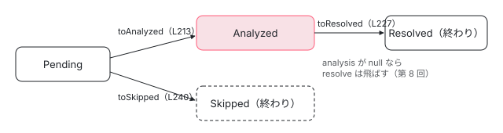

[目次](../README.md) › [ngtsc の内側](README.md) › 第 7 回 / 全 20 回

# TraitCompiler（1）：デコレーターを見つけて解析する

> DecoratorHandler の約束（detect・preanalyze・analyze・symbol・register）と HandlerPrecedence（PRIMARY・SHARED・WEAK。WEAK の handler は今は無い）、TraitCompiler.analyze がファイルのクラスを回して detectTraits で trait を作り、analyzeTrait で Pending から Analyzed に移す行（失敗は analysis が null の Analyzed。Skipped は adopt でしか作られない）、trait.ts の状態の移り方、非同期の preanalyze（外部のテンプレートやスタイルを読む）。

angular/angular · 読了 約 13 分 · 中核 · [サイトで読む（デモが動きます）](https://angular-deep-dive-cyan.vercel.app/chapter/ngtsc-trait-analyze)

---

ngtsc の中心にあるのは `TraitCompiler` です。プログラムの全部のクラスを回し、Angular のデコレーターごとの担当（handler）に「このクラスはあなたの担当か」を聞き、担当なら **trait**（「このクラスには、この handler が出力する Angular の面がある」という記録）を作って、状態を Pending → Analyzed → Resolved と進めます。この章では、handler が守る約束（`DecoratorHandler`）と precedence（PRIMARY・SHARED・WEAK）、trait の状態の移り方、`analyze` がファイルのクラスを回して detect → preanalyze → analyze と進む行を、1 ステップずつ読みます。

読む対象は `packages/compiler-cli/src/ngtsc/transform/src/` の `api.ts`・`trait.ts`・`compilation.ts`（820 行）の前半と、spec の `transform/test/compilation_spec.ts` です。resolve と compile は[第 8 回](08-ngtsc-trait-resolve-compile.md)、前のビルドの ClassRecord を引き継ぐ `adopt` は[第 14 回](14-ngtsc-incremental.md)で読みます。[compiler-entry の章](../compiler/02-compiler-entry.md)の 2 節で TraitCompiler の analyze → resolve → compile を一度眺めたので、ここではその内側に入ります。

1. [1. 全体像](01-ngtsc-overview.md)
2. [2. NgtscProgram](02-ngtsc-program.md)
3. [3. NgCompiler とチケット](03-ngtsc-compiler-ticket.md)
4. [4. リフレクション](04-ngtsc-reflection.md)
5. [5. 静的な評価](05-ngtsc-partial-evaluator.md)
6. [6. 参照と import](06-ngtsc-references-imports.md)
7. **7. 解析**（この章）
8. [8. 解決と出力](08-ngtsc-trait-resolve-compile.md)
9. [9. @Directive の handler](09-ngtsc-directive-handler.md)
10. [10. メタデータの登録](10-ngtsc-metadata-registry.md)
11. [11. .d.ts を読む](11-ngtsc-dts-metadata.md)
12. [12. JS の書き換え](12-ngtsc-ivy-transform.md)
13. [13. .d.ts の書き換え](13-ngtsc-dts-transform.md)
14. [14. 差分ビルド](14-ngtsc-incremental.md)
15. [15. 意味のグラフ](15-ngtsc-semantic-graph.md)
16. [16. import の循環](16-ngtsc-cycles.md)
17. [17. HMR](17-ngtsc-hmr.md)
18. [18. 診断と性能](18-ngtsc-diagnostics-perf.md)
19. [19. テストを書く](19-ngtsc-test-env.md)
20. [20. issue と PR を読む](20-ngtsc-issues.md)

## 1. DecoratorHandler：handler が守る約束

handler は 6 つあります。NgCompiler の `makeCompilation` が並べる順（[compiler-entry の章](../compiler/02-compiler-entry.md)の 1 節で引用）に、Component・Directive・Pipe・Service・Injectable・NgModule です。下の DEMO の記録でも detect はこの順に呼ばれています。どれも同じ interface を実装します。

📄 `angular/packages/compiler-cli/src/ngtsc/transform/src/api.ts` L78–101 （▶ の行: 78–79, 87, 93, 98–99, 101）

```ts
 78 ▶ export interface DecoratorHandler<D, A, S extends SemanticSymbol | null, R> {
 79 ▶   readonly name: string;
 80 │ 
 81 │   /**
 82 │    * The precedence of a handler controls how it interacts with other handlers that match the same
 83 │    * class.
 84 │    *
 85 │    * See the descriptions on `HandlerPrecedence` for an explanation of the behaviors involved.
 86 │    */
 87 ▶   readonly precedence: HandlerPrecedence;
 88 │ 
 89 │   /**
 90 │    * Scan a set of reflected decorators and determine if this handler is responsible for compilation
 91 │    * of one of them.
 92 │    */
 93 ▶   detect(node: ClassDeclaration, decorators: Decorator[] | null): DetectResult<D> | undefined;
 94 │ 
 95 │   /**
 96 │    * Asynchronously perform pre-analysis on the decorator/class combination.
 97 │    *
 98 ▶    * `preanalyze` is optional and is not guaranteed to be called through all compilation flows. It
 99 ▶    * will only be called if asynchronicity is supported in the CompilerHost.
100 │    */
101 ▶   preanalyze?(node: ClassDeclaration, metadata: Readonly<D>): Promise<void> | undefined;
```

📄 `angular/packages/compiler-cli/src/ngtsc/transform/src/api.ts` L103–121 （▶ の行: 110–113, 115, 121）

```ts
103 │   /**
104 │    * Perform analysis on the decorator/class combination, extracting information from the class
105 │    * required for compilation.
106 │    *
107 │    * Returns analyzed metadata if successful, or an array of diagnostic messages if the analysis
108 │    * fails or the decorator isn't valid.
109 │    *
110 ▶    * Analysis should always be a "pure" operation, with no side effects. This is because the
111 ▶    * detect/analysis steps might be skipped for files which have not changed during incremental
112 ▶    * builds. Any side effects required for compilation (e.g. registration of metadata) should happen
113 ▶    * in the `register` phase, which is guaranteed to run even for incremental builds.
114 │    */
115 ▶   analyze(node: ClassDeclaration, metadata: Readonly<D>): AnalysisOutput<A>;
116 │ 
117 │   /**
118 │    * React to a change in a resource file by updating the `analysis` or `resolution`, under the
119 │    * assumption that nothing in the TypeScript code has changed.
120 │    */
121 ▶   updateResources?(node: ClassDeclaration, analysis: A, resolution: R): void;
```

📄 `angular/packages/compiler-cli/src/ngtsc/transform/src/api.ts` L123–144 （▶ の行: 132–133, 135, 141–142, 144）

```ts
123 │   /**
124 │    * Produces a `SemanticSymbol` that represents the class, which is registered into the semantic
125 │    * dependency graph. The symbol is used in incremental compilations to let the compiler determine
126 │    * how a change to the class affects prior emit results. See the `incremental` target's README for
127 │    * details on how this works.
128 │    *
129 │    * The symbol is passed in to `resolve`, where it can be extended with references into other parts
130 │    * of the compilation as needed.
131 │    *
132 ▶    * Only primary handlers are allowed to have symbols; handlers with `precedence` other than
133 ▶    * `HandlerPrecedence.PRIMARY` must return a `null` symbol.
134 │    */
135 ▶   symbol(node: ClassDeclaration, analysis: Readonly<A>): S;
136 │ 
137 │   /**
138 │    * Post-process the analysis of a decorator/class combination and record any necessary information
139 │    * in the larger compilation.
140 │    *
141 ▶    * Registration always occurs for a given decorator/class, regardless of whether analysis was
142 ▶    * performed directly or whether the analysis results were reused from the previous program.
143 │    */
144 ▶   register?(node: ClassDeclaration, analysis: A): void;
```

| メソッド | いつ | 約束 |
| --- | --- | --- |
| `detect`（93 行目） | クラスごと・handler ごとに 1 回 | デコレーターの一覧を見て、担当なら DetectResult、違えば undefined |
| `preanalyze`（101 行目・任意） | 非同期のビルドだけ（98〜99 行目） | 外部のファイルを先に読む。Promise を返してよい |
| `analyze`（115 行目） | 担当のクラスに 1 回 | **副作用なし**（110〜113 行目）。差分ビルドでは飛ばされることがあるから |
| `symbol`（135 行目） | analyze のあと | 意味のグラフ（[第 15 回](15-ngtsc-semantic-graph.md)）に入れる記号。PRIMARY だけが返してよい（132〜133 行目） |
| `register`（144 行目・任意） | analyze のあと。前のビルドの結果を使い回すときも必ず（141〜142 行目） | 副作用（メタデータの登録など。[第 10 回](10-ngtsc-metadata-registry.md)）はここで |
| `resolve`・`compileFull` など | 全部の analyze のあと | [第 8 回](08-ngtsc-trait-resolve-compile.md) |

📄 `angular/packages/compiler-cli/src/ngtsc/transform/src/api.ts` L239–270 （▶ の行: 247, 254, 259, 267–269）

```ts
239 │ /**
240 │  * The output of detecting a trait for a declaration as the result of the first phase of the
241 │  * compilation pipeline.
242 │  */
243 │ export interface DetectResult<M> {
244 │   /**
245 │    * The node that triggered the match, which is typically a decorator.
246 │    */
247 ▶   trigger: ts.Node | null;
248 │ 
249 │   /**
250 │    * Refers to the decorator that was recognized for this detection, if any. This can be a concrete
251 │    * decorator that is actually present in a file, or a synthetic decorator as inserted
252 │    * programmatically.
253 │    */
254 ▶   decorator: Decorator | null;
255 │ 
256 │   /**
257 │    * An arbitrary object to carry over from the detection phase into the analysis phase.
258 │    */
259 ▶   metadata: Readonly<M>;
260 │ }
261 │ 
262 │ /**
263 │  * The output of an analysis operation, consisting of possibly an arbitrary analysis object (used as
264 │  * the input to code generation) and potentially diagnostics if there were errors uncovered during
265 │  * analysis.
266 │  */
267 ▶ export interface AnalysisOutput<A> {
268 ▶   analysis?: Readonly<A>;
269 ▶   diagnostics?: ts.Diagnostic[];
270 │ }
```

detect の答えの 247 行目 `trigger` は「当たった理由の node」で、ふつうはデコレーターです。254 行目の `decorator` は、デコレーターの無いクラスでは `null` になります（4 節の `Undecorated`）。259 行目の `metadata` は analyze にそのまま渡されます。analyze の答え（267〜270 行目）は、`analysis` と `diagnostics` のどちらか、または両方です。

## 2. HandlerPrecedence：1 つのクラスに 2 つ当たったら

📄 `angular/packages/compiler-cli/src/ngtsc/transform/src/api.ts` L43–64 （▶ の行: 45, 47, 49, 52–53, 57, 60–61, 63）

```ts
43 │ export enum HandlerPrecedence {
44 │   /**
45 ▶    * Handler with PRIMARY precedence cannot overlap - there can only be one on a given class.
46 │    *
47 ▶    * If more than one PRIMARY handler matches a class, an error is produced.
48 │    */
49 ▶   PRIMARY,
50 │ 
51 │   /**
52 ▶    * Handlers with SHARED precedence can match any class, possibly in addition to a single PRIMARY
53 ▶    * handler.
54 │    *
55 │    * It is not an error for a class to have any number of SHARED handlers.
56 │    */
57 ▶   SHARED,
58 │ 
59 │   /**
60 ▶    * Handlers with WEAK precedence that match a class are ignored if any handlers with stronger
61 ▶    * precedence match a class.
62 │    */
63 ▶   WEAK,
64 │ }
```

- **PRIMARY**（49 行目）：Component・Directive・Pipe・NgModule。1 つのクラスに 1 つだけ。2 つ目が当たるとエラー（4 節 344〜357 行目）。
- **SHARED**（57 行目）：Injectable・Service。PRIMARY と一緒に付いてよい。`@Directive() @Injectable()` は trait が 2 つになります。
- **WEAK**（63 行目）：ほかが当たれば捨てられる。2026-11-05 の ../angular で `HandlerPrecedence.WEAK` を grep すると、使っているのは compilation.ts の判定（4 節）だけで、WEAK の handler は 1 つもありません。

## 3. trait の状態：TraitState と TraitImpl

📄 `angular/packages/compiler-cli/src/ngtsc/transform/src/trait.ts` L15–35 （▶ の行: 19, 24, 29, 34）

```ts
15 │ export enum TraitState {
16 │   /**
17 │    * Pending traits are freshly created and have never been analyzed.
18 │    */
19 ▶   Pending,
20 │ 
21 │   /**
22 │    * Analyzed traits have successfully been analyzed, but are pending resolution.
23 │    */
24 ▶   Analyzed,
25 │ 
26 │   /**
27 │    * Resolved traits have successfully been analyzed and resolved and are ready for compilation.
28 │    */
29 ▶   Resolved,
30 │ 
31 │   /**
32 │    * Skipped traits are no longer considered for compilation.
33 │    */
34 ▶   Skipped,
35 │ }
```

📄 `angular/packages/compiler-cli/src/ngtsc/transform/src/trait.ts` L50–65 （▶ の行: 50–54, 61, 64）

```ts
50 ▶ export type Trait<D, A, S extends SemanticSymbol | null, R> =
51 ▶   | PendingTrait<D, A, S, R>
52 ▶   | SkippedTrait<D, A, S, R>
53 ▶   | AnalyzedTrait<D, A, S, R>
54 ▶   | ResolvedTrait<D, A, S, R>;
55 │ 
56 │ /**
57 │  * The value side of `Trait` exposes a helper to create a `Trait` in a pending state (by delegating
58 │  * to `TraitImpl`).
59 │  */
60 │ export const Trait = {
61 ▶   pending: <D, A, S extends SemanticSymbol | null, R>(
62 │     handler: DecoratorHandler<D, A, S, R>,
63 │     detected: DetectResult<D>,
64 ▶   ): PendingTrait<D, A, S, R> => TraitImpl.pending(handler, detected),
65 │ };
```

`Trait` は 4 つの状態の interface の union（50〜54 行目）です。`PendingTrait` には `toAnalyzed` と `toSkipped`、`AnalyzedTrait` には `toResolved` だけがあるので、**型の上で「Pending から Resolved に飛ぶ」コードは書けません**。実体は 1 つのクラス `TraitImpl` で、64 行目の `Trait.pending` だけが作ります。

📄 `angular/packages/compiler-cli/src/ngtsc/transform/src/trait.ts` L197–225 （▶ の行: 198, 201–206, 219–223）

```ts
197 │ class TraitImpl<D, A, S extends SemanticSymbol | null, R> {
198 ▶   state: TraitState = TraitState.Pending;
199 │   handler: DecoratorHandler<D, A, S, R>;
200 │   detected: DetectResult<D>;
201 ▶   analysis: Readonly<A> | null = null;
202 ▶   symbol: S | null = null;
203 ▶   resolution: Readonly<R> | null = null;
204 ▶   analysisDiagnostics: ts.Diagnostic[] | null = null;
205 ▶   resolveDiagnostics: ts.Diagnostic[] | null = null;
206 ▶   typeCheckDiagnostics: ts.Diagnostic[] | null = null;
207 │ 
208 │   constructor(handler: DecoratorHandler<D, A, S, R>, detected: DetectResult<D>) {
209 │     this.handler = handler;
210 │     this.detected = detected;
211 │   }
212 │ 
213 │   toAnalyzed(
214 │     analysis: A | null,
215 │     diagnostics: ts.Diagnostic[] | null,
216 │     symbol: S,
217 │   ): AnalyzedTrait<D, A, S, R> {
218 │     // Only pending traits can be analyzed.
219 ▶     this.assertTransitionLegal(TraitState.Pending, TraitState.Analyzed);
220 ▶     this.analysis = analysis;
221 ▶     this.analysisDiagnostics = diagnostics;
222 ▶     this.symbol = symbol;
223 ▶     this.state = TraitState.Analyzed;
224 │     return this as AnalyzedTrait<D, A, S, R>;
225 │   }
```

📄 `angular/packages/compiler-cli/src/ngtsc/transform/src/trait.ts` L227–245 （▶ の行: 229–231, 233–235, 242–243）

```ts
227 │   toResolved(resolution: R | null, diagnostics: ts.Diagnostic[] | null): ResolvedTrait<D, A, S, R> {
228 │     // Only analyzed traits can be resolved.
229 ▶     this.assertTransitionLegal(TraitState.Analyzed, TraitState.Resolved);
230 ▶     if (this.analysis === null) {
231 ▶       throw new Error(`Cannot transition an Analyzed trait with a null analysis to Resolved`);
232 │     }
233 ▶     this.resolution = resolution;
234 ▶     this.state = TraitState.Resolved;
235 ▶     this.resolveDiagnostics = diagnostics;
236 │     this.typeCheckDiagnostics = null;
237 │     return this as ResolvedTrait<D, A, S, R>;
238 │   }
239 │ 
240 │   toSkipped(): SkippedTrait<D, A, S, R> {
241 │     // Only pending traits can be skipped.
242 ▶     this.assertTransitionLegal(TraitState.Pending, TraitState.Skipped);
243 ▶     this.state = TraitState.Skipped;
244 │     return this as SkippedTrait<D, A, S, R>;
245 │   }
```

📄 `angular/packages/compiler-cli/src/ngtsc/transform/src/trait.ts` L247–263 （▶ の行: 250–253, 255–257）

```ts
247 │   /**
248 │    * Verifies that the trait is currently in one of the `allowedState`s.
249 │    *
250 ▶    * If correctly used, the `Trait` type and transition methods prevent illegal transitions from
251 ▶    * occurring. However, if a reference to the `TraitImpl` instance typed with the previous
252 ▶    * interface is retained after calling one of its transition methods, it will allow for illegal
253 ▶    * transitions to take place. Hence, this assertion provides a little extra runtime protection.
254 │    */
255 ▶   private assertTransitionLegal(allowedState: TraitState, transitionTo: TraitState): void {
256 ▶     if (!(this.state === allowedState)) {
257 ▶       throw new Error(
258 │         `Assertion failure: cannot transition from ${TraitState[this.state]} to ${
259 │           TraitState[transitionTo]
260 │         }.`,
261 │       );
262 │     }
263 │   }
```

1. **198〜206 行目：全部のフィールドを最初から持つ**

   状態が変わっても同じ object のフィールドを書き換えるだけで、形（hidden class）は変わりません。trait.ts の Trait の型の上のコメントにある「monomorphic（形が 1 つ）」の狙いです。
2. **219〜223 行目：toAnalyzed は analysis が null でもよい**

   analyze が失敗したとき（4 節）も、**analysis は null・診断あり**の Analyzed になります。「失敗した」という状態は別にありません。
3. **230〜232 行目：toResolved は analysis が null なら投げる**

   だから第 8 回の resolve は、analysis が null の trait を飛ばします。
4. **240〜245 行目：toSkipped は Pending からだけ**

   2026-11-05 の ../angular で `toSkipped` を grep すると、呼んでいるのは compilation.ts の `adopt`（前のビルドで Skipped だった trait を引き継ぐ所。[第 14 回](14-ngtsc-incremental.md)）だけです。**Skipped を新しく作る行は、今のソースにはありません**。解析で「出力しない」と決めた trait は、Skipped ではなく analysis が null の Analyzed で表します（4 節）。
5. **255〜262 行目：型を迂回されたときの保険**

   250〜253 行目のコメントのとおり、古い状態の型の変数を持ち続ければ型の上では呼べてしまうので、実行時にも確かめます。



*trait の状態。Skipped と Resolved で終わる。analyze の失敗は「analysis が null の Analyzed」で、resolve はそれを飛ばす。*

## 4. TraitCompiler.analyze：ファイルのクラスを回す

📄 `angular/packages/compiler-cli/src/ngtsc/transform/src/compilation.ts` L43–72 （▶ の行: 47, 52, 58, 66, 71）

```ts
43 │ export interface ClassRecord {
44 │   /**
45 │    * The `ClassDeclaration` of the class which has Angular traits applied.
46 │    */
47 ▶   node: ClassDeclaration;
48 │ 
49 │   /**
50 │    * All traits which matched on the class.
51 │    */
52 ▶   traits: Trait<unknown, unknown, SemanticSymbol | null, unknown>[];
53 │ 
54 │   /**
55 │    * Meta-diagnostics about the class, which are usually related to whether certain combinations of
56 │    * Angular decorators are not permitted.
57 │    */
58 ▶   metaDiagnostics: ts.Diagnostic[] | null;
59 │ 
60 │   // Subsequent fields are "internal" and used during the matching of `DecoratorHandler`s. This is
61 │   // mutable state during the `detect`/`analyze` phases of compilation.
62 │ 
63 │   /**
64 │    * Whether `traits` contains traits matched from `DecoratorHandler`s marked as `WEAK`.
65 │    */
66 ▶   hasWeakHandlers: boolean;
67 │ 
68 │   /**
69 │    * Whether `traits` contains a trait from a `DecoratorHandler` matched as `PRIMARY`.
70 │    */
71 ▶   hasPrimaryHandler: boolean;
72 │ }
```

📄 `angular/packages/compiler-cli/src/ngtsc/transform/src/compilation.ts` L85–109 （▶ の行: 90, 96, 102, 104, 106）

```ts
 85 │ export class TraitCompiler implements ProgramTypeCheckAdapter {
 86 │   /**
 87 │    * Maps class declarations to their `ClassRecord`, which tracks the Ivy traits being applied to
 88 │    * those classes.
 89 │    */
 90 ▶   private classes = new Map<ClassDeclaration, ClassRecord>();
 91 │ 
 92 │   /**
 93 │    * Maps source files to any class declaration(s) within them which have been discovered to contain
 94 │    * Ivy traits.
 95 │    */
 96 ▶   private fileToClasses = new Map<ts.SourceFile, Set<ClassDeclaration>>();
 97 │ 
 98 │   /**
 99 │    * Tracks which source files have been analyzed but did not contain any traits. This set allows
100 │    * the compiler to skip analyzing these files in an incremental rebuild.
101 │    */
102 ▶   private filesWithoutTraits = new Set<ts.SourceFile>();
103 │ 
104 ▶   private reexportMap = new Map<string, Map<string, [string, string]>>();
105 │ 
106 ▶   private handlersByName = new Map<
107 │     string,
108 │     DecoratorHandler<unknown, unknown, SemanticSymbol | null, unknown>
109 │   >();
```

1 つのクラスの記録が `ClassRecord`（43〜72 行目）で、trait の配列（52 行目）と、クラス全体のエラー（58 行目の metaDiagnostics。デコレーターの組み合わせが駄目なとき）を持ちます。TraitCompiler はそれを 90 行目の `classes`（クラス → ClassRecord）と 96 行目の `fileToClasses`（ファイル → クラスの集合）で引けるようにします。102 行目の `filesWithoutTraits` は「解析したが Angular のクラスが無かったファイル」で、差分ビルドで飛ばすのに使います。

📄 `angular/packages/compiler-cli/src/ngtsc/transform/src/compilation.ts` L129–158 （▶ の行: 129–130, 133–134, 141–144, 151, 154–156）

```ts
129 ▶   analyzeSync(sf: ts.SourceFile): void {
130 ▶     this.analyze(sf, false);
131 │   }
132 │ 
133 ▶   analyzeAsync(sf: ts.SourceFile): Promise<void> | undefined {
134 ▶     return this.analyze(sf, true);
135 │   }
136 │ 
137 │   private analyze(sf: ts.SourceFile, preanalyze: false): void;
138 │   private analyze(sf: ts.SourceFile, preanalyze: true): Promise<void> | undefined;
139 │   private analyze(sf: ts.SourceFile, preanalyze: boolean): Promise<void> | undefined {
140 │     // We shouldn't analyze declaration, shim, or resource files.
141 ▶     if (
142 ▶       sf.isDeclarationFile ||
143 ▶       this.sourceFileTypeIdentifier.isShim(sf) ||
144 ▶       this.sourceFileTypeIdentifier.isResource(sf)
145 │     ) {
146 │       return undefined;
147 │     }
148 │ 
149 │     // analyze() really wants to return `Promise<void>|void`, but TypeScript cannot narrow a return
150 │     // type of 'void', so `undefined` is used instead.
151 ▶     const promises: Promise<void>[] = [];
152 │ 
153 │     // Local compilation does not support incremental build.
154 ▶     const priorWork =
155 ▶       this.compilationMode !== CompilationMode.LOCAL
156 ▶         ? this.incrementalBuild.priorAnalysisFor(sf)
157 │         : null;
158 │     if (priorWork !== null) {
```

📄 `angular/packages/compiler-cli/src/ngtsc/transform/src/compilation.ts` L174–204 （▶ の行: 175–177, 179, 182, 184, 188, 191–192, 198–200）

```ts
174 │ 
175 ▶     const visit = (node: ts.Node): void => {
176 ▶       if (this.reflector.isClass(node)) {
177 ▶         this.analyzeClass(node, preanalyze ? promises : null);
178 │       }
179 ▶       ts.forEachChild(node, visit);
180 │     };
181 │ 
182 ▶     visit(sf);
183 │ 
184 ▶     if (!this.fileToClasses.has(sf)) {
185 │       // If no traits were detected in the source file we record the source file itself to not have
186 │       // any traits, such that analysis of the source file can be skipped during incremental
187 │       // rebuilds.
188 ▶       this.filesWithoutTraits.add(sf);
189 │     }
190 │ 
191 ▶     if (preanalyze && promises.length > 0) {
192 ▶       return Promise.all(promises).then(() => undefined as void);
193 │     } else {
194 │       return undefined;
195 │     }
196 │   }
197 │ 
198 ▶   recordFor(clazz: ClassDeclaration): ClassRecord | null {
199 ▶     if (this.classes.has(clazz)) {
200 ▶       return this.classes.get(clazz)!;
201 │     } else {
202 │       return null;
203 │     }
204 │   }
```

1. **129〜135 行目：同期と非同期の 2 つの入口**

   `ngc` や CLI の非同期のビルドは `analyzeAsync`（NgCompiler の `analyzeAsync` から。[第 3 回](03-ngtsc-compiler-ticket.md)）、言語サービスなど同期しかできない側は `analyzeSync` です。違いは preanalyze を呼ぶかだけ（177 行目の第 2 引数）。
2. **141〜146 行目：.d.ts・shim・資源のファイルは解析しない**

   .d.ts のクラスは、ここではなく[第 11 回](11-ngtsc-dts-metadata.md)の DtsMetadataReader が読みます。
3. **154〜157 行目：前のビルドの結果を使えるか**

   ローカルコンパイルでは使いません（155 行目）。使えるときは、その ClassRecord を `adopt` で引き継いで、このファイルの解析を終えます（[第 14 回](14-ngtsc-incremental.md)）。
4. **175〜182 行目：構文木を全部たどり、クラスなら analyzeClass**

   179 行目の `forEachChild` で、関数の中に書いたクラスも見つかります。
5. **184〜189 行目：1 つも trait が無ければ filesWithoutTraits へ**
6. **191〜192 行目：preanalyze の Promise を全部待つ**

   非同期のときだけ、全部の Promise が済んだら解決する Promise を返します。

### scanClassForTraits → detectTraits

📄 `angular/packages/compiler-cli/src/ngtsc/transform/src/compilation.ts` L267–301 （▶ の行: 270, 272, 279, 284–285, 287–290, 297–299, 301）

```ts
267 │   private scanClassForTraits(
268 │     clazz: ClassDeclaration,
269 │   ): PendingTrait<unknown, unknown, SemanticSymbol | null, unknown>[] | null {
270 ▶     const decorators = this.reflector.getDecoratorsOfDeclaration(clazz);
271 │ 
272 ▶     return this.detectTraits(clazz, decorators);
273 │   }
274 │ 
275 │   protected detectTraits(
276 │     clazz: ClassDeclaration,
277 │     decorators: Decorator[] | null,
278 │   ): PendingTrait<unknown, unknown, SemanticSymbol | null, unknown>[] | null {
279 ▶     let record: ClassRecord | null = this.recordFor(clazz);
280 │     let foundTraits: PendingTrait<unknown, unknown, SemanticSymbol | null, unknown>[] = [];
281 │ 
282 │     // A set to track the non-Angular decorators in local compilation mode. An error will be issued
283 │     // if non-Angular decorators is found in local compilation mode.
284 ▶     const nonNgDecoratorsInLocalMode =
285 ▶       this.compilationMode === CompilationMode.LOCAL ? new Set(decorators) : null;
286 │ 
287 ▶     for (const handler of this.handlers) {
288 ▶       const result = handler.detect(clazz, decorators);
289 ▶       if (result === undefined) {
290 ▶         continue;
291 │       }
292 │ 
293 │       if (nonNgDecoratorsInLocalMode !== null && result.decorator !== null) {
294 │         nonNgDecoratorsInLocalMode.delete(result.decorator);
295 │       }
296 │ 
297 ▶       const isPrimaryHandler = handler.precedence === HandlerPrecedence.PRIMARY;
298 ▶       const isWeakHandler = handler.precedence === HandlerPrecedence.WEAK;
299 ▶       const trait = Trait.pending(handler, result);
300 │ 
301 ▶       foundTraits.push(trait);
```

📄 `angular/packages/compiler-cli/src/ngtsc/transform/src/compilation.ts` L302–342 （▶ の行: 303, 306, 314, 319, 331, 334, 337–338, 341）

```ts
302 │ 
303 ▶       if (record === null) {
304 │         // This is the first handler to match this class. This path is a fast path through which
305 │         // most classes will flow.
306 ▶         record = {
307 │           node: clazz,
308 │           traits: [trait],
309 │           metaDiagnostics: null,
310 │           hasPrimaryHandler: isPrimaryHandler,
311 │           hasWeakHandlers: isWeakHandler,
312 │         };
313 │ 
314 ▶         this.classes.set(clazz, record);
315 │         const sf = clazz.getSourceFile();
316 │         if (!this.fileToClasses.has(sf)) {
317 │           this.fileToClasses.set(sf, new Set<ClassDeclaration>());
318 │         }
319 ▶         this.fileToClasses.get(sf)!.add(clazz);
320 │       } else {
321 │         // This is at least the second handler to match this class. This is a slower path that some
322 │         // classes will go through, which validates that the set of decorators applied to the class
323 │         // is valid.
324 │ 
325 │         // Validate according to rules as follows:
326 │         //
327 │         // * WEAK handlers are removed if a non-WEAK handler matches.
328 │         // * Only one PRIMARY handler can match at a time. Any other PRIMARY handler matching a
329 │         //   class with an existing PRIMARY handler is an error.
330 │ 
331 ▶         if (!isWeakHandler && record.hasWeakHandlers) {
332 │           // The current handler is not a WEAK handler, but the class has other WEAK handlers.
333 │           // Remove them.
334 ▶           record.traits = record.traits.filter(
335 │             (field) => field.handler.precedence !== HandlerPrecedence.WEAK,
336 │           );
337 ▶           record.hasWeakHandlers = false;
338 ▶         } else if (isWeakHandler && !record.hasWeakHandlers) {
339 │           // The current handler is a WEAK handler, but the class has non-WEAK handlers already.
340 │           // Drop the current one.
341 ▶           continue;
342 │         }
```

📄 `angular/packages/compiler-cli/src/ngtsc/transform/src/compilation.ts` L344–366 （▶ の行: 344, 346, 349, 353, 356–357, 362–363）

```ts
344 ▶         if (isPrimaryHandler && record.hasPrimaryHandler) {
345 │           // The class already has a PRIMARY handler, and another one just matched.
346 ▶           record.metaDiagnostics = [
347 │             {
348 │               category: ts.DiagnosticCategory.Error,
349 ▶               code: ngErrorCode(ErrorCode.DECORATOR_COLLISION),
350 │               file: getSourceFile(clazz),
351 │               start: clazz.getStart(undefined, false),
352 │               length: clazz.getWidth(),
353 ▶               messageText: 'Two incompatible decorators on class',
354 │             },
355 │           ];
356 ▶           record.traits = foundTraits = [];
357 ▶           break;
358 │         }
359 │ 
360 │         // Otherwise, it's safe to accept the multiple decorators here. Update some of the metadata
361 │         // regarding this class.
362 ▶         record.traits.push(trait);
363 ▶         record.hasPrimaryHandler = record.hasPrimaryHandler || isPrimaryHandler;
364 │       }
365 │     }
366 │ 
```

1. **270 行目：デコレーターの一覧**

   ReflectionHost が返す `Decorator[]`（[第 4 回](04-ngtsc-reflection.md)）。デコレーターが 1 つも無ければ `null` です。
2. **287〜291 行目：全部の handler の detect を順に呼ぶ**

   当たらなければ次へ。**当たらなかった handler にも毎回聞きます**（DEMO の `Plain` は 6 回とも undefined）。
3. **299・303〜319 行目：最初に当たった handler で ClassRecord を作る**

   304〜305 行目のコメントのとおり、ほとんどのクラスはここだけを通ります。
4. **331〜342 行目：WEAK の掃除**

   WEAK でない handler が当たったら、それまでの WEAK の trait を消します。逆に、すでに WEAK でない trait があるのに WEAK が当たったら捨てます（2 節のとおり、今は WEAK の handler がありません）。
5. **344〜357 行目：PRIMARY が 2 つ目なら、クラスごとエラー**

   metaDiagnostics に `DECORATOR_COLLISION`（「Two incompatible decorators on class」、-991006）を入れ、356 行目で trait を**全部空に**して、357 行目で残りの handler には聞かずに抜けます。DEMO の `ComponentAndDirective` は detect が 2 回だけで、Pipe 以降の handler は呼ばれていません。
6. **362〜363 行目：それ以外（PRIMARY + SHARED など）は足す**

   DEMO の `DirAndInjectable` は Directive と Injectable の 2 つの trait になります。

📄 `angular/packages/compiler-cli/src/ngtsc/transform/src/compilation.ts` L367–390 （▶ の行: 367–368, 371, 375, 380, 384, 386, 389）

```ts
367 ▶     if (
368 ▶       nonNgDecoratorsInLocalMode !== null &&
369 │       nonNgDecoratorsInLocalMode.size > 0 &&
370 │       record !== null &&
371 ▶       record.metaDiagnostics === null
372 │     ) {
373 │       // Custom decorators found in local compilation mode! In this mode we don't support custom
374 │       // decorators yet. But will eventually do (b/320536434). For now a temporary error is thrown.
375 ▶       const compilationModeName = this.emitDeclarationOnly
376 │         ? 'experimental declaration-only emission'
377 │         : 'local compilation';
378 │       record.metaDiagnostics = [...nonNgDecoratorsInLocalMode].map((decorator) => ({
379 │         category: ts.DiagnosticCategory.Error,
380 ▶         code: ngErrorCode(ErrorCode.DECORATOR_UNEXPECTED),
381 │         file: getSourceFile(clazz),
382 │         start: decorator.node.getStart(),
383 │         length: decorator.node.getWidth(),
384 ▶         messageText: `In ${compilationModeName} mode, Angular does not support custom decorators. Ensure all class decorators are from Angular.`,
385 │       }));
386 ▶       record.traits = foundTraits = [];
387 │     }
388 │ 
389 ▶     return foundTraits.length > 0 ? foundTraits : null;
390 │   }
```

ローカルコンパイル（[standalone-local-compilation の章](../standalone/06-standalone-local-compilation.md)）では、284〜285 行目で全部のデコレーターを集合に入れ、294 行目で Angular の handler が当たったものを消しておきます。残った（Angular でない）デコレーターがあれば、380 行目の `DECORATOR_UNEXPECTED` でクラスごとエラーです。384 行目のメッセージのとおり、ほかのファイルを見ずに独自のデコレーターの意味を知ることはできないからです。

### analyzeClass と analyzeTrait

📄 `angular/packages/compiler-cli/src/ngtsc/transform/src/compilation.ts` L414–428 （▶ の行: 415, 417–419, 422–423, 426）

```ts
414 │   private analyzeClass(clazz: ClassDeclaration, preanalyzeQueue: Promise<void>[] | null): void {
415 ▶     const traits = this.scanClassForTraits(clazz);
416 │ 
417 ▶     if (traits === null) {
418 ▶       // There are no Ivy traits on the class, so it can safely be skipped.
419 ▶       return;
420 │     }
421 │ 
422 ▶     for (const trait of traits) {
423 ▶       const analyze = () => this.analyzeTrait(clazz, trait);
424 │ 
425 │       let preanalysis: Promise<void> | null = null;
426 ▶       if (preanalyzeQueue !== null && trait.handler.preanalyze !== undefined) {
427 │         // Attempt to run preanalysis. This could fail with a `FatalDiagnosticError`; catch it if it
428 │         // does.
```

📄 `angular/packages/compiler-cli/src/ngtsc/transform/src/compilation.ts` L439–448 （▶ の行: 440–441, 443）

```ts
439 │       }
440 ▶       if (preanalysis !== null) {
441 ▶         preanalyzeQueue!.push(preanalysis.then(analyze));
442 │       } else {
443 ▶         analyze();
444 │       }
445 │     }
446 │   }
447 │ 
448 │   private analyzeTrait(
```

trait ごとに、423 行目で「analyze する関数」を作っておきます。426 行目：非同期の入口で、handler に preanalyze があれば先に呼び（中身は [compiler-entry の章](../compiler/02-compiler-entry.md)の 2〜3 節）、Promise が返れば 441 行目で **その Promise の後ろに analyze をつなげて**キューに積みます。無ければ 443 行目ですぐ analyze です。だから DEMO の記録では、外部のテンプレートを持つ `Cmp` の analyze が、ほかのクラスの analyze より**後**に来ます。

📄 `angular/packages/compiler-cli/src/ngtsc/transform/src/compilation.ts` L448–468 （▶ の行: 452–453, 460, 465, 467–468）

```ts
448 │   private analyzeTrait(
449 │     clazz: ClassDeclaration,
450 │     trait: Trait<unknown, unknown, SemanticSymbol | null, unknown>,
451 │   ): void {
452 ▶     if (trait.state !== TraitState.Pending) {
453 ▶       throw new Error(
454 │         `Attempt to analyze trait of ${clazz.name.text} in state ${
455 │           TraitState[trait.state]
456 │         } (expected DETECTED)`,
457 │       );
458 │     }
459 │ 
460 ▶     this.perf.eventCount(PerfEvent.TraitAnalyze);
461 │ 
462 │     // Attempt analysis. This could fail with a `FatalDiagnosticError`; catch it if it does.
463 │     let result: AnalysisOutput<unknown>;
464 │     try {
465 ▶       result = trait.handler.analyze(clazz, trait.detected.metadata);
466 │     } catch (err) {
467 ▶       if (err instanceof FatalDiagnosticError) {
468 ▶         trait.toAnalyzed(null, [err.toDiagnostic()], null);
```

📄 `angular/packages/compiler-cli/src/ngtsc/transform/src/compilation.ts` L469–490 （▶ の行: 475, 477–478, 480–481, 484–487, 489）

```ts
469 │         return;
470 │       } else {
471 │         throw err;
472 │       }
473 │     }
474 │ 
475 ▶     const symbol = this.makeSymbolForTrait(trait.handler, clazz, result.analysis ?? null);
476 │ 
477 ▶     const isStaticallyExported = this.reflector.isStaticallyExported(clazz);
478 ▶     const isStandalone = (result.analysis as any)?.meta?.isStandalone ?? false;
479 │ 
480 ▶     const shouldSkipResolution =
481 ▶       !isStaticallyExported && !this.compileNonExportedClasses && !isStandalone;
482 │ 
483 │     let analysisResult = result.analysis ?? null;
484 ▶     if (shouldSkipResolution) {
485 ▶       analysisResult = null;
486 ▶     } else if (result.analysis !== undefined && trait.handler.register !== undefined) {
487 ▶       trait.handler.register(clazz, result.analysis);
488 │     }
489 ▶     trait = trait.toAnalyzed(analysisResult, result.diagnostics ?? null, symbol);
490 │   }
```

1. **452〜458 行目：Pending でなければ投げる**

   同じ trait を 2 回解析しないための確認です。
2. **465〜468 行目：analyze。FatalDiagnosticError は診断にする**

   handler の中で「これ以上は続けられない」エラーは FatalDiagnosticError で投げられ、468 行目で `toAnalyzed(null, [診断], null)` になります。ビルドは止まりません。DEMO の `BadSelector`（`selector: 42 as any`）がこれです。それ以外の例外は 471 行目でそのまま投げ直します（コンパイラの不具合として表に出す）。
3. **475 行目：symbol を作る**

   意味のグラフに登録します（[第 15 回](15-ngtsc-semantic-graph.md)）。
4. **477〜485 行目：エクスポートされていない、standalone でもないクラスは analysis を捨てる**

   `compileNonExportedClasses` が false のとき（言語サービスが設定します）だけです。ngc の既定は true（NgCompiler が `options.compileNonExportedClasses !== false` を渡す）なので、ふつうのビルドでは捨てません。
5. **486〜489 行目：register してから Analyzed へ**

   analysis を捨てたときは register も呼びません。

> **🧪 DEMO — 本物の TraitCompiler の呼び出しと ClassRecord（記録）**
>
> これは記録です。下の src/classes.ts を、@angular/compiler-cli 22.1.6 の本物の NgtscProgram で `loadNgStructureAsync()`（非同期の analyze）しました。NgCompiler の private の `makeCompilation` を包んで TraitCompiler を手に入れ、6 つの handler の detect・preanalyze・analyze・symbol・register・resolve を「記録してから本物を呼ぶ」関数で包み、resolve の直前と直後に private の `classes` を読みました。設定の 2 つ目は `compileNonExportedClasses: false` です。
>
> ▶ [このデモはサイトで動かせます](https://angular-deep-dive-cyan.vercel.app/chapter/ngtsc-trait-analyze)

📄 `記録に使った入力 src/classes.ts（src/cmp.html は <p>external template</p> の 1 行）`

```
import {Component, Directive, Injectable, Input, NgModule} from '@angular/core';

@Component({selector: 'app-cmp', templateUrl: './cmp.html'})
export class Cmp {}

@Directive({selector: '[appDir]'})
@Injectable()
export class DirAndInjectable {}

@Component({selector: 'app-both', template: ''})
@Directive({selector: '[appBoth]'})
export class ComponentAndDirective {}

export class Plain {}

export class Undecorated {
  @Input() value = 0;
}

@Component({selector: 42 as any, template: ''})
export class BadSelector {}

@Component({selector: 'app-in-module', template: '', standalone: false})
class NotExportedInModule {}

@NgModule({declarations: [NotExportedInModule]})
export class SomeModule {}

```

- `Undecorated`：デコレーターは無いのに `@Input()` があるので、DirectiveDecoratorHandler の detect が「Angular の機能を使うクラス」として当てます（trigger はデコレーターではなく PropertyDeclaration）。analyze は analysis 無し・診断 1 件（-992007 `UNDECORATED_CLASS_USING_ANGULAR_FEATURES`）を返し、analysis が null の Analyzed のまま resolve の直後も変わりません。
- `NotExportedInModule`：既定の設定では Resolved まで進みます。`compileNonExportedClasses: false` では 477〜485 行目で analysis が null になり、register も呼ばれないので、NgModule の側が「declarations にあるのにディレクティブでもコンポーネントでもない」（-996001）と言います。

📄 `記録のスクリプト（scratchpad の記録スクリプト traits.mjs。angular-deep-dive を cwd にして node で走らせる）`

```
// 第 7 回（ngtsc-trait-analyze）の記録。
// 使い方: cd angular-deep-dive && node <このファイル> > traits.json
// 本物の NgtscProgram（@angular/compiler-cli 22.1.6）で小さなファイルを解析し、
//  1. handler の detect・preanalyze・analyze・register・resolve が呼ばれた順
//  2. resolve の直前と直後の TraitCompiler の ClassRecord（trait の handler の名前と state）
// を記録する。NgCompiler の private の makeCompilation を包んで TraitCompiler を手に入れ、
// handler のメソッドを「呼ばれたら記録してから本物を呼ぶ」関数で包む（中身は変えない）。
import fs from 'node:fs';
import path from 'node:path';
import { createRequire } from 'node:module';
import { pathToFileURL } from 'node:url';

const req = createRequire(path.join(process.cwd(), 'package.json'));
const load = (id) => import(pathToFileURL(req.resolve(id)).href);
const ts = (await load('typescript')).default;
const { NgtscProgram, createCompilerHost, setFileSystem, NodeJSFileSystem } = await load('@angular/compiler-cli');
setFileSystem(new NodeJSFileSystem());

const root = path.join(path.dirname(new URL(import.meta.url).pathname), '..', 'b-tmp', 'traits');
fs.rmSync(root, { recursive: true, force: true });
fs.mkdirSync(path.join(root, 'src'), { recursive: true });
fs.symlinkSync(path.resolve('node_modules'), path.join(root, 'node_modules'));

const FILES = {
  'src/classes.ts': `import {Component, Directive, Injectable, Input, NgModule} from '@angular/core';

@Component({selector: 'app-cmp', templateUrl: './cmp.html'})
export class Cmp {}

@Directive({selector: '[appDir]'})
@Injectable()
export class DirAndInjectable {}

@Component({selector: 'app-both', template: ''})
@Directive({selector: '[appBoth]'})
export class ComponentAndDirective {}

export class Plain {}

export class Undecorated {
  @Input() value = 0;
}

@Component({selector: 42 as any, template: ''})
export class BadSelector {}

@Component({selector: 'app-in-module', template: '', standalone: false})
class NotExportedInModule {}

@NgModule({declarations: [NotExportedInModule]})
export class SomeModule {}
`,
  'src/cmp.html': `<p>external template</p>\n`,
};
for (const [name, text] of Object.entries(FILES)) fs.writeFileSync(path.join(root, name), text);

const TRAIT_STATE = ['Pending', 'Analyzed', 'Resolved', 'Skipped']; // trait.ts の TraitState の並び
const WRAP = ['detect', 'preanalyze', 'analyze', 'symbol', 'register', 'resolve'];

async function run(label, extraOptions) {
  const options = {
    strict: true,
    target: ts.ScriptTarget.ES2022,
    module: ts.ModuleKind.ES2022,
    moduleResolution: ts.ModuleResolutionKind.Bundler,
    skipLibCheck: true,
    outDir: path.join(root, 'out'),
    ...extraOptions,
  };
  const host = createCompilerHost({ options });
  // CLI と同じく readResource を持たせる（ある と preanalyze が外部のテンプレートを先に読む）
  host.readResource = async (fileName) => {
    calls.push({ phase: 'readResource', handler: '(host)', cls: path.relative(root, fileName) });
    return fs.readFileSync(fileName, 'utf8');
  };
  const calls = [];
  const snapshots = [];
  const program = new NgtscProgram([path.join(root, 'src/classes.ts')], options, host);
  const compiler = program.compiler;
  const makeCompilation = compiler.makeCompilation.bind(compiler);
  compiler.makeCompilation = () => {
    const compilation = makeCompilation();
    const tc = compilation.traitCompiler;
    for (const handler of tc.handlers) {
      for (const m of WRAP) {
        if (typeof handler[m] !== 'function') continue;
        const orig = handler[m].bind(handler);
        handler[m] = (node, ...rest) => {
          const entry = { phase: m, handler: handler.name, cls: node?.name?.text ?? '?' };
          calls.push(entry);
          let r;
          try {
            r = orig(node, ...rest);
          } catch (e) {
            entry.threw = e.constructor.name; // FatalDiagnosticError なら TraitCompiler が診断にする
            throw e;
          }
          if (m === 'detect') entry.hit = r !== undefined;
          if (m === 'preanalyze') entry.async = r instanceof Promise;
          if (m === 'analyze') {
            entry.analysis = r.analysis !== undefined;
            entry.diagnostics = (r.diagnostics ?? []).length;
          }
          return r;
        };
      }
    }
    const resolve = tc.resolve.bind(tc);
    tc.resolve = () => {
      snapshots.push({ when: 'resolve の直前', records: snapshot(tc) });
      calls.push({ phase: '— TraitCompiler.resolve() —', handler: '', cls: '' });
      resolve();
      snapshots.push({ when: 'resolve の直後', records: snapshot(tc) });
    };
    return compilation;
  };
  // NgtscProgram.loadNgStructureAsync → NgCompiler.analyzeAsync → TraitCompiler.analyzeAsync（preanalyze あり）
  await program.loadNgStructureAsync();
  const flatten = (m) => (typeof m === 'string' ? [m] : [m.messageText, ...(m.next ?? []).flatMap(flatten)]);
  const diagnostics = [...program.getNgStructuralDiagnostics(), ...program.getNgSemanticDiagnostics()].map((d) => ({
    code: d.code,
    line: d.file ? d.file.getLineAndCharacterOfPosition(d.start).line + 1 : null,
    message: flatten(d.messageText).join(' / '),
  }));
  return { label, options: extraOptions, calls, snapshots, diagnostics };
}

function snapshot(tc) {
  // classes は TraitCompiler の private の Map（compilation.ts 90 行目）
  const out = [];
  for (const [clazz, record] of tc.classes) {
    out.push({
      cls: clazz.name.text,
      hasPrimaryHandler: record.hasPrimaryHandler,
      hasWeakHandlers: record.hasWeakHandlers,
      metaDiagnostics: (record.metaDiagnostics ?? []).map((d) => `${d.code}: ${d.messageText}`),
      traits: record.traits.map((t) => ({
        handler: t.handler.name,
        precedence: ['PRIMARY', 'SHARED', 'WEAK'][t.handler.precedence],
        state: TRAIT_STATE[t.state],
        analysis: t.analysis === undefined ? 'undefined' : t.analysis === null ? 'null' : 'あり',
        analysisDiagnostics: (t.analysisDiagnostics ?? []).map((d) => d.code),
        resolution: t.resolution === undefined ? 'undefined' : t.resolution === null ? 'null' : 'あり',
        resolveDiagnostics: (t.resolveDiagnostics ?? []).map((d) => d.code),
        trigger: t.detected.trigger ? ts.SyntaxKind[t.detected.trigger.kind] : null,
      })),
    });
  }
  return out;
}

const runs = [await run('ngc と同じ（compileNonExportedClasses は既定）', {}), await run('compileNonExportedClasses: false（言語サービスと同じ）', { compileNonExportedClasses: false })];
// 全部の class × handler の detect は多いので、detect は「当たった」ものと件数だけ残す
for (const r of runs) {
  r.detectCount = r.calls.filter((c) => c.phase === 'detect').length;
  r.detectMissByClass = {};
  for (const c of r.calls) if (c.phase === 'detect' && !c.hit) (r.detectMissByClass[c.cls] ??= []).push(c.handler);
  r.calls = r.calls.filter((c) => c.phase !== 'detect' || c.hit);
}
const out = {
  compilerCli: JSON.parse(fs.readFileSync('node_modules/@angular/compiler-cli/package.json', 'utf8')).version,
  files: FILES,
  runs,
};
fs.rmSync(root, { recursive: true, force: true });
process.stdout.write(JSON.stringify(out, null, 2) + '\n');

```

## ここまでの呼び出し

- 👤 `ngc / CLI のビルド` — あなたのコマンド
- `NgtscProgram.loadNgStructureAsync` → `NgCompiler.analyzeAsync` — 第 2〜3 回
  - `TraitCompiler.analyzeAsync(sf)` → `analyze(sf, true)` — compilation.ts L133-196 — *.d.ts と shim は飛ばす。前のビルドがあれば adopt*
    - `visit` → `analyzeClass(clazz, promises)` — L175-182 / L414
      - `scanClassForTraits` → `detectTraits` — L267-390 — *全部の handler の detect。PRIMARY が 2 つなら L344-357 でエラー*
      - `handler.preanalyze` → Promise.then(analyze) — L426・L441 — *外部のテンプレートを先に読む*
      - `analyzeTrait` → `handler.analyze` — L448-490 — *FatalDiagnosticError は L467-468 で診断に*
        - `handler.symbol` → `handler.register` → `trait.toAnalyzed` — L475-489 / trait.ts L213
- `TraitCompiler.resolve()` — 第 8 回

## テストと直し方

### spec と describe

| spec | describe / it | bazel のターゲット |
| --- | --- | --- |
| transform/test/compilation\_spec.ts | describe `TraitCompiler`（42 行目）。it `should not run decoration handlers against declaration files`（79）、describe `compilation mode`（114）・`local compilation`（336）・`non-exported classes`（436）の it `should skip non-exported non-standalone components`（437）・`should not skip non-exported standalone components`（511）。describe の先頭の `setup` 関数が、本物の `TraitCompiler` に偽の handler を渡して作ります。 | `//packages/compiler-cli/src/ngtsc/transform/test:test` |

📄 `angular/packages/compiler-cli/src/ngtsc/transform/test/compilation_spec.ts` L79–112 （▶ の行: 84–85, 100, 105, 108, 110–111）

```ts
 79 │     it('should not run decoration handlers against declaration files', () => {
 80 │       class FakeDecoratorHandler implements DecoratorHandler<{} | null, unknown, null, unknown> {
 81 │         name = 'FakeDecoratorHandler';
 82 │         precedence = HandlerPrecedence.PRIMARY;
 83 │ 
 84 ▶         detect(): undefined {
 85 ▶           throw new Error('detect should not have been called');
 86 │         }
 87 │         analyze(): AnalysisOutput<unknown> {
 88 │           throw new Error('analyze should not have been called');
 89 │         }
 90 │         symbol(): null {
 91 │           throw new Error('symbol should not have been called');
 92 │         }
 93 │         compileFull(): CompileResult {
 94 │           throw new Error('compileFull should not have been called');
 95 │         }
 96 │         compileLocal(): CompileResult {
 97 │           throw new Error('compileLocal should not have been called');
 98 │         }
 99 │       }
100 ▶       const contents = `export declare class SomeDirective {}`;
101 │       const {compiler, sourceFile} = setup(
102 │         contents,
103 │         [new FakeDecoratorHandler()],
104 │         CompilationMode.FULL,
105 ▶         true,
106 │       );
107 │ 
108 ▶       const analysis = compiler.analyzeSync(sourceFile);
109 │ 
110 ▶       expect(sourceFile.isDeclarationFile).toBe(true);
111 ▶       expect(analysis).toBeFalsy();
112 │     });
```

4 節 141〜146 行目を確かめています。偽の handler の detect は呼ばれたら投げる（85 行目）ので、.d.ts（105 行目の `true`）を analyze して何も起きなければ合格です。

📄 `angular/packages/compiler-cli/src/ngtsc/transform/test/compilation_spec.ts` L498–509 （▶ の行: 500, 502, 505–508）

```ts
498 │         const sourceFile = program.getSourceFile(filename)!;
499 │ 
500 ▶         compiler.analyzeSync(sourceFile);
501 │ 
502 ▶         const record = compiler.recordFor(
503 │           getDeclaration(program, absoluteFrom('/test.ts'), 'Cmp', isNamedClassDeclaration),
504 │         );
505 ▶         expect(record).not.toBeNull();
506 ▶         expect(record!.traits.length).toBe(1);
507 ▶         expect(record!.traits[0].state).toBe(TraitState.Analyzed);
508 ▶         expect((record!.traits[0] as {analysis: unknown}).analysis).toBeNull();
509 │       });
```

4 節 477〜489 行目です。エクスポートされていない非 standalone のクラスは、ClassRecord も trait もあり、状態は Analyzed で、analysis だけが `null`（508 行目）です。

### 手元で走らせた結果

📄 `ターミナル（../angular で）`

```
cd ~/angular-research/angular
pnpm bazel test //packages/compiler-cli/src/ngtsc/transform/test:test \
  --nocache_test_results --test_output=all
```

📄 `出力（2026-11-05 に実行。抜粋。ログは scratchpad/ngtsc-logs/b-transform-all.log）`

```
36 specs, 0 failures
//packages/compiler-cli/src/ngtsc/transform/test:test                    PASSED in 0.5s
INFO: Elapsed time: 0.640s
```

36 件は compilation\_spec.ts の it 9 つを `runInEachFileSystem` が 4 つの仮のファイルシステムで走らせた数です。

### 直すとしたら

- どの handler が当たるか・組み合わせのエラーは compilation.ts の `detectTraits`、解析の失敗の扱いは `analyzeTrait`、状態の移り方は trait.ts です。it は compilation\_spec.ts の形（`setup` に偽の handler を渡し、`analyzeSync` のあと `recordFor` で trait を見る）で足せます。
- 最近の変更 7f0265e43ab（2026-05-05、feat(language-service): compile non-exported classes if standalone、#68454、fixes #65515）：前は scanClassForTraits の先頭で、エクスポートされていないクラスを detect の前に捨てていました（ClassRecord も無し）。後は detect と analyze はして、analyzeTrait で「standalone でなければ analysis を null にする」形に変わりました。standalone のクラスは、エクスポートされていなくても言語サービスで解析されます。spec は describe `non-exported classes` の 2 つの it です。

📄 `git -C ../angular show 7f0265e43ab（compilation.ts の差分の抜粋）`

```
   private scanClassForTraits(clazz: ClassDeclaration) … {
-    if (!this.compileNonExportedClasses && !this.reflector.isStaticallyExported(clazz)) {
-      return null;
-    }
-
     const decorators = this.reflector.getDecoratorsOfDeclaration(clazz);
 …
     const symbol = this.makeSymbolForTrait(trait.handler, clazz, result.analysis ?? null);
-    if (result.analysis !== undefined && trait.handler.register !== undefined) {
+
+    const isStaticallyExported = this.reflector.isStaticallyExported(clazz);
+    const isStandalone = (result.analysis as any)?.meta?.isStandalone ?? false;
+
+    const shouldSkipResolution =
+      !isStaticallyExported && !this.compileNonExportedClasses && !isStandalone;
+
+    let analysisResult = result.analysis ?? null;
+    if (shouldSkipResolution) {
+      analysisResult = null;
+    } else if (result.analysis !== undefined && trait.handler.register !== undefined) {
       trait.handler.register(clazz, result.analysis);
     }
-    trait = trait.toAnalyzed(result.analysis ?? null, result.diagnostics ?? null, symbol);
+    trait = trait.toAnalyzed(analysisResult, result.diagnostics ?? null, symbol);
```

- デコレーターの組み合わせの issue（「2 つ付けたらエラーになった／ならなかった」）を読むときは、2 節の precedence の表と 344〜363 行目で、どちらの道かを先に決めます。本家に PR を出すことは勧めません（[第 20 回](20-ngtsc-issues.md)）。

## 聞かれそうな質問

**Q. @Component と @Directive を同じクラスに付けるとどうなりますか？@Directive と @Injectable なら？**

@Component と @Directive はどちらも PRIMARY なので、344〜357 行目で DECORATOR\_COLLISION（-991006）のエラーになり、trait は空になります（そのクラスは何も出力されません）。@Injectable は SHARED なので 362〜363 行目で足され、trait が 2 つになります。

**Q. analyze が失敗したら、ビルドは止まりますか？**

止まりません。FatalDiagnosticError は 467〜468 行目で「analysis が null・診断あり」の Analyzed にします。診断は最後にまとめて報告され、そのクラスは resolve と compile で飛ばされます。FatalDiagnosticError 以外の例外は 471 行目で投げ直します。

**Q. デコレーターの無いクラスも解析されますか？**

detect は全部のクラスで呼ばれます（287〜291 行目）。DirectiveDecoratorHandler は、デコレーターが無くても `@Input()` などの Angular の機能を使うクラスを当て、analyze で「デコレーターを付けてください」の診断（-992007）を返します。何も使っていないクラスは、どの handler も当たらず ClassRecord も作られません。

**Q. templateUrl のファイルは、いつ読まれますか？**

非同期のビルドでは、analyze の前の preanalyze（426・441 行目）です。handler が返した Promise の後ろに analyze がつながるので、そのクラスの analyze は、読み終わってからになります。同期のビルド（analyzeSync）では preanalyze を呼ばず、analyze の中で同期に読みます。

**Q. trait の状態はなぜ型の union になっているのですか？**

Pending には toAnalyzed と toSkipped、Analyzed には toResolved しかないので、許されない移り方をコンパイル時に防げるからです（trait.ts 50〜54 行目）。それでも古い型の変数を使えば呼べてしまうので、255〜262 行目で実行時にも確かめます。

## 読み終えて

- TraitCompiler はファイルの全部のクラスで、全部の handler の detect を順に呼ぶ。当たれば Pending の trait を作る。
- PRIMARY は 1 クラスに 1 つ（2 つ目でクラスごとエラー）、SHARED は足せる、WEAK は今は使われていない。
- 非同期のビルドでは preanalyze の Promise の後ろに analyze がつながる。
- analyze の失敗は「analysis が null の Analyzed」。register は analysis があるときだけ。
- エクスポートされていない非 standalone のクラスは、compileNonExportedClasses が false のときだけ analysis を捨てる（7f0265e43ab 以降）。

---

← 前: [参照と import：クラスへの参照を出力の式にする](06-ngtsc-references-imports.md)  
次: [TraitCompiler（2）：解決して、静的なフィールドを作る](08-ngtsc-trait-resolve-compile.md) →
