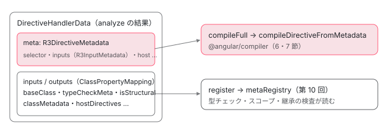

[目次](../README.md) › [ngtsc の内側](README.md) › 第 9 回 / 全 20 回

# DirectiveDecoratorHandler：@Directive を解析する

> DirectiveDecoratorHandler の detect・analyze（extractDirectiveMetadata で selector・inputs・outputs・host・queries・exportAs・hostDirectives を読む）・symbol（DirectiveSymbol）・register・resolve・compileFull の流れ、継承したメタデータ、抽象クラスの扱い、R3DirectiveMetadata を @angular/compiler の compileDirectiveFromMetadata に渡すところ。コンポーネントの handler（既存の章）との違い。

angular/angular · 読了 約 13 分 · 中核 · [サイトで読む（デモが動きます）](https://angular-deep-dive-cyan.vercel.app/chapter/ngtsc-directive-handler)

---

この章では、`@Directive` の付いたクラス 1 つが、ngtsc の中でどの関数を通って `static ɵdir = ɵɵdefineDirective({...})` になるかを、`DirectiveDecoratorHandler` の 6 つのメソッド（detect・analyze・symbol・register・resolve・compileFull）の順に追います。デコレーターの引数の 1 つ 1 つ（selector・inputs・host・exportAs など）を読む関数と、`@angular/compiler` に渡す `R3DirectiveMetadata` の形を、行で確かめます。

読む対象は `packages/compiler-cli/src/ngtsc/annotations/directive/src/handler.ts`・`shared.ts`、`annotations/common/src/` の補助、`packages/compiler/src/render3/view/compiler.ts` です。

1. [1. 全体像](01-ngtsc-overview.md)
2. [2. NgtscProgram](02-ngtsc-program.md)
3. [3. NgCompiler とチケット](03-ngtsc-compiler-ticket.md)
4. [4. リフレクション](04-ngtsc-reflection.md)
5. [5. 静的な評価](05-ngtsc-partial-evaluator.md)
6. [6. 参照と import](06-ngtsc-references-imports.md)
7. [7. 解析](07-ngtsc-trait-analyze.md)
8. [8. 解決と出力](08-ngtsc-trait-resolve-compile.md)
9. **9. @Directive の handler**（この章）
10. [10. メタデータの登録](10-ngtsc-metadata-registry.md)
11. [11. .d.ts を読む](11-ngtsc-dts-metadata.md)
12. [12. JS の書き換え](12-ngtsc-ivy-transform.md)
13. [13. .d.ts の書き換え](13-ngtsc-dts-transform.md)
14. [14. 差分ビルド](14-ngtsc-incremental.md)
15. [15. 意味のグラフ](15-ngtsc-semantic-graph.md)
16. [16. import の循環](16-ngtsc-cycles.md)
17. [17. HMR](17-ngtsc-hmr.md)
18. [18. 診断と性能](18-ngtsc-diagnostics-perf.md)
19. [19. テストを書く](19-ngtsc-test-env.md)
20. [20. issue と PR を読む](20-ngtsc-issues.md)

> [!TIP]
> **新卒エンジニアへ**
>
> **handler**（ハンドラ）は、1 種類のデコレーターを受け持つクラスです。`TraitCompiler` がファイルのクラスを回し、handler の `detect` → `analyze` → … を決まった順で呼びます。その順番と状態の移り方は[第 7 回](07-ngtsc-trait-analyze.md)と [第 8 回](08-ngtsc-trait-resolve-compile.md)で読みました。この章は「呼ばれる側」の中身です。

## 1. detect：このクラスは私の担当か

📄 `angular/packages/compiler-cli/src/ngtsc/annotations/directive/src/handler.ts` L178–198 （▶ の行: 178, 189–190, 192, 195–196）

```ts
178 ▶   readonly precedence = HandlerPrecedence.PRIMARY;
179 │   readonly name = 'DirectiveDecoratorHandler';
180 │   private readonly undecoratedMetadataExtractor: UndecoratedMetadataExtractor;
181 │ 
182 │   detect(
183 │     node: ClassDeclaration,
184 │     decorators: Decorator[] | null,
185 │   ): DetectResult<Decorator | null> | undefined {
186 │     // If a class is undecorated but uses Angular features, we detect it as an
187 │     // abstract directive. This is an unsupported pattern as of v10, but we want
188 │     // to still detect these patterns so that we can report diagnostics.
189 ▶     if (!decorators) {
190 ▶       const angularField = this.findClassFieldWithAngularFeatures(node);
191 │       return angularField
192 ▶         ? {trigger: angularField.node, decorator: null, metadata: null}
193 │         : undefined;
194 │     } else {
195 ▶       const decorator = findAngularDecorator(decorators, 'Directive', this.isCore);
196 ▶       return decorator ? {trigger: decorator.node, decorator, metadata: decorator} : undefined;
197 │     }
198 │   }
```

178 行目、優先度は `HandlerPrecedence.PRIMARY` です（`@Component` と `@Directive` が同じクラスに付いていたら、どちらも PRIMARY なのでエラーになります。[第 7 回](07-ngtsc-trait-analyze.md)）。`detect` の分かれ道は 189 行目の「デコレーターが 1 つも無いか」です。

1. **デコレーターがある（194〜196 行目）**

   195 行目の `findAngularDecorator(decorators, 'Directive', this.isCore)` で `@angular/core` の `Directive` を探します。見つかれば 196 行目で `trigger`（診断を出す位置）と `metadata` にデコレーターそのものを入れて返します。
2. **デコレーターが無い（189〜193 行目）**

   それでも 190 行目で「Angular の機能を使っているメンバー」を探し、見つかれば 192 行目で `decorator: null` のまま担当を名乗ります。エラーを出すためだけに拾っている、というのが 186〜188 行目のコメントです（2 節）。

📄 `angular/packages/compiler-cli/src/ngtsc/annotations/common/src/util.ts` L139–154 （▶ の行: 148–151）

```ts
139 │ export function findAngularDecorator(
140 │   decorators: Decorator[],
141 │   name: string,
142 │   isCore: boolean,
143 │ ): Decorator | undefined {
144 │   return decorators.find((decorator) => isAngularDecorator(decorator, name, isCore));
145 │ }
146 │ 
147 │ export function isAngularDecorator(decorator: Decorator, name: string, isCore: boolean): boolean {
148 ▶   if (isCore) {
149 ▶     return decorator.name === name;
150 ▶   } else if (isAngularCore(decorator)) {
151 ▶     return decorator.import.name === name;
152 │   }
153 │   return false;
154 │ }
```

「Angular のデコレーターか」の判定は、名前の文字列ではなく **import 元**で決まります。150 行目の `isAngularCore(decorator)` は `decorator.import.from === '@angular/core'` を見る関数で、151 行目は `import.name`（import したときの元の名前）を比べます。だから `import {Directive as D} from '@angular/core'` と書いて `@D()` と付けても見つかります。148〜149 行目は `@angular/core` 自身をコンパイルしているとき（`isCore`）で、import が無いので名前で比べます。デコレーターの import をどう読むかは[第 4 回](04-ngtsc-reflection.md)です。

## 2. デコレーターの無いクラスと NG2007

📄 `angular/packages/compiler-cli/src/ngtsc/annotations/directive/src/handler.ts` L100–119 （▶ の行: 100, 110）

```ts
100 ▶ const FIELD_DECORATORS = [
101 │   'Input',
102 │   'Output',
103 │   'ViewChild',
104 │   'ViewChildren',
105 │   'ContentChild',
106 │   'ContentChildren',
107 │   'HostBinding',
108 │   'HostListener',
109 │ ];
110 ▶ const LIFECYCLE_HOOKS = new Set([
111 │   'ngOnChanges',
112 │   'ngOnInit',
113 │   'ngOnDestroy',
114 │   'ngDoCheck',
115 │   'ngAfterViewInit',
116 │   'ngAfterViewChecked',
117 │   'ngAfterContentInit',
118 │   'ngAfterContentChecked',
119 │ ]);
```

📄 `angular/packages/compiler-cli/src/ngtsc/annotations/directive/src/handler.ts` L530–555 （▶ の行: 539–541, 545–548）

```ts
530 │   /**
531 │    * Checks if a given class uses Angular features and returns the TypeScript node
532 │    * that indicated the usage. Classes are considered using Angular features if they
533 │    * contain class members that are either decorated with a known Angular decorator,
534 │    * or if they correspond to a known Angular lifecycle hook.
535 │    */
536 │   private findClassFieldWithAngularFeatures(node: ClassDeclaration): ClassMember | undefined {
537 │     return this.reflector.getMembersOfClass(node).find((member) => {
538 │       if (
539 ▶         !member.isStatic &&
540 ▶         member.kind === ClassMemberKind.Method &&
541 ▶         LIFECYCLE_HOOKS.has(member.name)
542 │       ) {
543 │         return true;
544 │       }
545 ▶       if (member.decorators) {
546 ▶         return member.decorators.some((decorator) =>
547 ▶           FIELD_DECORATORS.some((decoratorName) =>
548 ▶             isAngularDecorator(decorator, decoratorName, this.isCore),
549 │           ),
550 │         );
551 │       }
552 │       return false;
553 │     });
554 │   }
555 │ }
```

「Angular の機能を使っている」の定義は、この 2 つのリストがすべてです。539〜541 行目、static でないメソッドで、名前が 110〜119 行目の 8 つのライフサイクルフックのどれか。または 545〜548 行目、メンバーに 100〜109 行目の 8 つのデコレーター（`Input`・`Output`・クエリ 4 つ・`HostBinding`・`HostListener`）のどれかが付いている。`input()` のような関数で書いたメンバーは、このリストには入っていません。

📄 `angular/packages/compiler-cli/src/ngtsc/annotations/directive/src/handler.ts` L200–216 （▶ の行: 208, 211–212, 214）

```ts
200 │   analyze(
201 │     node: ClassDeclaration,
202 │     decorator: Readonly<Decorator | null>,
203 │   ): AnalysisOutput<DirectiveHandlerData> {
204 │     // Skip processing of the class declaration if compilation of undecorated classes
205 │     // with Angular features is disabled. Previously in ngtsc, such classes have always
206 │     // been processed, but we want to enforce a consistent decorator mental model.
207 │     // See: https://v9.angular.io/guide/migration-undecorated-classes.
208 ▶     if (decorator === null) {
209 │       // If compiling @angular/core, skip the diagnostic as core occasionally hand-writes
210 │       // definitions.
211 ▶       if (this.isCore) {
212 ▶         return {};
213 │       }
214 ▶       return {diagnostics: [getUndecoratedClassWithAngularFeaturesDiagnostic(node)]};
215 │     }
216 │ 
```

📄 `angular/packages/compiler-cli/src/ngtsc/annotations/common/src/diagnostics.ts` L349–358 （▶ の行: 353, 355）

```ts
349 │ export function getUndecoratedClassWithAngularFeaturesDiagnostic(
350 │   node: ClassDeclaration,
351 │ ): ts.Diagnostic {
352 │   return makeDiagnostic(
353 ▶     ErrorCode.UNDECORATED_CLASS_USING_ANGULAR_FEATURES,
354 │     node.name,
355 ▶     `Class is using Angular features but is not decorated. Please add an explicit ` +
356 │       `Angular decorator.`,
357 │   );
358 │ }
```

`analyze` は 208 行目で `decorator === null`（1 節の「デコレーターが無い」側）を先に処理します。214 行目で `UNDECORATED_CLASS_USING_ANGULAR_FEATURES`（2007 番、画面では `NG2007`）の診断だけを返し、`analysis` は返しません。211〜213 行目、`@angular/core` 自身のコンパイルでは何も言わずに空を返します（core は定義を手で書くことがあるため）。

このときクラスは「解析の結果なし」なので、[第 12 回](12-ngtsc-ivy-transform.md)の変換は何もしません。6 節のデモの「デコレーター無し + @Input」の場面で、出力の JS に `__decorate([Input()], ...)` がそのまま残っているのはそのためです。

## 3. analyze：extractDirectiveMetadata を呼ぶ

📄 `angular/packages/compiler-cli/src/ngtsc/annotations/directive/src/handler.ts` L217–243 （▶ の行: 217, 219, 230, 239–241）

```ts
217 ▶     this.perf.eventCount(PerfEvent.AnalyzeDirective);
218 │ 
219 ▶     const directiveResult = extractDirectiveMetadata(
220 │       node,
221 │       decorator,
222 │       this.reflector,
223 │       this.importTracker,
224 │       this.evaluator,
225 │       this.refEmitter,
226 │       this.referencesRegistry,
227 │       this.isCore,
228 │       this.annotateForClosureCompiler,
229 │       this.compilationMode,
230 ▶       /* defaultSelector */ null,
231 │       this.strictStandalone,
232 │       this.implicitStandaloneValue,
233 │       this.emitDeclarationOnly,
234 │       this.legacyOptionalChaining,
235 │     );
236 │     // `extractDirectiveMetadata` returns `jitForced = true` when the `@Directive` has
237 │     // set `jit: true`. In this case, compilation of the decorator is skipped. Returning
238 │     // an empty object signifies that no analysis was produced.
239 ▶     if (directiveResult.jitForced) {
240 ▶       this.jitDeclarationRegistry.jitDeclarations.add(node);
241 ▶       return {};
242 │     }
243 │ 
```

実際の読み取りは 219 行目の `extractDirectiveMetadata`（shared.ts）にまとめて任せます。この関数は `ComponentDecoratorHandler` も呼んでいて、違いは 230 行目の `defaultSelector` です。ディレクティブは `null`、コンポーネントは要素スキーマの既定の要素名（`ng-component`）を渡します。239〜241 行目、`jit: true` が付いていたら `JitDeclarationRegistry` に入れて空の結果を返し、AOT のコンパイルから外します。

### 3-1. 引数を Map にする

📄 `angular/packages/compiler-cli/src/ngtsc/annotations/directive/src/shared.ts` L162–194 （▶ の行: 163–165, 173, 180, 183, 188, 192）

```ts
162 │   let directive: Map<string, ts.Expression>;
163 ▶   if (decorator.args === null || decorator.args.length === 0) {
164 ▶     directive = new Map<string, ts.Expression>();
165 ▶   } else if (decorator.args.length !== 1) {
166 │     throw new FatalDiagnosticError(
167 │       ErrorCode.DECORATOR_ARITY_WRONG,
168 │       decorator.node,
169 │       `Incorrect number of arguments to @${decorator.name} decorator`,
170 │     );
171 │   } else {
172 │     const meta = unwrapExpression(decorator.args[0]);
173 ▶     if (!ts.isObjectLiteralExpression(meta)) {
174 │       throw new FatalDiagnosticError(
175 │         ErrorCode.DECORATOR_ARG_NOT_LITERAL,
176 │         meta,
177 │         `@${decorator.name} argument must be an object literal`,
178 │       );
179 │     }
180 ▶     directive = reflectObjectLiteral(meta);
181 │   }
182 │ 
183 ▶   if (directive.has('jit')) {
184 │     // The only allowed value is true, so there's no need to expand further.
185 │     return {jitForced: true};
186 │   }
187 │ 
188 ▶   const members = reflector.getMembersOfClass(clazz);
189 │ 
190 │   // Precompute a list of ts.ClassElements that have decorators. This includes things like @Input,
191 │   // @Output, @HostBinding, etc.
192 ▶   const decoratedElements = members.filter(
193 │     (member) => !member.isStatic && member.decorators !== null,
194 │   );
```

1. **163〜164 行目：引数なし**

   `@Directive()` は空の `Map` になります。抽象ディレクティブ（selector の無いもの）はこの形で書きます。
2. **165〜170 行目・173〜178 行目：形が違えば止める**

   引数が 2 つ以上なら `DECORATOR_ARITY_WRONG`、オブジェクトのリテラル（`{ ... }`）でなければ `DECORATOR_ARG_NOT_LITERAL` の `FatalDiagnosticError` を投げます。投げられた例外が診断になる道は [第 18 回](18-ngtsc-diagnostics-perf.md)です。
3. **180 行目：reflectObjectLiteral**

   オブジェクトのリテラルを「キーの文字列 → 値の `ts.Expression`」の `Map` にします。ここではまだ値を評価していません。値は 3-3 節以降で必要になったときに `evaluator.evaluate`（[第 5 回](05-ngtsc-partial-evaluator.md)）で読みます。
4. **188〜194 行目：クラスのメンバー**

   `reflector.getMembersOfClass` でメンバーを全部取り、デコレーターの付いた static でないものを `decoratedElements` に分けておきます（`@HostBinding` などを探すため）。

### 3-2. inputs と outputs：2 か所から集めて 1 つに

📄 `angular/packages/compiler-cli/src/ngtsc/annotations/directive/src/shared.ts` L198–236 （▶ の行: 200, 209, 218, 222, 225–226, 236）

```ts
198 │   // Construct the map of inputs both from the @Directive/@Component
199 │   // decorator, and the decorated fields.
200 ▶   const inputsFromMeta = parseInputsArray(
201 │     clazz,
202 │     directive,
203 │     evaluator,
204 │     reflector,
205 │     refEmitter,
206 │     compilationMode,
207 │     emitDeclarationOnly,
208 │   );
209 ▶   const inputsFromFields = parseInputFields(
210 │     clazz,
211 │     members,
212 │     evaluator,
213 │     reflector,
214 │     importTracker,
215 │     refEmitter,
216 │     isCore,
217 │     compilationMode,
218 ▶     inputsFromMeta,
219 │     decorator,
220 │     emitDeclarationOnly,
221 │   );
222 ▶   const inputs = ClassPropertyMapping.fromMappedObject({...inputsFromMeta, ...inputsFromFields});
223 │ 
224 │   // And outputs.
225 ▶   const outputsFromMeta = parseOutputsArray(directive, evaluator);
226 ▶   const outputsFromFields = parseOutputFields(
227 │     clazz,
228 │     decorator,
229 │     members,
230 │     isCore,
231 │     reflector,
232 │     importTracker,
233 │     evaluator,
234 │     outputsFromMeta,
235 │   );
236 ▶   const outputs = ClassPropertyMapping.fromMappedObject({...outputsFromMeta, ...outputsFromFields});
```

入力は 2 か所から来ます。200 行目の `parseInputsArray` はデコレーターの `inputs: ['a', 'b: alias']` の配列、209 行目の `parseInputFields` はクラスのフィールド（`@Input()` と `input()`）です。218 行目で配列側の結果を渡しているのは、同じ名前が両方にあるかを調べるためです。222 行目、2 つをスプレッドで 1 つのオブジェクトにして `ClassPropertyMapping`（クラスのプロパティ名と、テンプレートで使う名前の対応表。[第 10 回](10-ngtsc-metadata-registry.md)）にします。出力も 225〜236 行目で同じ形です。`input()` を関数の呼び出しの形から見分ける仕組みは [signal の入力の章](../signals/12-signals-input-compile.md)で読みました。

### 3-2b. クエリ：フィールドとデコレーターの queries

📄 `angular/packages/compiler-cli/src/ngtsc/annotations/directive/src/shared.ts` L238–273 （▶ の行: 239, 247–249, 251, 261–263, 271–272）

```ts
238 │   // Parse queries of fields.
239 ▶   const {viewQueries, contentQueries} = parseQueriesOfClassFields(
240 │     members,
241 │     reflector,
242 │     importTracker,
243 │     evaluator,
244 │     isCore,
245 │   );
246 │ 
247 ▶   if (directive.has('queries')) {
248 ▶     const signalQueryFields = new Set(
249 ▶       [...viewQueries, ...contentQueries].filter((q) => q.isSignal).map((q) => q.propertyName),
250 │     );
251 ▶     const queriesFromDecorator = extractQueriesFromDecorator(
252 │       directive.get('queries')!,
253 │       reflector,
254 │       evaluator,
255 │       isCore,
256 │     );
257 │ 
258 │     // Checks if the query is already declared/reserved via class members declaration.
259 │     // If so, we throw a fatal diagnostic error to prevent this unintentional pattern.
260 │     const checkAndUnwrapQuery = (q: {expr: ts.Expression; metadata: R3QueryMetadata}) => {
261 ▶       if (signalQueryFields.has(q.metadata.propertyName)) {
262 ▶         throw new FatalDiagnosticError(
263 ▶           ErrorCode.INITIALIZER_API_DECORATOR_METADATA_COLLISION,
264 │           q.expr,
265 │           `Query is declared multiple times. "@${decorator.name}" declares a query for the same property.`,
266 │         );
267 │       }
268 │       return q.metadata;
269 │     };
270 │ 
271 ▶     contentQueries.push(...queriesFromDecorator.content.map((q) => checkAndUnwrapQuery(q)));
272 ▶     viewQueries.push(...queriesFromDecorator.view.map((q) => checkAndUnwrapQuery(q)));
273 │   }
```

239〜245 行目の `parseQueriesOfClassFields` が、フィールドの `@ViewChild` 系と `viewChild()` 系の両方を `viewQueries` と `contentQueries` に分けて集めます。247 行目、デコレーターに `queries: {...}` も書いてあれば 251 行目で読み、271〜272 行目で後ろに足します。248〜250 行目と 261〜267 行目は、`viewChild()` などの signal のクエリと同じプロパティを `queries` でも宣言していたら `INITIALIZER_API_DECORATOR_METADATA_COLLISION` で止める検査です。

### 3-3. selector

📄 `angular/packages/compiler-cli/src/ngtsc/annotations/directive/src/shared.ts` L275–302 （▶ の行: 276–277, 279, 290–291, 294–295, 297）

```ts
275 │   // Parse the selector.
276 ▶   let selector = defaultSelector;
277 ▶   if (directive.has('selector')) {
278 │     const expr = directive.get('selector')!;
279 ▶     const resolved = evaluator.evaluate(expr);
280 │     assertLocalCompilationUnresolvedConst(
281 │       compilationMode,
282 │       resolved,
283 │       null,
284 │       'Unresolved identifier found for @Component.selector field! Did you ' +
285 │         'import this identifier from a file outside of the compilation unit? ' +
286 │         'This is not allowed when Angular compiler runs in local mode. Possible ' +
287 │         'solutions: 1) Move the declarations into a file within the compilation ' +
288 │         'unit, 2) Inline the selector',
289 │     );
290 ▶     if (typeof resolved !== 'string') {
291 ▶       throw createValueHasWrongTypeError(expr, resolved, `selector must be a string`);
292 │     }
293 │     // use default selector in case selector is an empty string
294 ▶     selector = resolved === '' ? defaultSelector : resolved;
295 ▶     if (!selector) {
296 │       throw new FatalDiagnosticError(
297 ▶         ErrorCode.DIRECTIVE_MISSING_SELECTOR,
298 │         expr,
299 │         `Directive ${clazz.name.text} has no selector, please add it!`,
300 │       );
301 │     }
302 │   }
```

276 行目、最初の値は `defaultSelector`（ディレクティブなら `null`）。277 行目、`selector` のキーが無ければそのまま `null` で、これが抽象ディレクティブです。キーがあれば 279 行目で評価し、文字列でなければ 290〜291 行目でエラー。294 行目、空文字なら `defaultSelector` に戻すので、ディレクティブで `selector: ''` と書くと 295〜301 行目の `DIRECTIVE_MISSING_SELECTOR`（NG2004）になります。selector の文字列をこの段階では**解析しません**。CSS のセレクタとして分解するのは compiler 側（7 節）です。

### 3-4. host・providers・ngOnChanges

📄 `angular/packages/compiler-cli/src/ngtsc/annotations/directive/src/shared.ts` L304–334 （▶ の行: 311, 317, 320–321, 329–331）

```ts
304 │   const hostBindingNodes: HostBindingNodes = {
305 │     hostObjectLiteralBindings: [],
306 │     hostBindingDecorators: [],
307 │     hostListenerDecorators: [],
308 │     rawNodes: [],
309 │   };
310 │ 
311 ▶   const host = extractHostBindings(
312 │     decoratedElements,
313 │     evaluator,
314 │     coreModule,
315 │     compilationMode,
316 │     hostBindingNodes,
317 ▶     directive,
318 │   );
319 │ 
320 ▶   const providers: Expression | null = directive.has('providers')
321 ▶     ? new WrappedNodeExpr(
322 │         annotateForClosureCompiler
323 │           ? wrapFunctionExpressionsInParens(directive.get('providers')!)
324 │           : directive.get('providers')!,
325 │       )
326 │     : null;
327 │ 
328 │   // Determine if `ngOnChanges` is a lifecycle hook defined on the component.
329 ▶   const usesOnChanges = members.some(
330 ▶     (member) =>
331 ▶       !member.isStatic && member.kind === ClassMemberKind.Method && member.name === 'ngOnChanges',
332 │   );
333 │ 
334 │   const controlCreate = extractControlDirectiveDefinition(members);
```

311〜318 行目の `extractHostBindings` が、デコレーターの `host: {...}`（317 行目で `directive` の Map を渡す）と、メンバーの `@HostBinding`・`@HostListener` を 1 つの `ParsedHostBindings`（attributes・listeners・properties・specialAttributes）にまとめます。`host` のオブジェクトの値を読む部分は次の引用です。320〜326 行目、`providers` は評価せず、書かれた式をそのまま `WrappedNodeExpr`（TypeScript の式をそのまま包む出力の式）で持ちます。329〜332 行目、`ngOnChanges` という名前のメソッドがあるかどうかだけで `usesOnChanges` を決めます。

📄 `angular/packages/compiler-cli/src/ngtsc/annotations/directive/src/shared.ts` L2030–2057 （▶ の行: 2031, 2045–2048, 2050）

```ts
2030 │   const hostMetadata: Record<string, string | Expression> = {};
2031 ▶   hostMetaMap.forEach((value, key) => {
2032 │     // Resolve Enum references to their declared value.
2033 │     if (value instanceof EnumValue) {
2034 │       value = value.resolved;
2035 │     }
2036 │ 
2037 │     if (typeof key !== 'string') {
2038 │       throw createValueHasWrongTypeError(
2039 │         hostExpr,
2040 │         key,
2041 │         `Decorator host metadata must be a string -> string object, but found unparseable key`,
2042 │       );
2043 │     }
2044 │ 
2045 ▶     if (typeof value == 'string') {
2046 ▶       hostMetadata[key] = value;
2047 ▶     } else if (value instanceof DynamicValue) {
2048 ▶       hostMetadata[key] = new WrappedNodeExpr(value.node as ts.Expression);
2049 │     } else {
2050 ▶       throw createValueHasWrongTypeError(
2051 │         hostExpr,
2052 │         value,
2053 │         `Decorator host metadata must be a string -> string object, but found unparseable value`,
2054 │       );
2055 │     }
2056 │   });
2057 │ 
```

📄 `angular/packages/compiler-cli/src/ngtsc/annotations/directive/src/shared.ts` L2068–2079 （▶ の行: 2069, 2071–2072）

```ts
2068 │ 
2069 ▶   const errors = verifyHostBindings(bindings, createSourceSpan(hostExpr));
2070 │   if (errors.length > 0) {
2071 ▶     throw new FatalDiagnosticError(
2072 ▶       ErrorCode.HOST_BINDING_PARSE_ERROR,
2073 │       getHostBindingErrorNode(errors[0], hostExpr),
2074 │       errors.map((error: ParseError) => error.msg).join('\n'),
2075 │     );
2076 │   }
2077 │ 
2078 │   return bindings;
2079 │ }
```

2045〜2046 行目、値が文字列ならそのまま。2047〜2048 行目、評価できなかった値（`DynamicValue`）は式のまま包みます。この `hostMetadata` を `@angular/compiler` の `parseHostBindings` に渡すと、`[prop]` と `(event)` の値が文字列でないときに素の `Error` を投げます。それを診断に変える `try`（この 2 つの引用のあいだ）は 2026 年 6 月の修正 8b2785b597c で入ったもので、[第 18 回](18-ngtsc-diagnostics-perf.md)で読みます。2069 行目の `verifyHostBindings` は、文字列の中の式を実際に解析して、壊れていれば 2071〜2072 行目で `HOST_BINDING_PARSE_ERROR` にします。

### 3-5. exportAs・構造ディレクティブ・継承・hostDirectives

📄 `angular/packages/compiler-cli/src/ngtsc/annotations/directive/src/shared.ts` L336–358 （▶ の行: 340, 353, 356）

```ts
336 │   // Parse exportAs.
337 │   let exportAs: string[] | null = null;
338 │   if (directive.has('exportAs')) {
339 │     const expr = directive.get('exportAs')!;
340 ▶     const resolved = evaluator.evaluate(expr);
341 │ 
342 │     assertLocalCompilationUnresolvedConst(
343 │       compilationMode,
344 │       resolved,
345 │       null,
346 │       'Unresolved identifier found for exportAs field! Did you import this ' +
347 │         'identifier from a file outside of the compilation unit? This is not ' +
348 │         'allowed when Angular compiler runs in local mode. Possible solutions: ' +
349 │         '1) Move the declarations into a file within the compilation unit, ' +
350 │         '2) Inline the selector',
351 │     );
352 │ 
353 ▶     if (typeof resolved !== 'string') {
354 │       throw createValueHasWrongTypeError(expr, resolved, `exportAs must be a string`);
355 │     }
356 ▶     exportAs = resolved.split(',').map((part) => part.trim());
357 │   }
358 │ 
```

356 行目、`exportAs: 'a, b'` はカンマで分けて前後の空白を落とした配列になります。このすぐあとのコンストラクタの依存の読み取りは[ファクトリの章](../di/04-di-factory.md)で読みました。

📄 `angular/packages/compiler-cli/src/ngtsc/annotations/directive/src/shared.ts` L368–379 （▶ の行: 370, 375–377）

```ts
368 │ 
369 │   // Structural directives must have a `TemplateRef` dependency.
370 ▶   const isStructural =
371 │     ctorDeps !== null &&
372 │     ctorDeps !== 'invalid' &&
373 │     ctorDeps.some(
374 │       (dep) =>
375 ▶         dep.token instanceof ExternalExpr &&
376 ▶         dep.token.value.moduleName === '@angular/core' &&
377 ▶         dep.token.value.name === 'TemplateRef',
378 │     );
379 │ 
```

「構造ディレクティブ」（`*ngIf` のように `<ng-template>` に付くもの）かどうかは、宣言ではなく 375〜377 行目の**コンストラクタが `@angular/core` の `TemplateRef` を受け取るか**で決まります。この値はテンプレートの型チェックで `*` の構文に使えるかの判定に使われます。その次の `standalone` の読み取りは[standalone への移行の章](../ngmodule/18-ngmodule-to-standalone.md)で読みました。

📄 `angular/packages/compiler-cli/src/ngtsc/annotations/directive/src/shared.ts` L410–443 （▶ の行: 411, 415, 419, 428, 433）

```ts
410 │   // Detect if the component inherits from another class
411 ▶   const usesInheritance = reflector.hasBaseClass(clazz);
412 │   const sourceFile = clazz.getSourceFile();
413 │   const type = wrapTypeReference(clazz);
414 │ 
415 ▶   const rawHostDirectives = directive.get('hostDirectives') || null;
416 │   const hostDirectives =
417 │     rawHostDirectives === null
418 │       ? null
419 ▶       : extractHostDirectives(
420 │           rawHostDirectives,
421 │           evaluator,
422 │           reflector,
423 │           compilationMode,
424 │           createForwardRefResolver(isCore),
425 │           emitDeclarationOnly,
426 │         );
427 │ 
428 ▶   if (compilationMode !== CompilationMode.LOCAL && hostDirectives !== null) {
429 │     // In global compilation mode where we do type checking, the template type-checker will need to
430 │     // import host directive types, so add them as referenced by `clazz`. This will ensure that
431 │     // libraries are required to export host directives which are visible from publicly exported
432 │     // components.
433 ▶     referencesRegistry.add(
434 │       clazz,
435 │       ...hostDirectives.map((hostDir) => {
436 │         if (!isHostDirectiveMetaForGlobalMode(hostDir)) {
437 │           throw new Error('Impossible state');
438 │         }
439 │ 
440 │         return hostDir.directive;
441 │       }),
442 │     );
443 │   }
```

411 行目、継承しているかは `reflector.hasBaseClass`、つまり `extends` が書いてあるかだけです。親が Angular のクラスかどうかはここでは見ません。415〜426 行目で `hostDirectives` を読み、428〜443 行目、ローカルでない（全体を見る）コンパイルでは、型チェックが host directive の型を import できるように `referencesRegistry.add` で記録します。host directive の中身の検査は[host directives の章](../standalone/10-standalone-host-directives.md)です。

### 3-6. R3DirectiveMetadata に詰める

📄 `angular/packages/compiler-cli/src/ngtsc/annotations/directive/src/shared.ts` L445–472 （▶ の行: 445, 454–458, 461–462）

```ts
445 ▶   const metadata: R3DirectiveMetadata = {
446 │     name: clazz.name.text,
447 │     deps: ctorDeps,
448 │     host: {
449 │       ...host,
450 │     },
451 │     lifecycle: {
452 │       usesOnChanges,
453 │     },
454 ▶     inputs: inputs.toJointMappedObject(toR3InputMetadata),
455 ▶     outputs: outputs.toDirectMappedObject(),
456 ▶     queries: contentQueries,
457 ▶     viewQueries,
458 ▶     selector,
459 │     type,
460 │     typeArgumentCount: reflector.getGenericArityOfClass(clazz) || 0,
461 ▶     typeSourceSpan: createSourceSpan(clazz.name),
462 ▶     usesInheritance,
463 │     controlCreate,
464 │     exportAs,
465 │     providers,
466 │     isStandalone,
467 │     isSignal,
468 │     hostDirectives:
469 │       hostDirectives?.map((hostDir) => toHostDirectiveMetadata(hostDir, sourceFile, refEmitter)) ||
470 │       null,
471 │     legacyOptionalChaining,
472 │   };
```

445 行目からが、`@angular/compiler` に渡す `R3DirectiveMetadata` です。ここで形が変わるものに注意します。

- 454 行目、入力は `ClassPropertyMapping` から `toJointMappedObject(toR3InputMetadata)` で「クラスのプロパティ名 → R3InputMetadata」のオブジェクトへ。
- 455 行目、出力は `toDirectMappedObject()` で「クラスのプロパティ名 → テンプレートでの名前」の文字列だけに。
- 456〜457 行目、`queries` は `@ContentChild` 系、`viewQueries` は `@ViewChild` 系です。
- 461 行目、`typeSourceSpan` はクラス名の位置で、host のエラーの位置などに使われます。

## 4. analyze が返すもの：compiler に渡さない情報も持つ

📄 `angular/packages/compiler-cli/src/ngtsc/annotations/directive/src/handler.ts` L255–288 （▶ の行: 256, 258, 261, 264, 274–275, 278, 281）

```ts
255 │     return {
256 ▶       diagnostics: directiveResult.diagnostics,
257 │       analysis: {
258 ▶         inputs: directiveResult.inputs,
259 │         inputFieldNamesFromMetadataArray: directiveResult.inputFieldNamesFromMetadataArray,
260 │         outputs: directiveResult.outputs,
261 ▶         meta: analysis,
262 │         hostDirectives: directiveResult.hostDirectives,
263 │         rawHostDirectives: directiveResult.rawHostDirectives,
264 ▶         classMetadata: this.includeClassMetadata
265 │           ? extractClassMetadata(
266 │               node,
267 │               this.reflector,
268 │               this.isCore,
269 │               this.annotateForClosureCompiler,
270 │               undefined,
271 │               this.undecoratedMetadataExtractor,
272 │             )
273 │           : null,
274 ▶         baseClass: readBaseClass(node, this.reflector, this.evaluator),
275 ▶         typeCheckMeta: extractDirectiveTypeCheckMeta(node, directiveResult.inputs, this.reflector),
276 │         providersRequiringFactory,
277 │         isPoisoned: false,
278 ▶         isStructural: directiveResult.isStructural,
279 │         decorator: (decorator?.node as ts.Decorator | null) ?? null,
280 │         hostBindingNodes: directiveResult.hostBindingNodes,
281 ▶         resources: {
282 │           template: null,
283 │           styles: null,
284 │           hostBindings: extractHostBindingResources(directiveResult.hostBindingNodes),
285 │         },
286 │       },
287 │     };
288 │   }
```

`analysis` は `meta`（261 行目、compiler に渡す分）より多くを持っています。258 行目の `inputs` は `ClassPropertyMapping` のまま（型チェックとメタデータの登録で使う）。264〜273 行目の `classMetadata` は、開発モードで `ɵsetClassMetadata`（デコレーターの中身を実行時に残す呼び出し）を出すための材料です。275 行目の `typeCheckMeta` はテンプレートの型チェック用で、[ガードの章](../typecheck/14-typecheck-template-guards.md)で読んだ `extractDirectiveTypeCheckMeta` の結果です。256 行目の `diagnostics` は、`strictStandalone` のエラーを「止めずに、結果と一緒に返す」ための行で、2026 年 8 月の修正 74b294cd51b で入りました（[第 10 回](10-ngtsc-metadata-registry.md)で pipe の側を読みます）。

📄 `angular/packages/compiler-cli/src/ngtsc/annotations/common/src/util.ts` L303–319 （▶ の行: 308, 310–312, 314, 318）

```ts
303 │ export function readBaseClass(
304 │   node: ClassDeclaration,
305 │   reflector: ReflectionHost,
306 │   evaluator: PartialEvaluator,
307 │ ): Reference<ClassDeclaration> | 'dynamic' | null {
308 ▶   const baseExpression = reflector.getBaseClassExpression(node);
309 │   if (baseExpression !== null) {
310 ▶     const baseClass = evaluator.evaluate(baseExpression);
311 ▶     if (baseClass instanceof Reference && reflector.isClass(baseClass.node)) {
312 ▶       return baseClass as Reference<ClassDeclaration>;
313 │     } else {
314 ▶       return 'dynamic';
315 │     }
316 │   }
317 │ 
318 ▶   return null;
319 │ }
```

274 行目の `baseClass` は `readBaseClass` の結果で、3 つの値を取ります。`extends` が無ければ 318 行目の `null`。あれば 310 行目で `extends` の式を評価し、クラスへの `Reference` になれば 312 行目でそれを返し、そうでなければ（`extends mixin(Base)` のような式）314 行目の `'dynamic'` です。ここでは親が Angular のクラスかどうかを確かめていません。親のメタデータをたどるのは型チェックのとき（[第 10 回](10-ngtsc-metadata-registry.md)の `flattenInheritedDirectiveMetadata`）です。



*analyze が返す DirectiveHandlerData は 2 層。meta（R3DirectiveMetadata）は compileFull で @angular/compiler へ、残りは register・型チェック・継承の検査が使う。*

## 5. register と resolve

📄 `angular/packages/compiler-cli/src/ngtsc/annotations/directive/src/handler.ts` L304–330 （▶ の行: 307–310, 318–320, 322）

```ts
304 │   register(node: ClassDeclaration, analysis: Readonly<DirectiveHandlerData>): void {
305 │     // Register this directive's information with the `MetadataRegistry`. This ensures that
306 │     // the information about the directive is available during the compile() phase.
307 ▶     const ref = new Reference(node);
308 ▶     this.metaRegistry.registerDirectiveMetadata({
309 ▶       kind: MetaKind.Directive,
310 ▶       matchSource: MatchSource.Selector,
311 │       ref,
312 │       name: node.name.text,
313 │       selector: analysis.meta.selector,
314 │       exportAs: analysis.meta.exportAs,
315 │       inputs: analysis.inputs,
316 │       inputFieldNamesFromMetadataArray: analysis.inputFieldNamesFromMetadataArray,
317 │       outputs: analysis.outputs,
318 ▶       queries: analysis.meta.queries.map((query) => query.propertyName),
319 ▶       isComponent: false,
320 ▶       baseClass: analysis.baseClass,
321 │       hostDirectives: analysis.hostDirectives,
322 ▶       ...analysis.typeCheckMeta,
323 │       isPoisoned: analysis.isPoisoned,
324 │       isStructural: analysis.isStructural,
325 │       animationTriggerNames: null,
326 │       isStandalone: analysis.meta.isStandalone,
327 │       isSignal: analysis.meta.isSignal,
328 │       imports: null,
329 │       foreignImports: null,
330 │       rawImports: null,
```

`register` は、ほかのクラス（このディレクティブを使うコンポーネントなど）が後で読めるように、308 行目で `DirectiveMeta` を書き込みます。318 行目、`queries` はクエリのプロパティ名だけに減らします。320 行目の `baseClass` は 4 節の値そのまま、322 行目で `typeCheckMeta` を広げて入れます。書き込み先の `metaRegistry` が何で、誰が読むのかは[第 10 回](10-ngtsc-metadata-registry.md)の主題です。`symbol` が作る `DirectiveSymbol` は[第 15 回](15-ngtsc-semantic-graph.md)で読みます。

📄 `angular/packages/compiler-cli/src/ngtsc/annotations/directive/src/handler.ts` L401–438 （▶ の行: 406–407, 410–411, 415, 419, 427）

```ts
401 │   resolve(
402 │     node: ClassDeclaration,
403 │     analysis: DirectiveHandlerData,
404 │     symbol: DirectiveSymbol,
405 │   ): ResolveResult<unknown> {
406 ▶     if (this.compilationMode === CompilationMode.LOCAL) {
407 ▶       return {};
408 │     }
409 │ 
410 ▶     if (this.semanticDepGraphUpdater !== null && analysis.baseClass instanceof Reference) {
411 ▶       symbol.baseClass = this.semanticDepGraphUpdater.getSymbol(analysis.baseClass.node);
412 │     }
413 │ 
414 │     const diagnostics: ts.Diagnostic[] = [];
415 ▶     if (
416 │       analysis.providersRequiringFactory !== null &&
417 │       analysis.meta.providers instanceof WrappedNodeExpr
418 │     ) {
419 ▶       const providerDiagnostics = getProviderDiagnostics(
420 │         analysis.providersRequiringFactory,
421 │         analysis.meta.providers!.node,
422 │         this.injectableRegistry,
423 │       );
424 │       diagnostics.push(...providerDiagnostics);
425 │     }
426 │ 
427 ▶     const directiveDiagnostics = getDirectiveDiagnostics(
428 │       node,
429 │       this.injectableRegistry,
430 │       this.evaluator,
431 │       this.reflector,
432 │       this.scopeRegistry,
433 │       this.strictCtorDeps,
434 │       'Directive',
435 │     );
436 │     if (directiveDiagnostics !== null) {
437 │       diagnostics.push(...directiveDiagnostics);
438 │     }
```

📄 `angular/packages/compiler-cli/src/ngtsc/annotations/directive/src/handler.ts` L440–459 （▶ の行: 440, 442, 452–453, 458）

```ts
440 ▶     const hostDirectivesDiagnotics =
441 │       analysis.hostDirectives && analysis.rawHostDirectives
442 ▶         ? validateHostDirectives(
443 │             analysis.rawHostDirectives,
444 │             analysis.hostDirectives,
445 │             this.metaReader,
446 │           )
447 │         : null;
448 │     if (hostDirectivesDiagnotics !== null) {
449 │       diagnostics.push(...hostDirectivesDiagnotics);
450 │     }
451 │ 
452 ▶     if (diagnostics.length > 0) {
453 ▶       return {diagnostics};
454 │     }
455 │ 
456 │     // Note: we need to produce *some* sort of the data in order
457 │     // for the host binding diagnostics to be surfaced.
458 ▶     return {data: {}};
459 │   }
```

`resolve` は、すべてのクラスの `register` が終わったあとに呼ばれるので、**ほかのクラスの情報が要る検査**をここで行います。406〜408 行目、ローカルのコンパイル（[ローカルコンパイルの章](../standalone/06-standalone-local-compilation.md)）では何もしません。415〜425 行目は providers に入れたクラスにファクトリがあるか、427〜438 行目は重複した宣言と継承したコンストラクタ、440〜450 行目は hostDirectives の検査です。何も無くても 458 行目で `{data: {}}` を返すのは、コメントのとおり host binding の診断を出す段に進ませるためです。

📄 `angular/packages/compiler-cli/src/ngtsc/annotations/common/src/diagnostics.ts` L360–397 （▶ の行: 368–369, 375, 379, 382, 390, 396）

```ts
360 │ export function checkInheritanceOfInjectable(
361 │   node: ClassDeclaration,
362 │   injectableRegistry: InjectableClassRegistry,
363 │   reflector: ReflectionHost,
364 │   evaluator: PartialEvaluator,
365 │   strictInjectionParameters: boolean,
366 │   kind: 'Directive' | 'Component' | 'Pipe' | 'Injectable',
367 │ ): ts.Diagnostic | null {
368 ▶   const classWithCtor = findInheritedCtor(node, injectableRegistry, reflector, evaluator);
369 ▶   if (classWithCtor === null || classWithCtor.isCtorValid) {
370 │     // The class does not inherit a constructor, or the inherited constructor is compatible
371 │     // with DI; no need to report a diagnostic.
372 │     return null;
373 │   }
374 │ 
375 ▶   if (!classWithCtor.isDecorated) {
376 │     // The inherited constructor exists in a class that does not have an Angular decorator.
377 │     // This is an error, as there won't be a factory definition available for DI to invoke
378 │     // the constructor.
379 ▶     return getInheritedUndecoratedCtorDiagnostic(node, classWithCtor.ref, kind);
380 │   }
381 │ 
382 ▶   if (isFromDtsFile(classWithCtor.ref.node)) {
383 │     // The inherited class is declared in a declaration file, in which case there is not enough
384 │     // information to detect invalid constructors as `@Inject()` metadata is not present in the
385 │     // declaration file. Consequently, we have to accept such occurrences, although they might
386 │     // still fail at runtime.
387 │     return null;
388 │   }
389 │ 
390 ▶   if (!strictInjectionParameters || isAbstractClassDeclaration(node)) {
391 │     // An invalid constructor is only reported as error under `strictInjectionParameters` and
392 │     // only for concrete classes; follow the same exclusions for derived types.
393 │     return null;
394 │   }
395 │ 
396 ▶   return getInheritedInvalidCtorDiagnostic(node, classWithCtor.ref, kind);
397 │ }
```

427 行目の `getDirectiveDiagnostics` の中で呼ばれる、継承のコンストラクタの検査です。自分にコンストラクタが無いとき、368 行目の `findInheritedCtor` が親をたどって最初のコンストラクタを探します。

1. **375〜379 行目**

   そのコンストラクタを持つ親に Angular のデコレーターが無ければ `DIRECTIVE_INHERITS_UNDECORATED_CTOR`（NG2006）。親の引数を注入するためのファクトリが作られないからです。
2. **382〜387 行目**

   親が .d.ts にあれば、`@Inject()` の情報が無いので検査しません。
3. **390〜396 行目**

   `strictInjectionParameters` が有効で、自分が抽象クラスでないときだけ、親の引数が DI に合わないことを `INJECTABLE_INHERITS_INVALID_CONSTRUCTOR`（NG2016）にします。

## 6. compileFull：3 つの CompileResult

📄 `angular/packages/compiler-cli/src/ngtsc/annotations/directive/src/handler.ts` L461–482 （▶ の行: 467–470, 472, 478）

```ts
461 │   compileFull(
462 │     node: ClassDeclaration,
463 │     analysis: Readonly<DirectiveHandlerData>,
464 │     resolution: Readonly<unknown>,
465 │     pool: ConstantPool,
466 │   ): CompileResult[] {
467 ▶     const fac = compileNgFactoryDefField(toFactoryMetadata(analysis.meta, FactoryTarget.Directive));
468 ▶     const def = compileDirectiveFromMetadata(analysis.meta, pool, makeBindingParser());
469 ▶     const inputTransformFields = compileInputTransformFields(analysis.inputs);
470 ▶     const classMetadata =
471 │       analysis.classMetadata !== null
472 ▶         ? compileClassMetadata(analysis.classMetadata).toStmt()
473 │         : null;
474 │     return compileResults(
475 │       fac,
476 │       def,
477 │       classMetadata,
478 ▶       'ɵdir',
479 │       inputTransformFields,
480 │       null /* deferrableImports */,
481 │     );
482 │   }
```

1. **467 行目：ɵfac**

   `analysis.meta` から `toFactoryMetadata` で名前・型・依存だけを取り出し、`compileNgFactoryDefField` に渡します。ファクトリの中身は[ファクトリの章](../di/04-di-factory.md)です。
2. **468 行目：ɵdir**

   3 節で作った `R3DirectiveMetadata` を `compileDirectiveFromMetadata` に渡します。`pool` は同じファイルのクラスで共有する `ConstantPool`（[第 12 回](12-ngtsc-ivy-transform.md)）です。
3. **469 行目と 470〜473 行目**

   入力に `transform` があれば、`ngAcceptInputType_名前` という型だけのフィールドを足します（初期値が `null` なので JS には出ず、.d.ts にだけ出ます）。`classMetadata` があれば `ɵsetClassMetadata` の文を作ります。

📄 `angular/packages/compiler-cli/src/ngtsc/annotations/common/src/factory.ts` L17–28 （▶ の行: 20, 22–25）

```ts
17 │ export type CompileFactoryFn = (metadata: R3FactoryMetadata) => CompileResult;
18 │ 
19 │ export function compileNgFactoryDefField(metadata: R3FactoryMetadata): CompileResult {
20 ▶   const res = compileFactoryFunction(metadata);
21 │   return {
22 ▶     name: 'ɵfac',
23 ▶     initializer: res.expression,
24 ▶     statements: res.statements,
25 ▶     type: res.type,
26 │     deferrableImports: null,
27 │   };
28 │ }
```

📄 `angular/packages/compiler-cli/src/ngtsc/annotations/common/src/util.ts` L456–473 （▶ の行: 458, 460–463, 469）

```ts
456 │ 
457 │   const results = [
458 ▶     fac,
459 │     {
460 ▶       name: propName,
461 ▶       initializer: def.expression,
462 ▶       statements: def.statements,
463 ▶       type: def.type,
464 │       deferrableImports,
465 │     },
466 │   ];
467 │ 
468 │   if (additionalFields !== null) {
469 ▶     results.push(...additionalFields);
470 │   }
471 │ 
472 │   return results;
473 │ }
```

`CompileResult` は「static フィールドの名前・初期値の式・型・クラスのあとに置く文」の組です。factory.ts の 22 行目で名前が `'ɵfac'`、compileResults の 460 行目で `propName`（ここでは 478 行目の `'ɵdir'`）。462 行目の `statements` に、さっきの `ɵsetClassMetadata` の文が入っています。この配列が [第 12 回](12-ngtsc-ivy-transform.md)の変換に渡り、static フィールドとクラスのあとの文になります。

## 7. @angular/compiler 側：compileDirectiveFromMetadata

📄 `angular/packages/compiler/src/render3/view/compiler.ts` L157–173 （▶ の行: 165–170）

```ts
157 │ /**
158 │  * Compile a directive for the render3 runtime as defined by the `R3DirectiveMetadata`.
159 │  */
160 │ export function compileDirectiveFromMetadata(
161 │   meta: R3DirectiveMetadata,
162 │   constantPool: ConstantPool,
163 │   bindingParser: BindingParser,
164 │ ): R3CompiledExpression {
165 ▶   const definitionMap = baseDirectiveFields(meta, constantPool, bindingParser);
166 ▶   addFeatures(definitionMap, meta);
167 ▶   const expression = o
168 ▶     .importExpr(R3.defineDirective)
169 ▶     .callFn([definitionMap.toLiteralMap()], undefined, true);
170 ▶   const type = createDirectiveType(meta);
171 │ 
172 │   return {expression, type, statements: []};
173 │ }
```

165 行目でフィールドを並べ、166 行目で `features` を足し、167〜169 行目で `ɵɵdefineDirective({...})` の呼び出しの式にします。169 行目の第 3 引数 `true` は「純粋な呼び出し」の印で、出力の `/*@__PURE__*/` になります。170 行目の `createDirectiveType` は .d.ts に書く型（[第 13 回](13-ngtsc-dts-transform.md)）です。166 行目の `addFeatures` の中身（`usesInheritance` なら `ɵɵInheritDefinitionFeature`、`usesOnChanges` なら `ɵɵNgOnChangesFeature`）は [host directives の章](../standalone/10-standalone-host-directives.md)で引用しました。

📄 `angular/packages/compiler/src/render3/view/compiler.ts` L39–68 （▶ の行: 45, 48, 51–52, 55, 63）

```ts
39 │ function baseDirectiveFields(
40 │   meta: R3DirectiveMetadata,
41 │   constantPool: ConstantPool,
42 │   bindingParser: BindingParser,
43 │ ): DefinitionMap {
44 │   const definitionMap = new DefinitionMap();
45 ▶   const selectors = core.parseSelectorToR3Selector(meta.selector);
46 │ 
47 │   // e.g. `type: MyDirective`
48 ▶   definitionMap.set('type', meta.type.value);
49 │ 
50 │   // e.g. `selectors: [['', 'someDir', '']]`
51 ▶   if (selectors.length > 0) {
52 ▶     definitionMap.set('selectors', asLiteral(selectors));
53 │   }
54 │ 
55 ▶   if (meta.queries.length > 0) {
56 │     // e.g. `contentQueries: (rf, ctx, dirIndex) => { ... }
57 │     definitionMap.set(
58 │       'contentQueries',
59 │       createContentQueriesFunction(meta.queries, constantPool, meta.name),
60 │     );
61 │   }
62 │ 
63 ▶   if (meta.viewQueries.length) {
64 │     definitionMap.set(
65 │       'viewQuery',
66 │       createViewQueriesFunction(meta.viewQueries, constantPool, meta.name),
67 │     );
68 │   }
```

📄 `angular/packages/compiler/src/render3/view/compiler.ts` L70–90 （▶ の行: 71–72, 86, 89）

```ts
70 │   // e.g. `hostBindings: (rf, ctx) => { ... }
71 ▶   definitionMap.set(
72 ▶     'hostBindings',
73 │     createHostBindingsFunction(
74 │       meta.host,
75 │       meta.typeSourceSpan,
76 │       bindingParser,
77 │       constantPool,
78 │       meta.selector || '',
79 │       meta.name,
80 │       definitionMap,
81 │       meta.legacyOptionalChaining,
82 │     ),
83 │   );
84 │ 
85 │   // e.g 'inputs: {a: 'a'}`
86 ▶   definitionMap.set('inputs', conditionallyCreateDirectiveBindingLiteral(meta.inputs, true));
87 │ 
88 │   // e.g 'outputs: {a: 'a'}`
89 ▶   definitionMap.set('outputs', conditionallyCreateDirectiveBindingLiteral(meta.outputs));
90 │ 
```

45 行目、ここで初めて selector の文字列を CSS のセレクタとして分解し、`[["", "appHighlight", ""]]` の配列にします。51 行目、selector が `null`（抽象ディレクティブ）なら `selectors` のキー自体を書きません。71〜83 行目の `hostBindings` の関数の作り方は[テンプレートの出力の章](../compiler/16-compiler-reify-emit.md)の 8 節で読みました。86 行目の入力の書き方（signal の入力は `[1, "name"]` のような配列）は[signal の入力の章](../signals/12-signals-input-compile.md)の 6 節です。

## 8. DEMO：handler が compiler に渡すものを、両側から見る

> **🧪 DEMO 1 — ブラウザで本物の compileDirectiveFromMetadata を呼ぶ**
>
> このサイトに入っている本物の `@angular/compiler` を、ボタンを押したときに読み込みます。3-6 節と同じ項目の `R3DirectiveMetadata` を組み、host は `parseHostBindings`（ngtsc と同じ関数）で分けてから渡します。出力は JIT の評価器が文字列にしたもので、ngtsc の出力（TypeScript の printer）とは括弧と改行の付き方が違います。host の式を壊す（`[attr.title] = color +` など）と、`verifyHostBindings` の誤りを出して compile に進みません。3-4 節の 2069〜2076 行目と同じ止め方です。
>
> ▶ [このデモはサイトで動かせます](https://angular-deep-dive-cyan.vercel.app/chapter/ngtsc-directive-handler)

> **🧪 DEMO 2 — 記録：同じようなディレクティブを本物の ngtsc で emit した結果**
>
> これは記録です。@angular/compiler-cli 22.1.6 を Node で動かした結果（`NgtscProgram` で emit）。「handler が作った meta」は、`NgCompiler` の private な `compilation` から `TraitCompiler.recordFor` を呼んで `analysis.meta` の一部を取り出したものです（学習用に中を覗いています）。
>
> ▶ [このデモはサイトで動かせます](https://angular-deep-dive-cyan.vercel.app/chapter/ngtsc-directive-handler)

見比べると、次のことが分かります。

- 「@Input / @Output / host」の場面で、meta の `host.properties` に `"class.active": "this.active"` があります。`@HostBinding` のメンバーは `this.` を付けた文字列に直されて、デコレーターの `host` と同じ表に入ります。出力では `ctx.active` になります。
- `required: true` の入力は出力の `inputs` では `[0, "appHighlight", "on"]` になり、required という情報は JS に出ません（.d.ts の型にだけ出る）。
- 「input() / model() / output()」の場面では、`model()` の 1 つが inputs の `size` と outputs の `size: "sizeChange"` の 2 つになります。
- 「抽象 @Directive() と派生」の場面で、`Child` の meta は `usesInheritance: true`・`deps: null` です。出力は `features: [i0.ɵɵInheritDefinitionFeature]` と、親のファクトリを使う `ɵɵgetInheritedFactory` になります。

📄 `記録に使ったスクリプト（scratchpad の記録スクリプト）`

```
// 第 9 回の記録。angular-deep-dive を cwd にして `node <このファイル>` で走らせる。
// 本物の @angular/compiler-cli（node_modules の 22.1.6）の NgtscProgram で 4 つの場面を emit し、
// 出力の .js・診断・DirectiveDecoratorHandler が analyze で作った R3DirectiveMetadata の一部を JSON で出す。
import fs from 'node:fs';
import path from 'node:path';
import { createRequire } from 'node:module';
import { pathToFileURL } from 'node:url';

// typescript と @angular/compiler-cli は cwd（angular-deep-dive）の node_modules から読む
const req = createRequire(path.resolve('package.json'));
const load = (id) => import(pathToFileURL(req.resolve(id)).href);
const { default: ts } = await load('typescript');
const { NgtscProgram, VERSION } = await load('@angular/compiler-cli');

const HERE = path.dirname(new URL(import.meta.url).pathname);
const NODE_MODULES = path.resolve('node_modules');

const SCENES = {
  decorator: `import {Directive, EventEmitter, HostBinding, HostListener, Input, Output} from '@angular/core';

@Directive({
  selector: '[appHighlight]',
  exportAs: 'highlight',
  host: {'class': 'hl', '[attr.title]': 'color'},
})
export class Highlight {
  @Input() color = 'yellow';
  @Input({alias: 'appHighlight', required: true}) on!: boolean;
  @Output() toggled = new EventEmitter<boolean>();
  @HostBinding('class.active') get active() { return this.on; }
  @HostListener('click') toggle() { this.toggled.emit(!this.on); }
}
`,
  signal: `import {Directive, input, model, output} from '@angular/core';

@Directive({
  selector: '[appHighlight]',
  exportAs: 'highlight',
  host: {'(click)': 'toggle()', '[class.active]': 'on()'},
})
export class Highlight {
  color = input('yellow');
  on = input.required<boolean>({alias: 'appHighlight'});
  size = model(1);
  toggled = output<boolean>();
  toggle() { this.toggled.emit(!this.on()); }
}
`,
  undecorated: `import {Input} from '@angular/core';

export class NoDecorator {
  @Input() color = 'yellow';
}
`,
  abstract: `import {Directive, Input, OnChanges} from '@angular/core';

@Directive()
export abstract class Base implements OnChanges {
  @Input() color = 'yellow';
  ngOnChanges() {}
}

@Directive({selector: '[appChild]'})
export class Child extends Base {
  @Input() size = 1;
}
`,
};

function compile(source) {
  const dir = fs.mkdtempSync(path.join(HERE, 'tmp-'));
  try {
    fs.symlinkSync(NODE_MODULES, path.join(dir, 'node_modules'), 'dir');
    const file = path.join(dir, 'demo.ts');
    fs.writeFileSync(file, source);
    const options = {
      target: ts.ScriptTarget.ES2022,
      module: ts.ModuleKind.ES2022,
      moduleResolution: ts.ModuleResolutionKind.Bundler,
      experimentalDecorators: true,
      importHelpers: true,
      strict: true,
      skipLibCheck: true,
      outDir: path.join(dir, 'out'),
      strictTemplates: true,
    };
    const host = ts.createCompilerHost(options);
    const program = new NgtscProgram([file], options, host);
    const diagnostics = [
      ...program.getTsSemanticDiagnostics(),
      ...program.getNgStructuralDiagnostics(),
      ...program.getNgSemanticDiagnostics(),
    ].map((d) => ({
      code: String(d.code).startsWith('-99') ? 'NG' + String(d.code).slice(3) : 'TS' + d.code,
      text: ts.flattenDiagnosticMessageText(d.messageText, '\n'),
    }));
    program.emit();
    const js = fs.readFileSync(path.join(dir, 'out', 'demo.js'), 'utf8');

    // 学習用に覗く: NgCompiler の private な compilation（ensureAnalyzed のあとにある）から
    // TraitCompiler の記録を取り、DirectiveDecoratorHandler の analysis.meta を読む。
    const compilation = program.compiler['compilation'];
    const sf = program.getTsProgram().getSourceFile(file);
    const handlerMeta = [];
    for (const stmt of sf.statements) {
      if (!ts.isClassDeclaration(stmt)) continue;
      const record = compilation.traitCompiler.recordFor(stmt);
      for (const trait of record?.traits ?? []) {
        const m = trait.analysis?.meta;
        handlerMeta.push({
          class: stmt.name.text,
          handler: trait.handler.name,
          meta: m
            ? {
                selector: m.selector,
                exportAs: m.exportAs,
                inputs: m.inputs,
                outputs: m.outputs,
                host: {
                  attributes: Object.keys(m.host.attributes),
                  listeners: m.host.listeners,
                  properties: m.host.properties,
                  specialAttributes: m.host.specialAttributes,
                },
                usesInheritance: m.usesInheritance,
                usesOnChanges: m.lifecycle.usesOnChanges,
                isStandalone: m.isStandalone,
                deps: m.deps === null ? null : m.deps === 'invalid' ? 'invalid' : m.deps.length,
              }
            : null,
        });
      }
    }
    return { diagnostics, js, handlerMeta };
  } finally {
    fs.rmSync(dir, { recursive: true, force: true });
  }
}

const out = { version: VERSION.full, scenes: {} };
for (const [name, source] of Object.entries(SCENES)) {
  out.scenes[name] = { source, ...compile(source) };
}
console.log(JSON.stringify(out, null, 2));

```

## ここまでの呼び出し

- `TraitCompiler.analyzeClass` — transform/src/compilation.ts — *第 7 回*
  - `DirectiveDecoratorHandler.detect` — directive/src/handler.ts L182 — *findAngularDecorator(decorators, 'Directive')*
  - `DirectiveDecoratorHandler.analyze` — handler.ts L200 — *decorator が null なら NG2007*
    - `extractDirectiveMetadata` — directive/src/shared.ts L131 — *inputs・outputs・queries・selector・host・exportAs・deps・hostDirectives*
    - `readBaseClass` — common/src/util.ts L303 — *null / Reference / 'dynamic'*
  - `DirectiveDecoratorHandler.register` — handler.ts L304 — *metaRegistry.registerDirectiveMetadata（第 10 回）*
  - `DirectiveDecoratorHandler.resolve` — handler.ts L401 — *providers・重複・継承の ctor・hostDirectives の診断*
  - `DirectiveDecoratorHandler.compileFull` — handler.ts L461
    - `compileNgFactoryDefField` — common/src/factory.ts L19 — *ɵfac*
    - `compileDirectiveFromMetadata` — compiler/src/render3/view/compiler.ts L160 — *ɵɵdefineDirective({...})*
    - `compileResults(..., 'ɵdir', ...)` — common/src/util.ts L433 — *CompileResult\[\] → 第 12 回の変換へ*

## テストと直し方

- 単体テスト：`annotations/directive/test/directive_spec.ts` の `describe('DirectiveDecoratorHandler')`（:54）。``'should use the `ReflectionHost` to detect class inheritance'``（:55）、`'should record the source span of a Directive class type'`（:82）、`'should produce metadata compatible with template binding'`（:107）、`'should identify a structural directive'`（:159）の 4 つ。どれも下の `analyzeDirective` の補助で handler を直接作って `detect` → `analyze` を呼びます。
- 結合テスト：`test/ngtsc/ngtsc_spec.ts` の `describe('undecorated classes using Angular features')`（:1745）、`describe('compiling invalid @Directives')`（:4593）、`it('should compile Directives without errors')`（:634）、`it('should compile abstract Directives without errors')`（:662）、host の壊れた値は `it('should report a diagnostic instead of crashing when a host property binding has a non-static value')`（:3255）。

📄 `angular/packages/compiler-cli/src/ngtsc/annotations/directive/test/directive_spec.ts` L249–261 （▶ の行: 251, 256）

```ts
249 │     const DirNode = getDeclaration(program, _('/entry.ts'), dirName, isNamedClassDeclaration);
250 │ 
251 ▶     const detected = handler.detect(DirNode, reflectionHost.getDecoratorsOfDeclaration(DirNode));
252 │     if (detected === undefined) {
253 │       throw new Error(`Failed to recognize @Directive (${dirName}).`);
254 │     }
255 │ 
256 ▶     const {analysis} = handler.analyze(DirNode, detected.metadata);
257 │     if (analysis === undefined) {
258 │       throw new Error(`Failed to analyze @Directive (${dirName}).`);
259 │     }
260 │ 
261 │     return analysis;
```

📄 `angular/packages/compiler-cli/test/ngtsc/ngtsc_spec.ts` L1745–1760 （▶ の行: 1752, 1754–1755）

```ts
1745 │     describe('undecorated classes using Angular features', () => {
1746 │       it('should error if @Input has been discovered', () =>
1747 │         assertErrorUndecoratedClassWithField('Input'));
1748 │       it('should error if @Output has been discovered', () =>
1749 │         assertErrorUndecoratedClassWithField('Output'));
1750 │       it('should error if @ViewChild has been discovered', () =>
1751 │         assertErrorUndecoratedClassWithField('ViewChild'));
1752 ▶       it('should error if @ViewChildren has been discovered', () =>
1753 │         assertErrorUndecoratedClassWithField('ViewChildren'));
1754 ▶       it('should error if @ContentChild has been discovered', () =>
1755 ▶         assertErrorUndecoratedClassWithField('ContentChildren'));
1756 │       it('should error if @HostBinding has been discovered', () =>
1757 │         assertErrorUndecoratedClassWithField('HostBinding'));
1758 │       it('should error if @HostListener has been discovered', () =>
1759 │         assertErrorUndecoratedClassWithField('HostListener'));
1760 │ 
```

📄 `angular/packages/compiler-cli/test/ngtsc/ngtsc_spec.ts` L1778–1797 （▶ の行: 1786, 1792）

```ts
1778 │       function assertErrorUndecoratedClassWithField(fieldDecoratorName: string) {
1779 │         env.write(
1780 │           'test.ts',
1781 │           `
1782 │           import {Component, ${fieldDecoratorName}, NgModule} from '@angular/core';
1783 │ 
1784 │           export class SomeBaseClass {
1785 │             // @ts-ignore — Because no arguments are specified.
1786 ▶             @${fieldDecoratorName}() someMember: any;
1787 │           }
1788 │         `,
1789 │         );
1790 │ 
1791 │         const errors = env.driveDiagnostics();
1792 ▶         expect(errors.length).toBe(1);
1793 │         expect(trim(errors[0].messageText as string)).toContain(
1794 │           'Class is using Angular features but is not decorated. Please add an explicit ' +
1795 │             'Angular decorator.',
1796 │         );
1797 │       }
```

> [!WARNING]
> **ハマりどころ**
>
> 1754 行目の it の名前は「@ContentChild」ですが、1755 行目で渡しているのは `'ContentChildren'` です。`ContentChildren` のための it はほかに無く（1752 行目は `ViewChildren`）、この describe では `@ContentChild` そのものを付けた場合を一度も試していません（2 節の 100〜109 行目のリストには入っています）。手元で確かめる練習に向いた小さな食い違いです。

📄 `ターミナル（../angular で実行）`

```
cd ../angular
pnpm bazel test //packages/compiler-cli/src/ngtsc/annotations/directive/test:test \
  --nocache_test_results --test_output=all \
  '--test_arg=--filter=DirectiveDecoratorHandler'
pnpm bazel test //packages/compiler-cli/test/ngtsc:ngtsc \
  --nocache_test_results --test_output=all \
  '--test_arg=--filter=undecorated classes using Angular features|compiling invalid @Directives|should compile Directives without errors|should compile abstract Directives without errors'
```

📄 `出力（抜粋。2026-11-05 に実行。ログは scratchpad/ngtsc-logs/c-directive-unit.log・c-ngtsc-directive.log）`

```
Ran 16 of 92 specs
16 specs, 0 failures
//packages/compiler-cli/src/ngtsc/annotations/directive/test:test        PASSED in 0.8s

==================== Test output for //packages/compiler-cli/test/ngtsc:ngtsc (shard 4 of 4):
Ran 22 of 6696 specs
22 specs, 0 failures
==================== Test output for //packages/compiler-cli/test/ngtsc:ngtsc (shard 2 of 4):
Ran 20 of 6694 specs
==================== Test output for //packages/compiler-cli/test/ngtsc:ngtsc (shard 1 of 4):
Ran 18 of 6692 specs
==================== Test output for //packages/compiler-cli/test/ngtsc:ngtsc (shard 3 of 4):
Ran 20 of 6694 specs
INFO: Elapsed time: 2.700s, Critical Path: 2.44s
//packages/compiler-cli/test/ngtsc:ngtsc                                 PASSED in 2.4s
```

単体テストの 4 つの it は `runInEachFileSystem`（[第 19 回](19-ngtsc-test-env.md)）で 4 つの偽のファイルシステムごとに走るので、16 件になります。結合テストは 4 つの shard（テストを 4 つのプロセスに分けて並べて走らせる仕組み）の合計で 80 件です。shard の受け持ちは、aspect\_rules\_jasmine の runner.cjs が jasmine の spec の id の番号を shard の数で割った余りで決めていて（bazel の外部のリポジトリにあるファイルなので引用はしません）、受け持ちでない spec は除外して結果からも消します。そのため 4 つの「Ran N」は少しずつ違い（22・20・18・20）、合計の 80 がフィルタに合った spec の数です。「of」の後ろの数は、どの shard でも「フィルタで外れた 6674 件 + その shard で走った件数」になっています（6696 = 6674 + 22）。80 と 6674 を足した 6754 が、このターゲットの spec の総数です。

1. **開いている issue：#37769「抽象クラスでも annotation が要る」**

   2020-06-26 に開かれ、ラベルは area: compiler・type: confusing・P4。v10 で `ngOnDestroy` だけを持つ抽象の基底クラスが NG2007 になった、という報告です。2023-06-29 に一度「直った」という返事がありますが、その直後に「`OnDestroy` などを実装した抽象クラスではまだ出る」と指摘されて開いたままです。2 節の 539〜541 行目を読むと、今もライフサイクルフックの名前のメソッドだけで「Angular の機能を使っている」と判定されるので、この指摘のとおりです。`abstract` かどうかは `findClassFieldWithAngularFeatures` の中では見ていません。
2. **最近の修正：74b294cd51b（2026-08-19）**

   `strictStandalone` のエラーを、以前は shared.ts で `FatalDiagnosticError` として投げていました。投げると analysis が丸ごと無くなり、そのディレクティブを使う側に別のエラーが連鎖します。修正後は診断の配列にして結果と一緒に返し、4 節の 256 行目でそれを `diagnostics` に載せます。spec は test/ngtsc/standalone\_spec.ts の `it('should retain metadata for non-standalone declarations')`（:1146）です。
3. **直すとしたら**

   デコレーターの引数の読み方は shared.ts の `extractDirectiveMetadata`（3 節）、NG2007 の判定は handler.ts の `findClassFieldWithAngularFeatures`（2 節）、継承の診断は common/src/diagnostics.ts（5 節）が入口です。出力の形を確かめるなら test/ngtsc/ngtsc\_spec.ts に `env.driveMain()` と `env.getContents('test.js')` の it を、handler だけを確かめるなら directive\_spec.ts の `analyzeDirective` を使う it を足します。issue の読み方は[第 20 回](20-ngtsc-issues.md)です。

## 聞かれそうな質問

**Q. @Directive を別名で import しても AOT は認識しますか？**

します。common/src/util.ts 150〜151 行目の `isAngularDecorator` は、`import.from` が `@angular/core` であることと、`import.name`（元の名前）が `'Directive'` であることを見ます。手元の名前（`D` など）は比べません。

**Q. selector の無い @Directive() は何に使われますか？**

抽象ディレクティブです。shared.ts 277 行目で `selector` のキーが無ければ `null` のままになり、compiler.ts 51 行目で `selectors` を出力しません。テンプレートの要素には一致しませんが、入力やライフサイクルフックを持つ基底クラスとして `extends` されます（デモ 2 の「抽象 @Directive() と派生」）。`selector: ''` と空文字を書くと、294〜301 行目で NG2004 になります。

**Q. デコレーターの無い基底クラスに @Input を書くと、なぜエラーなのですか？**

handler.ts 190〜192 行目で、デコレーターが無くても `@Input` などの付いたクラスは検出され、208〜214 行目で解析の代わりに NG2007 の診断だけが返るからです。解析の結果が無いので ɵdir が作られず、実行時に親の入力を受け継ぐ材料（ɵdir の inputs）がありません。空の `@Directive()` を付けると 3 節の通常の解析に入ります。

**Q. @HostBinding と host: {} はどう違いますか？**

最後は同じ表になります。shared.ts 311〜318 行目の `extractHostBindings` が両方を 1 つの `ParsedHostBindings` にまとめ、`@HostBinding` のメンバーは `this.名前` という文字列に直されます（デモ 2 の meta の `"class.active": "this.active"`）。違いは、デコレーターの `host` の値は 2045〜2048 行目で評価された文字列か式であることです。

**Q. 構造ディレクティブかどうかは何で決まりますか？**

コンストラクタの引数です。shared.ts 370〜378 行目で、依存のどれかが `@angular/core` の `TemplateRef` なら `isStructural` が `true` になります。`inject(TemplateRef)` をフィールドで呼ぶ書き方は、この判定には入りません（ここで見ているのはコンストラクタの依存だけです）。

## 読み終えて

- `DirectiveDecoratorHandler` は detect → analyze → register → resolve → compileFull の順に呼ばれ、読み取りの本体は shared.ts の `extractDirectiveMetadata`
- デコレーターの無いクラスも、Angular の機能（8 つのデコレーターと 8 つのフック）を使っていれば検出され、NG2007 の診断だけが返る
- analyze の結果は compiler に渡す `meta`（R3DirectiveMetadata）と、型チェック・登録・継承に使う情報（`ClassPropertyMapping`・`baseClass`・`typeCheckMeta`）の 2 層
- selector を CSS として分解するのも、hostBindings の関数を作るのも `@angular/compiler` 側。ngtsc は値を集めて形を整えるところまで
- compileFull は ɵfac・ɵdir（と入力の transform 用のフィールド）の `CompileResult` を返し、第 12 回の変換がそれをクラスに貼る

---

← 前: [TraitCompiler（2）：解決して、静的なフィールドを作る](08-ngtsc-trait-resolve-compile.md)  
次: [メタデータの登録と読み出し：pipe の handler と LocalMetadataRegistry](10-ngtsc-metadata-registry.md) →
