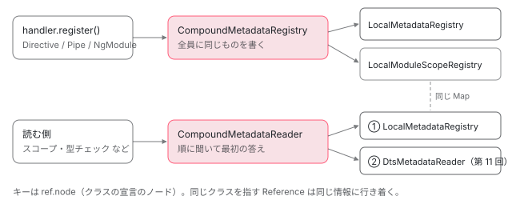

[目次](../README.md) › [ngtsc の内側](README.md) › 第 10 回 / 全 20 回

# メタデータの登録と読み出し：pipe の handler と LocalMetadataRegistry

> PipeDecoratorHandler の analyze・register（registerPipeMetadata）を例に、handler が解析の結果を CompoundMetadataRegistry（LocalMetadataRegistry と LocalModuleScopeRegistry に配る）に書き、CompoundMetadataReader（ローカル → .d.ts の順）でほかの部品が読む仕組み、DirectiveMeta・PipeMeta・NgModuleMeta の形（metadata/src/api.ts）、継承をたどって inputs・outputs を子が勝つ形で 1 つにまとめる flattenInheritedDirectiveMetadata（queries は合わせない・途中に登録されないクラスがあると 'dynamic' で止まる）と HostDirectivesResolver。

angular/angular · 読了 約 12 分 · 中核 · [サイトで読む（デモが動きます）](https://angular-deep-dive-cyan.vercel.app/chapter/ngtsc-metadata-registry)

---

handler は自分の担当のクラスを解析し終えると、その結果を「ほかの部品が後で読める形」で書き残します。この章では `PipeDecoratorHandler` を例に、`register` が `LocalMetadataRegistry` に何を書き、誰がそれを `CompoundMetadataReader` 越しに読むのかを追います。後半では、継承の連なりを 1 つにまとめる `flattenInheritedDirectiveMetadata` と `HostDirectivesResolver` を読み、記録のデモで「どこで継承の情報が切れるか」を確かめます。

読む対象は `packages/compiler-cli/src/ngtsc/annotations/src/pipe.ts` と、`ngtsc/metadata/src/` の `api.ts`・`registry.ts`・`util.ts`・`inheritance.ts`・`host_directives_resolver.ts`・`ng_module_index.ts` です。

1. [1. 全体像](01-ngtsc-overview.md)
2. [2. NgtscProgram](02-ngtsc-program.md)
3. [3. NgCompiler とチケット](03-ngtsc-compiler-ticket.md)
4. [4. リフレクション](04-ngtsc-reflection.md)
5. [5. 静的な評価](05-ngtsc-partial-evaluator.md)
6. [6. 参照と import](06-ngtsc-references-imports.md)
7. [7. 解析](07-ngtsc-trait-analyze.md)
8. [8. 解決と出力](08-ngtsc-trait-resolve-compile.md)
9. [9. @Directive の handler](09-ngtsc-directive-handler.md)
10. **10. メタデータの登録**（この章）
11. [11. .d.ts を読む](11-ngtsc-dts-metadata.md)
12. [12. JS の書き換え](12-ngtsc-ivy-transform.md)
13. [13. .d.ts の書き換え](13-ngtsc-dts-transform.md)
14. [14. 差分ビルド](14-ngtsc-incremental.md)
15. [15. 意味のグラフ](15-ngtsc-semantic-graph.md)
16. [16. import の循環](16-ngtsc-cycles.md)
17. [17. HMR](17-ngtsc-hmr.md)
18. [18. 診断と性能](18-ngtsc-diagnostics-perf.md)
19. [19. テストを書く](19-ngtsc-test-env.md)
20. [20. issue と PR を読む](20-ngtsc-issues.md)

## 1. PipeDecoratorHandler の detect と analyze

pipe の handler は `@Directive` の handler（[第 9 回](09-ngtsc-directive-handler.md)）より小さく、「解析 → 登録 → 出力」の骨組みが見やすいので、ここから入ります。

📄 `angular/packages/compiler-cli/src/ngtsc/annotations/src/pipe.ts` L105–125 （▶ の行: 105, 112–113, 115）

```ts
105 ▶   readonly precedence = HandlerPrecedence.PRIMARY;
106 │   readonly name = 'PipeDecoratorHandler';
107 │ 
108 │   detect(
109 │     node: ClassDeclaration,
110 │     decorators: Decorator[] | null,
111 │   ): DetectResult<Decorator> | undefined {
112 ▶     if (!decorators) {
113 ▶       return undefined;
114 │     }
115 ▶     const decorator = findAngularDecorator(decorators, 'Pipe', this.isCore);
116 │     if (decorator !== undefined) {
117 │       return {
118 │         trigger: decorator.node,
119 │         decorator: decorator,
120 │         metadata: decorator,
121 │       };
122 │     } else {
123 │       return undefined;
124 │     }
125 │   }
```

112〜114 行目、デコレーターが無ければすぐ `undefined` です。`@Directive` の handler のように 「デコレーターは無いが Angular の機能を使っている」クラスを拾う道（NG2007）はありません。115 行目は第 9 回と同じ `findAngularDecorator` で、import 元が `@angular/core` の `Pipe` を探します。

📄 `angular/packages/compiler-cli/src/ngtsc/annotations/src/pipe.ts` L131–160 （▶ の行: 140–142, 144, 148–149, 158–159）

```ts
131 │   analyze(
132 │     clazz: ClassDeclaration,
133 │     decorator: Readonly<Decorator>,
134 │   ): AnalysisOutput<PipeHandlerData> {
135 │     this.perf.eventCount(PerfEvent.AnalyzePipe);
136 │ 
137 │     const name = clazz.name.text;
138 │     const type = wrapTypeReference(clazz);
139 │ 
140 ▶     if (decorator.args === null) {
141 ▶       throw new FatalDiagnosticError(
142 ▶         ErrorCode.DECORATOR_NOT_CALLED,
143 │         decorator.node,
144 ▶         `@Pipe must be called`,
145 │       );
146 │     }
147 │ 
148 ▶     const meta =
149 ▶       decorator.args.length === 0 ||
150 │       // TODO(crisbeto): temporary for testing until we've changed
151 │       // the pipe public API not to require a name.
152 │       (ts.isNonNullExpression(decorator.args[0]) &&
153 │         decorator.args[0].expression.kind === ts.SyntaxKind.NullKeyword)
154 │         ? null
155 │         : unwrapExpression(decorator.args[0]);
156 │     let pipeName: string | null = null;
157 │     let pipeNameExpr: ts.Expression | null = null;
158 ▶     let pure = true;
159 ▶     let isStandalone = this.implicitStandaloneValue;
160 │     let diagnostics: ts.Diagnostic[] | undefined;
```

140〜146 行目、`decorator.args === null` は「呼び出していない」`@Pipe`（括弧なし）で、`DECORATOR_NOT_CALLED` です。148〜155 行目、引数が無いとき（とテスト用の `null!`）は `meta` が `null` になり、名前の無い pipe として先へ進みます。158〜159 行目が既定値で、`pure` は `true`、`standalone` は設定の `implicitStandaloneValue` です。

📄 `angular/packages/compiler-cli/src/ngtsc/annotations/src/pipe.ts` L162–198 （▶ の行: 171–172, 174, 180–181, 188, 192, 196）

```ts
162 │     if (meta !== null) {
163 │       if (!ts.isObjectLiteralExpression(meta)) {
164 │         throw new FatalDiagnosticError(
165 │           ErrorCode.DECORATOR_ARG_NOT_LITERAL,
166 │           meta,
167 │           '@Pipe must have a literal argument',
168 │         );
169 │       }
170 │ 
171 ▶       const pipe = reflectObjectLiteral(meta);
172 ▶       if (!pipe.has('name')) {
173 │         throw new FatalDiagnosticError(
174 ▶           ErrorCode.PIPE_MISSING_NAME,
175 │           meta,
176 │           `@Pipe decorator is missing name field`,
177 │         );
178 │       }
179 │       pipeNameExpr = pipe.get('name')!;
180 ▶       const evaluatedName = this.evaluator.evaluate(pipeNameExpr);
181 ▶       if (typeof evaluatedName !== 'string') {
182 │         throw createValueHasWrongTypeError(
183 │           pipeNameExpr,
184 │           evaluatedName,
185 │           `@Pipe.name must be a string`,
186 │         );
187 │       }
188 ▶       pipeName = evaluatedName;
189 │ 
190 │       if (pipe.has('pure')) {
191 │         const expr = pipe.get('pure')!;
192 ▶         const pureValue = this.evaluator.evaluate(expr);
193 │         if (typeof pureValue !== 'boolean') {
194 │           throw createValueHasWrongTypeError(expr, pureValue, `@Pipe.pure must be a boolean`);
195 │         }
196 ▶         pure = pureValue;
197 │       }
198 │ 
```

1. **171 行目**

   第 9 回と同じ `reflectObjectLiteral` で、キー → 式の `Map` にします。
2. **172〜178 行目**

   引数のオブジェクトがあるのに `name` が無ければ `PIPE_MISSING_NAME`。
3. **180〜188 行目**

   `name` の式を評価し（[第 5 回](05-ngtsc-partial-evaluator.md)）、文字列でなければエラー。`const NAME = 'x'` のような別の場所の定数でも、評価できれば通ります。
4. **190〜197 行目**

   `pure` も評価して boolean か確かめます。

📄 `angular/packages/compiler-cli/src/ngtsc/annotations/src/pipe.ts` L199–217 （▶ の行: 201–202, 205, 207–210）

```ts
199 │       if (pipe.has('standalone')) {
200 │         const expr = pipe.get('standalone')!;
201 ▶         const resolved = this.evaluator.evaluate(expr);
202 ▶         if (typeof resolved !== 'boolean') {
203 │           throw createValueHasWrongTypeError(expr, resolved, `standalone flag must be a boolean`);
204 │         }
205 ▶         isStandalone = resolved;
206 │ 
207 ▶         if (!isStandalone && this.strictStandalone) {
208 ▶           diagnostics = [
209 ▶             makeDiagnostic(
210 ▶               ErrorCode.NON_STANDALONE_NOT_ALLOWED,
211 │               expr,
212 │               `Only standalone pipes are allowed when 'strictStandalone' is enabled.`,
213 │             ),
214 │           ];
215 │         }
216 │       }
217 │     }
```

207〜215 行目、`strictStandalone` が有効で `standalone: false` と書かれていたら、診断を作って `diagnostics` の変数に入れるだけで、例外は投げません。この形は 2026 年 8 月の修正 74b294cd51b からです（7 節）。

📄 `angular/packages/compiler-cli/src/ngtsc/annotations/src/pipe.ts` L219–238 （▶ の行: 220, 222, 226–229, 234）

```ts
219 │     return {
220 ▶       diagnostics,
221 │       analysis: {
222 ▶         meta: {
223 │           name,
224 │           type,
225 │           typeArgumentCount: this.reflector.getGenericArityOfClass(clazz) || 0,
226 ▶           pipeName,
227 ▶           deps: getValidConstructorDependencies(clazz, this.reflector, this.isCore),
228 ▶           pure,
229 ▶           isStandalone,
230 │         },
231 │         classMetadata: this.includeClassMetadata
232 │           ? extractClassMetadata(clazz, this.reflector, this.isCore)
233 │           : null,
234 ▶         pipeNameExpr,
235 │         decorator: (decorator?.node as ts.Decorator | null) ?? null,
236 │       },
237 │     };
238 │   }
```

222〜230 行目の `meta` が `@angular/compiler` に渡す `R3PipeMetadata` です。226 行目の `pipeName` は評価した文字列、227 行目の `deps` はコンストラクタの依存（pipe もコンストラクタで注入できる）。234 行目の `pipeNameExpr` は名前を書いた**式そのもの**で、compiler には渡さず、後で診断の位置に使うために持っておきます。

## 2. register：書き残すのは PipeMeta

📄 `angular/packages/compiler-cli/src/ngtsc/annotations/src/pipe.ts` L240–261 （▶ の行: 245–247, 249–250, 255, 258）

```ts
240 │   symbol(node: ClassDeclaration, analysis: Readonly<PipeHandlerData>): PipeSymbol {
241 │     return new PipeSymbol(node, analysis.meta.pipeName ?? analysis.meta.name);
242 │   }
243 │ 
244 │   register(node: ClassDeclaration, analysis: Readonly<PipeHandlerData>): void {
245 ▶     const ref = new Reference(node);
246 ▶     this.metaRegistry.registerPipeMetadata({
247 ▶       kind: MetaKind.Pipe,
248 │       ref,
249 ▶       name: analysis.meta.pipeName,
250 ▶       nameExpr: analysis.pipeNameExpr,
251 │       isStandalone: analysis.meta.isStandalone,
252 │       decorator: analysis.decorator,
253 │       isExplicitlyDeferred: false,
254 │       deferredBlocks: null,
255 ▶       isPure: analysis.meta.pure,
256 │     });
257 │ 
258 ▶     this.injectableRegistry.registerInjectable(node, {
259 │       ctorDeps: analysis.meta.deps,
260 │     });
261 │   }
```

245 行目、クラスの宣言を `Reference`（「どこから見えるか」も覚えるクラスへの参照。[第 6 回](06-ngtsc-references-imports.md)）で包み、246 行目で `registerPipeMetadata` に `PipeMeta` を渡します。247 行目の `kind: MetaKind.Pipe` が「これは pipe の情報だ」という印、249 行目の `name` がテンプレートの `| shout` と照らし合わせる名前です。258〜260 行目、pipe はコンストラクタの依存を持てるので、注入できるクラスの登録（`InjectableClassRegistry`）にも書きます。241 行目の `symbol` が作る `PipeSymbol`（名前が変わったかだけを比べる）は[第 15 回](15-ngtsc-semantic-graph.md)で読みます。

📄 `angular/packages/compiler-cli/src/ngtsc/annotations/src/pipe.ts` L263–287 （▶ の行: 264, 268, 272, 280–281, 286）

```ts
263 │   resolve(node: ClassDeclaration): ResolveResult<unknown> {
264 ▶     if (this.compilationMode === CompilationMode.LOCAL) {
265 │       return {};
266 │     }
267 │ 
268 ▶     const duplicateDeclData = this.scopeRegistry.getDuplicateDeclarations(node);
269 │     if (duplicateDeclData !== null) {
270 │       // This pipe was declared twice (or more).
271 │       return {
272 ▶         diagnostics: [makeDuplicateDeclarationError(node, duplicateDeclData, 'Pipe')],
273 │       };
274 │     }
275 │ 
276 │     return {};
277 │   }
278 │ 
279 │   compileFull(node: ClassDeclaration, analysis: Readonly<PipeHandlerData>): CompileResult[] {
280 ▶     const fac = compileNgFactoryDefField(toFactoryMetadata(analysis.meta, FactoryTarget.Pipe));
281 ▶     const def = compilePipeFromMetadata(analysis.meta);
282 │     const classMetadata =
283 │       analysis.classMetadata !== null
284 │         ? compileClassMetadata(analysis.classMetadata).toStmt()
285 │         : null;
286 ▶     return compileResults(fac, def, classMetadata, 'ɵpipe', null, null /* deferrableImports */);
287 │   }
```

`resolve` の検査は 268〜274 行目の「同じ pipe を 2 つの NgModule で宣言していないか」だけです。`compileFull` は 280 行目の ɵfac、281 行目の `compilePipeFromMetadata`、286 行目で `'ɵpipe'` の名前を付けて返します。形は[第 9 回](09-ngtsc-directive-handler.md)の 6 節とまったく同じです。

## 3. 書き残す 3 つの形：DirectiveMeta・PipeMeta・NgModuleMeta

📄 `angular/packages/compiler-cli/src/ngtsc/metadata/src/api.ts` L137–163 （▶ の行: 140–143, 147–148, 162）

```ts
137 │ /**
138 │  * Disambiguates different kinds of compiler metadata objects.
139 │  */
140 ▶ export enum MetaKind {
141 ▶   Directive,
142 ▶   Pipe,
143 ▶   NgModule,
144 │ }
145 │ 
146 │ /** Metadata for a single input mapping. */
147 ▶ export type InputMapping = InputOrOutput & {
148 ▶   required: boolean;
149 │ 
150 │   /**
151 │    * Transform for the input. Null if no transform is configured.
152 │    *
153 │    * For signal-based inputs, this is always `null` even if a transform
154 │    * is configured. Signal inputs capture their transform write type
155 │    * automatically in the `InputSignal`, nor is there a need to emit a
156 │    * reference to the transform.
157 │    *
158 │    * For zone-based decorator `@Input`s this is different because the transform
159 │    * write type needs to be captured in a coercion member as the decorator information
160 │    * is lost in the `.d.ts` for type-checking.
161 │    */
162 ▶   transform: DecoratorInputTransform | null;
163 │ };
```

140〜144 行目の `MetaKind` は 3 つだけです。コンポーネントは `Directive` の一種として扱われ（`isComponent` で区別）、独自の種類を持ちません。147〜163 行目の `InputMapping` は、compiler 側の `InputOrOutput` （`classPropertyName`・`bindingPropertyName`・`isSignal`）に `required` と `transform` を足したものです。

📄 `angular/packages/compiler-cli/src/ngtsc/metadata/src/api.ts` L193–231 （▶ の行: 196, 200, 206–207, 212, 223, 228–229, 231）

```ts
193 │ /**
194 │  * Metadata collected for a directive within an NgModule's scope.
195 │  */
196 ▶ export interface DirectiveMeta extends T2DirectiveMeta, DirectiveTypeCheckMeta {
197 │   kind: MetaKind.Directive;
198 │ 
199 │   /** Way in which the directive was matched. */
200 ▶   matchSource: MatchSource;
201 │ 
202 │   ref: Reference<ClassDeclaration>;
203 │   /**
204 │    * Unparsed selector of the directive, or null if the directive does not have a selector.
205 │    */
206 ▶   selector: string | null;
207 ▶   queries: string[];
208 │ 
209 │   /**
210 │    * A mapping of input field names to the property names.
211 │    */
212 ▶   inputs: ClassPropertyMapping<InputMapping>;
213 │ 
214 │   /**
215 │    * List of input fields that were defined in the class decorator
216 │    * metadata. Null for directives extracted from `.d.ts`
217 │    */
218 │   inputFieldNamesFromMetadataArray: Set<string> | null;
219 │ 
220 │   /**
221 │    * A mapping of output field names to the property names.
222 │    */
223 ▶   outputs: ClassPropertyMapping;
224 │ 
225 │   /**
226 │    * A `Reference` to the base class for the directive, if one was detected.
227 │    *
228 ▶    * A value of `'dynamic'` indicates that while the analyzer detected that this directive extends
229 ▶    * another type, it could not statically determine the base class.
230 │    */
231 ▶   baseClass: Reference<ClassDeclaration> | 'dynamic' | null;
```

📄 `angular/packages/compiler-cli/src/ngtsc/metadata/src/api.ts` L233–258 （▶ の行: 237, 242, 247, 252, 257）

```ts
233 │   /**
234 │    * Whether the directive had some issue with its declaration that means it might not have complete
235 │    * and reliable metadata.
236 │    */
237 ▶   isPoisoned: boolean;
238 │ 
239 │   /**
240 │    * Whether the directive is likely a structural directive (injects `TemplateRef`).
241 │    */
242 ▶   isStructural: boolean;
243 │ 
244 │   /**
245 │    * Whether the directive is a standalone entity.
246 │    */
247 ▶   isStandalone: boolean;
248 │ 
249 │   /**
250 │    * Whether the directive is a signal entity.
251 │    */
252 ▶   isSignal: boolean;
253 │ 
254 │   /**
255 │    * For standalone components, the list of imported types.
256 │    */
257 ▶   imports: Reference<ClassDeclaration>[] | null;
258 │ 
```

- 196 行目、`DirectiveMeta` は compiler 側の `T2DirectiveMeta`（テンプレートの束縛を決める `R3TargetBinder` が読む形）と、型チェック用の `DirectiveTypeCheckMeta` の両方を満たします。そのため同じ 1 つの値を、テンプレートの照合（binder）にも型チェックにも渡せます。
- 206 行目、`selector` は分解していない文字列のまま。207 行目の `queries` は名前の配列です（[第 9 回](09-ngtsc-directive-handler.md)の register で `@ContentChild` 系のプロパティ名だけにしていました）。
- 228〜231 行目、`baseClass` の `'dynamic'` は「`extends` はあるが、親を静的に決められなかった」という意味です。5 節でこの値がどう広がるかを見ます。
- 237 行目の `isPoisoned` は「宣言に問題があって情報が不完全かもしれない」印です。

この後ろ（`selectorlessEnabled` など）は[selectorless の章](../standalone/13-standalone-selectorless.md)で引用しました。

📄 `angular/packages/compiler-cli/src/ngtsc/metadata/src/api.ts` L361–391 （▶ の行: 364, 367–368, 370, 380–383, 389–390）

```ts
361 │ /**
362 │  * Metadata for a pipe within an NgModule's scope.
363 │  */
364 ▶ export interface PipeMeta {
365 │   kind: MetaKind.Pipe;
366 │   ref: Reference<ClassDeclaration>;
367 ▶   name: string | null;
368 ▶   nameExpr: ts.Expression | null;
369 │   isStandalone: boolean;
370 ▶   isPure: boolean;
371 │   decorator: ts.Decorator | null;
372 │   isExplicitlyDeferred: boolean;
373 │   deferredBlocks?: Set<string> | null;
374 │ }
375 │ 
376 │ /**
377 │  * Reads metadata for directives, pipes, and modules from a particular source, such as .d.ts files
378 │  * or a registry.
379 │  */
380 ▶ export interface MetadataReader {
381 ▶   getDirectiveMetadata(node: Reference<ClassDeclaration>): DirectiveMeta | null;
382 ▶   getNgModuleMetadata(node: Reference<ClassDeclaration>): NgModuleMeta | null;
383 ▶   getPipeMetadata(node: Reference<ClassDeclaration>): PipeMeta | null;
384 │ }
385 │ 
386 │ /**
387 │  * A MetadataReader which also allows access to the set of all known trait classes.
388 │  */
389 ▶ export interface MetadataReaderWithIndex extends MetadataReader {
390 ▶   getKnown(kind: MetaKind): Array<ClassDeclaration>;
391 │ }
```

📄 `angular/packages/compiler-cli/src/ngtsc/metadata/src/api.ts` L393–407 （▶ の行: 403–406）

```ts
393 │ /**
394 │  * An NgModuleIndex allows access to information about traits exported by NgModules.
395 │  */
396 │ export interface NgModuleIndex {
397 │   getNgModulesExporting(directiveOrPipe: ClassDeclaration): Array<Reference<ClassDeclaration>>;
398 │ }
399 │ 
400 │ /**
401 │  * Registers new metadata for directives, pipes, and modules.
402 │  */
403 ▶ export interface MetadataRegistry {
404 ▶   registerDirectiveMetadata(meta: DirectiveMeta): void;
405 ▶   registerNgModuleMetadata(meta: NgModuleMeta): void;
406 ▶   registerPipeMetadata(meta: PipeMeta): void;
407 │ }
```

読む側の約束 `MetadataReader`（380〜384 行目）と、書く側の約束 `MetadataRegistry`（403〜407 行目）は別のインターフェースです。どちらも引数は「クラスへの参照」1 つで、種類ごとに 3 つのメソッドがあります。389〜391 行目の `MetadataReaderWithIndex` は「知っているクラスの一覧」を返せる読み手で、4 節で使い道を見ます。`NgModuleMeta` は次のとおりで、中身の使われ方は[NgModule のスコープの章](../ngmodule/04-ngmodule-compilation-scope.md)です。

📄 `angular/packages/compiler-cli/src/ngtsc/metadata/src/api.ts` L31–46 （▶ の行: 35, 37–39, 46）

```ts
31 │ /**
32 │  * Metadata collected for an `NgModule`.
33 │  */
34 │ export interface NgModuleMeta {
35 ▶   kind: MetaKind.NgModule;
36 │   ref: Reference<ClassDeclaration>;
37 ▶   declarations: Reference<ClassDeclaration>[];
38 ▶   imports: Reference<ClassDeclaration>[];
39 ▶   exports: Reference<ClassDeclaration>[];
40 │   schemas: SchemaMetadata[];
41 │ 
42 │   /**
43 │    * Whether the module had some issue being analyzed.
44 │    * This means it likely does not have complete and reliable metadata.
45 │    */
46 ▶   isPoisoned: boolean;
```

## 4. LocalMetadataRegistry と、束ねる 2 つのクラス

📄 `angular/packages/compiler-cli/src/ngtsc/metadata/src/registry.ts` L21–60 （▶ の行: 25–28, 31, 41, 47, 50）

```ts
21 │ /**
22 │  * A registry of directive, pipe, and module metadata for types defined in the current compilation
23 │  * unit, which supports both reading and registering.
24 │  */
25 ▶ export class LocalMetadataRegistry implements MetadataRegistry, MetadataReaderWithIndex {
26 ▶   private directives = new Map<ClassDeclaration, DirectiveMeta>();
27 ▶   private ngModules = new Map<ClassDeclaration, NgModuleMeta>();
28 ▶   private pipes = new Map<ClassDeclaration, PipeMeta>();
29 │ 
30 │   getDirectiveMetadata(ref: Reference<ClassDeclaration>): DirectiveMeta | null {
31 ▶     return this.directives.has(ref.node) ? this.directives.get(ref.node)! : null;
32 │   }
33 │   getNgModuleMetadata(ref: Reference<ClassDeclaration>): NgModuleMeta | null {
34 │     return this.ngModules.has(ref.node) ? this.ngModules.get(ref.node)! : null;
35 │   }
36 │   getPipeMetadata(ref: Reference<ClassDeclaration>): PipeMeta | null {
37 │     return this.pipes.has(ref.node) ? this.pipes.get(ref.node)! : null;
38 │   }
39 │ 
40 │   registerDirectiveMetadata(meta: DirectiveMeta): void {
41 ▶     this.directives.set(meta.ref.node, meta);
42 │   }
43 │   registerNgModuleMetadata(meta: NgModuleMeta): void {
44 │     this.ngModules.set(meta.ref.node, meta);
45 │   }
46 │   registerPipeMetadata(meta: PipeMeta): void {
47 ▶     this.pipes.set(meta.ref.node, meta);
48 │   }
49 │ 
50 ▶   getKnown(kind: MetaKind): Array<ClassDeclaration> {
51 │     switch (kind) {
52 │       case MetaKind.Directive:
53 │         return Array.from(this.directives.values()).map((v) => v.ref.node);
54 │       case MetaKind.Pipe:
55 │         return Array.from(this.pipes.values()).map((v) => v.ref.node);
56 │       case MetaKind.NgModule:
57 │         return Array.from(this.ngModules.values()).map((v) => v.ref.node);
58 │     }
59 │   }
60 │ }
```

実体は **種類ごとの `Map` が 3 つ**だけです（26〜28 行目）。キーは `Reference` ではなく `ref.node`、つまり TypeScript のクラスの宣言のノードです（31・41・47 行目）。同じクラスを別の経路で指す `Reference` が何個あっても、同じ 1 つの情報に行き着きます。41 行目は `Map.set` なので、同じクラスをもう一度登録すると後のものが勝ちます。名前のとおり「ローカル」で、今コンパイルしている .ts のクラスだけが入ります。node\_modules のライブラリのクラスは[第 11 回](11-ngtsc-dts-metadata.md)の `DtsMetadataReader` が担当します。

📄 `angular/packages/compiler-cli/src/ngtsc/metadata/src/registry.ts` L62–86 （▶ の行: 66–67, 70–71）

```ts
62 │ /**
63 │  * A `MetadataRegistry` which registers metadata with multiple delegate `MetadataRegistry`
64 │  * instances.
65 │  */
66 ▶ export class CompoundMetadataRegistry implements MetadataRegistry {
67 ▶   constructor(private registries: MetadataRegistry[]) {}
68 │ 
69 │   registerDirectiveMetadata(meta: DirectiveMeta): void {
70 ▶     for (const registry of this.registries) {
71 ▶       registry.registerDirectiveMetadata(meta);
72 │     }
73 │   }
74 │ 
75 │   registerNgModuleMetadata(meta: NgModuleMeta): void {
76 │     for (const registry of this.registries) {
77 │       registry.registerNgModuleMetadata(meta);
78 │     }
79 │   }
80 │ 
81 │   registerPipeMetadata(meta: PipeMeta): void {
82 │     for (const registry of this.registries) {
83 │       registry.registerPipeMetadata(meta);
84 │     }
85 │   }
86 │ }
```

📄 `angular/packages/compiler-cli/src/ngtsc/metadata/src/util.ts` L305–343 （▶ の行: 312–313, 316–319, 322）

```ts
305 │ /**
306 │  * A `MetadataReader` that reads from an ordered set of child readers until it obtains the requested
307 │  * metadata.
308 │  *
309 │  * This is used to combine `MetadataReader`s that read from different sources (e.g. from a registry
310 │  * and from .d.ts files).
311 │  */
312 ▶ export class CompoundMetadataReader implements MetadataReader {
313 ▶   constructor(private readers: MetadataReader[]) {}
314 │ 
315 │   getDirectiveMetadata(node: Reference<ClassDeclaration<ts.Declaration>>): DirectiveMeta | null {
316 ▶     for (const reader of this.readers) {
317 ▶       const meta = reader.getDirectiveMetadata(node);
318 ▶       if (meta !== null) {
319 ▶         return meta;
320 │       }
321 │     }
322 ▶     return null;
323 │   }
324 │ 
325 │   getNgModuleMetadata(node: Reference<ClassDeclaration<ts.Declaration>>): NgModuleMeta | null {
326 │     for (const reader of this.readers) {
327 │       const meta = reader.getNgModuleMetadata(node);
328 │       if (meta !== null) {
329 │         return meta;
330 │       }
331 │     }
332 │     return null;
333 │   }
334 │   getPipeMetadata(node: Reference<ClassDeclaration<ts.Declaration>>): PipeMeta | null {
335 │     for (const reader of this.readers) {
336 │       const meta = reader.getPipeMetadata(node);
337 │       if (meta !== null) {
338 │         return meta;
339 │       }
340 │     }
341 │     return null;
342 │   }
343 │ }
```

書くほうの `CompoundMetadataRegistry` は、70〜72 行目のとおり**全員に同じものを書きます**。読むほうの `CompoundMetadataReader` は、316〜321 行目のとおり**先頭から順に聞いて、最初に `null` でなかった答え**を返します。

この 2 つを実際に組み立てるのは `NgCompiler` の `makeCompilation`（[第 3 回](03-ngtsc-compiler-ticket.md)）で、読み手は「ローカル → .d.ts」の順の `CompoundMetadataReader`、書き手は「`LocalMetadataRegistry` と NgModule のスコープの登録（`LocalModuleScopeRegistry`）」の `CompoundMetadataRegistry` です。ただし `LocalModuleScopeRegistry` の `registerDirectiveMetadata` と `registerPipeMetadata` は 中身が空のメソッドで、意味のある仕事をするのは `registerNgModuleMetadata`（NgModule の declarations から「このクラスはどの NgModule の宣言か」を記録する）だけです （[NgModule のスコープの章](../ngmodule/04-ngmodule-compilation-scope.md)）。同じ組み立てが、第 9 回の単体テストの補助にもあります。

📄 `angular/packages/compiler-cli/src/ngtsc/annotations/directive/test/directive_spec.ts` L196–226 （▶ の行: 199–200, 203, 205, 224–226）

```ts
196 │     const checker = program.getTypeChecker();
197 │     const reflectionHost = new TestReflectionHost(checker);
198 │     const evaluator = new PartialEvaluator(reflectionHost, checker, /*dependencyTracker*/ null);
199 ▶     const metaReader = new LocalMetadataRegistry();
200 ▶     const dtsReader = new DtsMetadataReader(checker, reflectionHost);
201 │     const refEmitter = new ReferenceEmitter([]);
202 │     const referenceRegistry = new NoopReferencesRegistry();
203 ▶     const scopeRegistry = new LocalModuleScopeRegistry(
204 │       metaReader,
205 ▶       new CompoundMetadataReader([metaReader, dtsReader]),
206 │       new MetadataDtsModuleScopeResolver(dtsReader, null),
207 │       refEmitter,
208 │       null,
209 │     );
210 │     const injectableRegistry = new InjectableClassRegistry(reflectionHost, /* isCore */ false);
211 │     const importTracker = new ImportedSymbolsTracker();
212 │     const jitDeclarationRegistry = new JitDeclarationRegistry();
213 │     const resourceRegistry = new ResourceRegistry();
214 │     const hostDirectivesResolver = new HostDirectivesResolver(metaReader);
215 │     const typeCheckScopeRegistry = new TypeCheckScopeRegistry(
216 │       scopeRegistry,
217 │       metaReader,
218 │       hostDirectivesResolver,
219 │     );
220 │ 
221 │     const handler = new DirectiveDecoratorHandler(
222 │       reflectionHost,
223 │       evaluator,
224 ▶       scopeRegistry,
225 ▶       scopeRegistry,
226 ▶       metaReader,
```

199 行目の `LocalMetadataRegistry` と 200 行目の `DtsMetadataReader` を、205 行目で「ローカルが先」の順に束ねています。224〜226 行目、このテストでは handler の `metaRegistry`（第 9 回の 5 節で書き込み先だった引数）に `scopeRegistry` を渡し、`metaReader` に `LocalMetadataRegistry` を渡しています。本物の組み立てより簡単にした形です。

📄 `angular/packages/compiler-cli/src/ngtsc/metadata/src/ng_module_index.ts` L42–53 （▶ の行: 44–46, 50）

```ts
42 │   private index(): void {
43 │     const seenTypesWithReexports = new Map<ClassDeclaration, Set<ClassDeclaration>>();
44 ▶     const locallyDeclaredDirsAndNgModules = [
45 ▶       ...this.localReader.getKnown(MetaKind.NgModule),
46 ▶       ...this.localReader.getKnown(MetaKind.Directive),
47 │     ];
48 │     for (const decl of locallyDeclaredDirsAndNgModules) {
49 │       // Here it's safe to create a new Reference because these are known local types.
50 ▶       this.indexTrait(new Reference(decl), seenTypesWithReexports);
51 │     }
52 │     this.indexed = true;
53 │   }
```

3 節の `getKnown` の使い道の 1 つがこの `NgModuleIndexImpl` です。45〜46 行目で「ローカルで知っている NgModule とディレクティブ」の一覧を取り、どの NgModule がどのディレクティブを export しているかの索引を作ります。この索引は、テンプレートの型チェックの部品が「このディレクティブを使うには、どの NgModule を import すればよいか」を答えるとき（言語サービスの import の提案など）に読まれます。



*handler の register は CompoundMetadataRegistry に書き、全員に配られる。読む側は CompoundMetadataReader に聞き、ローカル → .d.ts の順に最初の答えが返る。*

## 5. 継承を 1 つにまとめる：flattenInheritedDirectiveMetadata

登録された `DirectiveMeta` は**そのクラスに書かれた分だけ**です（[第 9 回](09-ngtsc-directive-handler.md)の analyze は親を読みません）。テンプレートの型チェックでは親の入力も知る必要があるので、読むときに親をたどって 1 つにまとめます。

📄 `angular/packages/compiler-cli/src/ngtsc/metadata/src/inheritance.ts` L15–45 （▶ の行: 27–28, 31–32, 42–43）

```ts
15 │ /**
16 │  * Given a reference to a directive, return a flattened version of its `DirectiveMeta` metadata
17 │  * which includes metadata from its entire inheritance chain.
18 │  *
19 │  * The returned `DirectiveMeta` will either have `baseClass: null` if the inheritance chain could be
20 │  * fully resolved, or `baseClass: 'dynamic'` if the inheritance chain could not be completely
21 │  * followed.
22 │  */
23 │ export function flattenInheritedDirectiveMetadata(
24 │   reader: MetadataReader,
25 │   dir: Reference<ClassDeclaration>,
26 │ ): DirectiveMeta | null {
27 ▶   const topMeta = reader.getDirectiveMetadata(dir);
28 ▶   if (topMeta === null) {
29 │     return null;
30 │   }
31 ▶   if (topMeta.baseClass === null) {
32 ▶     return topMeta;
33 │   }
34 │ 
35 │   const coercedInputFields = new Set<ClassPropertyName>();
36 │   const undeclaredInputFields = new Set<ClassPropertyName>();
37 │   const restrictedInputFields = new Set<ClassPropertyName>();
38 │   const stringLiteralInputFields = new Set<ClassPropertyName>();
39 │   const publicMethods = new Set<string>();
40 │   let hostDirectives: HostDirectiveMeta[] | null = null;
41 │   let isDynamic = false;
42 ▶   let inputs = ClassPropertyMapping.empty<InputMapping>();
43 ▶   let outputs = ClassPropertyMapping.empty();
44 │   let isStructural: boolean = false;
45 │ 
```

27〜30 行目、自分の情報が無ければ `null`。31〜33 行目、親が無ければ何もせずそのまま返します。42〜43 行目、空の対応表から始めて、次の `addMetadata` で積み上げます。

📄 `angular/packages/compiler-cli/src/ngtsc/metadata/src/inheritance.ts` L46–85 （▶ の行: 47–48, 50, 52, 55, 61–62, 79, 81）

```ts
46 │   const addMetadata = (meta: DirectiveMeta): void => {
47 ▶     if (meta.baseClass === 'dynamic') {
48 ▶       isDynamic = true;
49 │     } else if (meta.baseClass !== null) {
50 ▶       const baseMeta = reader.getDirectiveMetadata(meta.baseClass);
51 │       if (baseMeta !== null) {
52 ▶         addMetadata(baseMeta);
53 │       } else {
54 │         // Missing metadata for the base class means it's effectively dynamic.
55 ▶         isDynamic = true;
56 │       }
57 │     }
58 │ 
59 │     isStructural = isStructural || meta.isStructural;
60 │ 
61 ▶     inputs = ClassPropertyMapping.merge(inputs, meta.inputs);
62 ▶     outputs = ClassPropertyMapping.merge(outputs, meta.outputs);
63 │ 
64 │     for (const coercedInputField of meta.coercedInputFields) {
65 │       coercedInputFields.add(coercedInputField);
66 │     }
67 │     for (const undeclaredInputField of meta.undeclaredInputFields) {
68 │       undeclaredInputFields.add(undeclaredInputField);
69 │     }
70 │     for (const restrictedInputField of meta.restrictedInputFields) {
71 │       restrictedInputFields.add(restrictedInputField);
72 │     }
73 │     for (const field of meta.stringLiteralInputFields) {
74 │       stringLiteralInputFields.add(field);
75 │     }
76 │     for (const name of meta.publicMethods) {
77 │       publicMethods.add(name);
78 │     }
79 ▶     if (meta.hostDirectives !== null && meta.hostDirectives.length > 0) {
80 │       hostDirectives ??= [];
81 ▶       hostDirectives.push(...meta.hostDirectives);
82 │     }
83 │   };
84 │ 
85 │   addMetadata(topMeta);
```

1. **47〜57 行目：先に親へ**

   親が `'dynamic'` なら 48 行目で印を付けるだけ。親の `Reference` があれば 50 行目で**同じ読み手**に親の情報を聞き、見つかれば 52 行目で再帰します。親の情報が無ければ（55 行目）やはり `'dynamic'` 扱いで、**その先の祖先へは進みません**。
2. **61〜62 行目：自分の分を上に重ねる**

   再帰が戻ってきてから自分の inputs・outputs を `merge` するので、祖先 → 親 → 自分の順に重なります。
3. **64〜82 行目：集合と hostDirectives**

   型チェック用の集合（coerced・undeclared・restricted・stringLiteral・publicMethods）は和を取り、hostDirectives は 81 行目で配列をつなぎます。

📄 `angular/packages/compiler/src/property_mapping.ts` L109–123 （▶ の行: 117–119）

```ts
109 │   /**
110 │    * Merge two mappings into one, with class properties from `b` taking precedence over class
111 │    * properties from `a`.
112 │    */
113 │   static merge<T extends InputOrOutput>(
114 │     a: ClassPropertyMapping<T>,
115 │     b: ClassPropertyMapping<T>,
116 │   ): ClassPropertyMapping<T> {
117 ▶     const forwardMap = new Map<ClassPropertyName, T>(a.forwardMap.entries());
118 ▶     for (const [classPropertyName, inputOrOutput] of b.forwardMap) {
119 ▶       forwardMap.set(classPropertyName, inputOrOutput);
120 │     }
121 │ 
122 │     return new ClassPropertyMapping(forwardMap);
123 │   }
```

`merge(a, b)` は 117 行目で `a` を写し、118〜119 行目で `b` を上書きします。同じクラスのプロパティ名なら**子のほうが勝つ**ので、子で同じ名前の入力を別名で宣言し直すと、子の宣言が使われます。

📄 `angular/packages/compiler-cli/src/ngtsc/metadata/src/inheritance.ts` L86–100 （▶ の行: 88–90, 96, 98）

```ts
 86 │ 
 87 │   return {
 88 ▶     ...topMeta,
 89 ▶     inputs,
 90 ▶     outputs,
 91 │     coercedInputFields,
 92 │     undeclaredInputFields,
 93 │     restrictedInputFields,
 94 │     stringLiteralInputFields,
 95 │     publicMethods,
 96 ▶     baseClass: isDynamic ? 'dynamic' : null,
 97 │     isStructural,
 98 ▶     hostDirectives,
 99 │   };
100 │ }
```

88 行目の `...topMeta` に注意します。上書きするのは 89〜98 行目に書いた項目だけで、`selector`・`exportAs`・`queries` などは**自分の値のまま**です。96 行目、途中で一度でも切れていれば `baseClass` は `'dynamic'`、全部たどれたら `null` になります。

この関数を呼ぶのは、型チェックのためのスコープの部品（`TypeCheckScopeRegistry.getTypeCheckDirectiveMetadata`。結果をクラスごとにキャッシュする）、次の `HostDirectivesResolver`、hostDirectives の検査（[host directives の章](../standalone/10-standalone-host-directives.md)）です。出力の JS は継承をまとめません。実行時は `ɵɵInheritDefinitionFeature` が親の ɵdir を合わせます（[第 9 回](09-ngtsc-directive-handler.md)の 7 節）。

## 6. HostDirectivesResolver：host directive を平らな配列に

📄 `angular/packages/compiler-cli/src/ngtsc/metadata/src/host_directives_resolver.ts` L18–36 （▶ の行: 20, 26, 30–32, 34）

```ts
18 │ /** Resolves the host directives of a directive to a flat array of matches. */
19 │ export class HostDirectivesResolver {
20 ▶   private cache = new Map<ClassDeclaration, ReadonlyArray<DirectiveMeta>>();
21 │ 
22 │   constructor(private metaReader: MetadataReader) {}
23 │ 
24 │   /** Resolves all of the host directives that apply to a directive. */
25 │   resolve(metadata: DirectiveMeta): ReadonlyArray<DirectiveMeta> {
26 ▶     if (this.cache.has(metadata.ref.node)) {
27 │       return this.cache.get(metadata.ref.node)!;
28 │     }
29 │ 
30 ▶     const results =
31 ▶       metadata.hostDirectives && metadata.hostDirectives.length > 0
32 ▶         ? this.walkHostDirectives(metadata.hostDirectives, [])
33 │         : EMPTY_ARRAY;
34 ▶     this.cache.set(metadata.ref.node, results);
35 │     return results;
36 │   }
```

📄 `angular/packages/compiler-cli/src/ngtsc/metadata/src/host_directives_resolver.ts` L38–75 （▶ の行: 51, 54, 58–59, 62, 64–66, 68）

```ts
38 │   /**
39 │    * Traverses all of the host directive chains and produces a flat array of
40 │    * directive metadata representing the host directives that apply to the host.
41 │    */
42 │   private walkHostDirectives(
43 │     directives: NonNullable<DirectiveMeta['hostDirectives']>,
44 │     results: DirectiveMeta[],
45 │   ): ReadonlyArray<DirectiveMeta> {
46 │     for (const current of directives) {
47 │       if (!isHostDirectiveMetaForGlobalMode(current)) {
48 │         throw new Error('Impossible state: resolving code path in local compilation mode');
49 │       }
50 │ 
51 ▶       const hostMeta = flattenInheritedDirectiveMetadata(this.metaReader, current.directive);
52 │ 
53 │       // This case has been checked for already and produces a diagnostic
54 ▶       if (hostMeta === null) {
55 │         continue;
56 │       }
57 │ 
58 ▶       if (hostMeta.hostDirectives) {
59 ▶         this.walkHostDirectives(hostMeta.hostDirectives, results);
60 │       }
61 │ 
62 ▶       results.push({
63 │         ...hostMeta,
64 ▶         matchSource: MatchSource.HostDirective,
65 ▶         inputs: ClassPropertyMapping.fromMappedObject(
66 ▶           this.filterMappings(hostMeta.inputs, current.inputs, resolveInput),
67 │         ),
68 ▶         outputs: ClassPropertyMapping.fromMappedObject(
69 │           this.filterMappings(hostMeta.outputs, current.outputs, resolveOutput),
70 │         ),
71 │       });
72 │     }
73 │ 
74 │     return results;
75 │   }
```

51 行目、host directive 1 つずつについても `flattenInheritedDirectiveMetadata` で継承をまとめます。58〜60 行目、その host directive がさらに host directive を持っていれば先に再帰するので、深いものから配列に入ります。62〜71 行目、結果は `matchSource: MatchSource.HostDirective`（セレクタで一致したのではない印）に変え、inputs と outputs は「公開すると書いたものだけ」に絞ります。

📄 `angular/packages/compiler-cli/src/ngtsc/metadata/src/host_directives_resolver.ts` L83–108 （▶ の行: 90–91, 93, 97–98）

```ts
 83 │   private filterMappings<T, M extends InputOrOutput>(
 84 │     source: ClassPropertyMapping<M>,
 85 │     allowedProperties: Record<string, string> | null,
 86 │     valueResolver: (bindingName: string, binding: M) => T,
 87 │   ): Record<string, T> {
 88 │     const result: Record<string, T> = {};
 89 │ 
 90 ▶     if (allowedProperties !== null) {
 91 ▶       for (const publicName in allowedProperties) {
 92 │         if (Object.hasOwn(allowedProperties, publicName)) {
 93 ▶           const bindings = source.getByBindingPropertyName(publicName);
 94 │ 
 95 │           if (bindings !== null) {
 96 │             for (const binding of bindings) {
 97 ▶               result[binding.classPropertyName] = valueResolver(
 98 ▶                 allowedProperties[publicName],
 99 │                 binding,
100 │               );
101 │             }
102 │           }
103 │         }
104 │       }
105 │     }
106 │ 
107 │     return result;
108 │   }
```

90 行目、`inputs` を書かなかった（`null`）host directive は、何も公開しません。93 行目、公開名から元の束縛を探し、97〜98 行目で「新しい公開名」を付けて入れます。実行時に同じことをする `ɵɵHostDirectivesFeature` の側は[host directives の章](../standalone/10-standalone-host-directives.md)で読みました。

## 7. DEMO：継承の連なりを登録と型チェックの両方から見る

> **🧪 DEMO — 記録：getMeta（登録されたまま）と getDirectiveMetadata（平らにしたもの）**
>
> これは記録です。@angular/compiler-cli 22.1.6 を Node で動かした結果。「登録されたまま」は `NgCompiler.getMeta`（`CompoundMetadataReader` から読む）、「平らにしたもの」は `getTemplateTypeChecker().getDirectiveMetadata`（5 節の関数を通る）の値です。どの場面も、別のコンポーネント `User` が `<app-derived [color]="1" [size]="2" (changed)="0" />` と書いています。
>
> ▶ [このデモはサイトで動かせます](https://angular-deep-dive-cyan.vercel.app/chapter/ngtsc-metadata-registry)

記録から読み取れることを、ソースの行に戻して確かめます。

1. **「Base → Derived」：平らにすると親の入力が入る**

   `Derived` の登録は `size` だけで、平らにしたものは `color, size` と `changed` になります（5 節の 52・61〜62 行目）。一方 `queries` は `Base` が `item` を持っているのに、`Derived` の平らにしたものでは `[]` です。88 行目の `...topMeta` のとおり、queries は合わせていません。テンプレートの `[color]="1"` は `color` が `string` なので、型の誤り（TS2322）として正しく見つかっています。
2. **「Base → 素の Middle → Derived」：途中で切れる**

   `Middle` は Angular の機能を何も使っていないので、NG2007 にもならず、登録もされません。すると 5 節の 50 行目が `null` を受け取り、55 行目で `'dynamic'` になって、`Base` まで上りません。平らにした `Derived` の inputs は `size` だけになり、テンプレートの `[color]` は **NG8002「Can't bind to 'color'」**になります。出力の JS では `Derived` に `ɵɵInheritDefinitionFeature` が付いていて、この feature は実行時にプロトタイプの連なりを上り、ɵdir を持たないクラスを飛ばして親の定義を探します（packages/core/src/render3/features/inherit\_definition\_feature.ts）。つまり実行時には `color` を受け継げる形の出力なのに、型チェックは受け継がない、というずれがこの場面で起きています。
3. **「@Input 付き Middle（デコレーター無し）」：NG2007 と NG8002**

   `Middle` が `@Input` を持つので[第 9 回](09-ngtsc-directive-handler.md)の NG2007 が出ます。登録されないので、型チェックは前の場面と同じく途中で切れます。
4. **「@Directive() Middle」：全部つながる**

   空の `@Directive()` を付けると `Middle` も登録され、`Derived` の平らにしたものに `color, label, size` がそろいます。`Middle` にも `ɵɵInheritDefinitionFeature` が付きます。
5. **「@Pipe」**

   `getMeta` は 2 節で登録した `PipeMeta` を返します。`isPure: false` は 196 行目で読んだ値です。平らにする関数はディレクティブ用なので、pipe では使われません。

📄 `記録に使ったスクリプト（scratchpad の記録スクリプト）`

```
// 第 10 回の記録。angular-deep-dive を cwd にして `node <このファイル>` で走らせる。
// 本物の @angular/compiler-cli（node_modules の 22.1.6）の NgtscProgram で継承の連なりを emit し、
// 1) NgCompiler.getMeta（CompoundMetadataReader から読んだ、平らにする前の DirectiveMeta）
// 2) TemplateTypeChecker.getDirectiveMetadata（flattenInheritedDirectiveMetadata で平らにしたもの）
// 3) 出力の .js の features と、テンプレートの型チェックの診断
// を JSON で出す。pipe の場面では getMeta が返す PipeMeta と ɵpipe を出す。
import fs from 'node:fs';
import path from 'node:path';
import { createRequire } from 'node:module';
import { pathToFileURL } from 'node:url';

const req = createRequire(path.resolve('package.json'));
const load = (id) => import(pathToFileURL(req.resolve(id)).href);
const { default: ts } = await load('typescript');
const { NgtscProgram, VERSION } = await load('@angular/compiler-cli');

const HERE = path.dirname(new URL(import.meta.url).pathname);
const NODE_MODULES = path.resolve('node_modules');

const BASE = `import {Component, ContentChild, Directive, ElementRef, EventEmitter, Input, Output} from '@angular/core';

@Directive()
export abstract class Base {
  @Input() color = 'yellow';
  @Output() changed = new EventEmitter<string>();
  @ContentChild('item') item?: ElementRef;
}
`;
const USER = `
@Component({
  selector: 'app-user',
  imports: [Derived],
  template: '<app-derived [color]="1" [size]="2" (changed)="0" />',
})
export class User {}
`;
const DERIVED = (parent) => `
@Component({selector: 'app-derived', template: '<div #box></div>'})
export class Derived extends ${parent} {
  @Input() size = 1;
}
`;

const SCENES = {
  direct: BASE + DERIVED('Base') + USER,
  plainMiddle: BASE + `
export abstract class Middle extends Base {
  label = 'plain';
}
` + DERIVED('Middle') + USER,
  featureMiddle: BASE + `
export abstract class Middle extends Base {
  @Input() label = 'feature';
}
` + DERIVED('Middle') + USER,
  directiveMiddle: BASE + `
@Directive()
export abstract class Middle extends Base {
  @Input() label = 'directive';
}
` + DERIVED('Middle') + USER,
  pipe: `import {Pipe, PipeTransform} from '@angular/core';

@Pipe({name: 'shout', pure: false})
export class ShoutPipe implements PipeTransform {
  transform(v: string) { return v.toUpperCase() + '!'; }
}
`,
};

const mapping = (m) => (m ? Array.from(m).map((io) => `${io.classPropertyName}→${io.bindingPropertyName}`) : null);
const baseClass = (b) => (b === null ? null : b === 'dynamic' ? 'dynamic' : 'Reference(' + b.debugName + ')');
const dirSummary = (meta) =>
  meta === null
    ? null
    : meta.kind === 1
      ? { kind: 'Pipe', name: meta.name, isPure: meta.isPure, isStandalone: meta.isStandalone }
      : {
          kind: 'Directive',
          isComponent: meta.isComponent,
          inputs: mapping(meta.inputs),
          outputs: mapping(meta.outputs),
          queries: meta.queries,
          baseClass: baseClass(meta.baseClass),
        };

function compile(source) {
  const dir = fs.mkdtempSync(path.join(HERE, 'tmp-'));
  try {
    fs.symlinkSync(NODE_MODULES, path.join(dir, 'node_modules'), 'dir');
    const file = path.join(dir, 'demo.ts');
    fs.writeFileSync(file, source);
    const options = {
      target: ts.ScriptTarget.ES2022,
      module: ts.ModuleKind.ES2022,
      moduleResolution: ts.ModuleResolutionKind.Bundler,
      experimentalDecorators: true,
      importHelpers: true,
      strict: true,
      skipLibCheck: true,
      outDir: path.join(dir, 'out'),
      strictTemplates: true,
      // TemplateTypeChecker を外から使うための設定（言語サービスも同じものを立てる）
      _enableTemplateTypeChecker: true,
    };
    const program = new NgtscProgram([file], options, ts.createCompilerHost(options));
    const diagnostics = [
      ...program.getTsSemanticDiagnostics(),
      ...program.getNgStructuralDiagnostics(),
      ...program.getNgSemanticDiagnostics(),
    ].map((d) => ({
      code: String(d.code).startsWith('-99') ? 'NG' + String(d.code).slice(3) : 'TS' + d.code,
      text: ts.flattenDiagnosticMessageText(d.messageText, '\n'),
    }));
    program.emit();
    const js = fs.readFileSync(path.join(dir, 'out', 'demo.js'), 'utf8');
    const sf = program.getTsProgram().getSourceFile(file);
    const checker = program.compiler.getTemplateTypeChecker();
    const classes = {};
    for (const stmt of sf.statements) {
      if (!ts.isClassDeclaration(stmt) || stmt.name.text === 'User') continue;
      const name = stmt.name.text;
      // 出力の .js をクラスごとに切り、そのクラスの static ɵ... と features を探す
      const chunk = js.split(/\n(?=export class |class )/).find((c) => new RegExp(`^(export )?class ${name}\\b`).test(c)) ?? '';
      const def = /static (ɵdir|ɵcmp|ɵpipe) =/.exec(chunk);
      const features = /features: \[([^\]]*)\]/.exec(chunk);
      classes[name] = {
        raw: dirSummary(program.compiler.getMeta(stmt)),
        flattened: dirSummary(checker.getDirectiveMetadata(stmt)),
        def: def ? def[1] : null,
        features: features ? features[1].trim() : null,
      };
    }
    return { diagnostics, js, classes };
  } finally {
    fs.rmSync(dir, { recursive: true, force: true });
  }
}

const out = { version: VERSION.full, scenes: {} };
for (const [name, source] of Object.entries(SCENES)) {
  out.scenes[name] = { source, ...compile(source) };
}
console.log(JSON.stringify(out, null, 2));

```

## ここまでの呼び出し

- `PipeDecoratorHandler.analyze` — annotations/src/pipe.ts L131 — *name・pure・standalone を評価して R3PipeMetadata*
- `PipeDecoratorHandler.register` — pipe.ts L244
  - `CompoundMetadataRegistry.registerPipeMetadata` — metadata/src/registry.ts L81 — *全員に配る*
    - `LocalMetadataRegistry.registerPipeMetadata` — registry.ts L46 — *pipes.set(ref.node, meta)*
    - `LocalModuleScopeRegistry.registerPipeMetadata` — scope/src/local.ts — *空のメソッド（NgModule の登録だけが仕事をする）*
- `TypeCheckScopeRegistry.getTypeCheckDirectiveMetadata` — scope/src/typecheck.ts — *型チェックのとき*
  - `flattenInheritedDirectiveMetadata(metaReader, ref)` — metadata/src/inheritance.ts L23
    - `CompoundMetadataReader.getDirectiveMetadata` — metadata/src/util.ts L315 — *ローカル → .d.ts の順*
    - `ClassPropertyMapping.merge(inputs, meta.inputs)` — compiler/src/property\_mapping.ts L113 — *子が勝つ*

## テストと直し方

- 継承：`test/ngtsc/ngtsc_spec.ts` の `describe('inherited directives')`（:9159）。継承したコンストラクタの診断（第 9 回の 5 節）と、下の `it('should produce a diagnostic if an inherited required input is not bound')`（:9424）。型チェックの側は `test/ngtsc/template_typecheck_spec.ts` の `it('should properly type-check inherited directives')`（:2082）で、`@Directive()` の付いた 3 段の連なりを試しています。**途中に登録されないクラスがある連なりの spec は、この 2 つのファイルにはありません**（7 節の 2 つ目の場面）。
- pipe：同じファイルの `it('should compile Pipes without errors')`（:2438）と `it('should compile pure Pipes without errors')`（:2470）。
- .d.ts から読んだ情報の単体テストは `metadata/test/dts_spec.ts`（[第 11 回](11-ngtsc-dts-metadata.md)）。registry.ts・inheritance.ts そのものの単体テストのファイルはありません。

📄 `angular/packages/compiler-cli/test/ngtsc/ngtsc_spec.ts` L9424–9452 （▶ の行: 9431, 9433, 9437, 9441, 9450）

```ts
9424 │       it('should produce a diagnostic if an inherited required input is not bound', () => {
9425 │         env.tsconfig();
9426 │         env.write(
9427 │           'test.ts',
9428 │           `
9429 │           import {Directive, Component, Input} from '@angular/core';
9430 │ 
9431 ▶           @Directive()
9432 │           export class BaseDir {
9433 ▶             @Input({required: true}) input: any;
9434 │           }
9435 │ 
9436 │           @Directive({selector: '[dir]'})
9437 ▶           export class Dir extends BaseDir {}
9438 │ 
9439 │           @Component({
9440 │             selector: 'test-cmp',
9441 ▶             template: '<div dir></div>',
9442 │                         imports: [Dir]
9443 │           })
9444 │           export class Cmp {}
9445 │         `,
9446 │         );
9447 │         const diags = env.driveDiagnostics();
9448 │         expect(diags.length).toBe(1);
9449 │         expect(diags[0].messageText).toBe(
9450 ▶           `Required input 'input' from directive Dir must be specified.`,
9451 │         );
9452 │       });
```

9433 行目の required の入力は `BaseDir` にしか書かれていません。9441 行目のテンプレートで `Dir` にそれを渡していないことが 9450 行目の診断になるのは、5 節で `Dir` の情報を平らにして `BaseDir` の入力を合わせているからです。

📄 `angular/packages/compiler-cli/test/ngtsc/ngtsc_spec.ts` L2438–2468 （▶ の行: 2459, 2465）

```ts
2438 │     it('should compile Pipes without errors', () => {
2439 │       env.write(
2440 │         'test.ts',
2441 │         `
2442 │         import {Pipe} from '@angular/core';
2443 │ 
2444 │         @Pipe({
2445 │           name: 'test-pipe',
2446 │           pure: false,
2447 │           standalone: false,
2448 │         })
2449 │         export class TestPipe {}
2450 │     `,
2451 │       );
2452 │ 
2453 │       env.driveMain();
2454 │ 
2455 │       const jsContents = env.getContents('test.js');
2456 │       const dtsContents = env.getContents('test.d.ts');
2457 │ 
2458 │       expect(jsContents).toContain(
2459 ▶         'TestPipe.ɵpipe = /*@__PURE__*/ i0.ɵɵdefinePipe({ name: "test-pipe", type: TestPipe, pure: false, standalone: false })',
2460 │       );
2461 │       expect(jsContents).toContain(
2462 │         'TestPipe.ɵfac = function TestPipe_Factory(__ngFactoryType__) { return new (__ngFactoryType__ || TestPipe)(); }',
2463 │       );
2464 │       expect(dtsContents).toContain(
2465 ▶         'static ɵpipe: i0.ɵɵPipeDeclaration<TestPipe, "test-pipe", false>;',
2466 │       );
2467 │       expect(dtsContents).toContain('static ɵfac: i0.ɵɵFactoryDeclaration<TestPipe, never>;');
2468 │     });
```

2459 行目の期待値は `TestPipe.ɵpipe = ...` と、クラスの外で代入する形です。NgtscTestEnvironment の tsconfig は `target: es2015` なので static フィールドの構文を使いません。このページの記録（ES2022）では `static ɵpipe = ...` になっています。spec の期待値を読むときは target の違いに気を付けます。.d.ts 側の 2465 行目の形は[第 11 回](11-ngtsc-dts-metadata.md)で読む側から見ます。

📄 `ターミナル（../angular で実行）`

```
cd ../angular
pnpm bazel test //packages/compiler-cli/test/ngtsc:ngtsc \
  --nocache_test_results --test_output=all \
  '--test_arg=--filter=inherited directives'
pnpm bazel test //packages/compiler-cli/test/ngtsc:ngtsc \
  --nocache_test_results --test_output=all \
  '--test_arg=--filter=should compile Pipes|should compile pure Pipes|should retain metadata for non-standalone declarations'
```

📄 `出力（抜粋。2026-11-05 に実行。ログは scratchpad/ngtsc-logs/c-ngtsc-inherit.log・c-ngtsc-pipe2.log）`

```
# filter=inherited directives（shard ごと: 4 → 1 → 2 → 3 の順に出た）
Ran 11 of 6713 specs
Ran 12 of 6714 specs
Ran 14 of 6716 specs
Ran 15 of 6717 specs      （合計 52 件、すべて 0 failures）
INFO: Elapsed time: 2.912s, Critical Path: 2.67s
//packages/compiler-cli/test/ngtsc:ngtsc                                 PASSED in 2.6s

# filter=should compile Pipes|should compile pure Pipes|should retain metadata for non-standalone declarations
Ran 4 of 6738 specs / Ran 4 of 6738 specs / Ran 4 of 6738 specs / Ran 8 of 6742 specs（合計 20 件、0 failures）
INFO: Elapsed time: 2.800s, Critical Path: 2.54s
//packages/compiler-cli/test/ngtsc:ngtsc                                 PASSED in 2.5s
```

1. **最近の修正：74b294cd51b（2026-08-19）「strict standalone のエラーでメタデータを残す」**

   修正前の pipe.ts は、1 節の 207〜215 行目の場所で `FatalDiagnosticError` を投げていました。`TraitCompiler` はこの例外を受け取ると、その trait の analysis を `null` にして `register` を呼びません（[第 7 回](07-ngtsc-trait-analyze.md)・[第 18 回](18-ngtsc-diagnostics-perf.md)）。つまり 2 節の `PipeMeta` が登録されず、その pipe を使う側は情報の無いクラスを相手にすることになります。修正後は診断を `analyze` の戻り値に載せ（220 行目）、登録は普通に行われます。追加された spec は test/ngtsc/standalone\_spec.ts の `it('should retain metadata for non-standalone declarations')`（:1146）で、診断が NON\_STANDALONE\_NOT\_ALLOWED の 2 つ**だけ**であることを確かめています。
2. **途中の素のクラスで継承が切れる件（7 節）**

   手元の記録で再現する現象です。直すとしたら inheritance.ts の 50〜56 行目、親の情報が無いときに `'dynamic'` で止まらず、親のさらに親（`readBaseClass` の結果）へ進む道が入口になります。ただし登録されないクラスには `baseClass` の情報も無いので、その親をどこで読むかを決める必要があります。spec を足すなら template\_typecheck\_spec.ts の `'should properly type-check inherited directives'` の隣です。GitHub を検索した範囲（2026-11-05）では、この形の issue は見つかりませんでした。
3. **直すとしたら（一般）**

   登録の中身を変えるなら各 handler の `register`、読み方を変えるなら `CompoundMetadataReader` や `flattenInheritedDirectiveMetadata` です。issue の読み方は[第 20 回](20-ngtsc-issues.md)です。

## 聞かれそうな質問

**Q. LocalMetadataRegistry には何が入っていて、何が入っていませんか？**

今コンパイルしている .ts の中で、handler が `register` したディレクティブ・コンポーネント・pipe・NgModule の情報です（registry.ts 26〜28 行目の 3 つの Map）。node\_modules のライブラリのクラスは入っていません。それは `CompoundMetadataReader` の 2 番目の読み手（.d.ts を読む `DtsMetadataReader`）が答えます。

**Q. 同じクラスの情報がローカルと .d.ts の両方にあったら、どちらが使われますか？**

読み手の並び順で先のほうです。util.ts 316〜321 行目は最初に `null` でなかった答えを返し、組み立ては「ローカル → .d.ts」の順です（directive\_spec.ts 205 行目も同じ順）。

**Q. 親クラスの @Input は、子のメタデータに入っていますか？**

登録された `DirectiveMeta` には入っていません。型チェックなどで読むときに、inheritance.ts の `flattenInheritedDirectiveMetadata` が 50〜52 行目で親をたどって 61 行目で合わせます。同じ名前のプロパティは property\_mapping.ts 118〜119 行目のとおり子が勝ちます。

**Q. 親の @ContentChild は、子のテンプレートの型チェックで見えますか？**

平らにした情報の `queries` には入りません。inheritance.ts 88 行目で `...topMeta` をそのまま使い、89〜98 行目で上書きする項目に `queries` が無いからです（デモの「Base → Derived」で `Derived` の queries が `[]`）。実行時の問い合わせは `ɵɵInheritDefinitionFeature` が親の定義から受け継ぎます。

**Q. pipe の pure は、ライブラリの .d.ts からも分かりますか？**

分かりません。.d.ts の `ɵɵPipeDeclaration` の型には pure が書かれていないので、[第 11 回](11-ngtsc-dts-metadata.md)の `DtsMetadataReader.getPipeMetadata` は `isPure` を埋めません。ローカルの pipe だけが 2 節の 255 行目で値を持ちます。

## 読み終えて

- handler の `register` は、種類（`MetaKind`）ごとの形の情報を、クラスの宣言のノードをキーにした Map に書く
- 書き手は `CompoundMetadataRegistry`（全員に配る）、読み手は `CompoundMetadataReader`（ローカル → .d.ts の順に最初の答え）
- 登録された情報はそのクラスの分だけ。継承は読むときに `flattenInheritedDirectiveMetadata` がたどり、inputs・outputs などは子が勝つ形で合わせ、queries は合わせない
- 途中に登録されないクラスがあると、平らにする処理はそこで `'dynamic'` になって止まる。実行時の継承とはずれる
- `HostDirectivesResolver` も同じ関数で各 host directive の継承をまとめ、公開した inputs・outputs だけを残す

---

← 前: [DirectiveDecoratorHandler：@Directive を解析する](09-ngtsc-directive-handler.md)  
次: [.d.ts からメタデータを読む：DtsMetadataReader](11-ngtsc-dts-metadata.md) →
