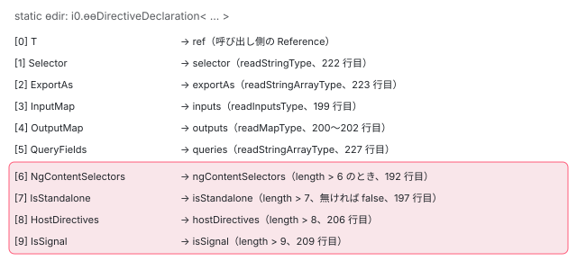

[目次](../README.md) › [ngtsc の内側](README.md) › 第 11 回 / 全 20 回

# .d.ts からメタデータを読む：DtsMetadataReader

> node\_modules のライブラリはソースではなく .d.ts で来る。DtsMetadataReader が static ɵdir / ɵcmp: i0.ɵɵDirectiveDeclaration&lt;…&gt; の型引数を番号で読み、selector・inputs（v16 より前と後の 2 つの形）・outputs・exportAs・queries・ngContentSelectors・standalone・hostDirectives・signal を読み直す行、ɵɵPipeDeclaration（pure は分からない）と ɵɵNgModuleDeclaration（型の配列を PartialEvaluator.evaluateType で Reference にする）、型の読み方の補助（readMapType・readStringArrayType）と、親クラス・host directives の typeof のたどり方。

angular/angular · 読了 約 12 分 · 発展 · [サイトで読む（デモが動きます）](https://angular-deep-dive-cyan.vercel.app/chapter/ngtsc-dts-metadata)

---

`@angular/common` のようなライブラリは、node\_modules に**ソースではなく .d.ts（型の宣言）と .js**で入っています。.d.ts にはデコレーターがありません。それでも ngtsc は `*ngIf` の入力の名前や `date` pipe の名前を知っています。この章では、その情報を .d.ts の `static ɵdir: i0.ɵɵDirectiveDeclaration<...>` の**型引数**から読み直す `DtsMetadataReader` を、型引数の 1 つ 1 つを読む行まで追います。

読む対象は `packages/compiler-cli/src/ngtsc/metadata/src/dts.ts`・`util.ts`と、型の形を決めている `packages/core/src/render3/interfaces/public_definitions.ts` です。

1. [1. 全体像](01-ngtsc-overview.md)
2. [2. NgtscProgram](02-ngtsc-program.md)
3. [3. NgCompiler とチケット](03-ngtsc-compiler-ticket.md)
4. [4. リフレクション](04-ngtsc-reflection.md)
5. [5. 静的な評価](05-ngtsc-partial-evaluator.md)
6. [6. 参照と import](06-ngtsc-references-imports.md)
7. [7. 解析](07-ngtsc-trait-analyze.md)
8. [8. 解決と出力](08-ngtsc-trait-resolve-compile.md)
9. [9. @Directive の handler](09-ngtsc-directive-handler.md)
10. [10. メタデータの登録](10-ngtsc-metadata-registry.md)
11. **11. .d.ts を読む**（この章）
12. [12. JS の書き換え](12-ngtsc-ivy-transform.md)
13. [13. .d.ts の書き換え](13-ngtsc-dts-transform.md)
14. [14. 差分ビルド](14-ngtsc-incremental.md)
15. [15. 意味のグラフ](15-ngtsc-semantic-graph.md)
16. [16. import の循環](16-ngtsc-cycles.md)
17. [17. HMR](17-ngtsc-hmr.md)
18. [18. 診断と性能](18-ngtsc-diagnostics-perf.md)
19. [19. テストを書く](19-ngtsc-test-env.md)
20. [20. issue と PR を読む](20-ngtsc-issues.md)

## 1. 値の無い型：ɵɵDirectiveDeclaration

📄 `angular/packages/core/src/render3/interfaces/public_definitions.ts` L18–36 （▶ の行: 19–21, 23–24, 26–27, 30, 33–36）

```ts
18 │ export type ɵɵDirectiveDeclaration<
19 ▶   T,
20 ▶   Selector extends string,
21 ▶   ExportAs extends string[],
22 │   // `string` keys are for backwards compatibility with pre-16 versions.
23 ▶   InputMap extends {
24 ▶     [key: string]: string | {alias: string | null; required: boolean; isSignal?: boolean};
25 │   },
26 ▶   OutputMap extends {[key: string]: string},
27 ▶   QueryFields extends string[],
28 │   // Optional as this was added to align the `IsStandalone` parameters
29 │   // between directive and component declarations.
30 ▶   NgContentSelectors extends never = never,
31 │   // Optional as this was added in Angular v14. All pre-existing directives
32 │   // are not standalone.
33 ▶   IsStandalone extends boolean = false,
34 ▶   HostDirectives = never,
35 ▶   IsSignal extends boolean = false,
36 ▶ > = unknown;
```

36 行目、この型の中身は `unknown` です。TypeScript の型としては何の意味も持たず、**型引数の並びだけが情報**です。0 番目から順に、ディレクティブのクラス（19 行目）・selector（20）・exportAs（21）・入力の表（23〜25）・出力の表（26）・クエリのフィールド（27）・ ng-content のセレクタ（30。ディレクティブでは `never`）・standalone（33）・host directives（34）・signal（35）。30 行目以降に既定値が付いているのは、古い Angular で作られたライブラリの .d.ts（型引数が少ない）もそのまま読めるようにするためで、コメントに追加された版が書いてあります。24 行目、入力の表の値は v16 より前は文字列、v16 からは `{alias, required, isSignal?}` のオブジェクトです。

📄 `angular/packages/core/src/render3/interfaces/public_definitions.ts` L62–73 （▶ の行: 62, 67, 69, 72）

```ts
62 ▶ export type ɵɵNgModuleDeclaration<T, Declarations, Imports, Exports> = unknown;
63 │ 
64 │ /**
65 │  * @publicApi
66 │  */
67 ▶ export type ɵɵPipeDeclaration<
68 │   T,
69 ▶   Name extends string | null,
70 │   // Optional as this was added in Angular v14. All pre-existing directives
71 │   // are not standalone.
72 ▶   IsStandalone extends boolean = false,
73 │ > = unknown;
```

NgModule は 62 行目の 4 つ（クラス・declarations・imports・exports）、pipe は 67〜73 行目の 3 つ（クラス・名前・standalone）です。この型を .d.ts に書き出す側は[第 13 回](13-ngtsc-dts-transform.md)で読みます。この章は読む側です。

## 2. DtsMetadataReader の居場所

📄 `angular/packages/compiler-cli/src/ngtsc/metadata/src/dts.ts` L40–52 （▶ の行: 44, 48–49, 51）

```ts
40 │ /**
41 │  * A `MetadataReader` that can read metadata from `.d.ts` files, which have static Ivy properties
42 │  * from an upstream compilation already.
43 │  */
44 ▶ export class DtsMetadataReader implements MetadataReader {
45 │   private evaluator: PartialEvaluator;
46 │ 
47 │   constructor(
48 ▶     private checker: ts.TypeChecker,
49 ▶     private reflector: ReflectionHost,
50 │   ) {
51 ▶     this.evaluator = new PartialEvaluator(this.reflector, this.checker, null);
52 │   }
```

`DtsMetadataReader` は[第 10 回](10-ngtsc-metadata-registry.md)の `MetadataReader` を実装した読み手で、`CompoundMetadataReader` の 2 番目に置かれます（ローカルの登録に無かったクラスだけがここに来る）。持っているのは TypeScript の型チェッカーと `ReflectionHost`（[第 4 回](04-ngtsc-reflection.md)）、51 行目で自分用に作る `PartialEvaluator`（第 3 引数の依存の記録は `null`）だけです。書き込みのメソッドは無く、`MetadataReader` の 3 つの読み取りだけです。

## 3. getDirectiveMetadata：static のメンバーを探して型引数を読む

📄 `angular/packages/compiler-cli/src/ngtsc/metadata/src/dts.ts` L152–189 （▶ の行: 157–160, 164–167, 173, 180, 185–187）

```ts
152 │   /**
153 │    * Read directive (or component) metadata from a referenced class in a .d.ts file.
154 │    */
155 │   getDirectiveMetadata(ref: Reference<ClassDeclaration>): DirectiveMeta | null {
156 │     const clazz = ref.node;
157 ▶     const def = this.reflector
158 ▶       .getMembersOfClass(clazz)
159 ▶       .find((field) => field.isStatic && (field.name === 'ɵcmp' || field.name === 'ɵdir'));
160 ▶     if (def === undefined) {
161 │       // No definition could be found.
162 │       return null;
163 │     } else if (
164 ▶       def.type === null ||
165 ▶       !ts.isTypeReferenceNode(def.type) ||
166 ▶       def.type.typeArguments === undefined ||
167 ▶       def.type.typeArguments.length < 2
168 │     ) {
169 │       // The type metadata was the wrong shape.
170 │       return null;
171 │     }
172 │ 
173 ▶     const isComponent = def.name === 'ɵcmp';
174 │ 
175 │     const ctorParams = this.reflector.getConstructorParameters(clazz);
176 │ 
177 │     // A directive is considered to be structural if:
178 │     // 1) it's a directive, not a component, and
179 │     // 2) it injects `TemplateRef`
180 ▶     const isStructural =
181 │       !isComponent &&
182 │       ctorParams !== null &&
183 │       ctorParams.some((param) => {
184 │         return (
185 ▶           param.typeValueReference.kind === TypeValueReferenceKind.IMPORTED &&
186 ▶           param.typeValueReference.moduleName === '@angular/core' &&
187 ▶           param.typeValueReference.importedName === 'TemplateRef'
188 │         );
189 │       });
```

1. **157〜162 行目：static の ɵcmp か ɵdir を探す**

   `reflector.getMembersOfClass` は .d.ts の `declare class` でも使えます。名前が `ɵcmp` か `ɵdir` の static なメンバーが無ければ、Angular のディレクティブではないので `null`。
2. **163〜171 行目：形を確かめる**

   型が型の参照（`i0.ɵɵDirectiveDeclaration<...>`）で、型引数が 2 つ以上あること。違えば例外ではなく `null` を返します。
3. **173 行目：コンポーネントか**

   メンバーの名前だけで決めます。
4. **180〜189 行目：構造ディレクティブか**

   .d.ts のコンストラクタの引数の型が `@angular/core` の `TemplateRef` かで決めます。[第 9 回](09-ngtsc-directive-handler.md)の shared.ts と同じ考え方を、型の宣言に対して行っています。

📄 `angular/packages/compiler-cli/src/ngtsc/metadata/src/dts.ts` L191–215 （▶ の行: 192, 196–197, 199–201, 205–206, 209, 214）

```ts
191 │     const ngContentSelectors =
192 ▶       def.type.typeArguments.length > 6 ? readStringArrayType(def.type.typeArguments[6]) : null;
193 │ 
194 │     // Note: the default value is still `false` here, because only legacy .d.ts files written before
195 │     // we had so many arguments use this default.
196 ▶     const isStandalone =
197 ▶       def.type.typeArguments.length > 7 && (readBooleanType(def.type.typeArguments[7]) ?? false);
198 │ 
199 ▶     const inputs = ClassPropertyMapping.fromMappedObject(readInputsType(def.type.typeArguments[3]));
200 ▶     const outputs = ClassPropertyMapping.fromMappedObject(
201 ▶       readMapType(def.type.typeArguments[4], readStringType),
202 │     );
203 │ 
204 │     const hostDirectives =
205 ▶       def.type.typeArguments.length > 8
206 ▶         ? readHostDirectivesType(this.checker, def.type.typeArguments[8], ref.bestGuessOwningModule)
207 │         : null;
208 │     const isSignal =
209 ▶       def.type.typeArguments.length > 9 && (readBooleanType(def.type.typeArguments[9]) ?? false);
210 │ 
211 │     // At this point in time, the `.d.ts` may not be fully extractable when
212 │     // trying to resolve host directive types to their declarations.
213 │     // If this cannot be done completely, the metadata is incomplete and "poisoned".
214 ▶     const isPoisoned = hostDirectives !== null && hostDirectives?.isIncomplete;
215 │ 
```

1 節の並びを番号で読みます。192 行目の 6 番（ng-content のセレクタ）、197 行目の 7 番（standalone）、206 行目の 8 番（host directives）、209 行目の 9 番（signal）は、どれも「型引数がその数より多いときだけ」読みます。古い .d.ts は 194〜195 行目のコメントのとおり standalone が `false` 扱いになります。199 行目の 3 番が入力（4 節の `readInputsType`）、200〜202 行目の 4 番が出力です。214 行目、host directive の型を最後までたどれなかったら `isPoisoned` にします。

📄 `angular/packages/compiler-cli/src/ngtsc/metadata/src/dts.ts` L216–239 （▶ の行: 217–218, 222–223, 227–229, 236）

```ts
216 │     return {
217 ▶       kind: MetaKind.Directive,
218 ▶       matchSource: MatchSource.Selector,
219 │       ref,
220 │       name: clazz.name.text,
221 │       isComponent,
222 ▶       selector: readStringType(def.type.typeArguments[1]),
223 ▶       exportAs: readStringArrayType(def.type.typeArguments[2]),
224 │       inputs,
225 │       outputs,
226 │       hostDirectives: hostDirectives?.result ?? null,
227 ▶       queries: readStringArrayType(def.type.typeArguments[5]),
228 ▶       ...extractDirectiveTypeCheckMeta(clazz, inputs, this.reflector),
229 ▶       baseClass: readBaseClass(clazz, this.checker, this.reflector),
230 │       isPoisoned,
231 │       isStructural,
232 │       animationTriggerNames: null,
233 │       ngContentSelectors,
234 │       isStandalone,
235 │       isSignal,
236 ▶       // We do not transfer information about inputs from class metadata
237 │       // via `.d.ts` declarations. This is fine because this metadata is
238 │       // currently only used for classes defined in source files. E.g. in migrations.
239 │       inputFieldNamesFromMetadataArray: null,
```

222 行目の 1 番が selector、223 行目の 2 番が exportAs、227 行目の 5 番がクエリです。228 行目は[ガードの章](../typecheck/14-typecheck-template-guards.md)で読んだ `extractDirectiveTypeCheckMeta` で、.d.ts の `static ngTemplateGuard_ngIf: 'binding'` のような**型引数ではない static のメンバー**から、型チェック用の情報を集めます。229 行目の親クラスは 7 節で読みます。218 行目、.d.ts から来たディレクティブも `matchSource` は selector での一致です。



*ɵɵDirectiveDeclaration の型引数の番号と、DtsMetadataReader.getDirectiveMetadata が埋める DirectiveMeta の項目。6 番以降は型引数が足りなければ読まない。*

## 4. 型を値に戻す小さな関数

📄 `angular/packages/compiler-cli/src/ngtsc/metadata/src/util.ts` L113–133 （▶ の行: 114, 118–119, 121, 129, 132）

```ts
113 │ export function readBooleanType(type: ts.TypeNode): boolean | null {
114 ▶   if (!ts.isLiteralTypeNode(type)) {
115 │     return null;
116 │   }
117 │ 
118 ▶   switch (type.literal.kind) {
119 ▶     case ts.SyntaxKind.TrueKeyword:
120 │       return true;
121 ▶     case ts.SyntaxKind.FalseKeyword:
122 │       return false;
123 │     default:
124 │       return null;
125 │   }
126 │ }
127 │ 
128 │ export function readStringType(type: ts.TypeNode): string | null {
129 ▶   if (!ts.isLiteralTypeNode(type) || !ts.isStringLiteral(type.literal)) {
130 │     return null;
131 │   }
132 ▶   return type.literal.text;
133 │ }
```

📄 `angular/packages/compiler-cli/src/ngtsc/metadata/src/util.ts` L160–172 （▶ の行: 161–162, 166, 169）

```ts
160 │ export function readStringArrayType(type: ts.TypeNode): string[] {
161 ▶   if (!ts.isTupleTypeNode(type)) {
162 ▶     return [];
163 │   }
164 │   const res: string[] = [];
165 │   type.elements.forEach((el) => {
166 ▶     if (!ts.isLiteralTypeNode(el) || !ts.isStringLiteral(el.literal)) {
167 │       return;
168 │     }
169 ▶     res.push(el.literal.text);
170 │   });
171 │   return res;
172 │ }
```

📄 `angular/packages/compiler-cli/src/ngtsc/metadata/src/util.ts` L135–158 （▶ の行: 139, 144–145, 148, 152, 154）

```ts
135 │ export function readMapType<T>(
136 │   type: ts.TypeNode,
137 │   valueTransform: (type: ts.TypeNode) => T | null,
138 │ ): {[key: string]: T} {
139 ▶   if (!ts.isTypeLiteralNode(type)) {
140 │     return {};
141 │   }
142 │   const obj: {[key: string]: T} = {};
143 │   type.members.forEach((member) => {
144 ▶     if (
145 ▶       !ts.isPropertySignature(member) ||
146 │       member.type === undefined ||
147 │       member.name === undefined ||
148 ▶       (!ts.isStringLiteral(member.name) && !ts.isIdentifier(member.name))
149 │     ) {
150 │       return;
151 │     }
152 ▶     const value = valueTransform(member.type);
153 │     if (value !== null) {
154 ▶       obj[member.name.text] = value;
155 │     }
156 │   });
157 │   return obj;
158 │ }
```

どれも**型の構文木の形**だけを見ます。型チェッカーに型を計算させていません。

- 114 行目・129 行目：リテラル型（`true`・`"date"` のような、値そのものを書いた型）でなければ `null`。
- 161 行目：タプル型（`["ngIf"]`）でなければ空の配列。だから `never` と書かれた exportAs は `[]` になります。166 行目、文字列のリテラルでない要素は黙って飛ばします。
- 139 行目：オブジェクトの型リテラル（`{ "a": ...; }`）でなければ空のオブジェクト。148 行目、キーは文字列か識別子だけ。152 行目で値を `valueTransform` に渡し、`null` でなければ入れます。

📄 `angular/packages/compiler-cli/src/ngtsc/metadata/src/dts.ts` L311–341 （▶ の行: 314, 325–326, 330–332, 334, 336, 340）

```ts
311 │ function readInputsType(type: ts.TypeNode): Record<string, InputMapping> {
312 │   const inputsMap = {} as Record<string, InputMapping>;
313 │ 
314 ▶   if (ts.isTypeLiteralNode(type)) {
315 │     for (const member of type.members) {
316 │       if (
317 │         !ts.isPropertySignature(member) ||
318 │         member.type === undefined ||
319 │         member.name === undefined ||
320 │         (!ts.isStringLiteral(member.name) && !ts.isIdentifier(member.name))
321 │       ) {
322 │         continue;
323 │       }
324 │ 
325 ▶       const stringValue = readStringType(member.type);
326 ▶       const classPropertyName = member.name.text;
327 │ 
328 │       // Before v16 the inputs map has the type of `{[field: string]: string}`.
329 │       // After v16 it has the type of `{[field: string]: {alias: string, required: boolean}}`.
330 ▶       if (stringValue != null) {
331 ▶         inputsMap[classPropertyName] = {
332 ▶           bindingPropertyName: stringValue,
333 │           classPropertyName,
334 ▶           required: false,
335 │           // Signal inputs were not supported pre v16- so those inputs are never signal based.
336 ▶           isSignal: false,
337 │           // Input transform are only tracked for locally-compiled directives. Directives coming
338 │           // from the .d.ts already have them included through `ngAcceptInputType` class members,
339 │           // or via the `InputSignal` type of the member.
340 ▶           transform: null,
341 │         };
```

📄 `angular/packages/compiler-cli/src/ngtsc/metadata/src/dts.ts` L342–362 （▶ の行: 343–344, 349–351, 355）

```ts
342 │       } else {
343 ▶         const config = readMapType(member.type, (innerValue) => {
344 ▶           return readStringType(innerValue) ?? readBooleanType(innerValue);
345 │         }) as {alias: string; required: boolean; isSignal?: boolean};
346 │ 
347 │         inputsMap[classPropertyName] = {
348 │           classPropertyName,
349 ▶           bindingPropertyName: config.alias,
350 ▶           required: config.required,
351 ▶           isSignal: !!config.isSignal,
352 │           // Input transform are only tracked for locally-compiled directives. Directives coming
353 │           // from the .d.ts already have them included through `ngAcceptInputType` class members,
354 │           // or via the `InputSignal` type of the member.
355 ▶           transform: null,
356 │         };
357 │       }
358 │     }
359 │   }
360 │ 
361 │   return inputsMap;
362 │ }
```

入力の表は 2 通りを読み分けます。325 行目で値を文字列として読めたら v16 より前の形（330〜341 行目）で、`required` も `isSignal` も `false`。読めなければ v16 からの形で、343〜345 行目の `readMapType` にさらに `readMapType` を重ね、値を文字列か boolean として読みます。340 行目と 355 行目、`transform` はどちらも `null` です。.d.ts の側では、変換の型は `ngAcceptInputType_` で始まる static のメンバーか、`InputSignal` の型にすでに入っているからです（352〜354 行目のコメント）。

📄 `angular/packages/compiler-cli/src/ngtsc/metadata/src/util.ts` L298–303 （▶ の行: 299, 302）

```ts
298 │ function extractCoercedInput(member: ClassMember): string | null {
299 ▶   if (member.kind !== ClassMemberKind.Property || !member.name.startsWith('ngAcceptInputType_')) {
300 │     return null!;
301 │   }
302 ▶   return afterUnderscore(member.name);
303 │ }
```

📄 `angular/packages/compiler-cli/src/ngtsc/metadata/src/util.ts` L241–253 （▶ の行: 244–246, 251）

```ts
241 │ 
242 │   const arity = reflector.getGenericArityOfClass(node);
243 │ 
244 ▶   return {
245 ▶     hasNgTemplateContextGuard,
246 ▶     ngTemplateGuards,
247 │     coercedInputFields,
248 │     restrictedInputFields,
249 │     stringLiteralInputFields,
250 │     undeclaredInputFields,
251 ▶     publicMethods,
252 │     isGeneric: arity !== null && arity > 0,
253 │   };
```

299 行目、`ngAcceptInputType_` で始まるプロパティから入力の名前を取り出して、`coercedInputFields` に入れます。これらの集合を 244〜251 行目でまとめて返し、3 節の 228 行目でディレクティブの情報に広げます。

📄 `angular/packages/compiler/src/property_mapping.ts` L77–107 （▶ の行: 87, 91–94, 97, 100）

```ts
 77 │   /**
 78 │    * Construct a `ClassPropertyMapping` from a primitive JS object which maps class property names
 79 │    * to either binding property names or an array that contains both names, which is used in on-disk
 80 │    * metadata formats (e.g. in .d.ts files).
 81 │    */
 82 │   static fromMappedObject<T extends InputOrOutput>(obj: {
 83 │     [classPropertyName: string]: BindingPropertyName | T;
 84 │   }): ClassPropertyMapping<T> {
 85 │     const forwardMap = new Map<ClassPropertyName, T>();
 86 │ 
 87 ▶     for (const classPropertyName of Object.keys(obj)) {
 88 │       const value = obj[classPropertyName];
 89 │       let inputOrOutput: InputOrOutput;
 90 │ 
 91 ▶       if (typeof value === 'string') {
 92 ▶         inputOrOutput = {
 93 ▶           classPropertyName,
 94 ▶           bindingPropertyName: value,
 95 │           // Inputs/outputs not captured via an explicit `InputOrOutput` mapping
 96 │           // value are always considered non-signal. This is the string shorthand.
 97 ▶           isSignal: false,
 98 │         };
 99 │       } else {
100 ▶         inputOrOutput = value;
101 │       }
102 │ 
103 │       forwardMap.set(classPropertyName, inputOrOutput as T);
104 │     }
105 │ 
106 │     return new ClassPropertyMapping(forwardMap);
107 │   }
```

最後に 3 節の 199 行目で `ClassPropertyMapping.fromMappedObject` に渡ります。出力の表は値が文字列なので 91〜98 行目で `InputOrOutput` を作り（signal ではない扱い）、入力は 100 行目でそのまま使います。

## 5. getPipeMetadata：pure は分からない

📄 `angular/packages/compiler-cli/src/ngtsc/metadata/src/dts.ts` L264–292 （▶ の行: 270, 283, 286–287, 292）

```ts
264 │   /**
265 │    * Read pipe metadata from a referenced class in a .d.ts file.
266 │    */
267 │   getPipeMetadata(ref: Reference<ClassDeclaration>): PipeMeta | null {
268 │     const def = this.reflector
269 │       .getMembersOfClass(ref.node)
270 ▶       .find((field) => field.isStatic && field.name === 'ɵpipe');
271 │     if (def === undefined) {
272 │       // No definition could be found.
273 │       return null;
274 │     } else if (
275 │       def.type === null ||
276 │       !ts.isTypeReferenceNode(def.type) ||
277 │       def.type.typeArguments === undefined ||
278 │       def.type.typeArguments.length < 2
279 │     ) {
280 │       // The type metadata was the wrong shape.
281 │       return null;
282 │     }
283 ▶     const type = def.type.typeArguments[1];
284 │ 
285 │     if (
286 ▶       !ts.isLiteralTypeNode(type) ||
287 ▶       (!ts.isStringLiteral(type.literal) && type.literal.kind !== ts.SyntaxKind.NullKeyword)
288 │     ) {
289 │       // The type metadata was the wrong type.
290 │       return null;
291 │     }
292 ▶     const name = ts.isStringLiteral(type.literal) ? type.literal.text : null;
```

📄 `angular/packages/compiler-cli/src/ngtsc/metadata/src/dts.ts` L294–308 （▶ の行: 295, 300–301, 303）

```ts
294 │     const isStandalone =
295 ▶       def.type.typeArguments.length > 2 && (readBooleanType(def.type.typeArguments[2]) ?? false);
296 │ 
297 │     return {
298 │       kind: MetaKind.Pipe,
299 │       ref,
300 ▶       name,
301 ▶       nameExpr: null,
302 │       isStandalone,
303 ▶       isPure: null!, // The DTS has no idea about that
304 │       decorator: null,
305 │       isExplicitlyDeferred: false,
306 │       deferredBlocks: null,
307 │     };
308 │   }
```

270 行目、static の `ɵpipe` を探し、283〜292 行目で 1 番の型引数（名前）を読みます。名前は文字列のリテラルか `null` です。303 行目、`isPure` は `null!`（型の上は boolean のふりをした `null`）で、コメントは「DTS はそれを知らない」。1 節の 67〜73 行目のとおり、型引数に pure が無いからです。301 行目の `nameExpr` も `null` で、ライブラリの pipe の名前に診断の位置を付けることはできません。

## 6. getNgModuleMetadata：型の配列を評価する

📄 `angular/packages/compiler-cli/src/ngtsc/metadata/src/dts.ts` L60–96 （▶ の行: 63, 65–67, 75, 81, 83–84, 88–90）

```ts
60 │   getNgModuleMetadata(ref: Reference<ClassDeclaration>): NgModuleMeta | null {
61 │     const clazz = ref.node;
62 │ 
63 ▶     // This operation is explicitly not memoized, as it depends on `ref.ownedByModuleGuess`.
64 │     // TODO(alxhub): investigate caching of .d.ts module metadata.
65 ▶     const ngModuleDef = this.reflector
66 ▶       .getMembersOfClass(clazz)
67 ▶       .find((member) => member.name === 'ɵmod' && member.isStatic);
68 │     if (ngModuleDef === undefined) {
69 │       return null;
70 │     } else if (
71 │       // Validate that the shape of the ngModuleDef type is correct.
72 │       ngModuleDef.type === null ||
73 │       !ts.isTypeReferenceNode(ngModuleDef.type) ||
74 │       ngModuleDef.type.typeArguments === undefined ||
75 ▶       ngModuleDef.type.typeArguments.length !== 4
76 │     ) {
77 │       return null;
78 │     }
79 │ 
80 │     // Read the ModuleData out of the type arguments.
81 ▶     const [_, declarationMetadata, importMetadata, exportMetadata] = ngModuleDef.type.typeArguments;
82 │ 
83 ▶     const foreignTypeResolver: ForeignTypeResolver = (typeNode: ts.TypeNode) => {
84 ▶       return moduleWithProvidersTypeArgument(typeNode, this.reflector);
85 │     };
86 │ 
87 │     const evaluateMetadata = (metadataNode: ts.TypeNode) => {
88 ▶       return metadataNode.kind === ts.SyntaxKind.NeverKeyword
89 ▶         ? []
90 ▶         : this.evaluator.evaluateType(
91 │             metadataNode,
92 │             ref.bestGuessOwningModule,
93 │             undefined,
94 │             foreignTypeResolver,
95 │           );
96 │     };
```

1. **63〜64 行目**

   この結果はキャッシュしません。同じクラスでも、参照がどのモジュールから来たか（`ownedByModuleGuess`）で結果の `Reference` が変わるからです。
2. **65〜78 行目**

   static の `ɵmod` を探し、型引数がちょうど 4 つであることを確かめます。
3. **81 行目**

   0 番（クラス自身）を捨て、declarations・imports・exports を取り出します。
4. **87〜96 行目**

   `never` なら空の配列、そうでなければ 2 節の `PartialEvaluator` の `evaluateType`（型を値として評価する。[第 5 回](05-ngtsc-partial-evaluator.md)）で `[typeof NgIf, typeof NgForOf, ...]` を `Reference` の配列にします。83〜85 行目の `foreignTypeResolver` は、配列の中に `ModuleWithProviders<T>` の型が書かれていたら `T` を取り出す関数です（下の引用）。

📄 `angular/packages/compiler-cli/src/ngtsc/metadata/src/dts.ts` L437–463 （▶ の行: 448–449, 455–456, 462）

```ts
437 │ /**
438 │  * If `type` is `ModuleWithProviders<T>` (resolving to the symbol exported by `@angular/core`, where
439 │  * determinable), returns the `T` type node; otherwise `null`.
440 │  */
441 │ function moduleWithProvidersTypeArgument(
442 │   type: ts.TypeNode | undefined,
443 │   host: ReflectionHost,
444 │ ): ts.TypeNode | null {
445 │   if (type === undefined || !ts.isTypeReferenceNode(type)) {
446 │     return null;
447 │   }
448 ▶   const name = ts.isQualifiedName(type.typeName) ? type.typeName.right : type.typeName;
449 ▶   if (name.text !== 'ModuleWithProviders') {
450 │     return null;
451 │   }
452 │   // If the reference can be traced to an import, require it to be from `@angular/core`. If it can't
453 │   // (e.g. a namespace-qualified `i0.ModuleWithProviders` or a local re-declaration in a `.d.ts`),
454 │   // fall back to trusting the name.
455 ▶   const imp = host.getImportOfIdentifier(name);
456 ▶   if (imp !== null && (imp.name !== 'ModuleWithProviders' || imp.from !== '@angular/core')) {
457 │     return null;
458 │   }
459 │   if (type.typeArguments === undefined || type.typeArguments.length !== 1) {
460 │     return null;
461 │   }
462 ▶   return type.typeArguments[0];
463 │ }
```

449 行目、型の名前が `ModuleWithProviders` でなければ何もしません。455〜458 行目、import をたどれたら `@angular/core` の `ModuleWithProviders` であることまで確かめます。たどれなければ（`i0.ModuleWithProviders` のような名前空間つきの書き方など）名前を信じます。

📄 `angular/packages/compiler-cli/src/ngtsc/metadata/src/dts.ts` L98–126 （▶ の行: 101–102, 108, 117, 124）

```ts
 98 │     const declarations = this.extractReferencesFromResolvedValue(
 99 │       evaluateMetadata(declarationMetadata),
100 │     );
101 ▶     const exports = this.extractReferencesFromResolvedValue(evaluateMetadata(exportMetadata));
102 ▶     const imports = this.extractReferencesFromResolvedValue(evaluateMetadata(importMetadata));
103 │ 
104 │     // The module is considered poisoned if it's exports couldn't be
105 │     // resolved completely. This would make the module not necessarily
106 │     // usable for scope computation relying on this module; so we propagate
107 │     // this "incompleteness" information to the caller.
108 ▶     const isPoisoned = exports.isIncomplete;
109 │ 
110 │     return {
111 │       kind: MetaKind.NgModule,
112 │       ref,
113 │       declarations: declarations.result,
114 │       isPoisoned,
115 │       exports: exports.result,
116 │       imports: imports.result,
117 ▶       schemas: [],
118 │       rawDeclarations: null,
119 │       rawImports: null,
120 │       rawExports: null,
121 │       decorator: null,
122 │       // NgModules declared outside the current compilation are assumed to contain providers, as it
123 │       // would be a non-breaking change for a library to introduce providers at any point.
124 ▶       mayDeclareProviders: true,
125 │     };
126 │   }
```

📄 `angular/packages/compiler-cli/src/ngtsc/metadata/src/dts.ts` L128–150 （▶ の行: 137–138, 140, 146）

```ts
128 │   private extractReferencesFromResolvedValue(value: ResolvedValue): {
129 │     result: Reference<ClassDeclaration>[];
130 │     isIncomplete: boolean;
131 │   } {
132 │     const result: Reference<ClassDeclaration>[] = [];
133 │     let isIncomplete = false;
134 │ 
135 │     if (Array.isArray(value)) {
136 │       for (const element of value) {
137 ▶         if (element instanceof Reference && this.reflector.isClass(element.node)) {
138 ▶           result.push(element as Reference<ClassDeclaration>);
139 │         } else {
140 ▶           isIncomplete = true;
141 │         }
142 │       }
143 │     } else if (value instanceof Reference && this.reflector.isClass(value.node)) {
144 │       result.push(value as Reference<ClassDeclaration>);
145 │     } else {
146 ▶       isIncomplete = true;
147 │     }
148 │ 
149 │     return {result, isIncomplete};
150 │   }
```

評価の結果のうち、クラスへの `Reference` でないものがあれば 140 行目・146 行目で `isIncomplete` にします。108 行目、**exports** が不完全なときだけ NgModule を `isPoisoned` にします。104〜107 行目のコメントのとおり、その NgModule を使うスコープの計算（[NgModule のスコープの章](../ngmodule/04-ngmodule-compilation-scope.md)）が exports に頼るからです。124 行目、外のライブラリの NgModule は「providers を持っているかもしれない」と仮定します。

> [!NOTE]
> **さらに深く**
>
> この 87〜96 行目の形は、2026 年 5 月の 06b004ec5c4（isolatedDeclarations で NgModule をコンパイルするための変更）からです。それまでは util.ts の `extractReferencesFromType` がタプル型の要素を 1 つずつ `typeof X` として読んでいました。今の `packages/` の中で `extractReferencesFromType` を呼んでいる場所はありません（定義だけが残っています）。

## 7. host directives と親クラス：型の中の typeof をたどる

📄 `angular/packages/compiler-cli/src/ngtsc/metadata/src/dts.ts` L399–435 （▶ の行: 404, 411–412, 415, 419–421, 428）

```ts
399 │ function readHostDirectivesType(
400 │   checker: ts.TypeChecker,
401 │   type: ts.TypeNode,
402 │   bestGuessOwningModule: OwningModule | null,
403 │ ): {result: HostDirectiveMeta[]; isIncomplete: boolean} | null {
404 ▶   if (!ts.isTupleTypeNode(type) || type.elements.length === 0) {
405 │     return null;
406 │   }
407 │ 
408 │   const result: HostDirectiveMeta[] = [];
409 │   let isIncomplete = false;
410 │ 
411 ▶   for (const hostDirectiveType of type.elements) {
412 ▶     const {directive, inputs, outputs} = readMapType(hostDirectiveType, (type) => type);
413 │ 
414 │     if (directive) {
415 ▶       if (!ts.isTypeQueryNode(directive)) {
416 │         throw new Error(`Expected TypeQueryNode: ${nodeDebugInfo(directive)}`);
417 │       }
418 │ 
419 ▶       const ref = extraReferenceFromTypeQuery(checker, directive, type, bestGuessOwningModule);
420 ▶       if (ref === null) {
421 ▶         isIncomplete = true;
422 │         continue;
423 │       }
424 │ 
425 │       result.push({
426 │         directive: ref,
427 │         isForwardReference: false,
428 ▶         inputs: readMapType(inputs, readStringType),
429 │         outputs: readMapType(outputs, readStringType),
430 │       });
431 │     }
432 │   }
433 │ 
434 │   return result.length > 0 ? {result, isIncomplete} : null;
435 │ }
```

📄 `angular/packages/compiler-cli/src/ngtsc/metadata/src/util.ts` L73–111 （▶ の行: 86, 90–91, 100, 103–105, 110）

```ts
 73 │ export function extraReferenceFromTypeQuery(
 74 │   checker: ts.TypeChecker,
 75 │   typeNode: ts.TypeQueryNode,
 76 │   origin: ts.TypeNode,
 77 │   bestGuessOwningModule: OwningModule | null,
 78 │ ): Reference<ClassDeclaration> | null {
 79 │   const type = typeNode.exprName;
 80 │   let node: ts.Declaration;
 81 │   let from: string | null;
 82 │ 
 83 │   // Gracefully handle when the type entity could not be converted or
 84 │   // resolved to its declaration node.
 85 │   try {
 86 ▶     const result = reflectTypeEntityToDeclaration(type, checker);
 87 │     node = result.node;
 88 │     from = result.from;
 89 │   } catch (e) {
 90 ▶     if (e instanceof TypeEntityToDeclarationError) {
 91 ▶       return null;
 92 │     }
 93 │     throw e;
 94 │   }
 95 │ 
 96 │   if (!isNamedClassDeclaration(node)) {
 97 │     throw new Error(`Expected named ClassDeclaration: ${nodeDebugInfo(node)}`);
 98 │   }
 99 │ 
100 ▶   if (from !== null && !from.startsWith('.')) {
101 │     // The symbol was imported using an absolute module specifier so return a reference that
102 │     // uses that absolute module specifier as its best guess owning module.
103 ▶     return new Reference(node, {
104 ▶       specifier: from,
105 ▶       resolutionContext: origin.getSourceFile().fileName,
106 │     });
107 │   }
108 │   // For local symbols or symbols that were imported using a relative module import it is
109 │   // assumed that the symbol is exported from the provided best guess owning module.
110 ▶   return new Reference(node, bestGuessOwningModule);
111 │ }
```

host directives の型引数は `[{ directive: typeof DeferredContentAware; inputs: {...}; outputs: {}; }]` のようなタプルです。412 行目で各要素を `readMapType` で分解し、419 行目の `extraReferenceFromTypeQuery` で `typeof X` の X の宣言を探します。86 行目の `reflectTypeEntityToDeclaration` が失敗したら 90〜91 行目で `null` を返し、呼び出し側（420〜423 行目）はその要素を飛ばして不完全の印を付けます。100〜107 行目、X が `'@angular/aria/...'` のような絶対のモジュール名で import されていれば、その名前を「どこから見えるか」として `Reference` に覚えさせます。相対パスや同じファイルなら 110 行目、もとの参照の推測（`bestGuessOwningModule`）を引き継ぎます。この情報が出力の import を決める道は[第 6 回](06-ngtsc-references-imports.md)です。

📄 `angular/packages/compiler-cli/src/ngtsc/metadata/src/dts.ts` L364–397 （▶ の行: 375, 377–379, 381, 383, 386–387, 389, 391）

```ts
364 │ function readBaseClass(
365 │   clazz: ClassDeclaration,
366 │   checker: ts.TypeChecker,
367 │   reflector: ReflectionHost,
368 │ ): Reference<ClassDeclaration> | 'dynamic' | null {
369 │   if (!isNamedClassDeclaration(clazz)) {
370 │     // Technically this is an error in a .d.ts file, but for the purposes of finding the base class
371 │     // it's ignored.
372 │     return reflector.hasBaseClass(clazz) ? 'dynamic' : null;
373 │   }
374 │ 
375 ▶   if (clazz.heritageClauses !== undefined) {
376 │     for (const clause of clazz.heritageClauses) {
377 ▶       if (clause.token === ts.SyntaxKind.ExtendsKeyword) {
378 ▶         const baseExpr = clause.types[0].expression;
379 ▶         let symbol = checker.getSymbolAtLocation(baseExpr);
380 │         if (symbol === undefined) {
381 ▶           return 'dynamic';
382 │         } else if (symbol.flags & ts.SymbolFlags.Alias) {
383 ▶           symbol = checker.getAliasedSymbol(symbol);
384 │         }
385 │         if (
386 ▶           symbol.valueDeclaration !== undefined &&
387 ▶           isNamedClassDeclaration(symbol.valueDeclaration)
388 │         ) {
389 ▶           return new Reference(symbol.valueDeclaration);
390 │         } else {
391 ▶           return 'dynamic';
392 │         }
393 │       }
394 │     }
395 │   }
396 │   return null;
397 │ }
```

親クラスは、`extends` の式（378 行目）のシンボルを型チェッカーに聞き、別名なら 383 行目で元をたどり、386〜389 行目、値の宣言が名前のあるクラスならその `Reference`、それ以外は 391 行目の `'dynamic'` です。ここで `Reference` になれば、[第 10 回](10-ngtsc-metadata-registry.md)の `flattenInheritedDirectiveMetadata` が 同じ読み手を使って親の .d.ts の ɵdir まで上れます。

ライブラリの .d.ts では、mixin（関数で親クラスを合成する書き方）の結果が `declare const _Base: typeof Base & Constructor<X>;` のような **変数の宣言**になっていることがあります。その場合 386 行目の判定に通らず `'dynamic'` になり、親の入力が型チェックから見えなくなります。これを直したのが下の「テストと直し方」の a614bd23cd9 です。

## 8. DEMO：本物の .d.ts を DtsMetadataReader で読む

> **🧪 DEMO — 記録：node\_modules の .d.ts から読んだ値**
>
> これは記録です。@angular/compiler-cli 22.1.6 を Node で動かした結果。このサイトの node\_modules にある `@angular/common` と `@angular/aria` の .d.ts を TypeScript のプログラムに読み込み、`@angular/compiler-cli/private/migrations` が export している本物の `DtsMetadataReader` の 3 つのメソッドを呼びました。
>
> `getDirectiveMetadata`（`@angular/common` から import。宣言は `node_modules/@angular/common/types/_common_module-chunk.d.ts`）
>
> ▶ [このデモはサイトで動かせます](https://angular-deep-dive-cyan.vercel.app/chapter/ngtsc-dts-metadata)

記録と行を照らし合わせます。

- `NgIf`：`isStructural: true` は 3 節の 180〜189 行目（.d.ts のコンストラクタが `TemplateRef` を受け取る）、`ngTemplateGuards` の `ngIf / binding` は型引数ではなく `static ngTemplateGuard_ngIf: 'binding'` から（228 行目）。exportAs の `never` は 4 節の 161 行目で `[]`。
- `NgForOf`：`ngTemplateGuards` は空で、`hasNgTemplateContextGuard: true` だけが立ちます。`ngTemplateContextGuard` という static のメソッドがあるからです。
- `DatePipe`：`isPure` は `null`（5 節の 303 行目）。`ɵfac` の型（`[null, { optional: true; }, ...]`）は pipe の情報には使われません。
- `CommonModule`：declarations は `never` なので空、imports と exports に 24 個ずつ。.d.ts の上では「宣言は無く、import して export し直している」形です。
- `AccordionTrigger`：v16 からの入力の表で、`panel` は `required: true`、全部 `isSignal: true`。出力の `expanded → expandedChange` は `model()` の出力側です（`InputOrOutput` の `isSignal` は出力では `false`）。
- `AccordionPanel`：host directives の `DeferredContentAware` が 7 節の 419 行目で `Reference` になり、公開した `preserveContent` の入力も読めています。

📄 `記録に使ったスクリプト（scratchpad の記録スクリプト）`

```
// 第 11 回の記録。angular-deep-dive を cwd にして `node <このファイル>` で走らせる。
// angular-deep-dive/node_modules にある本物の .d.ts（@angular/common と @angular/aria 22.1.6）を
// TypeScript のプログラムに読み込み、@angular/compiler-cli 22.1.6 の DtsMetadataReader で
// getDirectiveMetadata・getPipeMetadata・getNgModuleMetadata を呼んで、返ってきた値を JSON で出す。
import fs from 'node:fs';
import path from 'node:path';
import { createRequire } from 'node:module';
import { pathToFileURL } from 'node:url';

const req = createRequire(path.resolve('package.json'));
const load = (id) => import(pathToFileURL(req.resolve(id)).href);
const { default: ts } = await load('typescript');
const { VERSION } = await load('@angular/compiler-cli');
const { DtsMetadataReader, TypeScriptReflectionHost, Reference } = await load(
  '@angular/compiler-cli/private/migrations',
);

const HERE = path.dirname(new URL(import.meta.url).pathname);
const NODE_MODULES = path.resolve('node_modules');

// 場面: [import する名前, モジュール, 読む関数]
const SCENES = [
  ['NgIf', '@angular/common', 'getDirectiveMetadata'],
  ['NgForOf', '@angular/common', 'getDirectiveMetadata'],
  ['DatePipe', '@angular/common', 'getPipeMetadata'],
  ['CommonModule', '@angular/common', 'getNgModuleMetadata'],
  ['AccordionTrigger', '@angular/aria/accordion', 'getDirectiveMetadata'],
  ['AccordionPanel', '@angular/aria/accordion', 'getDirectiveMetadata'],
];

const dir = fs.mkdtempSync(path.join(HERE, 'tmp-'));
try {
  fs.symlinkSync(NODE_MODULES, path.join(dir, 'node_modules'), 'dir');
  const file = path.join(dir, 'demo.ts');
  fs.writeFileSync(
    file,
    SCENES.map(([name, from]) => `import {${name}} from '${from}';`).join('\n') +
      `\nexport const all = [${SCENES.map(([n]) => n).join(', ')}];\n`,
  );
  const options = {
    target: ts.ScriptTarget.ES2022,
    module: ts.ModuleKind.ES2022,
    moduleResolution: ts.ModuleResolutionKind.Bundler,
    strict: true,
    skipLibCheck: true,
    noEmit: true,
  };
  const program = ts.createProgram([file], options);
  const checker = program.getTypeChecker();
  const reflector = new TypeScriptReflectionHost(checker);
  const reader = new DtsMetadataReader(checker, reflector);
  const sf = program.getSourceFile(file);

  const mapping = (m) =>
    Array.from(m).map((io) => ({
      classPropertyName: io.classPropertyName,
      bindingPropertyName: io.bindingPropertyName,
      ...('required' in io ? { required: io.required } : {}),
      isSignal: io.isSignal,
    }));
  const refs = (list) => list.map((r) => r.debugName);

  const out = { version: VERSION.full, scenes: {} };
  for (const stmt of sf.statements) {
    if (!ts.isImportDeclaration(stmt)) continue;
    const spec = stmt.importClause.namedBindings.elements[0];
    const name = spec.name.text;
    const [, from, fn] = SCENES.find(([n]) => n === name);
    // import の名前から .d.ts の class 宣言へたどる
    const decl = checker.getAliasedSymbol(checker.getSymbolAtLocation(spec.name)).valueDeclaration;
    const ref = new Reference(decl, { specifier: from, resolutionContext: file });
    // .d.ts に書かれている static のメンバー（DtsMetadataReader が読む型）
    const statics = decl.members
      .filter((m) => ts.isPropertyDeclaration(m) || ts.isMethodDeclaration(m))
      .filter((m) => m.modifiers?.some((x) => x.kind === ts.SyntaxKind.StaticKeyword))
      .map((m) => m.getText().replace(/\s+/g, ' '));
    const meta = reader[fn](ref);
    let result;
    if (meta === null) {
      result = null;
    } else if (fn === 'getDirectiveMetadata') {
      result = {
        name: meta.name,
        isComponent: meta.isComponent,
        selector: meta.selector,
        exportAs: meta.exportAs,
        inputs: mapping(meta.inputs),
        outputs: mapping(meta.outputs),
        queries: meta.queries,
        ngContentSelectors: meta.ngContentSelectors,
        isStandalone: meta.isStandalone,
        isSignal: meta.isSignal,
        isStructural: meta.isStructural,
        ngTemplateGuards: meta.ngTemplateGuards,
        hasNgTemplateContextGuard: meta.hasNgTemplateContextGuard,
        coercedInputFields: [...meta.coercedInputFields],
        hostDirectives: meta.hostDirectives?.map((h) => ({
          directive: h.directive.debugName,
          inputs: h.inputs,
          outputs: h.outputs,
        })) ?? null,
        baseClass: meta.baseClass === null ? null : meta.baseClass === 'dynamic' ? 'dynamic' : meta.baseClass.debugName,
        isPoisoned: meta.isPoisoned,
      };
    } else if (fn === 'getPipeMetadata') {
      result = { name: meta.name, isStandalone: meta.isStandalone, isPure: meta.isPure ?? null };
    } else {
      result = {
        declarations: refs(meta.declarations),
        imports: refs(meta.imports),
        exports: refs(meta.exports),
        isPoisoned: meta.isPoisoned,
        mayDeclareProviders: meta.mayDeclareProviders,
      };
    }
    out.scenes[name] = {
      from,
      fn,
      dtsFile: 'node_modules/' + path.relative(NODE_MODULES, decl.getSourceFile().fileName),
      statics,
      result,
    };
  }
  console.log(JSON.stringify(out, null, 2));
} finally {
  fs.rmSync(dir, { recursive: true, force: true });
}

```

## ここまでの呼び出し

- `CompoundMetadataReader.getDirectiveMetadata(ref)` — metadata/src/util.ts — *ローカルに無ければ次へ（第 10 回）*
  - `DtsMetadataReader.getDirectiveMetadata(ref)` — metadata/src/dts.ts L155
    - `reflector.getMembersOfClass(clazz)` — reflection — *static ɵcmp / ɵdir を探す*
    - `readStringType / readStringArrayType / readMapType / readBooleanType` — metadata/src/util.ts L113〜172 — *型引数を番号で読む*
    - `readInputsType` — dts.ts L311 — *v16 より前と後の 2 つの形*
    - `readHostDirectivesType → extraReferenceFromTypeQuery` — dts.ts L399・util.ts L73
    - `extractDirectiveTypeCheckMeta` — util.ts L179 — *ngTemplateGuard\_ など static のメンバー*
    - `readBaseClass` — dts.ts L364 — *Reference か 'dynamic'*
  - `DtsMetadataReader.getNgModuleMetadata(ref)` — dts.ts L60
    - `PartialEvaluator.evaluateType` — partial\_evaluator — *第 5 回*

## テストと直し方

- 単体テスト：`metadata/test/dts_spec.ts`。`describe('DtsMetadataReader')`（:22）の中に `'should not assume directives are structural'`（:23）・`'should identify a structural directive by its constructor'`（:62）・ `'should retain an absolute owning module for relative imports'`（:101）、describe の外に `'should identify host directives'`（:193）・`'should read the post-v16 inputs map syntax'`（:261）・ `'should read the pre-v16 inputs map syntax'`（:303）・`'should not fail fatal at runtime when reference cannot be resolved'`（:341）の 7 つ。
- 結合テスト：`test/ngtsc/template_typecheck_spec.ts` の `it('should properly type-check inherited directives from external libraries')`（:2134）。.d.ts の親子のディレクティブの入力を、型チェックが親までたどれることを確かめています。

📄 `angular/packages/compiler-cli/src/ngtsc/metadata/test/dts_spec.ts` L22–60 （▶ の行: 33–35, 53, 58–59）

```ts
22 │   describe('DtsMetadataReader', () => {
23 │     it('should not assume directives are structural', () => {
24 │       const mainPath = absoluteFrom('/main.d.ts');
25 │       const {program} = makeProgram(
26 │         [
27 │           {
28 │             name: mainPath,
29 │             contents: `
30 │           import {ViewContainerRef} from '@angular/core';
31 │           import * as i0 from '@angular/core';
32 │ 
33 ▶           export declare class TestDir {
34 ▶             constructor(p0: ViewContainerRef);
35 ▶             static ɵdir: i0.ɵɵDirectiveDeclaration<TestDir, "[test]", never, {}, {}, never>
36 │           }
37 │         `,
38 │           },
39 │         ],
40 │         {
41 │           skipLibCheck: true,
42 │           lib: ['es6', 'dom'],
43 │         },
44 │       );
45 │ 
46 │       const sf = getSourceFileOrError(program, mainPath);
47 │       const clazz = sf.statements[2];
48 │       if (!isNamedClassDeclaration(clazz)) {
49 │         return fail('Expected class declaration');
50 │       }
51 │ 
52 │       const typeChecker = program.getTypeChecker();
53 ▶       const dtsReader = new DtsMetadataReader(
54 │         typeChecker,
55 │         new TypeScriptReflectionHost(typeChecker),
56 │       );
57 │ 
58 ▶       const meta = dtsReader.getDirectiveMetadata(new Reference(clazz))!;
59 ▶       expect(meta.isStructural).toBeFalse();
60 │     });
```

単体テストの型は、33〜36 行目のように `declare class` と `static ɵdir` を手で書いた .d.ts を偽のファイルシステムに置き、53〜58 行目で本物と同じように `DtsMetadataReader` を作って読ませるだけです。このページの記録のスクリプトと同じ形です。

📄 `angular/packages/compiler-cli/src/ngtsc/metadata/test/dts_spec.ts` L261–301 （▶ の行: 272–273, 295–296, 300）

```ts
261 │   it('should read the post-v16 inputs map syntax', () => {
262 │     const mainPath = absoluteFrom('/main.d.ts');
263 │     const {program} = makeProgram(
264 │       [
265 │         {
266 │           name: mainPath,
267 │           contents: `
268 │             import * as i0 from '@angular/core';
269 │ 
270 │             export declare class TestDir {
271 │               static ɵdir: i0.ɵɵDirectiveDeclaration<TestDir, "[test]", never, {
272 ▶                 "input": {"alias": "input", "required": false},
273 ▶                 "otherInput": {"alias": "alias", "required": true}
274 │               }, {}, never>
275 │             }
276 │           `,
277 │         },
278 │       ],
279 │       {
280 │         skipLibCheck: true,
281 │         lib: ['es6', 'dom'],
282 │       },
283 │     );
284 │ 
285 │     const sf = getSourceFileOrError(program, mainPath);
286 │     const clazz = sf.statements[1];
287 │     if (!isNamedClassDeclaration(clazz)) {
288 │       return fail('Expected class declaration');
289 │     }
290 │ 
291 │     const typeChecker = program.getTypeChecker();
292 │     const dtsReader = new DtsMetadataReader(typeChecker, new TypeScriptReflectionHost(typeChecker));
293 │     const meta = dtsReader.getDirectiveMetadata(new Reference(clazz))!;
294 │ 
295 ▶     expect(meta.inputs.toDirectMappedObject()).toEqual({input: 'input', otherInput: 'alias'});
296 ▶     expect(
297 │       Array.from(meta.inputs)
298 │         .filter((i) => i.required)
299 │         .map((i) => i.classPropertyName),
300 ▶     ).toEqual(['otherInput']);
301 │   });
```

📄 `angular/packages/compiler-cli/test/ngtsc/template_typecheck_spec.ts` L2137–2157 （▶ の行: 2145, 2148, 2151, 2155）

```ts
2137 │       env.write(
2138 │         'node_modules/external/index.d.ts',
2139 │         `
2140 │         import * as i0 from '@angular/core';
2141 │ 
2142 │         export declare class AbstractDir {
2143 │           fromAbstract: number;
2144 │ 
2145 ▶           static ɵdir: i0.ɵɵDirectiveDeclaration<AbstractDir, never, never, {'fromAbstract': 'fromAbstract'}, never, never>;
2146 │         }
2147 │ 
2148 ▶         export declare class BaseDir extends AbstractDir {
2149 │           fromBase: string;
2150 │ 
2151 ▶           static ɵdir: i0.ɵɵDirectiveDeclaration<BaseDir, '[base]', never, {'fromBase': 'fromBase'}, never, never>;
2152 │         }
2153 │ 
2154 │         export declare class ExternalModule {
2155 ▶           static ɵmod: i0.ɵɵNgModuleDeclaration<ExternalModule, [typeof BaseDir], never, [typeof BaseDir]>;
2156 │         }
2157 │       `,
```

2148 行目の `BaseDir extends AbstractDir` が 7 節の 377〜389 行目で `Reference` になり、2145 行目と 2151 行目の 2 つの ɵdir の入力が平らにされます。2145 行目は型引数が 6 つで入力の値が文字列の古い形なので、4 節の 330〜341 行目（v16 より前の入力）と 3 節の 197 行目（standalone は `false`）の道を通ります。

📄 `ターミナル（../angular で実行）`

```
cd ../angular
pnpm bazel test //packages/compiler-cli/src/ngtsc/metadata/test:test \
  --nocache_test_results --test_output=all
pnpm bazel test //packages/compiler-cli/test/ngtsc:ngtsc \
  --nocache_test_results --test_output=all \
  '--test_arg=--filter=should properly type-check inherited directives'
```

📄 `出力（抜粋。2026-11-05 に実行。ログは scratchpad/ngtsc-logs/c-metadata-all.log・c-ngtsc-dts-inherit.log）`

```
==================== Test output for //packages/compiler-cli/src/ngtsc/metadata/test:test:
28 specs, 0 failures
INFO: Elapsed time: 1.111s, Critical Path: 0.87s
//packages/compiler-cli/src/ngtsc/metadata/test:test                     PASSED in 0.8s

# filter=should properly type-check inherited directives（shard 4 → 1 → 2 → 3 の順に出た）
Ran 0 of 6746 specs / Ran 0 of 6746 specs / Ran 4 of 6750 specs / Ran 4 of 6750 specs（合計 8 件、0 failures）
INFO: Elapsed time: 2.456s, Critical Path: 2.24s
//packages/compiler-cli/test/ngtsc:ngtsc                                 PASSED in 2.2s
```

dts\_spec.ts の 7 つの it は `runInEachFileSystem` で 4 回ずつ走るので 28 件です。結合テストのフィルタには「from external libraries」の付かない it（:2082）も合うので、2 つ × 4 の 8 件になります。

1. **新しい main の修正：a614bd23cd9（#70952、2026-09-28 に main へ）**

   このサイトが読んでいるソース（8576f161ae4、2026-09-09）より後の修正なので、上の引用には入っていません（`git -C ../angular show a614bd23cd9` で読めます）。7 節の dts.ts の `readBaseClass`（364〜397 行目）を消し、metadata/src/util.ts に新しく置いた `readBaseClass` （[第 9 回](09-ngtsc-directive-handler.md)の 4 節で読んだ、common/src/util.ts のものと同じ中身：`extends` の式を `PartialEvaluator` で評価する）を使うように変えました。合わせて `StaticInterpreter` が、初期値の無い変数の宣言の型（`typeof Base & Constructor<X>` など）から、交差型や括弧をほどいてクラスを探せるようにしています。修正の前は、mixin の `_base` の変数を親に持つ .d.ts のディレクティブで、親の入力が型チェックから消えていました。spec は dts\_spec.ts と template\_typecheck\_spec.ts に足されています。
2. **直すとしたら**

   型引数の読み方を変えるなら dts.ts の `getDirectiveMetadata`（3 節）と、util.ts の読み取りの関数（4 節）が入口です。.d.ts の形を足すとき（新しい型引数を増やすとき）は、1 節の `ɵɵDirectiveDeclaration` と、書き出す側（[第 13 回](13-ngtsc-dts-transform.md)）と、この読み手の 3 か所を合わせて変える必要があります。spec は dts\_spec.ts の「post-v16 inputs map」の it の形が一番短い手本です。

## 聞かれそうな質問

**Q. ライブラリのソースが無いのに、なぜテンプレートの型チェックで \*ngIf の入力が分かるのですか？**

ライブラリをビルドしたときに ngtsc が .d.ts に `static ɵdir: i0.ɵɵDirectiveDeclaration<NgIf<any>, "[ngIf]", never, { "ngIf": ... }, ...>` を書いていて、それを dts.ts の 199〜202 行目が型引数の 3 番と 4 番から読み直すからです。型そのものは public\_definitions.ts 36 行目のとおり `unknown` で、情報は型引数の並びにだけあります。

**Q. ライブラリの pipe が pure かどうかは、コンパイラに分かりますか？**

分かりません。`ɵɵPipeDeclaration` の型引数はクラス・名前・standalone の 3 つだけ（public\_definitions.ts 67〜73 行目）で、dts.ts 303 行目は `isPure` に `null!` を入れています。pure は実行時の `ɵpipe` の定義にだけあります。

**Q. v15 で作られた古いライブラリの .d.ts も読めますか？**

読めます。入力の表の値が文字列なら dts.ts 330〜341 行目の古い形として読み、required は `false` です。standalone などの後から増えた型引数は、192・197・206・209 行目のとおり、数が足りなければ読まずに既定値にします。

**Q. .d.ts から読んだ情報が「poisoned」になるのはいつですか？**

ディレクティブでは host directives の `typeof X` をたどれなかったとき（dts.ts 214 行目）、NgModule では exports の評価に クラスでないものが混じったとき（108 行目）です。どちらも例外にはせず、使う側に「この情報は不完全」と伝えます。

**Q. .d.ts の ngTemplateGuard\_ngIf は型引数ではないのに、どこで読まれていますか？**

dts.ts 228 行目の `extractDirectiveTypeCheckMeta` です。型引数ではなくクラスの static のメンバーを見て集めます （[ガードの章](../typecheck/14-typecheck-template-guards.md)で読んだ関数）。ソースのディレクティブでも .d.ts のディレクティブでも同じ関数を通ります。

## 読み終えて

- .d.ts の `static ɵdir / ɵcmp / ɵpipe / ɵmod` の型は中身が `unknown` で、**型引数の並び**がメタデータそのもの
- `DtsMetadataReader` は型の構文木の形（リテラル型・タプル型・型リテラル）だけを見て、型引数を番号で読む。数が足りない古い .d.ts は既定値にする
- 入力の表は v16 より前（文字列）と後（alias・required・isSignal）の 2 つの形を読み分ける。transform は .d.ts では `ngAcceptInputType_` の static で表す
- pipe の pure は .d.ts に無いので分からない。NgModule の型の配列は `PartialEvaluator.evaluateType` で `Reference` にする
- host directives と親クラスは型の中の `typeof X` や `extends` をたどる。たどれないと `'dynamic'` や poisoned になり、型チェックで情報が欠ける

---

← 前: [メタデータの登録と読み出し：pipe の handler と LocalMetadataRegistry](10-ngtsc-metadata-registry.md)  
次: [JS の書き換え：ivyTransformFactory が静的なフィールドを足す](12-ngtsc-ivy-transform.md) →
