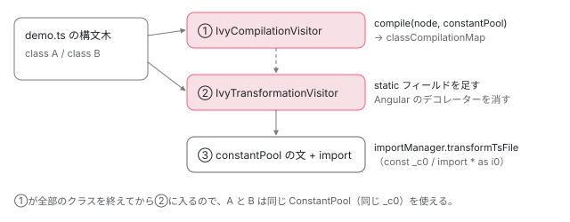

[目次](../README.md) › [ngtsc の内側](README.md) › 第 12 回 / 全 20 回

# JS の書き換え：ivyTransformFactory が静的なフィールドを足す

> ivyTransformFactory が TypeScript の before の変換として 2 回の訪問（IvyCompilationVisitor で TraitCompiler.compile を呼んで結果を集め、IvyTransformationVisitor でクラスに静的なフィールドを足しデコレーターを消す）を行う行、Visitor の after でクラスの直後に文を置く仕組み、ImportManager で足す import と ConstantPool の文、aliasTransformFactory。ngDevMode の条件は変換ではなく compiler が作る式の側にあること。テンプレートの出力の章（compiler-reify-emit）で読んだ範囲はリンク。

angular/angular · 読了 約 13 分 · 発展 · [サイトで読む（デモが動きます）](https://angular-deep-dive-cyan.vercel.app/chapter/ngtsc-ivy-transform)

---

handler が作った `CompileResult`（[第 9 回](09-ngtsc-directive-handler.md)の 6 節）は、まだ「式の部品」です。それを TypeScript のクラスに `static ɵcmp = ...` として貼り、`@Component` などのデコレーターを消すのが `ivyTransformFactory` です。この章では、TypeScript の emit の途中で動くこの変換が、ファイルを**2 回**訪問する理由と、クラス・メンバー・コンストラクタの引数からデコレーターを消す行を 1 つずつ読みます。

読む対象は `packages/compiler-cli/src/ngtsc/transform/src/transform.ts`・`alias.ts` と、訪問の土台の `packages/compiler-cli/src/ngtsc/util/src/visitor.ts` です。

1. [1. 全体像](01-ngtsc-overview.md)
2. [2. NgtscProgram](02-ngtsc-program.md)
3. [3. NgCompiler とチケット](03-ngtsc-compiler-ticket.md)
4. [4. リフレクション](04-ngtsc-reflection.md)
5. [5. 静的な評価](05-ngtsc-partial-evaluator.md)
6. [6. 参照と import](06-ngtsc-references-imports.md)
7. [7. 解析](07-ngtsc-trait-analyze.md)
8. [8. 解決と出力](08-ngtsc-trait-resolve-compile.md)
9. [9. @Directive の handler](09-ngtsc-directive-handler.md)
10. [10. メタデータの登録](10-ngtsc-metadata-registry.md)
11. [11. .d.ts を読む](11-ngtsc-dts-metadata.md)
12. **12. JS の書き換え**（この章）
13. [13. .d.ts の書き換え](13-ngtsc-dts-transform.md)
14. [14. 差分ビルド](14-ngtsc-incremental.md)
15. [15. 意味のグラフ](15-ngtsc-semantic-graph.md)
16. [16. import の循環](16-ngtsc-cycles.md)
17. [17. HMR](17-ngtsc-hmr.md)
18. [18. 診断と性能](18-ngtsc-diagnostics-perf.md)
19. [19. テストを書く](19-ngtsc-test-env.md)
20. [20. issue と PR を読む](20-ngtsc-issues.md)

> [!TIP]
> **新卒エンジニアへ**
>
> TypeScript の **変換（transformer）**は、emit のときに構文木を受け取って、書き換えた構文木を返す関数です。`before` の変換は、TypeScript 自身が型を消して JS にする**前**に走ります。だから ngtsc の変換の中ではまだ型の注釈やデコレーターが残っていて、消すのも足すのも TypeScript の構文木の操作です。ngtsc がどの変換を `before` に並べるか（`prepareEmit`）は[テンプレートの出力の章](../compiler/16-compiler-reify-emit.md)の 9 節で読みました。

## 1. 入口：ivyTransformFactory

📄 `angular/packages/compiler-cli/src/ngtsc/transform/src/transform.ts` L47–81 （▶ の行: 47–48, 58, 60–64）

```ts
47 ▶ export function ivyTransformFactory(
48 ▶   compilation: TraitCompiler,
49 │   reflector: ReflectionHost,
50 │   importRewriter: ImportRewriter,
51 │   defaultImportTracker: DefaultImportTracker,
52 │   localCompilationExtraImportsTracker: LocalCompilationExtraImportsTracker | null,
53 │   perf: PerfRecorder,
54 │   isCore: boolean,
55 │   isClosureCompilerEnabled: boolean,
56 │   emitDeclarationOnly: boolean,
57 │   refEmitter: ReferenceEmitter | null,
58 ▶   enableTypeReification: boolean,
59 │ ): ts.TransformerFactory<ts.SourceFile> {
60 ▶   const recordWrappedNode = createRecorderFn(defaultImportTracker);
61 ▶   return (context: ts.TransformationContext): ts.Transformer<ts.SourceFile> => {
62 ▶     return (file: ts.SourceFile): ts.SourceFile => {
63 ▶       return perf.inPhase(PerfPhase.Compile, () =>
64 ▶         transformIvySourceFile(
65 │           compilation,
66 │           context,
67 │           reflector,
68 │           importRewriter,
69 │           localCompilationExtraImportsTracker,
70 │           file,
71 │           isCore,
72 │           isClosureCompilerEnabled,
73 │           emitDeclarationOnly,
74 │           refEmitter,
75 │           enableTypeReification,
76 │           recordWrappedNode,
77 │         ),
78 │       );
79 │     };
80 │   };
81 │ }
```

61〜62 行目が TypeScript の変換の決まった形で、「`context` を受け取って、ファイル 1 つを変換する関数」を返します。63 行目、ファイルごとの仕事は `PerfPhase.Compile` の時間として記録され（[第 18 回](18-ngtsc-diagnostics-perf.md)）、中身は 64 行目の `transformIvySourceFile` です。48 行目の `compilation` は[第 8 回](08-ngtsc-trait-resolve-compile.md)の `TraitCompiler` そのもので、変換はここに「このクラスをコンパイルして」と頼みます。58 行目の `enableTypeReification` は、足すフィールドに型の注釈まで付けるかの切り替えで、`prepareEmit` は内部用の設定 `_experimentalEmitIntermediateTs`（名前のとおり、変換の途中の TypeScript を書き出す実験的な使い方）から渡します。

## 2. 訪問の土台：Visitor は子を先に、文を後から差し込む

📄 `angular/packages/compiler-cli/src/ngtsc/util/src/visitor.ts` L82–104 （▶ の行: 87, 89–91, 94, 99–100）

```ts
 82 │   _visit<T extends ts.Node>(node: T, context: ts.TransformationContext): T {
 83 │     // First, visit the node. visitedNode starts off as `null` but should be set after visiting
 84 │     // is completed.
 85 │     let visitedNode: T | null = null;
 86 │ 
 87 ▶     node = ts.visitEachChild(node, (child) => child && this._visit(child, context), context) as T;
 88 │ 
 89 ▶     if (ts.isClassDeclaration(node)) {
 90 ▶       visitedNode = this._visitListEntryNode(node, (node: ts.ClassDeclaration) =>
 91 ▶         this.visitClassDeclaration(node),
 92 │       ) as typeof node;
 93 │     } else {
 94 ▶       visitedNode = this.visitOtherNode(node);
 95 │     }
 96 │ 
 97 │     // If the visited node has a `statements` array then process them, maybe replacing the visited
 98 │     // node and adding additional statements.
 99 ▶     if (visitedNode && (ts.isBlock(visitedNode) || ts.isSourceFile(visitedNode))) {
100 ▶       visitedNode = this._maybeProcessStatements(visitedNode);
101 │     }
102 │ 
103 │     return visitedNode;
104 │   }
```

87 行目、**先に子をすべて訪問**してから自分を見ます。クラスの中（コンストラクタの中など）にクラスがあれば、内側が先です。89〜92 行目、クラスの宣言なら `visitClassDeclaration`、それ以外は 94 行目の `visitOtherNode`。99〜101 行目、文の並びを持つノード（ブロックとファイル）では、子が頼んだ「前後に足す文」をここで差し込みます。

📄 `angular/packages/compiler-cli/src/ngtsc/util/src/visitor.ts` L55–70 （▶ の行: 59–60, 63, 65, 67, 69）

```ts
55 │   private _visitListEntryNode<T extends ts.Statement>(
56 │     node: T,
57 │     visitor: (node: T) => VisitListEntryResult<ts.Statement, T>,
58 │   ): T {
59 ▶     const result = visitor(node);
60 ▶     if (result.before !== undefined) {
61 │       // Record that some nodes should be inserted before the given declaration. The declaration's
62 │       // parent's _visit call is responsible for performing this insertion.
63 ▶       this._before.set(result.node, result.before);
64 │     }
65 ▶     if (result.after !== undefined) {
66 │       // Same with nodes that should be inserted after.
67 ▶       this._after.set(result.node, result.after);
68 │     }
69 ▶     return result.node;
70 │   }
```

📄 `angular/packages/compiler-cli/src/ngtsc/util/src/visitor.ts` L106–125 （▶ の行: 109, 115–116, 120–122）

```ts
106 │   private _maybeProcessStatements<T extends ts.Block | ts.SourceFile>(node: T): T {
107 │     // Shortcut - if every statement doesn't require nodes to be prepended or appended,
108 │     // this is a no-op.
109 ▶     if (node.statements.every((stmt) => !this._before.has(stmt) && !this._after.has(stmt))) {
110 │       return node;
111 │     }
112 │ 
113 │     // Build a new list of statements and patch it onto the clone.
114 │     const newStatements: ts.Statement[] = [];
115 ▶     node.statements.forEach((stmt) => {
116 ▶       if (this._before.has(stmt)) {
117 │         newStatements.push(...(this._before.get(stmt)! as ts.Statement[]));
118 │         this._before.delete(stmt);
119 │       }
120 ▶       newStatements.push(stmt);
121 ▶       if (this._after.has(stmt)) {
122 ▶         newStatements.push(...(this._after.get(stmt)! as ts.Statement[]));
123 │         this._after.delete(stmt);
124 │       }
125 │     });
```

`visitClassDeclaration` が `{node, after: [...]}` を返すと、67 行目で「このクラスのあとに足す文」を覚えます。親（ファイル）の番になったとき、115〜124 行目で文を 1 つずつ並べ直し、クラスの直後（121〜122 行目）に入れます。出力でクラスのすぐ下に `(() => { ... ɵsetClassMetadata(...) })();` が来るのはこの仕組みです。

## 3. 1 回目の訪問：IvyCompilationVisitor は何も書き換えない

📄 `angular/packages/compiler-cli/src/ngtsc/transform/src/transform.ts` L83–121 （▶ の行: 86, 89–90, 104–106, 111–112, 119）

```ts
 83 │ /**
 84 │  * Visits all classes, performs Ivy compilation where Angular decorators are present and collects
 85 │  * result in a Map that associates a ts.ClassDeclaration with Ivy compilation results. This visitor
 86 ▶  * does NOT perform any TS transformations.
 87 │  */
 88 │ class IvyCompilationVisitor extends Visitor {
 89 ▶   public classCompilationMap = new Map<ts.ClassDeclaration, CompileResult[]>();
 90 ▶   public deferrableImports = new Set<ts.ImportDeclaration>();
 91 │ 
 92 │   constructor(
 93 │     private compilation: TraitCompiler,
 94 │     private constantPool: ConstantPool,
 95 │   ) {
 96 │     super();
 97 │   }
 98 │ 
 99 │   override visitClassDeclaration(
100 │     node: ts.ClassDeclaration,
101 │   ): VisitListEntryResult<ts.Statement, ts.ClassDeclaration> {
102 │     // Determine if this class has an Ivy field that needs to be added, and compile the field
103 │     // to an expression if so.
104 ▶     const result = this.compilation.compile(node, this.constantPool);
105 ▶     if (result !== null) {
106 ▶       this.classCompilationMap.set(node, result);
107 │ 
108 │       // Collect all deferrable imports declarations into a single set,
109 │       // so that we can pass it to the transform visitor that will drop
110 │       // corresponding regular import declarations.
111 ▶       for (const classResult of result) {
112 ▶         if (classResult.deferrableImports !== null && classResult.deferrableImports.size > 0) {
113 │           classResult.deferrableImports.forEach((importDecl) =>
114 │             this.deferrableImports.add(importDecl),
115 │           );
116 │         }
117 │       }
118 │     }
119 ▶     return {node};
120 │   }
121 │ }
```

86 行目のコメントのとおり、このクラスは TypeScript の構文木を**変えません**（119 行目で受け取ったノードをそのまま返す）。104 行目の `this.compilation.compile(node, this.constantPool)` が[第 8 回](08-ngtsc-trait-resolve-compile.md)の `TraitCompiler.compile` で、handler の `compileFull` などを呼んで `CompileResult[]` を返します。Angular のクラスでなければ `null` です。106 行目、結果をクラスの宣言のノードをキーにして `classCompilationMap` に溜めます。111〜117 行目、`@defer` で遅らせて読み込む import の宣言を集めておき、2 回目で消します（[defer の依存の章](../standalone/11-standalone-defer-deps.md)）。

なぜ 2 回に分けるのかは、`transformIvySourceFile` の中の「2 つの段」のコメントに書いてあり、[テンプレートの出力の章](../compiler/16-compiler-reify-emit.md)で引用しました。要点は、**ファイルの中の全部のクラスを先にコンパイルしてから**書き換えに入ることで、同じファイルの複数のコンポーネントが `ConstantPool`（同じ定数を 1 つにまとめて共有する入れ物）を共有できるようにするためです。7 節のデモの「同じファイルに 2 つのコンポーネント」で確かめます。



*transformIvySourceFile は同じファイルを 2 回 visit する。1 回目は compile を呼んで結果を Map に溜めるだけ、2 回目でその結果を使ってクラスを作り直し、最後に定数と import をファイルの先頭に足す。*

## 4. 2 回目の訪問：クラスを作り直す

📄 `angular/packages/compiler-cli/src/ngtsc/transform/src/transform.ts` L143–169 （▶ の行: 147, 151–154, 157–159, 164, 168）

```ts
143 │   override visitClassDeclaration(
144 │     node: ts.ClassDeclaration,
145 │   ): VisitListEntryResult<ts.Statement, ts.ClassDeclaration> {
146 │     // Node might be modified since results were collected in the compilation phase.
147 ▶     const original = ts.getOriginalNode(node, ts.isClassDeclaration);
148 │ 
149 │     // If this class is not registered in the map, it means that it doesn't have Angular decorators,
150 │     // thus no further processing is required.
151 ▶     const compileResults =
152 ▶       this.classCompilationMap.get(node) ?? this.classCompilationMap.get(original);
153 ▶     if (!compileResults) {
154 ▶       return {node};
155 │     }
156 │ 
157 ▶     const translateOptions: TranslatorOptions<ts.Expression> = {
158 ▶       recordWrappedNode: this.recordWrappedNodeExpr,
159 ▶       annotateForClosureCompiler: this.isClosureCompilerEnabled,
160 │     };
161 │ 
162 │     // There is at least one field to add.
163 │     const statements: ts.Statement[] = [];
164 ▶     const members = [...node.members];
165 │ 
166 │     // Note: Class may be already transformed by e.g. Tsickle and
167 │     // not have a direct reference to the source file.
168 ▶     const sourceFile = original.getSourceFile();
169 │ 
```

1. **147〜152 行目：1 回目の結果を探す**

   まず受け取ったノードで、無ければ `ts.getOriginalNode` で「作り直される前のノード」で探します。2 節の 87 行目のとおり子が先に訪問されるので、クラスの中に Angular のクラスがあると、外側のクラスは `ts.visitEachChild` で作り直された別のノードになっています。1 回目の Map のキーは元のノードなので、元に戻して探す必要があります。この 2 段の探し方は a904d9f77b5（「入れ子のコンポーネントの宣言」）で入りました（テストと直し方）。
2. **153〜155 行目：Angular のクラスでなければそのまま**

   デコレーターの無いクラスや、[第 9 回](09-ngtsc-directive-handler.md)の NG2007 で解析の結果が無かったクラスは、ここで何もされません。
3. **157〜168 行目：準備**

   式を TypeScript のノードにするための設定、元のメンバーの写し（164 行目）、ファイル（168 行目。tsickle などで作り直されたクラスでも元のファイルを取るため）。

この直後の for 文の前半（フィールドの初期値の式を `translateExpression` で TypeScript のノードにし、型の注釈を付けるかを決める行）は [compiler の入口の章](../compiler/02-compiler-entry.md)の 7 節で引用しました。続きから読みます。

📄 `angular/packages/compiler-cli/src/ngtsc/transform/src/transform.ts` L196–222 （▶ の行: 196–198, 204, 212, 217–219, 221）

```ts
196 ▶       const property = ts.factory.createPropertyDeclaration(
197 ▶         [ts.factory.createToken(ts.SyntaxKind.StaticKeyword)],
198 ▶         isUnsafeObjectKey(field.name) ? ts.factory.createStringLiteral(field.name) : field.name,
199 │         undefined,
200 │         typeNode,
201 │         exprNode,
202 │       );
203 │ 
204 ▶       if (this.isClosureCompilerEnabled) {
205 │         // Closure compiler transforms the form `Service.ɵprov = X` into `Service$ɵprov = X`. To
206 │         // prevent this transformation, such assignments need to be annotated with @nocollapse.
207 │         // Note that tsickle is typically responsible for adding such annotations, however it
208 │         // doesn't yet handle synthetic fields added during other transformations.
209 │         ts.addSyntheticLeadingComment(
210 │           property,
211 │           ts.SyntaxKind.MultiLineCommentTrivia,
212 ▶           '* @nocollapse ',
213 │           /* hasTrailingNewLine */ false,
214 │         );
215 │       }
216 │ 
217 ▶       field.statements
218 ▶         .map((stmt) => translateStatement(sourceFile, stmt, this.importManager, translateOptions))
219 ▶         .forEach((stmt) => statements.push(stmt));
220 │ 
221 ▶       members.push(property);
222 │     }
```

1. **196〜202 行目：static のプロパティを作る**

   197 行目の `static` の修飾子、198 行目の名前（`ɵcmp`・`ɵfac` など）、201 行目の初期値。198 行目、名前が識別子として書けないとき（`ngAcceptInputType_aria-label` のように `-` を含むなど）は文字列のリテラルにします。これは 2026 年 5 月の b225a5d902f で入った行です。
2. **204〜215 行目：Closure Compiler 向け**

   `annotateForClosureCompiler` のときだけ `/** @nocollapse */` を付けます（Closure がプロパティを平らにして壊すのを防ぐ）。
3. **217〜219 行目：クラスのあとに置く文**

   `CompileResult` の `statements`（`ɵsetClassMetadata` の呼び出しなど）を翻訳して、ローカルの `statements` に積みます。
4. **221 行目：メンバーに足す**

   164 行目で写したメンバーの**後ろ**に足すので、出力では元のフィールドとメソッドのあとに `static ɵfac`・`static ɵcmp` が並びます。

## 5. デコレーターを消す

📄 `angular/packages/compiler-cli/src/ngtsc/transform/src/transform.ts` L224–246 （▶ の行: 226, 228, 231–232, 236, 243, 245）

```ts
224 │     const filteredDecorators =
225 │       // Remove the decorator which triggered this compilation, leaving the others alone.
226 ▶       maybeFilterDecorator(ts.getDecorators(node), this.compilation.decoratorsFor(node));
227 │ 
228 ▶     const nodeModifiers = ts.getModifiers(node);
229 │     let updatedModifiers: ts.ModifierLike[] | undefined;
230 │ 
231 ▶     if (filteredDecorators?.length || nodeModifiers?.length) {
232 ▶       updatedModifiers = [...(filteredDecorators || []), ...(nodeModifiers || [])];
233 │     }
234 │ 
235 │     // Replace the class declaration with an updated version.
236 ▶     node = ts.factory.updateClassDeclaration(
237 │       node,
238 │       updatedModifiers,
239 │       node.name,
240 │       node.typeParameters,
241 │       node.heritageClauses || [],
242 │       // Map over the class members and remove any Angular decorators from them.
243 ▶       members.map((member) => this._stripAngularDecorators(member)),
244 │     );
245 ▶     return {node, after: statements};
246 │   }
```

📄 `angular/packages/compiler-cli/src/ngtsc/transform/src/transform.ts` L480–498 （▶ の行: 484, 487–488, 490–491, 493）

```ts
480 │ function maybeFilterDecorator(
481 │   decorators: readonly ts.Decorator[] | undefined,
482 │   toRemove: ts.Decorator[],
483 │ ): ts.NodeArray<ts.Decorator> | undefined {
484 ▶   if (decorators === undefined) {
485 │     return undefined;
486 │   }
487 ▶   const filtered = decorators.filter(
488 ▶     (dec) => toRemove.find((decToRemove) => ts.getOriginalNode(dec) === decToRemove) === undefined,
489 │   );
490 ▶   if (filtered.length === 0) {
491 ▶     return undefined;
492 │   }
493 ▶   return ts.factory.createNodeArray(filtered);
494 │ }
495 │ 
496 │ function isFromAngularCore(decorator: Decorator): boolean {
497 │   return decorator.import !== null && decorator.import.from === '@angular/core';
498 │ }
```

クラスそのものに付いたデコレーターは、226 行目で `this.compilation.decoratorsFor(node)`（[第 8 回](08-ngtsc-trait-resolve-compile.md)。コンパイルの元になったデコレーター）を、488 行目で `ts.getOriginalNode` どうしを比べて取り除きます。**消すのは trait を作ったデコレーターだけ**で、ほかのライブラリのデコレーター（`@Log` など）は残ります。490〜492 行目、何も残らなければ `undefined` にして、228〜233 行目でほかの修飾子（`export` など）と並べ直します。236〜244 行目でクラスを作り直し、243 行目で**メンバーそれぞれ**からも Angular のデコレーターを消します。245 行目が 2 節の `after` です。

📄 `angular/packages/compiler-cli/src/ngtsc/transform/src/transform.ts` L258–289 （▶ の行: 263, 268–269, 281, 285, 288）

```ts
258 │   /**
259 │    * Return all decorators on a `Declaration` which are from @angular/core, or an empty set if none
260 │    * are.
261 │    */
262 │   private _angularCoreDecorators(decl: ts.Declaration): Set<ts.Decorator> {
263 ▶     const decorators = this.reflector.getDecoratorsOfDeclaration(decl);
264 │     if (decorators === null) {
265 │       return NO_DECORATORS;
266 │     }
267 │     const coreDecorators = decorators
268 ▶       .filter((dec) => this.isCore || isFromAngularCore(dec))
269 ▶       .map((dec) => dec.node as ts.Decorator);
270 │     if (coreDecorators.length > 0) {
271 │       return new Set<ts.Decorator>(coreDecorators);
272 │     } else {
273 │       return NO_DECORATORS;
274 │     }
275 │   }
276 │ 
277 │   private _nonCoreDecoratorsOnly(node: ts.HasDecorators): ts.Decorator[] | undefined {
278 │     const decorators = ts.getDecorators(node);
279 │ 
280 │     // Shortcut if the node has no decorators.
281 ▶     if (decorators === undefined) {
282 │       return undefined;
283 │     }
284 │     // Build a Set of the decorators on this node from @angular/core.
285 ▶     const coreDecorators = this._angularCoreDecorators(node);
286 │ 
287 │     // Filter out the core decorators.
288 ▶     return decorators.filter((dec) => !coreDecorators.has(dec));
289 │   }
```

メンバーのほうは、trait ではなく「`@angular/core` から来たデコレーターか」で決めます。263 行目で `ReflectionHost`（[第 4 回](04-ngtsc-reflection.md)）にデコレーターを聞き、268 行目で import 元が `@angular/core` のもの（`@angular/core` 自身のコンパイルでは全部）を集め、288 行目でそれ以外だけを残します。だから `@Input`・`@HostListener`・`@Optional` は消え、`@Track` のようなほかのデコレーターは残ります。

📄 `angular/packages/compiler-cli/src/ngtsc/transform/src/transform.ts` L291–317 （▶ の行: 299, 301–302, 306, 310–312, 315–316）

```ts
291 │   /**
292 │    * Remove Angular decorators from a `ts.Node` in a shallow manner.
293 │    *
294 │    * This will remove decorators from class elements (getters, setters, properties, methods) as well
295 │    * as parameters of constructors.
296 │    */
297 │   private _stripAngularDecorators<T extends ts.Node>(node: T): T {
298 │     const modifiers = ts.canHaveModifiers(node) ? ts.getModifiers(node) : undefined;
299 ▶     if (ts.isConstructorDeclaration(node)) {
300 │       // For constructors, strip decorators of the parameters.
301 ▶       const parameters = node.parameters.map((param) => this._stripAngularDecorators(param));
302 ▶       node = ts.factory.updateConstructorDeclaration(node, modifiers, parameters, node.body) as T &
303 │         ts.ConstructorDeclaration;
304 │     }
305 │ 
306 ▶     if (!ts.canHaveDecorators(node)) {
307 │       return node;
308 │     }
309 │ 
310 ▶     const nonCoreDecorators = this._nonCoreDecoratorsOnly(node);
311 ▶     if (nonCoreDecorators === undefined) {
312 ▶       return node;
313 │     }
314 │ 
315 ▶     const combinedModifiers = [...nonCoreDecorators, ...(modifiers ?? [])];
316 ▶     return ts.factory.replaceDecoratorsAndModifiers(node, combinedModifiers) as T;
317 │   }
```

1. **299〜304 行目：コンストラクタ**

   コンストラクタ自身ではなく、引数の 1 つずつにこの関数を再帰で当てます。`@Inject(TOKEN)` などはここで消えます（情報はすでに ɵfac に入っています）。
2. **306〜313 行目：消すものが無いとき**

   デコレーターを持てないノードと、デコレーターが 1 つも無いノードは、**同じノードのまま**返します。
3. **315〜316 行目：作り直す**

   残すデコレーターと修飾子を並べて `ts.factory.replaceDecoratorsAndModifiers` でノードを作り直します。プロパティかメソッドかアクセサかを分けずに 1 行で済むのは 2c141c04cbc の整理からです。

## 6. ファイルの仕上げと ngDevMode

📄 `angular/packages/compiler-cli/src/ngtsc/transform/src/transform.ts` L389–409 （▶ の行: 392, 395–397, 402, 405）

```ts
389 │ 
390 │   // Preserve @fileoverview comments required by Closure, since the location might change as a
391 │   // result of adding extra imports and constant pool statements.
392 ▶   const fileOverviewMeta = isClosureCompilerEnabled ? getFileOverviewComment(sf.statements) : null;
393 │ 
394 │   // Add extra imports.
395 ▶   if (localCompilationExtraImportsTracker !== null) {
396 ▶     for (const moduleName of localCompilationExtraImportsTracker.getImportsForFile(sf)) {
397 ▶       importManager.addSideEffectImport(sf, moduleName);
398 │     }
399 │   }
400 │ 
401 │   // Add new imports for this file.
402 ▶   sf = importManager.transformTsFile(context, sf, constants);
403 │ 
404 │   if (fileOverviewMeta !== null) {
405 ▶     sf = insertFileOverviewComment(sf, fileOverviewMeta);
406 │   }
407 │ 
408 │   return sf;
409 │ }
```

この引用の直前、ConstantPool の文を翻訳する行は[テンプレートの出力の章](../compiler/16-compiler-reify-emit.md)で引用しました。395〜399 行目は、ローカルのコンパイル（[ローカルコンパイルの章](../standalone/06-standalone-local-compilation.md)）のときだけ副作用の import を足します。402 行目の `importManager.transformTsFile(context, sf, constants)` が、足す必要のある import（`import * as i0 from "@angular/core"` など）と ConstantPool の文（`const _c0 = ...`）をファイルの先頭のほうに入れます。ImportManager の中は同じ章の 9 節です。392 行目と 404〜406 行目は、Closure の `@fileoverview` のコメントを、先頭に文が増えたあとも一番上に保つための処理です。

**この変換の中に `ngDevMode` の分岐はありません。** 出力の `(typeof ngDevMode === "undefined" || ngDevMode) && i0.ɵsetClassMetadata(...)` の条件は、`@angular/compiler` の `compileClassMetadata` が式として作ったもので（[forwardRef の章](../standalone/05-standalone-forward-ref.md)で引用）、変換は 217〜219 行目でそれを翻訳して置くだけです。`input()` などに付く `...(ngDevMode ? [{ debugName }] : [])` は `before` の並びのもっと後ろの別の変換（[signal のデバッグ名の章](../signals/18-signals-debug.md)）が足します。`ngDevMode` を `false` に置き換えて中身を消すのは、さらに後のバンドラの仕事です（[CLI の JavaScript の変換の章](../cli/05-cli-javascript-transformer.md)）。

📄 `angular/packages/compiler-cli/src/ngtsc/transform/src/alias.ts` L11–36 （▶ の行: 16, 21–22, 26, 28, 33）

```ts
11 │ export function aliasTransformFactory(
12 │   exportStatements: Map<string, Map<string, [string, string]>>,
13 │ ): ts.TransformerFactory<ts.SourceFile> {
14 │   return () => {
15 │     return (file: ts.SourceFile) => {
16 ▶       if (ts.isBundle(file) || !exportStatements.has(file.fileName)) {
17 │         return file;
18 │       }
19 │ 
20 │       const statements = [...file.statements];
21 ▶       exportStatements.get(file.fileName)!.forEach(([moduleName, symbolName], aliasName) => {
22 ▶         const stmt = ts.factory.createExportDeclaration(
23 │           /* modifiers */ undefined,
24 │           /* isTypeOnly */ false,
25 │           /* exportClause */ ts.factory.createNamedExports([
26 ▶             ts.factory.createExportSpecifier(false, symbolName, aliasName),
27 │           ]),
28 ▶           /* moduleSpecifier */ ts.factory.createStringLiteral(moduleName),
29 │         );
30 │         statements.push(stmt);
31 │       });
32 │ 
33 ▶       return ts.factory.updateSourceFile(file, statements);
34 │     };
35 │   };
36 │ }
```

`before` で `ivyTransformFactory` の次に並ぶ `aliasTransformFactory` は、ずっと小さな変換です。16 行目、`exportStatements`（`TraitCompiler` が resolve で集めた「このファイルから足す re-export」）に載っていないファイルは素通り。載っていれば 21〜31 行目で `export { 元の名前 as 別名 } from '...'` の文をファイルの最後に足します。別名の re-export が要る場面（`AliasingHost`）は[第 6 回](06-ngtsc-references-imports.md)です。

## 7. DEMO：デコレーターの組み合わせで、変換の前後を見比べる

> **🧪 DEMO — 記録：入力の .ts と、Angular の変換の直後と、書き出された .js**
>
> これは記録です。@angular/compiler-cli 22.1.6 を Node で動かした結果。「Angular の変換の直後」は、emit の `customTransformers.beforeTs` に「受け取った構文木を printer で文字列にするだけ」の変換を足して取りました。NgtscProgram はこれを Angular の `before` の変換の後ろに並べるので、TypeScript が型やデコレーターを処理する前の形が見えます。設定は target ES2022・`experimentalDecorators: true`・`importHelpers: true`（`useDefineForClassFields` は書かず、TypeScript の既定）。
>
> ▶ [このデモはサイトで動かせます](https://angular-deep-dive-cyan.vercel.app/chapter/ngtsc-ivy-transform)

場面ごとに、行に戻して確かめます。

1. **Angular のデコレーターだけ**

   「変換の直後」で `@Component` も `@Input` も、コンストラクタの引数の `@Optional() @Inject(TOKEN)` も消えています（5 節の 226・243・299〜304 行目）。その情報は `ɵfac` の `ɵɵdirectiveInject(TOKEN, 8)`（8 は「省略可能」の印）と、クラスのあとの `ɵsetClassMetadata` に移っています。元の `import { Component, Inject, Input, Optional }` はそのまま残っていて、`ɵsetClassMetadata` の中の `Component`・`Optional`・`Inject`・`Input` がそれを使っています。
2. **Angular + ほかのライブラリのデコレーター**

   「変換の直後」で、クラスの `@Log('card')` と、`title`・`select` の `@Track()` は残り、`@Directive` と `@Input` だけが消えています（488 行目と 288 行目）。「.js」では、残ったデコレーターを TypeScript 自身が `__decorate([...])` にしています。クラスのデコレーターがあるので `let CardDir = class CardDir {...}` の形になり、`static ɵfac`・`static ɵdir` は class の本体の中にあります。
3. **プロパティに ! と declare**

   「変換の直後」で `title!: string` の `!`（初期化しなくてよいという印）が残っています。2026 年 3 月の 7a0d6b8df21 より前は、デコレーターを消すためにプロパティを作り直すとき（当時は 5 節より前の形）にこの `!` を落としていました（テストと直し方）。「.js」には `title; label; note;` の 3 つのフィールドが出ています。このうち `note` は `declare` のフィールドです。下の「テストと直し方」の 4 つ目で扱います。
4. **同じファイルに 2 つのコンポーネント**

   A と B のテンプレートはどちらも `[title]="[1, 2]"` で、ファイルの先頭の `const _c0 = () => [1, 2];` を**両方が**使っています。3 節で 1 回目の訪問が両方のクラスを同じ `ConstantPool` でコンパイルし、6 節の 402 行目で 1 つだけ先頭に置かれた結果です。

📄 `記録に使ったスクリプト（scratchpad の記録スクリプト）`

```
// 第 12 回の記録。angular-deep-dive を cwd にして `node <このファイル>` で走らせる。
// 本物の @angular/compiler-cli（node_modules の 22.1.6）の NgtscProgram で場面ごとに emit し、
// 1) 入力の .ts
// 2) Angular の before の変換（ivyTransformFactory ほか）が終わった直後の TypeScript の構文木を
//    printer で文字列にしたもの（emit の customTransformers.beforeTs に自分の変換を 1 つ足して取る）
// 3) 最後に書き出された .js
// を JSON で出す。
import fs from 'node:fs';
import path from 'node:path';
import { createRequire } from 'node:module';
import { pathToFileURL } from 'node:url';

const req = createRequire(path.resolve('package.json'));
const load = (id) => import(pathToFileURL(req.resolve(id)).href);
const { default: ts } = await load('typescript');
const { NgtscProgram, VERSION } = await load('@angular/compiler-cli');

const HERE = path.dirname(new URL(import.meta.url).pathname);
const NODE_MODULES = path.resolve('node_modules');

const SCENES = {
  angularOnly: `import {Component, Inject, Input, Optional} from '@angular/core';
import {TOKEN} from './token';

@Component({selector: 'app-card', template: '<p>{{ title }}</p>'})
export class Card {
  @Input() title = '';
  constructor(@Optional() @Inject(TOKEN) readonly config: string | null) {}
}
`,
  mixed: `import {Directive, Input} from '@angular/core';
import {Log, Track} from './lib';

@Log('card')
@Directive({selector: '[appCard]'})
export class CardDir {
  @Track() @Input() title = '';
  @Track() select() {}
}
`,
  exclamation: `import {Directive, Input} from '@angular/core';
import {Track} from './lib';

@Directive({selector: '[appCard]'})
export class CardDir {
  @Input() title!: string;
  @Track() label!: string;
  @Track() declare note: string;
}
`,
  constantPool: `import {Component} from '@angular/core';

@Component({selector: 'app-a', template: '<p [title]="[1, 2]"></p>'})
export class A {}

@Component({selector: 'app-b', template: '<p [title]="[1, 2]"></p>'})
export class B {}
`,
};

const LIB = `export function Log(name: string) { return (c: Function) => {}; }
export function Track() { return (t: object, key: string) => {}; }
`;
const TOKEN = `import {InjectionToken} from '@angular/core';
export const TOKEN = new InjectionToken<string>('TOKEN');
`;

function compile(source) {
  const dir = fs.mkdtempSync(path.join(HERE, 'tmp-'));
  try {
    fs.symlinkSync(NODE_MODULES, path.join(dir, 'node_modules'), 'dir');
    const file = path.join(dir, 'demo.ts');
    fs.writeFileSync(file, source);
    fs.writeFileSync(path.join(dir, 'lib.ts'), LIB);
    fs.writeFileSync(path.join(dir, 'token.ts'), TOKEN);
    const options = {
      target: ts.ScriptTarget.ES2022,
      module: ts.ModuleKind.ES2022,
      moduleResolution: ts.ModuleResolutionKind.Bundler,
      experimentalDecorators: true,
      importHelpers: true,
      strict: true,
      skipLibCheck: true,
      outDir: path.join(dir, 'out'),
    };
    const program = new NgtscProgram([file], options, ts.createCompilerHost(options));
    const diagnostics = [
      ...program.getTsSemanticDiagnostics(),
      ...program.getNgStructuralDiagnostics(),
      ...program.getNgSemanticDiagnostics(),
    ].map((d) => ts.flattenDiagnosticMessageText(d.messageText, '\n'));

    // Angular の before の変換のあとに走る、何も変えずに印刷するだけの変換
    let afterAngular = '';
    const printer = ts.createPrinter();
    const capture = () => (sf) => {
      if (sf.fileName === file) {
        afterAngular = printer.printFile(sf);
      }
      return sf;
    };
    program.emit({ customTransformers: { beforeTs: [capture] } });
    const js = fs.readFileSync(path.join(dir, 'out', 'demo.js'), 'utf8');
    return { diagnostics, afterAngular, js };
  } finally {
    fs.rmSync(dir, { recursive: true, force: true });
  }
}

const out = { version: VERSION.full, lib: LIB, token: TOKEN, scenes: {} };
for (const [name, source] of Object.entries(SCENES)) {
  out.scenes[name] = { source, ...compile(source) };
}
console.log(JSON.stringify(out, null, 2));

```

## ここまでの呼び出し

- `NgCompiler.prepareEmit()` — core/src/compiler.ts — *before: \[ivyTransformFactory(...), aliasTransformFactory(...), ...\]*
  - `ivyTransformFactory(...)(context)(file)` — transform/src/transform.ts L47
    - `transformIvySourceFile` — transform.ts L323 — *ConstantPool と ImportManager をファイルごとに作る*
      - `visit(file, new IvyCompilationVisitor(...))` — util/src/visitor.ts L24
        - `TraitCompiler.compile(node, constantPool)` — transform/src/compilation.ts — *第 8 回。CompileResult\[\] を Map へ*
      - `visit(file, new IvyTransformationVisitor(...))` — visitor.ts L24
        - `visitClassDeclaration` — transform.ts L143 — *static フィールド + decoratorsFor の除去 + \_stripAngularDecorators*
        - `_maybeProcessStatements` — visitor.ts L106 — *after の文をクラスの直後へ*
      - `importManager.transformTsFile(context, sf, constants)` — transform.ts L402 — *import と const \_c0 を先頭へ*
  - `aliasTransformFactory(exportStatements)` — transform/src/alias.ts L11

## テストと直し方

- transform.ts には単体テストがありません（`transform/test/compilation_spec.ts` は `TraitCompiler` のテスト）。変換の出力は `test/ngtsc/ngtsc_spec.ts` で、`env.driveMain()` のあとの .js の文字列を比べて確かめます。`describe('multiple decorators on classes')`（:3647）の 3 つの it と、下の `declare` の it（:9483）。
- 入れ子のクラスは compliance テスト（入力の .ts と期待する .js の組を並べたテスト）の `test/compliance/test_cases/r3_compiler_compliance/components_and_directives/TEST_CASES.json` の `"should support nested component declarations"` です。

📄 `angular/packages/compiler-cli/test/ngtsc/ngtsc_spec.ts` L9483–9517 （▶ の行: 9484, 9494, 9507–9509）

```ts
9483 │       it('should emit `declare` fields without runtime initialization in decorated classes', () => {
9484 ▶         env.tsconfig();
9485 │         env.write(
9486 │           'test.ts',
9487 │           `
9488 │           import {Directive} from '@angular/core';
9489 │ 
9490 │           function Log(target: any, key: string): void {}
9491 │ 
9492 │           @Directive({selector: '[child]'})
9493 │           export class Child {
9494 ▶             @Log declare value: string;
9495 │           }
9496 │         `,
9497 │         );
9498 │ 
9499 │         env.driveMain();
9500 │ 
9501 │         const jsContents = trim(env.getContents('test.js'));
9502 │         expect(jsContents).toContain(
9503 │           trim(`
9504 │             import { Directive } from '@angular/core';
9505 │             import * as i0 from "@angular/core";
9506 │             function Log(target, key) { }
9507 ▶             export class Child {
9508 ▶             }
9509 ▶             Child.ɵfac = function Child_Factory(__ngFactoryType__) { return new (__ngFactoryType__ || Child)(); };
9510 │             Child.ɵdir = /*@__PURE__*/ i0.ɵɵdefineDirective({ type: Child, selectors: [["", "child", ""]] });
9511 │             __decorate([
9512 │                 Log
9513 │             ], Child.prototype, "value", void 0);
9514 │           `),
9515 │         );
9516 │       });
9517 │     });
```

📄 `ターミナル（../angular で実行）`

```
cd ../angular
pnpm bazel test //packages/compiler-cli/test/ngtsc:ngtsc \
  --nocache_test_results --test_output=all \
  '--test_arg=--filter=multiple decorators on classes|declare. fields without runtime'
pnpm bazel test //packages/compiler-cli/test/compliance/full:full \
  --nocache_test_results --test_output=all \
  '--test_arg=--filter=nested component declarations'
```

📄 `出力（抜粋。2026-11-05 に実行。ログは scratchpad/ngtsc-logs/c-ngtsc-transform2.log・c-compliance-nested.log）`

```
# test/ngtsc（shard 2 → 4 → 3 → 1 の順に出た）
Ran 3 of 6741 specs / Ran 3 of 6741 specs / Ran 4 of 6742 specs / Ran 6 of 6744 specs（合計 16 件、0 failures）
INFO: Elapsed time: 2.794s, Critical Path: 2.57s
//packages/compiler-cli/test/ngtsc:ngtsc                                 PASSED in 2.5s

# test/compliance/full（shard_count = 2）
==================== Test output for //packages/compiler-cli/test/compliance/full:full (shard 1 of 2):
Ran 0 of 616 specs
==================== Test output for //packages/compiler-cli/test/compliance/full:full (shard 2 of 2):
Ran 1 of 617 specs
1 spec, 0 failures
INFO: Elapsed time: 1.755s, Critical Path: 1.42s
//packages/compiler-cli/test/compliance/full:full                        PASSED in 1.2s
```

1. **7a0d6b8df21（2026-03-13）：変換で exclamationToken が落ちる**

   変更は 1 行だけで、spec は足されていません。当時の `_stripAngularDecorators` は、プロパティなら `ts.factory.updatePropertyDeclaration(node, combinedModifiers, node.name, node.questionToken, ...)` とノードの種類ごとに作り直していて、4 番目の引数に `?` しか渡していなかったため `!` が消えていました。修正で `node.questionToken || node.exclamationToken` になりました。JS では `!` は意味を持たないので、影響が出るのは変換の結果を TypeScript のまま使うとき（1 節の `enableTypeReification` の使い方や、このページの「変換の直後」）です。
2. **2c141c04cbc（2026-04-19）：Angular のデコレーターの除去を整理**

   refactor のコミットで、プロパティ・メソッド・アクセサ・引数ごとの `update...` の分岐を、5 節の 315〜316 行目の `replaceDecoratorsAndModifiers` の 1 行にまとめました。ノードのほかの部分（`!` も含む）を触らなくなったので、7a0d6b8df21 のような落とし方は起きにくくなっています。このとき足された spec が上の ``'should emit `declare` fields without runtime initialization in decorated classes'`` です。
3. **a904d9f77b5：入れ子のコンポーネントの宣言（2024-11 に書かれ、2026-01-14 に取り込み）**

   修正前は 2 回目の訪問が `this.classCompilationMap.has(node)` だけで探していたため、内側のクラスを持つ外側のクラスは 作り直された別のノードとして扱われ、外側のコンパイルの結果が貼られませんでした。4 節の 147〜152 行目の `getOriginalNode` の 2 段の探し方が修正です。
4. **記録で見えたこと：`declare` のフィールドが JS のフィールドになる**

   7 節の「プロパティに ! と declare」の .js に `note;` が出ています。`declare note: string` は「実行時には何も作らない」宣言で、Angular のデコレーターの無いクラスに同じ書き方をして TypeScript だけで変換すると、`note` のフィールドは出ません（`ts.transpileModule` で確かめた）。上の spec（9494 行目の `@Log declare value`）は 9507〜9508 行目で「クラスの本体が空」であることを期待していて通りますが、NgtscTestEnvironment の tsconfig は `target: es2015` で（9509 行目の `Child.ɵfac = ...` がクラスの外の代入なのもそのため）、`useDefineForClassFields` が `false` になり、もともと初期値の無いフィールドを書かない設定です。ES2022 の既定（`useDefineForClassFields: true`）では違いが出ます。TypeScript の変換は `declare` を修飾子ではなく構文木のノードの印（`NodeFlags.Ambient`。解析したときに付く）で見分けていて、5 節の 315〜316 行目で作り直したノードにはこの印がありません（`replaceDecoratorsAndModifiers` の前後で印を比べて確かめた）。デコレーターの無いメンバーは 310〜313 行目で同じノードのまま返るので、この差は「Angular のクラスの、ほかのデコレーターが付いた `declare` のフィールド」だけで起きます。GitHub を検索した範囲（2026-11-05）では、同じ報告は見つかりませんでした。
5. **直すとしたら**

   クラスの作り直しは transform.ts の `visitClassDeclaration`（4〜5 節）、メンバーは `_stripAngularDecorators`（5 節）が入口です。spec は ngtsc\_spec.ts の `describe('multiple decorators on classes')` か、上の `declare` の it の隣に、`env.tsconfig({target: 'es2022'})` のように target を変えた it を足す形になります。issue の読み方は[第 20 回](20-ngtsc-issues.md)です。

## 聞かれそうな質問

**Q. ngtsc は @Component のデコレーターを JS に残しますか？**

残しません。transform.ts 226 行目で、コンパイルの元になったデコレーター（`decoratorsFor`）をクラスから取り除きます。中身は `static ɵcmp` と、開発モードでだけ動く `ɵsetClassMetadata` の呼び出し（217〜219 行目でクラスのあとに置く文）に移ります。

**Q. 自作のデコレーターや、ほかのライブラリのデコレーターは消えますか？**

消えません。クラスでは 488 行目で trait を作ったデコレーターだけを、メンバーでは 268 行目で import 元が `@angular/core` のものだけを取り除くからです。残ったものは TypeScript が普通に `__decorate`（`experimentalDecorators` のとき）にします。

**Q. なぜファイルを 2 回訪問するのですか？1 回で足りませんか？**

1 回目（104 行目の `compile`）でファイルの全部のクラスの出力の式を作り終えてから、2 回目で TypeScript の構文木を書き換えるためです。こうすると同じファイルのクラスが 1 つの `ConstantPool` を共有でき、デモのように A と B が同じ `_c0` を使えます。

**Q. static ɵcmp はクラスのどこに入りますか？**

メンバーの最後です。164 行目で元のメンバーを写し、221 行目でその後ろに足します。`useDefineForClassFields` が `false` だと、TypeScript がそれを `static { this.ɵcmp = ... }` のブロックに書き直します（ES2022 で static フィールドの定義の仕方を変える設定のため）。

**Q. デコレーターの無いクラスの @Input は、変換で消えますか？**

消えません。そのクラスは 1 回目の Map に入らないので、153〜155 行目でそのまま返されます。[第 9 回](09-ngtsc-directive-handler.md)のデモの 「デコレーター無し + @Input」で、出力に `__decorate([Input()], ...)` が残っていたのはこのためです。

## 読み終えて

- `ivyTransformFactory` は TypeScript の `before` の変換で、ファイルごとに `transformIvySourceFile` を呼ぶ
- 1 回目の訪問は `TraitCompiler.compile` の結果を Map に溜めるだけ。2 回目でクラスを作り直す。間に挟むのは `ConstantPool` を共有するため
- static フィールドはメンバーの最後に足し、`statements` は Visitor の `after` でクラスの直後に置く
- クラスからは trait を作ったデコレーターだけ、メンバーと引数からは `@angular/core` のデコレーターだけを消す。ほかは残る
- メンバーを `replaceDecoratorsAndModifiers` で作り直すことが、`!` や `declare` の扱いに関わる。最近の修正と、記録で見えた差はどちらもここ

---

← 前: [.d.ts からメタデータを読む：DtsMetadataReader](11-ngtsc-dts-metadata.md)  
次: [.d.ts の書き換え：ɵɵComponentDeclaration の型を足す](13-ngtsc-dts-transform.md) →
