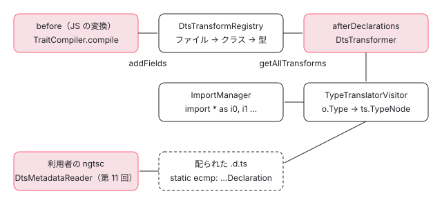

[目次](../README.md) › [ngtsc の内側](README.md) › 第 13 回 / 全 20 回

# .d.ts の書き換え：ɵɵComponentDeclaration の型を足す

> DtsTransformRegistry と IvyDeclarationDtsTransform が、TraitCompiler の CompileResult の type から .d.ts のクラスに static ɵcmp・ɵfac の宣言を足す行、declarationTransformFactory、型の中の参照を import に直す仕組み。ライブラリを配るとき .d.ts の型が DtsMetadataReader に読まれる、往復の関係。

angular/angular · 読了 約 12 分 · 発展 · [サイトで読む（デモが動きます）](https://angular-deep-dive-cyan.vercel.app/chapter/ngtsc-dts-transform)

---

ライブラリを配ると、利用者のコンパイラは `.js` ではなく `.d.ts` を読んで「このクラスはコンポーネントで、selector は何で、入力は何か」を知ります。その情報は、TypeScript がふつうに作る `.d.ts` には入っていません。ngtsc が `static ɵcmp: i0.ɵɵComponentDeclaration<…>;` のような宣言を後から足しています。この章では、その「足す」処理が、どの関数で、どの順で、何をしているかを 1 ステップずつ追い、型の中に出てくる別ファイルのクラスが `import * as i1` になる仕組みまで確かめます。

読む対象は `compiler-cli/src/ngtsc/transform/src/declaration.ts`（201 行の全部）、`translator/src/type_translator.ts`、型の中身を作る `compiler/src/render3/view/compiler.ts` と `injectable_compiler_2.ts` の数か所、spec の `test/ngtsc/declaration_only_emission_spec.ts` です。

1. [1. 全体像](01-ngtsc-overview.md)
2. [2. NgtscProgram](02-ngtsc-program.md)
3. [3. NgCompiler とチケット](03-ngtsc-compiler-ticket.md)
4. [4. リフレクション](04-ngtsc-reflection.md)
5. [5. 静的な評価](05-ngtsc-partial-evaluator.md)
6. [6. 参照と import](06-ngtsc-references-imports.md)
7. [7. 解析](07-ngtsc-trait-analyze.md)
8. [8. 解決と出力](08-ngtsc-trait-resolve-compile.md)
9. [9. @Directive の handler](09-ngtsc-directive-handler.md)
10. [10. メタデータの登録](10-ngtsc-metadata-registry.md)
11. [11. .d.ts を読む](11-ngtsc-dts-metadata.md)
12. [12. JS の書き換え](12-ngtsc-ivy-transform.md)
13. **13. .d.ts の書き換え**（この章）
14. [14. 差分ビルド](14-ngtsc-incremental.md)
15. [15. 意味のグラフ](15-ngtsc-semantic-graph.md)
16. [16. import の循環](16-ngtsc-cycles.md)
17. [17. HMR](17-ngtsc-hmr.md)
18. [18. 診断と性能](18-ngtsc-diagnostics-perf.md)
19. [19. テストを書く](19-ngtsc-test-env.md)
20. [20. issue と PR を読む](20-ngtsc-issues.md)

## 1. 全体の流れ：JS の書き換えが先、.d.ts はその記録を使う

TypeScript の emit は、1 つのソースファイルについて「JS を作る」と「宣言（`.d.ts`）を作る」の 2 本の道を持ち、それぞれに変換（transformer）を差し込めます。ngtsc は JS の側（`before`）で `ɵcmp` などの static フィールドを足し（[第 12 回](12-ngtsc-ivy-transform.md)）、宣言の側（`afterDeclarations`）で、同じフィールドの**型**を足します。2 本の道をつなぐのが `DtsTransformRegistry` で、JS の側で「このクラスにこのフィールドを足した」と書き込み、宣言の側でそれを読みます。



*JS の変換が CompileResult を DtsTransformRegistry に書き込み、宣言の変換がそれを読んで .d.ts のクラスにメンバーを足す。足した .d.ts は、ライブラリを使う側の DtsMetadataReader（第 11 回）が読む*

> [!TIP]
> **新卒エンジニアへ**
>
> transformer は「構文木を受け取って、書き換えた構文木を返す関数」です。`before` は TypeScript が JS に下げる前の木に、`afterDeclarations` は TypeScript が作り終えた宣言（.d.ts）の木に当たります。ngtsc は自分で .d.ts を書き出すのではなく、TypeScript が作った .d.ts の木に、足りないメンバーを差し込むだけです。

## 2. 書き込む側：TraitCompiler.compile の最後

JS の変換は、クラスごとに `TraitCompiler.compile` を呼んで `CompileResult`（足すフィールドの名前・初期値の式・型・前に置く文）の配列を受け取ります（[第 8 回](08-ngtsc-trait-resolve-compile.md)）。その関数の最後がここです。

📄 `angular/packages/compiler-cli/src/ngtsc/transform/src/compilation.ts` L727–733 （▶ の行: 729–731）

```ts
727 │     // Look up the .d.ts transformer for the input file and record that at least one field was
728 │     // generated, which will allow the .d.ts to be transformed later.
729 ▶     this.dtsTransforms
730 ▶       .getIvyDeclarationTransform(original.getSourceFile())
731 ▶       .addFields(original, res);
732 │ 
733 │     // Return the instruction to the transformer so the fields will be added.
```

729〜731 行目、クラスの元のソースファイルに対応する `IvyDeclarationDtsTransform` を取り、`addFields(original, res)` で「このクラスにはこの `CompileResult` たちを足した」と覚えさせます。`res` は handler ごとの結果を名前で重複を除いてまとめた配列で、コンポーネントなら `ɵfac` と `ɵcmp`、入力に transform があれば `ngAcceptInputType_…` も入ります。ここで覚えるのは各要素の `name` と `type` だけです（次の節の 140〜143 行目）。初期値の式は .d.ts には要りません。

## 3. DtsTransformRegistry：ファイルごとの入れ物

📄 `angular/packages/compiler-cli/src/ngtsc/transform/src/declaration.ts` L22–57 （▶ の行: 27, 29–31, 45, 48, 51, 53）

```ts
22 │ /**
23 │  * Keeps track of `DtsTransform`s per source file, so that it is known which source files need to
24 │  * have their declaration file transformed.
25 │  */
26 │ export class DtsTransformRegistry {
27 ▶   private ivyDeclarationTransforms = new Map<ts.SourceFile, IvyDeclarationDtsTransform>();
28 │ 
29 ▶   getIvyDeclarationTransform(sf: ts.SourceFile): IvyDeclarationDtsTransform {
30 ▶     if (!this.ivyDeclarationTransforms.has(sf)) {
31 ▶       this.ivyDeclarationTransforms.set(sf, new IvyDeclarationDtsTransform());
32 │     }
33 │     return this.ivyDeclarationTransforms.get(sf)!;
34 │   }
35 │ 
36 │   /**
37 │    * Gets the dts transforms to be applied for the given source file, or `null` if no transform is
38 │    * necessary.
39 │    */
40 │   getAllTransforms(sf: ts.SourceFile): DtsTransform[] | null {
41 │     // No need to transform if it's not a declarations file, or if no changes have been requested
42 │     // to the input file. Due to the way TypeScript afterDeclarations transformers work, the
43 │     // `ts.SourceFile` path is the same as the original .ts. The only way we know it's actually a
44 │     // declaration file is via the `isDeclarationFile` property.
45 ▶     if (!sf.isDeclarationFile) {
46 │       return null;
47 │     }
48 ▶     const originalSf = ts.getOriginalNode(sf) as ts.SourceFile;
49 │ 
50 │     let transforms: DtsTransform[] | null = null;
51 ▶     if (this.ivyDeclarationTransforms.has(originalSf)) {
52 │       transforms = [];
53 ▶       transforms.push(this.ivyDeclarationTransforms.get(originalSf)!);
54 │     }
55 │     return transforms;
56 │   }
57 │ }
```

1. **27〜34 行目：ソースファイル 1 つに 1 つ**

   `ts.SourceFile` をキーにした `Map` です。2 節の 730 行目が初めてそのファイルを渡したときに、31 行目で `IvyDeclarationDtsTransform` を作ります。
2. **45 行目：宣言のファイルでなければ何もしない**

   41〜44 行目のコメントのとおり、TypeScript の `afterDeclarations` に渡ってくる `ts.SourceFile` は、パスが元の `.ts` と同じで、`isDeclarationFile` だけが真になっています。JS の側の変換から呼ばれても、ここで `null` を返して素通りします。
3. **48・51 行目：元のファイルで引く**

   宣言のファイルは TypeScript が作り直した構文木なので、`ts.getOriginalNode` で元の `.ts` の `ts.SourceFile` に戻してから表を引きます。53 行目、見つかれば長さ 1 の配列で返します。配列なのは `DtsTransform` というインタフェースで複数の変換を並べられる形にしてあるからで、いまの実装が足すのはこの 1 種類だけです。

## 4. declarationTransformFactory：TypeScript に渡す形

📄 `angular/packages/compiler-cli/src/ngtsc/transform/src/declaration.ts` L59–79 （▶ の行: 65–66, 68, 72–73, 76）

```ts
59 │ export function declarationTransformFactory(
60 │   transformRegistry: DtsTransformRegistry,
61 │   reflector: ReflectionHost,
62 │   refEmitter: ReferenceEmitter,
63 │   importRewriter: ImportRewriter,
64 │ ): ts.TransformerFactory<ts.SourceFile> {
65 ▶   return (context: ts.TransformationContext) => {
66 ▶     const transformer = new DtsTransformer(context, reflector, refEmitter, importRewriter);
67 │     return (fileOrBundle) => {
68 ▶       if (ts.isBundle(fileOrBundle)) {
69 │         // Only attempt to transform source files.
70 │         return fileOrBundle;
71 │       }
72 ▶       const transforms = transformRegistry.getAllTransforms(fileOrBundle);
73 ▶       if (transforms === null) {
74 │         return fileOrBundle;
75 │       }
76 ▶       return transformer.transform(fileOrBundle, transforms);
77 │     };
78 │   };
79 │ }
```

TypeScript の変換は「`context` を受け取り、ファイルを受け取って新しいファイルを返す関数」を返す関数です（`ts.TransformerFactory`）。66 行目で emit 1 回につき `DtsTransformer` を 1 つ作り、ファイルが来るたびに 72 行目で 3 節の `getAllTransforms` を呼びます。68 行目の `ts.isBundle` は、`outFile` で 1 つにまとめる emit の形で、これは書き換えません。

この関数を `afterDeclarations` に並べるのは `NgCompiler.prepareEmit` です（流れの全体は [第 2 回](02-ngtsc-program.md)）。

📄 `angular/packages/compiler-cli/src/ngtsc/core/src/compiler.ts` L898–904 （▶ の行: 901–902, 904）

```ts
898 │       // If we are emitting declarations only, the script transformations are skipped by the TS
899 │       // compiler, so we have to add them to the afterDeclarations transforms to run their analysis
900 │       // because the declaration transform depends on their metadata output.
901 ▶       if (this.emitDeclarationOnly) {
902 ▶         afterDeclarations.push(...before);
903 │       }
904 ▶       afterDeclarations.push(
```

904 行目から `declarationTransformFactory(compilation.dtsTransforms, …)` を `afterDeclarations` に入れます。その前の 901〜903 行目が、この章の「順番」の話を裏付けます。`emitDeclarationOnly`（`.d.ts` だけを出す設定）のときは TypeScript が JS の変換を走らせないので、JS の変換（`before`）を宣言の側にも積んで、2 節の `addFields` が先に起きるようにしています（898〜900 行目のコメント「宣言の変換はその出力に依存する」）。この形は `_experimentalAllowEmitDeclarationOnly` を付けたときだけ有効で、spec は 8 節で見ます。

## 5. DtsTransformer：クラスを探して、最後に import を足す

📄 `angular/packages/compiler-cli/src/ngtsc/transform/src/declaration.ts` L92–115 （▶ の行: 96–98, 102–103, 106, 111, 114）

```ts
 92 │   /**
 93 │    * Transform the declaration file and add any declarations which were recorded.
 94 │    */
 95 │   transform(sf: ts.SourceFile, transforms: DtsTransform[]): ts.SourceFile {
 96 ▶     const imports = new ImportManager({
 97 ▶       ...presetImportManagerForceNamespaceImports,
 98 ▶       rewriter: this.importRewriter,
 99 │     });
100 │ 
101 │     const visitor: ts.Visitor = (node: ts.Node): ts.VisitResult<ts.Node> => {
102 ▶       if (ts.isClassDeclaration(node)) {
103 ▶         return this.transformClassDeclaration(node, transforms, imports);
104 │       } else {
105 │         // Otherwise return node as is.
106 ▶         return ts.visitEachChild(node, visitor, this.ctx);
107 │       }
108 │     };
109 │ 
110 │     // Recursively scan through the AST and process all nodes as desired.
111 ▶     sf = ts.visitNode(sf, visitor, ts.isSourceFile) || sf;
112 │ 
113 │     // Update/insert needed imports.
114 ▶     return imports.transformTsFile(this.ctx, sf);
115 │   }
```

1. **96〜99 行目：名前空間 import だけを作る ImportManager**

   型の中で `@angular/core` の `ɵɵComponentDeclaration` を指すには import が要ります。`presetImportManagerForceNamespaceImports` は「既存の import を使い回さず、必ず `import * as iN` を足す」設定です。デモの出力で、元からある `import { EventEmitter } from '@angular/core'` とは別に `import * as i0 from "@angular/core"` が足されているのはこのためです。`ImportManager` そのものは [compiler-reify-emit](../compiler/16-compiler-reify-emit.md) で読んでいます。
2. **101〜108 行目：クラスの宣言だけを書き換える**

   構文木を上から歩き、`ts.isClassDeclaration` に当たったら次の `transformClassDeclaration` に回し、それ以外は 106 行目で子をたどるだけです。
3. **114 行目：歩き終えてから import をまとめて入れる**

   型を作る途中で `ImportManager` に頼んだ import を、ファイルの先頭にまとめて差し込みます。だから i0・i1 の番号は、型の中で初めて出てきた順になります。

📄 `angular/packages/compiler-cli/src/ngtsc/transform/src/declaration.ts` L117–137 （▶ の行: 124, 126, 128）

```ts
117 │   private transformClassDeclaration(
118 │     clazz: ts.ClassDeclaration,
119 │     transforms: DtsTransform[],
120 │     imports: ImportManager,
121 │   ): ts.ClassDeclaration {
122 │     let newClazz: ts.ClassDeclaration = clazz;
123 │ 
124 ▶     for (const transform of transforms) {
125 │       if (transform.transformClass !== undefined) {
126 ▶         newClazz = transform.transformClass(
127 │           newClazz,
128 ▶           newClazz.members,
129 │           this.reflector,
130 │           this.refEmitter,
131 │           imports,
132 │         );
133 │       }
134 │     }
135 │ 
136 │     return newClazz;
137 │   }
```

124〜133 行目、3 節で受け取った変換を順に当てます。128 行目、メンバーは「直前の変換のあと」の `newClazz.members` を渡すので、変換が複数あっても足し算が積み重なります。

## 6. IvyDeclarationDtsTransform：static のプロパティを作る

📄 `angular/packages/compiler-cli/src/ngtsc/transform/src/declaration.ts` L140–165 （▶ の行: 140–142, 148–149, 159, 161–162）

```ts
140 ▶ export interface IvyDeclarationField {
141 ▶   name: string;
142 ▶   type: Type;
143 │ }
144 │ 
145 │ export class IvyDeclarationDtsTransform implements DtsTransform {
146 │   private declarationFields = new Map<ClassDeclaration, IvyDeclarationField[]>();
147 │ 
148 ▶   addFields(decl: ClassDeclaration, fields: IvyDeclarationField[]): void {
149 ▶     this.declarationFields.set(decl, fields);
150 │   }
151 │ 
152 │   transformClass(
153 │     clazz: ts.ClassDeclaration,
154 │     members: ReadonlyArray<ts.ClassElement>,
155 │     reflector: ReflectionHost,
156 │     refEmitter: ReferenceEmitter,
157 │     imports: ImportManager,
158 │   ): ts.ClassDeclaration {
159 ▶     const original = ts.getOriginalNode(clazz) as ClassDeclaration;
160 │ 
161 ▶     if (!this.declarationFields.has(original)) {
162 ▶       return clazz;
163 │     }
164 │     const fields = this.declarationFields.get(original)!;
165 │ 
```

140〜143 行目、覚えるのは名前と `Type`（`@angular/compiler` の出力用の型の木。`o.Type`）だけです。`CompileResult` はこの 2 つを持つので、2 節の `res` をそのまま渡せます。159 行目でここでも元のクラスに戻してから表を引き、161〜162 行目、何も足していないクラス（Angular のデコレーターが無いクラス）はそのまま返します。

📄 `angular/packages/compiler-cli/src/ngtsc/transform/src/declaration.ts` L166–201 （▶ の行: 167–168, 170, 175, 178–179, 183, 193, 199）

```ts
166 │     const newMembers = fields.map((decl) => {
167 ▶       const modifiers = [ts.factory.createModifier(ts.SyntaxKind.StaticKeyword)];
168 ▶       const typeRef = translateType(
169 │         decl.type,
170 ▶         original.getSourceFile(),
171 │         reflector,
172 │         refEmitter,
173 │         imports,
174 │       );
175 ▶       markForEmitAsSingleLine(typeRef);
176 │       return ts.factory.createPropertyDeclaration(
177 │         /* modifiers */ modifiers,
178 ▶         /* name */ isUnsafeObjectKey(decl.name)
179 ▶           ? ts.factory.createStringLiteral(decl.name)
180 │           : decl.name,
181 │         /* questionOrExclamationToken */ undefined,
182 │         /* type */ typeRef,
183 ▶         /* initializer */ undefined,
184 │       );
185 │     });
186 │ 
187 │     return ts.factory.updateClassDeclaration(
188 │       /* node */ clazz,
189 │       /* modifiers */ clazz.modifiers,
190 │       /* name */ clazz.name,
191 │       /* typeParameters */ clazz.typeParameters,
192 │       /* heritageClauses */ clazz.heritageClauses,
193 ▶       /* members */ [...members, ...newMembers],
194 │     );
195 │   }
196 │ }
197 │ 
198 │ function markForEmitAsSingleLine(node: ts.Node) {
199 ▶   ts.setEmitFlags(node, ts.EmitFlags.SingleLine);
200 │   ts.forEachChild(node, markForEmitAsSingleLine);
201 │ }
```

1. **167 行目：static**

   足すメンバーはすべて `static` のプロパティです。初期値は書かず（183 行目の `undefined`）、型だけを持ちます。
2. **168〜174 行目：型を TypeScript の型の構文に訳す**

   `translateType` に、型と、**元の .ts の**`ts.SourceFile`（170 行目）を渡します。import のパスは「どのファイルから見たパスか」で変わるので、文脈は宣言のファイルではなく元のファイルにします。中身は 8 節。
3. **175・198〜201 行目：1 行で書かせる**

   型の木のすべての節に `EmitFlags.SingleLine` を付けます。デモの `ɵɵDirectiveDeclaration<…>` が改行なしの長い 1 行になっているのはこのためです。
4. **178〜180 行目：名前に引用符が要るとき**

   `aria-label` のような名前の入力に transform を付けると、`ngAcceptInputType_aria-label` というフィールドができます。これは識別子として書けないので文字列のリテラルにします。2026-05 の修正 b225a5d902f で足された行です（10 節）。
5. **193 行目：元のメンバーの後ろに並べる**

   `[...members, ...newMembers]`。TypeScript が作った宣言は変えず、末尾に足すだけです。

## 7. 型の中身は @angular/compiler が作る

6 節の `decl.type` は、handler が `@angular/compiler` の `compileComponentFromMetadata` などから受け取った値です。つまり「`ɵcmp` の型引数の並び」を決めているのは ngtsc ではなく `@angular/compiler` です。

📄 `angular/packages/compiler/src/render3/view/compiler.ts` L331–347 （▶ の行: 332, 336–339, 343, 346）

```ts
331 │ /**
332 ▶  * Creates the type specification from the component meta. This type is inserted into .d.ts files
333 │  * to be consumed by upstream compilations.
334 │  */
335 │ export function createComponentType(meta: R3ComponentMetadata<R3TemplateDependency>): o.Type {
336 ▶   const typeParams = createBaseDirectiveTypeParams(meta);
337 ▶   typeParams.push(stringArrayAsType(meta.template.ngContentSelectors));
338 ▶   typeParams.push(o.expressionType(o.literal(meta.isStandalone)));
339 ▶   typeParams.push(createHostDirectivesType(meta));
340 │   // TODO(signals): Always include this metadata starting with v17. Right
341 │   // now Angular v16.0.x does not support this field and library distributions
342 │   // would then be incompatible with v16.0.x framework users.
343 ▶   if (meta.isSignal) {
344 │     typeParams.push(o.expressionType(o.literal(meta.isSignal)));
345 │   }
346 ▶   return o.expressionType(o.importExpr(R3.ComponentDeclaration, typeParams));
347 │ }
```

📄 `angular/packages/compiler/src/render3/view/compiler.ts` L390–409 （▶ の行: 391, 393, 399, 402–407）

```ts
390 │ function stringArrayAsType(arr: ReadonlyArray<string | null>): o.Type {
391 ▶   return arr.length > 0
392 │     ? o.expressionType(o.literalArr(arr.map((value) => o.literal(value))))
393 ▶     : o.NONE_TYPE;
394 │ }
395 │ 
396 │ function createBaseDirectiveTypeParams(meta: R3DirectiveMetadata): o.Type[] {
397 │   // On the type side, remove newlines from the selector as it will need to fit into a TypeScript
398 │   // string literal, which must be on one line.
399 ▶   const selectorForType = meta.selector !== null ? meta.selector.replace(/\n/g, '') : null;
400 │ 
401 │   return [
402 ▶     typeWithParameters(meta.type.type, meta.typeArgumentCount),
403 ▶     selectorForType !== null ? stringAsType(selectorForType) : o.NONE_TYPE,
404 ▶     meta.exportAs !== null ? stringArrayAsType(meta.exportAs) : o.NONE_TYPE,
405 ▶     o.expressionType(getInputsTypeExpression(meta)),
406 ▶     o.expressionType(stringMapAsLiteralExpression(meta.outputs)),
407 ▶     stringArrayAsType(meta.queries.map((q) => q.propertyName)),
408 │   ];
409 │ }
```

📄 `angular/packages/compiler/src/render3/view/compiler.ts` L431–449 （▶ の行: 439–441, 445, 448）

```ts
431 │ /**
432 │  * Creates the type specification from the directive meta. This type is inserted into .d.ts files
433 │  * to be consumed by upstream compilations.
434 │  */
435 │ export function createDirectiveType(meta: R3DirectiveMetadata): o.Type {
436 │   const typeParams = createBaseDirectiveTypeParams(meta);
437 │   // Directives have no NgContentSelectors slot, but instead express a `never` type
438 │   // so that future fields align.
439 ▶   typeParams.push(o.NONE_TYPE);
440 ▶   typeParams.push(o.expressionType(o.literal(meta.isStandalone)));
441 ▶   typeParams.push(createHostDirectivesType(meta));
442 │   // TODO(signals): Always include this metadata starting with v17. Right
443 │   // now Angular v16.0.x does not support this field and library distributions
444 │   // would then be incompatible with v16.0.x framework users.
445 ▶   if (meta.isSignal) {
446 │     typeParams.push(o.expressionType(o.literal(meta.isSignal)));
447 │   }
448 ▶   return o.expressionType(o.importExpr(R3.DirectiveDeclaration, typeParams));
449 │ }
```

デモの `SortDirective<T>` の出力を、型引数の順に並べるとこうなります。

| # | 作る行 | 中身 | デモの値 |
| --- | --- | --- | --- |
| 1 | 402 | クラス自身。型引数があれば `any` で埋める（`typeWithParameters`） | `SortDirective<any>` |
| 2 | 403（399 で改行を除く） | selector の文字列 | `"[appSort]"` |
| 3 | 404 | exportAs の配列。無ければ `never`（391〜393 行目） | `["appSort"]` |
| 4 | 405 | 入力：クラスのプロパティ名 → alias・required（signal なら isSignal） | `{ "items": { "alias": "appSort"; "required": true; }; … }` |
| 5 | 406 | 出力：プロパティ名 → 公開名 | `{ "sorted": "sorted"; }` |
| 6 | 407 | クエリのプロパティ名 | `never` |
| 7 | 439（コンポーネントは 337） | ng-content の selector。ディレクティブは常に `never` | `never` |
| 8 | 440（338） | standalone か | `true` |
| 9 | 441（339） | hostDirectives | `never` |

437〜438 行目のコメントのとおり、ディレクティブにも 7 番目の席を `never` で取っておき、コンポーネントと位置をそろえます。445〜447 行目の `isSignal` は signal コンポーネント（`signals: true`）のときだけ 10 番目に付きます。これを読む側の、席の番号で取り出す処理は [第 11 回](11-ngtsc-dts-metadata.md)です。

📄 `angular/packages/compiler/src/injectable_compiler_2.ts` L140–149 （▶ の行: 142, 147–148）

```ts
140 │   return {
141 │     expression,
142 ▶     type: createInjectableType(meta.type.type, meta.typeArgumentCount),
143 │     statements: result.statements,
144 │   };
145 │ }
146 │ 
147 ▶ export function createInjectableType(type: o.Expression, typeArgumentCount: number) {
148 ▶   return new o.ExpressionType(o.importExpr(Identifiers.InjectableDeclaration, [o.DYNAMIC_TYPE]));
149 │ }
```

`ɵprov` の型は 148 行目のとおり、型引数が常に `o.DYNAMIC_TYPE`（訳すと `any`）です。デモの `Clock` の出力が `ɵɵInjectableDeclaration<any>` なのは、デモの作り方のせいではなくこの行のためです（147 行目の引数 `type` は使われていません）。`ɵfac` の型 `ɵɵFactoryDeclaration<Clock, [{ optional: true; }]>` は [di-factory](../di/04-di-factory.md) の範囲です。

## 8. TypeTranslatorVisitor：o.Type を TypeScript の型に訳す

📄 `angular/packages/compiler-cli/src/ngtsc/translator/src/type_translator.ts` L26–37 （▶ の行: 33–35）

```ts
26 │ export function translateType(
27 │   type: o.Type,
28 │   contextFile: ts.SourceFile,
29 │   reflector: ReflectionHost,
30 │   refEmitter: ReferenceEmitter,
31 │   imports: ImportManager,
32 │ ): ts.TypeNode {
33 ▶   return type.visitType(
34 ▶     new TypeTranslatorVisitor(imports, contextFile, reflector, refEmitter),
35 ▶     new Context(false),
36 │   );
37 │ }
```

`o.Type` の木を訪問者（visitor）で 1 節ずつ `ts.TypeNode` に置き換えます。JS の側の `ExpressionTranslatorVisitor`（[compiler-reify-emit](../compiler/16-compiler-reify-emit.md)）と同じ形の、型の版です。木の節の種類ごとに、どう訳すかを見ます。

📄 `angular/packages/compiler-cli/src/ngtsc/translator/src/type_translator.ts` L65–83 （▶ の行: 66–68, 81–82）

```ts
65 │   visitExpressionType(type: o.ExpressionType, context: Context): ts.TypeNode {
66 ▶     const typeNode = this.translateExpression(type.value, context);
67 ▶     if (type.typeParams === null) {
68 ▶       return typeNode;
69 │     }
70 │ 
71 │     if (!ts.isTypeReferenceNode(typeNode)) {
72 │       throw new Error(
73 │         'An ExpressionType with type arguments must translate into a TypeReferenceNode',
74 │       );
75 │     } else if (typeNode.typeArguments !== undefined) {
76 │       throw new Error(
77 │         `An ExpressionType with type arguments cannot have multiple levels of type arguments`,
78 │       );
79 │     }
80 │ 
81 ▶     const typeArgs = type.typeParams.map((param) => this.translateType(param, context));
82 ▶     return ts.factory.createTypeReferenceNode(typeNode.typeName, typeArgs);
83 │   }
```

📄 `angular/packages/compiler-cli/src/ngtsc/translator/src/type_translator.ts` L166–182 （▶ の行: 170–174, 177, 181）

```ts
166 │   visitExternalExpr(ast: o.ExternalExpr, context: Context): ts.EntityName | ts.TypeReferenceNode {
167 │     if (ast.value.moduleName === null || ast.value.name === null) {
168 │       throw new Error(`Import unknown module or symbol`);
169 │     }
170 ▶     const typeName = this.imports.addImport({
171 ▶       exportModuleSpecifier: ast.value.moduleName,
172 ▶       exportSymbolName: ast.value.name,
173 ▶       requestedFile: this.contextFile,
174 ▶       asTypeReference: true,
175 │     });
176 │ 
177 ▶     const typeArguments =
178 │       ast.typeParams !== null
179 │         ? ast.typeParams.map((type) => this.translateType(type, context))
180 │         : undefined;
181 ▶     return ts.factory.createTypeReferenceNode(typeName, typeArguments);
182 │   }
```

1. **65〜83 行目：「式の型」**

   `ɵɵComponentDeclaration<…>` は 7 節の 346 行目で「`importExpr` を型として使う（`expressionType`）」形で作られています。66 行目で中の式を訳し、81〜82 行目で型引数を 1 つずつ訳して、型の参照 `X<A, B, …>` を組みます。
2. **166〜182 行目：外のモジュールのシンボル**

   `ɵɵComponentDeclaration` のような `ExternalExpr`（「`@angular/core` の、この名前」）は、170〜175 行目で 5 節の `ImportManager` に import を頼みます。`asTypeReference: true` は「型の位置で使う名前」を返させる指定で、返り値は `i0.ɵɵComponentDeclaration` という修飾名です。

📄 `angular/packages/compiler-cli/src/ngtsc/translator/src/type_translator.ts` L224–245 （▶ の行: 226, 236, 239, 244）

```ts
224 │   visitLiteralArrayExpr(ast: o.LiteralArrayExpr, context: Context): ts.TupleTypeNode {
225 │     const values = ast.entries.map((expr) => this.translateExpression(expr, context));
226 ▶     return ts.factory.createTupleTypeNode(values);
227 │   }
228 │ 
229 │   visitLiteralMapExpr(ast: o.LiteralMapExpr, context: Context): ts.TypeLiteralNode {
230 │     const entries = ast.entries.map((entry) => {
231 │       if (entry instanceof o.LiteralMapSpreadAssignment) {
232 │         throw new Error('Spread is not supported in this context');
233 │       }
234 │ 
235 │       const {key, quoted} = entry;
236 ▶       const type = this.translateExpression(entry.value, context);
237 │       return ts.factory.createPropertySignature(
238 │         /* modifiers */ undefined,
239 ▶         /* name */ quoted ? ts.factory.createStringLiteral(key) : key,
240 │         /* questionToken */ undefined,
241 │         /* type */ type,
242 │       );
243 │     });
244 ▶     return ts.factory.createTypeLiteralNode(entries);
245 │   }
```

配列のリテラルは 226 行目でタプルの型 `["appSort"]` に、オブジェクトのリテラルは 229〜244 行目で型のリテラル `{ "alias": "appSort"; … }` になります。中の文字列や `true` は `visitLiteralExpr` でリテラルの型になります。7 節の入力と出力の型を作る関数（同じファイルの `getInputsTypeExpression`・`stringMapAsLiteralExpression`）が鍵に `quoted: true` を付けているので、239 行目で鍵は引用符付きになります。

📄 `angular/packages/compiler-cli/src/ngtsc/translator/src/type_translator.ts` L251–281 （▶ の行: 253–254, 265, 271, 274–275）

```ts
251 │   visitWrappedNodeExpr(ast: o.WrappedNodeExpr<any>, context: Context): ts.TypeNode {
252 │     const node: ts.Node = ast.node;
253 ▶     if (ts.isEntityName(node)) {
254 ▶       return ts.factory.createTypeReferenceNode(this.routeEntityNameThroughImportManager(node));
255 │     } else if (ts.isPropertyAccessExpression(node)) {
256 │       const entityName = expressionToEntityName(node);
257 │       if (entityName !== null) {
258 │         return ts.factory.createTypeReferenceNode(
259 │           this.routeEntityNameThroughImportManager(entityName),
260 │         );
261 │       }
262 │       throw new Error(
263 │         `Unsupported PropertyAccessExpression in TypeTranslatorVisitor: ${node.getText()} in ${node.getSourceFile()?.fileName}`,
264 │       );
265 ▶     } else if (ts.isTypeNode(node)) {
266 │       // The wrapped type node may reference identifiers from another source file (e.g. when the
267 │       // NgModule isolated-declarations transform synthesizes `ReturnType<typeof Foo.forRoot>`).
268 │       // Route the leftmost identifier of each entity name through the `ImportManager` so the
269 │       // emitted `.d.ts` carries the needed imports, namespaced consistently with what the standard
270 │       // (non-isolated) compilation path produces.
271 ▶       return this.routeEntityNamesInTypeNodeThroughImportManager(node);
272 │     } else if (ts.isLiteralExpression(node)) {
273 │       return ts.factory.createLiteralTypeNode(node);
274 ▶     } else if (ts.isTypeParameterDeclaration(node)) {
275 ▶       return ts.factory.createTypeReferenceNode(node.name);
276 │     } else {
277 │       throw new Error(
278 │         `Unsupported WrappedNodeExpr in TypeTranslatorVisitor: ${ts.SyntaxKind[node.kind]} in ${node.getSourceFile()?.fileName}`,
279 │       );
280 │     }
281 │   }
```

`WrappedNodeExpr` は「TypeScript の節をそのまま包んだもの」で、クラス自身の名前（7 節の 402 行目の `meta.type.type`）がこれです。253〜254 行目、識別子なら次の `routeEntityNameThroughImportManager` を通して型の参照にします。265〜271 行目は型の節そのもの（`isolatedDeclarations` 向けに作られる `ReturnType<typeof Foo.forRoot>` など）、274〜275 行目は型引数の宣言（2026-04 の修正 ab061a7610b で足された分岐）です。

📄 `angular/packages/compiler-cli/src/ngtsc/translator/src/type_translator.ts` L289–313 （▶ の行: 290, 299, 302–303, 306, 312）

```ts
289 │   private routeEntityNameThroughImportManager(name: ts.EntityName): ts.EntityName {
290 ▶     let leftmost: ts.EntityName = name;
291 │     while (ts.isQualifiedName(leftmost)) {
292 │       leftmost = leftmost.left;
293 │     }
294 │     if (!ts.isIdentifier(leftmost)) {
295 │       return name;
296 │     }
297 │     // Synthetic identifiers (with no parent) can't be resolved via `getImportOfIdentifier`, which
298 │     // relies on the parent chain - and shouldn't be rewritten anyway (e.g. the global `ReturnType`).
299 ▶     if (leftmost.parent === undefined) {
300 │       return name;
301 │     }
302 ▶     const imp = this.reflector.getImportOfIdentifier(leftmost);
303 ▶     if (imp === null) {
304 │       return name;
305 │     }
306 ▶     const namespaced = this.imports.addImport({
307 │       exportModuleSpecifier: imp.from,
308 │       exportSymbolName: imp.name,
309 │       requestedFile: this.contextFile,
310 │       asTypeReference: true,
311 │     });
312 ▶     return replaceLeftmostEntityName(name, namespaced);
313 │   }
```

名前のいちばん左の識別子を取り（290〜293 行目）、それが元のファイルで import されたものかを 302 行目で調べます。クラス自身の名前はそのファイルで宣言されているので 303 行目で `null`、名前はそのままです。import したものなら 306〜311 行目で名前空間 import に付け替えます。299 行目、親を持たない識別子（コンパイラが作った `ReturnType` のような名前）は調べられないので触りません。

### 別ファイルのクラスを型の中で指す

NgModule の `declarations` は、型の中で `typeof i1.LegacyComponent` の形になります。

📄 `angular/packages/compiler-cli/src/ngtsc/translator/src/type_translator.ts` L336–343 （▶ の行: 337, 342）

```ts
336 │   visitTypeofExpr(ast: o.TypeofExpr, context: Context): ts.TypeQueryNode {
337 ▶     const typeNode = this.translateExpression(ast.expr, context);
338 │     if (!ts.isTypeReferenceNode(typeNode)) {
339 │       throw new Error(`The target of a typeof expression must be a type reference, but it was
340 │           ${ts.SyntaxKind[typeNode.kind]}`);
341 │     }
342 ▶     return ts.factory.createTypeQueryNode(typeNode.typeName);
343 │   }
```

NgModule の handler は、宣言の参照を `ReferenceEmitter` で先に式（`ExternalExpr`）にしてから `typeof` で包みます（handler の側は [ngmodule-aot-output](../ngmodule/03-ngmodule-aot-output.md)）。337 行目でその式を訳すと 166 行目の道を通って `i1.LegacyComponent` になり、342 行目で `typeof` を付けます。

入力の transform の型は、もう 1 つの道を通ります。

📄 `angular/packages/compiler-cli/src/ngtsc/annotations/common/src/input_transforms.ts` L24–30 （▶ の行: 26–27, 29）

```ts
24 │     if (input.transform) {
25 │       extraFields.push({
26 ▶         name: `ngAcceptInputType_${input.classPropertyName}`,
27 ▶         type: input.transform.type.synthetic
28 │           ? new outputAst.ExpressionType(new outputAst.WrappedNodeExpr(input.transform.type.node))
29 ▶           : outputAst.transplantedType(input.transform.type),
30 │         statements: [],
```

📄 `angular/packages/compiler-cli/src/ngtsc/translator/src/type_translator.ts` L105–117 （▶ の行: 106, 111, 113–114）

```ts
105 │   visitTransplantedType(ast: o.TransplantedType<unknown>, context: Context) {
106 ▶     const node = ast.type instanceof Reference ? ast.type.node : ast.type;
107 │     if (!ts.isTypeNode(node)) {
108 │       throw new Error(`A TransplantedType must wrap a TypeNode`);
109 │     }
110 │ 
111 ▶     const viaModule = ast.type instanceof Reference ? ast.type.bestGuessOwningModule : null;
112 │ 
113 ▶     const emitter = new TypeEmitter((typeRef) =>
114 ▶       this.translateTypeReference(typeRef, context, viaModule),
115 │     );
116 │     return emitter.emitType(node);
117 │   }
```

📄 `angular/packages/compiler-cli/src/ngtsc/translator/src/type_translator.ts` L383–419 （▶ の行: 384, 392, 399, 403, 406, 411）

```ts
383 │     const target = ts.isIdentifier(type.typeName) ? type.typeName : type.typeName.right;
384 ▶     const declaration = this.reflector.getDeclarationOfIdentifier(target);
385 │     if (declaration === null) {
386 │       throw new Error(
387 │         `Unable to statically determine the declaration file of type node ${target.text}`,
388 │       );
389 │     }
390 │ 
391 │     let owningModule = viaModule;
392 ▶     if (typeof declaration.viaModule === 'string') {
393 │       owningModule = {
394 │         specifier: declaration.viaModule,
395 │         resolutionContext: type.getSourceFile().fileName,
396 │       };
397 │     }
398 │ 
399 ▶     const reference = new Reference(
400 │       declaration.node,
401 │       declaration.viaModule === AmbientImport ? AmbientImport : owningModule,
402 │     );
403 ▶     const emittedType = this.refEmitter.emit(
404 │       reference,
405 │       this.contextFile,
406 ▶       ImportFlags.NoAliasing | ImportFlags.AllowTypeImports | ImportFlags.AllowAmbientReferences,
407 │     );
408 │ 
409 │     assertSuccessfulReferenceEmit(emittedType, target, 'type');
410 │ 
411 ▶     const typeNode = this.translateExpression(emittedType.expression, context);
412 │ 
413 │     if (!ts.isTypeReferenceNode(typeNode)) {
414 │       throw new Error(
415 │         `Expected TypeReferenceNode for emitted reference, got ${ts.SyntaxKind[typeNode.kind]}.`,
416 │       );
417 │     }
418 │     return typeNode;
419 │   }
```

1. **29 行目：利用者が書いた型の節を「移植」する**

   `transform: toSize` の引数の型 `Size | string` は、利用者のソースにある型の節です。それを `transplantedType` で包み、26 行目の `ngAcceptInputType_size` の型にします。
2. **113〜116 行目：型の節を写しながら、型の参照だけ差し替える**

   `TypeEmitter` が型の節をなぞって写し、型の参照（`Size`）に出会うたびに 114 行目の `translateTypeReference` を呼びます。
3. **384〜409 行目：宣言をたどって、.d.ts から届く名前を作る**

   384 行目で `Size` の宣言（`size.ts` の interface）を探し、399 行目で `Reference` にして、403 行目で `ReferenceEmitter` に「このファイルから見た式」を作らせます（[第 6 回](06-ngtsc-references-imports.md)）。406 行目の `AllowTypeImports` は「型しか export していないものでもよい」の印です。
4. **411 行目：式を型に訳す**

   返ってきた式は `ExternalExpr` なので、166 行目の道で `import * as i1 from "./size"` が足され、`i1.Size | string` になります（デモの「@Input の transform」）。

## 9. デモ：.d.ts を並べる

> **🧪 記録の再生：TypeScript だけの .d.ts と、ngtsc の .d.ts**
>
> これは記録です。@angular/compiler-cli 22.1.6 を Node で動かした結果（TypeScript 6.0.3）。同じ入力を `ts.createProgram` と `NgtscProgram` で emit し、`writeFile` に来た .d.ts を保存しました。ngtsc の出力では、TypeScript だけの出力に無い行を強調しています。
>
> ▶ [このデモはサイトで動かせます](https://angular-deep-dive-cyan.vercel.app/chapter/ngtsc-dts-transform)

- どの場面でも、足されるのは `import * as i0`（と i1・i2）と `static` の行だけで、TypeScript が作った行は 1 行も変わりません（6 節の 193 行目）。
- full と partial の .d.ts は全場面で同じでした。partial（ライブラリ用）でも handler は同じ `type` を返すので、配る .d.ts の形は変わりません。JS の側の違いは [cli-linker](../cli/06-cli-linker.md) です。
- 「@NgModule」の場面では、`legacy.module.d.ts` に `i1`（宣言のファイル）と `i2`（`@angular/common`）が増えます。番号は型の中で初めて出てきた順です（5 節の 114 行目）。

## 10. 往復：配った .d.ts は誰が読むか

ライブラリの利用者のビルドでは、ライブラリのクラスはソースではなく .d.ts として ts.Program に入ります。利用者の ngtsc は、この章で足した `static ɵdir: i0.ɵɵDirectiveDeclaration<…>` の型引数を、7 節の表の順番で読み戻して `DirectiveMeta` を作ります（[第 11 回](11-ngtsc-dts-metadata.md)）。書く側が 404 行目で exportAs を 3 番目に置くから、読む側は 3 番目を exportAs として読めます。並びを変える修正は、両側を同時に変えないと古いライブラリが読めなくなります。7 節の 340〜342 行目の TODO（「v16.0.x が読めないので isSignal はまだ常には出さない」）は、その互換を気にしている跡です。

## ここまでの呼び出し

- `NgCompiler.prepareEmit()` — core/src/compiler.ts — *904 行目で afterDeclarations に入れる*
  - `IvyCompilationVisitor → TraitCompiler.compile()` — transform/src/compilation.ts — *JS の変換の途中。729〜731 行目 addFields*
    - `DtsTransformRegistry.getIvyDeclarationTransform(sf).addFields(clazz, res)` — transform/src/declaration.ts — *148 行目*
  - `declarationTransformFactory(...)(context)(sf)` — transform/src/declaration.ts — *宣言の変換。72 行目 getAllTransforms*
    - `DtsTransformer.transform(sf, transforms)` — transform/src/declaration.ts — *96 行目 ImportManager、114 行目で import を足す*
      - `IvyDeclarationDtsTransform.transformClass(...)` — transform/src/declaration.ts — *167〜184 行目 static のプロパティ*
        - `translateType(decl.type, originalSf, …)` — translator/src/type\_translator.ts — *visitExpressionType → visitExternalExpr → ImportManager.addImport*
          - `translateTypeReference(...)` — translator/src/type\_translator.ts — *移植した型の中の参照を ReferenceEmitter で import にする*

## テストと直し方

### spec と describe

| spec | describe / it | 確かめていること |
| --- | --- | --- |
| test/ngtsc/declaration\_only\_emission\_spec.ts | describe `declaration-only emission`（L29、it 36）。例: `should emit type declarations containing external reference in NgModule imports`（L97）、``should emit `ReturnType<typeof ...>` for a `forRoot()`-style call in NgModule imports``（L119） | 4 節の 901〜903 行目の道（emitDeclarationOnly）で、型の中の別ファイルの参照が i1 になること、8 節の 265〜271 行目 |
| test/ngtsc/ngtsc\_spec.ts | `should compile Injectables without errors`（L95。L117 で `ɵɵInjectableDeclaration<any>` を確かめる）、describe `input transforms`（L11190）の `should compile an input with a transform function and whose name needs to be quoted`（L11514） | 7 節の 148 行目、6 節の 178〜180 行目 |

📄 `angular/packages/compiler-cli/test/ngtsc/declaration_only_emission_spec.ts` L97–117 （▶ の行: 105, 111–112, 114–115）

```ts
 97 │     it('should emit type declarations containing external reference in NgModule imports', () => {
 98 │       env.write(
 99 │         'test.ts',
100 │         `
101 │         import {NgModule} from '@angular/core';
102 │         import {Comp} from './comp';
103 │ 
104 │         @NgModule({
105 ▶           imports: [Comp],
106 │         })
107 │         export class CompModule {}
108 │         `,
109 │       );
110 │ 
111 ▶       env.driveMain();
112 ▶       const dtsContent = env.getContents('test.d.ts');
113 │ 
114 ▶       expect(dtsContent).toContain(
115 ▶         'static ɵmod: i0.ɵɵNgModuleDeclaration<CompModule, never, [typeof i1.Comp], never>;',
116 │       );
117 │     });
```

105 行目で別ファイルの `Comp` を imports に入れ、111 行目で 1 回ビルドし、112 行目で出力の .d.ts を読みます。114〜116 行目、`[typeof i1.Comp]` が 3 番目の型引数（imports）に出ることを、文字列で確かめます。.d.ts の spec はほとんどがこの「1 行を `toContain`」の形です。

### 手元で走らせた結果

📄 `ターミナル（../angular で）`

```
pnpm bazel test //packages/compiler-cli/test/ngtsc:ngtsc --nocache_test_results --test_output=all \
  '--test_arg=--filter=declaration-only emission'

pnpm bazel test //packages/compiler-cli/test/ngtsc:ngtsc --nocache_test_results --test_output=all \
  '--test_arg=--filter=whose name needs to be quoted'
```

📄 `出力（2026-11-05 に実行。抜粋。ログは scratchpad/ngtsc-logs/d-ngtsc-declaration-onlyemission.log・d-ngtsc-quoted.log）`

```
# declaration-only emission
Ran 36 of 6646 specs / 36 specs, 0 failures   (shard 1〜4 のどれも同じ)
//packages/compiler-cli/test/ngtsc:ngtsc   PASSED in 2.6s
  Stats over 4 runs: max = 2.6s, min = 2.5s, avg = 2.5s, dev = 0.0s

# whose name needs to be quoted（b225a5d902f が足した it）
Ran 0 of 6750 specs / Ran 1 of 6751 specs / Ran 1 of 6751 specs / Ran 2 of 6752 specs
//packages/compiler-cli/test/ngtsc:ngtsc   PASSED in 2.2s
```

- shard の数字の読み方：`//packages/compiler-cli/test/ngtsc:ngtsc` は `shard_count = 4` で、jasmine の実行器（aspect の rules\_jasmine の `runner.cjs`）は spec の通し番号を 4 で割った余りで shard を決めます。spec は `runInEachFileSystem` で 4 つのファイルシステム（OS/X・Windows・Unix・Native）ごとに 1 回ずつ登録されるので、36 個の it は 144 回になります。36 は 4 で割り切れるので、どの並びでも各 shard にちょうど 36 ずつ入ります。1 個の it（quoted）は 4 回になり、shard ごとに 0・1・1・2 と偏りました。

### 直すとしたら

- .d.ts に何が足されるかの入口は `IvyDeclarationDtsTransform.transformClass`（6 節）、型の中身の訳し方は `TypeTranslatorVisitor` の各 `visit…`（8 節）、型引数の並びは `@angular/compiler` の `createComponentType` 系（7 節）です。
- spec は、ふつうの emit なら `ngtsc_spec.ts` に「`env.driveMain()` → `env.getContents('test.d.ts')` → `toContain`」の形で、`emitDeclarationOnly` の道なら `declaration_only_emission_spec.ts` に足します。
- 最近の修正 2 つを `git show` で読みました。**b225a5d902f**（2026-05-04、fix(compiler): invalid type checking code if field name needs to be quoted）は declaration.ts の名前の 1 か所（178〜180 行目）と型チェックの側を直し、ngtsc\_spec に `static "ngAcceptInputType_aria-label": string;` を確かめる it を足しています。直す前は識別子として書けない名前をそのまま出し、壊れた .d.ts になっていました。**ab061a7610b**（2026-04-07、fix(compiler-cli): error for type parameter declarations、#67704 に関係）は 274〜275 行目の分岐を足し、例外の文にファイル名を加えました。直す前は型引数の宣言が来ると「Unsupported WrappedNodeExpr」で落ちていました。
- 閉じた issue #67706（2026-03、「partial の .d.ts で `| null` が消える」）は、この章の変換ではなく、ng-packagr の既定の tsconfig が `strict` でないことが原因でした（2026-03-16 の JoostK さんのコメント）。.d.ts の issue を読むときは、まず TypeScript だけの出力（デモの「TypeScript だけ」）と比べて、ngtsc が足した行の話かどうかを分けるのが手がかりになります（[第 20 回](20-ngtsc-issues.md)）。
- 本家に PR を出すことは勧めません。手元で spec を走らせ、issue を読むときの手がかりにするところまでにします。

## 聞かれそうな質問

**Q. .d.ts の ɵcmp の型は、JS の ɵcmp を見て作っているのですか？**

いいえ。同じ `CompileResult` の別の欄から作ります。JS の側は `initializer`（式）を、.d.ts の側は 2 節の 731 行目で覚えた `type` を使います。どちらも handler が `@angular/compiler` から受け取った値で、.d.ts の変換は JS の出力を読みません。

**Q. 元からある import を使わず、import \* as i0 を足すのはなぜですか？**

5 節の 97 行目の `presetImportManagerForceNamespaceImports` の設定です。既存の import の形（名前付き・別名・type だけ）に合わせずに済み、どのファイルでも `i0.名前` の同じ形で書けます。

**Q. emitDeclarationOnly で .d.ts だけ出すと、ɵcmp の型は付きますか？**

`_experimentalAllowEmitDeclarationOnly` を付けたときだけ付きます。4 節の 901〜903 行目で JS の変換を宣言の側にも積むので、`addFields` が先に起きます。付けないと `CONFIG_EMIT_DECLARATION_ONLY_UNSUPPORTED` の設定のエラーになります（spec の it `fails with config diagnostic if experimental flag is not provided`）。

**Q. ジェネリックなディレクティブの型引数はどうなりますか？**

.d.ts のクラスは `SortDirective<T>` のままで、`ɵdir` の 1 番目の型引数だけが `SortDirective<any>` になります（7 節の 402 行目の `typeWithParameters`）。T の中身は型チェックの型コンストラクタが推論します（[typecheck-type-constructor](../typecheck/09-typecheck-type-constructor.md)）。

**Q. partial でビルドしたライブラリの .d.ts は、full と違いますか？**

デモの 6 場面ではすべて同じでした。JS は `ɵɵngDeclareComponent` になりますが、.d.ts の `ɵcmp` の型は同じ `createComponentType` から作られます。

## 読み終えて

- .d.ts に足す宣言は、JS の変換中の `TraitCompiler.compile` が `DtsTransformRegistry` に書き、宣言の変換 `DtsTransformer` がそれを読んで、クラスの末尾に static のプロパティとして足す。
- 型引数の並び（クラス・selector・exportAs・入力・出力・クエリ・ng-content・standalone・hostDirectives）は `@angular/compiler` が決め、第 11 回の `DtsMetadataReader` が同じ順で読み戻す。
- `TypeTranslatorVisitor` は外のシンボルを `ImportManager` で `i0.名前` にし、利用者の型の中の参照は `ReferenceEmitter` を通して `i1.名前` にする。
- 直す入口は declaration.ts（足し方）・type\_translator.ts（訳し方）・compiler/src/render3/view/compiler.ts（並び）の 3 つ。spec は .d.ts の 1 行を `toContain` で確かめる形。

---

← 前: [JS の書き換え：ivyTransformFactory が静的なフィールドを足す](12-ngtsc-ivy-transform.md)  
次: [差分ビルド：IncrementalCompilation と前の結果の使い回し](14-ngtsc-incremental.md) →
