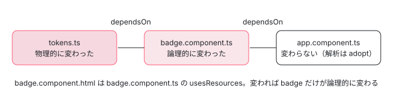

[目次](../README.md) › [ngtsc の内側](README.md) › 第 14 回 / 全 20 回

# 差分ビルド：IncrementalCompilation と前の結果の使い回し

> IncrementalCompilation.incremental が前のビルドの状態（IncrementalState の Fresh・Analyzed・Delta）と変わったファイルから、作り直すファイルを決める行、FileDependencyGraph（ファイルの依存と、テンプレートやスタイルのような資源の依存）、TraitCompiler.adopt が前の ClassRecord を使い回す仕組み、IncrementalBuildStrategy。

angular/angular · 読了 約 13 分 · 発展 · [サイトで読む（デモが動きます）](https://angular-deep-dive-cyan.vercel.app/chapter/ngtsc-incremental)

---

`ng serve` で 1 つのファイルを保存すると、2 回目のビルドは最初のビルドよりずっと速く終わります。ngtsc は「前のビルドで解析したクラスの記録」を取っておき、変わっていないファイルの解析を丸ごと使い回すからです。この章では、何をもって「変わった」とするのか（物理的な変更と論理的な変更）、前の記録をどう引き継ぐのか（`TraitCompiler.adopt`）、どのファイルの emit を飛ばすのかを、`IncrementalCompilation` の行で 1 ステップずつ確かめます。

読む対象は `compiler-cli/src/ngtsc/incremental/` の `api.ts`・`src/state.ts`・`src/incremental.ts`・`src/dependency_tracking.ts`・`src/strategy.ts`、`transform/src/compilation.ts` の `adopt`、spec の `incremental/test/incremental_spec.ts` と `test/ngtsc/incremental_spec.ts` です。「公開の形が変わったか」で作り直しを広げる意味のグラフは[第 15 回](15-ngtsc-semantic-graph.md)に分けます。

1. [1. 全体像](01-ngtsc-overview.md)
2. [2. NgtscProgram](02-ngtsc-program.md)
3. [3. NgCompiler とチケット](03-ngtsc-compiler-ticket.md)
4. [4. リフレクション](04-ngtsc-reflection.md)
5. [5. 静的な評価](05-ngtsc-partial-evaluator.md)
6. [6. 参照と import](06-ngtsc-references-imports.md)
7. [7. 解析](07-ngtsc-trait-analyze.md)
8. [8. 解決と出力](08-ngtsc-trait-resolve-compile.md)
9. [9. @Directive の handler](09-ngtsc-directive-handler.md)
10. [10. メタデータの登録](10-ngtsc-metadata-registry.md)
11. [11. .d.ts を読む](11-ngtsc-dts-metadata.md)
12. [12. JS の書き換え](12-ngtsc-ivy-transform.md)
13. [13. .d.ts の書き換え](13-ngtsc-dts-transform.md)
14. **14. 差分ビルド**（この章）
15. [15. 意味のグラフ](15-ngtsc-semantic-graph.md)
16. [16. import の循環](16-ngtsc-cycles.md)
17. [17. HMR](17-ngtsc-hmr.md)
18. [18. 診断と性能](18-ngtsc-diagnostics-perf.md)
19. [19. テストを書く](19-ngtsc-test-env.md)
20. [20. issue と PR を読む](20-ngtsc-issues.md)

## 1. 2 回目のビルドの流れ

2 回目の `NgtscProgram` は、1 回目の `NgtscProgram` を引数に受け取ります。そこから先、この章の主役 `IncrementalCompilation` は次の 4 つの場面で出てきます。チケットの選び方（`incrementalFromCompilerTicket`）は[第 3 回](03-ngtsc-compiler-ticket.md)、CLI が古いプログラムを渡す側は [cli-angular-compilation](../cli/03-cli-angular-compilation.md) です。

1. **作るとき：何が変わったか**

   `IncrementalCompilation.incremental` が、前のプログラムと今のプログラムのファイルを比べて「論理的に変わったファイル」の集合を決める（4・5 節）。
2. **解析するとき：使い回してよいか**

   `TraitCompiler.analyze` がファイルごとに `priorAnalysisFor` を尋ね、使えるなら前の `ClassRecord` を `adopt` する（6 節）。
3. **解析が終わったとき：状態を確定**

   `recordSuccessfulAnalysis` が意味のグラフの結果を受け取り、次のビルドに渡す状態を `Analyzed` にする（7 節）。
4. **emit するとき：書かなくてよいか**

   `safeToSkipEmit` が真のファイルは、TypeScript の emit 自体を呼ばない（8 節）。

## 2. 約束：IncrementalBuild と DependencyTracker

📄 `angular/packages/compiler-cli/src/ngtsc/incremental/api.ts` L12–36 （▶ の行: 15–16, 20, 24, 29, 35）

```ts
12 │ /**
13 │  * Interface of the incremental build engine.
14 │  *
15 ▶  * `AnalysisT` is a generic type representing a unit of work. This is generic to avoid a cyclic
16 ▶  * dependency between the incremental engine API definition and its consumer(s).
17 │  * `FileTypeCheckDataT` is a generic type representing template type-checking data for a particular
18 │  * input file, which is generic for the same reason.
19 │  */
20 ▶ export interface IncrementalBuild<AnalysisT, FileTypeCheckDataT> {
21 │   /**
22 │    * Retrieve the prior analysis work, if any, done for the given source file.
23 │    */
24 ▶   priorAnalysisFor(sf: ts.SourceFile): AnalysisT[] | null;
25 │ 
26 │   /**
27 │    * Retrieve the prior type-checking work, if any, that's been done for the given source file.
28 │    */
29 ▶   priorTypeCheckingResultsFor(fileSf: ts.SourceFile): FileTypeCheckDataT | null;
30 │ 
31 │   /**
32 │    * Reports that template type-checking has completed successfully, with a map of type-checking
33 │    * data for each user file which can be reused in a future incremental iteration.
34 │    */
35 ▶   recordSuccessfulTypeCheck(results: Map<AbsoluteFsPath, FileTypeCheckDataT>): void;
36 │ }
```

`TraitCompiler` や型チェックが知っているのはこのインタフェースだけです。24 行目「このファイルの前回の解析」、29 行目「このファイルの前回の型チェック」、35 行目「型チェックが成功した」の 3 つ。15〜16 行目のコメントのとおり、型引数 `AnalysisT` を使って、incremental の側が transform の型を import しない形にしてあります（import すると循環になるため）。

📄 `angular/packages/compiler-cli/src/ngtsc/incremental/api.ts` L38–59 （▶ の行: 45, 50, 58）

```ts
38 │ /**
39 │  * Tracks dependencies between source files or resources in the application.
40 │  */
41 │ export interface DependencyTracker<T extends {fileName: string} = ts.SourceFile> {
42 │   /**
43 │    * Record that the file `from` depends on the file `on`.
44 │    */
45 ▶   addDependency(from: T, on: T): void;
46 │ 
47 │   /**
48 │    * Record that the file `from` depends on the resource file `on`.
49 │    */
50 ▶   addResourceDependency(from: T, on: AbsoluteFsPath): void;
51 │ 
52 │   /**
53 │    * Record that the given file contains unresolvable dependencies.
54 │    *
55 │    * In practice, this means that the dependency graph cannot provide insight into the effects of
56 │    * future changes on that file.
57 │    */
58 ▶   recordDependencyAnalysisFailure(file: T): void;
59 │ }
```

もう 1 つが依存の記録係です。45 行目「ファイル `from` は `on` に依存する」、50 行目「`from` は資源（テンプレートやスタイルのファイル）`on` に依存する」、58 行目「このファイルの依存は分からなかった」。誰がこれを呼ぶかは 5 節で見ます。

## 3. IncrementalState：Fresh・Analyzed・Delta

次のビルドに渡すのは `IncrementalCompilation` そのものではなく、この `IncrementalState` です。

📄 `angular/packages/compiler-cli/src/ngtsc/incremental/src/state.ts` L18–32 （▶ の行: 21–24, 30–31）

```ts
18 │ /**
19 │  * Discriminant of the `IncrementalState` union.
20 │  */
21 ▶ export enum IncrementalStateKind {
22 ▶   Fresh,
23 ▶   Delta,
24 ▶   Analyzed,
25 │ }
26 │ 
27 │ /**
28 │  * Placeholder state for a fresh compilation that has never been successfully analyzed.
29 │  */
30 ▶ export interface FreshIncrementalState {
31 ▶   kind: IncrementalStateKind.Fresh;
32 │ }
```

📄 `angular/packages/compiler-cli/src/ngtsc/incremental/src/state.ts` L38–77 （▶ の行: 45, 53, 59, 65, 71, 76）

```ts
38 │ export interface AnalyzedIncrementalState {
39 │   kind: IncrementalStateKind.Analyzed;
40 │ 
41 │   /**
42 │    * Dependency graph extracted from the build, to be used to determine the logical impact of
43 │    * physical file changes.
44 │    */
45 ▶   depGraph: FileDependencyGraph;
46 │ 
47 │   /**
48 │    * The semantic dependency graph from the build.
49 │    *
50 │    * This is used to perform in-depth comparison of Angular decorated classes, to determine
51 │    * which files have to be re-emitted and/or re-type-checked.
52 │    */
53 ▶   semanticDepGraph: SemanticDepGraph;
54 │ 
55 │   /**
56 │    * The analysis data from a prior compilation. This stores the trait information for all source
57 │    * files that was present in a prior compilation.
58 │    */
59 ▶   priorAnalysis: Map<ts.SourceFile, ClassRecord[]>;
60 │ 
61 │   /**
62 │    * All generated template type-checking files produced as part of this compilation, or `null` if
63 │    * type-checking was not (yet) performed.
64 │    */
65 ▶   typeCheckResults: Map<AbsoluteFsPath, FileTypeCheckingData> | null;
66 │ 
67 │   /**
68 │    * Cumulative set of source file paths which were definitively emitted by this compilation or
69 │    * carried forward from a prior one.
70 │    */
71 ▶   emitted: Set<AbsoluteFsPath>;
72 │ 
73 │   /**
74 │    * Map of source file paths to the version of this file as seen in the compilation.
75 │    */
76 ▶   versions: Map<AbsoluteFsPath, string> | null;
77 │ }
```

📄 `angular/packages/compiler-cli/src/ngtsc/incremental/src/state.ts` L79–107 （▶ の行: 83–85, 96, 101, 106）

```ts
 79 │ /**
 80 │  * Incremental state for a compilation that has not been successfully analyzed, but that can be
 81 │  * based on a previous compilation which was.
 82 │  *
 83 ▶  * This is the state produced by an incremental compilation until its own analysis succeeds. If
 84 ▶  * analysis fails, this state carries forward information about which files have changed since the
 85 ▶  * last successful build (the `lastAnalyzedState`), so that the next incremental build can consider
 86 │  * the total delta between the `lastAnalyzedState` and the current program in its incremental
 87 │  * analysis.
 88 │  */
 89 │ export interface DeltaIncrementalState {
 90 │   kind: IncrementalStateKind.Delta;
 91 │ 
 92 │   /**
 93 │    * If available, the `AnalyzedIncrementalState` for the most recent ancestor of the current
 94 │    * program which was successfully analyzed.
 95 │    */
 96 ▶   lastAnalyzedState: AnalyzedIncrementalState;
 97 │ 
 98 │   /**
 99 │    * Set of file paths which have changed since the `lastAnalyzedState` compilation.
100 │    */
101 ▶   physicallyChangedTsFiles: Set<AbsoluteFsPath>;
102 │ 
103 │   /**
104 │    * Set of resource file paths which have changed since the `lastAnalyzedState` compilation.
105 │    */
106 ▶   changedResourceFiles: Set<AbsoluteFsPath>;
107 │ }
```

| 種類 | いつ | 持っているもの |
| --- | --- | --- |
| `Fresh`（30〜32 行目） | 一度も解析が成功していない | 何も無い。次のビルドも最初からになる |
| `Analyzed`（38〜77 行目） | 解析が成功した | 45 行目 ファイルの依存のグラフ・53 行目 意味のグラフ・59 行目 ファイルごとの `ClassRecord`・65 行目 型チェックの結果・71 行目 emit 済みのファイル・76 行目 ファイルの版 |
| `Delta`（89〜107 行目） | 今のビルドが作られたが、まだ解析が成功していない | 96 行目 最後に成功した `Analyzed`・101 行目 それ以降に変わった .ts・106 行目 それ以降に変わった資源 |

`Delta` が要るのは 83〜87 行目のコメントの場合です。解析が途中で失敗したビルドの記録は使えないので、「最後に成功したビルドからの変更」を足し続けて持ち越します。エラーを直した次のビルドは、成功したビルドとの差分を全部まとめて受け取れます。

## 4. IncrementalCompilation.incremental：物理的な変更を集める

📄 `angular/packages/compiler-cli/src/ngtsc/incremental/src/incremental.ts` L84–109 （▶ の行: 88, 93–96, 104, 106, 108）

```ts
 84 │   private constructor(
 85 │     state: IncrementalState,
 86 │     readonly depGraph: FileDependencyGraph,
 87 │     private versions: Map<AbsoluteFsPath, string> | null,
 88 ▶     private step: IncrementalStep | null,
 89 │   ) {
 90 │     this._state = state;
 91 │ 
 92 │     // The compilation begins in analysis phase.
 93 ▶     this.phase = {
 94 ▶       kind: PhaseKind.Analysis,
 95 ▶       semanticDepGraphUpdater: new SemanticDepGraphUpdater(
 96 ▶         step !== null ? step.priorState.semanticDepGraph : null,
 97 │       ),
 98 │     };
 99 │   }
100 │ 
101 │   /**
102 │    * Begin a fresh `IncrementalCompilation`.
103 │    */
104 ▶   static fresh(versions: Map<AbsoluteFsPath, string> | null): IncrementalCompilation {
105 │     const state: IncrementalState = {
106 ▶       kind: IncrementalStateKind.Fresh,
107 │     };
108 ▶     return new IncrementalCompilation(state, new FileDependencyGraph(), versions, /* reuse */ null);
109 │   }
```

93〜98 行目、どのビルドも「解析中」の段から始まり、前回の意味のグラフ（あれば）を持った `SemanticDepGraphUpdater` を作ります（[第 15 回](15-ngtsc-semantic-graph.md)）。104〜109 行目の `fresh` は、空の依存のグラフと `step = null`（88 行目。前回との差分が無い）で作るだけです。2026-03 の 66e72efef44 で、使っていなかった `ts.Program` の引数が外されました。

📄 `angular/packages/compiler-cli/src/ngtsc/incremental/src/incremental.ts` L111–147 （▶ の行: 119–121, 128, 133, 138–139, 142）

```ts
111 │   static incremental(
112 │     program: ts.Program,
113 │     newVersions: Map<AbsoluteFsPath, string> | null,
114 │     oldProgram: ts.Program,
115 │     oldState: IncrementalState,
116 │     modifiedResourceFiles: Set<AbsoluteFsPath> | null,
117 │     perf: PerfRecorder,
118 │   ): IncrementalCompilation {
119 ▶     return perf.inPhase(PerfPhase.Reconciliation, () => {
120 ▶       const physicallyChangedTsFiles = new Set<AbsoluteFsPath>();
121 ▶       const changedResourceFiles = new Set<AbsoluteFsPath>(modifiedResourceFiles ?? []);
122 │ 
123 │       let priorAnalysis: AnalyzedIncrementalState;
124 │       switch (oldState.kind) {
125 │         case IncrementalStateKind.Fresh:
126 │           // Since this line of program has never been successfully analyzed to begin with, treat
127 │           // this as a fresh compilation.
128 ▶           return IncrementalCompilation.fresh(newVersions);
129 │         case IncrementalStateKind.Analyzed:
130 │           // The most recent program was analyzed successfully, so we can use that as our prior
131 │           // state and don't need to consider any other deltas except changes in the most recent
132 │           // program.
133 ▶           priorAnalysis = oldState;
134 │           break;
135 │         case IncrementalStateKind.Delta:
136 │           // There is an ancestor program which was analyzed successfully and can be used as a
137 │           // starting point, but we need to determine what's changed since that program.
138 ▶           priorAnalysis = oldState.lastAnalyzedState;
139 ▶           for (const sfPath of oldState.physicallyChangedTsFiles) {
140 │             physicallyChangedTsFiles.add(sfPath);
141 │           }
142 ▶           for (const resourcePath of oldState.changedResourceFiles) {
143 │             changedResourceFiles.add(resourcePath);
144 │           }
145 │           break;
146 │       }
147 │ 
```

1. **119 行目：Reconciliation の段**

   ここで使った時間は perf の `Reconciliation` に入ります（[第 18 回](18-ngtsc-diagnostics-perf.md)）。121 行目、CLI が「変わった資源」を渡していれば最初から入れておきます。
2. **128 行目：前が Fresh なら、今回も最初から**

   比べる相手がいないので `fresh` を返します。
3. **133・138〜144 行目：比べる相手を決める**

   前が `Analyzed` ならそれ自身、`Delta` なら 138 行目でその中の「最後に成功した状態」を相手にし、139〜144 行目でそれ以降に溜まった変更を引き継ぎます。

📄 `angular/packages/compiler-cli/src/ngtsc/incremental/src/incremental.ts` L148–185 （▶ の行: 150, 152, 159, 161, 168–169, 174–177, 179）

```ts
148 │       const oldVersions = priorAnalysis.versions;
149 │ 
150 ▶       const oldFilesArray = oldProgram.getSourceFiles().map(toOriginalSourceFile);
151 │       const oldFiles = new Set(oldFilesArray);
152 ▶       const deletedTsFiles = new Set(oldFilesArray.map((sf) => absoluteFromSourceFile(sf)));
153 │ 
154 │       for (const possiblyRedirectedNewFile of program.getSourceFiles()) {
155 │         const sf = toOriginalSourceFile(possiblyRedirectedNewFile);
156 │         const sfPath = absoluteFromSourceFile(sf);
157 │         // Since we're seeing a file in the incoming program with this name, it can't have been
158 │         // deleted.
159 ▶         deletedTsFiles.delete(sfPath);
160 │ 
161 ▶         if (oldFiles.has(sf)) {
162 │           // This source file has the same object identity as in the previous program. We need to
163 │           // determine if it's really the same file, or if it might have changed versions since the
164 │           // last program without changing its identity.
165 │ 
166 │           // If there's no version information available, then this is the same file, and we can
167 │           // skip it.
168 ▶           if (oldVersions === null || newVersions === null) {
169 ▶             continue;
170 │           }
171 │ 
172 │           // If a version is available for the file from both the prior and the current program, and
173 │           // that version is the same, then this is the same file, and we can skip it.
174 ▶           if (
175 ▶             oldVersions.has(sfPath) &&
176 ▶             newVersions.has(sfPath) &&
177 ▶             oldVersions.get(sfPath)! === newVersions.get(sfPath)!
178 │           ) {
179 ▶             continue;
180 │           }
181 │ 
182 │           // Otherwise, assume that the file has changed. Either its versions didn't match, or we
183 │           // were missing version information about it on one side for some reason.
184 │         }
185 │ 
```

1. **152 行目：まず「全部消えた」と仮定する**

   前のプログラムの全ファイルを `deletedTsFiles` に入れ、今のプログラムに同じパスが見つかるたびに 159 行目で外します。最後に残ったものが消えたファイルです。
2. **161 行目：同じオブジェクトなら、たぶん同じ**

   ホスト（CLI の `SourceFileCache` など。[cli-cache-watch](../cli/10-cli-cache-watch.md)）は、変わっていないファイルには前回と**同じ `ts.SourceFile` のオブジェクト**を返します。TypeScript もそれを前提に `oldProgram` の構造を使い回すので、「同じオブジェクトか」が第一の判断です。なお `ts.createCompilerHost` のままのホストは毎回読み直して新しいオブジェクトを作るので、手元で確かめると全ファイルが「変わった」になります（デモのスクリプトが中身ごとに覚えるホストを作っているのはこのためです）。150 行目の `toOriginalSourceFile` は、型チェックで書き換えたファイルや redirect（同じライブラリの .d.ts が 2 か所にあるときの身代わり）を元に戻してから比べるためのものです。
3. **168〜179 行目：版の文字列があれば、それでも比べる**

   言語サービスのように `ts.SourceFile` をその場で書き換えるホストは、オブジェクトが同じでも中身が違うことがあります。プログラムのドライバーが版を出せるとき（[typecheck-program-driver](../typecheck/04-typecheck-program-driver.md) の `getSourceFileVersion`）は、174〜177 行目で版が同じときだけ「同じ」とみなします。ngc（`TsCreateProgramDriver`）は版を出さないので 168 行目で抜けます。

📄 `angular/packages/compiler-cli/src/ngtsc/incremental/src/incremental.ts` L186–200 （▶ の行: 188–189, 193, 197–198）

```ts
186 │         // Bail out if a .d.ts file changes - the semantic dep graph is not able to process such
187 │         // changes correctly yet.
188 ▶         if (sf.isDeclarationFile) {
189 ▶           return IncrementalCompilation.fresh(newVersions);
190 │         }
191 │ 
192 │         // The file has changed physically, so record it.
193 ▶         physicallyChangedTsFiles.add(sfPath);
194 │       }
195 │ 
196 │       // Remove any files that have been deleted from the list of physical changes.
197 ▶       for (const deletedFileName of deletedTsFiles) {
198 ▶         physicallyChangedTsFiles.delete(resolve(deletedFileName));
199 │       }
200 │ 
```

188〜189 行目、**.d.ts が 1 つでも変わったら、全部最初から**です（186〜187 行目のコメント「意味のグラフはまだ .d.ts の変更を正しく扱えない」）。`node_modules` のライブラリを更新すると 2 回目のビルドが速くならないのはこの行のためです。spec は 9 節の `should rebuild everything if a typings file changes`。193 行目で残りを「物理的に変わった」に入れ、197〜198 行目で消えたファイルはそこから外します。

この直後の部分（[typecheck-program-driver](../typecheck/04-typecheck-program-driver.md) の 7 節で引用済み）で、前回の `FileDependencyGraph` の `updateWithPhysicalChanges` に物理的な変更を渡して論理的な変更に広げ、物理的に変わったファイル自身もそこに足します。広げ方は次の節です。

📄 `angular/packages/compiler-cli/src/ngtsc/incremental/src/incremental.ts` L217–232 （▶ の行: 220–221, 224, 227–229）

```ts
217 │ 
218 │       // Start off in a `DeltaIncrementalState` as a delta against the previous successful analysis,
219 │       // until this compilation completes its own analysis.
220 ▶       const state: DeltaIncrementalState = {
221 ▶         kind: IncrementalStateKind.Delta,
222 │         physicallyChangedTsFiles,
223 │         changedResourceFiles,
224 ▶         lastAnalyzedState: priorAnalysis,
225 │       };
226 │ 
227 ▶       return new IncrementalCompilation(state, depGraph, newVersions, {
228 ▶         priorState: priorAnalysis,
229 ▶         logicallyChangedTsFiles,
230 │       });
231 │     });
232 │   }
```

220〜225 行目、まだ解析していないので状態は `Delta` です。227〜230 行目、比べる相手と論理的な変更を `step` に入れて作ります。以降の判断はすべてこの `step` を見ます。

## 5. FileDependencyGraph：物理的な変更を論理的な変更に広げる

📄 `angular/packages/compiler-cli/src/ngtsc/incremental/src/dependency_tracking.ts` L14–47 （▶ の行: 20, 22–24, 29, 32, 36, 40）

```ts
14 │ /**
15 │  * An implementation of the `DependencyTracker` dependency graph API.
16 │  *
17 │  * The `FileDependencyGraph`'s primary job is to determine whether a given file has "logically"
18 │  * changed, given the set of physical changes (direct changes to files on disk).
19 │  *
20 ▶  * A file is logically changed if at least one of three conditions is met:
21 │  *
22 ▶  * 1. The file itself has physically changed.
23 ▶  * 2. One of its dependencies has physically changed.
24 ▶  * 3. One of its resource dependencies has physically changed.
25 │  */
26 │ export class FileDependencyGraph<T extends {fileName: string} = ts.SourceFile>
27 │   implements DependencyTracker<T>
28 │ {
29 ▶   private nodes = new Map<T, FileNode>();
30 │ 
31 │   addDependency(from: T, on: T): void {
32 ▶     this.nodeFor(from).dependsOn.add(absoluteFromSourceFile(on));
33 │   }
34 │ 
35 │   addResourceDependency(from: T, resource: AbsoluteFsPath): void {
36 ▶     this.nodeFor(from).usesResources.add(resource);
37 │   }
38 │ 
39 │   recordDependencyAnalysisFailure(file: T): void {
40 ▶     this.nodeFor(file).failedAnalysis = true;
41 │   }
42 │ 
43 │   getResourceDependencies(from: T): AbsoluteFsPath[] {
44 │     const node = this.nodes.get(from);
45 │ 
46 │     return node ? [...node.usesResources] : [];
47 │   }
```

20〜24 行目が定義です。論理的に変わったファイルとは「自分が変わった」「依存しているファイルが変わった」「依存している資源が変わった」のどれか。29 行目、ファイルごとに 1 つの節（`dependsOn`・`usesResources`・`failedAnalysis`）を持ちます。

### 辺を足すのは誰か

📄 `angular/packages/compiler-cli/src/ngtsc/partial_evaluator/src/interpreter.ts` L267–270 （▶ の行: 268–269）

```ts
267 │   private visitDeclaration(node: DeclarationNode, context: Context): ResolvedValue {
268 ▶     if (this.dependencyTracker !== null) {
269 ▶       this.dependencyTracker.addDependency(context.originatingFile, node.getSourceFile());
270 │     }
```

📄 `angular/packages/compiler-cli/src/ngtsc/annotations/component/src/resources.ts` L225–231 （▶ の行: 225, 227–229）

```ts
225 ▶     const templateContent = resourceLoader.load(template.resolvedTemplateUrl);
226 │     if (depTracker !== null) {
227 ▶       depTracker.addResourceDependency(
228 ▶         node.getSourceFile(),
229 ▶         absoluteFrom(template.resolvedTemplateUrl),
230 │       );
231 │     }
```

1 つめは静的な評価（[第 5 回](05-ngtsc-partial-evaluator.md)）です。269 行目、デコレーターの引数を評価していて識別子を宣言までたどるたびに、「評価を始めたファイル → 宣言のあるファイル」の辺を足します。2 つめは 227〜230 行目、`templateUrl` のテンプレートを読んだときの資源の辺です（`styleUrl` も同じ形）。

> [!WARNING]
> **ハマりどころ**
>
> 辺ができるのは**デコレーターの評価でたどった宣言だけ**です。クラスの本文で `import {shout} from './helper'` を使っても、`helper.ts` への辺はできません。その JS の出力は `helper.ts` の中身に左右されないからです。デモの「helper.ts の本文だけ」で、`app.component.ts` が使い回されるのはこのためです。



*デモの「tokens.ts の定数」：tokens.ts が物理的に変わると、辺のある badge.component.ts は論理的に変わる。app.component.ts の辺は badge.component.ts にしか無いので、1 段で止まる*

📄 `angular/packages/compiler-cli/src/ngtsc/incremental/src/dependency_tracking.ts` L60–93 （▶ の行: 62, 78, 80–84）

```ts
60 │    * In essence, for build `n`, this method performs:
61 │    *
62 ▶    * G(n) + L(n) = G(n - 1) + P(n)
63 │    *
64 │    * where:
65 │    *
66 │    * G(n) = the dependency graph of build `n`
67 │    * L(n) = the logically changed files from build n - 1 to build n.
68 │    * P(n) = the physically changed files from build n - 1 to build n.
69 │    */
70 │   updateWithPhysicalChanges(
71 │     previous: FileDependencyGraph<T>,
72 │     changedTsPaths: Set<AbsoluteFsPath>,
73 │     deletedTsPaths: Set<AbsoluteFsPath>,
74 │     changedResources: Set<AbsoluteFsPath>,
75 │   ): Set<AbsoluteFsPath> {
76 │     const logicallyChanged = new Set<AbsoluteFsPath>();
77 │ 
78 ▶     for (const sf of previous.nodes.keys()) {
79 │       const sfPath = absoluteFromSourceFile(sf);
80 ▶       const node = previous.nodeFor(sf);
81 ▶       if (isLogicallyChanged(sf, node, changedTsPaths, deletedTsPaths, changedResources)) {
82 ▶         logicallyChanged.add(sfPath);
83 ▶       } else if (!deletedTsPaths.has(sfPath)) {
84 ▶         this.nodes.set(sf, {
85 │           dependsOn: new Set(node.dependsOn),
86 │           usesResources: new Set(node.usesResources),
87 │           failedAnalysis: false,
88 │         });
89 │       }
90 │     }
91 │ 
92 │     return logicallyChanged;
93 │   }
```

📄 `angular/packages/compiler-cli/src/ngtsc/incremental/src/dependency_tracking.ts` L107–145 （▶ の行: 120, 127, 132–133, 139–140）

```ts
107 │ /**
108 │  * Determine whether `sf` has logically changed, given its dependencies and the set of physically
109 │  * changed files and resources.
110 │  */
111 │ function isLogicallyChanged<T extends {fileName: string}>(
112 │   sf: T,
113 │   node: FileNode,
114 │   changedTsPaths: ReadonlySet<AbsoluteFsPath>,
115 │   deletedTsPaths: ReadonlySet<AbsoluteFsPath>,
116 │   changedResources: ReadonlySet<AbsoluteFsPath>,
117 │ ): boolean {
118 │   // A file is assumed to have logically changed if its dependencies could not be determined
119 │   // accurately.
120 ▶   if (node.failedAnalysis) {
121 │     return true;
122 │   }
123 │ 
124 │   const sfPath = absoluteFromSourceFile(sf);
125 │ 
126 │   // A file is logically changed if it has physically changed itself (including being deleted).
127 ▶   if (changedTsPaths.has(sfPath) || deletedTsPaths.has(sfPath)) {
128 │     return true;
129 │   }
130 │ 
131 │   // A file is logically changed if one of its dependencies has physically changed.
132 ▶   for (const dep of node.dependsOn) {
133 ▶     if (changedTsPaths.has(dep) || deletedTsPaths.has(dep)) {
134 │       return true;
135 │     }
136 │   }
137 │ 
138 │   // A file is logically changed if one of its resources has physically changed.
139 ▶   for (const dep of node.usesResources) {
140 ▶     if (changedResources.has(dep)) {
141 │       return true;
142 │     }
143 │   }
144 │   return false;
145 │ }
```

1. **62 行目：G(n) + L(n) = G(n − 1) + P(n)**

   「前回のグラフ」と「今回の物理的な変更」から、「今回のグラフ（の、変わっていない部分）」と「論理的な変更」を作る、という式です。
2. **78〜82 行目：前回のグラフの節を 1 つずつ判定する**

   論理的に変わったファイルは集合に入れ、**辺は引き継ぎません**。そのファイルは解析し直すので、今回の評価が辺を足し直します。
3. **83〜88 行目：変わっていないファイルは辺を写す**

   解析を使い回すファイルは評価が走らないので、前回の辺を今回のグラフに写しておかないと、次のビルドで辺が消えてしまいます。
4. **120・127・132〜135・139〜142 行目：判定の 4 つ**

   依存が分からなかった（120 行目）、自分が変わったか消えた（127 行目）、**直接の**依存が変わったか消えた（132〜135 行目）、資源が変わった（139〜142 行目）。132 行目は `dependsOn` の 1 段だけを見ます。A → B → C で C が変わると、B は論理的に変わりますが A は変わりません。A の出力が B の公開の形に左右される場合は、意味のグラフ（第 15 回）が A を拾います。デモの「tokens.ts の定数」がその形です。

## 6. 解析：前の ClassRecord を adopt する

📄 `angular/packages/compiler-cli/src/ngtsc/incremental/src/incremental.ts` L320–337 （▶ の行: 321, 328, 332–333, 336）

```ts
320 │   priorAnalysisFor(sf: ts.SourceFile): ClassRecord[] | null {
321 ▶     if (this.step === null) {
322 │       return null;
323 │     }
324 │ 
325 │     const sfPath = absoluteFromSourceFile(sf);
326 │ 
327 │     // If the file has logically changed, its previous analysis cannot be reused.
328 ▶     if (this.step.logicallyChangedTsFiles.has(sfPath)) {
329 │       return null;
330 │     }
331 │ 
332 ▶     const priorAnalysis = this.step.priorState.priorAnalysis;
333 ▶     if (!priorAnalysis.has(sf)) {
334 │       return null;
335 │     }
336 ▶     return priorAnalysis.get(sf)!;
337 │   }
```

321 行目、初回のビルドは常に `null`（解析する）。328 行目、論理的に変わったファイルも `null`。それ以外は 332〜336 行目で前回のファイルごとの `ClassRecord[]` を返します。Angular のクラスが無いファイルは空の配列で、これも「使い回してよい」の意味です。呼ぶ側は `TraitCompiler.analyze` です（[第 7 回](07-ngtsc-trait-analyze.md)）。

📄 `angular/packages/compiler-cli/src/ngtsc/transform/src/compilation.ts` L157–163 （▶ の行: 158–159, 161, 163）

```ts
157 │         : null;
158 ▶     if (priorWork !== null) {
159 ▶       this.perf.eventCount(PerfEvent.SourceFileReuseAnalysis);
160 │ 
161 ▶       if (priorWork.length > 0) {
162 │         for (const priorRecord of priorWork) {
163 ▶           this.adopt(priorRecord);
```

158 行目、返ってきたら 159 行目で perf の `SourceFileReuseAnalysis` を数え、161〜163 行目で記録を 1 つずつ `adopt` します。その後はファイルの中を歩かずに戻ります。

📄 `angular/packages/compiler-cli/src/ngtsc/transform/src/compilation.ts` L230–265 （▶ の行: 231, 235, 240–241, 246–250, 252, 259）

```ts
230 │   private adopt(priorRecord: ClassRecord): void {
231 ▶     const record: ClassRecord = {
232 │       hasPrimaryHandler: priorRecord.hasPrimaryHandler,
233 │       hasWeakHandlers: priorRecord.hasWeakHandlers,
234 │       metaDiagnostics: priorRecord.metaDiagnostics,
235 ▶       node: priorRecord.node,
236 │       traits: [],
237 │     };
238 │ 
239 │     for (const priorTrait of priorRecord.traits) {
240 ▶       const handler = this.handlersByName.get(priorTrait.handler.name)!;
241 ▶       let trait: Trait<unknown, unknown, SemanticSymbol | null, unknown> = Trait.pending(
242 │         handler,
243 │         priorTrait.detected,
244 │       );
245 │ 
246 ▶       if (priorTrait.state === TraitState.Analyzed || priorTrait.state === TraitState.Resolved) {
247 ▶         const symbol = this.makeSymbolForTrait(handler, record.node, priorTrait.analysis);
248 ▶         trait = trait.toAnalyzed(priorTrait.analysis, priorTrait.analysisDiagnostics, symbol);
249 ▶         if (trait.analysis !== null && trait.handler.register !== undefined) {
250 ▶           trait.handler.register(record.node, trait.analysis);
251 │         }
252 ▶       } else if (priorTrait.state === TraitState.Skipped) {
253 │         trait = trait.toSkipped();
254 │       }
255 │ 
256 │       record.traits.push(trait);
257 │     }
258 │ 
259 ▶     this.classes.set(record.node, record);
260 │     const sf = record.node.getSourceFile();
261 │     if (!this.fileToClasses.has(sf)) {
262 │       this.fileToClasses.set(sf, new Set<ClassDeclaration>());
263 │     }
264 │     this.fileToClasses.get(sf)!.add(record.node);
265 │   }
```

1. **231〜237 行目：記録の殻を作り直す**

   クラスの節（235 行目）と、primary・weak の印、メタ診断はそのまま写し、`traits` は空から積み直します。クラスの節が同じオブジェクトなのは、4 節の 161 行目でファイルが同じオブジェクトだと確かめたからです。
2. **240 行目：handler は今回のものに付け替える**

   前回の trait が持つ handler は前回の `NgCompiler` が作ったインスタンスです。名前で引き直し、今回の handler（今回のメタデータの登録先や評価器を持つ）にします。
3. **246〜251 行目：解析の結果だけを引き継ぐ**

   前回 `Analyzed` か `Resolved` だった trait は、248 行目で前回の `analysis` を持った **Analyzed** に戻します。resolve（スコープを決める段）はやり直すということです。247 行目で意味のグラフの記号を作り直し（第 15 回）、249〜250 行目で `register` を呼んで、今回のメタデータの登録先にディレクティブや NgModule を登録し直します（[第 10 回](10-ngtsc-metadata-registry.md)）。登録し直さないと、変わったファイルのコンポーネントが、使い回したファイルのディレクティブをスコープの中に見つけられません。
4. **252〜253 行目・259〜264 行目**

   前回 Skipped の trait は Skipped のまま、まだ解析されていなかった trait は Pending のまま入ります。解析でエラーになった trait も状態は Analyzed（`analysis` が `null`、診断だけを持つ）なので 246 行目の道に入り、248 行目でエラーの診断ごと写されます（247 行目の記号は `analysis` が無ければ作りません）。最後に、解析したときと同じ 2 つの表に入れます。

## 7. 解析が終わったら：Analyzed にして、emit 済みを数え直す

📄 `angular/packages/compiler-cli/src/ngtsc/incremental/src/incremental.ts` L247–277 （▶ の行: 256, 260, 262, 266, 269–270, 274–275）

```ts
247 │   recordSuccessfulAnalysis(traitCompiler: TraitCompiler): void {
248 │     if (this.phase.kind !== PhaseKind.Analysis) {
249 │       throw new Error(
250 │         `AssertionError: Incremental compilation in phase ${
251 │           PhaseKind[this.phase.kind]
252 │         }, expected Analysis`,
253 │       );
254 │     }
255 │ 
256 ▶     const {needsEmit, needsTypeCheckEmit, newGraph} = this.phase.semanticDepGraphUpdater.finalize();
257 │ 
258 │     // Determine the set of files which have already been emitted.
259 │     let emitted: Set<AbsoluteFsPath>;
260 ▶     if (this.step === null) {
261 │       // Since there is no prior compilation, no files have yet been emitted.
262 ▶       emitted = new Set();
263 │     } else {
264 │       // Begin with the files emitted by the prior successful compilation, but remove those which we
265 │       // know need to bee re-emitted.
266 ▶       emitted = new Set(this.step.priorState.emitted);
267 │ 
268 │       // Files need re-emitted if they've logically changed.
269 ▶       for (const sfPath of this.step.logicallyChangedTsFiles) {
270 ▶         emitted.delete(sfPath);
271 │       }
272 │ 
273 │       // Files need re-emitted if they've semantically changed.
274 ▶       for (const sfPath of needsEmit) {
275 ▶         emitted.delete(sfPath);
276 │       }
277 │     }
```

📄 `angular/packages/compiler-cli/src/ngtsc/incremental/src/incremental.ts` L279–297 （▶ の行: 281–282, 285–287, 292, 294–295）

```ts
279 │     // Transition to a successfully analyzed compilation. At this point, a subsequent compilation
280 │     // could use this state as a starting point.
281 ▶     this._state = {
282 ▶       kind: IncrementalStateKind.Analyzed,
283 │       versions: this.versions,
284 │       depGraph: this.depGraph,
285 ▶       semanticDepGraph: newGraph,
286 ▶       priorAnalysis: traitCompiler.getAnalyzedRecords(),
287 ▶       typeCheckResults: null,
288 │       emitted,
289 │     };
290 │ 
291 │     // We now enter the type-check and emit phase of compilation.
292 ▶     this.phase = {
293 │       kind: PhaseKind.TypeCheckAndEmit,
294 ▶       needsEmit,
295 ▶       needsTypeCheckEmit,
296 │     };
297 │   }
```

1. **256 行目：意味のグラフの結論を受け取る**

   `needsEmit`（JS を書き直すファイル）・`needsTypeCheckEmit`（型チェックのコードを作り直すファイル）・`newGraph`。決め方は第 15 回。
2. **266〜276 行目：「もう書いてある」の集合から引く**

   前回の emit 済みの集合を写し、論理的に変わったファイル（269〜271 行目）と、意味のグラフが選んだファイル（274〜276 行目）を外します。
3. **281〜289 行目：次のビルドの相手になる状態**

   286 行目、今回の `TraitCompiler` が持つ全ファイルの記録（adopt したものも含む）が、次のビルドの `priorAnalysis` になります。287 行目、型チェックの結果はまだ無く、型チェックが成功すると `recordSuccessfulTypeCheck` が入れます。
4. **292〜296 行目：型チェックと emit の段へ**

   この先、型チェックの `priorTypeCheckingResultsFor` が 294〜295 行目の集合を見ます（[typecheck-program-driver](../typecheck/04-typecheck-program-driver.md) の 7 節）。

## 8. emit：書かなくてよいファイル

📄 `angular/packages/compiler-cli/src/ngtsc/incremental/src/incremental.ts` L376–405 （▶ の行: 378, 385, 397, 404）

```ts
376 │   safeToSkipEmit(sf: ts.SourceFile): boolean {
377 │     // If this is a fresh compilation, it's never safe to skip an emit.
378 ▶     if (this.step === null) {
379 │       return false;
380 │     }
381 │ 
382 │     const sfPath = absoluteFromSourceFile(sf);
383 │ 
384 │     // If the file has itself logically changed, it must be emitted.
385 ▶     if (this.step.logicallyChangedTsFiles.has(sfPath)) {
386 │       return false;
387 │     }
388 │ 
389 │     if (this.phase.kind !== PhaseKind.TypeCheckAndEmit) {
390 │       throw new Error(
391 │         `AssertionError: Expected successful analysis before attempting to emit files`,
392 │       );
393 │     }
394 │ 
395 │     // If during analysis it was determined that this file has semantically changed, it must be
396 │     // emitted.
397 ▶     if (this.phase.needsEmit.has(sfPath)) {
398 │       return false;
399 │     }
400 │ 
401 │     // Generally it should be safe to assume here that the file was previously emitted by the last
402 │     // successful compilation. However, as a defense-in-depth against incorrectness, we explicitly
403 │     // check that the last emit included this file, and re-emit it otherwise.
404 ▶     return this.step.priorState.emitted.has(sfPath);
405 │   }
```

📄 `angular/packages/compiler-cli/src/ngtsc/program.ts` L347–350 （▶ の行: 348–349）

```ts
347 │ 
348 ▶         if (!forceEmit && this.compiler.incrementalCompilation.safeToSkipEmit(targetSourceFile)) {
349 ▶           this.compiler.perfRecorder.eventCount(PerfEvent.EmitSkipSourceFile);
350 │           continue;
```

378 行目、初回は書く。385 行目、論理的に変わったら書く。397 行目、意味のグラフが選んだら書く。404 行目、それ以外でも前回書いたことが確かなときだけ飛ばす（401〜403 行目のコメント「念のため」）。`NgtscProgram.emit` は 348 行目でこれが真のファイルについて TypeScript の emit 自体を呼ばず、349 行目で `EmitSkipSourceFile` を数えます。書いたファイルは `writeFile` の中で `recordSuccessfulEmit` され、7 節の emit 済みの集合に入ります。

## 9. 状態の持ち運び：IncrementalBuildStrategy

📄 `angular/packages/compiler-cli/src/ngtsc/incremental/src/strategy.ts` L13–50 （▶ の行: 21, 27, 33, 40–41, 45）

```ts
13 │ /**
14 │  * Strategy used to manage the association between a `ts.Program` and the `IncrementalState` which
15 │  * represents the reusable Angular part of its compilation.
16 │  */
17 │ export interface IncrementalBuildStrategy {
18 │   /**
19 │    * Determine the Angular `IncrementalState` for the given `ts.Program`, if one is available.
20 │    */
21 ▶   getIncrementalState(program: ts.Program): IncrementalState | null;
22 │ 
23 │   /**
24 │    * Associate the given `IncrementalState` with the given `ts.Program` and make it available to
25 │    * future compilations.
26 │    */
27 ▶   setIncrementalState(driver: IncrementalState, program: ts.Program): void;
28 │ 
29 │   /**
30 │    * Convert this `IncrementalBuildStrategy` into a possibly new instance to be used in the next
31 │    * incremental compilation (may be a no-op if the strategy is not stateful).
32 │    */
33 ▶   toNextBuildStrategy(): IncrementalBuildStrategy;
34 │ }
35 │ 
36 │ /**
37 │  * A noop implementation of `IncrementalBuildStrategy` which neither returns nor tracks any
38 │  * incremental data.
39 │  */
40 ▶ export class NoopIncrementalBuildStrategy implements IncrementalBuildStrategy {
41 ▶   getIncrementalState(): null {
42 │     return null;
43 │   }
44 │ 
45 ▶   setIncrementalState(): void {}
46 │ 
47 │   toNextBuildStrategy(): IncrementalBuildStrategy {
48 │     return this;
49 │   }
50 │ }
```

📄 `angular/packages/compiler-cli/src/ngtsc/incremental/src/strategy.ts` L52–74 （▶ の行: 56–57, 63, 65, 69, 71）

```ts
52 │ /**
53 │  * Tracks an `IncrementalState` within the strategy itself.
54 │  */
55 │ export class TrackedIncrementalBuildStrategy implements IncrementalBuildStrategy {
56 ▶   private state: IncrementalState | null = null;
57 ▶   private isSet: boolean = false;
58 │ 
59 │   getIncrementalState(): IncrementalState | null {
60 │     return this.state;
61 │   }
62 │ 
63 ▶   setIncrementalState(state: IncrementalState): void {
64 │     this.state = state;
65 ▶     this.isSet = true;
66 │   }
67 │ 
68 │   toNextBuildStrategy(): TrackedIncrementalBuildStrategy {
69 ▶     const strategy = new TrackedIncrementalBuildStrategy();
70 │     // Only reuse state that was explicitly set via `setIncrementalState`.
71 ▶     strategy.state = this.isSet ? this.state : null;
72 │     return strategy;
73 │   }
74 │ }
```

📄 `angular/packages/compiler-cli/src/ngtsc/incremental/src/strategy.ts` L76–111 （▶ の行: 82, 90, 101–103, 108, 111）

```ts
 76 │ /**
 77 │  * Manages the `IncrementalState` associated with a `ts.Program` by monkey-patching it onto the
 78 │  * program under `SYM_INCREMENTAL_STATE`.
 79 │  */
 80 │ export class PatchedProgramIncrementalBuildStrategy implements IncrementalBuildStrategy {
 81 │   getIncrementalState(program: ts.Program): IncrementalState | null {
 82 ▶     const state = (program as MayHaveIncrementalState)[SYM_INCREMENTAL_STATE];
 83 │     if (state === undefined) {
 84 │       return null;
 85 │     }
 86 │     return state;
 87 │   }
 88 │ 
 89 │   setIncrementalState(state: IncrementalState, program: ts.Program): void {
 90 ▶     (program as MayHaveIncrementalState)[SYM_INCREMENTAL_STATE] = state;
 91 │   }
 92 │ 
 93 │   toNextBuildStrategy(): IncrementalBuildStrategy {
 94 │     return this;
 95 │   }
 96 │ }
 97 │ 
 98 │ /**
 99 │  * Symbol under which the `IncrementalState` is stored on a `ts.Program`.
100 │  *
101 ▶  * The TS model of incremental compilation is based around reuse of a previous `ts.Program` in the
102 ▶  * construction of a new one. The `NgCompiler` follows this abstraction - passing in a previous
103 ▶  * `ts.Program` is sufficient to trigger incremental compilation. This previous `ts.Program` need
104 │  * not be from an Angular compilation (that is, it need not have been created from `NgCompiler`).
105 │  *
106 │  * If it is, though, Angular can benefit from reusing previous analysis work. This reuse is managed
107 │  * by the `IncrementalState`, which is inherited from the old program to the new program. To
108 ▶  * support this behind the API of passing an old `ts.Program`, the `IncrementalState` is stored on
109 │  * the `ts.Program` under this symbol.
110 │  */
111 ▶ const SYM_INCREMENTAL_STATE = Symbol('NgIncrementalState');
```

| 実装 | 状態の置き場所 | 使う側 |
| --- | --- | --- |
| `NoopIncrementalBuildStrategy`（40〜50 行目） | 置かない。常に `null` | spec（`core/test/compiler_spec.ts` など）だけ |
| `TrackedIncrementalBuildStrategy`（55〜74 行目） | 戦略のオブジェクト自身（56 行目） | `NgtscProgram`（ngc・CLI）と言語サービスの `compiler_factory.ts` |
| `PatchedProgramIncrementalBuildStrategy`（80〜96 行目） | `ts.Program` に記号 `NgIncrementalState` で貼る（90 行目） | `tsc_plugin.ts` の `NgTscPlugin`（tsc\_wrapped から呼ばれる形） |

`Tracked` は 69〜71 行目、次のビルド用に**新しい**戦略を作り、`setIncrementalState` で明示的に置いた状態だけを持たせます。`Patched` は 101〜109 行目のコメントのとおり、「古い `ts.Program` を渡すだけで差分ビルドになる」という TypeScript の約束に合わせるため、状態をプログラムに貼り付けます。

## 10. デモ：2 回目のビルドで何が使い回されたか

> **🧪 記録の再生：4 ファイル + テンプレート 1 つを 2 回ビルドする**
>
> これは記録です。@angular/compiler-cli 22.1.6 を Node で動かした結果（TypeScript 6.0.3）。1 回目の `NgtscProgram` を 2 回目に渡し、2 回目の `compiler.incrementalCompilation` の中（private の `state`・`step`・`phase`）と、各ファイルについての `priorAnalysisFor`・`priorTypeCheckingResultsFor` の答え、`writeFile` に来たファイルを保存しました。
>
> ▶ [このデモはサイトで動かせます](https://angular-deep-dive-cyan.vercel.app/chapter/ngtsc-incremental)

記録から読めることを、節の行に戻して並べます。

- **helper.ts の本文だけ**：物理的にも論理的にも変わったのは `helper.ts` だけで、書いたのも `helper.js` 1 つ。`app.component.ts` は helper を import していますが、5 節の注意のとおり辺が無いので 132 行目に引っかかりません。perf は `TraitReuseAnalysis=2`（Badge と App の 2 クラスを adopt）、`TraitAnalyze=0`。
- **badge.component.html だけ**：.ts は 1 つも物理的に変わっていませんが、139〜142 行目で `badge.component.ts` が論理的に変わり、解析・型チェック・emit がそのファイルだけやり直されます。
- **tokens.ts の定数**：物理的には `tokens.ts` だけ、論理的には 132 行目で `badge.component.ts` が加わります。`app.component.ts` は論理的には変わらず**解析は adopt** ですが、Badge の selector が変わったので意味のグラフが `needsEmit`・`needsTypeCheckEmit` に入れ、型チェックを作り直して「'app-badge' is not a known element」を出し、JS も書き直しました。ここが[第 15 回](15-ngtsc-semantic-graph.md)の入口です。
- **helper.ts を消す**：消えたファイルは 152・159 行目で見つかり、197〜198 行目で物理的な変更からは外れます。今回は helper に節が無いので論理的な変更にも入りません。import を外した `app.component.ts` だけが物理的に変わりました。

## ここまでの呼び出し

- 👤 `new NgtscProgram(rootNames, options, host, oldProgram)` — program.ts — *2 回目のビルド*
  - `incrementalFromCompilerTicket(oldCompiler, …)` — core/src/compiler.ts — *前の状態を strategy から取る（第 3 回）*
    - `IncrementalCompilation.incremental(program, versions, oldProgram, oldState, …)` — incremental/src/incremental.ts — *物理的な変更 → updateWithPhysicalChanges → 論理的な変更*
  - `TraitCompiler.analyze(sf)` — transform/src/compilation.ts — *ファイルごと*
    - `incrementalBuild.priorAnalysisFor(sf)` → `adopt(priorRecord)` — incremental.ts / compilation.ts — *handler を付け替え、Analyzed に戻し、register し直す*
  - `IncrementalCompilation.recordSuccessfulAnalysis(traitCompiler)` — incremental/src/incremental.ts — *finalize → Analyzed、emit 済みを数え直す*
  - `NgtscProgram.emit()` → `safeToSkipEmit(sf)` — program.ts / incremental.ts — *飛ばすか書くか。書いたら recordSuccessfulEmit*
  - `incrementalStrategy.setIncrementalState(state, program)` — incremental/src/strategy.ts — *次のビルドへ*

## テストと直し方

### spec と describe

| spec | describe / it | 確かめていること |
| --- | --- | --- |
| incremental/test/incremental\_spec.ts | describe `incremental reconciliation`（L17）の it 1 つ `should treat source files with changed versions as changed`（L18） | 4 節の 174〜177 行目（版が違えば同じオブジェクトでも変わった） |
| test/ngtsc/incremental\_spec.ts | describe `ngtsc incremental compilation`（L18、it 27）。例: `should skip unchanged services`（L47）・`should rebuild components whose templates have changed`（L113）・`should rebuild components whose partial-evaluation dependencies have changed`（L146）・`should rebuild everything if a typings file changes`（L558） | 5 節の判定の 4 つ、4 節の 188〜189 行目 |
| test/ngtsc/incremental\_error\_spec.ts | describe `ngtsc incremental compilation with errors`（L18、it 10） | 3 節の `Delta`（失敗したビルドをまたいで変更を持ち越す） |

📄 `angular/packages/compiler-cli/src/ngtsc/incremental/test/incremental_spec.ts` L16–43 （▶ の行: 24–26, 29–30, 33, 39–40）

```ts
16 │ runInEachFileSystem(() => {
17 │   describe('incremental reconciliation', () => {
18 │     it('should treat source files with changed versions as changed', () => {
19 │       const FOO_PATH = absoluteFrom('/foo.ts');
20 │       const {program} = makeProgram([{name: FOO_PATH, contents: `export const FOO = true;`}]);
21 │       const fooSf = getSourceFileOrError(program, FOO_PATH);
22 │       const traitCompiler = {getAnalyzedRecords: () => new Map()} as TraitCompiler;
23 │ 
24 ▶       const versionMapFirst = new Map([[FOO_PATH, 'version.1']]);
25 ▶       const firstCompilation = IncrementalCompilation.fresh(versionMapFirst);
26 ▶       firstCompilation.recordSuccessfulAnalysis(traitCompiler);
27 │       firstCompilation.recordSuccessfulEmit(fooSf);
28 │ 
29 ▶       const versionMapSecond = new Map([[FOO_PATH, 'version.2']]);
30 ▶       const secondCompilation = IncrementalCompilation.incremental(
31 │         program,
32 │         versionMapSecond,
33 ▶         program,
34 │         firstCompilation.state,
35 │         new Set(),
36 │         NOOP_PERF_RECORDER,
37 │       );
38 │ 
39 ▶       secondCompilation.recordSuccessfulAnalysis(traitCompiler);
40 ▶       expect(secondCompilation.safeToSkipEmit(fooSf)).toBeFalse();
41 │     });
42 │   });
43 │ });
```

単体の spec は `IncrementalCompilation` だけを直接動かします。25〜27 行目で 1 回目を fresh で作って成功させ、30〜37 行目で**同じ**`program` を old と new の両方に渡します。ファイルのオブジェクトは同じなので 161 行目は通りますが、24・29 行目の版が違うので 4 節の道で「変わった」になり、40 行目で emit を飛ばさないことを確かめます。

📄 `angular/packages/compiler-cli/test/ngtsc/incremental_spec.ts` L146–182 （▶ の行: 160, 162, 172, 175–177, 179–181）

```ts
146 │     it('should rebuild components whose partial-evaluation dependencies have changed', () => {
147 │       env.write(
148 │         'component1.ts',
149 │         `
150 │       import {Component} from '@angular/core';
151 │ 
152 │       @Component({selector: 'cmp', template: 'cmp'})
153 │       export class Cmp1 {}
154 │     `,
155 │       );
156 │       env.write(
157 │         'component2.ts',
158 │         `
159 │       import {Component} from '@angular/core';
160 ▶       import {SELECTOR} from './constants';
161 │ 
162 ▶       @Component({selector: SELECTOR, template: 'cmp'})
163 │       export class Cmp2 {}
164 │     `,
165 │       );
166 │       env.write(
167 │         'constants.ts',
168 │         `
169 │       export const SELECTOR = 'cmp';
170 │     `,
171 │       );
172 ▶       env.driveMain();
173 │ 
174 │       // Pretend a change was made to SELECTOR
175 ▶       env.flushWrittenFileTracking();
176 ▶       env.invalidateCachedFile('constants.ts');
177 ▶       env.driveMain();
178 │       const written = env.getFilesWrittenSinceLastFlush();
179 ▶       expect(written).toContain('/constants.js');
180 ▶       expect(written).not.toContain('/component1.js');
181 ▶       expect(written).toContain('/component2.js');
182 │     });
```

結合テストは `NgtscTestEnvironment` の `enableMultipleCompilations()`（describe の beforeEach）で 2 回ビルドする形です（[第 19 回](19-ngtsc-test-env.md)）。176 行目の `invalidateCachedFile` は「中身は同じだが変わったことにする」操作で、2 回目に新しい `ts.SourceFile` が作られ 161 行目を外れます。179〜181 行目、評価でたどった `constants.ts` に依存する `component2.js` だけが書き直され、`component1.js` は書かれません。デモの「tokens.ts の定数」の badge と同じ形です。

📄 `angular/packages/compiler-cli/test/ngtsc/incremental_spec.ts` L558–571 （▶ の行: 562, 565, 570）

```ts
558 │     it('should rebuild everything if a typings file changes', () => {
559 │       setupFooBarProgram(env);
560 │ 
561 │       // Pretend a change was made to a typings file.
562 ▶       env.invalidateCachedFile('foo_selector.d.ts');
563 │       env.driveMain();
564 │       const written = env.getFilesWrittenSinceLastFlush();
565 ▶       expect(written).toContain('/bar_directive.js');
566 │       expect(written).toContain('/bar_component.js');
567 │       expect(written).toContain('/bar_module.js');
568 │       expect(written).toContain('/foo_component.js');
569 │       expect(written).toContain('/foo_pipe.js');
570 ▶       expect(written).toContain('/foo_module.js');
571 │     });
```

562 行目で .d.ts を「変わった」ことにすると、565〜570 行目で全部が書き直されます。4 節の 188〜189 行目の確かめです。

### 手元で走らせた結果

📄 `ターミナル（../angular で）`

```
pnpm bazel test //packages/compiler-cli/src/ngtsc/incremental/test:test --nocache_test_results --test_output=all

pnpm bazel test //packages/compiler-cli/test/ngtsc:ngtsc --nocache_test_results --test_output=all \
  '--test_arg=--filter=ngtsc incremental compilation'

pnpm bazel test //packages/compiler-cli/test/ngtsc:ngtsc --nocache_test_results --test_output=all \
  '--test_arg=--filter=ngtsc incremental compilation with errors'
```

📄 `出力（2026-11-05 に実行。抜粋。ログは scratchpad/ngtsc-logs/d-unit.log・d-ngtsc-ngtscincrementalcompilation.log・d-ngtsc-ngtscincrementalcompilationwitherrors.log）`

```
# incremental/test（cycles・transform と同時に 3 つ）
4 specs, 0 failures
//packages/compiler-cli/src/ngtsc/incremental/test:test   PASSED in 0.5s

# ngtsc incremental compilation
Ran 96 of 6466 specs / 96 specs, 0 failures   (shard 1〜4 のどれも同じ)
//packages/compiler-cli/test/ngtsc:ngtsc   PASSED in 5.3s

# ngtsc incremental compilation with errors
Ran 10 of 6724 specs / 10 specs, 0 failures   (shard 1〜4 のどれも同じ)
//packages/compiler-cli/test/ngtsc:ngtsc   PASSED in 2.7s
```

- 単体の 4 specs は、it 1 つ × `runInEachFileSystem` の 4 つのファイルシステムです。
- フィルタ `ngtsc incremental compilation` は正規表現なので、`incremental_spec.ts`（27）・`incremental_semantic_changes_spec.ts`（34）・`incremental_typecheck_spec.ts`（25）・`incremental_error_spec.ts`（10）の describe の名前すべてに当たります。27 + 34 + 25 + 10 = 96 個の it が 4 つのファイルシステムで 384 回登録され、実行器が spec の通し番号を 4 で割った余りで 4 つの shard に分けた結果、各 shard が 96 でした。

### 直すとしたら

- 「変わった」の判断は `IncrementalCompilation.incremental`（4 節）と `isLogicallyChanged`（5 節）、使い回しの判断は `priorAnalysisFor`・`safeToSkipEmit`、引き継ぎ方は `TraitCompiler.adopt` です。
- 「書き直すべきファイルが書かれない／書かなくてよいファイルが書かれる」の確かめは、`test/ngtsc/incremental_spec.ts` に「1 回目 → `flushWrittenFileTracking` → 変更 → 2 回目 → `getFilesWrittenSinceLastFlush`」の形で足します。`IncrementalCompilation` の判定だけなら単体の spec の形が速いです。
- 開いている issue #42011（2019〜、「TypeScript の incremental build（`.tsbuildinfo`）に対応してほしい」）は、この章の仕組みがプロセスの中のメモリにしか状態を持たない（9 節の 3 つの実装のどれもディスクに書かない）ことと関係します。CLI 側でディスクに残すキャッシュは [cli-cache-watch](../cli/10-cli-cache-watch.md) です。
- 2025-11 以降、このディレクトリの修正は 66e72efef44（refactor、`fresh` の引数を外す。`git show` で読むと incremental.ts・compiler.ts・単体の spec の 1 行ずつ）だけで、振る舞いの修正はありませんでした（[第 20 回](20-ngtsc-issues.md)）。
- 本家に PR を出すことは勧めません。手元で spec を走らせ、issue を読むときの手がかりにするところまでにします。

## 聞かれそうな質問

**Q. ファイルを保存しただけで中身が同じなら、作り直されますか？**

ホスト次第です。ngtsc が見るのは中身ではなく `ts.SourceFile` のオブジェクト（4 節の 161 行目）と版（168〜179 行目）だけです。CLI のホストは watcher が知らせたファイルのキャッシュだけを捨てるので、保存したファイルは中身が同じでも新しいオブジェクトになり「変わった」になります（spec の 176 行目の `invalidateCachedFile` はそれを真似ています）。保存していないファイルは同じオブジェクトのままなので使い回されます。

**Q. テンプレートの .html だけを変えたとき、.ts は解析し直されますか？**

そのコンポーネントの .ts だけは解析し直されます。資源の辺（5 節の 227〜230 行目）があるので、139〜142 行目で論理的に変わったことになるからです。そのコンポーネントを使う側は、公開の形が変わらないので書き直されません（デモの「badge.component.html だけ」、理由は第 15 回）。

**Q. adopt したクラスの resolve は飛ばされますか？**

飛ばされません。6 節の 248 行目で trait を Analyzed に戻すので、resolve はすべてのクラスでやり直します。スコープ（どのディレクティブが見えるか）は他のファイルの変化で変わりうるからです。使い回すのは analyze の結果だけです。

**Q. ライブラリ（node\_modules）を更新したら、差分ビルドは効きますか？**

効きません。.d.ts が 1 つでも変わると 4 節の 188〜189 行目で `fresh` になり、全部を解析し直します。

**Q. ビルドがエラーで止まったあと、直したら差分は正しく取られますか？**

取られます。解析が成功しなかったビルドの状態は `Delta` のままで、最後に成功した状態と、それ以降の変更（3 節の 101・106 行目）を持ち越すので、次のビルドは 4 節の 138〜144 行目で両方の変更をまとめて受け取ります。

## 読み終えて

- 物理的な変更は「`ts.SourceFile` のオブジェクトが違う（版があれば版も違う）」で決まり、.d.ts が変われば全部やり直し。
- 論理的な変更は `FileDependencyGraph` で 1 段だけ広げる。辺を足すのは静的な評価（デコレーターの引数でたどった宣言）と、テンプレート・スタイルの資源の読み込みだけ。
- 使い回すのは analyze の結果まで。`adopt` は handler を今回のものに付け替え、Analyzed に戻し、メタデータを登録し直す。resolve・型チェック・emit は別の判断がある。
- 論理的に変わっていないのに出力が変わるファイル（使っているディレクティブの selector が変わった、など）は、意味のグラフが拾う。それが第 15 回。

---

← 前: [.d.ts の書き換え：ɵɵComponentDeclaration の型を足す](13-ngtsc-dts-transform.md)  
次: [意味のグラフ：公開の形が変わったときだけ作り直す](15-ngtsc-semantic-graph.md) →
