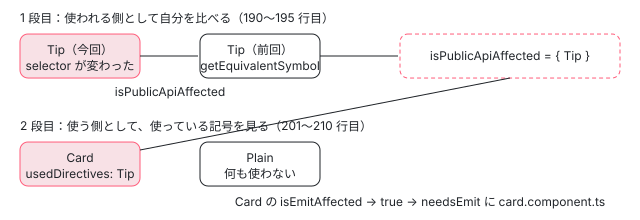

[目次](../README.md) › [ngtsc の内側](README.md) › 第 15 回 / 全 20 回

# 意味のグラフ：公開の形が変わったときだけ作り直す

> SemanticSymbol の isPublicApiAffected・isTypeCheckApiAffected・isEmitAffected、DirectiveSymbol と PipeSymbol と NgModuleSymbol がそれぞれ何を比べるか、SemanticDepGraphUpdater が前のグラフと今のグラフを照らして「影響を受けるファイル」を広げる行。テンプレートだけを変えたら、使う側のファイルは作り直さない理由。

angular/angular · 読了 約 13 分 · 発展 · [サイトで読む（デモが動きます）](https://angular-deep-dive-cyan.vercel.app/chapter/ngtsc-semantic-graph)

---

[第 14 回](14-ngtsc-incremental.md)の差分ビルドは「ファイルが変わったか」を見るだけでした。それだけだと、ディレクティブの selector を変えても、そのディレクティブを使うコンポーネントのファイルは「変わっていない」ことになります。ngtsc はそこを**意味のグラフ**（semantic dependency graph）で補います。クラスごとに「公開の形」を記録しておき、前のビルドと比べて形が変わったものを使う側だけを、emit と型チェックで作り直すのです。この章では、何を「公開の形」とするのかをディレクティブ・コンポーネント・pipe・NgModule の記号ごとに読み、テンプレートだけを変えても使う側が作り直されない理由を行で確かめます。

読む対象は `compiler-cli/src/ngtsc/incremental/semantic_graph/src/` の `api.ts`・`graph.ts`・`util.ts`・`type_parameters.ts`、各 handler の記号 `annotations/directive/src/symbol.ts`・`annotations/component/src/symbol.ts`・`annotations/src/pipe.ts` の `PipeSymbol`・`annotations/ng_module/src/handler.ts` の `NgModuleSymbol`、spec の `test/ngtsc/incremental_semantic_changes_spec.ts` です。

1. [1. 全体像](01-ngtsc-overview.md)
2. [2. NgtscProgram](02-ngtsc-program.md)
3. [3. NgCompiler とチケット](03-ngtsc-compiler-ticket.md)
4. [4. リフレクション](04-ngtsc-reflection.md)
5. [5. 静的な評価](05-ngtsc-partial-evaluator.md)
6. [6. 参照と import](06-ngtsc-references-imports.md)
7. [7. 解析](07-ngtsc-trait-analyze.md)
8. [8. 解決と出力](08-ngtsc-trait-resolve-compile.md)
9. [9. @Directive の handler](09-ngtsc-directive-handler.md)
10. [10. メタデータの登録](10-ngtsc-metadata-registry.md)
11. [11. .d.ts を読む](11-ngtsc-dts-metadata.md)
12. [12. JS の書き換え](12-ngtsc-ivy-transform.md)
13. [13. .d.ts の書き換え](13-ngtsc-dts-transform.md)
14. [14. 差分ビルド](14-ngtsc-incremental.md)
15. **15. 意味のグラフ**（この章）
16. [16. import の循環](16-ngtsc-cycles.md)
17. [17. HMR](17-ngtsc-hmr.md)
18. [18. 診断と性能](18-ngtsc-diagnostics-perf.md)
19. [19. テストを書く](19-ngtsc-test-env.md)
20. [20. issue と PR を読む](20-ngtsc-issues.md)

## 1. SemanticSymbol：ビルドをまたいで見分けられるクラス

📄 `angular/packages/compiler-cli/src/ngtsc/incremental/semantic_graph/src/api.ts` L19–44 （▶ の行: 23, 30–31, 34, 42–43）

```ts
19 │ export abstract class SemanticSymbol {
20 │   /**
21 │    * The path of the file that declares this symbol.
22 │    */
23 ▶   public readonly path: AbsoluteFsPath;
24 │ 
25 │   /**
26 │    * The identifier of this symbol, or null if no identifier could be determined. It should
27 │    * uniquely identify the symbol relative to `file`. This is typically just the name of a
28 │    * top-level class declaration, as that uniquely identifies the class within the file.
29 │    *
30 ▶    * If the identifier is null, then this symbol cannot be recognized across rebuilds. In that
31 ▶    * case, the symbol is always assumed to have semantically changed to guarantee a proper
32 │    * rebuild.
33 │    */
34 ▶   public readonly identifier: string | null;
35 │ 
36 │   constructor(
37 │     /**
38 │      * The declaration for this symbol.
39 │      */
40 │     public readonly decl: ClassDeclaration,
41 │   ) {
42 ▶     this.path = absoluteFromSourceFile(decl.getSourceFile());
43 ▶     this.identifier = getSymbolIdentifier(decl);
44 │   }
```

📄 `angular/packages/compiler-cli/src/ngtsc/incremental/semantic_graph/src/api.ts` L103–129 （▶ の行: 107–108, 112, 117, 121–122, 128）

```ts
103 │ /**
104 │  * Represents a reference to a semantic symbol that has been emitted into a source file. The
105 │  * reference may refer to the symbol using a different name than the semantic symbol's declared
106 │  * name, e.g. in case a re-export under a different name was chosen by a reference emitter.
107 ▶  * Consequently, to know that an emitted reference is still valid not only requires that the
108 ▶  * semantic symbol is still valid, but also that the path by which the symbol is imported has not
109 │  * changed.
110 │  */
111 │ export interface SemanticReference {
112 ▶   symbol: SemanticSymbol;
113 │ 
114 │   /**
115 │    * The path by which the symbol has been referenced.
116 │    */
117 ▶   importPath: string | null;
118 │ }
119 │ 
120 │ function getSymbolIdentifier(decl: ClassDeclaration): string | null {
121 ▶   if (!ts.isSourceFile(decl.parent)) {
122 ▶     return null;
123 │   }
124 │ 
125 │   // If this is a top-level class declaration, the class name is used as unique identifier.
126 │   // Other scenarios are currently not supported and causes the symbol not to be identified
127 │   // across rebuilds, unless the declaration node has not changed.
128 ▶   return decl.name.text;
129 │ }
```

記号（symbol）は Angular のクラス 1 つの記録で、23 行目のファイルのパスと、34 行目の識別子を持ちます。識別子は 120〜129 行目のとおり**トップレベルのクラスの名前**で、関数の中のクラスなどは 122 行目で `null` です。30〜32 行目、識別子が無い記号は前のビルドの記号と結びつけられないので「必ず変わった」扱いになります。

使う側が使われる側を指すときは、記号そのものではなく 111〜118 行目の `SemanticReference`（記号 + import のパス）で持ちます。107〜109 行目のコメントのとおり、同じ記号でも import の道が変われば（再 export の名前が変わった、など）出力の import 文が変わるからです。

## 2. 4 つの問い

📄 `angular/packages/compiler-cli/src/ngtsc/incremental/semantic_graph/src/api.ts` L46–72 （▶ の行: 51–52, 59, 65–66, 72）

```ts
46 │   /**
47 │    * Allows the symbol to be compared to the equivalent symbol in the previous compilation. The
48 │    * return value indicates whether the symbol has been changed in a way such that its public API
49 │    * is affected.
50 │    *
51 ▶    * This method determines whether a change to _this_ symbol require the symbols that
52 ▶    * use to this symbol to be re-emitted.
53 │    *
54 │    * Note: `previousSymbol` is obtained from the most recently succeeded compilation. Symbols of
55 │    * failed compilations are never provided.
56 │    *
57 │    * @param previousSymbol The symbol from a prior compilation.
58 │    */
59 ▶   abstract isPublicApiAffected(previousSymbol: SemanticSymbol): boolean;
60 │ 
61 │   /**
62 │    * Allows the symbol to determine whether its emit is affected. The equivalent symbol from a prior
63 │    * build is given, in addition to the set of symbols of which the public API has changed.
64 │    *
65 ▶    * This method determines whether a change to _other_ symbols, i.e. those present in
66 ▶    * `publicApiAffected`, should cause _this_ symbol to be re-emitted.
67 │    *
68 │    * @param previousSymbol The equivalent symbol from a prior compilation. Note that it may be a
69 │    * different type of symbol, if e.g. a Component was changed into a Directive with the same name.
70 │    * @param publicApiAffected The set of symbols of which the public API has changed.
71 │    */
72 ▶   isEmitAffected?(previousSymbol: SemanticSymbol, publicApiAffected: Set<SemanticSymbol>): boolean;
```

📄 `angular/packages/compiler-cli/src/ngtsc/incremental/semantic_graph/src/api.ts` L74–101 （▶ の行: 78–79, 86, 90–91, 97）

```ts
 74 │   /**
 75 │    * Similar to `isPublicApiAffected`, but here equivalent symbol from a prior compilation needs
 76 │    * to be compared to see if the type-check block of components that use this symbol is affected.
 77 │    *
 78 ▶    * This method determines whether a change to _this_ symbol require the symbols that
 79 ▶    * use to this symbol to have their type-check block regenerated.
 80 │    *
 81 │    * Note: `previousSymbol` is obtained from the most recently succeeded compilation. Symbols of
 82 │    * failed compilations are never provided.
 83 │    *
 84 │    * @param previousSymbol The symbol from a prior compilation.
 85 │    */
 86 ▶   abstract isTypeCheckApiAffected(previousSymbol: SemanticSymbol): boolean;
 87 │ 
 88 │   /**
 89 │    * Similar to `isEmitAffected`, but focused on the type-check block of this symbol. This method
 90 ▶    * determines whether a change to _other_ symbols, i.e. those present in `typeCheckApiAffected`,
 91 ▶    * should cause _this_ symbol's type-check block to be regenerated.
 92 │    *
 93 │    * @param previousSymbol The equivalent symbol from a prior compilation. Note that it may be a
 94 │    * different type of symbol, if e.g. a Component was changed into a Directive with the same name.
 95 │    * @param typeCheckApiAffected The set of symbols of which the type-check API has changed.
 96 │    */
 97 ▶   isTypeCheckBlockAffected?(
 98 │     previousSymbol: SemanticSymbol,
 99 │     typeCheckApiAffected: Set<SemanticSymbol>,
100 │   ): boolean;
101 │ }
```

| メソッド | 誰について | 問い | 必須 |
| --- | --- | --- | --- |
| `isPublicApiAffected(prev)`（59 行目） | 自分 | 自分の公開の形が変わったので、自分を使う側を emit し直す必要があるか（51〜52 行目） | abstract |
| `isEmitAffected(prev, set)`（72 行目） | 自分 | 自分が使う記号のうち公開の形が変わったものがあるので、自分を emit し直す必要があるか（65〜66 行目） | 任意 |
| `isTypeCheckApiAffected(prev)`（86 行目） | 自分 | 自分を使う側の型チェックのコード（TCB）を作り直す必要があるか（78〜79 行目） | abstract |
| `isTypeCheckBlockAffected(prev, set)`（97 行目） | 自分 | 自分の TCB を作り直す必要があるか（90〜91 行目） | 任意 |

「〜Api〜」の 2 つは**使われる側**として自分を比べ、「〜Affected(prev, set)」の 2 つは**使う側**として、使われる側の答え（`set`）を受け取って判断します。使う側になれるのはコンポーネントと NgModule だけなので、後の 2 つは任意です。

## 3. 記号を集める：makeSymbolForTrait と SemanticDepGraph

📄 `angular/packages/compiler-cli/src/ngtsc/transform/src/compilation.ts` L392–412 （▶ の行: 397, 400, 402–403, 408）

```ts
392 │   private makeSymbolForTrait(
393 │     handler: DecoratorHandler<unknown, unknown, SemanticSymbol | null, unknown>,
394 │     decl: ClassDeclaration,
395 │     analysis: Readonly<unknown> | null,
396 │   ): SemanticSymbol | null {
397 ▶     if (analysis === null) {
398 │       return null;
399 │     }
400 ▶     const symbol = handler.symbol(decl, analysis);
401 │     if (symbol !== null && this.semanticDepGraphUpdater !== null) {
402 ▶       const isPrimary = handler.precedence === HandlerPrecedence.PRIMARY;
403 ▶       if (!isPrimary) {
404 │         throw new Error(
405 │           `AssertionError: ${handler.name} returned a symbol but is not a primary handler.`,
406 │         );
407 │       }
408 ▶       this.semanticDepGraphUpdater.registerSymbol(symbol);
409 │     }
410 │ 
411 │     return symbol;
412 │   }
```

解析が終わった trait ごとに、400 行目で handler の `symbol()` を呼んで記号を作り、408 行目で今回のグラフに登録します。[第 14 回](14-ngtsc-incremental.md)の `adopt` もこの関数を呼ぶので、使い回したクラスの記号も毎回作り直されます。402〜407 行目、記号を返してよいのは PRIMARY の handler（@Component・@Directive・@Pipe・@NgModule など）だけで、1 クラスに記号は 1 つです。

📄 `angular/packages/compiler-cli/src/ngtsc/incremental/semantic_graph/src/graph.ts` L52–81 （▶ の行: 53, 59, 71, 73, 79）

```ts
52 │ export class SemanticDepGraph {
53 ▶   readonly files = new Map<AbsoluteFsPath, Map<string, SemanticSymbol>>();
54 │ 
55 │   // Note: the explicit type annotation is used to work around a CI failure on Windows:
56 │   // error TS2742: The inferred type of 'symbolByDecl' cannot be named without a reference to
57 │   // '../../../../../../../external/_main/node_modules/typescript/lib/typescript'. This is likely
58 │   // not portable. A type annotation is necessary.
59 ▶   readonly symbolByDecl: Map<ClassDeclaration, SemanticSymbol> = new Map<
60 │     ClassDeclaration,
61 │     SemanticSymbol
62 │   >();
63 │ 
64 │   /**
65 │    * Registers a symbol in the graph. The symbol is given a unique identifier if possible, such that
66 │    * its equivalent symbol can be obtained from a prior graph even if its declaration node has
67 │    * changed across rebuilds. Symbols without an identifier are only able to find themselves in a
68 │    * prior graph if their declaration node is identical.
69 │    */
70 │   registerSymbol(symbol: SemanticSymbol): void {
71 ▶     this.symbolByDecl.set(symbol.decl, symbol);
72 │ 
73 ▶     if (symbol.identifier !== null) {
74 │       // If the symbol has a unique identifier, record it in the file that declares it. This enables
75 │       // the symbol to be requested by its unique name.
76 │       if (!this.files.has(symbol.path)) {
77 │         this.files.set(symbol.path, new Map<string, SemanticSymbol>());
78 │       }
79 ▶       this.files.get(symbol.path)!.set(symbol.identifier, symbol);
80 │     }
81 │   }
```

📄 `angular/packages/compiler-cli/src/ngtsc/incremental/semantic_graph/src/graph.ts` L83–104 （▶ の行: 94–95, 100）

```ts
 83 │   /**
 84 │    * Attempts to resolve a symbol in this graph that represents the given symbol from another graph.
 85 │    * If no matching symbol could be found, null is returned.
 86 │    *
 87 │    * @param symbol The symbol from another graph for which its equivalent in this graph should be
 88 │    * found.
 89 │    */
 90 │   getEquivalentSymbol(symbol: SemanticSymbol): SemanticSymbol | null {
 91 │     // First lookup the symbol by its declaration. It is typical for the declaration to not have
 92 │     // changed across rebuilds, so this is likely to find the symbol. Using the declaration also
 93 │     // allows to diff symbols for which no unique identifier could be determined.
 94 ▶     let previousSymbol = this.getSymbolByDecl(symbol.decl);
 95 ▶     if (previousSymbol === null && symbol.identifier !== null) {
 96 │       // The declaration could not be resolved to a symbol in a prior compilation, which may
 97 │       // happen because the file containing the declaration has changed. In that case we want to
 98 │       // lookup the symbol based on its unique identifier, as that allows us to still compare the
 99 │       // changed declaration to the prior compilation.
100 ▶       previousSymbol = this.getSymbolByName(symbol.path, symbol.identifier);
101 │     }
102 │ 
103 │     return previousSymbol;
104 │   }
```

グラフは 2 つの引き方を持ちます。71 行目の「クラスの節 → 記号」と、79 行目の「ファイル → 名前 → 記号」です。前のビルドの記号を探すときは、94 行目でまず節で引き、見つからなければ 100 行目で名前で引きます。ファイルを書き換えると TypeScript はそのファイルの構文木を作り直すので、節は前のビルドと別のオブジェクトになります。だから 2 段目の「名前で引く」が要ります。

## 4. SemanticDepGraphUpdater.finalize：2 段で広げる

📄 `angular/packages/compiler-cli/src/ngtsc/incremental/semantic_graph/src/graph.ts` L135–157 （▶ の行: 136, 142, 149, 156）

```ts
135 │ export class SemanticDepGraphUpdater {
136 ▶   private readonly newGraph = new SemanticDepGraph();
137 │ 
138 │   /**
139 │    * Contains opaque symbols that were created for declarations for which there was no symbol
140 │    * registered, which happens for e.g. external declarations.
141 │    */
142 ▶   private readonly opaqueSymbols = new Map<ClassDeclaration, OpaqueSymbol>();
143 │ 
144 │   constructor(
145 │     /**
146 │      * The semantic dependency graph of the most recently succeeded compilation, or null if this
147 │      * is the initial build.
148 │      */
149 ▶     private priorGraph: SemanticDepGraph | null,
150 │   ) {}
151 │ 
152 │   /**
153 │    * Registers the symbol in the new graph that is being created.
154 │    */
155 │   registerSymbol(symbol: SemanticSymbol): void {
156 ▶     this.newGraph.registerSymbol(symbol);
157 │   }
```

📄 `angular/packages/compiler-cli/src/ngtsc/incremental/semantic_graph/src/graph.ts` L159–183 （▶ の行: 165, 169–171, 176–177）

```ts
159 │   /**
160 │    * Takes all facts that have been gathered to create a new semantic dependency graph. In this
161 │    * process, the semantic impact of the changes is determined which results in a set of files that
162 │    * need to be emitted and/or type-checked.
163 │    */
164 │   finalize(): SemanticDependencyResult {
165 ▶     if (this.priorGraph === null) {
166 │       // If no prior dependency graph is available then this was the initial build, in which case
167 │       // we don't need to determine the semantic impact as everything is already considered
168 │       // logically changed.
169 ▶       return {
170 ▶         needsEmit: new Set<AbsoluteFsPath>(),
171 ▶         needsTypeCheckEmit: new Set<AbsoluteFsPath>(),
172 │         newGraph: this.newGraph,
173 │       };
174 │     }
175 │ 
176 ▶     const needsEmit = this.determineInvalidatedFiles(this.priorGraph);
177 ▶     const needsTypeCheckEmit = this.determineInvalidatedTypeCheckFiles(this.priorGraph);
178 │     return {
179 │       needsEmit,
180 │       needsTypeCheckEmit,
181 │       newGraph: this.newGraph,
182 │     };
183 │   }
```

149 行目の `priorGraph` は前回成功したビルドのグラフで、[第 14 回](14-ngtsc-incremental.md)の `IncrementalCompilation` のコンストラクタで渡されます。165〜173 行目、初回のビルドは全部が論理的に変わっているので、空の集合を返すだけです。2 回目以降は 176 行目で emit の、177 行目で型チェックの「作り直すファイル」を求めます。

📄 `angular/packages/compiler-cli/src/ngtsc/incremental/semantic_graph/src/graph.ts` L185–213 （▶ の行: 190–193, 201–202, 206–208）

```ts
185 │   private determineInvalidatedFiles(priorGraph: SemanticDepGraph): Set<AbsoluteFsPath> {
186 │     const isPublicApiAffected = new Set<SemanticSymbol>();
187 │ 
188 │     // The first phase is to collect all symbols which have their public API affected. Any symbols
189 │     // that cannot be matched up with a symbol from the prior graph are considered affected.
190 ▶     for (const symbol of this.newGraph.symbolByDecl.values()) {
191 ▶       const previousSymbol = priorGraph.getEquivalentSymbol(symbol);
192 ▶       if (previousSymbol === null || symbol.isPublicApiAffected(previousSymbol)) {
193 ▶         isPublicApiAffected.add(symbol);
194 │       }
195 │     }
196 │ 
197 │     // The second phase is to find all symbols for which the emit result is affected, either because
198 │     // their used declarations have changed or any of those used declarations has had its public API
199 │     // affected as determined in the first phase.
200 │     const needsEmit = new Set<AbsoluteFsPath>();
201 ▶     for (const symbol of this.newGraph.symbolByDecl.values()) {
202 ▶       if (symbol.isEmitAffected === undefined) {
203 │         continue;
204 │       }
205 │ 
206 ▶       const previousSymbol = priorGraph.getEquivalentSymbol(symbol);
207 ▶       if (previousSymbol === null || symbol.isEmitAffected(previousSymbol, isPublicApiAffected)) {
208 ▶         needsEmit.add(symbol.path);
209 │       }
210 │     }
211 │ 
212 │     return needsEmit;
213 │   }
```



*1 段目で「公開の形が変わった記号」の集合を作り、2 段目で使う側の記号がその集合を見て、自分のファイルを作り直すか決める。型チェックの側（determineInvalidatedTypeCheckFiles）も同じ 2 段*

1. **190〜195 行目：1 段目**

   今回の記号を全部見て、前回の記号が見つからない（新しいクラス・名前が変わった）か、`isPublicApiAffected` が真なら集合に入れます。
2. **201〜210 行目：2 段目**

   202 行目、`isEmitAffected` を持たない記号（ディレクティブ・pipe）は使う側にならないので飛ばします。207 行目で前回の記号と 1 段目の集合を渡して尋ね、真なら 208 行目で**そのファイル**を `needsEmit` に入れます。
3. **型チェックの側**

   続く `determineInvalidatedTypeCheckFiles` は同じ形で `isTypeCheckApiAffected` と `isTypeCheckBlockAffected` を使います（[typecheck-program-driver](../typecheck/04-typecheck-program-driver.md) の 7 節に引用）。結果の `needsTypeCheckEmit` は、第 14 回の 7 節のとおり `phase` に入り、`priorTypeCheckingResultsFor` が見ます。

### 使う側の記録：SemanticReference と OpaqueSymbol

📄 `angular/packages/compiler-cli/src/ngtsc/annotations/component/src/handler.ts` L1461–1473 （▶ の行: 1462–1464, 1466, 1469）

```ts
1461 │ 
1462 ▶       if (this.semanticDepGraphUpdater !== null) {
1463 ▶         const getSemanticReference = (decl: UsedDirective | UsedPipe) =>
1464 ▶           this.semanticDepGraphUpdater!.getSemanticReference(decl.ref.node, decl.type);
1465 │ 
1466 ▶         symbol.usedDirectives = Array.from(declarations.values())
1467 │           .filter(isUsedDirective)
1468 │           .map(getSemanticReference);
1469 ▶         symbol.usedPipes = Array.from(declarations.values())
1470 │           .filter(isUsedPipe)
1471 │           .map(getSemanticReference);
1472 │       }
1473 │ 
```

📄 `angular/packages/compiler-cli/src/ngtsc/incremental/semantic_graph/src/graph.ts` L248–272 （▶ の行: 254–255, 264–265, 269）

```ts
248 │   /**
249 │    * Creates a `SemanticReference` for the reference to `decl` using the expression `expr`. See
250 │    * the documentation of `SemanticReference` for details.
251 │    */
252 │   getSemanticReference(decl: ClassDeclaration, expr: Expression): SemanticReference {
253 │     return {
254 ▶       symbol: this.getSymbol(decl),
255 ▶       importPath: getImportPath(expr),
256 │     };
257 │   }
258 │ 
259 │   /**
260 │    * Gets the `SemanticSymbol` that was registered for `decl` during the current compilation, or
261 │    * returns an opaque symbol that represents `decl`.
262 │    */
263 │   getSymbol(decl: ClassDeclaration): SemanticSymbol {
264 ▶     const symbol = this.newGraph.getSymbolByDecl(decl);
265 ▶     if (symbol === null) {
266 │       // No symbol has been recorded for the provided declaration, which would be the case if the
267 │       // declaration is external. Return an opaque symbol in that case, to allow the external
268 │       // declaration to be compared to a prior compilation.
269 ▶       return this.getOpaqueSymbol(decl);
270 │     }
271 │     return symbol;
272 │   }
```

📄 `angular/packages/compiler-cli/src/ngtsc/incremental/semantic_graph/src/graph.ts` L288–294 （▶ の行: 289–290, 292）

```ts
288 │ function getImportPath(expr: Expression): string | null {
289 ▶   if (expr instanceof ExternalExpr) {
290 ▶     return `${expr.value.moduleName}\$${expr.value.name}`;
291 │   } else {
292 ▶     return null;
293 │   }
294 │ }
```

📄 `angular/packages/compiler-cli/src/ngtsc/incremental/semantic_graph/src/graph.ts` L33–47 （▶ の行: 39–41, 44–45）

```ts
33 │ /**
34 │  * Represents a declaration for which no semantic symbol has been registered. For example,
35 │  * declarations from external dependencies have not been explicitly registered and are represented
36 │  * by this symbol. This allows the unresolved symbol to still be compared to a symbol from a prior
37 │  * compilation.
38 │  */
39 ▶ class OpaqueSymbol extends SemanticSymbol {
40 ▶   override isPublicApiAffected(): false {
41 ▶     return false;
42 │   }
43 │ 
44 ▶   override isTypeCheckApiAffected(): false {
45 ▶     return false;
46 │   }
47 │ }
```

コンポーネントの handler は resolve の中で、テンプレートで使うと決まったディレクティブと pipe（スコープの決め方は [ngmodule-compilation-scope](../ngmodule/04-ngmodule-compilation-scope.md)）を、1466〜1471 行目で `SemanticReference` の配列にします。1464 行目の `decl.type` は出力に書く参照の式で、別ファイルなら `ExternalExpr` なので、290 行目で「モジュール名$名前」の文字列が import のパスになります。

264〜269 行目、今回のグラフに無いクラス（`node_modules` のライブラリのディレクティブなど）には 39〜47 行目の `OpaqueSymbol` を作ります。中身を知らないので、公開の形は「常に変わっていない」（41・45 行目）です。ライブラリを更新したときは .d.ts が変わるので、第 14 回の 4 節の「.d.ts が変わったら全部最初から」で全体がやり直しになり、ここには来ません。

📄 `angular/packages/compiler-cli/src/ngtsc/incremental/semantic_graph/src/util.ts` L10–40 （▶ の行: 14, 19, 24, 32, 39）

```ts
10 │ /**
11 │  * Determines whether the provided symbols represent the same declaration.
12 │  */
13 │ export function isSymbolEqual(a: SemanticSymbol, b: SemanticSymbol): boolean {
14 ▶   if (a.decl === b.decl) {
15 │     // If the declaration is identical then it must represent the same symbol.
16 │     return true;
17 │   }
18 │ 
19 ▶   if (a.identifier === null || b.identifier === null) {
20 │     // Unidentifiable symbols are assumed to be different.
21 │     return false;
22 │   }
23 │ 
24 ▶   return a.path === b.path && a.identifier === b.identifier;
25 │ }
26 │ 
27 │ /**
28 │  * Determines whether the provided references to a semantic symbol are still equal, i.e. represent
29 │  * the same symbol and are imported by the same path.
30 │  */
31 │ export function isReferenceEqual(a: SemanticReference, b: SemanticReference): boolean {
32 ▶   if (!isSymbolEqual(a.symbol, b.symbol)) {
33 │     // If the reference's target symbols are different, the reference itself is different.
34 │     return false;
35 │   }
36 │ 
37 │   // The reference still corresponds with the same symbol, now check that the path by which it is
38 │   // imported has not changed.
39 ▶   return a.importPath === b.importPath;
40 │ }
```

📄 `angular/packages/compiler-cli/src/ngtsc/incremental/semantic_graph/src/util.ts` L46–64 （▶ の行: 55–56, 59, 63）

```ts
46 │ /**
47 │  * Determines if the provided arrays are equal to each other, using the provided equality tester
48 │  * that is called for all entries in the array.
49 │  */
50 │ export function isArrayEqual<T>(
51 │   a: readonly T[] | null,
52 │   b: readonly T[] | null,
53 │   equalityTester: (a: T, b: T) => boolean = referenceEquality,
54 │ ): boolean {
55 ▶   if (a === null || b === null) {
56 ▶     return a === b;
57 │   }
58 │ 
59 ▶   if (a.length !== b.length) {
60 │     return false;
61 │   }
62 │ 
63 ▶   return !a.some((item, index) => !equalityTester(item, b[index]));
64 │ }
```

比べる道具は 3 つです。14 行目、同じ節なら同じ記号。19 行目、識別子の無い記号は別物。24 行目、パスと名前が同じなら同じ記号。`isReferenceEqual` はさらに 39 行目で import のパスを比べます。`isArrayEqual` は 59 行目で長さを、63 行目で**同じ位置どうし**を比べるので、並び替えも「違う」になります。

## 5. DirectiveSymbol：selector・入出力の名前・exportAs

📄 `angular/packages/compiler-cli/src/ngtsc/annotations/directive/src/symbol.ts` L21–59 （▶ の行: 26, 30–35, 44–45, 54–57）

```ts
21 │ /**
22 │  * Represents an Angular directive. Components are represented by `ComponentSymbol`, which inherits
23 │  * from this symbol.
24 │  */
25 │ export class DirectiveSymbol extends SemanticSymbol {
26 ▶   baseClass: SemanticSymbol | null = null;
27 │ 
28 │   constructor(
29 │     decl: ClassDeclaration,
30 ▶     public readonly selector: string | null,
31 ▶     public readonly inputs: ClassPropertyMapping<InputMapping>,
32 ▶     public readonly outputs: ClassPropertyMapping,
33 ▶     public readonly exportAs: string[] | null,
34 ▶     public readonly typeCheckMeta: DirectiveTypeCheckMeta,
35 ▶     public readonly typeParameters: SemanticTypeParameter[] | null,
36 │   ) {
37 │     super(decl);
38 │   }
39 │ 
40 │   override isPublicApiAffected(previousSymbol: SemanticSymbol): boolean {
41 │     // Note: since components and directives have exactly the same items contributing to their
42 │     // public API, it is okay for a directive to change into a component and vice versa without
43 │     // the API being affected.
44 ▶     if (!(previousSymbol instanceof DirectiveSymbol)) {
45 ▶       return true;
46 │     }
47 │ 
48 │     // Directives and components have a public API of:
49 │     //  1. Their selector.
50 │     //  2. The binding names of their inputs and outputs; a change in ordering is also considered
51 │     //     to be a change in public API.
52 │     //  3. The list of exportAs names and its ordering.
53 │     return (
54 ▶       this.selector !== previousSymbol.selector ||
55 ▶       !isArrayEqual(this.inputs.propertyNames, previousSymbol.inputs.propertyNames) ||
56 ▶       !isArrayEqual(this.outputs.propertyNames, previousSymbol.outputs.propertyNames) ||
57 ▶       !isArrayEqual(this.exportAs, previousSymbol.exportAs)
58 │     );
59 │   }
```

📄 `angular/packages/compiler/src/property_mapping.ts` L125–137 （▶ の行: 128–129, 135–136）

```ts
125 │   /**
126 │    * All class property names mapped in this mapping.
127 │    */
128 ▶   get classPropertyNames(): ClassPropertyName[] {
129 ▶     return Array.from(this.forwardMap.keys());
130 │   }
131 │ 
132 │   /**
133 │    * All binding property names mapped in this mapping.
134 │    */
135 ▶   get propertyNames(): BindingPropertyName[] {
136 ▶     return Array.from(this.reverseMap.keys());
137 │   }
```

ディレクティブの公開の形は 48〜52 行目のコメントの 3 つで、54〜57 行目がその比較です。selector の文字列、入力と出力の**テンプレートから見える名前**（`propertyNames` は 135〜136 行目のとおり binding の名前の一覧）、exportAs。44〜46 行目、前回が DirectiveSymbol でなければ（pipe と入れ替わった、など）変わったことにします。41〜43 行目のコメントのとおり、ComponentSymbol は DirectiveSymbol を継ぐので、ディレクティブとコンポーネントの入れ替えはここでは変化になりません。

📄 `angular/packages/compiler-cli/src/ngtsc/annotations/directive/src/symbol.ts` L61–86 （▶ の行: 63–64, 73, 75–77, 80–82）

```ts
61 │   override isTypeCheckApiAffected(previousSymbol: SemanticSymbol): boolean {
62 │     // If the public API of the directive has changed, then so has its type-check API.
63 ▶     if (this.isPublicApiAffected(previousSymbol)) {
64 ▶       return true;
65 │     }
66 │ 
67 │     if (!(previousSymbol instanceof DirectiveSymbol)) {
68 │       return true;
69 │     }
70 │ 
71 │     // The type-check block also depends on the class property names, as writes property bindings
72 │     // directly into the backing fields.
73 ▶     if (
74 │       !isArrayEqual(
75 ▶         Array.from(this.inputs),
76 ▶         Array.from(previousSymbol.inputs),
77 ▶         isInputMappingEqual,
78 │       ) ||
79 │       !isArrayEqual(
80 ▶         Array.from(this.outputs),
81 ▶         Array.from(previousSymbol.outputs),
82 ▶         isInputOrOutputEqual,
83 │       )
84 │     ) {
85 │       return true;
86 │     }
```

📄 `angular/packages/compiler-cli/src/ngtsc/annotations/directive/src/symbol.ts` L111–121 （▶ の行: 112, 117–119）

```ts
111 │ function isInputMappingEqual(current: InputMapping, previous: InputMapping): boolean {
112 ▶   return isInputOrOutputEqual(current, previous) && current.required === previous.required;
113 │ }
114 │ 
115 │ function isInputOrOutputEqual(current: InputOrOutput, previous: InputOrOutput): boolean {
116 │   return (
117 ▶     current.classPropertyName === previous.classPropertyName &&
118 ▶     current.bindingPropertyName === previous.bindingPropertyName &&
119 ▶     current.isSignal === previous.isSignal
120 │   );
121 │ }
```

📄 `angular/packages/compiler-cli/src/ngtsc/annotations/directive/src/symbol.ts` L88–109 （▶ の行: 91, 97, 103）

```ts
 88 │     // The type parameters of a directive are emitted into the type constructors in the type-check
 89 │     // block of a component, so if the type parameters are not considered equal then consider the
 90 │     // type-check API of this directive to be affected.
 91 ▶     if (!areTypeParametersEqual(this.typeParameters, previousSymbol.typeParameters)) {
 92 │       return true;
 93 │     }
 94 │ 
 95 │     // The type-check metadata is used during TCB code generation, so any changes should invalidate
 96 │     // prior type-check files.
 97 ▶     if (!isTypeCheckMetaEqual(this.typeCheckMeta, previousSymbol.typeCheckMeta)) {
 98 │       return true;
 99 │     }
100 │ 
101 │     // Changing the base class of a directive means that its inputs/outputs etc may have changed,
102 │     // so the type-check block of components that use this directive needs to be regenerated.
103 ▶     if (!isBaseClassEqual(this.baseClass, previousSymbol.baseClass)) {
104 │       return true;
105 │     }
106 │ 
107 │     return false;
108 │   }
109 │ }
```

1. **63 行目：公開の形が変われば、型チェックの形も変わる**

   型チェックの形は公開の形より**広い**（細かい）比較です。
2. **73〜85 行目・117〜119 行目：入出力の中身を丸ごと比べる**

   71〜72 行目のコメントのとおり、TCB は入力をクラスのフィールドに直接書くので、クラスのプロパティ名（117 行目）・binding の名前（118 行目）・signal かどうか（119 行目）・required（112 行目）のどれが変わっても作り直しです。デモの「クラスのプロパティ名」は、binding の名前は同じなので公開の形は変わらず、ここで初めて真になります。
3. **91 行目：型引数**

   ジェネリックなディレクティブは TCB の中で型コンストラクタになるので（[typecheck-type-constructor](../typecheck/09-typecheck-type-constructor.md)）、型引数が変われば作り直しです。比べ方は下の `type_parameters.ts`。
4. **97・103 行目：型チェック用のメタデータと親クラス**

   ngTemplateGuard・ngAcceptInputType で型を変える入力など（下の 123〜153 行目）と、継承した親クラスの記号（103 行目）です。

📄 `angular/packages/compiler-cli/src/ngtsc/annotations/directive/src/symbol.ts` L123–153 （▶ の行: 127, 130, 137, 140, 143, 146, 149）

```ts
123 │ function isTypeCheckMetaEqual(
124 │   current: DirectiveTypeCheckMeta,
125 │   previous: DirectiveTypeCheckMeta,
126 │ ): boolean {
127 ▶   if (current.hasNgTemplateContextGuard !== previous.hasNgTemplateContextGuard) {
128 │     return false;
129 │   }
130 ▶   if (current.isGeneric !== previous.isGeneric) {
131 │     // Note: changes in the number of type parameters is also considered in
132 │     // `areTypeParametersEqual` so this check is technically not needed; it is done anyway for
133 │     // completeness in terms of whether the `DirectiveTypeCheckMeta` struct itself compares
134 │     // equal or not.
135 │     return false;
136 │   }
137 ▶   if (!isArrayEqual(current.ngTemplateGuards, previous.ngTemplateGuards, isTemplateGuardEqual)) {
138 │     return false;
139 │   }
140 ▶   if (!isSetEqual(current.coercedInputFields, previous.coercedInputFields)) {
141 │     return false;
142 │   }
143 ▶   if (!isSetEqual(current.restrictedInputFields, previous.restrictedInputFields)) {
144 │     return false;
145 │   }
146 ▶   if (!isSetEqual(current.stringLiteralInputFields, previous.stringLiteralInputFields)) {
147 │     return false;
148 │   }
149 ▶   if (!isSetEqual(current.undeclaredInputFields, previous.undeclaredInputFields)) {
150 │     return false;
151 │   }
152 │   return true;
153 │ }
```

📄 `angular/packages/compiler-cli/src/ngtsc/incremental/semantic_graph/src/type_parameters.ts` L33–47 （▶ の行: 40, 44–45）

```ts
33 │ /**
34 │  * Converts the type parameters of the given class into their semantic representation. If the class
35 │  * does not have any type parameters, then `null` is returned.
36 │  */
37 │ export function extractSemanticTypeParameters(
38 │   node: ClassDeclaration,
39 │ ): SemanticTypeParameter[] | null {
40 ▶   if (!ts.isClassDeclaration(node) || node.typeParameters === undefined) {
41 │     return null;
42 │   }
43 │ 
44 ▶   return node.typeParameters.map((typeParam) => ({
45 ▶     hasGenericTypeBound: typeParam.constraint !== undefined,
46 │   }));
47 │ }
```

📄 `angular/packages/compiler-cli/src/ngtsc/incremental/semantic_graph/src/type_parameters.ts` L49–74 （▶ の行: 58, 65–66）

```ts
49 │ /**
50 │  * Compares the list of type parameters to determine if they can be considered equal.
51 │  */
52 │ export function areTypeParametersEqual(
53 │   current: SemanticTypeParameter[] | null,
54 │   previous: SemanticTypeParameter[] | null,
55 │ ): boolean {
56 │   // First compare all type parameters one-to-one; any differences mean that the list of type
57 │   // parameters has changed.
58 ▶   if (!isArrayEqual(current, previous, isTypeParameterEqual)) {
59 │     return false;
60 │   }
61 │ 
62 │   // If there is a current list of type parameters and if any of them has a generic type constraint,
63 │   // then the meaning of that type parameter may have changed without us being aware; as such we
64 │   // have to assume that the type parameters have in fact changed.
65 ▶   if (current !== null && current.some((typeParam) => typeParam.hasGenericTypeBound)) {
66 ▶     return false;
67 │   }
68 │ 
69 │   return true;
70 │ }
71 │ 
72 │ function isTypeParameterEqual(a: SemanticTypeParameter, b: SemanticTypeParameter): boolean {
73 │   return a.hasGenericTypeBound === b.hasGenericTypeBound;
74 │ }
```

型引数は「`extends` があるか」しか記録しません（45 行目）。65〜66 行目、`extends` のある型引数が 1 つでもあれば、毎回「変わった」とみなします。62〜64 行目のコメントのとおり、制約の型の意味が変わったかを調べるには型の意味を完全に理解する必要があるので、安全側に倒しています。

📄 `angular/packages/compiler-cli/src/ngtsc/annotations/component/src/handler.ts` L1434–1440 （▶ の行: 1437–1438）

```ts
1434 │       };
1435 │     }
1436 │ 
1437 ▶     if (this.semanticDepGraphUpdater !== null && analysis.baseClass instanceof Reference) {
1438 ▶       symbol.baseClass = this.semanticDepGraphUpdater.getSymbol(analysis.baseClass.node);
1439 │     }
1440 │ 
```

親クラスの記号は resolve の中で入れます（1437〜1438 行目はコンポーネントの handler。ディレクティブの handler にも同じ 3 行があります）。親が Angular のクラスでなければ、3 節の `getSymbol` が OpaqueSymbol を返します。

## 6. PipeSymbol：名前だけ

📄 `angular/packages/compiler-cli/src/ngtsc/annotations/src/pipe.ts` L60–82 （▶ の行: 66, 76, 79–80）

```ts
60 │ /**
61 │  * Represents an Angular pipe.
62 │  */
63 │ export class PipeSymbol extends SemanticSymbol {
64 │   constructor(
65 │     decl: ClassDeclaration,
66 ▶     public readonly name: string,
67 │   ) {
68 │     super(decl);
69 │   }
70 │ 
71 │   override isPublicApiAffected(previousSymbol: SemanticSymbol): boolean {
72 │     if (!(previousSymbol instanceof PipeSymbol)) {
73 │       return true;
74 │     }
75 │ 
76 ▶     return this.name !== previousSymbol.name;
77 │   }
78 │ 
79 ▶   override isTypeCheckApiAffected(previousSymbol: SemanticSymbol): boolean {
80 ▶     return this.isPublicApiAffected(previousSymbol);
81 │   }
82 │ }
```

pipe の公開の形は 76 行目の名前（`{{ x | name }}` の `name`）だけで、80 行目のとおり型チェックの形も同じです。`transform` の引数や戻り値の型を変えても、TCB の文字列は「その pipe の型を名前で参照して `transform` を呼ぶ」ままなので変わりません。型の検査そのものは、TCB のファイルを TypeScript が新しいプログラムで毎回調べ直します。

## 7. ComponentSymbol：使っているものの形

📄 `angular/packages/compiler-cli/src/ngtsc/annotations/component/src/symbol.ts` L17–51 （▶ の行: 21–23, 29, 36–37, 47–49）

```ts
17 │ /**
18 │  * Represents an Angular component.
19 │  */
20 │ export class ComponentSymbol extends DirectiveSymbol {
21 ▶   usedDirectives: SemanticReference[] = [];
22 ▶   usedPipes: SemanticReference[] = [];
23 ▶   isRemotelyScoped = false;
24 │ 
25 │   override isEmitAffected(
26 │     previousSymbol: SemanticSymbol,
27 │     publicApiAffected: Set<SemanticSymbol>,
28 │   ): boolean {
29 ▶     if (!(previousSymbol instanceof ComponentSymbol)) {
30 │       return true;
31 │     }
32 │ 
33 │     // Create an equality function that considers symbols equal if they represent the same
34 │     // declaration, but only if the symbol in the current compilation does not have its public API
35 │     // affected.
36 ▶     const isSymbolUnaffected = (current: SemanticReference, previous: SemanticReference) =>
37 ▶       isReferenceEqual(current, previous) && !publicApiAffected.has(current.symbol);
38 │ 
39 │     // The emit of a component is affected if either of the following is true:
40 │     //  1. The component used to be remotely scoped but no longer is, or vice versa.
41 │     //  2. The list of used directives has changed or any of those directives have had their public
42 │     //     API changed. If the used directives have been reordered but not otherwise affected then
43 │     //     the component must still be re-emitted, as this may affect directive instantiation order.
44 │     //  3. The list of used pipes has changed, or any of those pipes have had their public API
45 │     //     changed.
46 │     return (
47 ▶       this.isRemotelyScoped !== previousSymbol.isRemotelyScoped ||
48 ▶       !isArrayEqual(this.usedDirectives, previousSymbol.usedDirectives, isSymbolUnaffected) ||
49 ▶       !isArrayEqual(this.usedPipes, previousSymbol.usedPipes, isSymbolUnaffected)
50 │     );
51 │   }
```

コンポーネントは DirectiveSymbol を継ぐので、使われる側としての比較は 5 節と同じです。そのうえで使う側として 2 つを持ちます。36〜37 行目の比べ方は「同じ記号を同じ import のパスで指していて、**かつ**その記号が 1 段目の集合に無い」。47 行目は remote scoping（[第 16 回](16-ngtsc-cycles.md)）になったか・外れたか、48 行目は使うディレクティブ、49 行目は使う pipe です。42〜43 行目のコメントのとおり、並びが変わっただけでも emit し直します（ディレクティブを作る順に関わるため）。

> [!NOTE]
> **ポイント**
>
> **テンプレートだけを変えても、使う側を作り直さない理由**は、ここまでの行を組み合わせると説明できます。テンプレートを変えたコンポーネント自身は資源の辺で論理的に変わり、解析・emit し直されます（第 14 回）。しかし 5 節の 54〜57 行目が比べるのは selector・入出力の名前・exportAs だけで、テンプレートの中身は入っていません。だから 1 段目の集合に入らず、それを使うコンポーネントの 36〜37 行目は「変わっていない」と答えます。使う側の JS が指しているのはクラスの名前（`dependencies: [Plain]`）だけなので、作り直す必要がないのです。デモの「Plain のテンプレートだけ」で確かめられます。

📄 `angular/packages/compiler-cli/src/ngtsc/annotations/component/src/symbol.ts` L53–79 （▶ の行: 63, 65–66, 69, 78–79）

```ts
53 │   override isTypeCheckBlockAffected(
54 │     previousSymbol: SemanticSymbol,
55 │     typeCheckApiAffected: Set<SemanticSymbol>,
56 │   ): boolean {
57 │     if (!(previousSymbol instanceof ComponentSymbol)) {
58 │       return true;
59 │     }
60 │ 
61 │     // To verify that a used directive is not affected we need to verify that its full inheritance
62 │     // chain is not present in `typeCheckApiAffected`.
63 ▶     const isInheritanceChainAffected = (symbol: SemanticSymbol): boolean => {
64 │       let currentSymbol: SemanticSymbol | null = symbol;
65 ▶       while (currentSymbol instanceof DirectiveSymbol) {
66 ▶         if (typeCheckApiAffected.has(currentSymbol)) {
67 │           return true;
68 │         }
69 ▶         currentSymbol = currentSymbol.baseClass;
70 │       }
71 │ 
72 │       return false;
73 │     };
74 │ 
75 │     // Create an equality function that considers directives equal if they represent the same
76 │     // declaration and if the symbol and all symbols it inherits from in the current compilation
77 │     // do not have their type-check API affected.
78 ▶     const isDirectiveUnaffected = (current: SemanticReference, previous: SemanticReference) =>
79 ▶       isReferenceEqual(current, previous) && !isInheritanceChainAffected(current.symbol);
```

📄 `angular/packages/compiler-cli/src/ngtsc/annotations/component/src/symbol.ts` L81–97 （▶ の行: 84–85, 93–94）

```ts
81 │     // Create an equality function that considers pipes equal if they represent the same
82 │     // declaration and if the symbol in the current compilation does not have its type-check
83 │     // API affected.
84 ▶     const isPipeUnaffected = (current: SemanticReference, previous: SemanticReference) =>
85 ▶       isReferenceEqual(current, previous) && !typeCheckApiAffected.has(current.symbol);
86 │ 
87 │     // The emit of a type-check block of a component is affected if either of the following is true:
88 │     //  1. The list of used directives has changed or any of those directives have had their
89 │     //     type-check API changed.
90 │     //  2. The list of used pipes has changed, or any of those pipes have had their type-check API
91 │     //     changed.
92 │     return (
93 ▶       !isArrayEqual(this.usedDirectives, previousSymbol.usedDirectives, isDirectiveUnaffected) ||
94 ▶       !isArrayEqual(this.usedPipes, previousSymbol.usedPipes, isPipeUnaffected)
95 │     );
96 │   }
97 │ }
```

型チェックの側は、使うディレクティブについて**継承の鎖をたどって**見ます。63〜73 行目、親・祖父母のどれかの型チェックの形が変わっていれば、そのディレクティブは変わったことにします。継承した入力は TCB に出てくるのに、子のクラスの記号の比較には入らないからです。

## 8. NgModuleSymbol：providers と remote scoping

📄 `angular/packages/compiler-cli/src/ngtsc/annotations/ng_module/src/handler.ts` L148–185 （▶ の行: 149, 164, 168, 174, 180, 184）

```ts
148 │ export class NgModuleSymbol extends SemanticSymbol {
149 ▶   private remotelyScopedComponents: {
150 │     component: SemanticSymbol;
151 │     usedDirectives: SemanticReference[];
152 │     usedPipes: SemanticReference[];
153 │   }[] = [];
154 │ 
155 │   /**
156 │    * `SemanticSymbol`s of the transitive imports of this NgModule which came from imported
157 │    * standalone components.
158 │    *
159 │    * Standalone components are excluded/included in the `InjectorDef` emit output of the NgModule
160 │    * based on whether the compiler can prove that their transitive imports may contain exported
161 │    * providers, so a change in this set of symbols may affect the compilation output of this
162 │    * NgModule.
163 │    */
164 ▶   private transitiveImportsFromStandaloneComponents = new Set<SemanticSymbol>();
165 │ 
166 │   constructor(
167 │     decl: ClassDeclaration,
168 ▶     public readonly hasProviders: boolean,
169 │   ) {
170 │     super(decl);
171 │   }
172 │ 
173 │   override isPublicApiAffected(previousSymbol: SemanticSymbol): boolean {
174 ▶     if (!(previousSymbol instanceof NgModuleSymbol)) {
175 │       return true;
176 │     }
177 │ 
178 │     // Changes in the provider status of this NgModule affect downstream dependencies, which may
179 │     // consider provider status in their own emits.
180 ▶     if (previousSymbol.hasProviders !== this.hasProviders) {
181 │       return true;
182 │     }
183 │ 
184 ▶     return false;
185 │   }
```

📄 `angular/packages/compiler-cli/src/ngtsc/annotations/ng_module/src/handler.ts` L187–221 （▶ の行: 193, 197–198, 202, 205, 208, 211–213, 217）

```ts
187 │   override isEmitAffected(previousSymbol: SemanticSymbol): boolean {
188 │     if (!(previousSymbol instanceof NgModuleSymbol)) {
189 │       return true;
190 │     }
191 │ 
192 │     // compare our remotelyScopedComponents to the previous symbol
193 ▶     if (previousSymbol.remotelyScopedComponents.length !== this.remotelyScopedComponents.length) {
194 │       return true;
195 │     }
196 │ 
197 ▶     for (const currEntry of this.remotelyScopedComponents) {
198 ▶       const prevEntry = previousSymbol.remotelyScopedComponents.find((prevEntry) => {
199 │         return isSymbolEqual(prevEntry.component, currEntry.component);
200 │       });
201 │ 
202 ▶       if (prevEntry === undefined) {
203 │         // No previous entry was found, which means that this component became remotely scoped and
204 │         // hence this NgModule needs to be re-emitted.
205 ▶         return true;
206 │       }
207 │ 
208 ▶       if (!isArrayEqual(currEntry.usedDirectives, prevEntry.usedDirectives, isReferenceEqual)) {
209 │         // The list of used directives or their order has changed. Since this NgModule emits
210 │         // references to the list of used directives, it should be re-emitted to update this list.
211 ▶         // Note: the NgModule does not have to be re-emitted when any of the directives has had
212 ▶         // their public API changed, as the NgModule only emits a reference to the symbol by its
213 ▶         // name. Therefore, testing for symbol equality is sufficient.
214 │         return true;
215 │       }
216 │ 
217 ▶       if (!isArrayEqual(currEntry.usedPipes, prevEntry.usedPipes, isReferenceEqual)) {
218 │         return true;
219 │       }
220 │     }
221 │ 
```

📄 `angular/packages/compiler-cli/src/ngtsc/annotations/ng_module/src/handler.ts` L222–244 （▶ の行: 223, 238）

```ts
222 │     if (
223 ▶       previousSymbol.transitiveImportsFromStandaloneComponents.size !==
224 │       this.transitiveImportsFromStandaloneComponents.size
225 │     ) {
226 │       return true;
227 │     }
228 │ 
229 │     const previousImports = Array.from(previousSymbol.transitiveImportsFromStandaloneComponents);
230 │     for (const transitiveImport of this.transitiveImportsFromStandaloneComponents) {
231 │       const prevEntry = previousImports.find((prevEntry) =>
232 │         isSymbolEqual(prevEntry, transitiveImport),
233 │       );
234 │       if (prevEntry === undefined) {
235 │         return true;
236 │       }
237 │ 
238 ▶       if (transitiveImport.isPublicApiAffected(prevEntry)) {
239 │         return true;
240 │       }
241 │     }
242 │ 
243 │     return false;
244 │   }
```

📄 `angular/packages/compiler-cli/src/ngtsc/annotations/ng_module/src/handler.ts` L246–265 （▶ の行: 251, 254, 259, 262–263）

```ts
246 │   override isTypeCheckApiAffected(previousSymbol: SemanticSymbol): boolean {
247 │     if (!(previousSymbol instanceof NgModuleSymbol)) {
248 │       return true;
249 │     }
250 │ 
251 ▶     return false;
252 │   }
253 │ 
254 ▶   addRemotelyScopedComponent(
255 │     component: SemanticSymbol,
256 │     usedDirectives: SemanticReference[],
257 │     usedPipes: SemanticReference[],
258 │   ): void {
259 ▶     this.remotelyScopedComponents.push({component, usedDirectives, usedPipes});
260 │   }
261 │ 
262 ▶   addTransitiveImportFromStandaloneComponent(importedSymbol: SemanticSymbol): void {
263 ▶     this.transitiveImportsFromStandaloneComponents.add(importedSymbol);
264 │   }
265 │ }
```

1. **180 行目：公開の形は providers を持つかどうかだけ**

   178〜179 行目のコメント「providers の状態の変化は、それを自分の出力に使う下流に影響する」。たとえば NgModule の `ɵinj` は、import した standalone コンポーネントを、その推移的な import が providers を持ちうるかで入れたり外したりします（159〜162 行目のコメント。出力は [ngmodule-aot-output](../ngmodule/03-ngmodule-aot-output.md)）。declarations や exports が変わると、使う側のコンポーネントのスコープが変わりますが、それは使う側のコンポーネントの `usedDirectives` の比較（7 節）で拾えます。
2. **193〜220 行目：remote scoping したコンポーネントの一覧**

   NgModule のファイルは、循環のせいで自分で import できないコンポーネントの代わりに `ɵɵsetComponentScope(Cmp, [dirs], [pipes])` を書きます（第 16 回）。その一覧（254〜260 行目でコンポーネントの handler が足す）が変わったら、NgModule を書き直します。208 行目は `isReferenceEqual` だけで比べ、公開の形は見ません。211〜213 行目のコメント「NgModule は名前で参照を書くだけなので」。
3. **222〜241 行目：standalone から来た推移的な import**

   164 行目の集合（standalone コンポーネント経由で見える NgModule など）の顔ぶれと、238 行目でそれぞれの公開の形（= providers の有無）を比べます。
4. **251 行目：型チェックの形は変わらない**

   NgModule は TCB に出てこないので、前回も NgModuleSymbol なら常に偽です。

## 9. デモ：ディレクティブの変え方ごとに、何が作り直されたか

> **🧪 記録の再生：Tip を Card と List が使う。Card は Plain も使う**
>
> これは記録です。@angular/compiler-cli 22.1.6 を Node で動かした結果（TypeScript 6.0.3）。2 回目のビルドについて、新しいグラフの記号ごとに本物の `isPublicApiAffected`・`isTypeCheckApiAffected` を前回の記号で呼んだ答えと、`needsEmit`・`needsTypeCheckEmit`、`priorTypeCheckingResultsFor` の答え、`writeFile` に来たファイルを保存しました。
>
> ▶ [このデモはサイトで動かせます](https://angular-deep-dive-cyan.vercel.app/chapter/ngtsc-semantic-graph)

| 変え方 | Tip の公開の形 | Tip の型チェックの形 | Card・List の JS | Card・List の TCB | 決めた行 |
| --- | --- | --- | --- | --- | --- |
| 本文の中だけ | 変わらない | 変わらない | 飛ばした | 前回を使う | 5 節の 54〜57・73〜105 行目のどれにも当たらない |
| クラスのプロパティ名 | 変わらない | **変わった** | 飛ばした | **作り直す** | 117 行目（binding の名前は同じなので 55 行目は偽） |
| 入力の名前 | **変わった** | **変わった** | **書いた** | **作り直す** | 55 行目 |
| selector | **変わった** | **変わった** | **書いた** | **作り直す** | 54 行目 |
| 型引数を足す | 変わらない | **変わった** | 飛ばした | **作り直す** | 91 行目 |
| Plain のテンプレートだけ | （Tip は変わらない。Plain も公開の形は変わらない） | Card は飛ばした | 前回を使う | 7 節の 36〜37 行目 |   |

- `app.module.ts` は Tip を変えた 5 つの場面で毎回書き直されます。`declarations` の評価で `tip.directive.ts` への辺ができているので、第 14 回の 5 節の `isLogicallyChanged`（直接の依存が変わった）で論理的に変わるからです（意味のグラフとは別の理由）。
- Tip の記号は 5 場面とも「名前で見つかった」でした。ファイルを書き換えたので節は別のオブジェクトになり、3 節の 100 行目の道を通っています。

## ここまでの呼び出し

- `TraitCompiler.analyze / adopt` — transform/src/compilation.ts — *trait ごと*
  - `makeSymbolForTrait → handler.symbol(node, analysis)` — transform/src/compilation.ts — *408 行目 registerSymbol*
- `ComponentDecoratorHandler.resolve` — annotations/component/src/handler.ts — *usedDirectives・usedPipes・baseClass・isRemotelyScoped を記号に入れる*
- `IncrementalCompilation.recordSuccessfulAnalysis` — incremental/src/incremental.ts — *第 14 回の 7 節*
  - `SemanticDepGraphUpdater.finalize()` — semantic\_graph/src/graph.ts — *176・177 行目*
    - `determineInvalidatedFiles(priorGraph)` — semantic\_graph/src/graph.ts — *isPublicApiAffected → isEmitAffected → needsEmit*
    - `determineInvalidatedTypeCheckFiles(priorGraph)` — semantic\_graph/src/graph.ts — *isTypeCheckApiAffected → isTypeCheckBlockAffected → needsTypeCheckEmit*
- `safeToSkipEmit`・`priorTypeCheckingResultsFor` — incremental/src/incremental.ts — *2 つの集合を見る*

## テストと直し方

### spec と describe

| spec | describe | 確かめていること |
| --- | --- | --- |
| test/ngtsc/incremental\_semantic\_changes\_spec.ts（L17 `ngtsc incremental compilation (semantic changes)`、it 34） | `changes to public api`（L41、it 13） | 5・6 節。入力・出力の追加・改名・削除、exportAs、pipe の改名、required |
| `external declarations`（L1152） | 4 節の OpaqueSymbol |   |
| `symbol identity`（L1314） | 1 節の識別子・3 節の名前で引く道、ディレクティブとコンポーネントの入れ替え |   |
| `remote scoping`（L1889、it 5） | 7 節の 47 行目、8 節の 193〜220 行目 |   |
| `NgModule declarations`（L2288） | スコープの変化が usedDirectives の比較で拾われること |   |
| `error recovery`（L2697） | 失敗したビルドをまたぐとき（priorGraph は最後に成功したビルドのもの） |   |
| test/ngtsc/incremental\_typecheck\_spec.ts | `type-check api surface`・`type parameters` | 型チェックの側。[typecheck-program-driver](../typecheck/04-typecheck-program-driver.md) で読んだ spec |

📄 `angular/packages/compiler-cli/test/ngtsc/incremental_semantic_changes_spec.ts` L123–157 （▶ の行: 127, 133, 138, 142, 148, 150, 153）

```ts
123 │         env.driveMain();
124 │         env.flushWrittenFileTracking();
125 │ 
126 │         // Change ADep without affecting its public API.
127 ▶         env.write(
128 │           'a/dep.ts',
129 │           `
130 │           import {Component, Input, Output, EventEmitter} from '@angular/core';
131 │ 
132 │           @Component({
133 ▶             selector: 'a-dep',
134 │             template: 'a-dep',
135 │             standalone: false,
136 │           })
137 │           export class ADep {
138 ▶             @Input()
139 │             input!: string;
140 │ 
141 │             @Output()
142 ▶             output = new EventEmitter<number>(); // changed from string to number
143 │           }
144 │         `,
145 │         );
146 │ 
147 │         env.driveMain();
148 ▶         expectToHaveWritten([
149 │           // ADep is written because it was updated.
150 ▶           '/a/dep.js',
151 │ 
152 │           // AMod is written because it has a direct dependency on ADep.
153 ▶           '/a/mod.js',
154 │ 
155 │           // Nothing else is written because the public API of AppCmpB was not affected
156 │         ]);
157 │       });
```

出力の型（`EventEmitter<string>` → `number`）だけを変えた例です。142 行目の変更は 5 節の 56 行目（出力の名前）にも 117〜119 行目にも当たらないので、148〜156 行目、書かれるのは変えたファイル自身と、辺のある NgModule の `mod.js` だけです。`expectToHaveWritten`（describe の先頭の補助関数）は .js と .d.ts の組で、過不足なく一致することを確かめます。

📄 `angular/packages/compiler-cli/test/ngtsc/incremental_semantic_changes_spec.ts` L2003–2025 （▶ の行: 2006, 2010, 2013, 2016, 2023–2024）

```ts
2003 │         env.driveMain();
2004 │         env.flushWrittenFileTracking();
2005 │ 
2006 ▶         env.write('cmp-a-template.html', `<cmp-b><cmp-b>`);
2007 │         env.driveMain();
2008 │         expectToHaveWritten([
2009 │           // MyMod is written because its remote scopes have changed.
2010 ▶           '/mod.js',
2011 │ 
2012 │           // MyCmpA is written because its template was updated.
2013 ▶           '/cmp-a.js',
2014 │ 
2015 │           // MyCmpB is written because it now requires remote scoping, where previously it did not.
2016 ▶           '/cmp-b.js',
2017 │         ]);
2018 │ 
2019 │         // Validate the correctness of the assumptions made above:
2020 │         // * CmpA should not be using remote scoping.
2021 │         // * CmpB should be using remote scoping.
2022 │         const moduleJs = env.getContents('mod.js');
2023 ▶         expect(moduleJs).not.toContain('setComponentScope(MyCmpA,');
2024 ▶         expect(moduleJs).toContain('setComponentScope(MyCmpB,');
2025 │       });
```

2006 行目で cmp-a のテンプレートが cmp-b を使うようにすると、循環を避けるために cmp-b が remote scoping になります（第 16 回）。2016 行目、cmp-b はファイルも資源も変わっていないのに、7 節の 47 行目で書き直され、2010 行目、NgModule も 8 節の 193〜206 行目で書き直されます。

### 手元で走らせた結果

📄 `ターミナル（../angular で）`

```
pnpm bazel test //packages/compiler-cli/test/ngtsc:ngtsc --nocache_test_results --test_output=all \
  '--test_arg=--filter=ngtsc incremental compilation \(semantic changes\)'

pnpm bazel test //packages/compiler-cli/test/ngtsc:ngtsc --nocache_test_results --test_output=all \
  '--test_arg=--filter=remote scoping'
```

📄 `出力（2026-11-05 に実行。抜粋。ログは scratchpad/ngtsc-logs/d-ngtsc-ngtscincrementalcompilationsem.log・d-ngtsc-remotescoping.log）`

```
# ngtsc incremental compilation (semantic changes)
Ran 34 of 6652 specs / 34 specs, 0 failures   (shard 1〜4 のどれも同じ)
//packages/compiler-cli/test/ngtsc:ngtsc   PASSED in 3.4s

# remote scoping
Ran 6 of 6740 specs / Ran 4 of 6738 specs / Ran 6 of 6740 specs / Ran 4 of 6738 specs
//packages/compiler-cli/test/ngtsc:ngtsc   PASSED in 2.5s
```

- 34 個の it × 4 つのファイルシステム = 136 回。34 は 4 で割ると 2 余るので、ファイルシステムごとの塊は shard の振り分けが 2 つずれ、4 つ足すとちょうど 34 ずつになります。remote scoping は it 5 × 4 = 20 回が 6・4・6・4 に分かれました。

### 直すとしたら

- 「作り直されない（古い出力のまま）」の issue は、まず 4 つの問いのどれが偽を返したかを疑います。入口は各記号の `is…Affected`（directive/src/symbol.ts・component/src/symbol.ts・pipe.ts・ng\_module/src/handler.ts）と、記号に値を入れる handler の `symbol()`・`resolve` です。
- 「作り直しすぎる（遅い）」の issue は逆に、比較が粗すぎないかを見ます。6 節の型引数の `extends` は意図して粗くしてある例です。
- spec は `incremental_semantic_changes_spec.ts` の該当する describe に、「1 回目 → 変更 → 2 回目 → `expectToHaveWritten([...])`」の形で足します。型チェックの側だけなら `incremental_typecheck_spec.ts`。
- 2025-11 以降、semantic\_graph/ と 4 つの記号の振る舞いの修正はありませんでした（`git log --since=2025-11-01` と、NgModuleSymbol・PipeSymbol の行は `git log -L` で確かめた。directive/src/symbol.ts は 2026-04 の d15ceff6170・7fa274510fc で `ClassPropertyMapping` などの import 先が `@angular/compiler` に移っただけ）。関係する開いた issue も、手元の issue のデータ（area: compiler の 106 件）には見つかりませんでした（[第 20 回](20-ngtsc-issues.md)）。
- 本家に PR を出すことは勧めません。手元で spec を走らせ、issue を読むときの手がかりにするところまでにします。

## 聞かれそうな質問

**Q. ディレクティブの入力の型を変えたら、使う側の型チェックは古いままですか？**

いいえ。TCB の文字列は作り直されませんが（5 節の比較に型は入っていない）、TCB のファイルは新しいプログラムで TypeScript が毎回調べ直すので、新しい型でエラーが出ます。記号が比べるのは「TCB の文字列が変わるか」です。

**Q. テンプレートを変えたコンポーネントを使う親は、なぜ作り直されないのですか？**

コンポーネントの公開の形（5 節の 54〜57 行目）にテンプレートは入っていないので 1 段目の集合に入らず、親の 7 節の 36〜37 行目が「変わっていない」と答えるからです。親の JS はクラスの名前を指しているだけです。

**Q. クラスの名前を変えたらどうなりますか？**

新しい記号は前回のグラフで節でも名前でも見つからないので（3 節の 94・100 行目）、1 段目で集合に入り、2 段目でも `previousSymbol === null` で使う側が作り直されます（4 節の 192・207 行目）。

**Q. ジェネリックなディレクティブは、毎回 TCB が作り直されますか？**

型引数に `extends` があれば、ディレクティブのファイルが論理的に変わるたびに作り直されます（6 節の 65〜66 行目）。`extends` の無い `<T>` なら、型引数の数が同じ限り作り直しません。

**Q. NgModule の declarations を変えたら、宣言されたコンポーネントは作り直されますか？**

NgModule の公開の形（8 節の 180 行目）は変わりませんが、スコープが変わったコンポーネントは resolve で使うディレクティブの一覧が変わるので、7 節の 48 行目で作り直されます。spec は describe `NgModule declarations` です。

## 読み終えて

- 意味のグラフはクラスごとの記号を前回と比べ、「使われる側として形が変わったか」→「使う側として影響を受けるか」の 2 段で、emit と型チェックの作り直しを別々に決める。
- ディレクティブの公開の形は selector・入出力の binding の名前・exportAs。型チェックの形はそれに加えてクラスのプロパティ名・signal・required・型引数・ガード・親クラス。pipe は名前だけ。NgModule は providers の有無。
- コンポーネントは使うディレクティブ・pipe を SemanticReference（記号 + import のパス）の配列で持ち、並びまで比べる。型チェックでは継承の鎖をたどる。
- テンプレートは公開の形に入っていないので、テンプレートだけの変更はそのコンポーネント自身で止まる。

---

← 前: [差分ビルド：IncrementalCompilation と前の結果の使い回し](14-ngtsc-incremental.md)  
次: [import の循環：CycleAnalyzer と、スコープを外から設定する逃げ道](16-ngtsc-cycles.md) →
