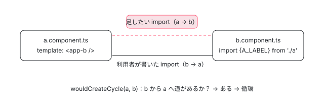

[目次](../README.md) › [ngtsc の内側](README.md) › 第 16 回 / 全 20 回

# import の循環：CycleAnalyzer と、スコープを外から設定する逃げ道

> ImportGraph がファイルの import をたどり（型だけの import は飛ばす）、CycleAnalyzer.wouldCreateCycle が「コンポーネントの依存を import すると循環になるか」を判定する行、循環になるときのコンポーネントの handler の 2 つの道（setComponentScope で外から設定する remote scoping、または NG3003 のエラー）。どちらになるかは利用者の設定ではなく compilationMode だけで決まり（partial なら Error）、standalone のコンポーネントは調べないこと。

angular/angular · 読了 約 12 分 · 発展 · [サイトで読む（デモが動きます）](https://angular-deep-dive-cyan.vercel.app/chapter/ngtsc-cycles)

---

NgModule に宣言したコンポーネントのテンプレートが別のコンポーネントを使うと、ngtsc はコンポーネントのファイルに `import` を**足し**ます（`dependencies: [i1.Other]`）。ところが相手のファイルがすでにこちらを import していたら、足した import で循環ができます。ngtsc はそれを作る前に見つけ、アプリなら `ɵɵsetComponentScope` で外から設定する逃げ道に回し、ライブラリなら NG3003 のエラーにします。この章では、ファイルの import をたどる `ImportGraph`、「この import を足すと循環になるか」を答える `CycleAnalyzer`、コンポーネントの handler の 2 つの選び方を行で確かめ、standalone のときにどうなるかまで見ます。

読む対象は `compiler-cli/src/ngtsc/cycles/src/` の `imports.ts`・`analyzer.ts`（2 ファイル・335 行の要所）、`annotations/component/src/handler.ts` の循環の扱い、spec の `cycles/test/` と `test/ngtsc/ngtsc_spec.ts` の describe `cycle detection` です。remote scoping の出力（NgModule のファイルに書かれる `ɵɵsetComponentScope` と、ランタイムの中身）は [ngmodule-compilation-scope](../ngmodule/04-ngmodule-compilation-scope.md) の 6 節で読んでいるので、ここではリンクにします。

1. [1. 全体像](01-ngtsc-overview.md)
2. [2. NgtscProgram](02-ngtsc-program.md)
3. [3. NgCompiler とチケット](03-ngtsc-compiler-ticket.md)
4. [4. リフレクション](04-ngtsc-reflection.md)
5. [5. 静的な評価](05-ngtsc-partial-evaluator.md)
6. [6. 参照と import](06-ngtsc-references-imports.md)
7. [7. 解析](07-ngtsc-trait-analyze.md)
8. [8. 解決と出力](08-ngtsc-trait-resolve-compile.md)
9. [9. @Directive の handler](09-ngtsc-directive-handler.md)
10. [10. メタデータの登録](10-ngtsc-metadata-registry.md)
11. [11. .d.ts を読む](11-ngtsc-dts-metadata.md)
12. [12. JS の書き換え](12-ngtsc-ivy-transform.md)
13. [13. .d.ts の書き換え](13-ngtsc-dts-transform.md)
14. [14. 差分ビルド](14-ngtsc-incremental.md)
15. [15. 意味のグラフ](15-ngtsc-semantic-graph.md)
16. **16. import の循環**（この章）
17. [17. HMR](17-ngtsc-hmr.md)
18. [18. 診断と性能](18-ngtsc-diagnostics-perf.md)
19. [19. テストを書く](19-ngtsc-test-env.md)
20. [20. issue と PR を読む](20-ngtsc-issues.md)

## 1. なぜ「足す import」が問題になるのか



*b.component.ts は a.component.ts の値を import している。A のテンプレートが &lt;app-b&gt; を使うので、ngtsc が a.component.ts に b への import を足すと、a → b → a の循環ができる*

利用者が書いた循環 import は、利用者の責任で動いたり動かなかったりします。しかし**コンパイラが足した import** で循環ができると、利用者のコードには循環が無いのに実行時に壊れる（あるいは Closure Compiler のような循環を許さない道具で失敗する）ことになります。だから ngtsc は「足す前に、足したら循環になるか」を調べます。

## 2. ImportGraph：ファイルが import しているファイル

📄 `angular/packages/compiler-cli/src/ngtsc/core/src/compiler.ts` L513–515 （▶ の行: 513–514）

```ts
513 ▶     this.cycleAnalyzer = new CycleAnalyzer(
514 ▶       new ImportGraph(inputProgram.getTypeChecker(), this.delegatingPerfRecorder),
515 │     );
```

`NgCompiler` のコンストラクタが、利用者のプログラムの型チェッカーから `ImportGraph` を作り、`CycleAnalyzer` に渡します（514 行目）。ビルドごとに 1 つです。

📄 `angular/packages/compiler-cli/src/ngtsc/cycles/src/imports.ts` L13–37 （▶ の行: 16–17, 20, 32–34, 36）

```ts
13 │ /**
14 │  * A cached graph of imports in the `ts.Program`.
15 │  *
16 ▶  * The `ImportGraph` keeps track of dependencies (imports) of individual `ts.SourceFile`s. Only
17 ▶  * dependencies within the same program are tracked; imports into packages on NPM are not.
18 │  */
19 │ export class ImportGraph {
20 ▶   private imports = new Map<ts.SourceFile, Set<ts.SourceFile>>();
21 │ 
22 │   constructor(
23 │     private checker: ts.TypeChecker,
24 │     private perf: PerfRecorder,
25 │   ) {}
26 │ 
27 │   /**
28 │    * List the direct (not transitive) imports of a given `ts.SourceFile`.
29 │    *
30 │    * This operation is cached.
31 │    */
32 ▶   importsOf(sf: ts.SourceFile): Set<ts.SourceFile> {
33 ▶     if (!this.imports.has(sf)) {
34 ▶       this.imports.set(sf, this.scanImports(sf));
35 │     }
36 ▶     return this.imports.get(sf)!;
37 │   }
```

📄 `angular/packages/compiler-cli/src/ngtsc/cycles/src/imports.ts` L87–123 （▶ の行: 88, 91–94, 99–102, 109–110, 114–115, 117）

```ts
 87 │   private scanImports(sf: ts.SourceFile): Set<ts.SourceFile> {
 88 ▶     return this.perf.inPhase(PerfPhase.CycleDetection, () => {
 89 │       const imports = new Set<ts.SourceFile>();
 90 │       // Look through the source file for import and export statements.
 91 ▶       for (const stmt of sf.statements) {
 92 ▶         if (
 93 ▶           (!ts.isImportDeclaration(stmt) && !ts.isExportDeclaration(stmt)) ||
 94 ▶           stmt.moduleSpecifier === undefined
 95 │         ) {
 96 │           continue;
 97 │         }
 98 │ 
 99 ▶         if (
100 ▶           ts.isImportDeclaration(stmt) &&
101 ▶           stmt.importClause !== undefined &&
102 ▶           isTypeOnlyImportClause(stmt.importClause)
103 │         ) {
104 │           // Exclude type-only imports as they are always elided, so they don't contribute to
105 │           // cycles.
106 │           continue;
107 │         }
108 │ 
109 ▶         const symbol = this.checker.getSymbolAtLocation(stmt.moduleSpecifier);
110 ▶         if (symbol === undefined || symbol.valueDeclaration === undefined) {
111 │           // No symbol could be found to skip over this import/export.
112 │           continue;
113 │         }
114 ▶         const moduleFile = symbol.valueDeclaration;
115 ▶         if (ts.isSourceFile(moduleFile) && isLocalFile(moduleFile)) {
116 │           // Record this local import.
117 ▶           imports.add(moduleFile);
118 │         }
119 │       }
120 │       return imports;
121 │     });
122 │   }
123 │ }
```

1. **32〜37 行目：問われたファイルだけ、1 回だけ調べる**

   最初に全部を調べるのではなく、`importsOf(sf)` が初めて呼ばれたときに 34 行目で調べ、20 行目の表に覚えます。調べる時間は 88 行目で perf の `CycleDetection` に入ります。
2. **91〜97 行目：import と export だけ**

   ファイルのトップレベルの文のうち、`import … from` と `export … from`（再 export）だけを見ます。再 export も、その先のファイルを読み込ませるからです。
3. **99〜107 行目：型だけの import は飛ばす**

   104〜105 行目のコメントのとおり、型だけの import は JS に残らない（elide される）ので、循環の原因になりません。判定は次の `isTypeOnlyImportClause`。
4. **109〜118 行目：同じプログラムの .ts だけ**

   モジュールの名前を型チェッカーでファイルに解決し、115 行目でそれが .d.ts でない（同じプログラムでコンパイルする .ts）ときだけ記録します。16〜17 行目のコメント「npm のパッケージへの import は追わない」。

📄 `angular/packages/compiler-cli/src/ngtsc/cycles/src/imports.ts` L125–145 （▶ の行: 126, 131, 136–139）

```ts
125 │ function isLocalFile(sf: ts.SourceFile): boolean {
126 ▶   return !sf.isDeclarationFile;
127 │ }
128 │ 
129 │ function isTypeOnlyImportClause(node: ts.ImportClause): boolean {
130 │   // The clause itself is type-only (e.g. `import type {foo} from '...'`).
131 ▶   if (node.phaseModifier === ts.SyntaxKind.TypeKeyword) {
132 │     return true;
133 │   }
134 │ 
135 │   // All the specifiers in the cause are type-only (e.g. `import {type a, type b} from '...'`).
136 ▶   if (
137 ▶     node.namedBindings !== undefined &&
138 ▶     ts.isNamedImports(node.namedBindings) &&
139 ▶     node.namedBindings.elements.every((specifier) => specifier.isTypeOnly)
140 │   ) {
141 │     return true;
142 │   }
143 │ 
144 │   return false;
145 │ }
```

131 行目が `import type {…}`、136〜141 行目が `import {type a, type b}`（すべての名前に `type` が付いている）です。131 行目は 2026-02 の e10a63453d4 で、TypeScript で非推奨になった `node.isTypeOnly` から `node.phaseModifier === ts.SyntaxKind.TypeKeyword` に書き換えられました（振る舞いは同じ。`git show` で読むと imports.ts は 1 行だけ）。`import {type a, b}` のように 1 つでも値の名前があれば、循環の原因として数えます。

## 3. CycleAnalyzer.wouldCreateCycle

📄 `angular/packages/compiler-cli/src/ngtsc/cycles/src/analyzer.ts` L16–54 （▶ の行: 23, 34, 36–37, 40–41, 50–52）

```ts
16 │ export class CycleAnalyzer {
17 │   /**
18 │    * Cycle detection is requested with the same `from` source file for all used directives and pipes
19 │    * within a component, which makes it beneficial to cache the results as long as the `from` source
20 │    * file has not changed. This avoids visiting the import graph that is reachable from multiple
21 │    * directives/pipes more than once.
22 │    */
23 ▶   private cachedResults: CycleResults | null = null;
24 │ 
25 │   constructor(private importGraph: ImportGraph) {}
26 │ 
27 │   /**
28 │    * Check for a cycle to be created in the `ts.Program` by adding an import between `from` and
29 │    * `to`.
30 │    *
31 │    * @returns a `Cycle` object if an import between `from` and `to` would create a cycle; `null`
32 │    *     otherwise.
33 │    */
34 ▶   wouldCreateCycle(from: ts.SourceFile, to: ts.SourceFile): Cycle | null {
35 │     // Try to reuse the cached results as long as the `from` source file is the same.
36 ▶     if (this.cachedResults === null || this.cachedResults.from !== from) {
37 ▶       this.cachedResults = new CycleResults(from, this.importGraph);
38 │     }
39 │ 
40 ▶     // Import of 'from' -> 'to' is illegal if an edge 'to' -> 'from' already exists.
41 ▶     return this.cachedResults.wouldBeCyclic(to) ? new Cycle(this.importGraph, from, to) : null;
42 │   }
43 │ 
44 │   /**
45 │    * Record a synthetic import from `from` to `to`.
46 │    *
47 │    * This is an import that doesn't exist in the `ts.Program` but will be considered as part of the
48 │    * import graph for cycle creation.
49 │    */
50 ▶   recordSyntheticImport(from: ts.SourceFile, to: ts.SourceFile): void {
51 ▶     this.cachedResults = null;
52 ▶     this.importGraph.addSyntheticImport(from, to);
53 │   }
54 │ }
```

📄 `angular/packages/compiler-cli/src/ngtsc/cycles/src/analyzer.ts` L69–103 （▶ の行: 70–71, 79, 85, 88, 93, 95–98, 102）

```ts
 69 │ class CycleResults {
 70 ▶   private readonly cyclic = {} as CyclicResultMarker;
 71 ▶   private readonly acyclic = {} as CyclicResultMarker;
 72 │ 
 73 │   constructor(
 74 │     readonly from: ts.SourceFile,
 75 │     private importGraph: ImportGraph,
 76 │   ) {}
 77 │ 
 78 │   wouldBeCyclic(sf: ts.SourceFile): boolean {
 79 ▶     const cached = this.getCachedResult(sf);
 80 │     if (cached !== null) {
 81 │       // The result for this source file has already been computed, so return its result.
 82 │       return cached;
 83 │     }
 84 │ 
 85 ▶     if (sf === this.from) {
 86 │       // We have reached the source file that we want to create an import from, which means that
 87 │       // doing so would create a cycle.
 88 ▶       return true;
 89 │     }
 90 │ 
 91 │     // Assume for now that the file will be acyclic; this prevents infinite recursion in the case
 92 │     // that `sf` is visited again as part of an existing cycle in the graph.
 93 ▶     this.markAcyclic(sf);
 94 │ 
 95 ▶     const imports = this.importGraph.importsOf(sf);
 96 ▶     for (const imported of imports) {
 97 ▶       if (this.wouldBeCyclic(imported)) {
 98 ▶         this.markCyclic(sf);
 99 │         return true;
100 │       }
101 │     }
102 ▶     return false;
103 │   }
```

1. **40〜41 行目：問いの言い換え**

   「`from` から `to` への import を足してよいか」は「`to` から import をたどって `from` に着くか」と同じです。着くなら `Cycle` を返します。
2. **85〜89 行目：from に着いたら循環**

   `wouldBeCyclic(sf)` は深さ優先で import をたどり、`from` に着けば真です。
3. **93 行目：先に「循環ではない」と印を付ける**

   91〜92 行目のコメントのとおり、すでにある循環（利用者が書いた a ↔ c など）の中を回り続けないための印です。95〜101 行目で import 先のどれかが真なら、98 行目で自分も「循環」に付け替えます。
4. **36〜38 行目：from が同じ間は結果を使い回す**

   18〜21 行目のコメントのとおり、1 つのコンポーネントの依存（ディレクティブや pipe）は全部同じ `from` で尋ねられます。だから「from が同じなら」の 1 つだけを覚えておけば、2 つめ以降の問いは印を見るだけで済みます。

📄 `angular/packages/compiler-cli/src/ngtsc/cycles/src/analyzer.ts` L105–129 （▶ の行: 110–111, 113, 116–117, 123, 127）

```ts
105 │   /**
106 │    * Returns whether the source file is already known to be cyclic, or `null` if the result is not
107 │    * yet known.
108 │    */
109 │   private getCachedResult(sf: CyclicSourceFile): boolean | null {
110 ▶     const result = sf[NgCyclicResult];
111 ▶     if (result === this.cyclic) {
112 │       return true;
113 ▶     } else if (result === this.acyclic) {
114 │       return false;
115 │     } else {
116 ▶       // Either the symbol is missing or its value does not correspond with one of the current
117 ▶       // result markers. As such, the result is unknown.
118 │       return null;
119 │     }
120 │   }
121 │ 
122 │   private markCyclic(sf: CyclicSourceFile): void {
123 ▶     sf[NgCyclicResult] = this.cyclic;
124 │   }
125 │ 
126 │   private markAcyclic(sf: CyclicSourceFile): void {
127 ▶     sf[NgCyclicResult] = this.acyclic;
128 │   }
129 │ }
```

印は `ts.SourceFile` に記号（`NgCyclicResult`）で直接付けます。値は 70〜71 行目の、その `CycleResults` だけが持つ空のオブジェクトで、111・113 行目は「自分の印か」をオブジェクトの同一性で見ます。116〜117 行目、前の `CycleResults` が付けた古い印は「分からない」になるので、消して回る必要がありません。63〜67 行目のコメント「大きなグラフでメモリを抑えるため」。

📄 `angular/packages/compiler-cli/src/ngtsc/cycles/src/analyzer.ts` L131–153 （▶ の行: 134–135, 150–151）

```ts
131 │ /**
132 │  * Represents an import cycle between `from` and `to` in the program.
133 │  *
134 ▶  * This class allows us to do the work to compute the cyclic path between `from` and `to` only if
135 ▶  * needed.
136 │  */
137 │ export class Cycle {
138 │   constructor(
139 │     private importGraph: ImportGraph,
140 │     readonly from: ts.SourceFile,
141 │     readonly to: ts.SourceFile,
142 │   ) {}
143 │ 
144 │   /**
145 │    * Compute an array of source-files that illustrates the cyclic path between `from` and `to`.
146 │    *
147 │    * Note that a `Cycle` will not be created unless a path is available between `to` and `from`,
148 │    * so `findPath()` will never return `null`.
149 │    */
150 ▶   getPath(): ts.SourceFile[] {
151 ▶     return [this.from, ...this.importGraph.findPath(this.to, this.from)!];
152 │   }
153 │ }
```

📄 `angular/packages/compiler-cli/src/ngtsc/cycles/src/imports.ts` L39–75 （▶ の行: 42–43, 56–57, 60–61, 65, 67）

```ts
39 │   /**
40 │    * Find an import path from the `start` SourceFile to the `end` SourceFile.
41 │    *
42 ▶    * This function implements a breadth first search that results in finding the
43 ▶    * shortest path between the `start` and `end` points.
44 │    *
45 │    * @param start the starting point of the path.
46 │    * @param end the ending point of the path.
47 │    * @returns an array of source files that connect the `start` and `end` source files, or `null` if
48 │    *     no path could be found.
49 │    */
50 │   findPath(start: ts.SourceFile, end: ts.SourceFile): ts.SourceFile[] | null {
51 │     if (start === end) {
52 │       // Escape early for the case where `start` and `end` are the same.
53 │       return [start];
54 │     }
55 │ 
56 ▶     const found = new Set<ts.SourceFile>([start]);
57 ▶     const queue: Found[] = [new Found(start, null)];
58 │ 
59 │     while (queue.length > 0) {
60 ▶       const current = queue.shift()!;
61 ▶       const imports = this.importsOf(current.sourceFile);
62 │       for (const importedFile of imports) {
63 │         if (!found.has(importedFile)) {
64 │           const next = new Found(importedFile, current);
65 ▶           if (next.sourceFile === end) {
66 │             // We have hit the target `end` path so we can stop here.
67 ▶             return next.toPath();
68 │           }
69 │           found.add(importedFile);
70 │           queue.push(next);
71 │         }
72 │       }
73 │     }
74 │     return null;
75 │   }
```

`Cycle` は循環の道をすぐには作りません。134〜135 行目のコメントのとおり、診断の文で道が要るときだけ `getPath()` が 151 行目で `findPath(to, from)` を呼びます。`findPath` は 42〜43 行目のとおり幅優先なので、いちばん短い道が出ます。NG3003 の関連メッセージの「a.component.ts -&gt; b.component.ts -&gt; a.component.ts」はこの配列です。

📄 `angular/packages/compiler-cli/src/ngtsc/cycles/src/imports.ts` L77–86 （▶ の行: 81–83）

```ts
77 │   /**
78 │    * Add a record of an import from `sf` to `imported`, that's not present in the original
79 │    * `ts.Program` but will be remembered by the `ImportGraph`.
80 │    */
81 ▶   addSyntheticImport(sf: ts.SourceFile, imported: ts.SourceFile): void {
82 ▶     if (isLocalFile(imported)) {
83 ▶       this.importsOf(sf).add(imported);
84 │     }
85 │   }
86 │ 
```

ngtsc が「この import を足す」と決めたら、それもグラフに入れます（83 行目）。3 節の 50〜53 行目の `recordSyntheticImport` がこれを呼び、51 行目でキャッシュを捨てます。これで、後から調べるコンポーネントが「前のコンポーネントのために足した import」で循環を作ることも防げます（6 節の spec）。

## 4. コンポーネントの handler：調べる・足す・逃げる

📄 `angular/packages/compiler-cli/src/ngtsc/annotations/component/src/handler.ts` L2100–2111 （▶ の行: 2100–2101, 2103–2104, 2111）

```ts
2100 ▶     const eagerDeclarations = Array.from(declarations.values()).filter((decl) => {
2101 ▶       return decl.kind === R3TemplateDependencyKind.NgModule || eagerlyUsed.has(decl.ref.node);
2102 │     });
2103 ▶     const cyclesFromDirectives = new Map<UsedDirective, Cycle>();
2104 ▶     const cyclesFromPipes = new Map<UsedPipe, Cycle>();
2105 │ 
2106 │     // Scan through the directives/pipes actually used in the template and check whether any
2107 │     // import which needs to be generated would create a cycle. This check is skipped for
2108 │     // standalone components as the dependencies of a standalone component have already been
2109 │     // imported directly by the user, so Angular won't introduce any imports that aren't already
2110 │     // in the user's program.
2111 ▶     if (!metadata.isStandalone) {
```

📄 `angular/packages/compiler-cli/src/ngtsc/annotations/component/src/handler.ts` L2415–2439 （▶ の行: 2420–2421, 2425, 2433, 2438）

```ts
2415 │   private _checkForCyclicImport(
2416 │     importedFile: ImportedFile,
2417 │     expr: o.Expression,
2418 │     origin: ts.SourceFile,
2419 │   ): Cycle | null {
2420 ▶     const imported = resolveImportedFile(this.moduleResolver, importedFile, expr, origin);
2421 ▶     if (imported === null) {
2422 │       return null;
2423 │     }
2424 │     // Check whether the import is legal.
2425 ▶     return this.cycleAnalyzer.wouldCreateCycle(origin, imported);
2426 │   }
2427 │ 
2428 │   private maybeRecordSyntheticImport(
2429 │     importedFile: ImportedFile,
2430 │     expr: o.Expression,
2431 │     origin: ts.SourceFile,
2432 │   ): void {
2433 ▶     const imported = resolveImportedFile(this.moduleResolver, importedFile, expr, origin);
2434 │     if (imported === null) {
2435 │       return;
2436 │     }
2437 │ 
2438 ▶     this.cycleAnalyzer.recordSyntheticImport(origin, imported);
2439 │   }
```

resolve の中の `handleDependencyCycles` です。2100〜2102 行目、テンプレートで本当に使うもの（と NgModule）だけが対象です。2111 行目の条件の中で（このループの本体は [ngmodule-compilation-scope](../ngmodule/04-ngmodule-compilation-scope.md) の 6 節に引用）、依存ごとに `_checkForCyclicImport` を呼び、循環なら 2103〜2104 行目の表に入れます。2420 行目でその依存の式を「どのファイルを import することになるか」に直し、2425 行目で 3 節の `wouldCreateCycle(origin, imported)` に尋ねます。2421 行目、ファイルが分からない（外のパッケージ）なら調べません。

📄 `angular/packages/compiler-cli/src/ngtsc/annotations/component/src/handler.ts` L2134–2140 （▶ の行: 2134–2135, 2138–2139）

```ts
2134 ▶     const cycleDetected = cyclesFromDirectives.size !== 0 || cyclesFromPipes.size !== 0;
2135 ▶     if (!cycleDetected) {
2136 │       // No cycle was detected. Record the imports that need to be created in the cycle detector
2137 │       // so that future cyclic import checks consider their production.
2138 ▶       for (const {type, importedFile} of eagerDeclarations) {
2139 ▶         this.maybeRecordSyntheticImport(importedFile, type, context);
2140 │       }
```

2134〜2139 行目、循環が 1 つも無ければ、足すことになる import を全部 2433〜2438 行目の道でグラフに記録します。そのあと `dependencies` に依存を並べる処理が続きます（第 12 回の JS の出力）。

### 循環があった：2 つの選び方

📄 `angular/packages/compiler-cli/src/ngtsc/core/src/compiler.ts` L1465–1471 （▶ の行: 1466–1467, 1469–1471）

```ts
1465 │     // Cycles are handled in full and local compilation modes by "remote scoping".
1466 ▶     // "Remote scoping" does not work well with tree shaking for libraries.
1467 ▶     // So in partial compilation mode, when building a library, a cycle will cause an error.
1468 │     const cycleHandlingStrategy =
1469 ▶       compilationMode === CompilationMode.PARTIAL
1470 ▶         ? CycleHandlingStrategy.Error
1471 ▶         : CycleHandlingStrategy.UseRemoteScoping;
```

📄 `angular/packages/compiler-cli/src/ngtsc/cycles/src/analyzer.ts` L155–163 （▶ の行: 160, 162）

```ts
155 │ /**
156 │  * What to do if a cycle is detected.
157 │  */
158 │ export const enum CycleHandlingStrategy {
159 │   /** Add "remote scoping" code to avoid creating a cycle. */
160 ▶   UseRemoteScoping,
161 │   /** Fail the compilation with an error. */
162 ▶   Error,
163 │ }
```

選び方は利用者の設定ではなく、`compilationMode` だけで決まります。1469〜1471 行目、partial（ライブラリ）なら `Error`、それ以外（full と local）なら `UseRemoteScoping`。1466〜1467 行目のコメント「remote scoping はライブラリの tree shaking と相性が悪い」。`CycleHandlingStrategy` を変える公開の設定はありません。

📄 `angular/packages/compiler-cli/src/ngtsc/annotations/component/src/handler.ts` L2183–2207 （▶ の行: 2184, 2189, 2195–2196, 2199, 2206）

```ts
2183 │       // NgModule file will take care of setting the directives for the component.
2184 ▶       this.scopeRegistry.setComponentRemoteScope(
2185 │         node,
2186 │         eagerDeclarations.filter(isUsedDirective).map((dir) => dir.ref),
2187 │         eagerDeclarations.filter(isUsedPipe).map((pipe) => pipe.ref),
2188 │       );
2189 ▶       symbol.isRemotelyScoped = true;
2190 │ 
2191 │       // If a semantic graph is being tracked, record the fact that this component is remotely
2192 │       // scoped with the declaring NgModule symbol as the NgModule's emit becomes dependent on
2193 │       // the directive/pipe usages of this component.
2194 │       if (
2195 ▶         this.semanticDepGraphUpdater !== null &&
2196 ▶         scope.kind === ComponentScopeKind.NgModule &&
2197 │         scope.ngModule !== null
2198 │       ) {
2199 ▶         const moduleSymbol = this.semanticDepGraphUpdater.getSymbol(scope.ngModule);
2200 │         if (!(moduleSymbol instanceof NgModuleSymbol)) {
2201 │           throw new Error(
2202 │             `AssertionError: Expected ${scope.ngModule.name} to be an NgModuleSymbol.`,
2203 │           );
2204 │         }
2205 │ 
2206 ▶         moduleSymbol.addRemotelyScopedComponent(symbol, symbol.usedDirectives, symbol.usedPipes);
2207 │       }
```

1. **2184〜2189 行目：UseRemoteScoping**

   スコープのレジストリに「このコンポーネントのディレクティブと pipe は NgModule のファイルから設定する」と登録し、記号に `isRemotelyScoped` を立てます。NgModule の compileFull がこれを見て `ɵɵsetComponentScope(…)` の文を足すところは [ngmodule-compilation-scope](../ngmodule/04-ngmodule-compilation-scope.md) の 6 節です。NgModule のファイルは宣言をすべて import しているので、そこから参照しても新しい循環はできません。
2. **2194〜2206 行目：意味のグラフに知らせる**

   NgModule の emit がこのコンポーネントの依存に左右されるようになるので、NgModule の記号に登録します（[第 15 回](15-ngtsc-semantic-graph.md)の 8 節）。

📄 `angular/packages/compiler-cli/src/ngtsc/annotations/component/src/handler.ts` L2208–2227 （▶ の行: 2209, 2211, 2213, 2216–2217, 2219–2220, 2222）

```ts
2208 │     } else {
2209 ▶       // We are not able to handle this cycle so throw an error.
2210 │       const relatedMessages: ts.DiagnosticRelatedInformation[] = [];
2211 ▶       for (const [dir, cycle] of cyclesFromDirectives) {
2212 │         relatedMessages.push(
2213 ▶           makeCyclicImportInfo(dir.ref, dir.isComponent ? 'component' : 'directive', cycle),
2214 │         );
2215 │       }
2216 ▶       for (const [pipe, cycle] of cyclesFromPipes) {
2217 ▶         relatedMessages.push(makeCyclicImportInfo(pipe.ref, 'pipe', cycle));
2218 │       }
2219 ▶       throw new FatalDiagnosticError(
2220 ▶         ErrorCode.IMPORT_CYCLE_DETECTED,
2221 │         node,
2222 ▶         'One or more import cycles would need to be created to compile this component, ' +
2223 │           'which is not supported by the current compiler configuration.',
2224 │         relatedMessages,
2225 │       );
2226 │     }
2227 │   }
```

📄 `angular/packages/compiler-cli/src/ngtsc/annotations/component/src/diagnostics.ts` L18–30 （▶ の行: 24–28）

```ts
18 │ export function makeCyclicImportInfo(
19 │   ref: Reference,
20 │   type: string,
21 │   cycle: Cycle,
22 │ ): ts.DiagnosticRelatedInformation {
23 │   const name = ref.debugName || '(unknown)';
24 ▶   const path = cycle
25 ▶     .getPath()
26 ▶     .map((sf) => sf.fileName)
27 ▶     .join(' -> ');
28 ▶   const message = `The ${type} '${name}' is used in the template but importing it would create a cycle: `;
29 │   return makeRelatedInformation(ref.node, message + path);
30 │ }
```

`Error` のときは 2219〜2225 行目で `FatalDiagnosticError`（`IMPORT_CYCLE_DETECTED`、NG3003）を投げます。2211〜2218 行目、循環になる依存ごとに関連メッセージを作り、24〜27 行目で 3 節の `getPath()` のファイル名を `->` でつなぎます。resolve で投げたエラーはそのクラスの resolve の診断になり、そのクラスは compile されません（[第 8 回](08-ngtsc-trait-resolve-compile.md)）。

> [!WARNING]
> **ハマりどころ**
>
> remote scoping は「動くけれど遅い・大きい」逃げ道です。`ɵɵsetComponentScope` は NgModule のファイルの末尾の文として残り、そのコンポーネントの依存を tree shaking で落とせなくなります（#38211 の本文の例は RouterModule の `routerLinkActive`）。そしてアプリのビルドでは何も知らされません。出力に `setComponentScope` が出ていないかを、ときどき grep で確かめる価値があります。

## 5. standalone のときは調べない

4 節の 2111 行目の `if (!metadata.isStandalone)` のとおり、standalone のコンポーネントは循環を調べません。条件の直前のコメント（ngmodule-compilation-scope の 6 節に引用）は「standalone の依存は利用者がすでに直接 import しているので、Angular が新しい import を足すことはない」と説明しています。コンパイラが足さないなら、コンパイラが作る循環もない、という理屈です。

では利用者が書いた循環はどうなるか。デモの「standalone 同士」は A が `imports: [forwardRef(() => BComponent)]`、B が `imports: [AComponent]` で、ngtsc は診断を 1 つも出さずに emit しました。出力の `a.component.js` は `dependencies: () => [BComponent]`（forwardRef があるので関数で包む。[standalone-forward-ref](../standalone/05-standalone-forward-ref.md)）、`b.component.js` は `dependencies: [AComponent]` です。記録した 2 つの .js を手元の Node で読み込んで確かめると（相対パスに `.js` を付けただけで実行）、`a.component.js` から読むと `ReferenceError: Cannot access 'AComponent' before initialization`、`b.component.js` から読むとエラーなしでした。これが開いている issue #48976（2023-02、「standalone の循環を build のときに知らせてほしい」）の症状で、いまのソースでは 2111 行目のとおり ngtsc は知らせません。

## 6. デモ：full と partial、standalone

> **🧪 記録の再生：互いを使う 2 つのコンポーネントを emit する**
>
> これは記録です。@angular/compiler-cli 22.1.6 を Node で動かした結果（TypeScript 6.0.3）。`NgtscProgram` の診断と、解析が終わったあとの `ImportGraph`（private の `compiler.cycleAnalyzer.importGraph` の `importsOf`）、`writeFile` に来た .js を保存しました。.js では import の行・`dependencies`・`setComponentScope` の行を強調しています。
>
> ▶ [このデモはサイトで動かせます](https://angular-deep-dive-cyan.vercel.app/chapter/ngtsc-cycles)

- **NgModule・full**：`a.component.js` に `dependencies` も b への import も無く、`cycle.module.js` の最後に `i0.ɵɵsetComponentScope(AComponent, [BComponent], []);` が 1 行足されています。ImportGraph は利用者の import だけ（b → a）です。
- **NgModule・partial**：NG3003（`-993003` は ngtsc の診断コードの表し方。[第 18 回](18-ngtsc-diagnostics-perf.md)）と、関連メッセージ「a.component.ts -&gt; b.component.ts -&gt; a.component.ts」。`a.component.js` は Angular の変換を受けずにデコレーターのまま出ています（`noEmitOnError` が既定の false なので emit 自体は止まらない）。
- **b の import を import type に**：2 節の 99〜107 行目で b → a の辺が消えるので循環にならず、`a.component.js` に `import * as i1 from "./b.component"` と `dependencies: [i1.BComponent]` が足されます。ImportGraph の a → b は、4 節の 2138〜2139 行目が記録した「足した import」です。
- **standalone 同士**：診断なし。ImportGraph は利用者の import どうしで a ↔ b。5 節のとおり調べていません。

## ここまでの呼び出し

- `new NgCompiler(...)` — core/src/compiler.ts — *513〜515 行目 new CycleAnalyzer(new ImportGraph(checker, perf))*
- `makeCompilation()` — core/src/compiler.ts — *1468〜1471 行目 cycleHandlingStrategy を compilationMode で決めて handler に渡す*
- `ComponentDecoratorHandler.resolve` → `handleDependencyCycles` — annotations/component/src/handler.ts — *standalone なら 2111 行目で調べない*
  - `_checkForCyclicImport(importedFile, expr, origin)` — annotations/component/src/handler.ts — *2425 行目*
    - `CycleAnalyzer.wouldCreateCycle(from, to)` — cycles/src/analyzer.ts — *CycleResults.wouldBeCyclic → ImportGraph.importsOf → scanImports*
  - `maybeRecordSyntheticImport` → `recordSyntheticImport` — handler.ts / analyzer.ts — *循環が無ければ、足す import をグラフに入れる*
  - `setComponentRemoteScope(...)` または `throw FatalDiagnosticError(IMPORT_CYCLE_DETECTED)` — annotations/component/src/handler.ts — *UseRemoteScoping / Error*

## テストと直し方

### spec と describe

| spec | describe / it | 確かめていること |
| --- | --- | --- |
| cycles/test/analyzer\_spec.ts | describe `cycle analyzer`（L17、it 7）。`should detect a cycle caused by a synthetic edge`（L79）・`should not consider type-only imports`（L90）など | 3 節の wouldCreateCycle・recordSyntheticImport、2 節の型だけの import |
| cycles/test/imports\_spec.ts | describe `ImportGraph`（L16）の `importsOf()`・`findPath()`（it 3） | 2 節、3 節の findPath |
| test/ngtsc/ngtsc\_spec.ts | describe `cycle detection`（L6949、it 7）。`should detect a cycle added entirely during compilation`（L6993）・`should not consider type-only import clauses during cycle detection`（L7081）・`should detect a simple cycle and fatally error if doing partial-compilation`（L7237）など | 4 節の handler の道を端から端まで |
| test/ngtsc/incremental\_semantic\_changes\_spec.ts | describe `remote scoping`（L1889） | 差分ビルドで循環が増えた・消えたとき（第 15 回） |

📄 `angular/packages/compiler-cli/src/ngtsc/cycles/test/util.ts` L14–36 （▶ の行: 21, 28, 35）

```ts
14 │ /**
15 │  * Construct a TS program consisting solely of an import graph, from a string-based representation
16 │  * of the graph.
17 │  *
18 │  * The `graph` string consists of semicolon separated files, where each file is specified
19 │  * as a name and (optionally) a list of comma-separated imports or exports. For example:
20 │  *
21 ▶  * "a:b,c;b;c"
22 │  *
23 │  * specifies a program with three files (a.ts, b.ts, c.ts) where a.ts imports from both b.ts and
24 │  * c.ts.
25 │  *
26 │  * A more complicated example has a dependency from b.ts to c.ts: "a:b,c;b:c;c".
27 │  *
28 ▶  * A * preceding a file name in the list of imports indicates that the dependency should be an
29 │  * "export" and not an "import" dependency. For example:
30 │  *
31 │  * "a:*b,c;b;c"
32 │  *
33 │  * represents a program where a.ts exports from b.ts and imports from c.ts.
34 │  *
35 ▶  * An import can be suffixed with ! to make it a type-only import.
36 │  */
```

📄 `angular/packages/compiler-cli/src/ngtsc/cycles/test/analyzer_spec.ts` L79–99 （▶ の行: 80, 83–85, 87, 91, 95–96, 98）

```ts
79 │     it('should detect a cycle caused by a synthetic edge', () => {
80 ▶       const {program, analyzer} = makeAnalyzer('a:b,c;b;c');
81 │       const b = getSourceFileOrError(program, _('/b.ts'));
82 │       const c = getSourceFileOrError(program, _('/c.ts'));
83 ▶       expect(analyzer.wouldCreateCycle(b, c)).toBe(null);
84 ▶       analyzer.recordSyntheticImport(c, b);
85 ▶       const cycle = analyzer.wouldCreateCycle(b, c);
86 │       expect(cycle).toBeInstanceOf(Cycle);
87 ▶       expect(importPath(cycle!.getPath())).toEqual('b,c,b');
88 │     });
89 │ 
90 │     it('should not consider type-only imports', () => {
91 ▶       const {program, analyzer} = makeAnalyzer('a:b,c!;b;c');
92 │       const a = getSourceFileOrError(program, _('/a.ts'));
93 │       const b = getSourceFileOrError(program, _('/b.ts'));
94 │       const c = getSourceFileOrError(program, _('/c.ts'));
95 ▶       expect(analyzer.wouldCreateCycle(c, a)).toBe(null);
96 ▶       const cycle = analyzer.wouldCreateCycle(b, a);
97 │       expect(cycle).toBeInstanceOf(Cycle);
98 ▶       expect(importPath(cycle!.getPath())).toEqual('b,a,b');
99 │     });
```

単体の spec はグラフを文字列で書きます。21 行目の `a:b,c;b;c` は「a は b と c を import、b と c は何も import しない」、28 行目の `*` は再 export、35 行目の `!` は型だけの import です。83 行目で b → c を足しても循環ではないことを見てから、84 行目で c → b の足した import を記録すると、85〜87 行目で b → c が循環（道は b,c,b）になります。91 行目の `c!` は a から c への型だけの import なので、95 行目で c → a は循環になりません。

📄 `angular/packages/compiler-cli/test/ngtsc/ngtsc_spec.ts` L7005–7036 （▶ の行: 7012, 7025, 7031, 7034–7035）

```ts
7005 │         env.write(
7006 │           'a.ts',
7007 │           `
7008 │         import {Component} from '@angular/core';
7009 │ 
7010 │         @Component({
7011 │           selector: 'a-cmp',
7012 ▶           template: '<b-cmp></b-cmp>',
7013 │           standalone: false,
7014 │         })
7015 │         export class ACmp {}
7016 │       `,
7017 │         );
7018 │         env.write(
7019 │           'b.ts',
7020 │           `
7021 │         import {Component} from '@angular/core';
7022 │ 
7023 │         @Component({
7024 │           selector: 'b-cmp',
7025 ▶           template: '<a-cmp></a-cmp>',
7026 │           standalone: false,
7027 │         })
7028 │         export class BCmp {}
7029 │       `,
7030 │         );
7031 ▶         env.driveMain();
7032 │         const aJsContents = env.getContents('a.js');
7033 │         const bJsContents = env.getContents('b.js');
7034 ▶         expect(aJsContents).toMatch(/import \* as i\d? from ".\/b"/);
7035 ▶         expect(bJsContents).not.toMatch(/import \* as i\d? from ".\/a"/);
7036 │       });
```

結合テストの「コンパイル中にだけできる循環」です。a も b も互いを import していませんが、7012 行目と 7025 行目でテンプレートが互いを使います。先に調べた A は循環が無いので b への import を足し（7034 行目）、それを 3 節の 83 行目でグラフに入れるので、後から調べた B は a への import を足せず remote scoping になります（7035 行目）。

📄 `angular/packages/compiler-cli/test/ngtsc/ngtsc_spec.ts` L7237–7260 （▶ の行: 7238–7239, 7246, 7256）

```ts
7237 │       it('should detect a simple cycle and fatally error if doing partial-compilation', () => {
7238 ▶         env.tsconfig({
7239 ▶           compilationMode: 'partial',
7240 │         });
7241 │ 
7242 │         env.write(
7243 │           'test.ts',
7244 │           `
7245 │         import {Component, NgModule} from '@angular/core';
7246 ▶         import {NormalComponent} from './cyclic';
7247 │ 
7248 │         @Component({
7249 │           selector: 'cyclic-component',
7250 │           template: 'Importing this causes a cycle',
7251 │           standalone: false,
7252 │         })
7253 │         export class CyclicComponent {}
7254 │ 
7255 │         @NgModule({
7256 ▶           declarations: [NormalComponent, CyclicComponent],
7257 │         })
7258 │         export class Module {}
7259 │       `,
7260 │         );
```

📄 `angular/packages/compiler-cli/test/ngtsc/ngtsc_spec.ts` L7276–7289 （▶ の行: 7277, 7279, 7284–7287）

```ts
7276 │         const diagnostics = env.driveDiagnostics();
7277 ▶         expect(diagnostics.length).toEqual(1);
7278 │         const error = diagnostics[0];
7279 ▶         expect(error.code).toBe(ngErrorCode(ErrorCode.IMPORT_CYCLE_DETECTED));
7280 │         expect(error.messageText).toMatch(
7281 │           /One or more import cycles would need to be created to compile this component, which is not supported by the current compiler configuration\. Find more at .*/,
7282 │         );
7283 │         const _abs = absoluteFrom;
7284 ▶         expect(error.relatedInformation?.map((diag) => diag.messageText)).toEqual([
7285 ▶           `The component 'CyclicComponent' is used in the template ` +
7286 ▶             `but importing it would create a cycle: ` +
7287 ▶             `${_abs('/cyclic.ts')} -> ${_abs('/test.ts')} -> ${_abs('/cyclic.ts')}`,
7288 │         ]);
7289 │       });
```

7238〜7240 行目で partial にし、7279 行目で NG3003、7284〜7288 行目で関連メッセージの文と道（4 節の 24〜28 行目の形）を文字列で確かめます。

### 手元で走らせた結果

📄 `ターミナル（../angular で）`

```
pnpm bazel test //packages/compiler-cli/src/ngtsc/cycles/test:test --nocache_test_results --test_output=all

pnpm bazel test //packages/compiler-cli/test/ngtsc:ngtsc --nocache_test_results --test_output=all \
  '--test_arg=--filter=cycle detection'
```

📄 `出力（2026-11-05 に実行。抜粋。ログは scratchpad/ngtsc-logs/d-unit.log・d-ngtsc-cycledetection.log）`

```
# cycles/test（incremental・transform と同時に 3 つ）
40 specs, 0 failures
//packages/compiler-cli/src/ngtsc/cycles/test:test   PASSED in 0.4s

# cycle detection（ngtsc_spec.ts）
Ran 7 of 6733 specs / Ran 8 of 6734 specs / Ran 6 of 6732 specs / Ran 7 of 6733 specs
//packages/compiler-cli/test/ngtsc:ngtsc   PASSED in 2.4s
```

- 単体の 40 specs は、analyzer\_spec の 7 と imports\_spec の 3 を足した 10 個の it × 4 つのファイルシステムです。
- `cycle detection` は it 7 × 4 = 28 回で、shard ごとに 7・8・6・7 と偏りました。`ngtsc_spec.ts` は it が多く、ファイルシステムごとの塊の中でこの describe の始まる通し番号が 4 で割った余りでばらばらになるからです。

### 直すとしたら

- 循環の判定そのものは `cycles/src/imports.ts` の `scanImports`・`isTypeOnlyImportClause` と `analyzer.ts` の `CycleResults`、どちらの道に回すかは handler の `handleDependencyCycles`（4 節）です。spec は前者なら `cycles/test/` に文字列のグラフで、後者なら `ngtsc_spec.ts` の describe `cycle detection` に足します。
- 開いている issue #38211（2020-07、「setComponentScope が要るときに警告かエラーを」、P4・feature: in backlog）：2021-09 の petebacondarwin さんのコメント「ライブラリのビルドではすでにエラー。アプリでは警告もエラーも出ない」は、いまのソースの 1469〜1471 行目と同じです。同じ作者の PR #38210（循環を表示する）は 2021-04 にマージされずに閉じています。
- 開いている issue #48976（2023-02、standalone の循環）：5 節のとおり 2111 行目で調べていないので、いまも build では知らせません。この issue に紐づく PR は `gh pr list --search 48976` では見つかりませんでした。
- どちらも「振る舞いを変える」機能の要望で、設計の判断が要ります。issue を読むときは、この章の 1469〜1471 行目と 2111 行目を手がかりに「いまどこで判断しているか」を押さえるところまでにします。本家に PR を出すことは勧めません（[第 20 回](20-ngtsc-issues.md)）。

## 聞かれそうな質問

**Q. setComponentScope が出ているかは、どうやって知りますか？**

アプリのビルドでは何も知らされません（#38211）。出力の NgModule のファイルに `ɵɵsetComponentScope(` があるかを見るか、同じソースを `compilationMode: 'partial'` でビルドして NG3003 が出るかを見ます。partial では 1469〜1471 行目で Error に回るので、関連メッセージに循環の道が出ます。

**Q. import type にすれば循環は解消しますか？**

ngtsc の判定では解消します。2 節の 99〜107 行目で型だけの import は辺にならないからです。ただし `import {type A, B}` のように値の名前が 1 つでも混ざると、136〜141 行目の条件を満たさず辺のままです。

**Q. standalone コンポーネント同士の循環は、なぜ NG3003 になりませんか？**

4 節の 2111 行目で standalone は調べないからです。依存は利用者の `imports` にすでに書かれていて、コンパイラが新しい import を足さないためです。利用者が書いた循環で実行時に ReferenceError になることは、5 節のとおり起こりえます（#48976）。

**Q. 循環を探すのは、全ファイルの import を最初に読むのですか？**

いいえ。`importsOf` が初めて尋ねられたファイルだけを読み（2 節の 32〜37 行目）、同じ `from` の問いの間は 3 節の印で結果を使い回します。ただし standalone のコンポーネントでも、循環の検査は飛ばす一方で、足す import の記録（4 節の 2138〜2139 行目）は行うので、そのコンポーネントのファイルの import は読まれます。

**Q. 2 つのコンポーネントのどちらが remote scoping になりますか？**

先に resolve されたほうが import を足し、それが 3 節の 83 行目でグラフに入るので、後のほうが循環になります（spec の 7034〜7035 行目）。デモの NgModule の場面では、利用者の import が b → a なので、a に b への import を足せない A のほうが remote scoping になりました。

## 読み終えて

- `ImportGraph` は同じプログラムの .ts の import と再 export だけを、問われたときに 1 回だけ読む。型だけの import は辺にしない。
- `CycleAnalyzer.wouldCreateCycle(from, to)` は「to から from に着くか」を、ファイルに付ける印で使い回しながら調べる。足すと決めた import も `recordSyntheticImport` でグラフに入る。
- 循環があったときの道は `compilationMode` だけで決まる。full・local は `ɵɵsetComponentScope` の remote scoping、partial は NG3003。
- standalone のコンポーネントは調べない。利用者の書いた循環は、実行時の ReferenceError として現れうる（#48976）。

---

← 前: [意味のグラフ：公開の形が変わったときだけ作り直す](15-ngtsc-semantic-graph.md)  
次: [HMR の更新モジュール：コンポーネントだけを差し替える関数を作る](17-ngtsc-hmr.md) →
