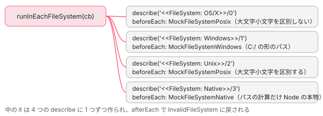

[目次](../README.md) › [ngtsc の内側](README.md) › 第 19 回 / 全 20 回

# ngtsc のテストを書く：NgtscTestEnvironment と runInEachFileSystem

> packages/compiler-cli/test/ngtsc の NgtscTestEnvironment（setup・write・driveMain・driveDiagnostics・getContents・enableMultipleCompilations）と、偽のファイルシステムで同じ spec を OS ごとに走らせる runInEachFileSystem、fake\_common（偽の @angular/common）、src/ngtsc の各ディレクトリの単体テストの makeProgram。ngtsc の不具合を spec の形で再現するときの手順。

angular/angular · 読了 約 13 分 · 中核 · [サイトで読む（デモが動きます）](https://angular-deep-dive-cyan.vercel.app/chapter/ngtsc-test-env)

---

ngtsc の不具合を確かめる一番の近道は、本家と同じ形の spec を 1 つ書くことです。`packages/compiler-cli/test/ngtsc/` の結合テストは、どれも `NgtscTestEnvironment`（以下 env）に入力のファイルを `write` し、`driveMain` か `driveDiagnostics` でコンパイラを最後まで走らせ、`getContents` で出力の JS を読みます。この章では、env がメモリの上の偽のファイルシステムに何を書き、どうやって本物の `ngc` の `main()` を呼ぶのか、同じ spec を 4 つのファイルシステムで回す `runInEachFileSystem`、単体テストの `makeProgram` を順に読み、最後に新しい spec を書く手順をまとめます。

読む対象は `packages/compiler-cli/test/ngtsc/env.ts`（490 行）・`packages/compiler-cli/src/ngtsc/file_system/testing/src/test_helper.ts`（189 行）・`packages/compiler-cli/src/ngtsc/testing/src/` の `mock_file_loading.ts`・`utils.ts`・`compiler_host.ts`・`runfile_helpers.ts`、`testing/fake_common/index.ts` です。bazel のテストの走らせ方そのものは [contrib-run-tests](../contrib/05-contrib-run-tests.md)、spec の読み方は [contrib-reading-specs](../contrib/06-contrib-reading-specs.md)、spec を足して壊して戻す練習は [contrib-writing-a-test](../contrib/07-contrib-writing-a-test.md) で読みました。

1. [1. 全体像](01-ngtsc-overview.md)
2. [2. NgtscProgram](02-ngtsc-program.md)
3. [3. NgCompiler とチケット](03-ngtsc-compiler-ticket.md)
4. [4. リフレクション](04-ngtsc-reflection.md)
5. [5. 静的な評価](05-ngtsc-partial-evaluator.md)
6. [6. 参照と import](06-ngtsc-references-imports.md)
7. [7. 解析](07-ngtsc-trait-analyze.md)
8. [8. 解決と出力](08-ngtsc-trait-resolve-compile.md)
9. [9. @Directive の handler](09-ngtsc-directive-handler.md)
10. [10. メタデータの登録](10-ngtsc-metadata-registry.md)
11. [11. .d.ts を読む](11-ngtsc-dts-metadata.md)
12. [12. JS の書き換え](12-ngtsc-ivy-transform.md)
13. [13. .d.ts の書き換え](13-ngtsc-dts-transform.md)
14. [14. 差分ビルド](14-ngtsc-incremental.md)
15. [15. 意味のグラフ](15-ngtsc-semantic-graph.md)
16. [16. import の循環](16-ngtsc-cycles.md)
17. [17. HMR](17-ngtsc-hmr.md)
18. [18. 診断と性能](18-ngtsc-diagnostics-perf.md)
19. **19. テストを書く**（この章）
20. [20. issue と PR を読む](20-ngtsc-issues.md)

## 1. 1 本の spec の形

📄 `angular/packages/compiler-cli/test/ngtsc/ngtsc_spec.ts` L57–93 （▶ の行: 57, 63–64, 68–69, 73–75, 89, 91–92）

```ts
57 ▶ const testFiles = loadStandardTestFiles();
58 │ 
59 │ function getDiagnosticSourceCode(diag: ts.Diagnostic): string {
60 │   return diag.file!.text.slice(diag.start!, diag.start! + diag.length!);
61 │ }
62 │ 
63 ▶ runInEachFileSystem((os: string) => {
64 ▶   describe('ngtsc behavioral tests', () => {
65 │     let env!: NgtscTestEnvironment;
66 │ 
67 │     beforeEach(() => {
68 ▶       env = NgtscTestEnvironment.setup(testFiles);
69 ▶       env.tsconfig();
70 │     });
71 │ 
72 │     it('should accept relative file paths as command line argument', () => {
73 ▶       env.addCommandLineArgs('--rootDir', './rootDir');
74 ▶       env.write('rootDir/test.html', '<p>Hello World</p>');
75 ▶       env.write(
76 │         'rootDir/test.ts',
77 │         `
78 │         import {Component} from '@angular/core';
79 │ 
80 │         @Component({
81 │           selector: 'test-cmp',
82 │           templateUrl: 'test.html',
83 │           standalone: false,
84 │         })
85 │         export class TestCmp {}
86 │     `,
87 │       );
88 │ 
89 ▶       env.driveMain();
90 │ 
91 ▶       const jsContents = env.getContents('test.js');
92 ▶       expect(jsContents).toContain('Hello World');
93 │     });
```

1. **57 行目：本物のパッケージを 1 回だけ読む**

   `loadStandardTestFiles()` は、bazel が用意した `@angular/core` などの配布物と TypeScript を、ファイルシステムの形のオブジェクト（`Folder`）に読み込みます（3 節）。spec のファイルの一番上で 1 回だけ呼びます。
2. **63 行目：4 つのファイルシステムで包む**

   `runInEachFileSystem` の中に書いた describe は、OS/X・Windows・Unix・Native の 4 回ぶん作られます（2 節）。
3. **68〜69 行目：毎回まっさらな env**

   `beforeEach` で `setup(testFiles)` と `tsconfig()`。it ごとに新しいメモリのファイルシステムです（4 節）。
4. **73〜87 行目：入力を書く**

   73 行目の `addCommandLineArgs` は `ngc` のコマンドラインに足す引数、74〜75 行目の `write` は相対パスで `/` の下に書きます。
5. **89〜92 行目：走らせて、出力を読む**

   `driveMain()` は本物の `main()` を呼び、エラーが無いことまで確かめます（5 節）。`getContents('test.js')` は出力のディレクトリ（`/built`）から読みます。

📄 `angular/packages/compiler-cli/test/ngtsc/BUILD.bazel` L28–39 （▶ の行: 31, 34–36, 38）

```python
28 │ jasmine_test(
29 │     name = "ngtsc",
30 │     timeout = "long",
31 ▶     data = [
32 │         ":ngtsc_lib",
33 │         "//:node_modules/yargs",
34 ▶         "//packages/compiler-cli/src/ngtsc/testing/fake_common:npm_package",
35 ▶         "//packages/core:npm_package",
36 ▶         "//packages/forms:npm_package",
37 │     ],
38 ▶     shard_count = 4,
39 │ )
```

34〜36 行目、bazel のテストの `data` に、`fake_common` と `@angular/core`・`@angular/forms` の `npm_package`（ビルドした配布物）が入っています。spec が使う `@angular/core` は、*手元の木から作った本物*です。38 行目の `shard_count = 4` は、spec を 4 つのプロセスに分けて走らせる数です（7 節）。

## 2. runInEachFileSystem：同じ spec を 4 つのファイルシステムで



*runInEachFileSystem(cb) は cb を 4 回呼び、それぞれを別の describe と beforeEach で包む*

📄 `angular/packages/compiler-cli/src/ngtsc/file_system/testing/src/test_helper.ts` L38–42 （▶ の行: 38, 41）

```ts
38 ▶ const FS_ALL = [FS_OS_X, FS_WINDOWS, FS_UNIX, FS_NATIVE];
39 │ 
40 │ function runInEachFileSystemFn(callback: (os: string) => void) {
41 ▶   FS_ALL.forEach((os) => runInFileSystem(os, callback, false));
42 │ }
```

📄 `angular/packages/compiler-cli/src/ngtsc/file_system/testing/src/test_helper.ts` L48–58 （▶ の行: 49–53, 55）

```ts
48 │ function runInFileSystem(os: string, callback: (os: string) => void, error: boolean) {
49 ▶   describe(`<<FileSystem: ${os}>>/${counter++}`, () => {
50 ▶     beforeEach(() => initMockFileSystem(os));
51 ▶     afterEach(() => setFileSystem(new InvalidFileSystem()));
52 ▶     callback(os);
53 ▶     if (error) {
54 │       afterAll(() => {
55 ▶         throw new Error(`runInFileSystem limited to ${os}, cannot pass`);
56 │       });
57 │     }
58 │   });
```

- 38 行目の順（OS/X → Windows → Unix → Native）に、41 行目で 1 つずつ `runInFileSystem` を呼びます。
- 49 行目の describe の名前に通し番号（`counter++`）を付けるのは、jasmine が一番外の describe の名前の重複を許さないからです（`runInFileSystem` の上のコメント）。
- 50 行目、it の前ごとに偽のファイルシステムを作り直して差し込み、51 行目、it の後には「使うと例外を投げる」`InvalidFileSystem` に替えます。it の外でファイルシステムを触る書き方は、ここで落ちます。
- 52 行目で、spec の本体（`cb`）を呼んで it を登録します。

📄 `angular/packages/compiler-cli/src/ngtsc/file_system/testing/src/test_helper.ts` L61–71 （▶ の行: 64–65, 70–71）

```ts
61 │ export const runInEachFileSystem: RunInEachFileSystemFn =
62 │   runInEachFileSystemFn as RunInEachFileSystemFn;
63 │ 
64 ▶ runInEachFileSystem.native = (callback: (os: string) => void) =>
65 ▶   runInFileSystem(FS_NATIVE, callback, true);
66 │ runInEachFileSystem.osX = (callback: (os: string) => void) =>
67 │   runInFileSystem(FS_OS_X, callback, true);
68 │ runInEachFileSystem.unix = (callback: (os: string) => void) =>
69 │   runInFileSystem(FS_UNIX, callback, true);
70 ▶ runInEachFileSystem.windows = (callback: (os: string) => void) =>
71 ▶   runInFileSystem(FS_WINDOWS, callback, true);
```

1 つのファイルシステムだけで走らせたいときは `runInEachFileSystem.windows(cb)` などを使います。65 行目・71 行目の 3 つめの引数が `true` なので、前の引用の 53〜57 行目の `afterAll` が「limited to …, cannot pass」を投げ、**必ず失敗します**。調べる間だけ使う道具で、そのまま本家に入れられない作りです（`fit` と同じ考え方。[contrib-run-tests](../contrib/05-contrib-run-tests.md) の 5 節）。

📄 `angular/packages/compiler-cli/src/ngtsc/file_system/testing/src/test_helper.ts` L78–101 （▶ の行: 82–84, 90–97）

```ts
 78 │ export function initMockFileSystem(os: string, cwd?: AbsoluteFsPath): MockFileSystem {
 79 │   if (mockFileSystemLocked) {
 80 │     return getFileSystem() as MockFileSystem;
 81 │   }
 82 ▶   const fs = createMockFileSystem(os, cwd);
 83 ▶   setFileSystem(fs);
 84 ▶   monkeyPatchTypeScript(fs);
 85 │   return fs;
 86 │ }
 87 │ 
 88 │ function createMockFileSystem(os: string, cwd?: AbsoluteFsPath): MockFileSystem {
 89 │   switch (os) {
 90 ▶     case 'OS/X':
 91 ▶       return new MockFileSystemPosix(/* isCaseSensitive */ false, cwd);
 92 ▶     case 'Unix':
 93 ▶       return new MockFileSystemPosix(/* isCaseSensitive */ true, cwd);
 94 ▶     case 'Windows':
 95 ▶       return new MockFileSystemWindows(/* isCaseSensitive*/ false, cwd);
 96 ▶     case 'Native':
 97 ▶       return new MockFileSystemNative(cwd);
 98 │     default:
 99 │       throw new Error('FileSystem not supported');
100 │   }
101 │ }
```

📄 `angular/packages/compiler-cli/src/ngtsc/file_system/testing/src/test_helper.ts` L103–114 （▶ の行: 104, 108, 110, 112）

```ts
103 │ function monkeyPatchTypeScript(fs: MockFileSystem) {
104 ▶   ts.sys.fileExists = (path) => {
105 │     const absPath = fs.resolve(path);
106 │     return fs.exists(absPath) && fs.stat(absPath).isFile();
107 │   };
108 ▶   ts.sys.getCurrentDirectory = () => fs.pwd();
109 │   ts.sys.getDirectories = getDirectories;
110 ▶   ts.sys.readFile = fs.readFile.bind(fs);
111 │   ts.sys.resolvePath = fs.resolve.bind(fs);
112 ▶   ts.sys.writeFile = fs.writeFile.bind(fs);
113 │   ts.sys.directoryExists = directoryExists;
114 │   ts.sys.readDirectory = readDirectory;
```

83 行目の `setFileSystem` で、コンパイラが `getFileSystem()` で引くファイルシステムを差し替え、84 行目でさらに TypeScript 自身の `ts.sys`（104〜114 行目）も偽物につなぎます。コンパイラの中にも `getFileSystem()` を通らずに `ts.sys` を直接使う所があるからです（たとえば `perform_compile.ts` の診断の書式の既定のホストは `ts.sys.getCurrentDirectory()` を使います）。Windows の偽物ではパスが `C:/` の形になり、ファイル名の大文字小文字やパスの区切りの扱いの違いで落ちる不具合を拾えます。

## 3. loadStandardTestFiles：本物の配布物をメモリに写す

📄 `angular/packages/compiler-cli/src/ngtsc/testing/src/mock_file_loading.ts` L42–77 （▶ の行: 42–43, 45, 50–51, 55, 58–59, 61, 64–65, 76）

```ts
42 ▶ const typescriptFolder = new CachedFolder(() =>
43 ▶   loadFolder(resolveFromRunfiles('_main/node_modules/typescript')),
44 │ );
45 ▶ const angularFolder = new CachedFolder(loadAngularFolder);
46 │ const rxjsFolder = new CachedFolder(() =>
47 │   loadFolder(resolveFromRunfiles('_main/node_modules/rxjs')),
48 │ );
49 │ 
50 ▶ export function loadStandardTestFiles({
51 ▶   fakeCommon = false,
52 │   rxjs = false,
53 │   forms = false,
54 │ }: {fakeCommon?: boolean; rxjs?: boolean; forms?: boolean} = {}): Folder {
55 ▶   const tmpFs = new MockFileSystemPosix(true);
56 │   const basePath = '/' as AbsoluteFsPath;
57 │ 
58 ▶   tmpFs.mount(tmpFs.resolve('/node_modules/typescript'), typescriptFolder.get());
59 ▶   tmpFs.mount(tmpFs.resolve('/node_modules/@angular'), angularFolder.get());
60 │ 
61 ▶   loadTsLib(tmpFs, basePath);
62 │ 
63 │   // TODO: Consider removing.
64 ▶   if (fakeCommon) {
65 ▶     loadFakeCommon(tmpFs, basePath);
66 │   }
67 │ 
68 │   if (rxjs) {
69 │     tmpFs.mount(tmpFs.resolve('/node_modules/rxjs'), rxjsFolder.get());
70 │   }
71 │ 
72 │   if (forms) {
73 │     loadAngularForms(tmpFs, basePath);
74 │   }
75 │ 
76 ▶   return tmpFs.dump();
77 │ }
```

📄 `angular/packages/compiler-cli/src/ngtsc/testing/src/runfile_helpers.ts` L19–31 （▶ の行: 25, 29–30）

```ts
19 │ export function getAngularPackagesFromRunfiles() {
20 │   // Path to the Bazel runfiles manifest if present. This file is present if runfiles are
21 │   // not symlinked into the runfiles directory.
22 │   const runfilesManifestPath = process.env['RUNFILES_MANIFEST_FILE'];
23 │ 
24 │   if (!runfilesManifestPath) {
25 ▶     const packageRunfilesDir = path.join(process.env['JS_BINARY__RUNFILES']!, '_main/packages');
26 │ 
27 │     return fs
28 │       .readdirSync(packageRunfilesDir)
29 ▶       .map((name) => ({name, pkgPath: path.join(packageRunfilesDir, name, 'npm_package/')}))
30 ▶       .filter(({pkgPath}) => fs.existsSync(pkgPath));
31 │   }
```

- 42〜48 行目：`CachedFolder` は最初に使われたときだけ実物のディスクを読み、あとは使い回します。spec のファイルを読み込むたびに数千のファイルを読み直さないためです。
- 59 行目：`/node_modules/@angular` に、runfiles（bazel がテストに渡すファイルの置き場）の `_main/packages/*/npm_package/` を全部つなぎます（runfile\_helpers.ts の 25〜30 行目）。BUILD の `data` に書いた配布物だけが見えます。
- 64〜65 行目：`fakeCommon: true` のときだけ、`@angular/common` を偽物（次の引用）にします。`@angular/common` の本物は BUILD の `data` に無いので、`NgIf` などを使う spec はこれを使います。
- 76 行目：`dump()` でファイルの木をただのオブジェクトにし、4 節の `setup(files)` が偽のファイルシステムに書き戻します。

📄 `angular/packages/compiler-cli/src/ngtsc/testing/fake_common/index.ts` L34–58 （▶ の行: 37, 42–44, 54）

```ts
34 │ /**
35 │  * A fake version of the NgFor directive.
36 │  */
37 ▶ export declare class NgForOf<T, U extends NgIterable<T>> {
38 │   ngForOf: (U & NgIterable<T>) | null | undefined;
39 │   ngForTrackBy: TrackByFunction<T>;
40 │   ngForTemplate: TemplateRef<NgForOfContext<T, U>>;
41 │ 
42 ▶   static ɵdir: ɵɵDirectiveDeclaration<
43 ▶     NgForOf<any, any>,
44 ▶     '[ngFor][ngForOf]',
45 │     never,
46 │     {
47 │       'ngForOf': 'ngForOf';
48 │       'ngForTrackBy': 'ngForTrackBy';
49 │       'ngForTemplate': 'ngForTemplate';
50 │     },
51 │     {},
52 │     never
53 │   >;
54 ▶   static ngTemplateContextGuard<T, U extends NgIterable<T>>(
55 │     dir: NgForOf<T, U>,
56 │     ctx: any,
57 │   ): ctx is NgForOfContext<T, U>;
58 │ }
```

偽の `@angular/common` は実装を持たない `declare class` だけで、42〜53 行目の `static ɵdir: ɵɵDirectiveDeclaration<…>` は、コンパイル済みのライブラリの `.d.ts` と同じ形です。ngtsc はこれを [第 11 回](11-ngtsc-dts-metadata.md)の `DtsMetadataReader` で読むので、本物の配布物と同じように selector と input が分かります。54 行目の `ngTemplateContextGuard` は型チェックのためです。なお、`ngtsc/testing/` に偽の `@angular/core`（fake\_core）はありません。`@angular/core` は 1 節の BUILD の本物です。

## 4. env.setup・write・tsconfig

📄 `angular/packages/compiler-cli/test/ngtsc/env.ts` L72–91 （▶ の行: 76–78, 81–82, 84–86, 88–89）

```ts
72 │   /**
73 │    * Set up a new testing environment.
74 │    */
75 │   static setup(files: Folder = {}, workingDir?: AbsoluteFsPath): NgtscTestEnvironment {
76 ▶     const fs = getFileSystem();
77 ▶     if (fs instanceof MockFileSystem) {
78 ▶       fs.init(files);
79 │     }
80 │ 
81 ▶     const host = new AugmentedCompilerHost(fs);
82 ▶     setWrapHostForTest(makeWrapHost(host));
83 │ 
84 ▶     workingDir = workingDir ?? absoluteFrom('/');
85 ▶     const env = new NgtscTestEnvironment(fs, fs.resolve('/built'), workingDir);
86 ▶     fs.chdir(workingDir);
87 │ 
88 ▶     env.write(
89 ▶       absoluteFrom('/tsconfig-base.json'),
90 │       `{
91 │       "compilerOptions": {
```

1. **76〜79 行目：3 節の Folder を書き戻す**

   2 節の `beforeEach` が差し込んだ偽のファイルシステムに書きます。
2. **81〜82 行目：コンパイラのホストを横取りする**

   `setWrapHostForTest` は、`createCompilerHost` が作るホストを包む関数を登録します。包み方は 8 節。
3. **84〜86 行目：/ を作業場所に、/built を出力に**

   コンストラクターの 3 つめが `basePath`（`-p /`）、2 つめが `outDir` です。
4. **88 行目から：tsconfig-base.json**

   中身は DEMO の「env.write した中身」で全部見られます。`noEmitOnError: true`・`outDir: built`・`declaration: true`・`target: es2015`・`module: es2015` などです。

📄 `angular/packages/compiler-cli/test/ngtsc/env.ts` L221–244 （▶ の行: 222, 226–228, 236, 239–240, 242）

```ts
221 │   tsconfig(
222 ▶     extraOpts: TsConfigOptions = {},
223 │     compilerOptions?: TsCompilerOptions,
224 │     files?: string[],
225 │   ): void {
226 ▶     let tsconfig: {[key: string]: any} = {
227 ▶       extends: './tsconfig-base.json',
228 ▶       angularCompilerOptions: extraOpts,
229 │     };
230 │     if (files !== undefined) {
231 │       tsconfig['files'] = files;
232 │     }
233 │     if (compilerOptions !== undefined) {
234 │       tsconfig['compilerOptions'] = compilerOptions;
235 │     }
236 ▶     this.write('tsconfig.json', JSON.stringify(tsconfig, null, 2));
237 │ 
238 │     if (
239 ▶       extraOpts['_useHostForImportGeneration'] ||
240 ▶       extraOpts['_useHostForImportAndAliasGeneration']
241 │     ) {
242 ▶       setWrapHostForTest(makeWrapHost(new FileNameToModuleNameHost(this.fs)));
243 │     }
244 │   }
```

`tsconfig(extraOpts)` は 226〜229 行目で base を `extends` し、引数をそのまま `angularCompilerOptions` にした tsconfig.json を書きます。`env.tsconfig({strictTemplates: true})` のように Angular の設定を変えるときに呼び直します。239〜242 行目、import の名前をホストに作らせる特別な設定のときだけ、ホストの包みを替えます。

📄 `angular/packages/compiler-cli/test/ngtsc/env.ts` L185–219 （▶ の行: 199–203, 206–207, 210, 215–217）

```ts
185 │   getFilesWrittenSinceLastFlush(): Set<string> {
186 │     if (this.multiCompileHostExt === null) {
187 │       throw new Error(`Not tracking written files - call enableMultipleCompilations()`);
188 │     }
189 │     const writtenFiles = new Set<string>();
190 │     this.multiCompileHostExt.getFilesWrittenSinceLastFlush().forEach((rawFile) => {
191 │       if (rawFile.startsWith(this.outDir)) {
192 │         writtenFiles.add(rawFile.slice(this.outDir.length));
193 │       }
194 │     });
195 │     return writtenFiles;
196 │   }
197 │ 
198 │   write(fileName: string, content: string) {
199 ▶     const absFilePath = this.fs.resolve(this.basePath, fileName);
200 ▶     if (this.multiCompileHostExt !== null) {
201 ▶       this.multiCompileHostExt.invalidate(absFilePath);
202 ▶       if (!fileName.endsWith('.ts')) {
203 ▶         this.changedResources!.add(absFilePath);
204 │       }
205 │     }
206 ▶     this.fs.ensureDir(this.fs.dirname(absFilePath));
207 ▶     this.fs.writeFile(absFilePath, content);
208 │   }
209 │ 
210 ▶   invalidateCachedFile(fileName: string): void {
211 │     const absFilePath = this.fs.resolve(this.basePath, fileName);
212 │     if (this.multiCompileHostExt === null) {
213 │       throw new Error(`Not caching files - call enableMultipleCompilations()`);
214 │     }
215 ▶     this.multiCompileHostExt.invalidate(absFilePath);
216 ▶     if (!fileName.endsWith('.ts')) {
217 ▶       this.changedResources!.add(absFilePath);
218 │     }
219 │   }
```

`write` は 199 行目で `basePath` からのパスにして、206〜207 行目で書くだけです。200〜205 行目は 6 節の「複数回のコンパイル」のときだけで、キャッシュを消し、`.ts` 以外（テンプレートなど）は「変わったリソース」に足します。`invalidateCachedFile`（210〜219 行目）は、中身を書き換えずに「変わった」ことだけを知らせます。

## 5. driveMain と driveDiagnostics：本物の main() を呼ぶ

📄 `angular/packages/compiler-cli/test/ngtsc/env.ts` L246–275 （▶ の行: 250, 252–254, 257–258, 263–264, 266, 269, 271, 273）

```ts
246 │   /**
247 │    * Run the compiler to completion, and assert that no errors occurred.
248 │    */
249 │   driveMain(customTransformers?: CustomTransformers): void {
250 ▶     const errorSpy = jasmine.createSpy('consoleError').and.callFake(console.error);
251 │     let reuseProgram: {program: Program | undefined} | undefined = undefined;
252 ▶     if (this.multiCompileHostExt !== null) {
253 ▶       reuseProgram = {
254 ▶         program: this.oldProgram || undefined,
255 │       };
256 │     }
257 ▶     const exitCode = main(
258 ▶       this.commandLineArgs,
259 │       errorSpy,
260 │       undefined,
261 │       customTransformers,
262 │       reuseProgram,
263 ▶       this.changedResources,
264 ▶     );
265 │ 
266 ▶     if (errorSpy.calls.count() > 0) {
267 │       console.error('>>>', errorSpy.calls.allArgs().join('\n'));
268 │     }
269 ▶     expect(errorSpy).not.toHaveBeenCalled();
270 │ 
271 ▶     expect(exitCode).toBe(0);
272 │     if (this.multiCompileHostExt !== null) {
273 ▶       this.oldProgram = reuseProgram!.program!;
274 │     }
275 │   }
```

1. **250 行目：エラーの出口を spy にする**

   `main()` の 2 つめの引数は、診断を表示する関数です。`console.error` に流しつつ、呼ばれた回数を数えます。
2. **257〜264 行目：ngc と同じ main()**

   `-p /` と追加の引数を渡します。`main` は `packages/compiler-cli/src/main.ts` の、`ngc` のコマンドが呼ぶものそのものです（[第 1 回](01-ngtsc-overview.md)）。5 つめと 6 つめは 6 節で使います。
3. **266〜271 行目：エラーが 1 つも無いことを確かめる**

   エラーの出口が 1 回でも呼ばれたら 269 行目の `expect` で、終了コードが 0 でなければ 271 行目で落ちます。`driveMain` を呼んだ it は、何も書かなくても「エラー無しでコンパイルできた」を確かめています。

📄 `angular/packages/compiler-cli/test/ngtsc/env.ts` L289–294 （▶ の行: 289–290）

```ts
289 ▶     const {exitCode, diagnostics} = mainDiagnosticsForTest(
290 ▶       this.commandLineArgs,
291 │       undefined,
292 │       reuseProgram,
293 │       this.changedResources,
294 │     );
```

エラーになる入力を確かめるときは `driveDiagnostics()` です。`mainDiagnosticsForTest` は表示せずに診断の配列を返します。全体は [typecheck-overview](../typecheck/01-typecheck-overview.md) で引用しました。返る `code` は `-992011` のような数なので、spec では `ngErrorCode(ErrorCode.…)` と比べます（[第 18 回](18-ngtsc-diagnostics-perf.md)）。

📄 `angular/packages/compiler-cli/test/ngtsc/env.ts` L130–140 （▶ の行: 131–133, 136–139）

```ts
130 │   getContents(fileName: string): string {
131 ▶     this.assertExists(fileName);
132 ▶     const modulePath = this.fs.resolve(this.outDir, fileName);
133 ▶     return this.fs.readFile(modulePath);
134 │   }
135 │ 
136 ▶   enableMultipleCompilations(): void {
137 ▶     this.changedResources = new Set();
138 ▶     this.multiCompileHostExt = new MultiCompileHostExt(this.fs);
139 ▶     setWrapHostForTest(makeWrapHost(this.multiCompileHostExt));
140 │   }
```

📄 `angular/packages/compiler-cli/test/ngtsc/env.ts` L364–381 （▶ の行: 365–368, 375–376）

```ts
364 │   driveHmr(fileName: string, className: string): string | null {
365 ▶     const {rootNames, options} = readNgcCommandLineAndConfiguration(this.commandLineArgs);
366 ▶     const host = createCompilerHost({options});
367 ▶     const program = createProgram({rootNames, host, options});
368 ▶     const sourceFile = program.getTsProgram().getSourceFile(fileName);
369 │ 
370 │     if (sourceFile == null) {
371 │       throw new Error(`Cannot find file at "${fileName}"`);
372 │     }
373 │ 
374 │     for (const node of sourceFile.statements) {
375 ▶       if (ts.isClassDeclaration(node) && node.name != null && node.name.text === className) {
376 ▶         return (program as NgtscProgram).compiler.emitHmrUpdateModule(node);
377 │       }
378 │     }
379 │ 
380 │     throw new Error(`Cannot find class with name "${className}" in "${fileName}"`);
381 │   }
```

`driveMain` 以外の drive は、`main()` を通さず自分で `createProgram` します。`driveHmr` は 365〜367 行目でプログラムを作り、376 行目で `compiler.emitHmrUpdateModule` を呼ぶだけです（[第 17 回](17-ngtsc-hmr.md)）。同じ形で `driveTemplateTypeChecker`・`driveIndexer`・`driveDocsExtraction` が並び、`driveXi18n` だけは `mainXi18n` を呼びます。

## 6. 複数回のコンパイル：enableMultipleCompilations

📄 `angular/packages/compiler-cli/test/ngtsc/env.ts` L428–466 （▶ の行: 428, 434–435, 437, 439, 448, 456, 459, 463–464）

```ts
428 ▶   override getSourceFile(
429 │     fileName: string,
430 │     languageVersion: ts.ScriptTarget,
431 │     onError?: (message: string) => void,
432 │     shouldCreateNewSourceFile?: boolean,
433 │   ): ts.SourceFile | undefined {
434 ▶     if (this.cache.has(fileName)) {
435 ▶       return this.cache.get(fileName)!;
436 │     }
437 ▶     const sf = super.getSourceFile(fileName, languageVersion);
438 │     if (sf !== undefined) {
439 ▶       this.cache.set(sf.fileName, sf);
440 │     }
441 │     return sf;
442 │   }
443 │ 
444 │   flushWrittenFileTracking(): void {
445 │     this.writtenFiles.clear();
446 │   }
447 │ 
448 ▶   override writeFile(
449 │     fileName: string,
450 │     data: string,
451 │     writeByteOrderMark: boolean,
452 │     onError: ((message: string) => void) | undefined,
453 │     sourceFiles?: ReadonlyArray<ts.SourceFile>,
454 │   ): void {
455 │     super.writeFile(fileName, data, writeByteOrderMark, onError, sourceFiles);
456 ▶     this.writtenFiles.add(fileName);
457 │   }
458 │ 
459 ▶   getFilesWrittenSinceLastFlush(): Set<string> {
460 │     return this.writtenFiles;
461 │   }
462 │ 
463 ▶   invalidate(fileName: string): void {
464 ▶     this.cache.delete(fileName);
465 │   }
466 │ }
```

差分ビルド（[第 14 回](14-ngtsc-incremental.md)）の spec は、5 節の 136〜140 行目の `enableMultipleCompilations()` を呼びます。ホストが `ts.SourceFile` を 434〜441 行目でキャッシュするので、2 回目の `driveMain` では、`write` か `invalidateCachedFile` で消したファイルだけが読み直されます。CLI の `ng serve` がファイルを見張ってしていることを、テストの中で真似る形です。書いたファイルは 456 行目で覚え、`getFilesWrittenSinceLastFlush()`（4 節の 185〜196 行目）で「前回から書いたファイル」を出力のディレクトリからの相対パスで返します。

📄 `angular/packages/compiler-cli/test/ngtsc/incremental_spec.ts` L47–80 （▶ の行: 69–70, 73–75, 78–79）

```ts
47 │     it('should skip unchanged services', () => {
48 │       env.write(
49 │         'service.ts',
50 │         `
51 │       import {Injectable} from '@angular/core';
52 │ 
53 │       @Injectable()
54 │       export class Service {}
55 │     `,
56 │       );
57 │       env.write(
58 │         'test.ts',
59 │         `
60 │       import {Component} from '@angular/core';
61 │       import {Service} from './service';
62 │ 
63 │       @Component({selector: 'cmp', template: 'cmp'})
64 │       export class Cmp {
65 │         constructor(service: Service) {}
66 │       }
67 │     `,
68 │       );
69 ▶       env.driveMain();
70 ▶       env.flushWrittenFileTracking();
71 │ 
72 │       // Pretend a change was made to test.ts.
73 ▶       env.invalidateCachedFile('test.ts');
74 ▶       env.driveMain();
75 ▶       const written = env.getFilesWrittenSinceLastFlush();
76 │ 
77 │       // The changed file should be recompiled, but not the service.
78 ▶       expect(written).toContain('/test.js');
79 ▶       expect(written).not.toContain('/service.js');
80 │     });
```

69〜70 行目で 1 回目をコンパイルして記録を消し、73 行目で `test.ts` を「変わった」ことにして 2 回目、78〜79 行目で `test.js` は書き直され、`service.js` は書かれなかったことを確かめます。5 節の 252〜256 行目と 272〜274 行目が、前回の `Program` を `main()` に渡して受け取り直す所です。

## 7. 単体テスト：makeProgram と、handler を直接作る

📄 `angular/packages/compiler-cli/src/ngtsc/testing/src/utils.ts` L19–44 （▶ の行: 25–28, 32, 35, 38, 42–44）

```ts
19 │ export function makeProgram(
20 │   files: {name: AbsoluteFsPath; contents: string; isRoot?: boolean}[],
21 │   options?: ts.CompilerOptions,
22 │   host?: ts.CompilerHost,
23 │   checkForErrors: boolean = true,
24 │ ): {program: ts.Program; host: ts.CompilerHost; options: ts.CompilerOptions} {
25 ▶   const fs = getFileSystem();
26 ▶   files.forEach((file) => {
27 ▶     fs.ensureDir(dirname(file.name));
28 ▶     fs.writeFile(file.name, file.contents);
29 │   });
30 │ 
31 │   const compilerOptions = {
32 ▶     noLib: true,
33 │     experimentalDecorators: true,
34 │     strict: false,
35 ▶     moduleResolution: ts.ModuleResolutionKind.Bundler,
36 │     ...options,
37 │   };
38 ▶   const compilerHost = new NgtscTestCompilerHost(fs, compilerOptions);
39 │   const rootNames = files
40 │     .filter((file) => file.isRoot !== false)
41 │     .map((file) => compilerHost.getCanonicalFileName(file.name));
42 ▶   const program = ts.createProgram(rootNames, compilerOptions, compilerHost);
43 ▶   if (checkForErrors) {
44 ▶     const diags = [...program.getSyntacticDiagnostics(), ...program.getSemanticDiagnostics()];
```

📄 `angular/packages/compiler-cli/src/ngtsc/testing/src/compiler_host.ts` L17–28 （▶ の行: 17, 22–24）

```ts
17 ▶ export class NgtscTestCompilerHost extends NgtscCompilerHost {
18 │   override getSourceFile(
19 │     fileName: string,
20 │     languageVersion: ts.ScriptTarget,
21 │   ): ts.SourceFile | undefined {
22 ▶     const cachedSf = getCachedSourceFile(fileName, () => this.readFile(fileName));
23 ▶     if (cachedSf !== null) {
24 ▶       return cachedSf;
25 │     }
26 │     return super.getSourceFile(fileName, languageVersion);
27 │   }
28 │ }
```

`packages/compiler-cli/src/ngtsc/<dir>/test/` の単体テストは env を使わず、`makeProgram` で TypeScript の `Program` だけを作ります。25 行目の `getFileSystem()` は 2 節で差し込まれた偽物で、26〜29 行目でそこにファイルを書きます。32 行目の `noLib: true` で `lib.d.ts` を読まないので速く、そのぶん `@angular/core` の `.d.ts` は spec の中で自分で書きます（次の引用の 54〜55 行目）。43〜44 行目、TypeScript の構文・意味のエラーがあれば、テストの前提が壊れているとして例外にします。38 行目の `NgtscTestCompilerHost` は、標準ライブラリの `SourceFile` をテストの間で使い回す（22〜24 行目）ホストです。

📄 `angular/packages/compiler-cli/src/ngtsc/annotations/test/injectable_spec.ts` L49–80 （▶ の行: 52, 54–55, 58, 68–69, 71–72, 78）

```ts
49 │ function setupHandler(errorOnDuplicateProv: boolean) {
50 │   const ENTRY_FILE = absoluteFrom('/entry.ts');
51 │   const ANGULAR_CORE = absoluteFrom('/node_modules/@angular/core/index.d.ts');
52 ▶   const {program} = makeProgram([
53 │     {
54 ▶       name: ANGULAR_CORE,
55 ▶       contents: 'export const Injectable: any; export const ɵɵdefineInjectable: any',
56 │     },
57 │     {
58 ▶       name: ENTRY_FILE,
59 │       contents: `
60 │         import {Injectable, ɵɵdefineInjectable} from '@angular/core';
61 │         export const TestClassToken = 'TestClassToken';
62 │         @Injectable({providedIn: 'module'})
63 │         export class TestClass {
64 │           static ɵprov = ɵɵdefineInjectable({ factory: () => {}, token: TestClassToken, providedIn: "module" });
65 │         }`,
66 │     },
67 │   ]);
68 ▶   const checker = program.getTypeChecker();
69 ▶   const reflectionHost = new TypeScriptReflectionHost(checker);
70 │   const injectableRegistry = new InjectableClassRegistry(reflectionHost, /* isCore */ false);
71 ▶   const evaluator = new PartialEvaluator(reflectionHost, checker, null);
72 ▶   const handler = new InjectableDecoratorHandler(
73 │     reflectionHost,
74 │     evaluator,
75 │     /* isCore */ false,
76 │     /* strictCtorDeps */ false,
77 │     injectableRegistry,
78 ▶     NOOP_PERF_RECORDER,
79 │     true,
80 │     /*compilationMode */ CompilationMode.FULL,
```

単体テストでは、[第 4 回](04-ngtsc-reflection.md)の `TypeScriptReflectionHost`、[第 5 回](05-ngtsc-partial-evaluator.md)の `PartialEvaluator`、handler を 69〜80 行目のように自分で組み立てます。78 行目の `NOOP_PERF_RECORDER` は第 18 回の何も数えない記録係です。`NgCompiler` が普段してくれる組み立て（[第 3 回](03-ngtsc-compiler-ticket.md)）を手でやるので、handler の 1 つの関数の入口と出口だけを見たいときに向きます。

## 8. ホストの包み方：Proxy で必要なメソッドだけ差し替える

📄 `angular/packages/compiler-cli/test/ngtsc/env.ts` L478–490 （▶ の行: 480–481, 483–484, 486）

```ts
478 │ function makeWrapHost(wrapped: AugmentedCompilerHost): (host: ts.CompilerHost) => ts.CompilerHost {
479 │   return (delegate) => {
480 ▶     wrapped.delegate = delegate;
481 ▶     return new Proxy(delegate, {
482 │       get: (target: ts.CompilerHost, name: string): any => {
483 ▶         if ((wrapped as any)[name] !== undefined) {
484 ▶           return (wrapped as any)[name]!.bind(wrapped);
485 │         }
486 ▶         return (target as any)[name];
487 │       },
488 │     });
489 │   };
490 │ }
```

4 節の 82 行目で登録した関数は、`createCompilerHost` が作った本物のホスト（`delegate`）を受け取り、481 行目の `Proxy` で包みます。483〜484 行目、env 側のクラスが同じ名前のメソッドを持っていればそれを、無ければ 486 行目で本物を返します。6 節の `MultiCompileHostExt` は `getSourceFile` と `writeFile` だけを持つので、その 2 つだけが差し替わります。

## 9. DEMO：本家の it と同じファイルを、本物のコンパイラに渡す

> **🧪 記録の再生：ngtsc\_spec.ts の 4 つの it と、この章の雛形の 2 つ**
>
> これは記録です。@angular/compiler-cli 22.1.6（TypeScript 6.0.3）を Node で動かした結果です。env.ts は使わず、各 it が env に書くのと同じファイル（`tsconfig-base.json`・`tsconfig.json`・入力）を一時ディレクトリに書き、`readConfiguration` → `performCompilation`（`main()` の中で呼ばれるもの）で動かしました。偽のファイルシステムではなく本物のディスクで、`@angular/core` は手元の木からビルドしたものではなく 22.1.6 の配布物です。
>
> ▶ [このデモはサイトで動かせます](https://angular-deep-dive-cyan.vercel.app/chapter/ngtsc-test-env)

- 72 行目の it では、`--rootDir ./rootDir` のおかげで出力が `built/rootDir/test.js` ではなく `built/test.js` になり、`templateUrl` の中身が JS に入ります（`Hello World`）。
- `strictInjectionParameters` の it（ボタンの「3757 行目」）は `noEmitOnError: true`（4 節の base）なので、エラーがあると何も書かれません。`driveDiagnostics` の spec が `getContents` を呼ばないのはこのためです。
- 雛形の 2 つは、次の 10 節の spec と同じ入力です。22.1.6 では、どちらも雛形の `expect` のとおりになりました（本家の木では走らせていません）。

> [!NOTE]
> **ポイント**
>
> main（2026-11-03）では、この章の部品が動き始めています。BUILD に、同じ spec を新しいプリプロセッサー（NGP）で走らせるターゲット `ngtsc_ngp`（環境変数 `NG_COMPILER_BACKEND=ngp`）が足され（51a127ad7f1 #71313）、env.ts の `driveMain` などは NGP のときに別の道を通り、`runInFileSystem` には NGP で落ちると分かっている it を `xit` に変える仕組み（`ngp_known_failures.ts`）が入りました（`git diff HEAD origin/main`。env.ts は 209 行の差）。この章の行番号は手元の木のもので、spec の書き方（setup → write → drive → getContents）は main でも同じです。

## 10. 新しい spec を 1 つ書く手順

../angular には書きません。下は形を示すためのもので、上の DEMO で同じ入力を 22.1.6 に通して確かめた範囲です。

📄 `例：packages/compiler-cli/test/ngtsc/ に置く spec の形（この章の例。本家には無い）`

```
import ts from 'typescript';
import {ErrorCode, ngErrorCode} from '../../src/ngtsc/diagnostics';
import {runInEachFileSystem} from '../../src/ngtsc/file_system/testing';
import {loadStandardTestFiles} from '../../src/ngtsc/testing';
import {NgtscTestEnvironment} from './env';

const testFiles = loadStandardTestFiles();

runInEachFileSystem(() => {
  describe('my investigation', () => {
    let env!: NgtscTestEnvironment;

    beforeEach(() => {
      env = NgtscTestEnvironment.setup(testFiles);
      env.tsconfig({strictTemplates: true});
    });

    // 1. 期待どおりに通る形（emit した JS を見る）
    it('should emit ɵcmp for a standalone component', () => {
      env.write('test.ts', `
        import {Component} from '@angular/core';
        @Component({selector: 'app-a', template: 'a'})
        export class A {}
      `);
      env.driveMain();
      expect(env.getContents('test.js')).toContain('A.ɵcmp = /*@__PURE__*/ i0.ɵɵdefineComponent');
    });

    // 2. エラーになる形（診断を見る）
    it('should report NG2011 for a non-standalone import', () => {
      env.write('test.ts', `
        import {Component} from '@angular/core';
        @Component({selector: 'app-old', template: '', standalone: false})
        export class Old {}
        @Component({selector: 'app-c', template: '', imports: [Old]})
        export class C {}
      `);
      const diags = env.driveDiagnostics();
      expect(diags.length).toBe(1);
      expect(diags[0].code).toBe(ngErrorCode(ErrorCode.COMPONENT_IMPORT_NOT_STANDALONE));
      expect(ts.flattenDiagnosticMessageText(diags[0].messageText, '\n')).toContain('is not standalone');
    });
  });
});
```

1. **置き場所を決める**

   下の表で、確かめたい段に一番近い spec ファイルと describe を選びます。新しいファイルを作るより、既存の describe に it を 1 つ足すほうが、本家の書き方に合わせやすく、BUILD も変えずに済みます（BUILD の `srcs` は `glob(["**/*.ts"])`）。
2. **入力を最小にする**

   issue の再現をそのまま貼らず、1〜2 個のクラスまで削ります。`@angular/common` が要るなら `loadStandardTestFiles({fakeCommon: true})`。
3. **drive を選ぶ**

   通る形なら `driveMain()` → `getContents`。エラーになる形なら `driveDiagnostics()` → `code` と `messageText`。差分ビルドなら `enableMultipleCompilations()`。HMR なら `driveHmr`。
4. **絞って走らせる**

   `--test_arg=--filter=<it の名前>`。結果は「Ran N」の合計が it の数 × 4 になっているかで見ます（下の「手元で走らせた結果」）。
5. **直す前に落ちることを確かめる**

   不具合の再現なら、直す前の木で it が*落ちる*ことを先に見ます。落ちない it は何も守っていません（[contrib-writing-a-test](../contrib/07-contrib-writing-a-test.md) の 3 節）。

| 確かめたいこと | spec ファイル（describe） | このシリーズの章 |
| --- | --- | --- |
| デコレーターの読み方・emit の形・FatalDiagnosticError | test/ngtsc/ngtsc\_spec.ts（`ngtsc behavioral tests` の中の `error handling` など） | [第 7 回](07-ngtsc-trait-analyze.md)・[第 9 回](09-ngtsc-directive-handler.md) |
| standalone の imports | test/ngtsc/standalone\_spec.ts | [standalone-imports-check](../standalone/03-standalone-imports-check.md) |
| NgModule のスコープ | test/ngtsc/scope\_spec.ts | [ngmodule-compilation-scope](../ngmodule/04-ngmodule-compilation-scope.md) |
| 足す import のパス・別名 | test/ngtsc/imports\_spec.ts、単体は imports/test/emitter\_spec.ts | [第 6 回](06-ngtsc-references-imports.md) |
| 差分ビルド | test/ngtsc/incremental\_spec.ts・incremental\_semantic\_changes\_spec.ts（`enableMultipleCompilations`） | [第 14 回](14-ngtsc-incremental.md)・[第 15 回](15-ngtsc-semantic-graph.md) |
| import の循環 | test/ngtsc/ngtsc\_spec.ts の `cycle detection`、単体は cycles/test/ | [第 16 回](16-ngtsc-cycles.md) |
| HMR | test/ngtsc/hmr\_spec.ts（`HMR code generation`） | [第 17 回](17-ngtsc-hmr.md) |
| @defer の依存 | test/ngtsc/defer\_spec.ts | [standalone-defer-deps](../standalone/11-standalone-defer-deps.md) |
| 静的な評価・リフレクション | 単体 partial\_evaluator/test/・reflection/test/（`makeProgram`） | [第 5 回](05-ngtsc-partial-evaluator.md)・[第 4 回](04-ngtsc-reflection.md) |
| テンプレートの型チェック | test/ngtsc/template\_typecheck\_spec.ts、単体は typecheck/test/ | [typecheck-overview](../typecheck/01-typecheck-overview.md) |

## ここまでの呼び出し

- 👤 `runInEachFileSystem(() => describe(…))` — file\_system/testing/src/test\_helper.ts 61 — *4 つの describe*
  - `beforeEach(() => initMockFileSystem(os))` — test\_helper.ts 50・78 — *setFileSystem・ts.sys を差し替え*
  - 👤 `NgtscTestEnvironment.setup(loadStandardTestFiles())` — test/ngtsc/env.ts 75 — *配布物を書き戻す・ホストを包む・tsconfig-base.json*
  - 👤 `env.write(…)` / `env.tsconfig(…)` — env.ts 198・221
  - 👤 `env.driveMain()` — env.ts 249
    - `main(['-p', '/'], errorSpy, …)` — src/main.ts（第 1 回） — *ngc と同じ*
      - `createCompilerHost` → `Proxy(delegate)` — env.ts 478
  - 👤 `env.getContents('test.js')` — env.ts 130 — */built から読む*

## テストと直し方

### env と偽のファイルシステムを確かめている spec

| spec | describe / it | bazel のターゲット |
| --- | --- | --- |
| file\_system/testing/test/mock\_file\_system\_spec.ts（46 行） | describe `MockFileSystem` に it `should support symlinks` が 1 つ。`runInEachFileSystem` で 4 回走ります。 | `//packages/compiler-cli/src/ngtsc/file_system/testing/test:test` |
| file\_system/test/ | `NgtscCompilerHost`・パスの型・`NodeJSFileSystem` などの単体テスト（compiler\_host\_spec.ts・helpers\_spec.ts・logical\_spec.ts・node\_js\_file\_system\_spec.ts） | `//packages/compiler-cli/src/ngtsc/file_system/test:test` |
| env.ts そのもの | 専用の spec はありません。test/ngtsc の全部の spec が env を使うことで確かめている形です。 | — |

### 手元で走らせた結果

📄 `ターミナル（../angular で）`

```
cd ~/angular-research/angular
pnpm bazel test //packages/compiler-cli/test/ngtsc:ngtsc \
  --nocache_test_results --test_output=all \
  '--test_arg=--filter=should compile Injectables without errors'
pnpm bazel test //packages/compiler-cli/src/ngtsc/file_system/testing/test:test \
  --nocache_test_results --test_output=all
```

📄 `出力（2026-11-05 に実行。抜粋。ログは scratchpad/ngtsc-logs/e-env-inj.log・e-fs-unit.log）`

```
# test/ngtsc:ngtsc
Ran 1 of 6751 specs
1 spec, 0 failures
（同じ 2 行が shard ごとに 4 回）
INFO: Elapsed time: 2.557s, Critical Path: 2.26s
//packages/compiler-cli/test/ngtsc:ngtsc                                 PASSED in 2.1s

# file_system/testing/test:test
4 specs, 0 failures
//packages/compiler-cli/src/ngtsc/file_system/testing/test:test          PASSED in 0.6s
```

- 1 つめは 95 行目の it 1 つで、4 つの shard が 1 つずつ（合計 4 = 1 × 4 つのファイルシステム）を走らせました。2 つめの 4 specs も、it 1 つ × 4 です。
- フィルターを describe の名前 `ngtsc behavioral tests` にすると、4 つの shard の合計は 1745 でした（436・436・436・437、pending 4。e-env-behav.log）。shard の分け方は [第 17 回](17-ngtsc-hmr.md)の「テストと直し方」です。

### 直すとしたら

- Windows の偽物だけで落ちる it は、パスの区切り（`\` と `/`）か、ドライブの名前（`C:`）の扱いの不具合です。2 節の 70〜71 行目の `runInEachFileSystem.windows` に一時的に替えると、その 1 つだけを見られます（必ず失敗するので戻す）。
- 1 回目は通るのに 2 回目のコンパイルで落ちる不具合は、6 節の `enableMultipleCompilations` と `invalidateCachedFile` の形で再現します。2026-07 の ae0ec7315c6（`TsCreateProgramDriver.updateFiles` のあとの再タグ付け、#68164）は、この形ではなく program\_driver の単体テスト（typecheck/test/program\_spec.ts）に it を 3 つ足しています（[第 20 回](20-ngtsc-issues.md)）。
- 本家に PR を出すことは勧めません。この章の形で「手元で再現する spec」を書けると、issue のコメントにある再現が本当にコンパイラの行に当たるのか、CLI の側の話なのかを見分ける手がかりになります。

## 聞かれそうな質問

**Q. ngtsc の結合テストの @angular/core は本物ですか、偽物ですか？**

本物です。手元の木からビルドした `//packages/core:npm_package` を BUILD の `data`（1 節の 35 行目）で受け、`loadStandardTestFiles` の 59 行目でメモリのファイルシステムの `/node_modules/@angular` に写します。偽物があるのは `@angular/common` だけで、`fakeCommon: true` のときに使います（3 節）。

**Q. 同じ it がテストの出力に 4 回出るのはなぜですか？**

`runInEachFileSystem` が 38 行目の 4 つのファイルシステムごとに describe を作り、その中に it を登録するからです（2 節）。Windows の偽物ではパスが `C:/` の形になるので、Windows でだけ壊れる不具合を Linux や Mac の上で拾えます。

**Q. driveMain の it に expect が無くても意味がありますか？**

あります。`driveMain` は中で、エラーの出口が呼ばれなかったこと（269 行目）と終了コードが 0 であること（271 行目）を expect しています。「この入力がエラー無しでコンパイルできる」を確かめていることになります。

**Q. env.ts を使うテストと makeProgram を使うテストは、どう使い分けますか？**

env は `ngc` の `main()` を最後まで走らせるので、出力の JS や診断を外から見る結合テストです。`makeProgram` は TypeScript の `Program` だけを作り、リフレクションや handler を自分で組み立てる単体テストで、1 つの関数の入口と出口を見るときに使います（7 節）。

**Q. runInEachFileSystem.windows を使った it を残して PR にできますか？**

できません。`.windows` などの 1 つだけの形は、3 つめの引数が `true` なので、`afterAll` で「limited to …, cannot pass」を投げて必ず失敗します（2 節の 53〜57 行目と 65〜71 行目）。調べる間だけの道具です。

## 読み終えて

- ngtsc の結合テストは「env.setup → write → driveMain / driveDiagnostics → getContents」。driveMain は ngc と同じ main() を呼び、エラー無しまで確かめる。
- runInEachFileSystem は同じ spec を OS/X・Windows・Unix・Native の偽のファイルシステムで 4 回走らせる。ts.sys まで差し替える。
- @angular/core は bazel がビルドした本物を、loadStandardTestFiles がメモリに写したもの。偽物は @angular/common だけ。
- 差分ビルドは enableMultipleCompilations、単体は makeProgram と手で組み立てる handler。どの spec のどの describe に足すかの目安を表にした。

---

← 前: [診断と性能の記録：FatalDiagnosticError・ErrorCode・PerfRecorder](18-ngtsc-diagnostics-perf.md)  
次: [issue と PR を読む：ngtsc の今](20-ngtsc-issues.md) →
