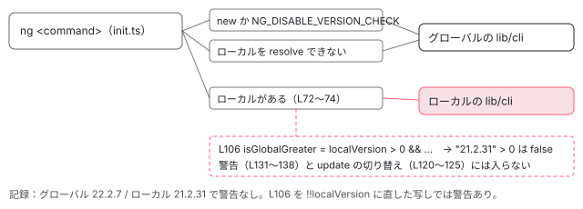

[目次](../README.md) › [ng コマンドの内側](README.md) › 第 1 回 / 全 10 回

# ng と打ってから：bin/ng・init・command-runner

> packages/angular/cli の bin/ng.js・bootstrap.js・lib/init.ts・lib/cli/index.ts・node-version.ts・environment-options.ts・command-runner.ts・command-module.ts：グローバルとローカルの CLI の版の比べ方（init.ts の 106 行目が文字列を数として比べ、警告が一度も出ない）、Node の版の 2 つの検査（27 が止まる）、環境変数の読み方、終了コード 1・3・127 とログのファイル、yargs の設定と、既定のコマンド '\*' のせいで打ち間違いの提案が出ないこと。

angular/angular-cli · 読了 約 13 分 · 中核 · [サイトで読む（デモが動きます）](https://angular-deep-dive-cyan.vercel.app/chapter/ngx-entry)

---

この章で分かること：`ng` と打ってから yargs がコマンドを選ぶまでの層のうち、[「ng serve」と打った直後に動くもの](../boot/01-boot-ng-command.md)が読まなかった行です。グローバルとローカルの CLI の版をどう比べるか（そしてその比べ方が 2023 年から働いていないこと）、Node の版の 2 つの検査、環境変数の読み方、失敗したときの終了コードとログ、`--help` と知らないコマンドへの答え方を、本物の `ng` を動かした記録と並べて読みます。

読む対象は `packages/angular/cli/` の `bin/ng.js`・`bin/bootstrap.js`・`lib/init.ts`・`lib/cli/index.ts`・`src/utilities/node-version.ts`・`version.ts`・`environment-options.ts`・`log-file.ts`・`src/command-builder/definitions.ts`・`command-module.ts`・`command-runner.ts`・`utilities/command.ts` です（../angular-cli、44129f66a3）。`bin/ng.js` → `bootstrap.js` → `init.ts` → `lib/cli` → `runCommand` の大きな流れと、`getCommandsToRegister`・`addCommandModuleToYargs`・`handler` は boot-ng-command の章が読んでいるので、ここでは繰り返さずに行だけ指します。

1. **1. ng と打ってから**（この章）
2. [2. schema からオプション](02-ngx-options.md)
3. [3. angular.json と設定](03-ngx-config.md)
4. [4. パッケージマネージャー](04-ngx-package-managers.md)
5. [5. ng add](05-ngx-add.md)
6. [6. ng update](06-ngx-update.md)
7. [7. generate・new・run・version](07-ngx-generate-run.md)
8. [8. analytics](08-ngx-analytics.md)
9. [9. ng mcp](09-ngx-mcp.md)
10. [10. spec と issue](10-ngx-tests-issues.md)

> [!TIP]
> **新卒エンジニアへ**
>
> `ng` はブラウザーでは動かないので、この章の DEMO は、手元で本物の `ng` を動かした記録の再生です。記録は、手元のグローバルの `@angular/cli` 22.2.7 と、記録用の場所に入れたローカルの 22.2.7・22.3.0・21.2.31・17.3.8 で取りました。どれも `HOME` を記録用の場所に向け、`NG_CLI_ANALYTICS=false` を付けています。引用は 44129f66a3（main、2026-09-10）の行です。22.2.7 は 22.2.x の枝から出ていて、この章の範囲では `command-runner.ts` の 102〜110 行目と 134 行目だけが違います（`--help` が無いときは yargs が help の文を作る手間を省く変更、6e7f809a7d）。ほかのファイルは同じです。

## 1. bin/ng.js の頭と、bootstrap.js の説明文

📄 `angular-cli/packages/angular/cli/bin/ng.js` L10–24 （▶ の行: 15, 18–19, 22）

```js
10 │ /* eslint-disable no-console */
11 │ /* eslint-disable import/no-unassigned-import */
12 │ 'use strict';
13 │ 
14 │ const path = require('path');
15 ▶ const nodeUtils = require('../src/utilities/node-version');
16 │ 
17 │ // Error if the external CLI appears to be used inside a google3 context.
18 ▶ if (process.cwd().split(path.sep).includes('google3')) {
19 ▶   console.error(
20 │     'This is the external Angular CLI, but you appear to be running in google3. There is a separate, internal version of the CLI which should be used instead. See http://go/angular/cli.',
21 │   );
22 ▶   process.exit();
23 │ }
24 │ 
```

15 行目で、Node の版を調べる関数を `src/utilities/node-version` から `require` します（このファイルは CommonJS のままで、版の検査は 2 節）。18 行目は、今いるディレクトリの道のどこかに `google3` という名前があるかを見ます。google3 は Google の社内のリポジトリで、そこでは別の CLI を使う決まりなので、19 行目の文を出して 22 行目で終わります。`process.exit()` に引数が無いので終了コードは 0 です。

📄 `angular-cli/packages/angular/cli/bin/bootstrap.js` L9–20 （▶ の行: 12–13, 15–18）

```js
 9 │ /**
10 │  * @fileoverview
11 │  *
12 ▶  * This file is used to bootstrap the CLI process by dynamically importing the main initialization code.
13 ▶  * This is done to allow the main bin file (`ng`) to remain CommonJS so that older versions of Node.js
14 │  * can be checked and validated prior to the execution of the CLI. This separate bootstrap file is
15 ▶  * needed to allow the use of a dynamic import expression without crashing older versions of Node.js that
16 ▶  * do not support dynamic import expressions and would otherwise throw a syntax error. This bootstrap file
17 ▶  * is required from the main bin file only after the Node.js version is determined to be in the supported
18 ▶  * range.
19 │  */
20 │ 
```

12〜18 行目は「`ng.js` を CommonJS のままにしておくのは古い Node でも版を調べられるようにするため、このファイルは版が範囲内と分かってから読まれる」と書きます。ところが `ng.js` の 35〜41 行目（boot-ng-command の章の引用）は、`completion` と `--get-yargs-completions` のときだけ、版を調べずにこのファイルを読みます。補完のスクリプトがシェルの起動のたびに走るので、警告を出さないためです。DEMO の「2. Node の版の検査」で Node 20.20.2 から `ng completion script` を打つと、`ng.js` の検査は通り抜け、もう 1 つの検査（3 節の `lib/cli/index.ts` 24 行目）が「The Angular CLI requires a minimum of v22.22.3.」と言って終了コード 3 で止まりました。説明文の「範囲内と分かってから」は、この 2 つの道では成り立ちません。

## 2. Node の版の 2 つの検査

📄 `angular-cli/packages/angular/cli/src/utilities/node-version.ts` L14–52 （▶ の行: 18, 23–24, 32, 34, 41–42, 44–45）

```ts
14 │ /**
15 │  * The supported Node.js version for the Angular CLI.
16 │  */
17 │ 
18 ▶ const SUPPORTED_NODE_VERSIONS = '0.0.0-ENGINES-NODE';
19 │ 
20 │ /**
21 │  * The supported Node.js versions.
22 │  */
23 ▶ export const supportedNodeVersions = SUPPORTED_NODE_VERSIONS.replace(/[\^~<>=]/g, '')
24 ▶   .split('||')
25 │   .map((v) => v.trim());
26 │ 
27 │ /**
28 │  * Checks if the current Node.js version is supported.
29 │  * @returns `true` if the current Node.js version is supported, `false` otherwise.
30 │  */
31 │ export function isNodeVersionSupported(): boolean {
32 ▶   if (SUPPORTED_NODE_VERSIONS.charAt(0) === '0') {
33 │     // Unlike `pkg_npm`, `ts_library` which is used to run unit tests does not support substitutions.
34 ▶     return true;
35 │   }
36 │ 
37 │   const [processMajor, processMinor, processPatch] = process.versions.node
38 │     .split('.', 3)
39 │     .map((part) => Number(part));
40 │ 
41 ▶   for (const version of supportedNodeVersions) {
42 ▶     const [major, minor, patch] = version.split('.', 3).map((part) => Number(part));
43 │     if (
44 ▶       (major === processMajor && processMinor === minor && processPatch >= patch) ||
45 ▶       (major === processMajor && processMinor > minor)
46 │     ) {
47 │       return true;
48 │     }
49 │   }
50 │ 
51 │   return false;
52 │ }
```

18 行目の `'0.0.0-ENGINES-NODE'` は置き換えの印で、配る包みを作るときに `package.json` の `engines.node` に置き換わります（tools/substitutions.bzl）。手元の 22.2.7 では `'^22.22.3 || ^24.15.0 || >=26.0.0'` でした。23 行目は `^`・`~`・`<`・`>`・`=` を消し、24 行目で `||` で割るので、`supportedNodeVersions` は `['22.22.3', '24.15.0', '26.0.0']` になります。`>=` という「これより上ならよい」の意味はここで消えます。32〜34 行目は置き換え前（spec を走らせるとき）なら常に `true` です。41〜45 行目は、major が等しく minor・patch が同じか上のときだけ `true` にします。だから 27 は 3 つのどの major とも等しくなく、`false` です。

これを呼ぶ `ng.js` の 46〜74 行目（boot-ng-command の章の引用）は、23 と 25 だけを「奇数の版」として警告で通し、それ以外で `false` なら終了コード 3 にします。DEMO の記録では、Node 25.9.0 は警告のあと `ng version` が動き、Node 27.0.0-alpha と Node 20.20.2 は同じ文「The Angular CLI requires a minimum Node.js version of v22.22.3 or v24.15.0 or v26.0.0.」で終了コード 3 でした。`engines` の `>=26.0.0` を満たす 27 が、「最低でも 26.0.0 が要る」と言われて止まります。main では f52fb536a1（2026-09-22、`fix(@angular/cli): decouple official Node.js support check from execution gate`）が `isNodeVersionRunnable` を足し、最大の major より新しい版と間の奇数の版を警告つきで通すようにしました。22.3.0 の CLI を Node 27 で動かした記録では、「has not been officially tested on this Node.js version」の警告のあと動いています。22.2.x の枝には入っていません。

📄 `angular-cli/packages/angular/cli/src/utilities/node-version.ts` L54–74 （▶ の行: 58, 67, 70–72）

```ts
54 │ /**
55 │  * Checks if the current Node.js version is the minimum supported version.
56 │  * @returns `true` if the current Node.js version is the minimum supported version, `false` otherwise.
57 │  */
58 ▶ export function isNodeVersionMinSupported(): boolean {
59 │   if (SUPPORTED_NODE_VERSIONS.charAt(0) === '0') {
60 │     // Unlike `pkg_npm`, `ts_library` which is used to run unit tests does not support substitutions.
61 │     return true;
62 │   }
63 │ 
64 │   const [processMajor, processMinor, processPatch] = process.versions.node
65 │     .split('.', 3)
66 │     .map((part) => Number(part));
67 ▶   const [major, minor, patch] = supportedNodeVersions[0].split('.', 3).map((part) => Number(part));
68 │ 
69 │   return (
70 ▶     processMajor > major ||
71 ▶     (processMajor === major && processMinor > minor) ||
72 ▶     (processMajor === major && processMinor === minor && processPatch >= patch)
73 │   );
74 │ }
```

こちらは「最低の版以上か」だけを見る関数で、67 行目で `supportedNodeVersions[0]`（いちばん古い 22.22.3）と比べ、70〜72 行目で大小を比べます。27 でも `true` です。`lib/cli/index.ts` の 24 行目がこれを使い（boot-ng-command の章）、`ng.js` の検査を通らずに来た補完の道を止めるのはこちらです。

## 3. init.ts の頭：forceExit・Windows・Browserslist

📄 `angular-cli/packages/angular/cli/lib/init.ts` L16–53 （▶ の行: 17, 22, 31, 33, 35, 42, 51, 53）

```ts
16 │ /**
17 ▶  * Angular CLI versions prior to v14 may not exit correctly if not forcibly exited
18 │  * via `process.exit()`. When bootstrapping, `forceExit` will be set to `true`
19 │  * if the local CLI version is less than v14 to prevent the CLI from hanging on
20 │  * exit in those cases.
21 │  */
22 ▶ let forceExit = false;
23 │ 
24 │ (async (): Promise<typeof import('./cli').default | null> => {
25 │   /**
26 │    * On Windows, ensure process.cwd() uses uppercase drive letter casing.
27 │    * Windows cmd.exe and VS Code terminals often preserve lowercase drive letters (e.g. c:\...),
28 │    * which causes ESM module duplication in Node.js (e.g. loading "vitest" twice) and path
29 │    * lookup mismatches in tools like Vite and esbuild.
30 │    */
31 ▶   if (process.platform === 'win32') {
32 │     const cwd = process.cwd();
33 ▶     if (/^[a-z]:/.test(cwd)) {
34 │       try {
35 ▶         process.chdir(cwd[0].toUpperCase() + cwd.slice(1));
36 │       } catch {
37 │         // Ignore failure to change directory
38 │       }
39 │     }
40 │ 
41 │     // Ensure Windows CreateProcess does not search the current directory for bare executable names.
42 ▶     process.env['NoDefaultCurrentDirectoryInExePath'] = '1';
43 │   }
44 │ 
45 │   /**
46 │    * Disable Browserslist old data warning as otherwise with every release we'd need to update this dependency
47 │    * which is cumbersome considering we pin versions and the warning is not user actionable.
48 │    * `Browserslist: caniuse-lite is outdated. Please run next command `npm update`
49 │    * See: https://github.com/browserslist/browserslist/blob/819c4337456996d19db6ba953014579329e9c6e1/node.js#L324
50 │    */
51 ▶   process.env.BROWSERSLIST_IGNORE_OLD_DATA = '1';
52 │ 
53 ▶   const rawCommandName = process.argv[2];
```

22 行目の `forceExit` は、17〜20 行目のとおり、v14 より前のローカルの CLI がプロセスを終わらせきれない問題への手当てです。4 節の 95〜96 行目で `true` になり、最後に `process.exit(exitCode)` を呼ばせます（L165〜167）。31〜43 行目は Windows だけの処理で、33 行目でドライブ文字が小文字（`c:\`）なら 35 行目で大文字に直して `chdir` し、42 行目で「実行ファイルを今のディレクトリから探さない」という環境変数を立てます。51 行目は Browserslist の「caniuse-lite が古い」警告を止めます。53 行目の `rawCommandName` は `process.argv[2]`、つまり `ng` の次の語です。63 行目（boot-ng-command の章）の `new` の判定と、4 節の `completion`・`update` の判定がこれを使います。

## 4. グローバルとローカルの版の比べ方：106 行目は働いていない

📄 `angular-cli/packages/angular/cli/lib/init.ts` L76–111 （▶ の行: 76, 79–80, 86, 94–95, 104, 106）

```ts
 76 ▶     const globalVersion = new SemVer(VERSION.full);
 77 │ 
 78 │     // Older versions might not have the VERSION export
 79 ▶     let localVersion = cli.VERSION?.full;
 80 ▶     if (!localVersion) {
 81 │       try {
 82 │         const localPackageJson = await readFile(
 83 │           path.join(path.dirname(projectLocalCli), '../../package.json'),
 84 │           'utf-8',
 85 │         );
 86 ▶         localVersion = (JSON.parse(localPackageJson) as { version: string }).version;
 87 │       } catch (error) {
 88 │         // eslint-disable-next-line  no-console
 89 │         console.error('Version mismatch check skipped. Unable to retrieve local version: ' + error);
 90 │       }
 91 │     }
 92 │ 
 93 │     // Ensure older versions of the CLI fully exit
 94 ▶     const localMajorVersion = major(localVersion);
 95 ▶     if (localMajorVersion > 0 && localMajorVersion < 14) {
 96 │       forceExit = true;
 97 │ 
 98 │       // Versions prior to 14 didn't implement completion command.
 99 │       if (rawCommandName === 'completion') {
100 │         return null;
101 │       }
102 │     }
103 │ 
104 ▶     let isGlobalGreater = false;
105 │     try {
106 ▶       isGlobalGreater = localVersion > 0 && globalVersion.compare(localVersion) > 0;
107 │     } catch (error) {
108 │       // eslint-disable-next-line  no-console
109 │       console.error('Version mismatch check skipped. Unable to compare local version: ' + error);
110 │     }
111 │ 
```

ローカルの CLI を `import` したあと（L72〜74）、76 行目でグローバル自身の版を `SemVer` にします。79 行目のローカルの版は `cli.VERSION?.full`、つまり `"21.2.31"` のような**文字列**です。古い CLI で `VERSION` が無ければ 80〜90 行目で `package.json` の `version`（これも文字列）を読みます。

📄 `angular-cli/packages/angular/cli/src/utilities/version.ts` L9–23 （▶ の行: 11, 15–16, 23）

```ts
 9 │ // Same structure as used in framework packages
10 │ class Version {
11 ▶   readonly major: string;
12 │   readonly minor: string;
13 │   readonly patch: string;
14 │ 
15 ▶   constructor(readonly full: string) {
16 ▶     const [major, minor, patch] = full.split('-', 1)[0].split('.', 3);
17 │     this.major = major;
18 │     this.minor = minor;
19 │     this.patch = patch;
20 │   }
21 │ }
22 │ 
23 ▶ export const VERSION = new Version('0.0.0-PLACEHOLDER');
```

`VERSION` は 23 行目の `Version` のインスタンスで、`full` も 16 行目で割った `major` も文字列です（11 行目の型が `string`）。

そこで 106 行目の `localVersion > 0` です。文字列と数を `>` で比べると、JavaScript は文字列を数に直します。`Number('21.2.31')` は点が 2 つあるので `NaN` で、`NaN > 0` は `false` です。DEMO の「106 行目の比較を Node で」の記録は `[ false, NaN, true ]` でした。semver の版はいつも点が 2 つあるので、`isGlobalGreater` は**いつも `false`** になり、113〜144 行目（boot-ng-command の章が読んだ「Your global Angular CLI version … is greater than your local version」の警告と、`ng update` をグローバルの版に回す分かれ道）には入りません。

記録では、グローバル 22.2.7・ローカル 21.2.31 の場所で `ng version` を打っても警告は出ず、表は 21.2.31 でした。`init.js` のこの 1 行だけを `!!localVersion &&` に直したグローバルの写しで同じことをすると、警告が出ました。この行は 3cbeee7377（2023-02-16、`build: remove no longer used scripts`）で `!!localVersion &&` から今の形になりました。同じコミットで 94〜95 行目に `localMajorVersion > 0` を足しているので、ローカルで組んだ `0.0.0` の版を除くつもりの変更です。`major()` の戻り値は数なので 95 行目は働きますが、106 行目は文字列のまま比べています。main（de5620f18d）も同じ行です。

📄 `angular-cli/packages/angular/cli/lib/init.ts` L119–125 （▶ の行: 121, 123, 125）

```ts
119 │       // This allows improvements in update to be used in older versions that do not have bootstrapping
120 │       if (
121 ▶         rawCommandName === 'update' &&
122 │         cli.VERSION &&
123 ▶         cli.VERSION.major - globalVersion.major <= 1
124 │       ) {
125 ▶         cli = await import('./cli');
```

106 行目を直すと、この分かれ道が生き返ります。123 行目は `cli.VERSION.major - globalVersion.major <= 1` で、ローカルからグローバルを引いています。ここに来るのはグローバルが新しいときだけなので、差はいつも 0 以下で、条件はいつも `true` です。119 行目のコメントの「1 つ違いまで」にするなら、引く向きが逆です。106 行目が働いていない今は、この行も通りません。



*どの CLI が処理するか（記録の結果）。グローバルが新しいときの警告は、106 行目の比較が文字列のため一度も出ない。*

## 5. 環境変数の読み方

📄 `angular-cli/packages/angular/cli/src/utilities/environment-options.ts` L24–56 （▶ の行: 30, 35–36, 39, 43, 47, 50, 53, 56）

```ts
24 │ /**
25 │  * Parses an environment variable into a boolean or undefined.
26 │  * @returns `true` if the variable is truthy ('1', 'true').
27 │  * @returns `false` if the variable is falsy ('0', 'false').
28 │  * @returns `undefined` if the variable is not present or has an unknown value.
29 │  */
30 ▶ function parseTristate(variable: string | undefined): boolean | undefined {
31 │   if (!isPresent(variable)) {
32 │     return undefined;
33 │   }
34 │ 
35 ▶   const value = variable.toLowerCase();
36 ▶   if (TRUTHY_VALUES.has(value)) {
37 │     return true;
38 │   }
39 ▶   if (FALSY_VALUES.has(value)) {
40 │     return false;
41 │   }
42 │ 
43 ▶   return undefined;
44 │ }
45 │ 
46 │ /** Disables all analytics reporting when the `NG_CLI_ANALYTICS` environment variable is set to '0' or 'false'. */
47 ▶ export const analyticsDisabled = parseTristate(process.env['NG_CLI_ANALYTICS']) === false;
48 │ 
49 │ /** Identifies when the CLI is running in a Continuous Integration environment. */
50 ▶ export const isCI = parseTristate(process.env['CI']) === true;
51 │ 
52 │ /** Disables the automatic version check when the `NG_DISABLE_VERSION_CHECK` environment variable is enabled. */
53 ▶ export const disableVersionCheck = parseTristate(process.env['NG_DISABLE_VERSION_CHECK']) === true;
54 │ 
55 │ /** Enables debugging messages when the `NG_DEBUG` environment variable is enabled. */
56 ▶ export const ngDebug = parseTristate(process.env['NG_DEBUG']) === true;
```

30 行目の `parseTristate` は、値を小文字にして（35 行目）`'1'`・`'true'` なら `true`、`'0'`・`'false'` なら `false`、それ以外と空は `undefined` を返します（43 行目）。`NG_DEBUG=yes` は `undefined` なので、56 行目の `=== true` で `false` です。53 行目の `NG_DISABLE_VERSION_CHECK` が `true` なら、`init.ts` の 63 行目でローカルを探さずグローバルを使います。記録ではローカル 21.2.31 の場所で `NG_DISABLE_VERSION_CHECK=1` を付けると表が 22.2.7 になりました。56 行目の `NG_DEBUG` は `lib/cli/index.ts` の 48 行目で debug の行を通すかを決め、記録では `Using configured package manager: 'npm'.` のような行が出ました（どこから出るかは[第 4 回](04-ngx-package-managers.md)）。47 行目と 50 行目（`NG_CLI_ANALYTICS` と `CI`）の使われ方は[analytics の章](08-ngx-analytics.md)です。

## 6. 失敗したとき：終了コードとログのファイル

📄 `angular-cli/packages/angular/cli/lib/cli/index.ts` L33–40 （▶ の行: 37–39）

```ts
33 │ 
34 │   const colorLevels: Record<string, (message: string) => string> = {
35 │     info: (s) => s,
36 │     debug: (s) => s,
37 ▶     warn: (s) => colors.bold(colors.yellow(s)),
38 ▶     error: (s) => colors.bold(colors.red(s)),
39 ▶     fatal: (s) => colors.bold(colors.red(s)),
40 │   };
```

ログの段ごとの色です。`warn` は黄色の太字、`error` と `fatal` は赤の太字で、`info` と `debug` は色を付けません。色が使えない出力先なら、52 行目（boot-ng-command の章）で色の制御文字を外します。

📄 `angular-cli/packages/angular/cli/lib/cli/index.ts` L80–119 （▶ の行: 81–83, 85, 87–88, 100–101, 103–104, 109, 116）

```ts
 80 │   } catch (err) {
 81 ▶     if (err instanceof CommandModuleError) {
 82 ▶       logger.fatal(`Error: ${err.message}`);
 83 ▶     } else if (err instanceof Error) {
 84 │       try {
 85 ▶         const logPath = writeErrorToLogFile(err);
 86 │         logger.fatal(
 87 ▶           `An unhandled exception occurred: ${err.message}\n` +
 88 ▶             `See "${logPath}" for further details.`,
 89 │         );
 90 │       } catch (e) {
 91 │         logger.fatal(
 92 │           `An unhandled exception occurred: ${err.message}\n` +
 93 │             `Fatal error writing debug log file: ${e}`,
 94 │         );
 95 │         if (err.stack) {
 96 │           logger.fatal(err.stack);
 97 │         }
 98 │       }
 99 │ 
100 ▶       return 127;
101 ▶     } else if (typeof err === 'string') {
102 │       logger.fatal(err);
103 ▶     } else if (typeof err === 'number') {
104 ▶       // Log nothing.
105 │     } else {
106 │       logger.fatal(`An unexpected error occurred: ${err}`);
107 │     }
108 │ 
109 ▶     return 1;
110 │   } finally {
111 │     logger.complete();
112 │     await loggerFinished;
113 │ 
114 │     // Restore original console methods so that late consumers
115 │     // (e.g. process.on('exit') handlers) still produce output.
116 ▶     console.log = console.info = logInfo;
117 │     console.warn = logWarn;
118 │     console.error = logError;
119 │   }
```

1. **81〜82 行目：`CommandModuleError`**

   「分かっている失敗」で、`Error: …` の 1 行を出して 109 行目の 1 を返します。知らない引数（yargs の `.fail`、L151〜157）も、ワークスペースの外で `ng build` を打ったとき（7 節）もこれです。
2. **83〜100 行目：それ以外の `Error`**

   85 行目でスタックをログのファイルに書き、87〜88 行目で「An unhandled exception occurred: …」と「See "…" for further details.」を出して、100 行目で **127** を返します。ファイルに書けなければ 96 行目でスタックをそのまま出します。
3. **101〜104 行目：文字列と数**

   文字列は 1 行出して 1、数は何も出さずに 1 を返します（103〜104 行目の「Log nothing」のあとも 109 行目に落ちる）。投げた数そのものは終了コードになりません。
4. **116〜118 行目：console を元に戻す**

   4 節で差し替えた `console.log` などを戻し、`process.on('exit')` の中からの出力が消えないようにします。

📄 `angular-cli/packages/angular/cli/src/utilities/log-file.ts` L13–29 （▶ の行: 21–23, 26）

```ts
13 │ let logPath: string | undefined;
14 │ 
15 │ /**
16 │  * Writes an Error to a temporary log file.
17 │  * If this method is called multiple times from the same process the same log file will be used.
18 │  * @returns The path of the generated log file.
19 │  */
20 │ export function writeErrorToLogFile(error: Error): string {
21 ▶   if (!logPath) {
22 ▶     const tempDirectory = mkdtempSync(realpathSync(tmpdir()) + '/ng-');
23 ▶     logPath = normalize(tempDirectory + '/angular-errors.log');
24 │   }
25 │ 
26 ▶   appendFileSync(logPath, '[error] ' + (error.stack || error) + '\n\n');
27 │ 
28 │   return logPath;
29 │ }
```

ログの場所は 22 行目の `mkdtempSync(tmpdir() + '/ng-')` が作る一時ディレクトリの中の `angular-errors.log` で、同じプロセスでは 21 行目のとおり 2 回目から同じファイルに足します（26 行目）。DEMO では途中で切れた `angular.json`（`{ "version": 1, "projects": { "a": ` だけ）を置き、`TMPDIR` を記録用の場所に向けて `ng config version` を打ちました。`JSONFile` の解析の失敗（[第 3 回](03-ngx-config.md)）は普通の `Error` なので、終了コードは 127 で、ログの 1 行目は `[error] Error: Failed to parse "…/angular.json" as JSON AST Object. ValueExpected at location: 35.` でした。同じファイルで `ng build` を打つと、ワークスペースの読み込み（`readWorkspace`）は切れた JSON を受け入れ、「Cannot determine project or target for command.」で終了コード 1 でした。どちらの読み方で読むかで、同じ壊れ方への答えが違います。

## 7. CommandContext と、コマンドの scope

📄 `angular-cli/packages/angular/cli/src/command-builder/definitions.ts` L14–47 （▶ の行: 14, 16, 19, 22, 25, 28–29, 31, 35, 38–40, 45）

```ts
14 ▶ export enum CommandScope {
15 │   /** Command can only run inside an Angular workspace. */
16 ▶   In,
17 │ 
18 │   /** Command can only run outside an Angular workspace. */
19 ▶   Out,
20 │ 
21 │   /** Command can run inside and outside an Angular workspace. */
22 ▶   Both,
23 │ }
24 │ 
25 ▶ export interface CommandContext {
26 │   currentDirectory: string;
27 │   root: string;
28 ▶   workspace?: AngularWorkspace;
29 ▶   globalConfiguration: AngularWorkspace;
30 │   logger: logging.Logger;
31 ▶   packageManager: PackageManager;
32 │   yargsInstance: Argv<{}>;
33 │ 
34 │   /** Arguments parsed in free-from without parser configuration. */
35 ▶   args: {
36 │     positional: string[];
37 │     options: {
38 ▶       help: boolean;
39 ▶       jsonHelp: boolean;
40 ▶       getYargsCompletions: boolean;
41 │     } & Record<string, unknown>;
42 │   };
43 │ }
44 │ 
45 ▶ export type Options<T> = { [key in keyof T as CamelCaseKey<key>]: T[key] };
46 │ 
47 │ export type OtherOptions = Record<string, unknown>;
```

14〜23 行目の `CommandScope` は、そのコマンドがワークスペースの中（`In`）・外（`Out`）・どちらでも（`Both`）使えるかです。25〜43 行目の `CommandContext` は `runCommand` の 82〜99 行目で 1 つだけ作られ、すべてのコマンドのクラスに渡ります。28 行目の `workspace` が無いことがある（ワークスペースの外）のに、29 行目の `globalConfiguration` はいつもある、という違いは[第 3 回](03-ngx-config.md)の `getWorkspace` が理由です。35〜42 行目の `args` は、yargs に登録する**前**に `yargs-parser` だけで分けた引数で、38〜40 行目の 3 つは名前を決めて取り出してあります。45 行目の `Options<T>` は、yargs が返す `dry-run` のような名前を `dryRun` に読み替える型です（実際の読み替えは `handler` の 102〜105 行目）。

📄 `angular-cli/packages/angular/cli/src/command-builder/command-module.ts` L44–62 （▶ の行: 50–55, 62）

```ts
44 │ export interface FullDescribe {
45 │   describe?: string;
46 │   longDescription?: string;
47 │   longDescriptionRelativePath?: string;
48 │ }
49 │ 
50 ▶ export abstract class CommandModule<T extends {} = {}> implements CommandModuleImplementation<T> {
51 ▶   abstract readonly command: string;
52 ▶   abstract readonly describe: string | false;
53 ▶   abstract readonly longDescriptionPath?: string;
54 ▶   protected readonly shouldReportAnalytics: boolean = true;
55 ▶   readonly scope: CommandScope = CommandScope.Both;
56 │ 
57 │   private readonly optionsWithAnalytics = new Map<
58 │     string,
59 │     EventCustomDimension | EventCustomMetric
60 │   >();
61 │ 
62 ▶   constructor(protected readonly context: CommandContext) {}
```

コマンドのクラスの土台です。51 行目の `command`（`'build [project]'` のような yargs の書き方）、52 行目の `describe`（`false` なら `--help` に出ない）、53 行目の長い説明のファイルは子のクラスが決めます。55 行目の既定の `scope` は `Both` で、`SchematicsCommandModule` や `ArchitectBaseCommandModule` は `In` に上書きします（[第 2 回](02-ngx-options.md)）。

📄 `angular-cli/packages/angular/cli/src/command-builder/command-module.ts` L198–205 （▶ の行: 200–201）

```ts
198 │   protected getWorkspaceOrThrow(): AngularWorkspace {
199 │     const { workspace } = this.context;
200 ▶     if (!workspace) {
201 ▶       throw new CommandModuleError('A workspace is required for this command.');
202 │     }
203 │ 
204 │     return workspace;
205 │   }
```

ワークスペースが要るのに無いときの文は 201 行目の「A workspace is required for this command.」ですが、`ng build` を外で打ったときに出たのは、`addCommandModuleToYargs` の 49〜57 行目（boot-ng-command の章）の「This command is not available when running the Angular CLI outside a workspace.」でした。scope の検査が `builder` の時点で先に止めるので、`scope` が `In` のコマンドではこの 201 行目に届きません。

## 8. yargs の設定：--help・知らないコマンド・打ち間違い

📄 `angular-cli/packages/angular/cli/src/command-builder/utilities/command.ts` L9–22 （▶ の行: 18）

```ts
 9 │ import { Argv } from 'yargs';
10 │ import {
11 │   CommandContext,
12 │   CommandModule,
13 │   CommandModuleError,
14 │   CommandModuleImplementation,
15 │   CommandScope,
16 │ } from '../command-module';
17 │ 
18 ▶ export const demandCommandFailureMessage = `You need to specify a command before moving on. Use '--help' to view the available commands.`;
19 │ export type CommandModuleConstructor = Partial<CommandModuleImplementation> & {
20 │   new (context: CommandContext): Partial<CommandModuleImplementation> & CommandModule;
21 │ };
22 │ 
```

📄 `angular-cli/packages/angular/cli/src/command-builder/command-runner.ts` L105–144 （▶ の行: 105, 108, 112–113, 119–122, 124–126, 128, 130, 134, 142）

```ts
105 ▶   if (jsonHelp) {
106 │     // eslint-disable-next-line @typescript-eslint/no-explicit-any
107 │     const usageInstance = (localYargs as any).getInternalMethods().getUsageInstance();
108 ▶     usageInstance.help = () => jsonHelpUsage(localYargs);
109 │   }
110 │ 
111 │   // Add default command to support version option when no subcommand is specified
112 ▶   localYargs.command('*', false, (builder) =>
113 ▶     builder.version('version', 'Show Angular CLI version.', VERSION.full),
114 │   );
115 │ 
116 │   await localYargs
117 │     .scriptName('ng')
118 │     // https://github.com/yargs/yargs/blob/main/docs/advanced.md#customizing-yargs-parser
119 ▶     .parserConfiguration({
120 ▶       'populate--': true,
121 ▶       'unknown-options-as-args': false,
122 ▶       'dot-notation': false,
123 │       'boolean-negation': true,
124 ▶       'strip-aliased': true,
125 ▶       'strip-dashed': true,
126 ▶       'camel-case-expansion': false,
127 │     })
128 ▶     .option('json-help', {
129 │       describe: 'Show help in JSON format.',
130 ▶       implies: ['help'],
131 │       hidden: true,
132 │       type: 'boolean',
133 │     })
134 ▶     .help('help', 'Shows a help message for this command in the console.')
135 │     // A complete list of strings can be found: https://github.com/yargs/yargs/blob/main/locales/en.json
136 │     .updateStrings({
137 │       'Commands:': colors.cyan('Commands:'),
138 │       'Options:': colors.cyan('Options:'),
139 │       'Positionals:': colors.cyan('Arguments:'),
140 │       'deprecated': colors.yellow('deprecated'),
141 │       'deprecated: %s': colors.yellow('deprecated:') + ' %s',
142 ▶       'Did you mean %s?': 'Unknown command. Did you mean %s?',
143 │     })
144 │     .epilogue('For more information, see https://angular.dev/cli/.\n')
```

1. **105〜109 行目：`--json-help`**

   yargs の help を出す関数を `jsonHelpUsage` に差し替えます。中身は[第 2 回](02-ngx-options.md)です。128〜133 行目でこのオプションを `hidden` で登録します。130 行目の `implies: ['help']` は yargs では「`--help` も一緒に付けること」という条件で、`--json-help` だけを打つと「Missing dependent arguments: json-help -&gt; help」で止まりました（[第 2 回](02-ngx-options.md)の記録）。
2. **112〜114 行目：既定のコマンド `'*'`**

   コマンドの名前が無いときにも `--version` を受けるための「どれにも当たらないとき」のコマンドです。`describe` が `false` なので `--help` には出ません。
3. **119〜127 行目：yargs-parser の設定**

   120 行目で `--` の後ろを `argv['--']` に分け、122 行目で `a.b` を入れ子にせず、123 行目で `--no-x` を `x: false` にし、124〜125 行目で別名と `dry-run` の形の重複を消し、126 行目で camelCase の写しを作りません（だから `handler` が自分で読み替える）。
4. **134 行目と 136〜143 行目：help の見出しと文**

   yargs の決まり文句を差し替え、`Positionals:` を `Arguments:` に、142 行目で「Did you mean %s?」を「Unknown command. Did you mean %s?」にします。

ところが、記録では 142 行目の文も、18 行目の「You need to specify a command before moving on.」も出ませんでした。`ng buidl` は「Error: Unknown argument: buidl」（終了コード 1）、`ng foo` も同じ形、コマンド無しの `ng` は何も出さずに終了コード 0 です。17.3.8 の CLI（Node 20.20.2）で同じことをすると、`ng buidl` は「Error: Unknown command. Did you mean build?」、`ng` は 18 行目の文で、どちらも終了コード 1 でした。

違いは 112〜114 行目です。83ef6a133e（2024-05-21、`fix(@angular/cli): only add --version option on default command`、18.0.0 に入った写しは dd786d495c）が、`--version` を全部のコマンドから外して既定のコマンド `'*'` だけに付けました。`'*'` はどんな語にも当たるので、yargs は `buidl` を「`'*'` の位置引数」と読み、`.recommendCommands()`（L146）の出番が無く、`.strict()`（L150）が知らない引数として止めます。コマンドが 1 つ当たったことになるので `.demandCommand(1, …)`（L145）も通ります。112 行目を「コマンドの名前が無く、`--version` があるときだけ」`'*'` を足す形にした写しで試すと、`ng` は 18 行目の文、`ng buidl` は「Did you mean build?」、`ng foo` は「Did you mean add?」、`ng --version` は `22.2.7` に戻りました（DEMO の「直した写し」）。main（de5620f18d）も 112〜114 行目は同じです。gh で探した範囲では、この件の issue は見つかりませんでした。

📄 `angular-cli/packages/angular/cli/src/command-builder/command-module.ts` L127–147 （▶ の行: 128–129, 131, 133–134, 138, 143–144）

```ts
127 │     } catch (e) {
128 ▶       if (e instanceof schema.SchemaValidationException) {
129 ▶         logger.fatal(`Error: ${e.message}`);
130 │         exitCode = 1;
131 ▶       } else if (e instanceof PackageManagerError) {
132 │         const output = e.stderr || e.stdout;
133 ▶         logger.fatal(
134 ▶           `Error: Package installation failed: ${e.message}${output ? `\nOutput: ${output}` : ''}`,
135 │         );
136 │         exitCode = 1;
137 │       } else {
138 ▶         throw e;
139 │       }
140 │     } finally {
141 │       await stopPeriodicFlushes?.();
142 │ 
143 ▶       if (typeof exitCode === 'number' && exitCode > 0) {
144 ▶         process.exitCode = exitCode;
145 │       }
146 │     }
147 │   }
```

各コマンドの `run` が投げたもののうち、128 行目の schema の検査の失敗と、131 行目のパッケージマネージャーの失敗（[第 4 回](04-ngx-package-managers.md)の `PackageManagerError`）だけはここで `Error: …` の形にして、終了コード 1 にします。134 行目は失敗した出力（stderr か stdout）を「Output:」として付けます。それ以外は 138 行目で投げ直し、6 節の 83〜100 行目で 127 になります。143〜144 行目は 0 より大きい終了コードだけを `process.exitCode` に入れ、`runCommand` の 161 行目がそれを返します。

> **🧪 DEMO — 本物の ng を動かした記録**
>
> ボタンは、手元で本物の `ng` を動かしたコマンド・標準出力・標準エラー・終了コードを再生します。`<work>` は記録用の場所、`<global-cli>` はグローバルの `@angular/cli` 22.2.7 です。`demo-ws` はローカルに 22.2.7、`new-cli` は 22.3.0、`old-cli` は 21.2.31、`cli17` は 17.3.8 を入れた場所です。標準エラーは左に印を付けます。
>
> ▶ [このデモはサイトで動かせます](https://angular-deep-dive-cyan.vercel.app/chapter/ngx-entry)

## ここまでの呼び出し（ng buidl が「Unknown argument」になるまで）

- 👤 `$ ng buidl` — bin/ng.js — *L15 で node-version を require、L18 で google3 を確かめる*
  - `isNodeVersionSupported()` — node-version.ts L31 — *major が等しい版だけを見る（27 は false）*
  - `import('../lib/init.js')` — bootstrap.js L33
    - `rawCommandName = 'buidl'` — init.ts L53
    - `isGlobalGreater = localVersion > 0 && …` — init.ts L106 — *文字列なのでいつも false*
      - `default({ cliArgs: ['buidl'] })` — lib/cli/index.ts L21
        - `runCommand(['buidl'], logger)` — command-runner.ts L36 — *知らない名前なので全コマンドを登録（L178）*
          - `localYargs.command('*', false, …)` — command-runner.ts L112 — *buidl はここに当たる*
          - `.strict().fail(…)` — command-runner.ts L150〜157 — *CommandModuleError('Unknown argument: buidl')*
        - `logger.fatal('Error: …')` — lib/cli/index.ts L82 — *L109 で 1 を返す*

## テストと直し方

| ファイル | 中身（行） | 固めている約束 |
| --- | --- | --- |
| `tests/e2e/tests/misc/version.ts` | `ng version` の出力に「(Unsupported)」と「Warning: The current version of Node」が無いこと（L7〜13）、`angular.json` が無くても・外でも失敗しないこと（L16〜21） | 2 節の手元の Node が範囲内のときだけ。範囲外の Node で止まる・警告する形は無い |
| `tests/e2e/tests/commands/unknown-option.ts` | `ng build --notanoption` と `ng generate component … --notanoption` が「Unknown argument: notanoption」で失敗すること（L5〜16） | 8 節の `.strict()`。知らない**コマンド**と打ち間違いの提案を確かめる e2e は無い |
| `tests/e2e/tests/commands/help/help-json.ts`・`help-hidden.ts` | `--json-help` の形と、隠したオプションが出ないこと | 8 節の 105〜109・128〜133 行目（中身は第 2 回） |
| `tests/e2e/tests/commands/config/config-set.ts`・`config-global.ts` | `cli.warnings.versionMismatch` を `false` に書けること（L17・L39） | 設定の読み書きだけ。警告が出るか出ないかは確かめない |
| `packages/angular/cli` の unit の spec | `init.ts`・`node-version.ts`・`command-runner.ts`・`lib/cli/index.ts`・`environment-options.ts` の spec は無い | — |

📄 `走らせたコマンド（2026-11-24）`

```
$ cd ~/angular-research/angular-cli      # 44129f66a3、読むだけ
$ pnpm bazel test //packages/angular/cli:test --nocache_test_results --test_output=all
（結果は下の段落）
```

手元の bazel では `//packages/angular/cli:test` が 257 specs・0 failures でした（このパッケージの unit の spec はこの 1 つの target にまとまっている）。その中にこの章の行を通るものはありません。e2e は重いので走らせず、上の表は読んだだけです。

📄 `直すとしたら（記録で試した形）`

```
// lib/init.ts 106 行目（直すとしたら）
isGlobalGreater = !!localVersion && globalVersion.compare(localVersion) > 0;
// 123 行目（グローバルとローカルの major の差は、グローバルから引く）
globalVersion.major - Number(cli.VERSION.major) <= 1
// command-runner.ts 112 行目（コマンドが無いときだけ既定のコマンドを足す）
if (positional.length === 0) {
  localYargs.command('*', false, (builder) => builder.version('version', 'Show Angular CLI version.', VERSION.full));
}
```

直すとしたら、`lib/init.ts` の 106 行目を `!!localVersion` に戻すか `semver.valid(localVersion)` で確かめ、同時に 123 行目の引き算の向きを逆にします（106 行目だけを直すと、どんなに古いローカルの CLI でも `ng update` がグローバルの版に回るため）。`init.ts` はプロセスを起動して確かめるしかないので、spec は tests/e2e/tests/misc に「ローカルに古い CLI を入れてグローバルから `ng version` を打ち、警告が出る」ものを足すことになります。112 行目は、記録で試した「名前が無く `--version` があるときだけ `'*'` を足す」形にし、e2e の unknown-option.ts に「`ng buidl` が『Did you mean build?』で失敗する」と「`ng` だけが 18 行目の文で失敗する」を足します。

## 聞かれそうな質問

**Q. グローバルの CLI がローカルより新しいと警告が出る、と聞きました。出ません。**

出ません。`init.ts` の 106 行目が文字列の版を `> 0` で比べ、`"21.2.31" > 0` は `false` だからです（記録）。3cbeee7377（2023-02-16）からこの形で、main も同じです。どちらにせよ処理するのはローカルの CLI です（L72〜74）。

**Q. Node 27 で `ng` が「最低でも v26.0.0 が要る」と言って止まります。**

`node-version.ts` の 23 行目が `>=26.0.0` の `>=` を消し、41〜45 行目が major の等しい版だけを通すからです。`ng.js` が通す奇数の版は 23 と 25 だけです。main の f52fb536a1（22.3.0 に入っている）で、27 は警告つきで動くようになりました（記録）。

**Q. `ng buidl` と打っても「Did you mean build?」と言われません。**

`command-runner.ts` の 112〜114 行目の既定のコマンド `'*'` が `buidl` を受け取ってしまい、`.recommendCommands()` まで行かずに `.strict()` が「Unknown argument」にするからです。83ef6a133e（18.0.0）からで、17.3.8 では提案が出ました（記録）。

**Q. 「An unhandled exception occurred」と出て終了コードが 127 でした。どこを見ればいいですか？**

`CommandModuleError` でも schema の検査やパッケージマネージャーの失敗でもない `Error` は、`lib/cli/index.ts` の 85 行目がスタックを `$TMPDIR/ng-XXXX/angular-errors.log` に書き、その道を 88 行目で出します（log-file.ts L22〜23）。記録では `JSONFile` の解析の失敗がこの道でした。

**Q. `NG_DEBUG=yes` にしても debug の行が出ません。**

`parseTristate`（environment-options.ts L30〜44）が受けるのは `1`・`true`・`0`・`false`（大文字小文字は問わない）だけで、`yes` は `undefined` になり、56 行目の `=== true` で `false` です。

## 読み終えて

- グローバルとローカルの版の比較（init.ts L106）は文字列を数として比べていて、警告も `ng update` の切り替えも 2023 年から一度も働いていない。直すと 123 行目の引き算の向きも問題になる。
- Node の検査は 2 つあり、`ng.js` の検査は `>=` の意味を捨てて major の等しい版だけを通す（27 が止まる）。補完の道は `lib/cli` の「最低の版」の検査だけを通る。
- 環境変数は `1`・`true`・`0`・`false` だけを読む。`NG_DISABLE_VERSION_CHECK` はグローバルを使わせ、`NG_DEBUG` は debug の行を出す。
- 終了コードは、分かっている失敗が 1、それ以外の `Error` が 127（スタックは一時ディレクトリの angular-errors.log）、Node の版が 3。
- 既定のコマンド `'*'` のせいで、打ち間違いの提案と「コマンドを指定して」の文は 18.0.0 から出ない。

---

← 前: [spec と issue を読む：animations の説明文を固めているもの](../anm/09-anm-tests-issues.md)  
次: [schema からオプションを作る：command-builder/utilities](02-ngx-options.md) →
