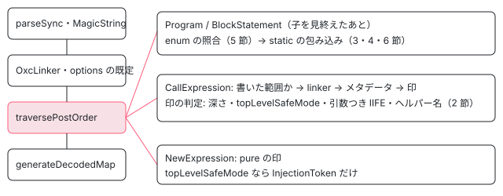

[目次](../README.md) › [oxc の変換と TypeScript の transformer の内側：ビルドが JavaScript を書き換える行](README.md) › 第 1 回 / 全 5 回

# transform の 1 回の走査：何を見て、どこに印を付けるか

> tools/oxc/oxc-transform.ts の transform が、oxc-parser で読んだ AST を 1 回たどる間に、linker の呼び出し・pure の印・メタデータの削除・静的メンバーと enum の包み直しを、どの判定（tslib と babel のヘルパー名、isPure、canWrapProperty、analyzeClassStaticProperties）で決め、magic-string に書くか。enum と隣り合うクラスで構文が壊れた件の直し（bad31421cb・199a864df9・abd8ec9f3e）、source map の作り方（87551ad5c5・18e4b93a9f）、Bun が // コメントの中の pure の注釈を読んだ件（675f1f5274）。

angular/angular-cli · 読了 約 13 分 · 中核 · [サイトで読む（デモが動きます）](https://angular-deep-dive-cyan.vercel.app/chapter/oxc-transform-pass)

---

この章で分かること: `tools/oxc/oxc-transform.ts` の `transform` が、1 回の木の走査のあいだに「この呼び出しに pure の印を付けてよいか」「このクラスは包んでよいか」「この 2 つの文は enum か」をどの関数で判定し、magic-string にどう書くかです。判定の関数（`isTslibHelperName`・`isPure`・`canWrapProperty`・`analyzeClassStaticProperties`）を 1 行ずつ読み、構文を壊した不具合の直し（abd8ec9f3e・bad31421cb・199a864df9）、source map の作り方（87551ad5c5・18e4b93a9f）、pure の注釈を書いた 1 行のコメント（675f1f5274）を git show で確かめます。最後に本物の `transform`（@angular/build 22.2.7）を 6 通りの入力で呼んだ記録を再生します。

読む対象は `packages/angular/build/src/tools/oxc/oxc-transform.ts`（748 行）と、それを呼ぶ `tools/esbuild/javascript-transformer-worker.ts` の後半です。どのファイルがワーカーに送られるか、4 つの書き換え（pure の印・static の包み込み・enum の包み込み・メタデータの削除）の大筋、`transform` の冒頭と `CallExpression` の枝は[「oxc の変換」の章](../cli/05-cli-javascript-transformer.md)にあります。この章はその内側の判定に入り、同じ説明を繰り返しません。linker（部分コンパイルの宣言の仕上げ）の側は[リンカーの章](../cli/06-cli-linker.md)と[第 3 回](03-oxc-linker-host.md)、走査そのもの（`traversePostOrder`）は[第 2 回](02-oxc-traversal.md)です。

1. **1. transform の 1 回の走査**（この章）
2. [2. 後順の走査](02-oxc-traversal.md)
3. [3. linker の読み書き](03-oxc-linker-host.md)
4. [4. TypeScript の transformer](04-oxc-ts-transformers.md)
5. [5. spec と issue](05-oxc-tests-issues.md)

> [!TIP]
> **新卒エンジニアへ**
>
> **AST**（抽象構文木）は、ソースを「呼び出し」「代入」「クラス」のような節点（ノード）の木にしたものです。oxc-parser は Rust で書かれたパーサーで、`parseSync` が ESTree という形の木を JavaScript のオブジェクトで返します。各ノードには元の文字列の中の位置 `start` と `end` があります。**magic-string** は、元の文字列を保ったまま「この位置の前に足す」「この範囲を消す」「この範囲を別の位置へ動かす」を記録し、最後に結果の文字列と source map を作るライブラリです。**pure の印**（`/*#__PURE__*/`）は、esbuild に「この呼び出しの戻り値が使われなければ、呼び出しごと消してよい」と伝える注釈です。

## 1. transform の順番と options

`transform(filename, code, options)` の中は、次の順に進みます。冒頭と走査の本体は[前のシリーズの章](../cli/05-cli-javascript-transformer.md)が引用したので、ここでは順番だけを並べ、行は後の節で引用する部分を指します。

1. **木を作る**

   `parseSync(filename, code, { range: true })` で 1 回だけ木を作り、`new MagicString(code)` を用意します。木は最後まで読むだけで、書き換えはすべて文字列の位置に対して行います。
2. **linker を用意する**

   `options.link` が真で、中身に部分宣言（`ɵɵngDeclare`）があるときだけ `OxcLinker` を作ります（[リンカーの章](../cli/06-cli-linker.md)）。
3. **options の既定を決める**

   下の表のとおりです。`wrapDecorators` は `sideEffects === false` と同じ値です。
4. **閉じた関数を定義する**

   `hasPureComment`・`markEdited`・`isAlreadyEdited`（4 節）・`adjustTypeScriptEnumsInStatements`（5 節）・`adjustStaticMembersInStatements`（6 節）。どれも `code` と `source` を閉じ込めた関数で、ファイルごとに作り直されます。
5. **後順に 1 回たどる**

   `traversePostOrder(program, visit)` の `visit` が、`Program` と `BlockStatement` では enum と static を、`CallExpression` では linker・メタデータの削除・pure の印を、`NewExpression` では pure の印を扱います。子が先・親が後なので、文の並びを見る時点で、その中の呼び出しはもう見終わっています（[第 2 回](02-oxc-traversal.md)）。
6. **source map を作って返す**

   8 節です。



*transform の中の順番。走査は 1 回で、訪ねたノードの種類で 3 つの仕事に分かれる*

📄 `angular-cli/packages/angular/build/src/tools/oxc/oxc-transform.ts` L17–30 （▶ の行: 18–24, 30）

```ts
17 │ export interface OxcTransformOptions {
18 ▶   sourcemap?: boolean;
19 ▶   sideEffects?: boolean;
20 ▶   topLevelSafeMode?: boolean;
21 ▶   pureAnnotate?: boolean;
22 ▶   link?: boolean;
23 ▶   jit?: boolean;
24 ▶   advancedOptimizations?: boolean;
25 │ }
26 │ 
27 │ /**
28 │  * A set of constructor names that are considered to be side-effect free.
29 │  */
30 ▶ const sideEffectFreeConstructors = new Set<string>(['InjectionToken']);
```

| option（17〜25 行目） | 省略したとき | ワーカーが渡す値 | 効くところ |
| --- | --- | --- | --- |
| `sourcemap` | 作らない | source map が有効で、node\_modules でないか `sourcemap.vendor` のとき真 | 8 節 |
| `sideEffects` | — | esbuild が package.json から判定した値（`false` / `true` / `undefined`） | `=== false` のときだけ `__decorate` も包む（6 節） |
| `topLevelSafeMode` | 偽 | node\_modules/@angular/ かつ sideEffects: false のファイルだけ偽、それ以外は真 | 真なら呼び出しに印を付けず、new は `InjectionToken`（30 行目）だけ |
| `pureAnnotate` | 真 | 渡さない | 偽にすると印を付けない（enum と static の spec が偽にして使う） |
| `link` / `jit` | 偽 | リンクするとき真 | linker |
| `advancedOptimizations` | 真 | 本番の最適化のときだけ真 | 偽なら linker だけが動く |

ワーカーの側でどう値を作るか（`safeAngularPackage` の判定）は[前の章の 3 節](../cli/05-cli-javascript-transformer.md)です。ワーカーが `pureAnnotate` を渡さないので、本番のビルドでは常に真です。spec の多くは `transform('test.js', input, { sourcemap: false })` のように `advancedOptimizations` を渡さずに呼び、この既定で 4 つの変換を走らせます。ワーカーは必ず値を渡します。

## 2. ヘルパー名の判定：tslib と Babel

📄 `angular-cli/packages/angular/build/src/tools/oxc/oxc-transform.ts` L32–56 （▶ の行: 35, 39, 45, 55）

```ts
32 │ /**
33 │  * A set of TypeScript helper function names used by the helper name matcher utility function.
34 │  */
35 ▶ const tslibHelpers = new Set<string>([
36 │   '__extends',
37 │   '__assign',
38 │   '__rest',
39 ▶   '__decorate',
40 │   '__param',
41 │   '__esDecorate',
42 │   '__runInitializers',
43 │   '__propKey',
44 │   '__setFunctionName',
45 ▶   '__metadata',
46 │   '__awaiter',
47 │   '__generator',
48 │   '__exportStar',
49 │   '__values',
50 │   '__read',
51 │   '__privateGet',
52 │   '__privateSet',
53 │   '__privateMethod',
54 │   '__addDisposableResource',
55 ▶   '__disposeResources',
56 │ ]);
```

📄 `angular-cli/packages/angular/build/src/tools/oxc/oxc-transform.ts` L58–88 （▶ の行: 65–66, 68–69, 72, 78, 87）

```ts
58 │ /**
59 │  * Determines whether an identifier name matches one of the TypeScript helper function names.
60 │  *
61 │  * @param name The identifier name to check.
62 │  * @returns True if the name matches a TypeScript helper name; otherwise, false.
63 │  */
64 │ function isTslibHelperName(name: string): boolean {
65 ▶   const nameParts = name.split('$');
66 ▶   const originalName = nameParts[0];
67 │ 
68 ▶   if (nameParts.length > 2 || (nameParts.length === 2 && !/^\d+$/.test(nameParts[1]))) {
69 ▶     return false;
70 │   }
71 │ 
72 ▶   return tslibHelpers.has(originalName);
73 │ }
74 │ 
75 │ /**
76 │  * A set of Babel helper function names that are intended to cause side effects.
77 │  */
78 ▶ const babelHelpers = new Set<string>(['_defineProperty']);
79 │ 
80 │ /**
81 │  * Determines whether an identifier name matches one of the Babel helper function names.
82 │  *
83 │  * @param name The identifier name to check.
84 │  * @returns True if the name matches a Babel helper name; otherwise, false.
85 │  */
86 │ function isBabelHelperName(name: string): boolean {
87 ▶   return babelHelpers.has(name);
88 │ }
```

トップレベルの呼び出しに pure の印を付ける枝（`topLevelSafeMode` が偽のとき）は、呼び出し先がこの 2 つの関数で真になる名前なら印を付けません。`__decorate`（39 行目）や `__metadata`（45 行目）は、クラスに書き込むことそのものが目的の呼び出しなので、消されると動きが変わるからです。

1. **65〜66 行目: `$` で割る**

   束ねたファイルで名前が重なったとき、`__decorate$1` のように `$` と数字が付いた名前に付け替えられます。先頭の部分を元の名前とみなします。
2. **68〜69 行目: 後ろが数字でなければヘルパーではない**

   `$` が 2 つ以上（`__decorate$1$2`）か、後ろが数字でない（`__decorate$foo`）なら偽です。spec の「annotates helper functions with non-numeric suffixes」と「does not annotate helper functions with numeric suffixes」がこの 2 通りです。
3. **72 行目: 20 個の名前の表と比べる**

   35〜56 行目の表です。
4. **78・87 行目: Babel は 1 つだけ、完全一致**

   `_defineProperty` だけで、`$` も数字も見ません。記録では `_defineProperty2(…)` に印が付きました（下のデモの 1 つ目）。

> **🧪 DEMO — ヘルパー名の判定をページの上で**
>
> `oxc-transform.ts` の 35〜56・64〜73・78・86〜88 行目を写した関数です。名前を入れてボタンを押すと、2 つの関数の結果が出ます。どちらかが真なら、その名前の呼び出しには印が付きません。
>
> （例: `__decorate$1`・`__decorate$foo`・`__assign$1$2`・`_defineProperty`・`_defineProperty2`）
>
> ▶ [このデモはサイトで動かせます](https://angular-deep-dive-cyan.vercel.app/chapter/oxc-transform-pass)

## 3. isPure と canWrapProperty：包んでよい値

📄 `angular-cli/packages/angular/build/src/tools/oxc/oxc-transform.ts` L129–156 （▶ の行: 137–139, 142, 144, 146, 148, 150, 152, 154）

```ts
129 │ /**
130 │  * Determines whether an AST node is considered safe for pure evaluation (side-effect free).
131 │  *
132 │  * @param node The AST node to check.
133 │  * @returns True if the node is side-effect free; otherwise, false.
134 │  */
135 │ function isPure(node: Node): boolean {
136 │   switch (node.type) {
137 ▶     case 'Identifier':
138 ▶     case 'Literal':
139 ▶       return true;
140 │     case 'BinaryExpression':
141 │     case 'LogicalExpression':
142 ▶       return isPure(node.left) && isPure(node.right);
143 │     case 'UnaryExpression':
144 ▶       return isPure(node.argument);
145 │     case 'MemberExpression':
146 ▶       return isPure(node.object) && (!node.computed || isPure(node.property));
147 │     case 'ObjectExpression':
148 ▶       return node.properties.every((p) => p.type === 'Property' && isPure(p.value));
149 │     case 'ArrayExpression':
150 ▶       return node.elements.every((e) => !e || isPure(e));
151 │     case 'ParenthesizedExpression':
152 ▶       return isPure(node.expression);
153 │     default:
154 ▶       return false;
155 │   }
156 │ }
```

`isPure` は「この式を評価しても外に何も起きない」と見なせるかを、ノードの種類だけで決めます。名前（`Identifier`）とリテラル（137〜139 行目）、その組み合わせ（2 項・論理・単項・メンバーの参照・オブジェクト・配列・括弧）だけが真で、呼び出し・`new`・関数・テンプレート文字列・カンマ式・スプレッドは 154 行目で偽になります。

> [!NOTE]
> **さらに深く**
>
> この判定は、以前の Babel のプラグインが使っていた `scope.isPure`（サイトの node\_modules の @babel/traverse 8.1.2 の `lib/index.js`）より広く真を返します。Babel はメンバーの参照を `Symbol.iterator` のような形しか純粋と見なさず、オブジェクトの計算されたキー（`{ [k]: 1 }`）の `k` も調べました。146 行目は `other.value` を真にし、148 行目はプロパティの値だけを見てキーを見ません。144 行目は演算子を見ないので、`delete a.b` も真です。記録のスクリプトの横で確かめたところ、`static y = { [register()]: 1 }` と `static y = delete globalThis.foo` のクラスは包まれ、`{ ...register() }`・テンプレート文字列・カンマ式は包まれませんでした。

📄 `angular-cli/packages/angular/build/src/tools/oxc/oxc-transform.ts` L158–191 （▶ の行: 165–166, 181–182, 185–187, 190）

```ts
158 │ /**
159 │  * Recursively unwraps any ParenthesizedExpression wrapper nodes to get the inner expression.
160 │  *
161 │  * @param node The potentially parenthesized AST node.
162 │  * @returns The inner non-parenthesized AST node.
163 │  */
164 │ function unwrapParentheses(node: Node): Node {
165 ▶   while (node && node.type === 'ParenthesizedExpression') {
166 ▶     node = node.expression;
167 │   }
168 │ 
169 │   return node;
170 │ }
171 │ 
172 │ /**
173 │  * Determines whether a class static property assignment is safe to be wrapped in a pure IIFE.
174 │  *
175 │  * @param propertyName The name of the property.
176 │  * @param assignmentValue The AST node representing the value assigned.
177 │  * @param code The source code of the file.
178 │  * @returns True if the property can be wrapped safely; otherwise, false.
179 │  */
180 │ function canWrapProperty(propertyName: string, assignmentValue: Node, code: string): boolean {
181 ▶   if (angularStaticsToWrap.has(propertyName)) {
182 ▶     return true;
183 │   }
184 │ 
185 ▶   const prefix = code.substring(Math.max(0, assignmentValue.start - 100), assignmentValue.start);
186 ▶   if (/(\/\*[\s\S]*?(?:@__PURE__|#__PURE__|@pureOrBreakMyCode)[\s\S]*?\*\/)\s*$/.test(prefix)) {
187 ▶     return true;
188 │   }
189 │ 
190 ▶   return isPure(assignmentValue);
191 │ }
```

1. **165〜166 行目: unwrapParentheses**

   oxc-parser は括弧を `ParenthesizedExpression` というノードとして残します。`((x))` の中身まで剥がす関数で、enum の照合（5 節）で何度も使います。
2. **181〜182 行目: Angular の static の名前なら無条件に真**

   `ɵcmp`・`ɵfac` など 8 つの `angularStaticsToWrap`（表は前の章の 6 節）です。値が `ɵɵdefineComponent(…)` の呼び出しでも包みます。
3. **185〜187 行目: 直前 100 文字に注釈があれば真**

   値の始まりから 100 文字前までを切り出し、末尾が `@__PURE__`・`#__PURE__`・`@pureOrBreakMyCode` を含むブロックコメントで終わるかを正規表現で見ます。TypeScript や esbuild が付けた注釈を信じる、ということです。
4. **190 行目: それ以外は isPure**

## 4. analyzeClassStaticProperties と、書いた範囲の記録

📄 `angular-cli/packages/angular/build/src/tools/oxc/oxc-transform.ts` L193–217 （▶ の行: 202, 204, 206–207, 212–213, 215–216）

```ts
193 │ /**
194 │  * Analyzes static properties inside a class body to determine if the class has any
195 │  * side-effecting static property initializers.
196 │  *
197 │  * @param classNode The Class AST node.
198 │  * @param code The source code of the file.
199 │  * @returns True if the class static properties are pure and can be wrapped; otherwise, false.
200 │  */
201 │ function analyzeClassStaticProperties(classNode: Node, code: string): boolean {
202 ▶   let shouldWrap = false;
203 │   const body = (classNode as Class).body.body;
204 ▶   for (const element of body) {
205 │     if (element.type === 'PropertyDefinition') {
206 ▶       if (!element.static) {
207 ▶         continue;
208 │       }
209 │ 
210 │       const key = element.key;
211 │       const value = element.value;
212 ▶       if (key.type === 'Identifier' && (!value || canWrapProperty(key.name, value, code))) {
213 ▶         shouldWrap = true;
214 │       } else {
215 ▶         shouldWrap = false;
216 ▶         break;
217 │       }
```

📄 `angular-cli/packages/angular/build/src/tools/oxc/oxc-transform.ts` L218–250 （▶ の行: 218, 220–221, 223–224, 236–239, 244–245, 249）

```ts
218 ▶     } else if (element.type === 'StaticBlock') {
219 │       const blockBody = element.body;
220 ▶       if (blockBody.length === 0) {
221 ▶         continue;
222 │       }
223 ▶       if (blockBody.length > 1) {
224 ▶         shouldWrap = false;
225 │         break;
226 │       }
227 │       const expressionStatement = blockBody[0];
228 │       if (expressionStatement && expressionStatement.type === 'ExpressionStatement') {
229 │         const assignment = expressionStatement.expression;
230 │         if (
231 │           assignment &&
232 │           assignment.type === 'AssignmentExpression' &&
233 │           assignment.left.type === 'MemberExpression'
234 │         ) {
235 │           const left = assignment.left;
236 ▶           if (left.object.type === 'ThisExpression' && left.property.type === 'Identifier') {
237 ▶             if (canWrapProperty(left.property.name, assignment.right, code)) {
238 ▶               shouldWrap = true;
239 ▶               continue;
240 │             }
241 │           }
242 │         }
243 │       }
244 ▶       shouldWrap = false;
245 ▶       break;
246 │     }
247 │   }
248 │ 
249 ▶   return shouldWrap;
250 │ }
```

クラスの本体（`static ɵcmp = …` のように中に書かれた形）を 1 つずつ見て、「包む価値があり、かつ包んでも安全か」を 1 つの真偽値にします。

1. **202 行目: 偽から始める**

   static が 1 つも無いクラスは偽のままです。メソッドや static でないフィールドは 206〜207 行目で飛ばします。
2. **212〜213 行目: 名前が Identifier で、値が無いか包める**

   `static x;`（値なし）も包める側です。`static #count = 0` の名前は `PrivateIdentifier` なので 215〜216 行目で偽になり、そこで打ち切ります。1 つでも包めないものがあればクラス全体が偽です。
3. **220〜224 行目: static ブロックは文が 1 つまで**

   空のブロックは飛ばし、2 文以上なら偽です。
4. **236〜239 行目: その 1 文が `this.x = 値` で、値が包めるなら真**

   `console.log(…)` のような文は 244〜245 行目で偽です。

> [!WARNING]
> **ハマりどころ**
>
> 212 行目は `key.type` だけを見て、キーが計算されたもの（`static [k] = 1`）かを見ません。oxc-parser は `[k]` のキーも `Identifier` にするので、名前 `k` のプロパティとして判定されます。記録では `class E { static [key] = 1; }` が包まれました（デモの 4 つ目）。名前が Angular の static と同じ変数なら、181 行目で値を見ずに真になります（`static [ɵfac] = register()` も包まれることを Node で確かめました）。

📄 `angular-cli/packages/angular/build/src/tools/oxc/oxc-transform.ts` L301–322 （▶ の行: 301, 309–310, 320–321）

```ts
301 ▶   const editedRanges: { start: number; end: number }[] = [];
302 │ 
303 │   /**
304 │    * Records a range in the source code that has been modified, preventing subsequent nested mutations.
305 │    *
306 │    * @param start The start index of the modified range.
307 │    * @param end The end index of the modified range.
308 │    */
309 ▶   function markEdited(start: number, end: number) {
310 ▶     editedRanges.push({ start, end });
311 │   }
312 │ 
313 │   /**
314 │    * Checks if the specified range falls inside an already modified section of code.
315 │    *
316 │    * @param start The start index of the range.
317 │    * @param end The end index of the range.
318 │    * @returns True if the range is already edited; otherwise, false.
319 │    */
320 ▶   function isAlreadyEdited(start: number, end: number): boolean {
321 ▶     return editedRanges.some((r) => start >= r.start && end <= r.end);
322 │   }
```

`markEdited` は書き換えた範囲を配列に足し、`isAlreadyEdited` は「この範囲は、どこかの書き換えた範囲にまるごと入っているか」を返します（321 行目）。`CallExpression` と `NewExpression` の枝の最初で呼び、すでに書き換えた範囲の中には印を付けません。magic-string 1.4.1 は、一度 `overwrite` した範囲の内側に `appendLeft` や `overwrite` をすると「cannot split a chunk that has already been edited」の例外を投げます（Node で確かめた）。この確認は、その内側に書きに行かないための門でもあります。走査が後順になってから、この確認が真になる場面がどれだけ減ったかは[第 2 回](02-oxc-traversal.md)で扱います。

## 5. enum の照合：TypeScript の形と Crockford 風

📄 `angular-cli/packages/angular/build/src/tools/oxc/oxc-transform.ts` L330–362 （▶ の行: 331, 335–336, 338, 342–344, 349, 354, 358–359）

```ts
330 │   function adjustTypeScriptEnumsInStatements(body: Node[]) {
331 ▶     for (let i = 0; i < body.length - 1; i++) {
332 │       const statement = body[i];
333 │       let declStatement = statement;
334 │       if (
335 ▶         statement.type === 'ExportNamedDeclaration' &&
336 ▶         statement.declaration?.type === 'VariableDeclaration'
337 │       ) {
338 ▶         declStatement = statement.declaration;
339 │       }
340 │ 
341 │       if (
342 ▶         declStatement.type !== 'VariableDeclaration' ||
343 ▶         declStatement.kind !== 'var' ||
344 ▶         declStatement.declarations.length !== 1
345 │       ) {
346 │         continue;
347 │       }
348 │       const decl = declStatement.declarations[0];
349 ▶       if (decl.init || decl.id.type !== 'Identifier') {
350 │         continue;
351 │       }
352 │ 
353 │       const nextStatement = body[i + 1];
354 ▶       if (nextStatement.type !== 'ExpressionStatement') {
355 │         continue;
356 │       }
357 │ 
358 ▶       const nextExpr = unwrapParentheses(nextStatement.expression);
359 ▶       if (nextExpr.type !== 'CallExpression' || nextExpr.arguments.length !== 1) {
360 │         continue;
361 │       }
362 │ 
```

📄 `angular-cli/packages/angular/build/src/tools/oxc/oxc-transform.ts` L363–393 （▶ の行: 363–364, 368–369, 373–374, 378, 380–381, 383, 389）

```ts
363 ▶       const arg = unwrapParentheses(nextExpr.arguments[0]);
364 ▶       if (arg.type !== 'LogicalExpression' || arg.operator !== '||') {
365 │         continue;
366 │       }
367 │ 
368 ▶       const argLeft = unwrapParentheses(arg.left);
369 ▶       if (argLeft.type !== 'Identifier' || argLeft.name !== decl.id.name) {
370 │         continue;
371 │       }
372 │ 
373 ▶       const rightCallArgument = unwrapParentheses(arg.right);
374 ▶       if (rightCallArgument.type !== 'AssignmentExpression') {
375 │         continue;
376 │       }
377 │ 
378 ▶       const callee = unwrapParentheses(nextExpr.callee);
379 │       if (
380 ▶         callee.type !== 'FunctionExpression' ||
381 ▶         callee.params.length !== 1 ||
382 │         !callee.body ||
383 ▶         callee.body.type !== 'BlockStatement'
384 │       ) {
385 │         continue;
386 │       }
387 │ 
388 │       const param = callee.params[0];
389 ▶       if (param.type !== 'Identifier') {
390 │         continue;
391 │       }
392 │       const paramName = (param as BindingIdentifier).name;
393 │ 
```

📄 `angular-cli/packages/angular/build/src/tools/oxc/oxc-transform.ts` L394–414 （▶ の行: 397–398, 403, 405–406, 412）

```ts
394 │       // Check if all statements in body are pure assignments
395 │       let hasElements = false;
396 │       let allPure = true;
397 ▶       for (const enumStatement of callee.body.body) {
398 ▶         if (enumStatement.type !== 'ExpressionStatement') {
399 │           allPure = false;
400 │           break;
401 │         }
402 │ 
403 ▶         const enumValueAssignment = unwrapParentheses(enumStatement.expression);
404 │         if (
405 ▶           enumValueAssignment.type !== 'AssignmentExpression' ||
406 ▶           !isPure(enumValueAssignment.right)
407 │         ) {
408 │           allPure = false;
409 │           break;
410 │         }
411 │ 
412 ▶         hasElements = true;
413 │       }
414 │ 
```

文の並びを 2 つずつ見て、`var X;` と `(function (X) { … })(X || (X = {}));` の組を探します。

1. **331 行目: 最後の 1 つ手前まで**

   次の文を見るので `body.length - 1` までです。335〜338 行目で `export var X;` の中の宣言も見ます。
2. **342〜349 行目: 初期値の無い var が 1 つ**

   `let`・`const` や、`var a, b;` は対象外です。
3. **354〜359 行目: 次の文が、引数 1 つの呼び出し**

   358 行目で外側の括弧を剥がします。Crockford 風（199a864df9 の言葉。`(function () {…}())` のように、呼び出しの括弧まで外側の括弧の内側に入れる書き方）では、文の式が `ParenthesizedExpression` で、その中が `CallExpression` です。剥がすので、2 つの形が同じ枝に入ります。
4. **363〜374 行目: 引数が `X || (X = …)`**

   364 行目で `||`、368〜369 行目で左が同じ名前、373〜374 行目で右が代入であることを確かめます。右は `X = exports.X = {}` のような連なった代入でもかまいません。
5. **378〜389 行目: 呼び出し先が、引数 1 つの function 式**

   アロー関数は対象外です。
6. **397〜412 行目: 本体がすべて「純粋な値の代入」**

   403〜406 行目で、各文が代入で、その右辺（`= "Off"` の側）が `isPure` であることを見ます。1 つも文が無ければ（412 行目の `hasElements`）対象外です。

ここを通った組を印付きの IIFE に書き換える手順（`remove`・`appendRight`・`overwrite`・`move`）は[前の章の 7 節](../cli/05-cli-javascript-transformer.md)が追っています。この 29 行は、2026 年 8 月に 2 回直されました。

📄 `引数の X || (X = …) を書き直すときの括弧（bad31421cb・a3c5817e52）`

```
$ git show bad31421cb -- …/oxc/oxc-transform.ts   # 2026-08-05（抜粋）
-        s.overwrite(
-          arg.right.start,
-          arg.right.end,
-          code.substring(rightCallArgument.right.start, rightCallArgument.right.end),
+        let replacement = code.substring(
+          rightCallArgument.right.start,
+          rightCallArgument.right.end,
         );
+        if (rightCallArgument.right.type === 'AssignmentExpression') {
+          replacement = `(${replacement})`;
+        }
+        s.overwrite(arg.right.start, arg.right.end, replacement);
$ git show a3c5817e52 -- …/oxc/oxc-transform.ts   # 同じ日（抜粋）
-        if (rightCallArgument.right.type === 'AssignmentExpression') {
+        if (unwrapParentheses(rightCallArgument.right).type === 'AssignmentExpression') {
```

`X || (exports.X = X = {})` の右辺の `X = …` を消して `exports.X = {}` だけを残すとき、残りがさらに代入なら括弧で包まないと `X || exports.X = {}` になり、`||` の方が強く結び付いて構文が壊れます。bad31421cb がそれを直し、a3c5817e52 が判定を `unwrapParentheses` 越しにしました。

📄 `Crockford 風の enum の左の括弧（199a864df9、Fixes #33785）`

```
$ git show 199a864df9 -- packages/angular/build/src/tools/oxc/oxc-transform.ts   # 2026-08-06（抜粋）
-      // 1. Remove only the trailing characters/semicolon of the expression statement
+      // 1. Remove leading/trailing characters/parentheses of the expression statement
+      s.remove(nextStatement.start, nextExpr.start);
       s.remove(nextExpr.end, nextStatement.end);
-      markEdited(nextExpr.end, nextStatement.end);
+      markEdited(nextStatement.start, nextStatement.end);
 ...
       s.move(nextExpr.start, nextExpr.end, decl.id.end);
       s.appendLeft(decl.id.end, ' = /*#__PURE__*/ ');
-      markEdited(nextExpr.start, nextExpr.end);
```

直す前は、呼び出しの後ろ（`));` の側）だけを消していました。Crockford 風では文の先頭の `(` が呼び出しの外にあるので、呼び出しを `var X` の後ろへ `move` すると、元の位置に `(` が 1 つ残ります。下のデモの enum の記録で、199a864df9 の前の版（`git show 199a864df9^:…` で取り出した `oxc-transform.ts` を Node の型の取り除きで動かしたもの）が実際に `(` を残し、oxc-parser で読み直すと `Unexpected token` になることを見られます。

> [!WARNING]
> **ハマりどころ**
>
> 403〜406 行目は右辺だけを見ます。TypeScript は `enum Reg { A = register("a") }` を `Reg[Reg["A"] = register("a")] = "A";` と出力するので、呼び出しが左辺の `[…]` の中に入り、右辺は文字列 `"A"` です（サイトの node\_modules の TypeScript 6.0.3 の `transpileModule` で確かめた）。そのため、値に呼び出しを持つ enum も印付きの IIFE に包まれます。記録の 6 つ目の `Live`（`Date.now()`）がそれで、使われなければ esbuild が呼び出しごと消せる形になります。Babel の版（`adjust-typescript-enums.ts` の `enumValueAssignment.get('right').isPure()`）も右辺だけを見ていました。spec の「does not wrap TypeScript enums with side effect values」（213 行目の it）は右辺が `console.log('foo')` の形だけを確かめています。

## 6. 静的メンバーの包み込み：4 つのクラスの形

📄 `angular-cli/packages/angular/build/src/tools/oxc/oxc-transform.ts` L452–489 （▶ の行: 453, 460, 463–465, 470–472, 477, 479, 486）

```ts
452 │   function adjustStaticMembersInStatements(body: Node[]) {
453 ▶     for (let i = 0; i < body.length; i++) {
454 │       const statement = body[i];
455 │       let classNode: Node | null = null;
456 │       let isExportDefault = false;
457 │       let isExportNamed = false;
458 │       let isVariableClass = false;
459 │       let classIdName = '';
460 ▶       if (statement.type === 'ClassDeclaration') {
461 │         classNode = statement;
462 │         classIdName = classNode.id?.name || '';
463 ▶       } else if (
464 ▶         statement.type === 'ExportNamedDeclaration' &&
465 ▶         statement.declaration?.type === 'ClassDeclaration'
466 │       ) {
467 │         classNode = statement.declaration;
468 │         classIdName = classNode.id?.name || '';
469 │         isExportNamed = true;
470 ▶       } else if (
471 ▶         statement.type === 'ExportDefaultDeclaration' &&
472 ▶         statement.declaration?.type === 'ClassDeclaration'
473 │       ) {
474 │         classNode = statement.declaration;
475 │         classIdName = classNode.id?.name || '';
476 │         isExportDefault = true;
477 ▶       } else if (statement.type === 'VariableDeclaration' && statement.declarations.length === 1) {
478 │         const decl = statement.declarations[0];
479 ▶         if (decl.init && decl.init.type === 'ClassExpression' && decl.id.type === 'Identifier') {
480 │           classNode = decl.init;
481 │           classIdName = decl.id.name;
482 │           isVariableClass = true;
483 │         }
484 │       }
485 │ 
486 ▶       if (!classNode || !classIdName) {
487 │         continue;
488 │       }
489 │ 
```

クラスは 4 つの形で見つけます。`class X {}`（460 行目）、`export class X {}`（463〜465 行目）、`export default class X {}`（470〜472 行目）、`let X = class X {}`（477〜479 行目、TypeScript がデコレーター付きのクラスを出すときの形）です。名前の無いクラスは 486 行目で飛ばします。

📄 `angular-cli/packages/angular/build/src/tools/oxc/oxc-transform.ts` L490–521 （▶ の行: 490–491, 493, 495–496, 502, 505, 510–511, 513, 519）

```ts
490 ▶       const wrapStatementPaths: { statement: Node; type: 'wrap' | 'decorate' | 'elide' }[] = [];
491 ▶       let hasPotentialSideEffects = false;
492 │ 
493 ▶       for (let j = i + 1; j < body.length; j++) {
494 │         const nextStatement = body[j];
495 ▶         if (nextStatement.type !== 'ExpressionStatement') {
496 ▶           break;
497 │         }
498 │ 
499 │         const nextExpression = nextStatement.expression;
500 │ 
501 │         // Case 1: __decorate(...)
502 ▶         if (nextExpression.type === 'CallExpression') {
503 │           if (
504 │             nextExpression.callee.type !== 'Identifier' ||
505 ▶             nextExpression.callee.name !== '__decorate'
506 │           ) {
507 │             break;
508 │           }
509 │ 
510 ▶           if (wrapDecorators) {
511 ▶             wrapStatementPaths.push({ statement: nextStatement, type: 'decorate' });
512 │           } else {
513 ▶             hasPotentialSideEffects = true;
514 │           }
515 │           continue;
516 │         }
517 │ 
518 │         // Case 2: AssignmentExpression
519 ▶         if (nextExpression.type !== 'AssignmentExpression') {
520 │           break;
521 │         }
```

📄 `angular-cli/packages/angular/build/src/tools/oxc/oxc-transform.ts` L522–551 （▶ の行: 525, 527, 530, 535–536, 538, 544, 546–547, 549）

```ts
522 │ 
523 │         const left = nextExpression.left;
524 │ 
525 ▶         if (left.type === 'Identifier') {
526 │           if (
527 ▶             left.name !== classIdName ||
528 │             nextExpression.right.type !== 'CallExpression' ||
529 │             nextExpression.right.callee.type !== 'Identifier' ||
530 ▶             nextExpression.right.callee.name !== '__decorate'
531 │           ) {
532 │             break;
533 │           }
534 │ 
535 ▶           if (wrapDecorators) {
536 ▶             wrapStatementPaths.push({ statement: nextStatement, type: 'decorate' });
537 │           } else {
538 ▶             hasPotentialSideEffects = true;
539 │           }
540 │           continue;
541 │         }
542 │ 
543 │         if (
544 ▶           left.type !== 'MemberExpression' ||
545 │           left.object.type !== 'Identifier' ||
546 ▶           left.object.name !== classIdName ||
547 ▶           left.property.type !== 'Identifier'
548 │         ) {
549 ▶           break;
550 │         }
551 │ 
```

1. **493〜496 行目: クラスの直後の式の文だけ**

   式の文でない文（宣言など）が来たら、そこで探すのをやめます。
2. **502〜516 行目: `__decorate(…)` の呼び出し**

   510〜511 行目、`wrapDecorators`（`sideEffects === false`）なら包む側に入れます。そうでなければ 513 行目で「副作用があるかもしれない」にします。呼び出し先がほかの名前なら 505〜507 行目で探すのをやめます。
3. **525〜541 行目: `X = __decorate([…], X)`**

   `let X = class X {}` の後ろに TypeScript が出す形です。扱いは前の段と同じです。
4. **543〜550 行目: `X.名前 = 値`**

   左が「このクラスの名前 . Identifier」でなければやめます。その先（消す・包む・副作用の 3 つに分ける）は前の章の 6 節が引用しています。

📄 `angular-cli/packages/angular/build/src/tools/oxc/oxc-transform.ts` L582–609 （▶ の行: 583–586, 590, 592–593, 595, 599–600, 603–605）

```ts
582 │       ) {
583 ▶         const lastStatement =
584 ▶           activeWrapPaths.length > 0
585 ▶             ? activeWrapPaths[activeWrapPaths.length - 1].statement
586 ▶             : classNode;
587 │ 
588 │         if (isExportDefault) {
589 │           // 1. Remove `export default `
590 ▶           source.overwrite(statement.start, classNode.start, '');
591 │           // 2. Wrap in IIFE
592 ▶           source.appendRight(classNode.start, `let ${classIdName} = /*#__PURE__*/ (() => {\n`);
593 ▶           source.appendLeft(
594 │             lastStatement.end,
595 ▶             `\nreturn ${classIdName};\n})();\nexport { ${classIdName} as default };`,
596 │           );
597 │         } else if (isExportNamed) {
598 │           // 1. Export is kept, turn `class` into `let ClassName = IIFE`
599 ▶           source.appendRight(classNode.start, `let ${classIdName} = /*#__PURE__*/ (() => {\n`);
600 ▶           source.appendLeft(lastStatement.end, `\nreturn ${classIdName};\n})();`);
601 │         } else if (isVariableClass) {
602 │           // 2. Wrap class inside init: `(() => { let ClassName = class ClassName {}; return ClassName; })()`
603 ▶           source.appendRight(classNode.start, `/*#__PURE__*/ (() => {\nlet ${classIdName} = `);
604 ▶           const terminator = activeWrapPaths.length === 0 ? ';' : '';
605 ▶           const iifeClosing = activeWrapPaths.length === 0 ? '})()' : '})();';
606 │           source.appendLeft(
607 │             lastStatement.end,
608 │             `${terminator}\nreturn ${classIdName};\n${iifeClosing}`,
609 │           );
```

📄 `angular-cli/packages/angular/build/src/tools/oxc/oxc-transform.ts` L616–628 （▶ の行: 616, 619–620, 622–624）

```ts
616 ▶         markEdited(statement.start, lastStatement.end);
617 │ 
618 │         // Fast-forward outer loop index to skip the statements we wrapped
619 ▶         i += wrapStatementPaths.length;
620 ▶       } else if (isExportDefault && !hasPotentialSideEffects) {
621 │         // Splitting default export even when not wrapped
622 ▶         source.overwrite(statement.start, classNode.start, '');
623 ▶         source.appendLeft(classNode.end, `\nexport { ${classIdName} as default };`);
624 ▶         markEdited(statement.start, classNode.end);
625 │       }
626 │     }
627 │   }
628 │ 
```

1. **583〜586 行目: IIFE の閉じる位置**

   包む代入があれば最後の代入の後ろ、無ければクラスの後ろです。
2. **590〜595 行目: export default**

   `export default ` を消し（590 行目）、`let X = …` に包んでから、最後に `export { X as default }` を足します。`export default` の後ろには `let` を書けないからです。
3. **599〜600 行目: export**

   `export` は残り、`export let X = /*#__PURE__*/ (() => {` になります。
4. **603〜605 行目: `let X = class X {}`**

   初期値の側を IIFE にし、中で `let X = class X {}` を作り直します。包む代入が無いと元の文の `;` が IIFE の外になるので、604〜605 行目で `;` と `})()` を出し分けます。
5. **616・619 行目: 包んだ範囲を記録し、外の繰り返しを先へ進める**
6. **620〜624 行目: 包まない export default も分ける**

   副作用が無く、包むものも無い `export default class` は、`class X {}` と `export { X as default }` の 2 つの文にします。

開く側を `appendRight`、閉じる側を `appendLeft` にしているのは、abd8ec9f3e の直しです。

📄 `隣り合ったクラスの IIFE が入れ子に崩れた件（abd8ec9f3e、#33699）`

```
$ git show abd8ec9f3e --format=%B   # 2026-07-30「prevent IIFE wrapper interleaving for adjacent classes in minified files」（抜粋）
In minified bundles where sibling top-level class declarations are adjacent without whitespace
(classA.end === classB.start), magic-string emits appendLeft content before appendRight content
at a shared index. ...
This change swaps the insertion methods to use appendRight for the opening fragment and
appendLeft for the closing fragment ...
closes #33699
```

magic-string の `appendLeft(i, s)` は位置 `i` の左の塊の後ろに、`appendRight(i, s)` は右の塊の前に足します。minify されたファイルで `class A{…}class B{…}` のように A の終わりと B の始まりが同じ位置だと、直す前（開く側が `appendLeft`、閉じる側が `appendRight`）は B を開く文字列が A を閉じる文字列より先に出ていました。いまは「A を閉じる（左に付く）→ B を開く（右に付く）」の順になります。spec の「wraps adjacent class declarations without interleaving」などの 5 つの it がこの直しで足されました。

📄 `pure の注釈を書いた 1 行のコメント（675f1f5274、#33973）`

```
$ git show 675f1f5274   # 2026-09-03「avoid pure comment pattern in oxc transform」Fixes #33973（全部）
In Bun 1.4.0, single-line comments containing `/*#__PURE__*/` immediately preceding a call expression
cause Bun's lexer/transpiler to interpret the call as pure and drop it during dead code elimination
when its return value is unused.

 packages/angular/build/src/tools/oxc/oxc-transform.ts | 2 +-
@@ -599,7 +599,7 @@
         } else if (isVariableClass) {
-          // Wrap class inside init: `/*#__PURE__*/ (() => { let ClassName = class ClassName {}; return ClassName; })()`
+          // 2. Wrap class inside init: `(() => { let ClassName = class ClassName {}; return ClassName; })()`
           source.appendRight(classNode.start, `/*#__PURE__*/ (() => {\nlet ${classIdName} = `);
```

この直しは出力の形を変えていません。603 行目の上の `//` のコメントに `/*#__PURE__*/ (() => …` と書いてあり、それが @angular/build 自身のコンパイル済みの `oxc-transform.js` にも残っていました。#33973 の報告者の環境（Bun 1.4.0 で `ng build` を動かす）では、Bun が `//` の中の `/*#__PURE__*/` を次の行の呼び出し（603 行目の `source.appendRight(…)`）への注釈と読み、戻り値が使われないその呼び出しを消していました（issue の中の調査のコメント）。IIFE の開く側が書かれず、閉じる側の `})();` だけが残るので、esbuild が `Unexpected "}"` で止まります。コメントから注釈の文字列を外して直しました。サイトの node\_modules の 22.2.7 の `oxc-transform.js` では、このコメントは `` // 2. Wrap class inside init: `(() => { … })()` `` になっています（509 行目）。

## 7. source map：boundary と、ワーカーでの合成

📄 `angular-cli/packages/angular/build/src/tools/oxc/oxc-transform.ts` L738–748 （▶ の行: 739–741, 745–746）

```ts
738 │   let map: DecodedSourceMap | undefined;
739 ▶   if (options.sourcemap) {
740 ▶     const rawMap = source.generateDecodedMap({ hires: 'boundary', source: filename });
741 ▶     map = { ...rawMap, version: 3 };
742 │   }
743 │ 
744 │   return {
745 ▶     code: source.toString(),
746 ▶     map,
747 │   };
748 │ }
```

📄 `angular-cli/packages/angular/build/src/tools/esbuild/javascript-transformer-worker.ts` L244–263 （▶ の行: 245–246, 250, 252, 256, 258）

```ts
244 │   if (useInputSourcemap) {
245 ▶     const baseMap = coverageMap ?? options.inputSourceMap ?? loadInputSourceMap(filename, data);
246 ▶     if (maps.length > 0 || coverageMap) {
247 │       if (!options.isAlreadyStripped) {
248 │         code = removeSourceMappingURL(code);
249 │       }
250 ▶       const remappingChain: (DecodedSourceMap | EncodedSourceMap)[] = maps.reverse();
251 │       if (baseMap) {
252 ▶         remappingChain.push(baseMap);
253 │       }
254 │ 
255 │       if (remappingChain.length > 0) {
256 ▶         const finalMap = remapping(remappingChain, () => null).toString();
257 │         const base64Map = Buffer.from(finalMap).toString('base64');
258 ▶         code += `\n//# sourceMappingURL=data:application/json;charset=utf-8;base64,${base64Map}`;
259 │       }
260 │     }
261 │ 
262 │     return code;
263 │   }
```

1. **740 行目: 文字列にしない map を作る**

   `generateDecodedMap` は、mappings を VLQ（source map の 1 文字ずつの符号）に符号化しない、数の配列のままの map を返します。87551ad5c5 が `generateMap` から替えました。ワーカーはすぐに `@ampproject/remapping` で合成するので、符号化してすぐ戻す手間を省けます。
2. **740 行目: `hires: 'boundary'`**

   18e4b93a9f が `hires: true`（1 文字ごとに対応を作る）から替えました。語の境目にだけ対応を作るので、mappings の数が減ります。記録では、同じ書き換えで数がおよそ半分でした（下のデモの 5 段目）。
3. **741 行目: `version: 3` を足す**

   magic-string の decoded map には `version` がないので、`DecodedSourceMap` の型に合わせて足します。spec の「should generate a decoded sourcemap when sourcemap option is enabled」が `version` が 3 であることを見ます。
4. **ワーカー 245〜258 行目: 元の map と合成する**

   245 行目でファイルの元の map（または coverage の map）を取り、250 行目で集めた map を逆順にし、252 行目で元の map を最後に足して、256 行目で 1 つに合成します。258 行目で base64 にしてファイルの末尾に書きます。

> **🧪 DEMO — 本物の transform を 6 通りの入力で（記録の再生）**
>
> `<work>/oxc-demo/a/record-transform.mjs` が、@angular/build 22.2.7（oxc-parser 0.156.0・magic-string 1.4.1）の `transform` を Node v24.22.1 で呼んだ記録です。判定の列は、コンパイル済みの `oxc-transform.js` の 16〜231 行目（モジュールの先頭の `const` と `function`）をそのまま取り出して評価した関数を、同じ木に当てた結果です。`functionDepth` と `classDepth` は、`transform` が実際に訪ねたときのコンテキストを `traversePostOrder` を包んで記録したものです。
>
> ワーカーが node\_modules/@angular/ かつ sideEffects: false のファイルに渡す options（topLevelSafeMode: false）。
>
> ▶ [このデモはサイトで動かせます](https://angular-deep-dive-cyan.vercel.app/chapter/oxc-transform-pass)

## テストと直し方

この章の行を固めている spec は次のとおりです（44129f66a3 で `grep -n` したもの。パスは `packages/angular/build/src/tools/oxc/` から）。どれも入力と期待する出力の対で、`transform` を直接呼びます。

| spec | describe（行）と it の数 | この章で固めていること |
| --- | --- | --- |
| `pure-toplevel-functions_oxc_spec.ts` | `pure-toplevel-functions oxc-transform implementation`（47）、20 | 2 節: tslib（127 行目の it）・`_defineProperty`（139）・数字でない後ろ（162）・数字の後ろ（170）。`topLevelSafeMode: true` の 3 つ（175〜193） |
| `adjust-static-class-members_oxc_spec.ts` | `adjust-static-class-members oxc-transform implementation`（42）、52 | 3・4・6 節: Angular の static・注釈・static ブロック・4 つのクラスの形・`__decorate` と `wrapDecorators`・隣り合ったクラス |
| `adjust-typescript-enums_oxc_spec.ts` | `adjust-typescript-enums oxc-transform implementation`（36）、17 | 5 節: 副作用のある右辺（213）・括弧（304）・Crockford 風（324・365）・連なった代入（284） |
| `elide-angular-metadata_oxc_spec.ts` | `elide-angular-metadata oxc-transform implementation`（41）、7 | メタデータの削除（前の章の 8 節） |
| `oxc-transform_spec.ts` | `oxc-transform`（11）の `sourcemaps`（12）と `linking and unified passes`（24）、4 | 7 節の decoded map（13 行目の it）と、リンクと最適化を 1 回で行うこと（51 行目の it） |

📄 `走らせたコマンド`

```
cd ~/angular-research/angular-cli-fix   # 44129f66a3（../angular-cli と同じ版）
pnpm bazel test //packages/angular/build:test --nocache_test_results --test_output=all '--test_arg=--filter=oxc-transform'
```

📄 `結果（出力から抜き出したもの）`

```
（4 つの shard）Ran 25 of 540 specs ×4 — どれも 25 specs, 0 failures（合わせて 100 specs）
//packages/angular/build:test                                            PASSED in 0.7s
  Stats over 4 runs: max = 0.7s, min = 0.7s, avg = 0.7s, dev = 0.0s
```

`--filter=oxc-transform` は 5 つの describe の名前のどれにも入っている語なので、5 つのファイルの it が全部走ります（52 + 17 + 7 + 20 + 4 = 100）。shard ごとに 540 のうち 25 が走りました。

直すとしたら、次の場所になります。

- **値に呼び出しを持つ enum**: `adjustTypeScriptEnumsInStatements` の 403〜406 行目。左辺の `E[E["A"] = 値]` の内側の代入の右辺も `isPure` で見る条件を足す形です。spec は `adjust-typescript-enums_oxc_spec.ts` の 213 行目の it の隣に、`Reg[Reg["A"] = register("a")] = "A";` の入力が NO\_CHANGE になる it を足します。下の実験で、条件を足した写しが `Mode` と `Side` を今までどおり包み、`Live` と `Reg` を残すことを確かめました。
- **計算されたキー**: `analyzeClassStaticProperties` の 212 行目と、`adjustStaticMembersInStatements` の 543〜547 行目。`element.computed`（クラスの外の代入なら `left.computed`）が真のときは包めない側に倒す形です。spec は `adjust-static-class-members_oxc_spec.ts` に足します。
- **isPure**: 135〜156 行目。148 行目に `p.computed` のときキーも見る条件を、144 行目に `delete` を除く条件を足す形です。`isPure` を直接見る unit の spec は無いので、static の spec に入力を足して確かめます。

📄 `条件を足した写しで変換した実験（<work>/oxc-demo/a/patched/）`

```
// <work>/oxc-demo/a/patched/: 22.2.7 の oxc-transform.js（コンパイル済み）の写しの 351 行目の条件に、次を足して同じ入力を変換した実験
                    !isPure(enumValueAssignment.right) ||
+                   (enumValueAssignment.left.type === 'MemberExpression' &&
+                       enumValueAssignment.left.computed &&
+                       unwrapParentheses(enumValueAssignment.left.property).type === 'AssignmentExpression' &&
+                       !isPure(unwrapParentheses(enumValueAssignment.left.property).right))) {
// 結果: Mode と Side は今までどおり包まれ、Live（Date.now()）と Reg（register("a")）は元のまま残った
```

## ここまでの呼び出し

- `transformJavaScriptImpl()` — tools/esbuild/javascript-transformer-worker.ts — *前の章の 3 節*
  - `transformWithOxc(filename, code, { link, jit, advancedOptimizations, sourcemap, sideEffects, topLevelSafeMode })` — oxc-transform.ts 263
    - `parseSync()`・`new MagicString()`・`new OxcLinker()` — 264〜268
    - `traversePostOrder(program, visit)` — traversal.ts 308 — *第 2 回*
      - `Program` / `BlockStatement` → `adjustTypeScriptEnumsInStatements()` — 330 — *unwrapParentheses・isPure*
      - `Program` / `BlockStatement` → `adjustStaticMembersInStatements()` — 452 — *canWrapProperty・analyzeClassStaticProperties・markEdited*
      - `CallExpression` → `isAlreadyEdited()` → linker → メタデータ → 印 — 639〜706 — *isTslibHelperName・isBabelHelperName*
      - `NewExpression` → 印 — 708〜734 — *sideEffectFreeConstructors*
    - `source.generateDecodedMap({ hires: 'boundary' })` — 740
  - `remapping(remappingChain)` — javascript-transformer-worker.ts 256

## 聞かれそうな質問

**Q. sideEffects: false を書いたライブラリなのに、トップレベルの関数の呼び出しに印が付きません。**

ワーカーが `topLevelSafeMode` を偽にするのは node\_modules/@angular/ のファイルだけで、それ以外は `sideEffects` に関係なく真だからです（1 節の表）。真のときは呼び出しには印を付けず、`new InjectionToken`（30 行目）だけに付けます。`sideEffects: false` で変わるのは 510〜511 行目の `__decorate` を包むかどうかです（記録の 4 つ目と 5 つ目の違い）。他のパッケージにも全部の呼び出しへの印を許す設定を求めた #33893 は、package.json の `sideEffects` はモジュール単位の主張で、文の単位の保証ではないという理由で NOT\_PLANNED で閉じられました。

**Q. `__decorate$1` と `__decorate$foo` で扱いが違うのはなぜですか？**

68 行目で、`$` の後ろが数字だけのときだけ元の名前の付け替えと見なすからです。`__decorate$1` は `__decorate` として 72 行目で表に当たり印が付かず、`__decorate$foo` は別の関数として印が付きます。上のヘルパー名のデモで確かめられます。

**Q. static ɵcmp = ɵɵdefineComponent(…) は呼び出しなのに、なぜ包んでよいのですか？**

181〜182 行目で、Angular の static の名前（`angularStaticsToWrap`）なら値を見ずに真を返すからです。コンパイラが出すこれらの定義は、外に何も書き込まないことを Angular が知っているので、名前だけで信じます。名前が表に無い static は 185〜187 行目の注釈か 190 行目の `isPure` で決まり、`static created = Date.now()` は包みません（記録の 4 つ目）。

**Q. クラスに static #count = 0 があると、ほかの static が全部純粋でも包まれません。**

212 行目の `key.type === 'Identifier'` が `PrivateIdentifier` で偽になり、215〜216 行目で `shouldWrap` を偽にして打ち切るからです。`class P { static #count = 0; static y = 1; }` が元のまま出ることを Node で確かめました。

**Q. source map の hires: 'boundary' で、デバッグの精度は落ちませんか？**

18e4b93a9f の説明は「語の境目にだけ対応を作り、デバッグの精度は保ったまま、decoded map のメモリと合成の時間を減らす」です。記録では同じ書き換えで mappings の数が 160 対 305、197 対 321 でした（デモの 5 段目）。対応が残らないのは語の途中の文字の位置です。

**Q. Bun で ng build したときに出力が壊れた件は、Angular の変換の不具合でしたか？**

#33973 の調査の結論は、Bun が `//` コメントの中の `/*#__PURE__*/` を注釈として読む上流の不具合で、@angular/build の側はコンパイル済みのファイルにその文字列を残さないように 675f1f5274 でコメントを書き換えました（6 節）。出力に付ける注釈の形は変わっていません。

## 読み終えて

- `transform` は木を 1 回作って後順に 1 回たどり、文の並びでは enum と static を、呼び出しと new では linker・メタデータ・pure の印を扱う。書き換えは全部 magic-string の位置への操作。
- 印を付けない呼び出しは、関数とクラスの中、`topLevelSafeMode`、引数つきの IIFE、tslib の 20 個の名前（`$数字` の付け替えを含む）と `_defineProperty`。
- 包んでよい値は、Angular の static の名前・直前 100 文字の注釈・`isPure` の 3 段で決まる。`isPure` はノードの種類だけを見るので、メンバーの参照・計算されたキー・`delete` も真になる。
- enum は `var X;` と引数 1 つの function 式の呼び出しの組を照合し、本体の代入の右辺だけを `isPure` で見る。Crockford 風の左の括弧（199a864df9）と、引数の括弧（bad31421cb）が直された。
- source map は decoded のまま（87551ad5c5）、語の境目だけ（18e4b93a9f）で作り、ワーカーが元の map と合成する。

---

← 前: [spec と issue を読む：Karma の builder を固めているテスト](../kar/05-kar-tests-issues.md)  
次: [後順の走査：再帰を使わずスタックで AST をたどる](02-oxc-traversal.md) →
