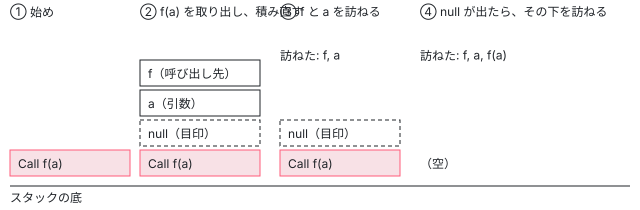

[目次](../README.md) › [oxc の変換と TypeScript の transformer の内側：ビルドが JavaScript を書き換える行](README.md) › 第 2 回 / 全 5 回

# 後順の走査：再帰を使わずスタックで AST をたどる

> tools/oxc/traversal.ts の traversePostOrder と pushChildNodes が、子を逆順に積み、関数とクラスの境目と TypeScript の型だけのノードを見分けながら、親より先に子を訪ねる仕組み。再帰からの書き換え（2b85529e82）と、linker と最適化の走査を 1 つにした変更（f4dad31cce）。

angular/angular-cli · 読了 約 12 分 · 発展 · [サイトで読む（デモが動きます）](https://angular-deep-dive-cyan.vercel.app/chapter/oxc-traversal)

---

この章で分かること: `tools/oxc/traversal.ts` の `traversePostOrder` が、再帰を使わずに配列のスタックだけで AST を後順（子が先・親が後）にたどり、関数とクラスの中にいるかを数えながら、TypeScript の型だけのノードを飛ばす仕組みです。子を積む `pushChildNodes` の枝を 1 つずつ読み、oxc-parser の `Visitor` を使っていた形からの書き換え（2b85529e82）と、linker と最適化の走査を 1 つにした変更（f4dad31cce）で何が変わったかを、古い版を実際に動かして確かめます。

読む対象は `packages/angular/build/src/tools/oxc/traversal.ts`（354 行）です。`traversePostOrder` の繰り返しの本体（317〜353 行目）は[「oxc の変換」の章の 4 節](../cli/05-cli-javascript-transformer.md)が引用して、目印の `null` の働きを説明しているので、ここでは短く参照します。この走査を使う側は、[第 1 回](01-oxc-transform-pass.md)の `transform` と、i18n の inliner（[i18n の章](../cli/09-cli-i18n.md)の `$localize` の置き換え）の 2 か所です。

1. [1. transform の 1 回の走査](01-oxc-transform-pass.md)
2. **2. 後順の走査**（この章）
3. [3. linker の読み書き](03-oxc-linker-host.md)
4. [4. TypeScript の transformer](04-oxc-ts-transformers.md)
5. [5. spec と issue](05-oxc-tests-issues.md)

> [!TIP]
> **新卒エンジニアへ**
>
> **後順**（post-order）は、木のノードを「子を全部訪ねてから親を訪ねる」順に並べることです。`f(a)` なら `f`・`a`・`f(a)` の順になります。**再帰**で書くと「子について自分を呼ぶ」だけで書けますが、木が深いと JavaScript の呼び出しのスタック（関数の呼び出しを覚えておく領域。Node の既定ではおよそ 1 MB）があふれて `RangeError: Maximum call stack size exceeded` になります。配列をスタックとして使えば、深さはヒープ（配列）の大きさにしかなりません。

## 1. コンテキストと、たどってよい TypeScript のノード

📄 `angular-cli/packages/angular/build/src/tools/oxc/traversal.ts` L9–44 （▶ の行: 10, 15, 19, 24, 29, 35–36, 39, 41–42）

```ts
 9 │ import type { Node } from '@oxc-project/types';
10 ▶ import { visitorKeys } from 'oxc-parser';
11 │ 
12 │ /**
13 │  * Contextual scope information provided to AST visitor callbacks during traversal.
14 │  */
15 ▶ export interface TraversalContext {
16 │   /**
17 │    * The current function nesting depth. Top-level code has depth 0.
18 │    */
19 ▶   functionDepth: number;
20 │ 
21 │   /**
22 │    * The current class nesting depth. Top-level code has depth 0.
23 │    */
24 ▶   classDepth: number;
25 │ 
26 │   /**
27 │    * The immediate enclosing function AST node, if currently inside a function.
28 │    */
29 ▶   parentFunc?: Node;
30 │ }
31 │ 
32 │ /**
33 │  * A set of TypeScript AST node types that contain executable code or runtime declarations.
34 │  */
35 ▶ const executableTypeScriptNodes = new Set<Node['type']>([
36 ▶   'TSEnumDeclaration',
37 │   'TSEnumBody',
38 │   'TSEnumMember',
39 ▶   'TSModuleDeclaration',
40 │   'TSModuleBlock',
41 ▶   'TSParameterProperty',
42 ▶   'TSImportEqualsDeclaration',
43 │   'TSExternalModuleReference',
44 │ ]);
```

訪ねる関数には、ノードと一緒に `TraversalContext` が渡ります。19 行目の `functionDepth` と 24 行目の `classDepth` は「いま関数の中に何重に入っているか・クラスの中に何重に入っているか」、29 行目の `parentFunc` は「いちばん内側の関数のノード」です。`transform` は、深さで「トップレベルか」を決めて pure の印を付けるかを選び、`parentFunc` が function 式かアロー関数かで `ɵsetClassMetadata` を `void 0` にするかを選びます（[前の章の 5 節と 8 節](../cli/05-cli-javascript-transformer.md)）。

35〜44 行目は、名前が `TS` で始まっても実行されるコードを持つノードの表です。`enum`（36〜38 行目）と `namespace`（39〜40 行目）は JavaScript のコードになり、41 行目の `TSParameterProperty`（`constructor(private x: number)`）は `this.x = x` の代入になり、42 行目の `import x = require('…')` も残ります。

📄 `angular-cli/packages/angular/build/src/tools/oxc/traversal.ts` L46–79 （▶ の行: 54–56, 67, 78）

```ts
46 │ /**
47 │  * Determines whether the given AST node type represents a function declaration or expression.
48 │  *
49 │  * @param type The AST node type to check.
50 │  * @returns True if the type is a function; otherwise, false.
51 │  */
52 │ function isFunction(type: Node['type']): boolean {
53 │   return (
54 ▶     type === 'FunctionDeclaration' ||
55 ▶     type === 'FunctionExpression' ||
56 ▶     type === 'ArrowFunctionExpression'
57 │   );
58 │ }
59 │ 
60 │ /**
61 │  * Determines whether the given AST node type represents a class declaration or expression.
62 │  *
63 │  * @param type The AST node type to check.
64 │  * @returns True if the type is a class; otherwise, false.
65 │  */
66 │ function isClass(type: Node['type']): boolean {
67 ▶   return type === 'ClassDeclaration' || type === 'ClassExpression';
68 │ }
69 │ 
70 │ /**
71 │  * Determines whether the given AST node type represents a non-executable TypeScript type-only node.
72 │  * Executable TypeScript nodes (e.g. enums, namespaces, parameter properties) return false.
73 │  *
74 │  * @param type The AST node type to check.
75 │  * @returns True if the type is a TypeScript type construct that can be safely pruned; otherwise, false.
76 │  */
77 │ function isTypeOnlyTypeScriptNode(type: Node['type']): boolean {
78 ▶   return type.startsWith('TS') && !executableTypeScriptNodes.has(type);
79 │ }
```

関数は 3 つの種類（54〜56 行目）、クラスは 2 つ（67 行目）です。メソッド（`MethodDefinition`）は、値の側が `FunctionExpression` なので、その `FunctionExpression` で関数の深さが上がります。78 行目の `isTypeOnlyTypeScriptNode` は、種類の名前が `TS` で始まり、35〜44 行目の表に無いものを「型だけのノード」とします。

> [!NOTE]
> **ポイント**
>
> 型かどうかを「ノードの種類の名前」で決めるので、`import type { Shape } from './shape';` は対象外です。これは `ImportDeclaration`（`importKind: 'type'`）なので、中の `Identifier` まで訪ねます（下の記録の 0〜4 番）。origin/main の 174eb34540（2026-10-29「elide non-value aliases and remaining type-only AST constructs」）も型だけの構文を扱う直しですが、変えたのは TypeScript の transformer（`jit-bootstrap-transformer.ts`）の import の削除で、`traversal.ts` ではありません（[第 4 回](04-oxc-ts-transformers.md)）。`git diff 44129f66a3 origin/main -- packages/angular/build/src/tools/oxc` は空で、origin/main の `traversal.ts` と `oxc-transform.ts` は 44129f66a3 と同じです（WASI の shim を足して消した 12578eccae と d9e3e22720 が通ったあと）。

## 2. 子を逆順に積む

📄 `angular-cli/packages/angular/build/src/tools/oxc/traversal.ts` L81–99 （▶ の行: 92, 94–95）

```ts
81 │ /**
82 │  * Pushes an array of AST nodes onto the traversal stack in reverse order.
83 │  *
84 │  * @param nodes The array of child AST nodes to push.
85 │  * @param stack The traversal stack.
86 │  */
87 │ function pushNodesReverse(
88 │   nodes: readonly (Node | null | undefined)[] | undefined,
89 │   stack: (Node | null)[],
90 │ ): void {
91 │   if (nodes) {
92 ▶     for (let i = nodes.length - 1; i >= 0; i--) {
93 │       const item = nodes[i];
94 ▶       if (item) {
95 ▶         stack.push(item);
96 │       }
97 │     }
98 │   }
99 │ }
```

スタックは最後に積んだものから取り出すので、ソースの順（左から右）に訪ねたければ、右から左へ積みます（92 行目）。94 行目で `null` と `undefined` を飛ばすのは、`[a, , b]` の穴が `null` の要素になるからです。目印の `null`（次の節）と混ざらないように、ここで落とします。

📄 `angular-cli/packages/angular/build/src/tools/oxc/traversal.ts` L101–130 （▶ の行: 105–106, 108, 111, 119–123, 125–129）

```ts
101 │ /**
102 │  * Pushes child AST nodes of the specified node onto the traversal stack in reverse order
103 │  * so they are visited in source order.
104 │  *
105 ▶  * Explicit cases are provided for the most common AST node types (~95%+ of AST nodes) to:
106 ▶  * 1. Fast-path leaf nodes and frequent expressions/statements by avoiding dynamic `visitorKeys`
107 │  *    dictionary lookups, string indexing, and dynamic array iteration.
108 ▶  * 2. Prune non-executable TypeScript type subtrees (e.g. `typeAnnotation`, `typeParameters`,
109 │  *    `returnType`, `implements`) so traversal only processes executable JavaScript expressions.
110 │  *
111 ▶  * All other less frequent node types fall back to the `visitorKeys` lookup in `default:`.
112 │  *
113 │  * @param node The parent AST node whose children to push.
114 │  * @param stack The traversal stack.
115 │  */
116 │ function pushChildNodes(node: Node, stack: (Node | null)[]): void {
117 │   switch (node.type) {
118 │     // High-frequency leaf nodes (~50% of AST)
119 ▶     case 'Identifier':
120 ▶     case 'PrivateIdentifier':
121 ▶     case 'Literal':
122 ▶     case 'ThisExpression':
123 ▶       break;
124 │ 
125 ▶     case 'Program':
126 ▶     case 'BlockStatement':
127 ▶     case 'ClassBody':
128 ▶     case 'StaticBlock':
129 ▶       pushNodesReverse(node.body, stack);
130 │       break;
```

105〜111 行目のコメントのとおり、`pushChildNodes` は よく出るノードの種類を名前で並べ、それぞれ決まったプロパティだけを積みます。そうでないもの（272 行目の `default`）だけが oxc-parser の `visitorKeys`（ノードの種類ごとの「子を持つプロパティの名前の一覧」）を引きます。119〜123 行目の葉（子を持たないノード）は何も積みません。`visitorKeys` の上では `Identifier` にも `decorators` と `typeAnnotation` の 2 つのキーがありますが（oxc-parser 0.156.0 で確かめた）、ここでは見ません。`x: number` の型の注釈も、TypeScript の構文の引数のデコレーター（`constructor(@Inject(T) x)`）も、この枝で落ちます。

📄 `angular-cli/packages/angular/build/src/tools/oxc/traversal.ts` L131–161 （▶ の行: 132–133, 135–136, 138, 141–142, 148, 150, 156, 159）

```ts
131 │ 
132 ▶     case 'ExpressionStatement':
133 ▶     case 'ParenthesizedExpression':
134 │     case 'ChainExpression':
135 ▶     case 'TSNonNullExpression':
136 ▶     case 'TSAsExpression':
137 │     case 'TSTypeAssertion':
138 ▶     case 'TSSatisfiesExpression':
139 │     case 'TSInstantiationExpression':
140 │     case 'TSExportAssignment':
141 ▶       if (node.expression) {
142 ▶         stack.push(node.expression);
143 │       }
144 │       break;
145 │ 
146 │     case 'CallExpression':
147 │     case 'NewExpression':
148 ▶       pushNodesReverse(node.arguments, stack);
149 │       if (node.callee) {
150 ▶         stack.push(node.callee);
151 │       }
152 │       break;
153 │ 
154 │     case 'MemberExpression':
155 │       if (node.property) {
156 ▶         stack.push(node.property);
157 │       }
158 │       if (node.object) {
159 ▶         stack.push(node.object);
160 │       }
161 │       break;
```

📄 `angular-cli/packages/angular/build/src/tools/oxc/traversal.ts` L162–200 （▶ の行: 166–167, 169–170, 180–181, 187, 190, 193, 199）

```ts
162 │ 
163 │     case 'BinaryExpression':
164 │     case 'LogicalExpression':
165 │     case 'AssignmentExpression':
166 ▶       if (node.right) {
167 ▶         stack.push(node.right);
168 │       }
169 ▶       if (node.left) {
170 ▶         stack.push(node.left);
171 │       }
172 │       break;
173 │ 
174 │     case 'UnaryExpression':
175 │     case 'UpdateExpression':
176 │     case 'AwaitExpression':
177 │     case 'YieldExpression':
178 │     case 'ReturnStatement':
179 │     case 'ThrowStatement':
180 ▶       if (node.argument) {
181 ▶         stack.push(node.argument);
182 │       }
183 │       break;
184 │ 
185 │     case 'IfStatement':
186 │     case 'ConditionalExpression':
187 ▶       if (node.alternate) {
188 │         stack.push(node.alternate);
189 │       }
190 ▶       if (node.consequent) {
191 │         stack.push(node.consequent);
192 │       }
193 ▶       if (node.test) {
194 │         stack.push(node.test);
195 │       }
196 │       break;
197 │ 
198 │     case 'VariableDeclaration':
199 ▶       pushNodesReverse(node.declarations, stack);
200 │       break;
```

📄 `angular-cli/packages/angular/build/src/tools/oxc/traversal.ts` L201–236 （▶ の行: 203, 206, 214–215, 217–218, 225, 228, 231, 234）

```ts
201 │ 
202 │     case 'VariableDeclarator':
203 ▶       if (node.init) {
204 │         stack.push(node.init);
205 │       }
206 ▶       if (node.id) {
207 │         stack.push(node.id);
208 │       }
209 │       break;
210 │ 
211 │     case 'FunctionDeclaration':
212 │     case 'FunctionExpression':
213 │     case 'ArrowFunctionExpression':
214 ▶       if (node.body) {
215 ▶         stack.push(node.body);
216 │       }
217 ▶       pushNodesReverse(node.params, stack);
218 ▶       if (node.id) {
219 │         stack.push(node.id);
220 │       }
221 │       break;
222 │ 
223 │     case 'ClassDeclaration':
224 │     case 'ClassExpression':
225 ▶       if (node.body) {
226 │         stack.push(node.body);
227 │       }
228 ▶       if (node.superClass) {
229 │         stack.push(node.superClass);
230 │       }
231 ▶       if (node.id) {
232 │         stack.push(node.id);
233 │       }
234 ▶       pushNodesReverse(node.decorators, stack);
235 │       break;
236 │ 
```

📄 `angular-cli/packages/angular/build/src/tools/oxc/traversal.ts` L237–271 （▶ の行: 240, 243, 246–247, 252, 256, 260, 264, 267）

```ts
237 │     case 'Property':
238 │     case 'PropertyDefinition':
239 │     case 'MethodDefinition':
240 ▶       if (node.value) {
241 │         stack.push(node.value);
242 │       }
243 ▶       if (node.key) {
244 │         stack.push(node.key);
245 │       }
246 ▶       if (node.type !== 'Property') {
247 ▶         pushNodesReverse(node.decorators, stack);
248 │       }
249 │       break;
250 │ 
251 │     case 'ObjectExpression':
252 ▶       pushNodesReverse(node.properties, stack);
253 │       break;
254 │ 
255 │     case 'ArrayExpression':
256 ▶       pushNodesReverse(node.elements, stack);
257 │       break;
258 │ 
259 │     case 'TemplateLiteral':
260 ▶       pushNodesReverse(node.expressions, stack);
261 │       break;
262 │ 
263 │     case 'TaggedTemplateExpression':
264 ▶       if (node.quasi) {
265 │         stack.push(node.quasi);
266 │       }
267 ▶       if (node.tag) {
268 │         stack.push(node.tag);
269 │       }
270 │       break;
271 │ 
```

| ノード | 積む順（行） | 訪ねる順 | 落とすもの |
| --- | --- | --- | --- |
| `TSAsExpression` など（135〜140） | `expression` だけ（141〜142） | 中の式 | `as T` の `T` |
| `CallExpression` / `NewExpression` | 引数を逆順（148）→ 呼び出し先（150） | 呼び出し先 → 引数 | `f<T>()` の型引数 |
| `MemberExpression` | property（156）→ object（159） | object → property | — |
| 2 項・論理・代入 | right（167）→ left（170） | left → right | — |
| `IfStatement` / 条件式 | alternate → consequent → test（187〜194） | test → consequent → alternate | — |
| 関数の 3 種類 | body（215）→ 引数を逆順（217）→ id（219） | id → 引数 → body | `typeParameters`・`returnType` |
| クラスの 2 種類 | body → superClass → id → デコレーターを逆順（225〜234） | デコレーター → id → superClass → body | `typeParameters`・`implements`・`superTypeArguments` |
| `Property` / `PropertyDefinition` / `MethodDefinition` | value → key → デコレーター（240〜248） | デコレーター → key → value | フィールドの型の注釈 |
| `TemplateLiteral` | `expressions` だけ（260） | 埋め込んだ式 | 文字の部分（`TemplateElement`） |

「訪ねる順」の列は、`visitorKeys` に書かれたキーの順と同じです。下の記録で、型だけのノードを除いた `visitorKeys` の再帰の後順と、本物の `traversePostOrder` の順が、49 個のノードで 1 つ残らず一致することを確かめました。246 行目は、オブジェクトリテラルの `Property` にはデコレーターが無いので飛ばす条件です。

📄 `angular-cli/packages/angular/build/src/tools/oxc/traversal.ts` L272–300 （▶ の行: 274–275, 278–280, 283, 291–292, 294）

```ts
272 │     default: {
273 │       // Prune non-executable TypeScript type-only AST nodes (e.g. TSTypeAnnotation, TSTypeReference, etc.)
274 ▶       if (isTypeOnlyTypeScriptNode(node.type)) {
275 ▶         break;
276 │       }
277 │ 
278 ▶       const keys = visitorKeys[node.type];
279 ▶       if (!keys) {
280 ▶         break;
281 │       }
282 │ 
283 ▶       for (let i = keys.length - 1; i >= 0; i--) {
284 │         const child = (
285 │           node as unknown as Record<string, Node | (Node | null)[] | null | undefined>
286 │         )[keys[i]];
287 │         if (!child) {
288 │           continue;
289 │         }
290 │ 
291 ▶         if (Array.isArray(child)) {
292 ▶           pushNodesReverse(child, stack);
293 │         } else {
294 ▶           stack.push(child);
295 │         }
296 │       }
297 │       break;
298 │     }
299 │   }
300 │ }
```

名前で並べなかったノードは 274 行目で型だけかを見て、型だけなら子ごと落とします（`TSTypeAnnotation`・`TSTypeReference`・`TSInterfaceDeclaration` など）。そうでなければ 278 行目で `visitorKeys` を引き、283 行目から後ろのキーから順に積みます。配列のキーは 292 行目で `pushNodesReverse` に任せます。`ImportDeclaration`・`ForStatement`・`TSEnumDeclaration`・`TSParameterProperty` などはここを通ります。

## 3. traversePostOrder：自分・目印・子

📄 `angular-cli/packages/angular/build/src/tools/oxc/traversal.ts` L302–316 （▶ の行: 308–310, 312–315）

```ts
302 │ /**
303 │  * Traverses ESTree AST nodes in post-order (bottom-up) without recursion.
304 │  *
305 │  * @param root The root AST node to traverse.
306 │  * @param visit Callback invoked on each AST node in post-order.
307 │  */
308 ▶ export function traversePostOrder(
309 ▶   root: Node,
310 ▶   visit: (node: Node, context: TraversalContext) => void,
311 │ ): void {
312 ▶   const stack: (Node | null)[] = [root];
313 ▶   let functionDepth = 0;
314 ▶   let classDepth = 0;
315 ▶   const functionStack: Node[] = [];
316 │ 
```

312 行目のスタックは根だけで始まり、313〜315 行目の 2 つの深さと、入った関数を覚える `functionStack` が繰り返しのあいだの状態のすべてです。繰り返しの本体は[前の章](../cli/05-cli-javascript-transformer.md)の引用で、次の 2 つの動きだけをします。

1. **ノードを取り出したとき**

   自分を積み直し、その上に目印の `null` を積み、関数かクラスなら深さを 1 つ上げ（関数なら `functionStack` にも積む）、`pushChildNodes` で子を積みます。子は目印より上にあるので、全部取り出されるまで目印は出てきません。
2. **`null` を取り出したとき**

   その下にある自分を取り出し、関数かクラスなら深さを 1 つ下げてから `visit` を呼びます。下げてから呼ぶので、関数のノードそのものは外側の深さで訪ねられ、`parentFunc` もその外側の関数になります。



*f(a) を後順にたどるときのスタック（下が底）。目印の null が「子を積み終えた自分」の上に乗る*

葉（`Identifier`）も一度「自分と `null`」を積んでから取り出されるので、1 つのノードにつき 2 回の取り出しがあります。下のデモで 1 回ずつ見られます。

> **🧪 DEMO — スタックを 1 回ずつ（ページの上で）**
>
> `traversal.ts` の 312〜353 行目（クラスの枝を除く）と、`pushChildNodes` の 119〜161・211〜221 行目の枝、`pushNodesReverse`（87〜99 行目）を写した関数を、手で書いた `f(a, () => g(b.c));` の木で動かします。繰り返しのたびに、スタックの中身（下が底）を書き出します。
>
> ▶ [このデモはサイトで動かせます](https://angular-deep-dive-cyan.vercel.app/chapter/oxc-traversal)

## 4. 再帰からの書き換え（2b85529e82）

📄 `oxc-parser の Visitor から traversePostOrder へ（2b85529e82）`

```
$ git show 2b85529e82 -- packages/angular/build/src/tools/oxc/oxc-transform.ts   # 2026-08-27（抜粋）
-import { Visitor, parseSync } from 'oxc-parser';
+import { parseSync } from 'oxc-parser';
+import { traversePostOrder } from './traversal';
 ...
-  // Track function nesting depth and closest function expression wrapper
-  let functionDepth = 0;
-  let classDepth = 0;
-  const functionStack: Node[] = [];
 ...
-  const visitor = new Visitor({
-    ClassDeclaration(node) {
-      classDepth++;
-    },
-    'ClassDeclaration:exit'() {
-      classDepth--;
-    },
 ...（ClassExpression・FunctionDeclaration・FunctionExpression・ArrowFunctionExpression も同じ形）
-    'Program:exit'(node) {
-      if (advancedOptimizations) {
-        adjustTypeScriptEnumsInStatements(node.body);
-        adjustStaticMembersInStatements(node.body);
-      }
-    },
 ...
-    CallExpression(node) {
-      if (isAlreadyEdited(node.start, node.end)) {
-        return;
-      }
 ...
-  visitor.visit(program);
+  traversePostOrder(program, (node, { functionDepth, classDepth, parentFunc }) => {
+    switch (node.type) {
+      case 'Program':
+      case 'BlockStatement':
```

2b85529e82（2026-08-27）までの `transform` は、oxc-parser の `Visitor` クラスに、ノードの種類ごとの関数（入るとき）と `'…:exit'` の関数（出るとき）を渡していました。深さはその入る・出るの組で数えていました。コミットの説明は「ファイルごとの Visitor の生成と内部のキャッシュの手間をなくし、型だけの部分木を根で刈り、よく出るノードは決まったプロパティを読む。木の深さの配列 1 本でスタックについて安全にし、OXC の変換と i18n の inliner のワーカーで共有する」です。同じコミットで、i18n の inliner が持っていた自前の後順の走査も `traversePostOrder` に替わりました。

📄 `i18n の inliner の walkAstPostOrder（同じコミットで消えたもの）`

```
$ git show 2b85529e82 -- packages/angular/build/src/tools/esbuild/i18n-inliner-worker.ts   # 同じコミット（抜粋）
-function walkAstPostOrder(root: Node, onExit: (node: Node) => void): void {
-  const traverseStack: Node[] = [root];
-  const postOrderNodes: Node[] = [];
-
-  while (traverseStack.length > 0) {
-    const current = traverseStack.pop();
 ...
-    postOrderNodes.push(current);
 ...
-  // Process collected nodes in reverse order to achieve bottom-up (post-order) traversal
-  for (let i = postOrderNodes.length - 1; i >= 0; i--) {
-    onExit(postOrderNodes[i]);
-  }
-}
 ...
-  walkAstPostOrder(program, (node) => {
+  traversePostOrder(program, (node) => {
```

消えた `walkAstPostOrder` も再帰ではありませんでしたが、全部のノードをいったん `postOrderNodes` に並べてから逆順に呼んでいました。ノードの数だけの配列を作り、子を `visitorKeys` の順に積むので、兄弟の順も逆になります。`traversePostOrder` は目印の `null` で「積み終えた自分」を示すので、並べ直す配列が要りません。

## 5. 1 つの走査にした変更（f4dad31cce）と、後順になって変わったこと

📄 `linker と最適化の走査を 1 つに（f4dad31cce、2026-08-20）`

```
$ git show f4dad31cce -- packages/angular/build/src/tools/oxc/oxc-transform.ts   # 2026-08-20（抜粋）
+import { needsLinking } from '@angular/compiler-cli/linker';
+import { OxcLinker } from '../angular/linker/oxc-linker';
 ...
-    Program(node) {
-      adjustTypeScriptEnumsInStatements(node.body);
-      adjustStaticMembersInStatements(node.body);
+    'Program:exit'(node) {
+      if (advancedOptimizations) {
+        adjustTypeScriptEnumsInStatements(node.body);
+        adjustStaticMembersInStatements(node.body);
+      }
     },
-    BlockStatement(node) {
+    'BlockStatement:exit'(node) {
 ...
     CallExpression(node) {
       if (isAlreadyEdited(node.start, node.end)) {
         return;
       }

+      if (linker) {
+        const linkedCode = linker.linkCallExpression(node);
+        if (linkedCode !== undefined) {
+          source.overwrite(node.start, node.end, linkedCode);
+          markEdited(node.start, node.end);
+
+          return;
+        }
+      }
$ git show f4dad31cce -- …/tools/esbuild/javascript-transformer-worker.ts（抜粋）
-import { linkWithOxc } from '../angular/linker/oxc-linker.js';
 ...
-      const result = linkWithOxc(filename, code, {
 ...
+  // Run Oxc linking and/or advanced optimizations in a single unified AST traversal pass
+  const oxcLink = shouldLink && !useBabelLinker;
+  if (oxcLink || advancedOptimizations) {
```

それまでのワーカーは、linker の `linkWithOxc`（自分で `parseSync` して、自分の走査で部分宣言を探す）を先に走らせ、その出力を `transform` がもう一度 `parseSync` していました。f4dad31cce は、`transform` の `CallExpression` の枝で `linker.linkCallExpression` を呼ぶようにして、木を 1 回だけ作るようにしました。説明は「重複した parse と、MagicString の source map の合成の連なりをなくす」です。

同じコミットで、enum と static を扱う `Program` と `BlockStatement` が「入るとき」から「出るとき」（`'Program:exit'`）に移っています。下の記録のデモの 3 は、その 2 行だけを入る側に戻した写しを動かした実験で、`MyComponent.ɵcmp = i0.ɵɵngDeclareComponent(…)` がリンクされずに残りました。入るときに static の包み込みが走ると、[第 1 回の 6 節](01-oxc-transform-pass.md)の `markEdited` がクラスから最後の代入までの範囲を記録し、あとで訪ねる `CallExpression` が `isAlreadyEdited` で何もせずに戻るからです。

📄 `1 つにする前の linker の走査（再帰。リンクしたら子に入らない）`

```
$ git show f4dad31cce^:packages/angular/build/src/tools/angular/linker/oxc-linker.ts   # 1 つにする前の linker の走査（抜粋）
function visitNode(
  node: Node | Node[] | null | undefined,
  onCallExpression: (node: CallExpression) => boolean,
): void {
 ...
  if (nodeType === 'CallExpression') {
    if (onCallExpression(node)) {
      // Subtree pruning: partial declarations cannot be nested, so skip child traversal.
      return;
    }
  }

  const keys = visitorKeys[nodeType];
  if (keys) {
    for (let i = 0; i < keys.length; i++) {
      const child = (node as unknown as Record<string, Node | Node[] | null | undefined>)[keys[i]];
      if (child !== undefined && child !== null) {
        visitNode(child, onCallExpression);
      }
    }
  }
}
```

1 つにした結果、次の 2 つが変わりました。どちらも下の記録と実験で確かめたものです。

1. **リンクする呼び出しの中も訪ねる**

   前の linker は、部分宣言をリンクしたらその子に入りませんでした（コメントの「Subtree pruning」）。いまは後順なので、`ɵɵngDeclareComponent({ … })` の引数の中の 25 個のノードを、呼び出しそのもの（47 個のうちの 44 番目）より先に訪ねます。中の呼び出しに付けた印は、外側の `overwrite` で消えます（magic-string 1.4.1 で、内側に `appendLeft` したあとで外側を `overwrite` すると、内側の分は残らないことを確かめた）。
2. **リンクが書いたコードは、同じ走査では見えない**

   リンクの結果は木に無い文字列なので、その中の `ɵsetClassMetadata` は `void 0` にならず、それを包む IIFE にも印が付きません。2 回に分けた形（22.2.7 の `transform` をリンクだけ・最適化だけの 2 回に分けて呼んだもの）では、`void 0` になり、IIFE に印が付きました。ただし本番の define（`ngDevMode: false`）で esbuild 0.28.2 に通すと、どちらの形もクラスだけが残る同じ出力になりました（下の `probe9.mjs`）。

📄 `1 回の走査と 2 回の走査の出力（<work>/oxc-demo/a/old/probe9.mjs）`

```
// <work>/oxc-demo/a/old/probe9.mjs（全部）: リンクが書いたコードを、同じ走査の最適化は見るか
import { createRequire } from 'node:module';
const req = createRequire(new URL('./node_modules/@angular/build/package.json', import.meta.url));
const cur = req('./src/tools/oxc/oxc-transform.js');
const esbuild = req('esbuild');
const code = `import * as i0 from "@angular/core";
export class Foo {}
i0.ɵɵngDeclareClassMetadata({ minVersion: "12.0.0", version: "14.0.0", ngImport: i0, type: Foo, decorators: [{ type: Injectable, args: [{ providedIn: 'root' }] }] });
`;
const F = '/n/node_modules/@angular/x/x.mjs';
const one = cur.transform(F, code, { link: true, advancedOptimizations: true, topLevelSafeMode: false, sideEffects: false }).code;
const linked = cur.transform(F, code, { link: true, advancedOptimizations: false }).code;
const two = cur.transform(F, linked, { link: false, advancedOptimizations: true, topLevelSafeMode: false, sideEffects: false }).code;
console.log('--- 1 pass\n' + one + '--- 2 passes\n' + two);
for (const [k, c] of Object.entries({ one, two })) {
  const r = await esbuild.transform(c, { minify: true, define: { ngDevMode: 'false' }, format: 'esm', treeShaking: true });
  console.log(k, 'esbuild:', r.code);
}
console.log(esbuild.version);

// 出力
--- 1 pass
import * as i0 from "@angular/core";
export class Foo {}
(() => {
((((typeof ngDevMode) === "undefined") || ngDevMode) && (i0.ɵsetClassMetadata(Foo, [{ type: Injectable, args: [{ providedIn: 'root' }] }], null, null)));
})();
--- 2 passes
import * as i0 from "@angular/core";
export class Foo {}
/*#__PURE__*/ (() => {
((((typeof ngDevMode) === "undefined") || ngDevMode) && (void 0));
})();

one esbuild: import"@angular/core";class t{}export{t as Foo};

two esbuild: import"@angular/core";class d{}export{d as Foo};

0.28.2
```

> [!NOTE]
> **さらに深く**
>
> 後順にしたことで、`CallExpression` と `NewExpression` の枝の最初の `isAlreadyEdited` は、真を返す場面が無くなりました。後順では、あるノードを訪ねたあとに訪ねるのは「その外側（祖先）」か「右の兄弟の部分木」だけで、書き換えた範囲の内側のノードはもう訪ね終わっているからです。サイトの node\_modules の @angular の 7 つのパッケージの fesm2022（130 ファイル、うち部分宣言を持つもの 60）を、ワーカーと同じ options で変換して数えると、22.2.7 では 25524 回呼ばれて真は 0 回、2b85529e82 の前の版（呼び出しを入るときに見る Visitor）では 25524 回のうち 62 回が真でした。出力は 130 ファイルとも 2 つの版で同じでした。

📄 `isAlreadyEdited を数えた実験`

```
// <work>/oxc-demo/a/patched/count-run.cjs: 22.2.7 の oxc-transform.js の写しの isAlreadyEdited に、呼ばれた回数と真の回数を数える 2 行だけを足したもの
// <work>/oxc-demo/a/old/count-old.mjs: 2b85529e82 の前の oxc-transform.ts に同じ 2 行を足したもの
// 入力: サイトの node_modules の @angular/{core,common,router,forms,platform-browser,cdk,aria}/fesm2022 の .mjs 全部
// options: { link: true, advancedOptimizations: true, topLevelSafeMode: false, sideEffects: false, sourcemap: false }
22.2.7（traversePostOrder）    {"files":130,"bytes":3136805,"sameOutput":130,"filesWithNgDeclare":60,"isAlreadyEdited":{"calls":25524,"hits":0}}
2b85529e82 の前（Visitor）      {"files":130,"isAlreadyEdited":{"calls":25524,"hits":62}}
// <work>/oxc-demo/a/old/compare-old.mjs: 2 つの版の出力を比べたもの
{"files":130,"same":130,"diff":[]}
```

> **🧪 DEMO — 本物の traversePostOrder が訪ねた順と、古い版との比べ（記録の再生）**
>
> `<work>/oxc-demo/a/record-traversal.mjs` が、@angular/build 22.2.7（oxc-parser 0.156.0）の `traversePostOrder` を Node v24.22.1 で呼んだ記録です。入力は次の TypeScript で、`parseSync('demo.ts', …, { range: true })` で読みました。
>
> （ボタンを押すと、訪ねた順に 1 つずつ、入力の中の位置とコンテキストが出ます）
>
> `oxc-transform_spec.ts` の 52〜68 行目の入力を、`{ link: true, advancedOptimizations: true, topLevelSafeMode: true }` で変換しました。
>
> ▶ [このデモはサイトで動かせます](https://angular-deep-dive-cyan.vercel.app/chapter/oxc-traversal)

## テストと直し方

`traversal.ts` を直接呼ぶ spec はありません（`traversal_spec.ts` は無い）。次の 2 つの所で、使う側の spec が間接に固めています（44129f66a3 で `grep -n` したもの）。

| spec | describe / it（行） | この章で固めていること |
| --- | --- | --- |
| `tools/oxc/*_oxc_spec.ts`・`oxc-transform_spec.ts` | 5 つの describe、100 の it | 深さの数え方（関数とクラスの中の呼び出しに印を付けない it、`pure-toplevel-functions_oxc_spec.ts` の 97〜122 行目の 6 つ）、`parentFunc`（メタデータの削除の 7 つ）、後順（`oxc-transform_spec.ts` の 51 行目の it は、リンクしてから包むことを見る） |
| `tools/esbuild/i18n-inliner_spec.ts` | `I18nInliner`（58）の「inlines nested $localize calls in post-order」（374）など | 入れ子の `$localize` を内側から置き換えること（`TaggedTemplateExpression` の枝、263〜270 行目） |

📄 `走らせたコマンド`

```
cd ~/angular-research/angular-cli-fix   # 44129f66a3
pnpm bazel test //packages/angular/build:test --nocache_test_results --test_output=all '--test_arg=--filter=oxc-transform'
pnpm bazel test //packages/angular/build:test --nocache_test_results --test_output=all '--test_arg=--filter=I18nInliner'
```

📄 `結果（出力から抜き出したもの）`

```
--filter=oxc-transform: Ran 25 of 540 specs ×4、どれも 0 failures（合わせて 100 specs）  //packages/angular/build:test PASSED in 0.7s
--filter=I18nInliner:   Ran 10 of 583 specs ×2・Ran 11 of 584 specs ×2、どれも 0 failures（合わせて 42 specs） //packages/angular/build:test PASSED in 3.4s
```

5 つの oxc の spec の入力はすべて `transform('test.js', …)` の JavaScript で（`grep -c "transform('test.js'"` で数えた）、TypeScript の構文を含みません。型だけのノードを落とす 274 行目と、35〜44 行目の表を固めている spec は無いということです。`transform` が受け取るのはコンパイルされたあとの JavaScript なので、型のノードがそもそも出ません。

直すとしたら、次の場所になります。

- **走査そのものの spec**: `packages/angular/build/src/tools/oxc/traversal_spec.ts` を足し、`parseSync` した小さな入力で、訪ねる順（`visitorKeys` の順と同じこと）、`functionDepth`・`classDepth`・`parentFunc`（関数のノードは外側の深さで訪ねること）、`TSParameterProperty` と enum を訪ね、型の注釈を訪ねないこと、深さ 20000 でも落ちないことを it にする形です。この章の記録のスクリプトの 1〜3 がそのまま it の材料になります。target は `//packages/angular/build:test`（`src/**/*_spec.ts`）です。
- **枝を足すとき**: よく出る種類を名前で並べるのは `pushChildNodes` の `switch`（116〜300 行目）です。足すなら `visitorKeys` の順の逆に積み、型の子を積まないこと。並べなくても 272 行目の `default` が拾うので、足すのは速さのためだけです。
- **`isAlreadyEdited`**: 後順では真にならないことを上の実験で数えました。消すなら第 1 回の 4 節の `isAlreadyEdited` と、`CallExpression`・`NewExpression` の枝の 2 か所ですが、`adjustStaticMembersInStatements` は `markEdited` を書くので、範囲の記録そのものは残ります。

## ここまでの呼び出し

- `transform()` / `extractLocalizeMetadata()` — oxc-transform.ts 263 / i18n-inliner-worker.ts
  - `traversePostOrder(program, visit)` — traversal.ts 308
    - `stack.pop()` がノード → 自分と `null` を積む・深さを上げる — 342〜350
      - `pushChildNodes(current, stack)` — 116 — *名前で並べた枝、または visitorKeys*
        - `pushNodesReverse()` — 87 — *右から左へ*
        - `isTypeOnlyTypeScriptNode()` — 77 — *型だけなら積まない*
    - `stack.pop()` が `null` → その下を取り出す・深さを下げる — 322〜333
      - `visit(node, { functionDepth, classDepth, parentFunc })` — 334〜338 — *第 1 回の switch*

## 聞かれそうな質問

**Q. なぜ後順でなければいけないのですか？**

`transform` では、文の並び（`Program`）を扱う時点で、その中の呼び出しのリンクが終わっている必要があるからです。記録のデモの 3 で、`Program` を入るときに扱う形にすると `ɵɵngDeclareComponent` がリンクされずに残りました。i18n の inliner では、入れ子の `$localize` を内側から置き換えるためで、spec の「inlines nested $localize calls in post-order」（374 行目）がそれを見ています。

**Q. 関数のノードそのものは、関数の中として数えられますか？**

数えられません。目印の `null` が出たとき、深さを下げてから `visit` を呼ぶからです（3 節）。記録では `FunctionDeclaration area`（23 番）が functionDepth 0、その中の `sq(s.size)`（19 番）が 1、引数の `s: Shape`（6 番）も 1 でした。引数は関数の中です。

**Q. TypeScript のファイルを渡しても大丈夫ですか？**

型だけのノードは 274 行目と、名前で並べた枝が型の子を積まないことで落ちます。記録の入力では 67 個のノードのうち 18 個（`TSTypeAnnotation`・`TSTypeReference`・`TSTypeParameterDeclaration`・`TSClassImplements`・`TSTypeParameterInstantiation` とその下）を訪ねず、`TSParameterProperty` と enum は訪ねました。`import type` は `ImportDeclaration` なので訪ねます。

**Q. 再帰の版は、どのくらいの深さで落ちていましたか？**

この記録（Node v24.22.1、既定のスタック）では、`a + a + … + a` の深さ 5000 までは oxc-parser の `Visitor` も `visitorKeys` の再帰も歩けて、10000 で `RangeError` でした。2b85529e82 の前の `transform` も深さ 20000 で止まり、22.2.7 は最後まで変換しました。`traversePostOrder` の配列は深さ n で 3n + 5 個までしか伸びません。

**Q. クラスのデコレーターは、クラスの中として数えられますか？**

数えられます。クラスを取り出した時点で繰り返しの本体が `classDepth` を上げ、そのあとの `pushChildNodes` が 234 行目でデコレーターを積むからです。`@Dec() class X {}` の `Dec()` は classDepth 1 で訪ねられ、pure の印の対象になりません。

## 読み終えて

- `traversePostOrder` は配列 1 本のスタックで、「自分・目印の null・子（逆順）」を積み、null が出たら下の自分を訪ねる。深さはヒープの配列の大きさになり、呼び出しのスタックはあふれない。
- コンテキストは関数とクラスの深さと、いちばん内側の関数。ノード自身は外側の深さで訪ねられる。
- `pushChildNodes` はよく出る種類を名前で並べ、型の子を積まない。残りは `visitorKeys` を引き、`TS` で始まる型だけのノードは子ごと落とす。訪ねる順は `visitorKeys` の順と同じ。
- 2b85529e82 で oxc-parser の `Visitor`（再帰）から替わり、i18n の inliner と共有された。f4dad31cce で linker と最適化が 1 回の走査になり、`Program` は出るときに扱うようになった。
- 後順になったので、リンクする呼び出しの中も先に訪ね、`isAlreadyEdited` は真にならない。リンクが書いた文字列は同じ走査では見えない。

---

← 前: [transform の 1 回の走査：何を見て、どこに印を付けるか](01-oxc-transform-pass.md)  
次: [linker の読み書き：OxcAstHost と StringAstFactory](03-oxc-linker-host.md) →
