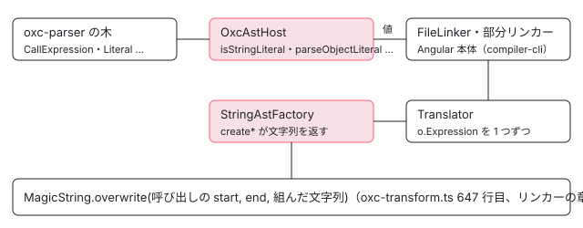

[目次](../README.md) › [oxc の変換と TypeScript の transformer の内側：ビルドが JavaScript を書き換える行](README.md) › 第 3 回 / 全 5 回

# linker の読み書き：OxcAstHost と StringAstFactory

> tools/angular/linker の OxcAstHost が ɵɵngDeclare\* の引数（oxc の AST）を linker に読ませ、StringAstFactory が linker の出力を JavaScript の文字列で組み立てる行。リテラルの見分け方、getRange が行と桁を 0 で返すこと、括弧の付け方、オブジェクトのリテラルの印（a6d5aabfc3）、構文が壊れる件の直し（bad31421cb）、内側の source map を切る理由（7e5510e464）、origin/main の括弧の対応（43aab6a1cf）。

angular/angular-cli · 読了 約 13 分 · 発展 · [サイトで読む（デモが動きます）](https://angular-deep-dive-cyan.vercel.app/chapter/oxc-linker-host)

---

この章で分かること: Angular 本体の `FileLinker` が部分宣言（`ɵɵngDeclare*` の引数）を読むとき、oxc-parser の AST（構文木）の節点について何を聞き、`OxcAstHost` がどの行で答えるか。リンクの結果を、`StringAstFactory` が節点を作らずに JavaScript の文字列としてどう組み立てるか（括弧の付け方、オブジェクトのリテラルの印 `\0obj_`、文字列のエスケープ）。それを入れた・直した 4 本のコミット（a6d5aabfc3・bad31421cb・7e5510e464・origin/main の 43aab6a1cf）と、本物の 22.2.7 を Node で動かした記録です。

読む対象は angular-cli（44129f66a3）の `tools/angular/linker/oxc-ast-host.ts`・`string-ast-factory.ts`・`oxc-linker.ts` と、Angular 本体の `compiler-cli/linker/src/file_linker/linker_environment.ts`・`partial_linkers/partial_component_linker_1.ts` です。リンクの大きな流れ（リンクが要るファイルの見分け方、`OxcLinker` が呼び出しを見つける行、部分リンカーの選び方）は[リンカーの章](../cli/06-cli-linker.md)にあり、そこで引用した `getSymbolName`・`!0` の読み方・`render`・`createCallExpression` はここでは繰り返しません。

1. [1. transform の 1 回の走査](01-oxc-transform-pass.md)
2. [2. 後順の走査](02-oxc-traversal.md)
3. **3. linker の読み書き**（この章）
4. [4. TypeScript の transformer](04-oxc-ts-transformers.md)
5. [5. spec と issue](05-oxc-tests-issues.md)

## 0. 読む係と書く係

`FileLinker` は、木の種類を知りません。木を読むときは `AstHost` という約束（interface）のメソッドを呼び、式を作るときは `AstFactory` の約束のメソッドを呼びます。Babel のリンカーなら Babel の木を読む係と Babel の節点を作る係が入り、CLI の oxc のリンカーでは `OxcAstHost` と `StringAstFactory` が入ります（組み合わせる行は[リンカーの章](../cli/06-cli-linker.md)の 3 節、`oxc-linker.ts` の 63〜70 行目）。



*1 つの宣言の呼び出しを置き換えるまで。赤い 2 つがこの章で読む係*

下の記録では、手書きの `ɵɵngDeclareComponent` 1 つのリンクで、host への問い合わせが 28 回、factory の呼び出しが 72 回（ほかに何もしない `setSourceMapRange` が 37 回）ありました。1 節から 3 節が host、4 節が factory です。

## 1. OxcAstHost：リテラルを見分ける

📄 `angular-cli/packages/angular/build/src/tools/angular/linker/oxc-ast-host.ts` L9–31 （▶ の行: 12, 18, 21, 25–26）

```ts
 9 │ import type { AstHost, Range } from '@angular/compiler-cli/linker';
10 │ import { FatalLinkerError } from '@angular/compiler-cli/linker';
11 │ import type {
12 ▶   ArrayExpression,
13 │   ArrowFunctionExpression,
14 │   BooleanLiteral,
15 │   CallExpression,
16 │   Function as FunctionNode,
17 │   Node,
18 ▶   NullLiteral,
19 │   NumericLiteral,
20 │   ObjectExpression,
21 ▶   StringLiteral,
22 │   UnaryExpression,
23 │ } from '@oxc-project/types';
24 │ 
25 ▶ function isNode(node: unknown): node is Node {
26 ▶   return typeof node === 'object' && node !== null && 'type' in node;
27 │ }
28 │ 
29 │ /**
30 │  * An implementation of `AstHost` that queries information from `oxc-parser` AST nodes.
31 │  */
```

host は引数を `unknown` で受け、25〜27 行目の `isNode`（`type` を持つオブジェクトか）で確かめてから読みます。型は 11〜23 行目のとおり `@oxc-project/types` の名前ですが、oxc-parser の木は ESTree（JavaScript の木の共通の形）なので、文字列・数・真偽値・`null` の節点の `type` はどれも `'Literal'` です（`StringLiteral` などは型の上の名前だけ）。

📄 `angular-cli/packages/angular/build/src/tools/angular/linker/oxc-ast-host.ts` L49–71 （▶ の行: 50, 55, 58, 62）

```ts
49 │   isStringLiteral(node: unknown): node is StringLiteral {
50 ▶     return isNode(node) && node.type === 'Literal' && typeof node.value === 'string';
51 │   }
52 │ 
53 │   parseStringLiteral(str: unknown): string {
54 │     if (!this.isStringLiteral(str)) {
55 ▶       throw new FatalLinkerError(str as object, 'Unsupported syntax, expected a string literal.');
56 │     }
57 │ 
58 ▶     return str.value;
59 │   }
60 │ 
61 │   isNumericLiteral(node: unknown): node is NumericLiteral {
62 ▶     return isNode(node) && node.type === 'Literal' && typeof node.value === 'number';
63 │   }
64 │ 
65 │   parseNumericLiteral(num: unknown): number {
66 │     if (!this.isNumericLiteral(num)) {
67 │       throw new FatalLinkerError(num as object, 'Unsupported syntax, expected a numeric literal.');
68 │     }
69 │ 
70 │     return num.value;
71 │   }
```

📄 `angular-cli/packages/angular/build/src/tools/angular/linker/oxc-ast-host.ts` L73–98 （▶ の行: 79, 89, 93, 97）

```ts
73 │   isBooleanLiteral(node: unknown): node is BooleanLiteral | UnaryExpression {
74 │     if (!isNode(node)) {
75 │       return false;
76 │     }
77 │ 
78 │     return (
79 ▶       (node.type === 'Literal' && typeof node.value === 'boolean') || isMinifiedBooleanLiteral(node)
80 │     );
81 │   }
82 │ 
83 │   parseBooleanLiteral(bool: unknown): boolean {
84 │     if (isNode(bool)) {
85 │       if (bool.type === 'Literal' && typeof bool.value === 'boolean') {
86 │         return bool.value;
87 │       }
88 │       if (isMinifiedBooleanLiteral(bool)) {
89 ▶         return !bool.argument.value;
90 │       }
91 │     }
92 │ 
93 ▶     throw new FatalLinkerError(bool as object, 'Unsupported syntax, expected a boolean literal.');
94 │   }
95 │ 
96 │   isNull(node: unknown): node is NullLiteral {
97 ▶     return isNode(node) && node.type === 'Literal' && node.value === null;
98 │   }
```

そのため 50・62・97 行目は `type === 'Literal'` に加えて `value` の JavaScript の型（`typeof`）で見分けます。`is*` は「そうか」に答えるだけで、`parse*` は違えば 55 行目のように `FatalLinkerError`（リンクを止める例外。ファイル名と位置を付けてビルドのエラーになる）を投げ、合えば 58 行目で `value` を返します。真偽値だけは 79 行目で、minify 済みの `!0`・`!1` も受けます（89 行目、読み方は[リンカーの章](../cli/06-cli-linker.md)の 280〜296 行目）。記録の `isSignal: !0, isRequired: !1` は `parseBooleanLiteral` が `true`・`false` と答えています。

## 2. 配列とオブジェクト

📄 `angular-cli/packages/angular/build/src/tools/angular/linker/oxc-ast-host.ts` L100–128 （▶ の行: 101, 112, 118, 124）

```ts
100 │   isArrayLiteral(node: unknown): node is ArrayExpression {
101 ▶     return isNode(node) && node.type === 'ArrayExpression';
102 │   }
103 │ 
104 │   parseArrayLiteral(array: unknown): unknown[] {
105 │     if (!this.isArrayLiteral(array)) {
106 │       throw new FatalLinkerError(array as object, 'Unsupported syntax, expected an array literal.');
107 │     }
108 │ 
109 │     const result: unknown[] = [];
110 │ 
111 │     for (const element of array.elements) {
112 ▶       if (element === null) {
113 │         throw new FatalLinkerError(
114 │           array as object,
115 │           'Unsupported syntax, element in array not to be empty.',
116 │         );
117 │       }
118 ▶       if (element.type === 'SpreadElement') {
119 │         throw new FatalLinkerError(
120 │           element as object,
121 │           'Unsupported syntax, element in array not to use spread syntax.',
122 │         );
123 │       }
124 ▶       result.push(element);
125 │     }
126 │ 
127 │     return result;
128 │   }
```

📄 `angular-cli/packages/angular/build/src/tools/angular/linker/oxc-ast-host.ts` L130–169 （▶ の行: 135, 142, 152, 154, 156–157, 165）

```ts
130 │   isObjectLiteral(node: unknown): node is ObjectExpression {
131 │     return isNode(node) && node.type === 'ObjectExpression';
132 │   }
133 │ 
134 │   parseObjectLiteral(obj: unknown): Map<string, unknown> {
135 ▶     if (!this.isObjectLiteral(obj)) {
136 │       throw new FatalLinkerError(obj as object, 'Unsupported syntax, expected an object literal.');
137 │     }
138 │ 
139 │     const result = new Map<string, unknown>();
140 │ 
141 │     for (const property of obj.properties) {
142 ▶       if (property.type !== 'Property') {
143 │         throw new FatalLinkerError(
144 │           property as object,
145 │           'Unsupported syntax, expected a property assignment.',
146 │         );
147 │       }
148 │ 
149 │       const keyNode = property.key;
150 │ 
151 │       let key: string;
152 ▶       if (keyNode.type === 'Identifier') {
153 │         key = keyNode.name;
154 ▶       } else if (this.isStringLiteral(keyNode)) {
155 │         key = keyNode.value;
156 ▶       } else if (this.isNumericLiteral(keyNode)) {
157 ▶         key = String(keyNode.value);
158 │       } else {
159 │         throw new FatalLinkerError(
160 │           keyNode as object,
161 │           'Unsupported syntax, expected a property name.',
162 │         );
163 │       }
164 │ 
165 ▶       result.set(key, property.value);
166 │     }
167 │ 
168 │     return result;
169 │   }
```

1. **112・118 行目：穴と展開は受けない**

   `[1, , 2]` の穴（`null` の要素）と `...a` は、値が静的に決まらないので `FatalLinkerError` です。124 行目、ほかの要素は節点のまま配列に入れます。中身を読むのは、部分リンカーがその要素について次の問い合わせをするときです。
2. **142 行目：`Property` だけ**

   `{ ...a }` の `SpreadElement` はここで止まります。oxc の `Property` には、`{ [a]: 1 }`（computed）・`{ get b() {…} }`・`{ c() {} }` も入ります。この関数は `computed` と `kind` を見ないので、22.2.7 で試すとキーはそれぞれ `a`・`b`・`c` になり、値は `Literal`・`FunctionExpression`・`FunctionExpression` でした（`<scratchpad>/oxc-demo/b/probe/computed.mjs`）。部分宣言の出力にこの形は出てきません。
3. **152〜163 行目：キーは 3 種類**

   識別子・文字列・数のキーを、どれも文字列のキーにします（157 行目の `String()` で `3` は `'3'`）。165 行目、値は節点のまま `Map` に入れます。記録の `parseObjectLiteral` の答えが `Map{minVersion, version, type, …}` なのはこれです。

## 3. 関数・呼び出し・範囲

📄 `angular-cli/packages/angular/build/src/tools/angular/linker/oxc-ast-host.ts` L171–197 （▶ の行: 177–179, 188, 193–194）

```ts
171 │   isFunctionExpression(node: unknown): node is FunctionNode | ArrowFunctionExpression {
172 │     if (!isNode(node)) {
173 │       return false;
174 │     }
175 │ 
176 │     return (
177 ▶       node.type === 'FunctionDeclaration' ||
178 ▶       node.type === 'FunctionExpression' ||
179 ▶       node.type === 'ArrowFunctionExpression'
180 │     );
181 │   }
182 │ 
183 │   parseReturnValue(fn: unknown): unknown {
184 │     if (!this.isFunctionExpression(fn)) {
185 │       throw new FatalLinkerError(fn as object, 'Unsupported syntax, expected a function.');
186 │     }
187 │ 
188 ▶     const body = fn.body;
189 │     if (!body || !isNode(body)) {
190 │       throw new FatalLinkerError(fn as object, 'Unsupported syntax, expected a function body.');
191 │     }
192 │ 
193 ▶     if (body.type !== 'BlockStatement') {
194 ▶       return body;
195 │     }
196 │ 
197 │     const statements = body.body;
```

📄 `angular-cli/packages/angular/build/src/tools/angular/linker/oxc-ast-host.ts` L198–229 （▶ の行: 198, 206, 213, 220, 228）

```ts
198 ▶     if (statements.length !== 1) {
199 │       throw new FatalLinkerError(
200 │         body as object,
201 │         'Unsupported syntax, expected a function body with a single return statement.',
202 │       );
203 │     }
204 │ 
205 │     const stmt = statements[0];
206 ▶     if (stmt.type !== 'ReturnStatement') {
207 │       throw new FatalLinkerError(
208 │         stmt as object,
209 │         'Unsupported syntax, expected a function body with a single return statement.',
210 │       );
211 │     }
212 │ 
213 ▶     if (!stmt.argument) {
214 │       throw new FatalLinkerError(
215 │         stmt as object,
216 │         'Unsupported syntax, expected function to return a value.',
217 │       );
218 │     }
219 │ 
220 ▶     return stmt.argument;
221 │   }
222 │ 
223 │   parseParameters(fn: unknown): unknown[] {
224 │     if (!this.isFunctionExpression(fn)) {
225 │       throw new FatalLinkerError(fn as object, 'Unsupported syntax, expected a function.');
226 │     }
227 │ 
228 ▶     return fn.params;
229 │   }
```

部分宣言には `forwardRef(function () { return X; })` や `resolveMetadata: () => ({ … })` のように、関数の「返す値」を読みたい場所があります。177〜179 行目、関数の宣言・関数式・アロー関数を関数とみなし、193〜194 行目、アロー関数の本体が式ならそれを返し、ブロックなら 198〜220 行目で「`return` の文が 1 つだけ」のときに限り、その式を返します。228 行目の引数は節点の配列のままです。

📄 `angular-cli/packages/angular/build/src/tools/angular/linker/oxc-ast-host.ts` L231–261 （▶ の行: 240, 251, 257）

```ts
231 │   isCallExpression(node: unknown): node is CallExpression {
232 │     return isNode(node) && node.type === 'CallExpression';
233 │   }
234 │ 
235 │   parseCallee(call: unknown): unknown {
236 │     if (!this.isCallExpression(call)) {
237 │       throw new FatalLinkerError(call as object, 'Unsupported syntax, expected a call expression.');
238 │     }
239 │ 
240 ▶     return call.callee;
241 │   }
242 │ 
243 │   parseArguments(call: unknown): unknown[] {
244 │     if (!this.isCallExpression(call)) {
245 │       throw new FatalLinkerError(call as object, 'Unsupported syntax, expected a call expression.');
246 │     }
247 │ 
248 │     const result: unknown[] = [];
249 │ 
250 │     for (const arg of call.arguments) {
251 ▶       if (arg.type === 'SpreadElement') {
252 │         throw new FatalLinkerError(
253 │           arg as object,
254 │           'Unsupported syntax, argument not to use spread syntax.',
255 │         );
256 │       }
257 ▶       result.push(arg);
258 │     }
259 │ 
260 │     return result;
261 │   }
```

251 行目、呼び出しの引数の `...args` も止めます。`OxcLinker` は宣言の引数をこの `parseArguments` で取り出します（[リンカーの章](../cli/06-cli-linker.md)の 87 行目）。

📄 `angular-cli/packages/angular/build/src/tools/angular/linker/oxc-ast-host.ts` L263–278 （▶ の行: 264, 272–275）

```ts
263 │   getRange(node: unknown): Range {
264 ▶     if (!isNode(node) || typeof node.start !== 'number' || typeof node.end !== 'number') {
265 │       throw new FatalLinkerError(
266 │         node as object,
267 │         'Unable to read range for node - it is missing location information.',
268 │       );
269 │     }
270 │ 
271 │     return {
272 ▶       startPos: node.start,
273 ▶       startLine: 0,
274 ▶       startCol: 0,
275 ▶       endPos: node.end,
276 │     };
277 │   }
278 │ }
```

📄 `angular/packages/compiler-cli/linker/src/file_linker/partial_linkers/partial_component_linker_1.ts` L318–337 （▶ の行: 322, 334）

```ts
318 │   private templateFromPartialCode(
319 │     templateNode: AstValue<unknown, TExpression>,
320 │     {startPos, endPos, startLine, startCol}: Range,
321 │   ): TemplateInfo {
322 ▶     if (!/["'`]/.test(this.code[startPos]) || this.code[startPos] !== this.code[endPos - 1]) {
323 │       throw new FatalLinkerError(
324 │         templateNode.expression,
325 │         `Expected the template string to be wrapped in quotes but got: ${this.code.substring(
326 │           startPos,
327 │           endPos,
328 │         )}`,
329 │       );
330 │     }
331 │     return {
332 │       code: this.code,
333 │       sourceUrl: this.sourceUrl,
334 ▶       range: {startPos: startPos + 1, endPos: endPos - 1, startLine, startCol: startCol + 1},
335 │       isEscaped: true,
336 │     };
337 │   }
```

`getRange` は 272・275 行目で oxc の `start`・`end`（ファイルの先頭からの文字の位置。`parseSync` に `range: true` を渡している）を返し、273・274 行目の行と桁は**いつも 0** です。部分リンカーは、テンプレートの文字列の範囲を 334 行目で `parseTemplate` に渡す範囲にします。行と桁は、テンプレートの誤りを知らせる文の「ファイル名@行:桁」に使われます。

記録の「テンプレートに誤り」では、宣言が 4 行目から、テンプレートの文字列が 5 行目の 12 桁目から（どちらも 0 から数えて）始まる入力で、22.2.7 の oxc のリンカーは `lib.mjs@0:14`、同じ入力を Babel のリンカー（`NG_BUILD_BABEL_LINKER=1` の道と同じ `createEs2015LinkerPlugin`）は `lib.mjs@5:26` と書きました。Babel の host（`babel_ast_host.ts`）は Babel の節点の `loc` から行と桁を入れます。334 行目で桁に引用符の分の 1 を足すので、oxc の 14 は「0 ＋ 1 ＋ 文字列の中の 13 文字」、Babel の 26 は「12 ＋ 1 ＋ 13」です。誤りの前後を切り出した文（`[ERROR ->]` の付いた部分）は `startPos` から作るので、どちらも同じでした。

## 4. StringAstFactory：文字列で式を組む

📄 `angular-cli/packages/angular/build/src/tools/angular/linker/string-ast-factory.ts` L9–28 （▶ の行: 24）

```ts
 9 │ import type {
10 │   AstFactory,
11 │   BinaryOperator,
12 │   LeadingComment,
13 │   ObjectLiteralProperty,
14 │   SourceMapRange,
15 │   TemplateLiteral,
16 │   UnaryOperator,
17 │   VariableDeclarationType,
18 │ } from '@angular/compiler-cli/src/ngtsc/translator';
19 │ import type {
20 │   BuiltInType,
21 │   Parameter,
22 │ } from '@angular/compiler-cli/src/ngtsc/translator/src/api/ast_factory';
23 │ 
24 ▶ const OBJECT_LITERAL_PREFIX = '\0obj_';
25 │ 
26 │ /**
27 │  * An implementation of `AstFactory` that generates JavaScript code strings directly.
28 │  */
```

factory のメソッドは、引数（すでに組んだ文字列か、host が返した oxc の節点）を `render` で文字列にして、決まった形に並べます。`render` の中身（節点なら元のソースの `start`〜`end` を切り出す 44 行目、印を外す 49〜51 行目）は[リンカーの章](../cli/06-cli-linker.md)の 6 節にあります。24 行目の `OBJECT_LITERAL_PREFIX`（`\0obj_`、先頭が NUL 文字）は、「この文字列はオブジェクトのリテラルとして作った」という印です。印の付け外しは下の 2 つ目の手順で追います。

📄 `angular-cli/packages/angular/build/src/tools/angular/linker/string-ast-factory.ts` L56–79 （▶ の行: 68–73, 75）

```ts
56 │   /**
57 │    * Wraps an expression in parentheses if it has syntax or operator precedence
58 │    * traps when used as the receiver/callee of property access, element access,
59 │    * call chains, `new` expressions, or tagged templates.
60 │    *
61 │    * For example, arrow functions (`(() => {}).foo`), numbers (`(5).foo`), object
62 │    * literals (`({ a: 1 }).foo`), and unary operators (`(void 0)()`) require
63 │    * parenthesization when used as receivers.
64 │    */
65 │   private wrapReceiver(receiver: unknown): string {
66 │     let rendered = this.render(receiver);
67 │     if (
68 ▶       rendered.startsWith('function') ||
69 ▶       rendered.startsWith('{') ||
70 ▶       rendered.includes('=>') ||
71 ▶       /^(?:typeof|void|delete|new|await|throw|return)\b/.test(rendered) ||
72 ▶       /^[!~+-]/.test(rendered) ||
73 ▶       /^\d/.test(rendered)
74 │     ) {
75 ▶       rendered = `(${rendered})`;
76 │     }
77 │ 
78 │     return rendered;
79 │   }
```

📄 `angular-cli/packages/angular/build/src/tools/angular/linker/string-ast-factory.ts` L81–100 （▶ の行: 93–94, 99）

```ts
 81 │   /**
 82 │    * Wraps an expression in parentheses if it is an un-parenthesized complex
 83 │    * operand (such as an un-parenthesized binary, logical, or assignment expression)
 84 │    * to prevent operator precedence inversion when embedded inside an outer expression.
 85 │    *
 86 │    * Atomic expressions (identifiers, member/element access chains, and simple
 87 │    * literals matching `/^[a-zA-Z0-9_$.[\]"'`]+$/`) and already-parenthesized
 88 │    * expressions are returned as-is.
 89 │    */
 90 │   private wrapOperand(expr: unknown): string {
 91 │     const rendered = this.render(expr);
 92 │     if (
 93 ▶       (rendered.startsWith('(') && rendered.endsWith(')')) ||
 94 ▶       /^[a-zA-Z0-9_$.[\]"'`]+$/.test(rendered)
 95 │     ) {
 96 │       return rendered;
 97 │     }
 98 │ 
 99 ▶     return `(${rendered})`;
100 │   }
```

1. **65〜79 行目：受け手の括弧**

   `x.foo`・`x()`・`new x()` の `x` になる文字列が、68〜73 行目の形（`function` や `{` で始まる、`=>` を含む、`typeof` などの単項の演算子・`!`・数で始まる）なら 75 行目で括弧で包みます。`5.foo` は数の小数点と読まれ、`() => 1()` は本体の呼び出しと読まれるからです。記録の `createNewExpression("(__ngFactoryType__ || Api)", …)` は、すでに括弧があるので 68〜73 行目のどれにも当たらず、そのまま `new (__ngFactoryType__ || Api)(…)` になっています。
2. **90〜100 行目：演算子の両側の括弧**

   94 行目の「識別子・`.`・`[]`・引用符だけの並び」と、93 行目の「`(` で始まり `)` で終わる」文字列はそのまま、ほかは 99 行目で包みます。93 行目は文字列の両端しか見ないので、`(a) || (b)` も「包まれている」とみなします。記録の単体の呼び出しで `createUnaryExpression('!', '(a) || (b)')` は `!(a) || (b)` を返しました。この factory の `createBinaryExpression`・`createConditional`・`createAssignment` は全体を括弧で包んだ文字列を返すので、記録の 4 つのリンクでは、両端だけが括弧の文字列は渡ってきませんでした。

📄 `angular-cli/packages/angular/build/src/tools/angular/linker/string-ast-factory.ts` L102–133 （▶ の行: 112, 115, 119, 127, 131）

```ts
102 │   /**
103 │    * Attaching statement-level comments is a no-op in `StringAstFactory`.
104 │    *
105 │    * Why this is safe:
106 │    * - Load-bearing tree-shaking annotations (`@__PURE__` markers) are explicitly prepended by
107 │    *   `createCallExpression` and `createCallChain` whenever `pure: true`.
108 │    * - In `@angular/compiler`, `LeadingComment` is only used for `@ts-ignore` (suppressing
109 │    *   TypeScript checker errors in generated `.ts` code) and `webpackChunkName` (in dynamic
110 │    *   imports), neither of which occur during `.js`/`.mjs` library partial linking.
111 │    */
112 ▶   attachComments(_statement: string, _leadingComments: LeadingComment[]): void {}
113 │ 
114 │   createArrayLiteral(elements: unknown[]): string {
115 ▶     return `[${elements.map((e) => this.render(e)).join(', ')}]`;
116 │   }
117 │ 
118 │   createAssignment(target: unknown, operator: BinaryOperator, value: unknown): string {
119 ▶     return `(${this.render(target)} ${operator} ${this.render(value)})`;
120 │   }
121 │ 
122 │   createBinaryExpression(
123 │     leftOperand: unknown,
124 │     operator: BinaryOperator,
125 │     rightOperand: unknown,
126 │   ): string {
127 ▶     return `(${this.wrapOperand(leftOperand)} ${operator} ${this.wrapOperand(rightOperand)})`;
128 │   }
129 │ 
130 │   createBlock(body: string[]): string {
131 ▶     return `{\n${body.join('\n')}\n}`;
132 │   }
133 │ 
```

112 行目の `attachComments` は何もしません。記録の factory の宣言では、`FileLinker` が `return` の文に `@ts-ignore` のコメントを付けようとしていますが、出力には出ません（Babel のリンカーの出力には `/* @ts-ignore */` が残ります）。103〜111 行目のコメントのとおり、木の揺さぶりに要る `/*@__PURE__*/` は `createCallExpression` が自分で付けます。119・127 行目、代入と二項演算は**いつも全体を括弧で包む**ので、出力は `((((typeof ngDevMode) === "undefined") || ngDevMode) && …)` のように括弧が多くなります。esbuild が後で minify するときに外れます。

📄 `angular-cli/packages/angular/build/src/tools/angular/linker/string-ast-factory.ts` L165–201 （▶ の行: 172, 183, 188–190, 192）

```ts
165 │   createFunctionDeclaration(
166 │     functionName: string,
167 │     parameters: Parameter<string>[],
168 │     body: string,
169 │   ): string {
170 │     const params = parameters.map((p) => p.name).join(', ');
171 │ 
172 ▶     return `function ${functionName}(${params}) ${body}`;
173 │   }
174 │ 
175 │   createFunctionExpression(
176 │     functionName: string | null,
177 │     parameters: Parameter<string>[],
178 │     body: string,
179 │   ): string {
180 │     const name = functionName ? ` ${functionName}` : '';
181 │     const params = parameters.map((p) => p.name).join(', ');
182 │ 
183 ▶     return `function${name}(${params}) ${body}`;
184 │   }
185 │ 
186 │   createArrowFunctionExpression(parameters: Parameter<string>[], body: unknown): string {
187 │     const params = parameters.map((p) => p.name).join(', ');
188 ▶     const isObjectLiteral = typeof body === 'string' && body.startsWith(OBJECT_LITERAL_PREFIX);
189 ▶     const renderedBody = this.render(body);
190 ▶     const formattedBody = isObjectLiteral ? `(${renderedBody})` : renderedBody;
191 │ 
192 ▶     return `(${params}) => ${formattedBody}`;
193 │   }
194 │ 
195 │   createDynamicImport(url: unknown): string {
196 │     return `import(${this.render(url)})`;
197 │   }
198 │ 
199 │   createIdentifier(name: string): string {
200 │     return name;
201 │   }
```

📄 `angular-cli/packages/angular/build/src/tools/angular/linker/string-ast-factory.ts` L203–237 （▶ の行: 214, 218, 227, 229, 232）

```ts
203 │   createIfStatement(
204 │     condition: unknown,
205 │     thenStatement: string,
206 │     elseStatement: string | null,
207 │   ): string {
208 │     const elseClause = elseStatement ? ` else ${elseStatement}` : '';
209 │ 
210 │     return `if (${this.render(condition)}) ${thenStatement}${elseClause}`;
211 │   }
212 │ 
213 │   createLiteral(value: string | number | boolean | null | undefined): string {
214 ▶     return typeof value === 'string' ? JSON.stringify(value) : String(value);
215 │   }
216 │ 
217 │   createNewExpression(expression: unknown, args: unknown[]): string {
218 ▶     return `new ${this.wrapReceiver(expression)}(${args.map((a) => this.render(a)).join(', ')})`;
219 │   }
220 │ 
221 │   createObjectLiteral(properties: ObjectLiteralProperty<unknown>[]): string {
222 │     const props = properties.map((p) => {
223 │       if (p.kind === 'spread') {
224 │         return `...${this.render(p.expression)}`;
225 │       }
226 │ 
227 ▶       const key = p.quoted ? JSON.stringify(p.propertyName) : p.propertyName;
228 │ 
229 ▶       return `${key}: ${this.render(p.value)}`;
230 │     });
231 │ 
232 ▶     return `${OBJECT_LITERAL_PREFIX}{\n${props.join(',\n')}\n}`;
233 │   }
234 │ 
235 │   createParenthesizedExpression(expression: unknown): string {
236 │     return `(${this.render(expression)})`;
237 │   }
```

📄 `angular-cli/packages/angular/build/src/tools/angular/linker/string-ast-factory.ts` L290–307 （▶ の行: 296, 298）

```ts
290 │   createVariableDeclaration(
291 │     variableName: string,
292 │     initializer: unknown | null,
293 │     variableType: VariableDeclarationType,
294 │     _type: string | null = null,
295 │   ): string {
296 ▶     const init = initializer !== null ? ` = ${this.render(initializer)}` : '';
297 │ 
298 ▶     return `${variableType} ${variableName}${init};`;
299 │   }
300 │ 
301 │   createRegularExpressionLiteral(body: string, flags: string | null): string {
302 │     return `/${body}/${flags ?? ''}`;
303 │   }
304 │ 
305 │   createSpreadElement(expression: unknown): string {
306 │     return `...${this.render(expression)}`;
307 │   }
```

記録の `[class]="{ on: on() }"` のテンプレートで、純粋関数の定数 `_c0` ができるまでを追います（記録の「factory の組み立て」の表の終わりの 6 行）。

1. **232 行目：印つきのオブジェクト**

   `createObjectLiteral([{ propertyName: 'on', value: 'a0' }])` が `"\0obj_{⏎on: a0⏎}"` を返します。227 行目、`quoted` のキーだけ `JSON.stringify` で引用符を付けます。
2. **188〜190 行目：アロー関数の本体なら括弧**

   `createArrowFunctionExpression([a0], "\0obj_{…}")`。188 行目で、`render` を通す**前**の文字列が印で始まるかを見て、189 行目で印を外し、190 行目で `({…})` にします。結果は `(a0) => ({⏎on: a0⏎})` です。括弧がないと `{` はブロック、`on:` はラベルと読まれ、関数は何も返しません。
3. **298 行目：定数の宣言**

   `createVariableDeclaration("_c0", …, "const")` が `const _c0 = (a0) => ({…});` を組み、宣言を IIFE の中に置く形（[リンカーの章](../cli/06-cli-linker.md)の 4 節の `LocalEmitScope`）で、出力の `Badge.ɵcmp = (function() { const _c0 = …; return /*@__PURE__*/ i0.ɵɵdefineComponent({…}); })();` になります。

印は `render` を通るたびに外れるので、配列の要素（115 行目）でもオブジェクトの値（229 行目）でも、出力には残りません。記録の 4 つのリンクの出力のどれにも NUL 文字はありませんでした。214 行目、文字列のリテラルは `JSON.stringify` で引用符とエスケープを付けます（記録の単体の呼び出しで `createLiteral('a"b⏎')` は `"a\"b\n"`）。テンプレートの `"ON"` が出力で `"ON"` のまま正しく引用されるのもこの行です。

📄 `angular-cli/packages/angular/build/src/tools/angular/linker/string-ast-factory.ts` L253–288 （▶ の行: 264, 266, 279, 283, 287）

```ts
253 │   createReturnStatement(expression: unknown | null): string {
254 │     return `return${expression !== null ? ` ${this.render(expression)}` : ''};`;
255 │   }
256 │ 
257 │   createTaggedTemplate(tag: unknown, template: TemplateLiteral<unknown>): string {
258 │     return `${this.wrapReceiver(tag)}${this.createTemplateLiteral(template)}`;
259 │   }
260 │ 
261 │   createTemplateLiteral(template: TemplateLiteral<unknown>): string {
262 │     let result = '`';
263 │     for (let i = 0; i < template.elements.length; i++) {
264 ▶       result += template.elements[i].raw;
265 │       if (i < template.expressions.length) {
266 ▶         result += `\${${this.render(template.expressions[i])}}`;
267 │       }
268 │     }
269 │     result += '`';
270 │ 
271 │     return result;
272 │   }
273 │ 
274 │   createThrowStatement(expression: unknown): string {
275 │     return `throw ${this.render(expression)};`;
276 │   }
277 │ 
278 │   createTypeOfExpression(expression: unknown): string {
279 ▶     return `typeof ${this.wrapOperand(expression)}`;
280 │   }
281 │ 
282 │   createVoidExpression(expression: unknown): string {
283 ▶     return `void ${this.wrapOperand(expression)}`;
284 │   }
285 │ 
286 │   createUnaryExpression(operator: UnaryOperator, operand: unknown): string {
287 ▶     return `${operator}${this.wrapOperand(operand)}`;
288 │   }
```

📄 `angular-cli/packages/angular/build/src/tools/angular/linker/string-ast-factory.ts` L309–335 （▶ の行: 309–310, 325, 333）

```ts
309 ▶   createBuiltInType(_type: BuiltInType): string {
310 ▶     return '';
311 │   }
312 │ 
313 │   createExpressionType(_expression: unknown, _typeParams: string[] | null): string {
314 │     return '';
315 │   }
316 │ 
317 │   createArrayType(_elementType: string): string {
318 │     return '';
319 │   }
320 │ 
321 │   createMapType(_valueType: string): string {
322 │     return '';
323 │   }
324 │ 
325 ▶   transplantType(_type: string): string {
326 │     return '';
327 │   }
328 │ 
329 │   setSourceMapRange<T extends string | unknown>(
330 │     node: T,
331 │     _sourceMapRange: SourceMapRange | null,
332 │   ): T {
333 ▶     return node;
334 │   }
335 │ }
```

テンプレートのリテラル（`$localize` のタグ付きテンプレートなどで使う）は、264 行目で各部分の `raw`（エスケープを書いたままの形）をつなぎ、266 行目で `${…}` を差し込みます。279・283・287 行目の `typeof`・`void`・単項演算子は、2 つ目の手順の `wrapOperand` で中身を包みます。309〜327 行目、型を作るメソッドはどれも空の文字列を返します。リンクの出力は `.mjs` に入る JavaScript なので型が要りません（記録の `createBuiltInType "any" => ""`）。333 行目の `setSourceMapRange` は引数をそのまま返します。source map は外側の `MagicString` が作ります（次の節の 7e5510e464）。

## 5. 入れた・直した 4 本

oxc のリンカーは #33625（ad8271320f、コミットは 2026-07-20、merge は 07-22）で入りました。その後の 3 本と、origin/main の 1 本を `git show` で読みます。

📄 `../angular-cli で git show bad31421cb`

```
$ git show bad31421cb -- …/linker/string-ast-factory.ts   # 2026-08-05、a6d5aabfc3 の 16 分前（抜粋）
   createArrowFunctionExpression(parameters: Parameter<string>[], body: unknown): string {
     const params = parameters.map((p) => p.name).join(', ');
+    const renderedBody = this.render(body);
+    const isObjectLiteral =
+      renderedBody.startsWith('{') && renderedBody.endsWith('}') && !renderedBody.includes(';');
+    const formattedBody = isObjectLiteral ? `(${renderedBody})` : renderedBody;

-    return `(${params}) => ${this.render(body)}`;
+    return `(${params}) => ${formattedBody}`;
```

📄 `../angular-cli で git show a6d5aabfc3`

```
$ git show a6d5aabfc3 -- …/linker/string-ast-factory.ts   # 2026-08-05（抜粋）
+const OBJECT_LITERAL_PREFIX = '\0obj_';
 ...
   createArrowFunctionExpression(parameters: Parameter<string>[], body: unknown): string {
     const params = parameters.map((p) => p.name).join(', ');
+    const isObjectLiteral = typeof body === 'string' && body.startsWith(OBJECT_LITERAL_PREFIX);
     const renderedBody = this.render(body);
-    const isObjectLiteral =
-      renderedBody.startsWith('{') && renderedBody.endsWith('}') && !renderedBody.includes(';');
     const formattedBody = isObjectLiteral ? `(${renderedBody})` : renderedBody;
 ...
-    return `{\n${props.join(',\n')}\n}`;
+    return `${OBJECT_LITERAL_PREFIX}{\n${props.join(',\n')}\n}`;
```

1. **bad31421cb（08-05 10:06。同じ題の PR は #33769）：まず括弧を付ける**

   アロー関数の本体がオブジェクトのリテラルのとき、括弧が無いためにブロックと読まれる件の直しです。判定は「`{` で始まり `}` で終わり、`;` を含まない」という文字列の形でした。
2. **a6d5aabfc3（08-05 10:22）：形ではなく印で**

   16 分後の refactor で、`createObjectLiteral` が作った文字列に印を付け、印で判定するようにしました。前の形では、値に `() => { return new Service(); }` のような `;` を含む関数があるオブジェクトを見落とします。そのとき足された it が、spec の 168 行目（「テストと直し方」で引用）の「`;` を含んでも包む」です。逆に、本体が `{ … }` のブロックの文字列（`createBlock` の結果）を、形だけで誤ってオブジェクトとみなすこともなくなりました。

📄 `../angular-cli で git show 7e5510e464`

```
$ git show 7e5510e464 -- …/linker/oxc-linker.ts   # 2026-08-05（抜粋。当時は関数 linkWithOxc の中）
-    { linkerJitMode: options.jit ?? false },
+    { linkerJitMode: options.jit ?? false, sourceMapping: false },
```

📄 `angular/packages/compiler-cli/linker/src/file_linker/linker_environment.ts` L21–48 （▶ の行: 29–30, 42）

```ts
21 │   private constructor(
22 │     readonly fileSystem: ReadonlyFileSystem,
23 │     readonly logger: Logger,
24 │     readonly host: AstHost<TExpression>,
25 │     readonly factory: AstFactory<TStatement, TExpression, TType>,
26 │     readonly options: LinkerOptions,
27 │   ) {
28 │     this.translator = new Translator<TStatement, TExpression, TType>(this.factory);
29 ▶     this.sourceFileLoader = this.options.sourceMapping
30 ▶       ? new SourceFileLoader(this.fileSystem, this.logger, {})
31 │       : null;
32 │   }
33 │ 
34 │   static create<TStatement, TExpression, TType>(
35 │     fileSystem: ReadonlyFileSystem,
36 │     logger: Logger,
37 │     host: AstHost<TExpression>,
38 │     factory: AstFactory<TStatement, TExpression, TType>,
39 │     options: Partial<LinkerOptions>,
40 │   ): LinkerEnvironment<TStatement, TExpression, TType> {
41 │     return new LinkerEnvironment(fileSystem, logger, host, factory, {
42 ▶       sourceMapping: options.sourceMapping ?? DEFAULT_LINKER_OPTIONS.sourceMapping,
43 │       linkerJitMode: options.linkerJitMode ?? DEFAULT_LINKER_OPTIONS.linkerJitMode,
44 │       unknownDeclarationVersionHandling:
45 │         options.unknownDeclarationVersionHandling ??
46 │         DEFAULT_LINKER_OPTIONS.unknownDeclarationVersionHandling,
47 │     });
48 │   }
```

📄 `sourceMapping の true と false で同じ宣言をリンクした記録`

```
$ node <scratchpad>/oxc-demo/b/probe/srcmap.mjs
# 22.2.7 の OxcAstHost・StringAstFactory と本物の LinkerEnvironment / FileLinker で、末尾に
# //# sourceMappingURL=lib.mjs.map がある ɵɵngDeclareComponent をリンクした。fileSystem は noopFileSystem と同じ形の偽物で、呼ばれたものを記録する
sourceMapping true  [["readFile","/lib.mjs.map"],["warn","Unable to fully load /lib.mjs for source-map flattening: Unexpected end of JSON input"]]  /*@__PURE__*/ i0.ɵɵdefineComponent({…
sourceMapping false []  /*@__PURE__*/ i0.ɵɵdefineComponent({…
```

7e5510e464（08-05）は `sourceMapping: false` を足しました（今は[リンカーの章](../cli/06-cli-linker.md)で引用した `oxc-linker.ts` の 69 行目）。42 行目のとおり、渡さなければ既定は `true` で、29〜30 行目で `SourceFileLoader` が作られます。すると部分リンカーは、外部のテンプレートを source map から探すために、ファイルの末尾の `//# sourceMappingURL=` が指す map を読みに行きます。`OxcLinker` の `fileSystem` は何もしない偽物なので、読んだ中身は空で、上の記録のとおり「Unable to fully load … for source-map flattening」の警告が出ます。npm の FESM のファイルの末尾にはこの 1 行があります。

📄 `../angular-cli で git show 43aab6a1cf`

```
$ git show 43aab6a1cf -- …/linker/oxc-ast-host.ts   # origin/main、2026-09-21（抜粋、Fixes #34129）
+function unwrapParentheses(node: unknown): unknown {
+  while (isNode(node) && node.type === 'ParenthesizedExpression') {
+    node = node.expression;
+  }
+
+  return node;
+}
 ...
   isObjectLiteral(node: unknown): node is ObjectExpression {
+    node = unwrapParentheses(node);
+
     return isNode(node) && node.type === 'ObjectExpression';
 ...
     if (body.type !== 'BlockStatement') {
-      return body;
+      return unwrapParentheses(body);
     }
 ...
-    return stmt.argument;
+    return unwrapParentheses(stmt.argument);
# ほかに getSymbolName・is*/parse* の全部・parseArrayLiteral の要素・parseObjectLiteral のキーと値・parseCallee・parseArguments・getRange の入口で同じ unwrapParentheses を呼ぶ（63 行の増減）。
# 22.2.x には 1fc2732795 として入り、このサイトの 22.2.7 の oxc-ast-host.js にもある（unwrapParentheses を含む行が 27 行）。
```

origin/main の 43aab6a1cf（09-21、#34136、Fixes #34129）は、host の全部の入口で `ParenthesizedExpression` を外します。oxc-parser 0.156.0 の型定義（`src-js/index.d.ts`）では `preserveParens` の既定が `true` で、`(1)` は `Literal` ではなく `ParenthesizedExpression` の節点になります。44129f66a3 の 193〜194 行目は、`() => ({ … })` の本体の `ParenthesizedExpression` をそのまま返すので、次の `parseObjectLiteral`（135 行目）が止まります。記録の「ClassMetadataAsync」は、この版の `oxc-ast-host.ts` を TypeScript で直して差し替えた走らせ方で `FatalLinkerError: Unsupported syntax, expected an object literal.` になり、22.2.7 では `ɵsetClassMetadataAsync` に置き換わりました。もう 1 本、999d84ca52（09-28）は `ConsoleLogger` のために `@angular/compiler-cli` の本体を読み込まないよう、logger を手で書いた小さなオブジェクトに替えました（22.2.7 にも入っている）。

> **🧪 DEMO — 5 つの部分宣言のリンク：host が答えたこと、factory が組んだ文字列（記録の再生）**
>
> `<scratchpad>/oxc-demo/b/linker/record.mjs` が、@angular/build 22.2.7（このサイトの node\_modules）の `transform('lib.mjs', code, { link: true, advancedOptimizations: false })` を Node v24.22.1 で呼んだ記録です（@angular/compiler-cli 22.2.6、oxc-parser 0.156.0）。`OxcAstHost` と `StringAstFactory` の prototype のメソッドを実行中だけ包み、引数・答え・組んだ文字列を 1 呼び出しずつ書き出しました。節点は `型〈元のソースの文字〉`、改行は ⏎ で表します。何もしない `setSourceMapRange` は数だけ残しています。
>
> 手書き。コンストラクタの引数 1 つを注入する factory
>
> ▶ [このデモはサイトで動かせます](https://angular-deep-dive-cyan.vercel.app/chapter/oxc-linker-host)

## 呼び出しの連なり

- `transform(filename, code, { link: true })` — tools/oxc/oxc-transform.ts L263 — *第 1 回*
  - `OxcLinker.linkCallExpression(node)` — tools/angular/linker/oxc-linker.ts L81
    - `OxcAstHost.getSymbolName(node.callee) → parseArguments(node)` — oxc-ast-host.ts L33・L243
    - `FileLinker.linkPartialDeclaration(name, args, scope)` — compiler-cli/linker file\_linker.ts
      - `AstObject → OxcAstHost.isObjectLiteral / parseObjectLiteral / parseStringLiteral / parseBooleanLiteral / getRange …` — oxc-ast-host.ts L49〜L277
      - `部分リンカー → parseTemplate(code, sourceUrl, { range })` — partial\_component\_linker\_1.ts L334
      - `Translator → StringAstFactory.createObjectLiteral / createArrowFunctionExpression / createCallExpression …` — string-ast-factory.ts L114〜L307
  - `source.overwrite(node.start, node.end, linkedCode)` — oxc-transform.ts L647 — *リンカーの章*

## テストと直し方

📄 `angular-cli/packages/angular/build/src/tools/angular/linker/string-ast-factory_spec.ts` L160–181 （▶ の行: 168, 178–179）

```ts
160 │     it('should format arrow functions', () => {
161 │       const params = [
162 │         { name: 'a', type: null },
163 │         { name: 'b', type: null },
164 │       ];
165 │       expect(factory.createArrowFunctionExpression(params, 'a + b')).toBe('(a, b) => a + b');
166 │     });
167 │ 
168 ▶     it('should parenthesize object literal expression bodies in arrow functions even when containing semicolons', () => {
169 │       const params = [{ name: 'a', type: null }];
170 │       const obj = factory.createObjectLiteral([
171 │         {
172 │           kind: 'property',
173 │           propertyName: 'factory',
174 │           value: '() => { return new Service(); }',
175 │           quoted: false,
176 │         },
177 │       ]);
178 ▶       expect(factory.createArrowFunctionExpression(params, obj)).toBe(
179 ▶         '(a) => ({\nfactory: () => { return new Service(); }\n})',
180 │       );
181 │     });
```

📄 `angular-cli/packages/angular/build/src/tools/angular/linker/oxc-ast-host_spec.ts` L183–194 （▶ の行: 187–188, 192）

```ts
183 │   describe('getRange', () => {
184 │     it('should return range object for valid AST nodes', () => {
185 │       const expr = parseExpression('foo');
186 │       const range = host.getRange(expr);
187 ▶       expect(range.startPos).toBeGreaterThanOrEqual(0);
188 ▶       expect(range.endPos).toBeGreaterThan(range.startPos);
189 │     });
190 │ 
191 │     it('should throw when node is missing range offsets', () => {
192 ▶       expect(() => host.getRange({})).toThrowError(FatalLinkerError);
193 │     });
194 │   });
```

📄 `angular-cli/packages/angular/build/src/tools/angular/linker/oxc-linker_spec.ts` L37–56 （▶ の行: 53–54）

```ts
37 │   it('should link a partial component declaration', () => {
38 │     const input = `
39 │       import * as i0 from "@angular/core";
40 │       export class MyComponent {}
41 │       MyComponent.ɵcmp = i0.ɵɵngDeclareComponent({
42 │         minVersion: "12.0.0",
43 │         version: "14.0.0",
44 │         ngImport: i0,
45 │         type: MyComponent,
46 │         isStandalone: true,
47 │         selector: "my-cmp",
48 │         template: "<span>Hello</span>"
49 │       });
50 │     `;
51 │ 
52 │     const result = transform('test.js', input, { link: true, advancedOptimizations: false });
53 ▶     expect(result.code).toContain('i0.ɵɵdefineComponent');
54 ▶     expect(result.code).not.toContain('i0.ɵɵngDeclareComponent');
55 │   });
56 │ 
```

この章の行を固める spec は 3 つのファイルです。`string-ast-factory_spec.ts`（`describe('StringAstFactory')`、25 の it）は factory を単独で呼んで文字列を比べ、168 行目の it が a6d5aabfc3 の約束（`;` を含んでも包む）です。`oxc-ast-host_spec.ts`（`describe('OxcAstHost')`、21 の it）は oxc-parser で読んだ式を host に渡します。`getRange` の it は 187〜188 行目で `startPos` と `endPos` だけを見て、行と桁は見ません。`oxc-linker_spec.ts`（`describe('oxc-linker')`、4 の it）は `transform` を通したリンクで、53〜54 行目のとおり `toContain` で関数名があるかだけを見ます。spec の地図の全体は[第 5 回](05-oxc-tests-issues.md)です。

📄 `走らせたコマンド`

```
# 1) bazel（../angular-cli-fix、44129f66a3）。src/**/*_spec.ts の全部が 1 つの jasmine_test（shard 4）
pnpm bazel test //packages/angular/build:test --nocache_test_results --test_output=all \
  '--test_arg=--filter=^(oxc-|OxcAstHost|StringAstFactory|adjust-static-class-members oxc|adjust-typescript-enums oxc|elide-angular-metadata oxc|pure-toplevel-functions oxc|lazyRoutesTransformer)'
# 2) 作業木（44129f66a3）で 1 行ずつ変え、tools/oxc と tools/angular/linker の .ts を transpileModule で直して Node の jasmine で走らせる
node <scratchpad>/oxc-demo/b/mut/mutate.mjs <scratchpad>/oxc-wt-b
```

📄 `結果（出力から抜き出したもの）`

```
（4 つの shard）Ran 40 of 496 specs ／ Ran 39 of 495 specs ／ Ran 40 of 496 specs ／ Ran 40 of 496 specs（どれも 0 failures）
//packages/angular/build:test                                            PASSED in 1.0s
# 絞らずに全部：154 + 153 + 154 + 154 = 615 specs, 0 failures
# Node の jasmine（行を変えない作業木、lazy-routes の 9 を除く）：150 specs, 0 failures
```

| 場所（44129f66a3） | 作業木で変えたこと | spec の結果 |
| --- | --- | --- |
| `oxc-ast-host.ts 273` | startLine: 0 → startLine: 42 | 150 specs, 0 failures |
| `oxc-linker.ts 69` | sourceMapping: false → true | 150 specs, 0 failures |
| `oxc-linker.ts 83` | isPartialDeclaration(calleeName) の確かめを外す | 150 specs, 0 failures |
| `string-ast-factory.ts 93` | 「( で始まり ) で終わる」なら包まない、を外す | 150 specs, 0 failures |
| `string-ast-factory.ts 188` | isObjectLiteral をいつも false | 1 failure（spec 168 行目の it） |
| `string-ast-factory.ts 135` | /\*@\_\_PURE\_\_\*/ を付けない | 1 failure（spec 100 行目の it） |
| `string-ast-factory.ts 214` | JSON.stringify(value) → \`"${value}"\` | 150 specs, 0 failures |
| `string-ast-factory.ts 264` | elements\[i\].raw → elements\[i\].cooked | 150 specs, 0 failures |

落ちたのは 2 つだけで、ほかの 6 つの行は spec が無い行です。`isPartialDeclaration` の確かめは、spec の入力に宣言以外の呼び出しが無いので外しても通ります（記録の UpperCasePipe には `assertPipeArgument(…)` と `value.toUpperCase()` があり、host の表の最初の 2 行がそれです）。`sourceMapping` は spec の入力に `sourceMappingURL` の行が無いので、`createLiteral` と `createTemplateLiteral` は spec の文字列にエスケープの要る文字が無いので、変えても通ります。

直すとしたら、`getRange` の行と桁は `oxc-ast-host.ts` の 271〜276 行目です。ただし host は `OxcLinker` の全部のファイルで 1 つを共有していて（[リンカーの章](../cli/06-cli-linker.md)の 60 行目）、ソースの文字列を持たないので、行と桁を出すには `start` からファイルの行の始まりを数える材料を、ファイルごとに host か `OxcLinker` に渡す形になります。spec は `oxc-ast-host_spec.ts` の `describe('getRange')` に、2 行目以降の式の `startLine`・`startCol` を見る it を足します。エスケープは `string-ast-factory_spec.ts` の `describe('literals and identifiers')` と `describe('template literals')` に、引用符・改行・`\u` を含む値の it を足す形です。

## 聞かれそうな質問

**Q. なぜ節点を作らず、文字列で組むのですか？**

出力は、元のファイルの宣言の呼び出しの範囲を上書きするだけだからです（oxc-transform.ts 647 行目の `source.overwrite`）。Babel のように木を作るなら、ファイル全体のコードを木から生成し直すことになります。文字列なら、`type: UpperCasePipe` のような引数の式は 4 節の `render` で元のソースから切り出したまま埋め込めます。その代わり、括弧（65〜100 行目）と、オブジェクトのリテラルの見分け（24・188 行目）を自分でやる必要があり、それが 5 節の 3 本の直しの理由です。

**Q. `\0obj_` が出力に残ることはありませんか？**

印は `createObjectLiteral` の戻り値（232 行目）にだけ付き、ほかのメソッドは引数を `render`（印を外す 49〜51 行目）に通してから並べます。記録の 4 つのリンクの出力に NUL 文字はありませんでした。印が外れないのは、`FileLinker` がオブジェクトのリテラルの文字列を**そのまま**リンクの結果として返す場合ですが、記録した宣言の結果はどれも呼び出し（`ɵɵdefinePipe(…)` など）か関数か IIFE でした。

**Q. テンプレートの誤りの位置がずれるのはなぜですか？**

3 節の 273・274 行目で、`getRange` が行と桁をいつも 0 で返すからです。部分リンカーはそれを 334 行目でテンプレートの範囲にするので、行は 0、桁は「文字列の中の桁 + 1」になります。記録では oxc が `@0:14`、Babel が `@5:26` でした。誤りの前後の抜き出しは `startPos` から作るので正しく出ます。

**Q. `(1)` のような括弧は、なぜ Babel では問題にならなかったのですか？**

Babel のパーサーは既定（`createParenthesizedExpressions: false`）で括弧の節点を作らず、`extra.parenthesized` の印にするだけだからです。oxc-parser は既定で `ParenthesizedExpression` を作るので、44129f66a3 の host は `() => ({ … })` の本体を 194 行目でそのまま返して 135 行目で止まります。43aab6a1cf（22.2.7 にも入っている）が全部の入口で外すようにしました（5 節）。

**Q. リンクした出力の source map はどこで作るのですか？**

factory の中では作りません（333 行目の `setSourceMapRange` は何もしない）。`transform` が `MagicString` の上書きから map を作ります（[第 1 回](01-oxc-transform-pass.md)）。リンカーの側の source map の読み込みは 7e5510e464 で切ってあり、切らないと 5 節の記録のとおり map を読みに行って警告が出ます。

## 読み終えて

- `OxcAstHost` は ESTree の `Literal` を `typeof value` で見分け、穴・展開・2 文以上の関数の本体を `FatalLinkerError` で止める。オブジェクトの値と配列の要素は節点のまま返す。
- `getRange` は位置（`start`・`end`）だけを返し、行と桁は 0。テンプレートの誤りの「@行:桁」は Babel のリンカーと違う値になる。
- `StringAstFactory` は節点を作らず、受け手（65〜79 行目）と演算子の両側（90〜100 行目）の括弧を文字列の形で決める。代入と二項演算はいつも全体を包む。
- オブジェクトのリテラルは `\0obj_` の印で見分け、アロー関数の本体のときだけ括弧で包む（bad31421cb → a6d5aabfc3）。印は `render` で外れる。
- spec の無い行は、行と桁・宣言以外の呼び出し・`sourceMapping`・文字列のエスケープ。作業木で変えても 150 specs が通った。

---

← 前: [後順の走査：再帰を使わずスタックで AST をたどる](02-oxc-traversal.md)  
次: [TypeScript の transformer：JIT の resource・bootstrap の置き換え・Web Worker](04-oxc-ts-transformers.md) →
