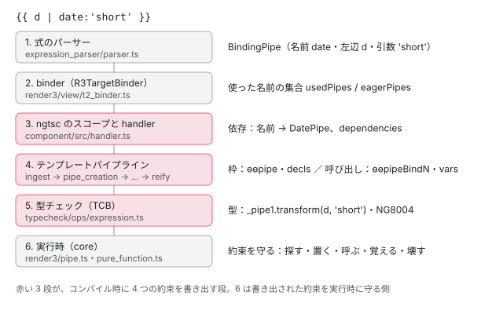

[目次](../README.md) › [パイプを書くと何を宣言したことになるか](README.md) › 第 1 回 / 全 6 回

# 1 行の | が生むもの：テンプレートに書いた pipe の全体像

> {{ d | date:"short" }} を本物のコンパイラ（ngtsc の記録と、ページの上の @angular/compiler）にかけ、出てきた JS と TCB の中で pipe に関係する部分を全部指さす。dependencies の DatePipe、作成のときの ɵɵpipe、更新のときの ɵɵpipeBind2、decls と vars に足される枠と箱（引数の数 + 1）、型チェックの \_pipe1.transform。「宣言」＝依存・枠・呼び出し・型の 4 つの約束が、どの段でどの行から生まれるかの地図。

angular/angular · 読了 約 12 分 · 基礎 · [サイトで読む（デモが動きます）](https://angular-deep-dive-cyan.vercel.app/chapter/pipe-what-declared)

---

この章では、テンプレートに `{{ d | date:'short' }}` と 1 行書いたことが、**何を宣言したことになるのか**を、本物のコンパイラの出力で全部指さします。ここで言う「宣言」とは、コンパイラがその 1 行から作り、実行時と型チェックに守らせる**約束**のことです。約束は 4 つあります。**依存**（このコンポーネントは DatePipe を使う）、**枠**（このビューの決まった番号にインスタンスを 1 つ置く）、**呼び出し**（変更検知のたびにこの引数で transform を呼ぶ。pure なら引数が同じ限り呼ばない）、**型**（transform の引数と戻り値が型に合う）です。

この章は地図です。4 つの約束が、どの段（パーサー → binder → ngtsc のスコープ → テンプレートパイプラインの phase → 出力、と型チェックの TCB）で、どのファイルのどの行から生まれるかを並べます。1 つずつの詳しい読み方は第 2〜5 回と、すでにある章（パーサーは [compiler-expression-parser](../compiler/05-compiler-expression-parser.md)、実行時の命令は [cmn-pipe-mechanism](../cmn/06-cmn-pipe-mechanism.md) など）に任せます。この章で引用するのは、出力を作る最後の段 `packages/compiler/src/template/pipeline/src/phases/reify.ts`・`src/instruction.ts` と、出力を固めているテスト `packages/compiler-cli/test/compliance/test_cases/r3_compiler_compliance/components_and_directives/pipes/` です。

1. **1. 1 行の | が生むもの**（この章）
2. [2. @Pipe が作るもの](02-pipe-class-def.md)
3. [3. 名前の解決](03-pipe-name-resolution.md)
4. [4. 書ける場所と書けない場所](04-pipe-where-allowed.md)
5. [5. インスタンスの数と寿命](05-pipe-instances-lifecycle.md)
6. [6. spec と issue](06-pipe-tests-issues.md)

## 1. 本物のコンパイラにかける

小さなコンポーネントを 1 つ書き、このサイトの node\_modules にある `@angular/compiler-cli` の `NgtscProgram`（`ngc` と同じ AOT のコンパイラ）でコンパイルしました（@angular/compiler-cli 22.1.6 / TypeScript 6.0.3。記録のスクリプトは章の最後）。テンプレートには 3 つの形を入れました。引数 1 つの `date:'short'`、引数 0 個の `uppercase`、2 つを連ねる `lowercase | slice:0:3` です。`imports` には、使わない `JsonPipe` も入れてあります。

📄 `demo.ts（コンパイルしたもの）` L1–17 （▶ の行: 6, 8–10）

```
 1 │ import {Component} from '@angular/core';
 2 │ import {DatePipe, JsonPipe, LowerCasePipe, SlicePipe, UpperCasePipe} from '@angular/common';
 3 │ 
 4 │ @Component({
 5 │   selector: 'app-what',
 6 ▶   imports: [DatePipe, UpperCasePipe, LowerCasePipe, SlicePipe, JsonPipe],
 7 │   template: `
 8 ▶     <p>{{ d | date:'short' }}</p>
 9 ▶     <p>{{ name | uppercase }}</p>
10 ▶     <p>{{ name | lowercase | slice:0:3 }}</p>
11 │   `,
12 │ })
13 │ export class What {
14 │   d = new Date(0);
15 │   name = 'Angular';
16 │ }
17 │ 
```

出てきた `demo.js` のうち、クラスの部分です。pipe に関係する行を強調しています。

📄 `out/demo.js（記録。1〜30 行目）` L1–30 （▶ の行: 8, 11, 15, 19–20, 24, 26, 28–29）

```
 1 │ import { Component } from '@angular/core';
 2 │ import { DatePipe, JsonPipe, LowerCasePipe, SlicePipe, UpperCasePipe } from '@angular/common';
 3 │ import * as i0 from "@angular/core";
 4 │ export class What {
 5 │     d = new Date(0);
 6 │     name = 'Angular';
 7 │     static ɵfac = function What_Factory(__ngFactoryType__) { return new (__ngFactoryType__ || What)(); };
 8 ▶     static ɵcmp = /*@__PURE__*/ i0.ɵɵdefineComponent({ type: What, selectors: [["app-what"]], decls: 10, vars: 14, template: function What_Template(rf, ctx) { if (rf & 1) {
 9 │             i0.ɵɵdomElementStart(0, "p");
10 │             i0.ɵɵtext(1);
11 ▶             i0.ɵɵpipe(2, "date");
12 │             i0.ɵɵdomElementEnd();
13 │             i0.ɵɵdomElementStart(3, "p");
14 │             i0.ɵɵtext(4);
15 ▶             i0.ɵɵpipe(5, "uppercase");
16 │             i0.ɵɵdomElementEnd();
17 │             i0.ɵɵdomElementStart(6, "p");
18 │             i0.ɵɵtext(7);
19 ▶             i0.ɵɵpipe(8, "lowercase");
20 ▶             i0.ɵɵpipe(9, "slice");
21 │             i0.ɵɵdomElementEnd();
22 │         } if (rf & 2) {
23 │             i0.ɵɵadvance();
24 ▶             i0.ɵɵtextInterpolate(i0.ɵɵpipeBind2(2, 3, ctx.d, "short"));
25 │             i0.ɵɵadvance(3);
26 ▶             i0.ɵɵtextInterpolate(i0.ɵɵpipeBind1(5, 6, ctx.name));
27 │             i0.ɵɵadvance(3);
28 ▶             i0.ɵɵtextInterpolate(i0.ɵɵpipeBind3(9, 10, i0.ɵɵpipeBind1(8, 8, ctx.name), 0, 3));
29 ▶         } }, dependencies: [DatePipe, UpperCasePipe, LowerCasePipe, SlicePipe], encapsulation: 2 });
30 │ }
```

テンプレートの 4 つの `|` が、出力のどこになったかを 1 つずつ指さします。

1. **11・15・19・20 行目：作成の回の `ɵɵpipe(番号, 名前)` ＝「枠」**

   `rf & 1`（ビューを作る 1 回だけ走る側）に、`|` 1 つにつき 1 行です。番号はこのビューの**スロット**（LView という配列の決まった位置）で、各 `ɵɵtext` の直後に来ます。連ねた 19・20 行目は、内側の `lowercase`（8）が先、外側の `slice`（9）が後です。実行時はこの行が、その番号に pipe のインスタンスを 1 つ置きます（[cmn-pipe-mechanism](../cmn/06-cmn-pipe-mechanism.md) の 3 節）。
2. **8 行目の `decls: 10`：枠の数**

   `<p>` 3 つとテキスト 3 つで 6、そこに `ɵɵpipe` の 4 つが足されて 10 です。pipe はテンプレートの要素と同じく、**スロットを 1 つずつ使う**ものとして数えられます。
3. **24・26・28 行目：更新の回の `ɵɵpipeBindN(番号, 箱の位置, 左辺, 引数…)` ＝「呼び出し」**

   `rf & 2`（変更検知のたびに走る側）です。N は transform に渡す値の数（左辺を含む）で、`date:'short'` は 2、`uppercase` は 1、`slice:0:3` は 3 です。28 行目は内側の `ɵɵpipeBind1(8, 8, ctx.name)` の答えが、外側の `ɵɵpipeBind3(9, 10, …, 0, 3)` の左辺になっています。「pure なら引数が同じ限り transform を呼ばない」は、この命令の中の話です（[cmn-pipe-mechanism](../cmn/06-cmn-pipe-mechanism.md) の 4〜5 節）。
4. **8 行目の `vars: 14`：呼び出しが使う箱**

   `ɵɵtextInterpolate` 3 つで 3（箱 0〜2）。pipe は「引数の数 + 1（答え）」ずつ箱を使います。`date` が 3（3〜5）、`uppercase` が 2（6〜7）、`lowercase` が 2（8〜9）、`slice` が 4（10〜13）で、合わせて 14 です。`ɵɵpipeBindN` の 2 つ目の数（3・6・8・10）が、その先頭です。前回の引数と答えを覚えておく場所が、この箱です。
5. **29 行目の `dependencies` ＝「依存」**

   `[DatePipe, UpperCasePipe, LowerCasePipe, SlicePipe]`。imports の 5 つのうち、テンプレートで使った 4 つだけです。`JsonPipe` は入らず、代わりに警告が 1 つ出ました。実行時の `ɵɵpipe` は、名前（`"date"`）をこの配列から作った一覧で探します（[standalone-directive-registry](../standalone/07-standalone-directive-registry.md)）。

📄 `診断（記録）`

```
NG8113 (Warning) JsonPipe is not used within the template of What
```

## 2. 型チェックの TCB：もう 1 つの出力

同じコンパイルで、ngtsc はテンプレートを TypeScript の関数（**TCB**、Type Check Block）にも書き直し、TypeScript に型を確かめさせます（[typecheck-overview](../typecheck/01-typecheck-overview.md)）。記録のスクリプトは、ngtsc の `TemplateTypeChecker.getTypeCheckBlock` で、このコンポーネントの TCB を取り出しました。

📄 `TCB（記録。_pipeN の宣言は同じファイルの先頭にあるものを並べた）` L1–16 （▶ の行: 1–4, 9, 11, 13）

```
 1 ▶ var _pipe1 = null! as i1.DatePipe;
 2 ▶ var _pipe2 = null! as i1.UpperCasePipe;
 3 ▶ var _pipe3 = null! as i1.LowerCasePipe;
 4 ▶ var _pipe4 = null! as i1.SlicePipe;
 5 │ function _tcb1(this: i0.What) {
 6 │ if (true) {
 7 │ this. /*T:COMPCOMP*/ /*D:ignore*/;
 8 │ var _t1 /*264,267*/ = document.createElement("p") /*264,267*/ /*264,267*/;
 9 ▶ "" + (_pipe1.transform /*274,278*/(((this).d /*270,271*/) /*270,271*/, "short" /*279,286*/) /*270,286*/);
10 │ var _t2 /*298,301*/ = document.createElement("p") /*298,301*/ /*298,301*/;
11 ▶ "" + (_pipe2.transform /*311,320*/(((this).name /*304,308*/) /*304,308*/) /*304,320*/);
12 │ var _t3 /*332,335*/ = document.createElement("p") /*332,335*/ /*332,335*/;
13 ▶ "" + (_pipe4.transform /*357,362*/(_pipe3.transform /*345,354*/(((this).name /*338,342*/) /*338,342*/) /*338,354*/, 0 /*363,364*/, 3 /*365,366*/) /*338,366*/);
14 │ 
15 │ }
16 │ }
```

- **1〜4 行目：pipe 1 種類につき変数 1 つ ＝「型」の土台**。`var _pipe1 = null! as i1.DatePipe;` は「DatePipe 型の値がある」と TypeScript に思わせるだけの行で、実行はされません。`i1` は `@angular/common` の import です。
- **9・11・13 行目：`_pipe1.transform((this).d, "short")`**。`|` が transform の呼び出しになり、左辺が第 1 引数、`:` の後ろが続きます。13 行目の連ねた形は、内側の呼び出しが外側の第 1 引数です。ここで引数の型が合わなければ、TypeScript のエラーとしてテンプレートの位置に戻されます。この変換の行は [typecheck-refs-pipes](../typecheck/15-typecheck-refs-pipes.md) が読んでいます。
- `/*274,278*/` のようなコメントは、TCB の位置をテンプレートの位置に戻すための目印です（[typecheck-diagnostics-mapping](../typecheck/16-typecheck-diagnostics-mapping.md)）。7・8・10・12 行目は、TemplateTypeChecker を使うと足される要素と補完の行で、pipe とは関係ありません。

> [!NOTE]
> **ポイント**
>
> JS の出力（1 節）では、同じ pipe を 2 か所に書くと `ɵɵpipe` も 2 行、インスタンスも 2 つです。TCB では、pipe の**クラス**ごとに変数が 1 つで、2 か所とも同じ `_pipe1` を使います。実行時の「インスタンスの枠」と、型チェックの「型の代表」は別のものです。DEMO の「同じ pipe を 2 か所」で並べて確かめられます。

## 3. 地図：どの段が、どの約束を作るか



*d | date:'short' の 1 行が、段ごとに約束へ変わっていく（右の列がその段の出すもの）*

| 出力の部分 | 約束 | 作る段と行 | 詳しくは |
| --- | --- | --- | --- |
| `BindingPipe`（AST） | —（材料） | parser.ts の `parsePipe`（872 行目の `new BindingPipe`） | [compiler-expression-parser](../compiler/05-compiler-expression-parser.md)・[第 4 回](04-pipe-where-allowed.md) |
| 使った名前の集合 | 依存の材料 | t2\_binder.ts の `TemplateBinder.visitPipe`（1222〜1228 行目） | [第 3 回](03-pipe-name-resolution.md)・[standalone-used-only](../standalone/04-standalone-used-only.md) |
| `dependencies: [DatePipe, …]` | 依存 | handler.ts の `resolveComponentDependencies`（名前 → PipeMeta の Map は 1893〜1894 行目、使ったものだけは 1985〜1989・2067〜2083 行目） | [第 3 回](03-pipe-name-resolution.md) |
| `ɵɵpipe(2, "date")`・`decls` | 枠 | ingest.ts 1380〜1385 行目で `PipeBindingExpr`、pipe\_creation.ts が作成の命令を差し込み、slot\_allocation.ts が番号を振り、4 節の reify が命令にする | [cmn-pipe-mechanism](../cmn/06-cmn-pipe-mechanism.md)・[compiler-slots-vars](../compiler/12-compiler-slots-vars.md) |
| `ɵɵpipeBind2(2, 3, ctx.d, "short")`・`vars` | 呼び出し | var\_counting.ts 182〜185 行目（1 + 引数の数）、5 個以上は pipe\_variadic.ts、instruction.ts の `pipeBind`（853〜860 行目） | [compiler-ir](../compiler/11-compiler-ir.md)・[compiler-slots-vars](../compiler/12-compiler-slots-vars.md) |
| `var _pipe1 = null! as i1.DatePipe`・`_pipe1.transform(…)` | 型 | typecheck/ops/expression.ts 180〜229 行目、compiler-cli の environment.ts の `pipeInst`（104〜113 行目） | [typecheck-refs-pipes](../typecheck/15-typecheck-refs-pipes.md) |
| `static ɵpipe`（DatePipe の側） | 依存の相手 | DatePipe 自身のコンパイル（r3\_pipe\_compiler.ts） | [第 2 回](02-pipe-class-def.md) |

## 4. 最後の段：reify が「枠」の命令を書く

4 つの約束のうち「枠」と「呼び出し」は、テンプレートパイプラインの最後の phase `reify`（中間表現の op を、出力の命令の呼び出しに置き換える段。[compiler-reify-emit](../compiler/16-compiler-reify-emit.md)）で JS の形になります。作成の側の行です。

📄 `angular/packages/compiler/src/template/pipeline/src/phases/reify.ts` L273–284 （▶ の行: 279–281）

```ts
273 │       case ir.OpKind.DisableBindings:
274 │         ir.OpList.replace(op, ng.disableBindings());
275 │         break;
276 │       case ir.OpKind.EnableBindings:
277 │         ir.OpList.replace(op, ng.enableBindings());
278 │         break;
279 ▶       case ir.OpKind.Pipe:
280 ▶         ir.OpList.replace(op, ng.pipe(op.handle.slot!, op.name));
281 ▶         break;
282 │       case ir.OpKind.DeclareLet:
283 │         ir.OpList.replace(op, ng.declareLet(op.handle.slot!, op.sourceSpan));
284 │         break;
```

279 行目：`ir.OpKind.Pipe` は、pipe\_creation の phase が作成の命令の並びに差し込んだ op です（差し込む行は [cmn-pipe-mechanism](../cmn/06-cmn-pipe-mechanism.md) の 2 節）。280 行目で、その op を `ng.pipe(スロット, 名前)` に置き換えます。`op.handle.slot` は slot\_allocation の phase が振った番号で、1 節の 11 行目の `2` です。`op.name` はテンプレートに書いた名前の文字列のままです。**クラス（DatePipe）はここには出てきません**。名前とクラスを結ぶのは dependencies の側（第 3 回）です。

📄 `angular/packages/compiler/src/template/pipeline/src/instruction.ts` L242–256 （▶ の行: 250–251）

```ts
242 │ export function twoWayListener(
243 │   name: string,
244 │   handlerFn: o.Expression,
245 │   sourceSpan: ParseSourceSpan,
246 │ ): ir.CreateOp {
247 │   return call(Identifiers.twoWayListener, [o.literal(name), handlerFn], sourceSpan);
248 │ }
249 │ 
250 ▶ export function pipe(slot: number, name: string): ir.CreateOp {
251 ▶   return call(Identifiers.pipe, [o.literal(slot), o.literal(name)], null);
252 │ }
253 │ 
254 │ export function namespaceHTML(): ir.CreateOp {
255 │   return call(Identifiers.namespaceHTML, [], null);
256 │ }
```

250〜251 行目：`Identifiers.pipe`（`ɵɵpipe` の外部参照）を、スロット番号と名前の 2 つの文字どおりの値で呼ぶ式です。3 つ目の `null` はソースの位置（source span）で、pipe の作成の命令は位置を持ちません。同じファイルの 853〜860 行目の `pipeBind` が更新の側で、引数の数で `ɵɵpipeBind1`〜`4` を選びます（[cmn-pipe-mechanism](../cmn/06-cmn-pipe-mechanism.md) の 2 節で引用）。

## 5. 呼び出しの連なり

- 👤 `{{ d | date:'short' }}` — あなたのテンプレート
- `ComponentDecoratorHandler.analyze` → `parseTemplate` — パーサー — *BindingPipe ができる*
- `ComponentDecoratorHandler.resolve` → `resolveComponentDependencies` — handler.ts
  - `R3TargetBinder.bind` → `TemplateBinder.visitPipe` — t2\_binder.ts L1222-1228 — *usedPipes.add('date')*
  - `pipes.get('date')` → `declarations` — handler.ts L1985-1989・L2067-2083 — *依存*
- `ComponentDecoratorHandler.compileFull` → `compileComponentFromMetadata` — render3/view/compiler.ts
  - `ingestComponent` → `convertAst` — ingest.ts L1380-1385 — *PipeBindingExpr*
  - `createPipes` → `createVariadicPipes` → `allocateSlots` → `countVariables` — phases/\*.ts — *枠と箱の数*
  - `reify` → `ng.pipe(2, 'date')`・`ng.pipeBind(2, 3, [d, 'short'])` — reify.ts L280・instruction.ts L250 — *枠と呼び出し*
  - `dependencies: [DatePipe]` — compiler.ts の compileDeclarationList
- `TemplateTypeChecker` → `generateTypeCheckBlock` — typecheck
  - `TcbExpressionTranslator.resolve(BindingPipe)` → `env.pipeInst(DatePipe)` — ops/expression.ts L180-229 — *型（見つからなければ missingPipe）*
- 👤 `実行時` — core
  - `ɵɵpipe(2, 'date')` → `getPipeDef` → `factory()` — pipe.ts L41-82 — *枠を守る*
  - `ɵɵpipeBind2(2, 3, d, 'short')` → `pureFunction2Internal` — pipe.ts・pure\_function.ts — *呼び出しを守る*

## 6. DEMO：テンプレートを書き換えて、ブラウザでコンパイルする

> **🧪 DEMO — このページの上の @angular/compiler で、| が生む行を見る**
>
> 「コンパイルする」を押すと、このサイトの `@angular/compiler` をその場で読み込み（それまでは読み込みません）、本物の関数を 3 つ呼びます。① `parseTemplate` と `R3TargetBinder` で使った pipe の名前を集め、② JIT の入口 `CompilerFacadeImpl.compileComponent` で ɵcmp の式を作って**評価する直前の JS の文字列**を受け取り、③ `generateTypeCheckBlock` で TCB の文字列を作ります。ngtsc が handler.ts でする「imports のうち使ったものだけを dependencies に」は、① の結果でこのページが真似しています。JS は JIT の書き出し（JitEmitterVisitor）なので、1 節の AOT の出力とは引用符と空白の付け方が違います。`jit_ɵɵpipe_4` のような引数名は `i0.ɵɵpipe` に戻して表示しています。
>
> 例を選ぶかテンプレートを書き換えて、「コンパイルする」を押してください。
>
> ▶ [このデモはサイトで動かせます](https://angular-deep-dive-cyan.vercel.app/chapter/pipe-what-declared)

例ごとに確かめられることです（このサイトの本番ビルドで確かめました）。

1. **本文の 3 行**

   1 節の記録と同じ `decls: 10, vars: 14`、同じスロット（2・5・8・9）と箱の先頭（3・6・8・10）になります。TCB も 2 節と同じ並びです（位置のコメントの数字だけが違います。記録はファイルの先頭からの位置、DEMO はテンプレートの先頭からの位置）。
2. **同じ pipe を 2 か所**

   `ɵɵpipe(2,'uppercase')` と `ɵɵpipe(5,'uppercase')` の 2 行（枠が 2 つ）、dependencies は 1 つ、TCB の変数は `_pipe1` の 1 つで、2 か所とも `_pipe1.transform` です。
3. **引数 5 個**

   `ɵɵpipeBindV(2,1,i0.ɵɵpureFunction1(8,_c0,ctx.v))`。5 つの値は 1 つの配列にまとめられ（pipe\_variadic の phase）、配列を作る `ɵɵpureFunction1` も箱を使います（[compiler-consts-pure](../compiler/14-compiler-consts-pure.md)）。TCB は配列にせず、6 つの値をそのまま transform に渡します。
4. **@if の中**

   `ɵɵpipe` は @if の中身のテンプレート関数（`Demo_Conditional_0_Template`）の側に出ます。枠はその小さなビューのもので、dependencies はコンポーネントに 1 つです。
5. **見つからない名前**

   `nope` も `ɵɵpipe(3,'nope')` として出力されます。dependencies に入らないので、実行時の `ɵɵpipe` が見つけられずに止まります。その前に TCB が `(0 as any).transform` にして `missingPipe('nope')` を記録し、ngtsc はこれを NG8004 のエラーにします（第 3 回）。
6. **@defer の中**

   ① で `date` は「使った」には入り、「@defer の外」には入りません。このデモ（JIT の入口）は dependencies に両方を入れますが、AOT では @defer の中だけの pipe は dependencies から外れ、読み込みの関数に回ります（第 3 回）。

## テストと直し方

### 出力の形を固めているテスト

1 節の「何行目に何が出るか」は、コンパイラの **compliance テスト**（入力の .ts をコンパイルし、出力を期待する .js と比べるテスト）が固めています。pipe の場面は `components_and_directives/pipes/` にまとまっています。

📄 `angular/packages/compiler-cli/test/compliance/test_cases/r3_compiler_compliance/components_and_directives/pipes/TEST_CASES.json` L57–70 （▶ の行: 58, 60, 66）

```json
57 │     {
58 ▶       "description": "should use appropriate function for a given no of pipe arguments",
59 │       "inputFiles": [
60 ▶         "pipe_invocation.ts"
61 │       ],
62 │       "expectations": [
63 │         {
64 │           "failureMessage": "Invalid MyApp definition",
65 │           "files": [
66 ▶             "pipe_invocation.js"
67 │           ]
68 │         }
69 │       ]
70 │     },
```

58 行目がテストの名前（jasmine の it になる）、60 行目が入力、66 行目が期待する出力のファイルです。

📄 `angular/packages/compiler-cli/test/compliance/test_cases/r3_compiler_compliance/components_and_directives/pipes/pipe_invocation.ts` L14–21 （▶ の行: 16）

```ts
14 │ @Component({
15 │     selector: 'my-app',
16 ▶     template: '0:{{name | myPipe}}1:{{name | myPipe:1}}2:{{name | myPipe:1:2}}3:{{name | myPipe:1:2:3}}4:{{name | myPipe:1:2:3:4}}',
17 │     standalone: false
18 │ })
19 │ export class MyApp {
20 │   name = '';
21 │ }
```

📄 `angular/packages/compiler-cli/test/compliance/test_cases/r3_compiler_compliance/components_and_directives/pipes/pipe_invocation.js` L1–31 （▶ の行: 7–8, 12, 16, 20–24, 28）

```js
 1 │ export class MyApp {
 2 │   // ...
 3 │   static ɵcmp = /*@__PURE__*/ $r3$.ɵɵdefineComponent({
 4 │     type: MyApp,
 5 │     selectors: [["my-app"]],
 6 │     standalone: false,
 7 ▶     decls: 6,
 8 ▶     vars: 27,
 9 │     template:  function MyApp_Template(rf, ctx) {
10 │       if (rf & 1) {
11 │         $r3$.ɵɵtext(0);
12 ▶         $r3$.ɵɵpipe(1, "myPipe");
13 │         $r3$.ɵɵpipe(2, "myPipe");
14 │         $r3$.ɵɵpipe(3, "myPipe");
15 │         $r3$.ɵɵpipe(4, "myPipe");
16 ▶         $r3$.ɵɵpipe(5, "myPipe");
17 │       }
18 │       if (rf & 2) {
19 │         $r3$.ɵɵtextInterpolate5(
20 ▶           "0:", i0.ɵɵpipeBind1(1, 5, ctx.name),
21 ▶           "1:", i0.ɵɵpipeBind2(2, 7, ctx.name, 1),
22 ▶           "2:", i0.ɵɵpipeBind3(3, 10, ctx.name, 1, 2),
23 ▶           "3:", i0.ɵɵpipeBind4(4, 14, ctx.name, 1, 2, 3),
24 ▶           "4:", i0.ɵɵpipeBindV(5, 19, $r3$.ɵɵpureFunction1(25, $c0$, ctx.name))
25 │         );
26 │       }
27 │     },
28 ▶     dependencies: [MyPipe],
29 │     encapsulation: 2
30 │   });
31 │ }
```

入力の 16 行目は、同じ `myPipe` を引数 0〜4 個で 5 回使います。期待する出力の 12〜16 行目は `ɵɵpipe` が 5 行（枠が 5 つ、`decls: 6` はテキスト 1 つ + 5）、20〜24 行目は引数の数で `ɵɵpipeBind1`〜`4` と `ɵɵpipeBindV` に分かれること、箱の先頭が 5・7・10・14・19 と「1 + 引数の数」ずつ進むことを確かめています（8 行目の `vars: 27`）。24 行目の `ɵɵpureFunction1(25, …)` は DEMO の「引数 5 個」と同じ形です。28 行目の `dependencies: [MyPipe]` は 1 つで、5 か所に書いても依存は 1 つです。`$r3$` のようにドルで挟んだ名前は、出力のどんな識別子にも合う書き方です（compliance の README の Identifier tolerant。同じファイルの中では同じ名前に揃っている必要がある）。`i0` はそのままの名前で比べます。

### 手元で走らせた結果

📄 `ターミナル（~/angular-research/angular で）`

```
cd ~/angular-research/angular
pnpm bazel test //packages/compiler-cli/test/compliance/full:full \
  --test_arg=--filter=components_and_directives/pipes --nocache_test_results --test_output=all
```

📄 `出力（2026-11-09 に実行。抜粋）`

```
Ran 2 of 615 specs
2 specs, 0 failures
Ran 2 of 615 specs
2 specs, 0 failures
//packages/compiler-cli/test/compliance/full:full     PASSED in 1.2s
  Stats over 2 runs: max = 1.2s, min = 1.2s, avg = 1.2s, dev = 0.0s
```

shard（テストを 2 つに分けて並べて走らせる設定）が 2 つで、それぞれ 2 件ずつ、`components_and_directives/pipes` の 4 つの場面（should render pipes・引数の数・ChangeDetectorRef・名前の無い pipe）が通っています。同じ filter で部分コンパイル + リンカーの `//packages/compiler-cli/test/compliance/linked:linked` も 2 + 2 件通りました（第 2 回）。

### 直すとしたら

- 作成の命令の形は reify.ts の `case ir.OpKind.Pipe`（280 行目）と instruction.ts の `pipe()`（250 行目）。更新の命令は同じファイルの `pipeBind`・`pipeBindV`。
- 枠と箱の数は phases の `pipe_creation.ts`（作成の命令をどこに置くか）・`slot_allocation.ts`・`var_counting.ts`（`1 + 引数の数`）。
- どれを直しても出力の .js が変わるので、`components_and_directives/pipes/TEST_CASES.json` に場面を足し、期待する .js を並べます。部分コンパイルの期待値 `GOLDEN_PARTIAL.js` も同じ場所にあります。
- TCB の形は typecheck の章の担当で、spec は `packages/compiler-cli/src/ngtsc/typecheck/test/type_check_block_spec.ts` です（[typecheck-refs-pipes](../typecheck/15-typecheck-refs-pipes.md) が pipe の it を読んでいます）。

## 記録のスクリプト

1・2 節の記録は、次のスクリプトを `angular-deep-dive` を cwd にして Node で走らせた結果です（第 2・3 回の記録も同じスクリプトです）。これは記録です。ページを開いたときにコンパイルしているのではありません。

📄 `record-pipe.mjs（記録のスクリプト）`

```
// pipe シリーズ（第 1〜3 回）の記録。angular-deep-dive を cwd にして `node <このファイル> > pipe.json` で走らせる。
// 本物の @angular/compiler-cli（このサイトの node_modules）の NgtscProgram で小さなファイルをコンパイルし、
// 場面ごとに 1) 出力の .js と .d.ts 2) 型チェックの TCB（TemplateTypeChecker.getTypeCheckBlock）3) 診断 を JSON で出す。
// 部分コンパイル（compilationMode: 'partial'）の場面では、出力をさらにリンカー（Babel のプラグイン）に通した結果も出す。
import fs from 'node:fs';
import os from 'node:os';
import path from 'node:path';
import {createRequire} from 'node:module';
import {pathToFileURL} from 'node:url';

const req = createRequire(path.resolve('package.json'));
const load = (id) => import(pathToFileURL(req.resolve(id)).href);
const {default: ts} = await load('typescript');
const {NgtscProgram, VERSION} = await load('@angular/compiler-cli');
const babel = await load('@babel/core');
const {createEs2015LinkerPlugin} = await load('@angular/compiler-cli/linker/babel');
const {NodeJSFileSystem, ConsoleLogger, LogLevel} = await load('@angular/compiler-cli');

const NODE_MODULES = path.resolve('node_modules');

// ---- 場面 ----------------------------------------------------------------
const SCENES = {
  // 第 1 回: 1 行の | が生むもの
  what: {
    chapter: 1,
    source: `import {Component} from '@angular/core';
import {DatePipe, JsonPipe, LowerCasePipe, SlicePipe, UpperCasePipe} from '@angular/common';

@Component({
  selector: 'app-what',
  imports: [DatePipe, UpperCasePipe, LowerCasePipe, SlicePipe, JsonPipe],
  template: \`
    <p>{{ d | date:'short' }}</p>
    <p>{{ name | uppercase }}</p>
    <p>{{ name | lowercase | slice:0:3 }}</p>
  \`,
})
export class What {
  d = new Date(0);
  name = 'Angular';
}
`,
  },
  // 第 2 回: @Pipe が作るもの
  classdef: {
    chapter: 2,
    partial: true,
    source: `import {ChangeDetectorRef, OnDestroy, Pipe, PipeTransform, inject} from '@angular/core';

@Pipe({name: 'pcdTrim'})
export class PcdTrimPipe implements PipeTransform {
  transform(value: string): string {
    return value.trim();
  }
}

@Pipe({name: 'pcdLive', pure: false})
export class PcdLivePipe implements PipeTransform, OnDestroy {
  private readonly cdr = inject(ChangeDetectorRef);
  transform(value: number): number {
    return value;
  }
  ngOnDestroy(): void {}
}

@Pipe({name: 'pcdOld', standalone: false})
export class PcdOldPipe implements PipeTransform {
  constructor(private readonly cdr: ChangeDetectorRef) {}
  transform(value: number): number {
    return value;
  }
}
`,
  },
  // 第 3 回: 名前の解決
  none: {
    chapter: 3,
    source: `import {Component} from '@angular/core';

@Component({
  selector: 'app-none',
  template: \`<p>{{ d | date:'short' }}</p>\`,
})
export class None {
  d = new Date(0);
}
`,
  },
  imported: {
    chapter: 3,
    source: `import {Component} from '@angular/core';
import {DatePipe, JsonPipe} from '@angular/common';

@Component({
  selector: 'app-imported',
  imports: [DatePipe, JsonPipe],
  template: \`<p>{{ d | date:'short' }}</p>\`,
})
export class Imported {
  d = new Date(0);
}
`,
  },
  duplicate: {
    chapter: 3,
    source: `import {Component, Pipe, PipeTransform} from '@angular/core';

@Pipe({name: 'pnrTag'})
export class PnrAPipe implements PipeTransform {
  transform(v: string): string {
    return 'A:' + v;
  }
}

@Pipe({name: 'pnrTag'})
export class PnrBPipe implements PipeTransform {
  transform(v: string): number {
    return v.length;
  }
}

@Component({
  selector: 'app-dup-ab',
  imports: [PnrAPipe, PnrBPipe],
  template: \`<p>{{ 'x' | pnrTag }}</p>\`,
})
export class DupAB {}

@Component({
  selector: 'app-dup-ba',
  imports: [PnrBPipe, PnrAPipe],
  template: \`<p>{{ 'x' | pnrTag }}</p>\`,
})
export class DupBA {}
`,
  },
  deferOnly: {
    chapter: 3,
    source: `import {Component} from '@angular/core';
import {DatePipe, UpperCasePipe} from '@angular/common';

@Component({
  selector: 'app-defer-only',
  imports: [DatePipe, UpperCasePipe],
  template: \`
    <p>{{ name | uppercase }}</p>
    @defer (on idle) {
      <p>{{ d | date:'short' }}</p>
    }
  \`,
})
export class DeferOnly {
  d = new Date(0);
  name = 'a';
}
`,
  },
  // deferOnly と同じテンプレートで、DatePipe の import 文だけを分けたもの
  deferSplit: {
    chapter: 3,
    source: `import {Component} from '@angular/core';
import {DatePipe} from '@angular/common';
import {UpperCasePipe} from '@angular/common';

@Component({
  selector: 'app-defer-split',
  imports: [DatePipe, UpperCasePipe],
  template: \`
    <p>{{ name | uppercase }}</p>
    @defer (on idle) {
      <p>{{ d | date:'short' }}</p>
    }
  \`,
})
export class DeferSplit {
  d = new Date(0);
  name = 'a';
}
`,
  },
  ngModule: {
    chapter: 3,
    source: `import {Component, NgModule} from '@angular/core';
import {CommonModule} from '@angular/common';

@Component({
  selector: 'app-legacy',
  standalone: false,
  template: \`<p>{{ d | date:'short' }} {{ d | nope }}</p>\`,
})
export class Legacy {
  d = new Date(0);
}

@NgModule({declarations: [Legacy], imports: [CommonModule]})
export class LegacyModule {}
`,
  },
};

// ---- コンパイル ----------------------------------------------------------
function compile(source, mode) {
  const dir = fs.mkdtempSync(path.join(os.tmpdir(), 'pipe-rec-'));
  try {
    fs.symlinkSync(NODE_MODULES, path.join(dir, 'node_modules'), 'dir');
    const file = path.join(dir, 'demo.ts');
    fs.writeFileSync(file, source);
    const options = {
      target: ts.ScriptTarget.ES2022,
      module: ts.ModuleKind.ES2022,
      moduleResolution: ts.ModuleResolutionKind.Bundler,
      strict: true,
      skipLibCheck: true,
      declaration: true,
      outDir: path.join(dir, 'out'),
      strictTemplates: true,
      _enableTemplateTypeChecker: true,
      ...(mode === 'partial' ? {compilationMode: 'partial'} : {}),
    };
    const program = new NgtscProgram([file], options, ts.createCompilerHost(options));
    const diagnostics = [
      ...program.getTsSemanticDiagnostics(),
      ...program.getNgStructuralDiagnostics(),
      ...program.getNgSemanticDiagnostics(),
    ].map((d) => {
      const pos = d.file && d.start !== undefined ? d.file.getLineAndCharacterOfPosition(d.start) : null;
      return {
        code: String(d.code).startsWith('-99') ? 'NG' + String(d.code).slice(3) : 'TS' + d.code,
        category: ts.DiagnosticCategory[d.category],
        file: d.file ? path.basename(d.file.fileName) : null,
        line: pos ? pos.line + 1 : null,
        text: ts.flattenDiagnosticMessageText(d.messageText, '\n'),
      };
    });
    program.emit();
    const js = fs.readFileSync(path.join(dir, 'out', 'demo.js'), 'utf8');
    const dts = fs.readFileSync(path.join(dir, 'out', 'demo.d.ts'), 'utf8');
    const tcb = {};
    if (mode !== 'partial') {
      const checker = program.compiler.getTemplateTypeChecker();
      const sf = program.getTsProgram().getSourceFile(file);
      for (const stmt of sf.statements) {
        if (!ts.isClassDeclaration(stmt)) continue;
        const node = checker.getTypeCheckBlock(stmt);
        if (node === null) continue;
        // TCB の関数と、同じファイルの先頭に置かれる pipe の変数（_pipeN）を並べる
        const shim = node.getSourceFile();
        const pipeVars = shim.statements
          .filter((s) => ts.isVariableStatement(s) && /\b_pipe\d+\b/.test(s.getText()))
          .map((s) => s.getText());
        tcb[stmt.name.text] = {pipeVars, block: node.getText()};
      }
    }
    return {diagnostics, js, dts, tcb};
  } finally {
    fs.rmSync(dir, {recursive: true, force: true});
  }
}

function link(js) {
  const fileSystem = new NodeJSFileSystem();
  const logger = new ConsoleLogger(LogLevel.warn);
  const plugin = createEs2015LinkerPlugin({fileSystem, logger, linkerJitMode: false});
  return babel.transformSync(js, {filename: 'demo.js', plugins: [plugin], compact: false, configFile: false, babelrc: false}).code;
}

// ---- 実行時（JIT）: 同じ名前の pipe が 2 つ・見つからない pipe -------------------
// @angular/compiler を読み込んだ状態で、デコレータを関数として呼び（JIT）、platform-server で 1 回描く。
// TestBed と同じく、コンポーネントの imports をそのまま実行時の pipeRegistry に入れる道。
async function runtimeScenes() {
  await load('@angular/compiler');
  const {Component, Pipe, provideZonelessChangeDetection} = await load('@angular/core');
  const {renderApplication} = await load('@angular/platform-server');
  const {bootstrapApplication} = await load('@angular/platform-browser');
  class PnrAPipe {
    transform(v) {
      return 'A:' + v;
    }
  }
  Pipe({name: 'pnrTag'})(PnrAPipe);
  class PnrBPipe {
    transform(v) {
      return v.length;
    }
  }
  Pipe({name: 'pnrTag'})(PnrBPipe);
  const cases = {
    'imports: [PnrAPipe, PnrBPipe]': [PnrAPipe, PnrBPipe],
    'imports: [PnrBPipe, PnrAPipe]': [PnrBPipe, PnrAPipe],
    'imports: []': [],
  };
  const result = {};
  const origWarn = console.warn;
  const origError = console.error;
  const origLog = console.log;
  for (const [label, imports] of Object.entries(cases)) {
    const warnings = [];
    console.warn = (...a) => warnings.push(a.map(String).join(' '));
    console.error = (...a) => warnings.push(a.map(String).join(' '));
    // 「Angular is running in development mode.」を JSON の出力に混ぜない
    console.log = () => {};
    class Root {}
    Component({selector: 'app-root', imports, template: '<p>{{ "xyz" | pnrTag }}</p>'})(Root);
    let html = null;
    let error = null;
    try {
      html = await renderApplication(
        (context) => bootstrapApplication(Root, {providers: [provideZonelessChangeDetection()]}, context),
        {document: '<app-root></app-root>', url: '/'},
      );
    } catch (e) {
      error = e instanceof Error ? e.message : String(e);
    }
    console.warn = origWarn;
    console.error = origError;
    console.log = origLog;
    result[label] = {
      rendered: html === null ? null : (/<p>(.*?)<\/p>/.exec(html)?.[1] ?? ''),
      error,
      warnings: warnings.filter((w) => /NG0\d{3}/.test(w)).map((w) => w.split('\n')[0]),
    };
  }
  return result;
}

const out = {compilerCli: VERSION.full, typescript: ts.version, scenes: {}};
for (const [name, scene] of Object.entries(SCENES)) {
  const full = compile(scene.source, 'full');
  const rec = {chapter: scene.chapter, source: scene.source, ...full};
  if (scene.partial) {
    const partial = compile(scene.source, 'partial');
    rec.partialJs = partial.js;
    rec.linkedJs = link(partial.js);
  }
  out.scenes[name] = rec;
}
out.runtime = await runtimeScenes();
console.log(JSON.stringify(out, null, 2));

```

## 聞かれそうな質問

**Q. テンプレートに | date と書くと、何を宣言したことになるのですか？**

4 つの約束です。依存（ɵcmp の `dependencies` に DatePipe。1 節の出力 29 行目）、枠（作成の回の `ɵɵpipe(2, "date")` と `decls` の 1 つ。11 行目）、呼び出し（更新の回の `ɵɵpipeBind2(2, 3, ctx.d, "short")` と、引数 + 答えの 3 つの箱。24 行目）、型（TCB の `_pipe1.transform(this.d, "short")`。2 節の 9 行目）です。

**Q. テンプレートの名前とクラスは、出力のどこで結ばれていますか？**

作成の命令は名前の文字列だけを持ちます（reify.ts 280 行目の `op.name`）。クラスは `dependencies` の配列にだけ出ます。実行時に `ɵɵpipe` がその配列から名前で探して結びます。だから名前が imports に無いと、`ɵɵpipe(3,'nope')` だけが出力に残ります（DEMO の「見つからない名前」）。

**Q. vars の数は pipe 1 つでいくつ増えますか？**

「transform に渡す値の数 + 1」です。`date:'short'` なら左辺と 'short' と答えで 3（1 節の箱 3〜5）。compliance テストの期待値（vars: 27）も、この数え方で 5・7・10・14・19 と進みます。5 個以上は配列 1 つにまとめられ、配列を作る分の箱も使います。

**Q. 同じ pipe を 2 か所に書くと、何が 2 つになりますか？**

枠（`ɵɵpipe` の行とインスタンス）と、呼び出しの箱が 2 つです。依存（dependencies）と、TCB の変数（`_pipe1`）は 1 つのままです（DEMO の「同じ pipe を 2 か所」）。

**Q. imports に入れたのに使っていない pipe はどうなりますか？**

出力の `dependencies` に入りません（1 節で JsonPipe が無い）。代わりに NG8113 の警告「JsonPipe is not used within the template of What」が出ます（[standalone-used-only](../standalone/04-standalone-used-only.md)）。

## 読み終えて

- `x | date:'short'` の 1 行は、依存（dependencies）・枠（ɵɵpipe と decls）・呼び出し（ɵɵpipeBindN と vars）・型（TCB の transform）の 4 つの約束になる。
- 作成の命令は名前の文字列だけを持ち、クラスとは dependencies の側で結ばれる。
- pipe 1 つは、スロット 1 つと「引数の数 + 1」個の箱を使う。連ねると内側が先。
- 同じ pipe を 2 か所に書くと、枠は 2 つ・依存と TCB の変数は 1 つ。
- 出力の形は compliance テスト（components\_and\_directives/pipes）が固めている。

---

← 前: [spec と issue を読む：Navigation API の連携の今](../navx/07-navx-tests-issues.md)  
次: [@Pipe が作るもの：ɵpipe と ɵfac、AOT と JIT と部分コンパイル](02-pipe-class-def.md) →
