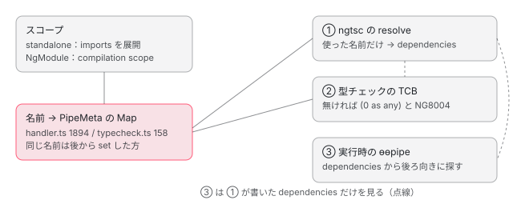

[目次](../README.md) › [パイプを書くと何を宣言したことになるか](README.md) › 第 3 回 / 全 6 回

# 名前の解決：imports に入れた pipe が、テンプレートの名前と結ばれるまで

> テンプレートの "date" という名前が、コンポーネントの imports（standalone）や NgModule のスコープから DatePipe に結ばれる流れ。名前 → PipeMeta の Map が handler と型チェックで別々に作られること、binder が使われた名前だけを集め、dependencies に eager に使ったものだけを出す行、見つからないときの NG8004（TCB を作るときの帯域外の診断）と実行時の NG0302、同じ名前の pipe が 2 つあると AOT も JIT も imports の後ろが勝つこと（警告は JIT の NG0313 だけ）、@defer の中だけで使う pipe が依存の関数に回る行。

angular/angular · 読了 約 13 分 · 中核 · [サイトで読む（デモが動きます）](https://angular-deep-dive-cyan.vercel.app/chapter/pipe-name-resolution)

---

テンプレートの `| date` は、クラスではなく **"date" という名前**を書いています。この章では、その 1 行が「**このコンポーネントのスコープ（imports か NgModule）の中から、"date" という名前の pipe を 1 つ選ぶ**」という宣言になる部分を読みます。名前は 3 か所で探されます。ngtsc が dependencies を決めるとき、型チェックの TCB を作るとき、実行時の `ɵɵpipe` です。3 か所が同じ答えを出すかを、見つからないとき・同じ名前が 2 つあるとき・@defer の中だけで使うときで確かめます。

読む対象は、名前の一覧を作る `packages/compiler-cli/src/ngtsc/scope/src/typecheck.ts`、名前を集める `packages/compiler/src/render3/view/t2_binder.ts`、診断の文を作る `packages/compiler-cli/src/ngtsc/typecheck/src/oob.ts`、実行時の `packages/core/src/render3/pipe.ts` のエラーの文、spec の `packages/compiler/test/render3/view/binding_spec.ts` です。imports の展開と検査は [standalone-imports-check](../standalone/03-standalone-imports-check.md)、NgModule のスコープは [ngmodule-compilation-scope](../ngmodule/04-ngmodule-compilation-scope.md)、使ったものだけを dependencies に残す手順は [standalone-used-only](../standalone/04-standalone-used-only.md) が読んでいるので、ここでは pipe の名前に関係する行だけを読みます。

1. [1. 1 行の | が生むもの](01-pipe-what-declared.md)
2. [2. @Pipe が作るもの](02-pipe-class-def.md)
3. **3. 名前の解決**（この章）
4. [4. 書ける場所と書けない場所](04-pipe-where-allowed.md)
5. [5. インスタンスの数と寿命](05-pipe-instances-lifecycle.md)
6. [6. spec と issue](06-pipe-tests-issues.md)

## 1. 名前は 3 か所で探される



*スコープから作った「名前 → pipe」の一覧を、3 か所が引く*

① と ② はコンパイル時に、同じスコープから作った Map を引きます。③ は実行時に、① が出力に書いた `dependencies` から作った一覧（`pipeRegistry`）を引きます。つまり AOT では、③ が見る候補は ① がすでに 1 つに絞ったものです。

## 2. 名前の一覧：同じ名前は後から入れた方

① の handler の側は、`resolveComponentDependencies` の 1890〜1897 行目で、スコープの依存を順に回して `pipes.set(dep.name, dep)` します（[ngmodule-compilation-scope](../ngmodule/04-ngmodule-compilation-scope.md) が引用）。② の型チェックの側も、同じ形の Map を別に作ります。

📄 `angular/packages/compiler-cli/src/ngtsc/scope/src/typecheck.ts` L141–161 （▶ の行: 141, 144, 149, 154, 157–158）

```ts
141 ▶       const dependencies = isNgModuleScope ? scope.compilation.dependencies : scope.dependencies;
142 │       let allDependencies = dependencies;
143 │ 
144 ▶       if (
145 │         !isNgModuleScope &&
146 │         Array.isArray(scope.deferredDependencies) &&
147 │         scope.deferredDependencies.length > 0
148 │       ) {
149 ▶         allDependencies = [...allDependencies, ...scope.deferredDependencies];
150 │       }
151 │ 
152 │       matcher = this.getSelectorMatcher(allDependencies);
153 │ 
154 ▶       for (const dep of allDependencies) {
155 │         if (dep.kind === MetaKind.Directive) {
156 │           directives.push(dep);
157 ▶         } else if (dep.kind === MetaKind.Pipe && dep.name !== null) {
158 ▶           pipes.set(dep.name, dep);
159 │         }
160 │       }
161 │     }
```

1. **141 行目：スコープの依存**

   NgModule なら compilation scope、standalone なら imports を展開したもの（[standalone-imports-check](../standalone/03-standalone-imports-check.md) の `StandaloneComponentScopeReader`。imports に書いた順に並ぶ）。
2. **144〜150 行目：deferredImports も足す**

   `@Component.deferredImports`（内部向けの欄）の依存は後ろに付きます。
3. **157〜158 行目：pipe は名前で Map に入れる**

   `Map.set` なので、**同じ名前がもう一度来ると、後の方で上書き**されます。名前が null の pipe（第 2 回の名前の無い pipe）は入りません。

このどちらにも、「同じ名前が 2 つある」ことを診断にする行はありません。6 節の記録で、診断が 0 件のまま後の方が選ばれることを確かめます。② の Map は、handler.ts 1253 行目で `TemplateContext.pipes` として TCB の材料になり、TCB の `getPipeByName` が引きます（[typecheck-refs-pipes](../typecheck/15-typecheck-refs-pipes.md)）。

## 3. binder が集めるのは名前だけ

テンプレートのどこでどの名前を使ったかは、`R3TargetBinder` が集めます。binder はクラスを知りません。

📄 `angular/packages/compiler/src/render3/view/t2_binder.ts` L1212–1229 （▶ の行: 1222–1225, 1227）

```ts
1212 │   }
1213 │ 
1214 │   override visitLetDeclaration(decl: LetDeclaration) {
1215 │     super.visitLetDeclaration(decl);
1216 │ 
1217 │     if (this.rootNode !== null) {
1218 │       this.symbols.set(decl, this.rootNode);
1219 │     }
1220 │   }
1221 │ 
1222 ▶   override visitPipe(ast: BindingPipe, context: any): any {
1223 ▶     this.usedPipes.add(ast.name);
1224 ▶     if (!this.scope.isDeferred) {
1225 ▶       this.eagerPipes.add(ast.name);
1226 │     }
1227 ▶     this.pipes.set(ast, this.scope.getEnclosingDeferBlocks());
1228 │     return super.visitPipe(ast, context);
1229 │   }
```

- 1223 行目：式の木の中で `BindingPipe`（`|`）に出会うたびに、**名前の文字列**を `usedPipes` に足します。
- 1224〜1225 行目：今いる scope が `@defer` の中でなければ、`eagerPipes` にも足します。
- 1227 行目：その `|` を囲む @defer の並び（外から内へ）を覚えます。TCB が deferredImports の検査（ops/expression.ts 191 行目）で使います。

📄 `angular/packages/compiler/src/render3/view/t2_binder.ts` L306–320 （▶ の行: 312, 318–319）

```ts
306 │   /**
307 │    * Child `Scope`s for immediately nested `ScopedNode`s.
308 │    */
309 │   readonly childScopes = new Map<ScopedNode, Scope>();
310 │ 
311 │   /** Whether this scope is deferred or if any of its ancestors are deferred. */
312 ▶   readonly isDeferred: boolean;
313 │ 
314 │   private constructor(
315 │     readonly parentScope: Scope | null,
316 │     readonly rootNode: ScopedNode | null,
317 │   ) {
318 ▶     this.isDeferred =
319 ▶       parentScope !== null && parentScope.isDeferred ? true : rootNode instanceof DeferredBlock;
320 │   }
```

318〜319 行目：親の scope が @defer の中なら中、そうでなければ「自分の根が `DeferredBlock` か」。`@placeholder`・`@loading`・`@error` は別の種類の節なので、その中は **@defer の中ではない**（eager）と数えられます。最初に表示される中身だからです（テストと直し方の spec で確かめます）。

📄 `angular/packages/compiler/src/render3/view/t2_binder.ts` L1359–1366 （▶ の行: 1360, 1364）

```ts
1359 │   getUsedPipes(): string[] {
1360 ▶     return Array.from(this.usedPipes);
1361 │   }
1362 │ 
1363 │   getEagerlyUsedPipes(): string[] {
1364 ▶     return Array.from(this.eagerPipes);
1365 │   }
1366 │ 
```

① の handler は、1364 行目の `getEagerlyUsedPipes()` の名前を Map で引いたものを dependencies に残し（handler.ts 1985〜1989 行目）、@defer の中の名前は読み込みの関数の側に回します（7 節）。imports にあって使わない pipe は dependencies に入らず、NG8113 の警告になります（[standalone-used-only](../standalone/04-standalone-used-only.md)）。

📄 `imports: [DatePipe, JsonPipe] の出力（記録。import と開発用の IIFE を除く）` L1–13 （▶ の行: 7, 12）

```
 1 │ export class Imported {
 2 │     d = new Date(0);
 3 │     static ɵfac = function Imported_Factory(__ngFactoryType__) { return new (__ngFactoryType__ || Imported)(); };
 4 │     static ɵcmp = /*@__PURE__*/ i0.ɵɵdefineComponent({ type: Imported, selectors: [["app-imported"]], decls: 3, vars: 4, template: function Imported_Template(rf, ctx) { if (rf & 1) {
 5 │             i0.ɵɵdomElementStart(0, "p");
 6 │             i0.ɵɵtext(1);
 7 ▶             i0.ɵɵpipe(2, "date");
 8 │             i0.ɵɵdomElementEnd();
 9 │         } if (rf & 2) {
10 │             i0.ɵɵadvance();
11 │             i0.ɵɵtextInterpolate(i0.ɵɵpipeBind2(2, 1, ctx.d, "short"));
12 ▶         } }, dependencies: [DatePipe], encapsulation: 2 });
13 │ }
```

12 行目：`dependencies: [DatePipe]`。JsonPipe は使っていないので入らず、診断は `NG8113（Warning、demo.ts 6 行目）JsonPipe is not used within the template of Imported` です。

## 4. 見つからないとき：NG8004 はどこで出るか

imports に何も書かずに `| date` を使った場合の記録です。

📄 `診断（記録）`

```
NG8004（Error、demo.ts 5 行目）
No pipe found with name 'date'.
To fix this, import the "DatePipe" class from "@angular/common" and add it to the "imports" array of the component.
```

📄 `TCB（記録。位置のコメントは除いた）` L1–8 （▶ の行: 5）

```
1 │ function _tcb1(this: i0.None) {
2 │ if (true) {
3 │ this. /*T:COMPCOMP*/ /*D:ignore*/;
4 │ var _t1 = document.createElement("p");
5 ▶ "" + ((0 as any).transform(((this).d), "short"));
6 │ 
7 │ }
8 │ }
```

1. **TCB を作るとき（②）に見つける**

   TCB の `getPipeByName('date')` が null を返すと、ops/expression.ts 184〜186 行目で帯域外の記録 `oobRecorder.missingPipe` を呼び、189 行目で `(0 as any)` を置きます（TCB の 5 行目。[typecheck-refs-pipes](../typecheck/15-typecheck-refs-pipes.md)）。TypeScript のエラーではなく、ngtsc が自分で作る診断（帯域外の診断。[typecheck-oob](../typecheck/17-typecheck-oob.md)）です。`(0 as any)` にするのは、残りの式の型チェックを続けるためです。
2. **文を作る：よく使う 13 個だけ、直し方を足す**

   📄 `angular/packages/compiler-cli/src/ngtsc/typecheck/src/oob.ts` L54–72 （▶ の行: 54, 57, 67）

   ```ts
   54 ▶   private readonly recordedPipes = new Set<BindingPipe>();
   55 │ 
   56 │   /** Common pipes that can be suggested to users. */
   57 ▶   private readonly pipeSuggestions = new Map<string, string>([
   58 │     ['async', 'AsyncPipe'],
   59 │     ['uppercase', 'UpperCasePipe'],
   60 │     ['lowercase', 'LowerCasePipe'],
   61 │     ['json', 'JsonPipe'],
   62 │     ['slice', 'SlicePipe'],
   63 │     ['number', 'DecimalPipe'],
   64 │     ['percent', 'PercentPipe'],
   65 │     ['titlecase', 'TitleCasePipe'],
   66 │     ['currency', 'CurrencyPipe'],
   67 ▶     ['date', 'DatePipe'],
   68 │     ['i18nPlural', 'I18nPluralPipe'],
   69 │     ['i18nSelect', 'I18nSelectPipe'],
   70 │     ['keyvalue', 'KeyValuePipe'],
   71 │   ]);
   72 │ 
   ```

   `missingPipe`（99〜139 行目。[typecheck-oob](../typecheck/17-typecheck-oob.md) で引用）は、基本の文「No pipe found with name 'date'.」に、名前が 57〜71 行目の Map にあれば 「To fix this, import the "DatePipe" class from "@angular/common" and add it to the "imports" array of the component.」を足します。NgModule の部品なら最後が「of the module declaring the component.」です。Map に無い名前（下の `nope`）には、基本の文だけが出ます。54 行目の `recordedPipes` は、同じ `|` で 2 度出さないための集合です。
3. **型チェックが走らないスコープでは出ない**

   handler.ts の `typeCheck` は、スコープが壊れている（`isPoisoned`。imports に standalone でないものを書いたなど）と TCB を作らずに戻ります（1242〜1245 行目。[standalone-imports-check](../standalone/03-standalone-imports-check.md)）。そのときは NG8004 も出ず、壊れた原因の診断だけが出ます。

NgModule のスコープで、CommonModule にある `date` と、どこにも無い `nope` を使った記録です。

📄 `診断（記録）`

```
NG8004（Error、demo.ts 7 行目）
No pipe found with name 'nope'.
```

📄 `NgModule のスコープの出力（記録）` L1–19 （▶ の行: 7–8, 13）

```
 1 │ export class Legacy {
 2 │     d = new Date(0);
 3 │     static ɵfac = function Legacy_Factory(__ngFactoryType__) { return new (__ngFactoryType__ || Legacy)(); };
 4 │     static ɵcmp = /*@__PURE__*/ i0.ɵɵdefineComponent({ type: Legacy, selectors: [["app-legacy"]], standalone: false, decls: 4, vars: 7, template: function Legacy_Template(rf, ctx) { if (rf & 1) {
 5 │             i0.ɵɵelementStart(0, "p");
 6 │             i0.ɵɵtext(1);
 7 ▶             i0.ɵɵpipe(2, "date");
 8 ▶             i0.ɵɵpipe(3, "nope");
 9 │             i0.ɵɵelementEnd();
10 │         } if (rf & 2) {
11 │             i0.ɵɵadvance();
12 │             i0.ɵɵtextInterpolate2("", i0.ɵɵpipeBind2(2, 2, ctx.d, "short"), " ", i0.ɵɵpipeBind1(3, 5, ctx.d));
13 ▶         } }, dependencies: [i1.DatePipe], encapsulation: 2 });
14 │ }
15 │ export class LegacyModule {
16 │     static ɵfac = function LegacyModule_Factory(__ngFactoryType__) { return new (__ngFactoryType__ || LegacyModule)(); };
17 │     static ɵmod = /*@__PURE__*/ i0.ɵɵdefineNgModule({ type: LegacyModule });
18 │     static ɵinj = /*@__PURE__*/ i0.ɵɵdefineInjector({ imports: [CommonModule] });
19 │ }
```

診断は `nope` の 1 つだけで、Map に無い名前なので直し方は付きません。8 行目：それでも `ɵɵpipe(3, "nope")` は出力されます。13 行目の dependencies には CommonModule が export する `i1.DatePipe`（`@angular/common` からの参照）だけが入ります。NG8004 はエラーなので、`ng build` はここで止まります。記録のスクリプトは診断のあとも `emit` を呼んだので、止めなかったときの出力が見えています。

止めずに実行するとどうなるかは、実行時の ③ のエラーです。`getPipeDef`（pipe.ts 92〜116 行目。[standalone-directive-registry](../standalone/07-standalone-directive-registry.md)）が見つけられないと、次の関数で文を作って throw します。

📄 `angular/packages/core/src/render3/pipe.ts` L119–157 （▶ の行: 125, 134, 144, 148, 150–153, 155）

```ts
119 │ /**
120 │  * Generates a helpful error message for the user when multiple pipes match the name.
121 │  *
122 │  * @param name Name of the pipe
123 │  * @returns The error message
124 │  */
125 ▶ function getMultipleMatchingPipesMessage(name: string) {
126 │   const lView = getLView();
127 │   const declarationLView = lView[DECLARATION_COMPONENT_VIEW] as LView<Type<unknown>>;
128 │   const context = declarationLView[CONTEXT];
129 │   const hostIsStandalone = isHostComponentStandalone(lView);
130 │   const componentInfoMessage = context ? ` in the '${context.constructor.name}' component` : '';
131 │   const verifyMessage = `check ${
132 │     hostIsStandalone ? "'@Component.imports' of this component" : 'the imports of this module'
133 │   }`;
134 ▶   const errorMessage = `Multiple pipes match the name \`${name}\`${componentInfoMessage}. ${verifyMessage}`;
135 │   return errorMessage;
136 │ }
137 │ 
138 │ /**
139 │  * Generates a helpful error message for the user when a pipe is not found.
140 │  *
141 │  * @param name Name of the missing pipe
142 │  * @returns The error message
143 │  */
144 ▶ function getPipeNotFoundErrorMessage(name: string) {
145 │   const lView = getLView();
146 │   const declarationLView = lView[DECLARATION_COMPONENT_VIEW] as LView<Type<unknown>>;
147 │   const context = declarationLView[CONTEXT];
148 ▶   const hostIsStandalone = isHostComponentStandalone(lView);
149 │   const componentInfoMessage = context ? ` in the '${context.constructor.name}' component` : '';
150 ▶   const verifyMessage = `Verify that it is ${
151 ▶     hostIsStandalone
152 ▶       ? "included in the '@Component.imports' of this component"
153 ▶       : 'declared or imported in this module'
154 │   }`;
155 ▶   const errorMessage = `The pipe '${name}' could not be found${componentInfoMessage}. ${verifyMessage}`;
156 │   return errorMessage;
157 │ }
```

148 行目：その部品が standalone かどうかで、151〜153 行目の直し方の文を変えます。155 行目が「The pipe 'pnrTag' could not be found in the 'Root' component. …」です。125〜136 行目は 6 節の「同じ名前が 2 つ」の警告の文です。記録のスクリプトの後半は、JIT（`@angular/compiler` を読み込み、デコレータを関数として呼ぶ）で部品を作り、`@angular/platform-server` で 1 回描きました。

| JIT の部品 | 描いた &lt;p&gt; の中身 | エラー | 警告（NG0 で始まるもの） |
| --- | --- | --- | --- |
| `imports: [PnrAPipe, PnrBPipe]` | `3` | — | NG0313: Multiple pipes match the name \`pnrTag\` in the 'Root' component. check '@Component.imports' of this component |
| `imports: [PnrBPipe, PnrAPipe]` | `A:xyz` | — | NG0313: Multiple pipes match the name \`pnrTag\` in the 'Root' component. check '@Component.imports' of this component |
| `imports: []` | `（描けなかった）` | NG0302: The pipe 'pnrTag' could not be found in the 'Root' component. Verify that it is included in the '@Component.imports' of this component. Find more at https://v22.angular.dev/errors/NG0302 | ERROR Error: NG0302: The pipe 'pnrTag' could not be found in the 'Root' component. Verify that it is included in the '@Component.imports' of this component. Find more at https://v22.angular.dev/errors/NG0302 |

`imports: []` の行が 155 行目の文です（`NG0302`。JIT では型チェックが無いので、実行時まで分かりません）。AOT では NG8004 がビルドを止めるので、この実行時のエラーに出会うのは、JIT の TestBed か、型チェックを外した場合です。

## 5. 同じ名前の pipe が 2 つあるとき

名前が同じ `pnrTag` の pipe を 2 つ書き、imports の順だけを変えた 2 つの部品をコンパイルした記録です。診断は （診断なし）。

📄 `同じ名前が 2 つの出力（記録）` L1–38 （▶ の行: 20, 25, 32, 37）

```
 1 │ export class PnrAPipe {
 2 │     transform(v) {
 3 │         return 'A:' + v;
 4 │     }
 5 │     static ɵfac = function PnrAPipe_Factory(__ngFactoryType__) { return new (__ngFactoryType__ || PnrAPipe)(); };
 6 │     static ɵpipe = /*@__PURE__*/ i0.ɵɵdefinePipe({ name: "pnrTag", type: PnrAPipe, pure: true });
 7 │ }
 8 │ export class PnrBPipe {
 9 │     transform(v) {
10 │         return v.length;
11 │     }
12 │     static ɵfac = function PnrBPipe_Factory(__ngFactoryType__) { return new (__ngFactoryType__ || PnrBPipe)(); };
13 │     static ɵpipe = /*@__PURE__*/ i0.ɵɵdefinePipe({ name: "pnrTag", type: PnrBPipe, pure: true });
14 │ }
15 │ export class DupAB {
16 │     static ɵfac = function DupAB_Factory(__ngFactoryType__) { return new (__ngFactoryType__ || DupAB)(); };
17 │     static ɵcmp = /*@__PURE__*/ i0.ɵɵdefineComponent({ type: DupAB, selectors: [["app-dup-ab"]], decls: 3, vars: 3, template: function DupAB_Template(rf, ctx) { if (rf & 1) {
18 │             i0.ɵɵdomElementStart(0, "p");
19 │             i0.ɵɵtext(1);
20 ▶             i0.ɵɵpipe(2, "pnrTag");
21 │             i0.ɵɵdomElementEnd();
22 │         } if (rf & 2) {
23 │             i0.ɵɵadvance();
24 │             i0.ɵɵtextInterpolate(i0.ɵɵpipeBind1(2, 1, "x"));
25 ▶         } }, dependencies: [PnrBPipe], encapsulation: 2 });
26 │ }
27 │ export class DupBA {
28 │     static ɵfac = function DupBA_Factory(__ngFactoryType__) { return new (__ngFactoryType__ || DupBA)(); };
29 │     static ɵcmp = /*@__PURE__*/ i0.ɵɵdefineComponent({ type: DupBA, selectors: [["app-dup-ba"]], decls: 3, vars: 3, template: function DupBA_Template(rf, ctx) { if (rf & 1) {
30 │             i0.ɵɵdomElementStart(0, "p");
31 │             i0.ɵɵtext(1);
32 ▶             i0.ɵɵpipe(2, "pnrTag");
33 │             i0.ɵɵdomElementEnd();
34 │         } if (rf & 2) {
35 │             i0.ɵɵadvance();
36 │             i0.ɵɵtextInterpolate(i0.ɵɵpipeBind1(2, 1, "x"));
37 ▶         } }, dependencies: [PnrAPipe], encapsulation: 2 });
38 │ }
```

| 部品 | imports | dependencies（出力） | TCB が使う変数 |
| --- | --- | --- | --- |
| `DupAB` | `[PnrAPipe, PnrBPipe]` | 25 行目 `[PnrBPipe]` | `_pipe1`（`PnrBPipe`） |
| `DupBA` | `[PnrBPipe, PnrAPipe]` | 37 行目 `[PnrAPipe]` | `_pipe2`（`PnrAPipe`） |

📄 `TCB（記録）：DupAB` L1–10 （▶ の行: 1–2, 7）

```
 1 ▶ var _pipe1 = null! as i0.PnrBPipe;
 2 ▶ var _pipe2 = null! as i0.PnrAPipe;
 3 │ function _tcb1(this: i0.DupAB) {
 4 │ if (true) {
 5 │ this. /*T:COMPCOMP*/ /*D:ignore*/;
 6 │ var _t1 = document.createElement("p");
 7 ▶ "" + (_pipe1.transform("x"));
 8 │ 
 9 │ }
10 │ }
```

📄 `TCB（記録）：DupBA` L1–10 （▶ の行: 1–2, 7）

```
 1 ▶ var _pipe1 = null! as i0.PnrBPipe;
 2 ▶ var _pipe2 = null! as i0.PnrAPipe;
 3 │ function _tcb2(this: i0.DupBA) {
 4 │ if (true) {
 5 │ this. /*T:COMPCOMP*/ /*D:ignore*/;
 6 │ var _t1 = document.createElement("p");
 7 ▶ "" + (_pipe2.transform("x"));
 8 │ 
 9 │ }
10 │ }
```

- **コンパイル時（① と ②）**：imports の**後ろの方**が選ばれます。2 節の 158 行目と handler.ts 1894 行目の `Map.set` の上書きです。dependencies に残るのは 1 つだけで、TCB もその方の型で transform を確かめます（DupAB の 7 行目は `_pipe1` = PnrBPipe）。
- **診断は出ません**。PnrAPipe（戻り値 string）と PnrBPipe（記録では戻り値 number）のどちらが選ばれたかで、テンプレートの型の答えが変わるのに、です。
- **実行時（③）**：AOT の出力では候補が 1 つしかないので、選び直しは起きません。JIT では imports がそのまま pipeRegistry になり、`getPipeDef` が 106 行目から**後ろ向きに**探すので、やはり後ろの方が勝ちます。開発モードでは 4 節の表のとおり、134 行目の文で `NG0313` の警告を出します（`[PnrAPipe, PnrBPipe]` は PnrB の `3`、逆は PnrA の `A:xyz`）。

> [!WARNING]
> **ハマりどころ**
>
> AOT と JIT の答えは同じ（後ろが勝つ）ですが、知らせ方が違います。JIT の開発モードは NG0313 の警告を出し、AOT のコンパイルは何も言いません。pipe.ts 96 行目のコメントは「TODO: Throw an error in the next major」です（[standalone-directive-registry](../standalone/07-standalone-directive-registry.md) が引用している範囲）。

## 6. @defer の中だけで使う pipe

📄 `@defer の中だけで date を使った出力（記録）` L1–28 （▶ の行: 1, 5, 19, 22, 27）

```
 1 ▶ const DeferOnly_Defer_4_DepsFn = () => [DatePipe];
 2 │ function DeferOnly_Defer_3_Template(rf, ctx) { if (rf & 1) {
 3 │     i0.ɵɵdomElementStart(0, "p");
 4 │     i0.ɵɵtext(1);
 5 ▶     i0.ɵɵpipe(2, "date");
 6 │     i0.ɵɵdomElementEnd();
 7 │ } if (rf & 2) {
 8 │     const ctx_r0 = i0.ɵɵnextContext();
 9 │     i0.ɵɵadvance();
10 │     i0.ɵɵtextInterpolate(i0.ɵɵpipeBind2(2, 1, ctx_r0.d, "short"));
11 │ } }
12 │ export class DeferOnly {
13 │     d = new Date(0);
14 │     name = 'a';
15 │     static ɵfac = function DeferOnly_Factory(__ngFactoryType__) { return new (__ngFactoryType__ || DeferOnly)(); };
16 │     static ɵcmp = /*@__PURE__*/ i0.ɵɵdefineComponent({ type: DeferOnly, selectors: [["app-defer-only"]], decls: 6, vars: 3, template: function DeferOnly_Template(rf, ctx) { if (rf & 1) {
17 │             i0.ɵɵdomElementStart(0, "p");
18 │             i0.ɵɵtext(1);
19 ▶             i0.ɵɵpipe(2, "uppercase");
20 │             i0.ɵɵdomElementEnd();
21 │             i0.ɵɵdomTemplate(3, DeferOnly_Defer_3_Template, 3, 4);
22 ▶             i0.ɵɵdefer(4, 3, DeferOnly_Defer_4_DepsFn);
23 │             i0.ɵɵdeferOnIdle();
24 │         } if (rf & 2) {
25 │             i0.ɵɵadvance();
26 │             i0.ɵɵtextInterpolate(i0.ɵɵpipeBind1(2, 1, ctx.name));
27 ▶         } }, dependencies: [UpperCasePipe], encapsulation: 2 });
28 │ }
```

1. **27 行目：dependencies は UpperCasePipe だけ**

   `date` は 3 節の 1224 行目で eagerPipes に入らないので、部品の dependencies から外れます。
2. **1 行目：`DeferOnly_Defer_4_DepsFn = () => [DatePipe]`**

   @defer のブロックが表示されるときに呼ばれる「依存の関数」です。22 行目の `ɵɵdefer(4, 3, DeferOnly_Defer_4_DepsFn)` がそれを渡します。
3. **5 行目：`ɵɵpipe(2, "date")` は @defer の中身のテンプレート関数の中**

   実行時はそのビューを作るときに、依存の関数が返した一覧から `date` を探します。

この記録の依存の関数は、配列を返すだけで `import()` になっていません。DatePipe が、eager に使う UpperCasePipe と同じ import 文（`import {DatePipe, UpperCasePipe} from '@angular/common'`）にあるからです。`import()` に変えるには、その import 文を消せる（同じ文のほかの名前も含めて、eager な参照が残っていない）ことが条件です（handler.ts の `resolveDeferBlocks`・`resolveAllDeferredDependencies` と deferred\_symbol\_tracker.ts の `canDefer`。[standalone-defer-deps](../standalone/11-standalone-defer-deps.md)）。

同じテンプレートで、`import {DatePipe} from '@angular/common'` を別の文に分けた記録です。

📄 `import 文を分けた出力（記録。import の行も残した）` L1–32 （▶ の行: 2, 4–5, 9, 23, 26, 31）

```
 1 │ import { Component } from '@angular/core';
 2 ▶ import { UpperCasePipe } from '@angular/common';
 3 │ import * as i0 from "@angular/core";
 4 ▶ const DeferSplit_Defer_4_DepsFn = () => [/* @ts-ignore */
 5 ▶     import("@angular/common").then(m => m.DatePipe)];
 6 │ function DeferSplit_Defer_3_Template(rf, ctx) { if (rf & 1) {
 7 │     i0.ɵɵdomElementStart(0, "p");
 8 │     i0.ɵɵtext(1);
 9 ▶     i0.ɵɵpipe(2, "date");
10 │     i0.ɵɵdomElementEnd();
11 │ } if (rf & 2) {
12 │     const ctx_r0 = i0.ɵɵnextContext();
13 │     i0.ɵɵadvance();
14 │     i0.ɵɵtextInterpolate(i0.ɵɵpipeBind2(2, 1, ctx_r0.d, "short"));
15 │ } }
16 │ export class DeferSplit {
17 │     d = new Date(0);
18 │     name = 'a';
19 │     static ɵfac = function DeferSplit_Factory(__ngFactoryType__) { return new (__ngFactoryType__ || DeferSplit)(); };
20 │     static ɵcmp = /*@__PURE__*/ i0.ɵɵdefineComponent({ type: DeferSplit, selectors: [["app-defer-split"]], decls: 6, vars: 3, template: function DeferSplit_Template(rf, ctx) { if (rf & 1) {
21 │             i0.ɵɵdomElementStart(0, "p");
22 │             i0.ɵɵtext(1);
23 ▶             i0.ɵɵpipe(2, "uppercase");
24 │             i0.ɵɵdomElementEnd();
25 │             i0.ɵɵdomTemplate(3, DeferSplit_Defer_3_Template, 3, 4);
26 ▶             i0.ɵɵdefer(4, 3, DeferSplit_Defer_4_DepsFn);
27 │             i0.ɵɵdeferOnIdle();
28 │         } if (rf & 2) {
29 │             i0.ɵɵadvance();
30 │             i0.ɵɵtextInterpolate(i0.ɵɵpipeBind1(2, 1, ctx.name));
31 ▶         } }, dependencies: [UpperCasePipe], encapsulation: 2 });
32 │ }
```

2 行目：DatePipe の import 文は消え、4〜5 行目の依存の関数が `import("@angular/common").then(m => m.DatePipe)` を返します。dependencies は同じく UpperCasePipe だけです。「@defer の中だけで使う」という書き方が、dependencies から外す（binder）ことと、読み込みを遅らせる（import 文の書き換え）ことの 2 段に分かれていることが、2 つの記録の差で分かります。

📄 `TCB（記録）` L1–12 （▶ の行: 1–2, 7, 9）

```
 1 ▶ var _pipe1 = null! as i1.UpperCasePipe;
 2 ▶ var _pipe2 = null! as i1.DatePipe;
 3 │ function _tcb1(this: i0.DeferOnly) {
 4 │ if (true) {
 5 │ this. /*T:COMPCOMP*/ /*D:ignore*/;
 6 │ var _t1 = document.createElement("p");
 7 ▶ "" + (_pipe1.transform(((this).name)));
 8 │ var _t2 = document.createElement("p");
 9 ▶ "" + (_pipe2.transform(((this).d), "short"));
10 │ 
11 │ }
12 │ }
```

TCB は @defer の中も外も同じ関数の中で確かめます（2 行目と 9 行目の `_pipe2` = DatePipe）。型チェックの約束は、読み込みが遅れても変わりません。

## 7. ここまでを 1 本に

- 👤 `imports: [DatePipe]` と `{{ d | date }}` — あなたの部品
- `StandaloneComponentScopeReader.getScopeForComponent` — scope/src/standalone.ts — *imports を展開*
- `ComponentDecoratorHandler.resolve` → `resolveComponentDependencies` — handler.ts
  - `pipes.set(dep.name, dep)` — handler.ts L1894 — *後ろが上書き*
  - `R3TargetBinder.bind` → `TemplateBinder.visitPipe` — t2\_binder.ts L1222-1228 — *名前を集める・@defer かを見る*
  - `getEagerlyUsedPipes()` → `pipes.get(name)` → dependencies — handler.ts L1985-1989・L2067-2083
  - `@defer の中だけ` → `DepsFn` — handler.ts resolveDeferBlocks — *standalone-defer-deps の章*
- `ComponentDecoratorHandler.typeCheck` → `getTypeCheckScope` — scope/src/typecheck.ts L154-160 — *もう 1 つの Map*
  - `getPipeByName` → null なら `missingPipe` — ops/expression.ts L182-186
    - `OutOfBandDiagnosticRecorderImpl.missingPipe` — oob.ts L99-139 — *NG8004（13 個は直し方つき）*
- 👤 `実行時` — core
  - `ɵɵpipe(2, 'date')` → `getPipeDef(name, tView.pipeRegistry)` — pipe.ts L92-116 — *後ろから探す。無ければ NG0302*

## 8. DEMO

> **🧪 DEMO 1 — imports を変えた 5 通りの出力と診断（記録の再生）**
>
> これは記録です。このサイトの node\_modules の ngtsc を Node で動かした結果です（@angular/compiler-cli 22.1.6 / TypeScript 6.0.3）。ページを開いたときにコンパイルしているのではありません。場面を選ぶと、入力・診断・出力の JS（import と開発用の IIFE を除く）・TCB を並べます。
>
> ▶ [このデモはサイトで動かせます](https://angular-deep-dive-cyan.vercel.app/chapter/pipe-name-resolution)

> **🧪 DEMO 2 — 同じ名前の pipe 2 つを、このページの上で使う**
>
> この章の .ts に、名前が同じ `pnrTag` の pipe を 2 つ（PnrA は `'A:' + v`、PnrB は `'B:' + v.length`）と、imports の順だけが違う 2 つの部品を書きました。このサイトのビルド（AOT）でコンパイルされています。押すと 2 つの部品を描き、`{{ 'xyz' | pnrTag }}` の結果と、部品の `ɵcmp.dependencies` に残ったクラスを並べます。
>
> ▶ [このデモはサイトで動かせます](https://angular-deep-dive-cyan.vercel.app/chapter/pipe-name-resolution)

確かめられることです（このサイトの本番ビルドで確かめました）。

- 上の部品は `B:3`、下の部品は `A:xyz`。imports の後ろの方が使われます。
- dependencies はどちらも 1 つ（上が PnrBPipe、下が PnrAPipe）。ビルドの警告もコンソールの警告も出ません。

## テストと直し方

### spec

| ファイル | describe / it | この章のどこ |
| --- | --- | --- |
| compiler/test/render3/view/binding\_spec.ts | describe `t2 binding` › `used pipes`（1028 行目）の 4 つ、`extracting defer blocks info` › should extract nested defer blocks and associated pipes（519）・should identify pipes used after a nested defer block as being lazy（571） | 3・6 節 |
| 同上 | describe `findMatchingDirectivesAndPipes`（111 行目）の should match directives and detect pipes in eager and deferrable parts of a template（112）・should return a directive and a pipe only once（155） | 3 節（binder の結果を eager と defer に分ける） |
| compiler-cli/test/ngtsc/template\_typecheck\_spec.ts | should report an error with an unknown pipe（1886 行目）・… even if \`strictTemplates\` is disabled（1913） | 4 節 |

📄 `angular/packages/compiler/test/render3/view/binding_spec.ts` L1028–1062 （▶ の行: 1033, 1040, 1047, 1060）

```ts
1028 │   describe('used pipes', () => {
1029 │     it('should record pipes used in interpolations', () => {
1030 │       const template = parseTemplate('{{value|date}}', '', {});
1031 │       const binder = new R3TargetBinder(makeSelectorMatcher());
1032 │       const res = binder.bind({template: template.nodes});
1033 ▶       expect(res.getUsedPipes()).toEqual(['date']);
1034 │     });
1035 │ 
1036 │     it('should record pipes used in bound attributes', () => {
1037 │       const template = parseTemplate('<person [age]="age|number"></person>', '', {});
1038 │       const binder = new R3TargetBinder(makeSelectorMatcher());
1039 │       const res = binder.bind({template: template.nodes});
1040 ▶       expect(res.getUsedPipes()).toEqual(['number']);
1041 │     });
1042 │ 
1043 │     it('should record pipes used in bound template attributes', () => {
1044 │       const template = parseTemplate('<ng-template [ngIf]="obs|async"></ng-template>', '', {});
1045 │       const binder = new R3TargetBinder(makeSelectorMatcher());
1046 │       const res = binder.bind({template: template.nodes});
1047 ▶       expect(res.getUsedPipes()).toEqual(['async']);
1048 │     });
1049 │ 
1050 │     it('should record pipes used in ICUs', () => {
1051 │       const template = parseTemplate(
1052 │         `<span i18n>{count|number, plural,
1053 │             =1 { {{value|date}} }
1054 │           }</span>`,
1055 │         '',
1056 │         {},
1057 │       );
1058 │       const binder = new R3TargetBinder(makeSelectorMatcher());
1059 │       const res = binder.bind({template: template.nodes});
1060 ▶       expect(res.getUsedPipes()).toEqual(['number', 'date']);
1061 │     });
1062 │   });
```

補間（1033 行目）・プロパティのバインディング（1040）・テンプレートの属性（1047）・ICU（1060 行目。`{count|number, plural, …}` の中の `{{value|date}}` まで）のどこに書いても、名前が集まることを確かめています。1031 行目の `makeSelectorMatcher()` は directive の照合用で、pipe の名前を集めるのには関係しません。

📄 `angular/packages/compiler/test/render3/view/binding_spec.ts` L519–551 （▶ の行: 523, 527, 531–532, 536, 543）

```ts
519 │     it('should extract nested defer blocks and associated pipes', () => {
520 │       const template = parseTemplate(
521 │         `
522 │             @defer {
523 ▶               {{ name | pipeA }}
524 │               @defer {
525 │                 {{ name | pipeB }}
526 │               }
527 ▶             } @loading {
528 │               @defer {
529 │                 {{ name | pipeC }}
530 │               }
531 ▶               {{ name | loading }}
532 ▶             } @placeholder {
533 │               @defer {
534 │                 {{ name | pipeD }}
535 │               }
536 ▶               {{ name | placeholder }}
537 │             } @error {
538 │               @defer {
539 │                 {{ name | pipeE }}
540 │               }
541 │               {{ name | error }}
542 │             }
543 ▶             {{ name | pipeF }}
544 │           `,
545 │         '',
546 │       );
547 │       const binder = new R3TargetBinder(makeSelectorMatcher());
548 │       const bound = binder.bind({template: template.nodes});
549 │       const deferBlocks = bound.getDeferBlocks();
550 │ 
551 │       expect(deferBlocks.length).toBe(5);
```

📄 `angular/packages/compiler/test/render3/view/binding_spec.ts` L552–569 （▶ の行: 555, 558）

```ts
552 │ 
553 │       // Record all pipes used within :placeholder, :loading and :error sub-blocks,
554 │       // also record pipes used outside of any defer blocks.
555 ▶       expect(bound.getEagerlyUsedPipes()).toEqual(['placeholder', 'loading', 'error', 'pipeF']);
556 │ 
557 │       // Record *all* pipes from the template, including the ones from defer blocks.
558 ▶       expect(bound.getUsedPipes()).toEqual([
559 │         'pipeA',
560 │         'pipeB',
561 │         'pipeD',
562 │         'placeholder',
563 │         'pipeC',
564 │         'loading',
565 │         'pipeE',
566 │         'error',
567 │         'pipeF',
568 │       ]);
569 │     });
```

555 行目：eager なのは `@loading`・`@placeholder`・`@error` の中に直接書いた 3 つと、外の `pipeF`。3 節の 318〜319 行目のとおり、@defer の本体の中（`pipeA`・`pipeB`）と、サブブロックの中の入れ子の @defer（`pipeC`・`pipeD`・`pipeE`）は eager ではありません。558〜568 行目の `getUsedPipes()` には全部が入ります。

template\_typecheck\_spec.ts の 2 つの it は、NgModule の部品で `{{expr | unknown}}` を書き、診断が 1 つで文が「No pipe found with name 'unknown'.」（直し方なし）であることと、`strictTemplates: false` でも同じであることを確かめています（この範囲は [typecheck-refs-pipes](../typecheck/15-typecheck-refs-pipes.md) が引用）。strictTemplates を切っても NG8004 が出るのは、`checkTypeOfPipes` が切るのは transform の型（ops/expression.ts 224〜226 行目の `as any`）だけで、名前を探す 182 行目は残るからです。

### 手元で走らせた結果

📄 `ターミナル（~/angular-research/angular で）`

```
cd ~/angular-research/angular
pnpm bazel test //packages/compiler/test/render3:test \
  "--test_arg=--filter=used pipes|associated pipes|detect pipes in eager|a pipe only once|lazy" \
  --nocache_test_results --test_output=all
pnpm bazel test //packages/compiler-cli/test/ngtsc:ngtsc \
  "--test_arg=--filter=unknown pipe" --nocache_test_results --test_output=all
```

📄 `出力（2026-11-09 に実行。要約）`

```
//packages/compiler/test/render3:test    Ran 9 of 499 specs                       PASSED in 0.7s
//packages/compiler-cli/test/ngtsc:ngtsc   Ran 0 of 6746 specs ×2 shard・Ran 4 of 6750 specs ×2 shard   PASSED in 2.4s
```

ngtsc の 8 件は、2 つの it が `runInEachFileSystem`（OS/X・Windows・Unix・Native の 4 つの仮のファイルシステムで同じ it を回す仕組み）で 4 回ずつ走った数です。binder の 9 件は、filter に合う it の数（used pipes の 4・defer の 2・findMatchingDirectivesAndPipes の 2・名前に lazy を含むもう 1 つ）です。

### 直すとしたら

- 名前の一覧の作り方は 2 か所あり、**同じ答えを出す必要があります**。handler.ts の `resolveComponentDependencies`（1890〜1897 行目）と scope/src/typecheck.ts の `getTypeCheckScope`（154〜160 行目）。片方だけ変えると、dependencies と TCB が別の pipe を指します。
- 同じ名前が 2 つあるときに診断を出すなら、この 2 か所の `Map.set` の手前が場所になります。ngtsc の診断の it は `packages/compiler-cli/test/ngtsc/` の `standalone_spec.ts`（imports の場面）か `template_typecheck_spec.ts` に足し、実行時の警告の側は `packages/core/test/acceptance/pipe_spec.ts` です。
- 名前の集め方（binder）は `TemplateBinder.visitPipe` と `Scope` の `isDeferred`。spec は binding\_spec.ts の `used pipes` と `extracting defer blocks info`。
- NG8004 の文は oob.ts の `missingPipe` と 57〜71 行目の Map（2025-06-19 の ed5062a91cb が足した。#62136 を閉じた修正）。

## 記録のスクリプト

4〜6 節と DEMO 1 の記録は、[第 1 回](01-pipe-what-declared.md)と同じスクリプトです。これは記録です。

📄 `record-pipe.mjs（記録のスクリプト）`

```
// pipe シリーズ（第 1〜3 回）の記録。angular-deep-dive を cwd にして `node <このファイル> > pipe.json` で走らせる。
// 本物の @angular/compiler-cli（このサイトの node_modules）の NgtscProgram で小さなファイルをコンパイルし、
// 場面ごとに 1) 出力の .js と .d.ts 2) 型チェックの TCB（TemplateTypeChecker.getTypeCheckBlock）3) 診断 を JSON で出す。
// 部分コンパイル（compilationMode: 'partial'）の場面では、出力をさらにリンカー（Babel のプラグイン）に通した結果も出す。
import fs from 'node:fs';
import os from 'node:os';
import path from 'node:path';
import {createRequire} from 'node:module';
import {pathToFileURL} from 'node:url';

const req = createRequire(path.resolve('package.json'));
const load = (id) => import(pathToFileURL(req.resolve(id)).href);
const {default: ts} = await load('typescript');
const {NgtscProgram, VERSION} = await load('@angular/compiler-cli');
const babel = await load('@babel/core');
const {createEs2015LinkerPlugin} = await load('@angular/compiler-cli/linker/babel');
const {NodeJSFileSystem, ConsoleLogger, LogLevel} = await load('@angular/compiler-cli');

const NODE_MODULES = path.resolve('node_modules');

// ---- 場面 ----------------------------------------------------------------
const SCENES = {
  // 第 1 回: 1 行の | が生むもの
  what: {
    chapter: 1,
    source: `import {Component} from '@angular/core';
import {DatePipe, JsonPipe, LowerCasePipe, SlicePipe, UpperCasePipe} from '@angular/common';

@Component({
  selector: 'app-what',
  imports: [DatePipe, UpperCasePipe, LowerCasePipe, SlicePipe, JsonPipe],
  template: \`
    <p>{{ d | date:'short' }}</p>
    <p>{{ name | uppercase }}</p>
    <p>{{ name | lowercase | slice:0:3 }}</p>
  \`,
})
export class What {
  d = new Date(0);
  name = 'Angular';
}
`,
  },
  // 第 2 回: @Pipe が作るもの
  classdef: {
    chapter: 2,
    partial: true,
    source: `import {ChangeDetectorRef, OnDestroy, Pipe, PipeTransform, inject} from '@angular/core';

@Pipe({name: 'pcdTrim'})
export class PcdTrimPipe implements PipeTransform {
  transform(value: string): string {
    return value.trim();
  }
}

@Pipe({name: 'pcdLive', pure: false})
export class PcdLivePipe implements PipeTransform, OnDestroy {
  private readonly cdr = inject(ChangeDetectorRef);
  transform(value: number): number {
    return value;
  }
  ngOnDestroy(): void {}
}

@Pipe({name: 'pcdOld', standalone: false})
export class PcdOldPipe implements PipeTransform {
  constructor(private readonly cdr: ChangeDetectorRef) {}
  transform(value: number): number {
    return value;
  }
}
`,
  },
  // 第 3 回: 名前の解決
  none: {
    chapter: 3,
    source: `import {Component} from '@angular/core';

@Component({
  selector: 'app-none',
  template: \`<p>{{ d | date:'short' }}</p>\`,
})
export class None {
  d = new Date(0);
}
`,
  },
  imported: {
    chapter: 3,
    source: `import {Component} from '@angular/core';
import {DatePipe, JsonPipe} from '@angular/common';

@Component({
  selector: 'app-imported',
  imports: [DatePipe, JsonPipe],
  template: \`<p>{{ d | date:'short' }}</p>\`,
})
export class Imported {
  d = new Date(0);
}
`,
  },
  duplicate: {
    chapter: 3,
    source: `import {Component, Pipe, PipeTransform} from '@angular/core';

@Pipe({name: 'pnrTag'})
export class PnrAPipe implements PipeTransform {
  transform(v: string): string {
    return 'A:' + v;
  }
}

@Pipe({name: 'pnrTag'})
export class PnrBPipe implements PipeTransform {
  transform(v: string): number {
    return v.length;
  }
}

@Component({
  selector: 'app-dup-ab',
  imports: [PnrAPipe, PnrBPipe],
  template: \`<p>{{ 'x' | pnrTag }}</p>\`,
})
export class DupAB {}

@Component({
  selector: 'app-dup-ba',
  imports: [PnrBPipe, PnrAPipe],
  template: \`<p>{{ 'x' | pnrTag }}</p>\`,
})
export class DupBA {}
`,
  },
  deferOnly: {
    chapter: 3,
    source: `import {Component} from '@angular/core';
import {DatePipe, UpperCasePipe} from '@angular/common';

@Component({
  selector: 'app-defer-only',
  imports: [DatePipe, UpperCasePipe],
  template: \`
    <p>{{ name | uppercase }}</p>
    @defer (on idle) {
      <p>{{ d | date:'short' }}</p>
    }
  \`,
})
export class DeferOnly {
  d = new Date(0);
  name = 'a';
}
`,
  },
  // deferOnly と同じテンプレートで、DatePipe の import 文だけを分けたもの
  deferSplit: {
    chapter: 3,
    source: `import {Component} from '@angular/core';
import {DatePipe} from '@angular/common';
import {UpperCasePipe} from '@angular/common';

@Component({
  selector: 'app-defer-split',
  imports: [DatePipe, UpperCasePipe],
  template: \`
    <p>{{ name | uppercase }}</p>
    @defer (on idle) {
      <p>{{ d | date:'short' }}</p>
    }
  \`,
})
export class DeferSplit {
  d = new Date(0);
  name = 'a';
}
`,
  },
  ngModule: {
    chapter: 3,
    source: `import {Component, NgModule} from '@angular/core';
import {CommonModule} from '@angular/common';

@Component({
  selector: 'app-legacy',
  standalone: false,
  template: \`<p>{{ d | date:'short' }} {{ d | nope }}</p>\`,
})
export class Legacy {
  d = new Date(0);
}

@NgModule({declarations: [Legacy], imports: [CommonModule]})
export class LegacyModule {}
`,
  },
};

// ---- コンパイル ----------------------------------------------------------
function compile(source, mode) {
  const dir = fs.mkdtempSync(path.join(os.tmpdir(), 'pipe-rec-'));
  try {
    fs.symlinkSync(NODE_MODULES, path.join(dir, 'node_modules'), 'dir');
    const file = path.join(dir, 'demo.ts');
    fs.writeFileSync(file, source);
    const options = {
      target: ts.ScriptTarget.ES2022,
      module: ts.ModuleKind.ES2022,
      moduleResolution: ts.ModuleResolutionKind.Bundler,
      strict: true,
      skipLibCheck: true,
      declaration: true,
      outDir: path.join(dir, 'out'),
      strictTemplates: true,
      _enableTemplateTypeChecker: true,
      ...(mode === 'partial' ? {compilationMode: 'partial'} : {}),
    };
    const program = new NgtscProgram([file], options, ts.createCompilerHost(options));
    const diagnostics = [
      ...program.getTsSemanticDiagnostics(),
      ...program.getNgStructuralDiagnostics(),
      ...program.getNgSemanticDiagnostics(),
    ].map((d) => {
      const pos = d.file && d.start !== undefined ? d.file.getLineAndCharacterOfPosition(d.start) : null;
      return {
        code: String(d.code).startsWith('-99') ? 'NG' + String(d.code).slice(3) : 'TS' + d.code,
        category: ts.DiagnosticCategory[d.category],
        file: d.file ? path.basename(d.file.fileName) : null,
        line: pos ? pos.line + 1 : null,
        text: ts.flattenDiagnosticMessageText(d.messageText, '\n'),
      };
    });
    program.emit();
    const js = fs.readFileSync(path.join(dir, 'out', 'demo.js'), 'utf8');
    const dts = fs.readFileSync(path.join(dir, 'out', 'demo.d.ts'), 'utf8');
    const tcb = {};
    if (mode !== 'partial') {
      const checker = program.compiler.getTemplateTypeChecker();
      const sf = program.getTsProgram().getSourceFile(file);
      for (const stmt of sf.statements) {
        if (!ts.isClassDeclaration(stmt)) continue;
        const node = checker.getTypeCheckBlock(stmt);
        if (node === null) continue;
        // TCB の関数と、同じファイルの先頭に置かれる pipe の変数（_pipeN）を並べる
        const shim = node.getSourceFile();
        const pipeVars = shim.statements
          .filter((s) => ts.isVariableStatement(s) && /\b_pipe\d+\b/.test(s.getText()))
          .map((s) => s.getText());
        tcb[stmt.name.text] = {pipeVars, block: node.getText()};
      }
    }
    return {diagnostics, js, dts, tcb};
  } finally {
    fs.rmSync(dir, {recursive: true, force: true});
  }
}

function link(js) {
  const fileSystem = new NodeJSFileSystem();
  const logger = new ConsoleLogger(LogLevel.warn);
  const plugin = createEs2015LinkerPlugin({fileSystem, logger, linkerJitMode: false});
  return babel.transformSync(js, {filename: 'demo.js', plugins: [plugin], compact: false, configFile: false, babelrc: false}).code;
}

// ---- 実行時（JIT）: 同じ名前の pipe が 2 つ・見つからない pipe -------------------
// @angular/compiler を読み込んだ状態で、デコレータを関数として呼び（JIT）、platform-server で 1 回描く。
// TestBed と同じく、コンポーネントの imports をそのまま実行時の pipeRegistry に入れる道。
async function runtimeScenes() {
  await load('@angular/compiler');
  const {Component, Pipe, provideZonelessChangeDetection} = await load('@angular/core');
  const {renderApplication} = await load('@angular/platform-server');
  const {bootstrapApplication} = await load('@angular/platform-browser');
  class PnrAPipe {
    transform(v) {
      return 'A:' + v;
    }
  }
  Pipe({name: 'pnrTag'})(PnrAPipe);
  class PnrBPipe {
    transform(v) {
      return v.length;
    }
  }
  Pipe({name: 'pnrTag'})(PnrBPipe);
  const cases = {
    'imports: [PnrAPipe, PnrBPipe]': [PnrAPipe, PnrBPipe],
    'imports: [PnrBPipe, PnrAPipe]': [PnrBPipe, PnrAPipe],
    'imports: []': [],
  };
  const result = {};
  const origWarn = console.warn;
  const origError = console.error;
  const origLog = console.log;
  for (const [label, imports] of Object.entries(cases)) {
    const warnings = [];
    console.warn = (...a) => warnings.push(a.map(String).join(' '));
    console.error = (...a) => warnings.push(a.map(String).join(' '));
    // 「Angular is running in development mode.」を JSON の出力に混ぜない
    console.log = () => {};
    class Root {}
    Component({selector: 'app-root', imports, template: '<p>{{ "xyz" | pnrTag }}</p>'})(Root);
    let html = null;
    let error = null;
    try {
      html = await renderApplication(
        (context) => bootstrapApplication(Root, {providers: [provideZonelessChangeDetection()]}, context),
        {document: '<app-root></app-root>', url: '/'},
      );
    } catch (e) {
      error = e instanceof Error ? e.message : String(e);
    }
    console.warn = origWarn;
    console.error = origError;
    console.log = origLog;
    result[label] = {
      rendered: html === null ? null : (/<p>(.*?)<\/p>/.exec(html)?.[1] ?? ''),
      error,
      warnings: warnings.filter((w) => /NG0\d{3}/.test(w)).map((w) => w.split('\n')[0]),
    };
  }
  return result;
}

const out = {compilerCli: VERSION.full, typescript: ts.version, scenes: {}};
for (const [name, scene] of Object.entries(SCENES)) {
  const full = compile(scene.source, 'full');
  const rec = {chapter: scene.chapter, source: scene.source, ...full};
  if (scene.partial) {
    const partial = compile(scene.source, 'partial');
    rec.partialJs = partial.js;
    rec.linkedJs = link(partial.js);
  }
  out.scenes[name] = rec;
}
out.runtime = await runtimeScenes();
console.log(JSON.stringify(out, null, 2));

```

## 聞かれそうな質問

**Q. テンプレートの "date" は、どうやって DatePipe に結ばれますか？**

スコープ（imports か NgModule）の依存を順に回し、PipeMeta を名前で Map に入れ（handler.ts 1894 行目、型チェック用は typecheck.ts 158 行目）、binder が集めた名前（t2\_binder.ts 1223 行目）で引きます。引けた pipe だけが dependencies に出て、実行時の `ɵɵpipe` はその中から名前で探します。

**Q. NG8004 は、どの段で出ますか？**

型チェックで TCB を作るときです。`getPipeByName` が null だと ops/expression.ts 186 行目で `missingPipe` を呼び、oob.ts がテンプレートの位置で NG8004 を作ります。よく使う 13 個の名前（oob.ts 57〜71 行目）なら、どのクラスを imports に足すかの文も付きます。スコープが壊れていると TCB を作らないので、NG8004 は出ません。

**Q. 同じ名前の pipe を 2 つ imports に書くと、どちらが使われますか？**

後ろに書いた方です。コンパイル時は 2 か所の `Map.set` の上書き、実行時は `getPipeDef` が後ろ向きに探すからで、AOT と JIT で同じ答えです。ただし AOT は何も言わず（記録の診断は 0 件）、JIT の開発モードだけが NG0313 の警告を出します。

**Q. imports に入れたのに使っていない pipe は、出力に残りますか？**

残りません。dependencies は eager に使った名前を Map で引いたものだけです（handler.ts 1985〜1989 行目）。代わりに NG8113 の警告が出ます（3 節の記録）。

**Q. @defer の中だけで使う pipe は、いつ読み込まれますか？**

部品の dependencies から外れ（1224 行目で eager に入らない）、@defer ごとの依存の関数（`…_DepsFn`）に入ります。@defer の中身が表示されるときにその関数が呼ばれ、ほかで使っていなければ `import()` で読み込まれます。@placeholder・@loading・@error の中は eager です（318〜319 行目、spec 555 行目）。

## 読み終えて

- `| date` は「スコープの中から date という名前の pipe を 1 つ選ぶ」宣言。選ぶのは名前 → PipeMeta の Map。
- Map は handler と型チェックで別々に作られ、どちらも同じ名前は後ろが上書きする。
- binder は名前と「@defer の中か」だけを集め、dependencies には eager に使ったものだけが残る。
- 見つからない名前は TCB を作るときに NG8004。それでも `ɵɵpipe` は出力され、実行すれば NG0302。
- 同じ名前の 2 つは、AOT も JIT も後ろが勝つ。警告は JIT の開発モードの NG0313 だけ。

---

← 前: [@Pipe が作るもの：ɵpipe と ɵfac、AOT と JIT と部分コンパイル](02-pipe-class-def.md)  
次: [書ける場所と書けない場所：イベント・ホスト・@let・track と優先順位](04-pipe-where-allowed.md) →
