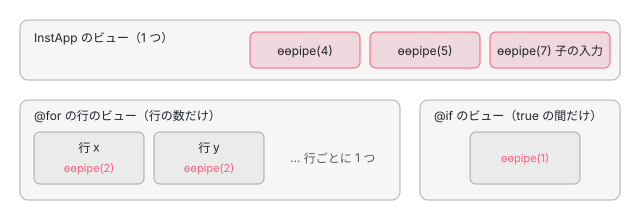

[目次](../README.md) › [パイプを書くと何を宣言したことになるか](README.md) › 第 5 回 / 全 6 回

# インスタンスの数と寿命：@for の中の pipe、inject、ngOnDestroy

> pipe のインスタンスは「書いた場所 × ビュー」ごとに 1 つ。@for の各行・@if の切り替え・同じ pipe を 2 回書いたときに、いくつ作られ、いつ ngOnDestroy が呼ばれるかを、コンパイルの出力とページの上の本物で数える。pipe の中の inject() は ɵɵpipe が動いた時点の TNode から探すので、子のコンポーネントの入力に書いた pipe には、その子の providers は見え、その子の viewProviders は見えない（自分のテンプレートでは自分の viewProviders が見える）。ChangeDetectorRef は、コンストラクタで受けるか inject() で受けるかで誰のものになるかが変わる（#50952）。

angular/angular · 読了 約 13 分 · 中核 · [サイトで読む（デモが動きます）](https://angular-deep-dive-cyan.vercel.app/chapter/pipe-instances-lifecycle)

---

この章では、`| date` と書いたことが「**この場所 × このビュー**に DatePipe のインスタンスを 1 つ置き、**この場所のノードの注入器**で作り、**このビューが壊れたら** ngOnDestroy を呼ぶ」と宣言している、という部分を読みます。`@for` の行・`@if` の切り替え・同じ pipe を 2 回書いたときに、いくつ作られていつ壊れるかを、コンパイルの出力と、このページの上の本物の pipe で数えます。そのうえで、pipe の中の `inject()` がどこに届くか、`ChangeDetectorRef` が誰のものになるかを確かめます。

読む対象は `packages/core/src/render3/pipe.ts`・`render3/instructions/di.ts`・`render3/di.ts`・`render3/list_reconciliation.ts`・`render3/instructions/control_flow.ts` と、spec の `core/test/acceptance/pipe_spec.ts`・`let_spec.ts` です。`ɵɵpipe` が PipeDef を `TView.data` に、インスタンスを LView に置き、`onDestroy` を `TView.destroyHooks` に登録する行は[pipe の仕組みの章](../cmn/06-cmn-pipe-mechanism.md)の 3 節、factory を呼ぶ前後で `inject()` の行き先を切り替える行は[inject() の章](../di/02-di-inject-function.md)で読みました。ここでは、その行が「いくつ・どこで・いつ」の答えになることを確かめます。

1. [1. 1 行の | が生むもの](01-pipe-what-declared.md)
2. [2. @Pipe が作るもの](02-pipe-class-def.md)
3. [3. 名前の解決](03-pipe-name-resolution.md)
4. [4. 書ける場所と書けない場所](04-pipe-where-allowed.md)
5. **5. インスタンスの数と寿命**（この章）
6. [6. spec と issue](06-pipe-tests-issues.md)

## 1. コンパイルの出力で数える

pipe を `@for` の中・`@if` の中・同じ補間に 2 つ・子のコンポーネントの入力に書いたコンポーネントを、このサイトの node\_modules の ngc で full コンパイルしました。これは**記録**です（@angular/compiler-cli 22.1.6・@angular/core 22.1.6・TypeScript 6.0.3・jsdom 28.1.0）。

📄 `src/inst.ts（コンパイルしたもの）`

```
import {ChangeDetectorRef, Component, inject, input, Pipe, PipeTransform} from '@angular/core';

@Pipe({name: 'cnt'})
export class CntPipe implements PipeTransform {
  constructor(readonly cdr: ChangeDetectorRef) {}
  transform(v: string): string {
    return v;
  }
}

@Pipe({name: 'cntInj'})
export class CntInjPipe implements PipeTransform {
  readonly cdr = inject(ChangeDetectorRef);
  transform(v: string): string {
    return v;
  }
}

@Component({selector: 'inst-child', template: ''})
export class InstChild {
  readonly v = input('');
}

@Component({
  selector: 'inst-app',
  imports: [CntPipe, CntInjPipe, InstChild],
  template: `
    @for (r of rows; track r) {
      <span>{{ r | cnt }}</span>
    }
    @if (on) {
      {{ a | cnt }}
    }
    {{ a | cnt }} {{ a | cnt }}
    <inst-child [v]="a | cntInj" />
  `,
})
export class InstApp {
  rows = ['x', 'y'];
  on = true;
  a = 'a';
}

```

📄 `out/inst.js（import と開発モードのメタデータを除いた全部。2026-11-09）`

```
// 診断 0 件
function InstApp_For_1_Template(rf, ctx) { if (rf & 1) {
    i0.ɵɵelementStart(0, "span");
    i0.ɵɵtext(1);
    i0.ɵɵpipe(2, "cnt");
    i0.ɵɵelementEnd();
} if (rf & 2) {
    const r_r1 = ctx.$implicit;
    i0.ɵɵadvance();
    i0.ɵɵtextInterpolate(i0.ɵɵpipeBind1(2, 1, r_r1));
} }
function InstApp_Conditional_2_Template(rf, ctx) { if (rf & 1) {
    i0.ɵɵtext(0);
    i0.ɵɵpipe(1, "cnt");
} if (rf & 2) {
    const ctx_r1 = i0.ɵɵnextContext();
    i0.ɵɵtextInterpolate1(" ", i0.ɵɵpipeBind1(1, 1, ctx_r1.a), " ");
} }
export class CntPipe {
    cdr;
    constructor(cdr) {
        this.cdr = cdr;
    }
    transform(v) {
        return v;
    }
    static ɵfac = function CntPipe_Factory(__ngFactoryType__) { /* @ts-ignore */
    return new (__ngFactoryType__ || CntPipe)(i0.ɵɵdirectiveInject(i0.ChangeDetectorRef, 16)); };
    static ɵpipe = /*@__PURE__*/ i0.ɵɵdefinePipe({ name: "cnt", type: CntPipe, pure: true });
}
export class CntInjPipe {
    cdr = inject(ChangeDetectorRef);
    transform(v) {
        return v;
    }
    static ɵfac = function CntInjPipe_Factory(__ngFactoryType__) { return new (__ngFactoryType__ || CntInjPipe)(); };
    static ɵpipe = /*@__PURE__*/ i0.ɵɵdefinePipe({ name: "cntInj", type: CntInjPipe, pure: true });
}
export class InstChild {
    v = input('', /* @ts-ignore */
    ...(ngDevMode ? [{ debugName: "v" }] : /* istanbul ignore next */ []));
    static ɵfac = function InstChild_Factory(__ngFactoryType__) { return new (__ngFactoryType__ || InstChild)(); };
    static ɵcmp = /*@__PURE__*/ i0.ɵɵdefineComponent({ type: InstChild, selectors: [["inst-child"]], inputs: { v: [1, "v"] }, decls: 0, vars: 0, template: function InstChild_Template(rf, ctx) { }, encapsulation: 2 });
}
export class InstApp {
    rows = ['x', 'y'];
    on = true;
    a = 'a';
    static ɵfac = function InstApp_Factory(__ngFactoryType__) { return new (__ngFactoryType__ || InstApp)(); };
    static ɵcmp = /*@__PURE__*/ i0.ɵɵdefineComponent({ type: InstApp, selectors: [["inst-app"]], decls: 8, vars: 10, consts: [[3, "v"]], template: function InstApp_Template(rf, ctx) { if (rf & 1) {
            i0.ɵɵrepeaterCreate(0, InstApp_For_1_Template, 3, 3, "span", null, i0.ɵɵrepeaterTrackByIdentity);
            i0.ɵɵconditionalCreate(2, InstApp_Conditional_2_Template, 2, 3);
            i0.ɵɵtext(3);
            i0.ɵɵpipe(4, "cnt");
            i0.ɵɵpipe(5, "cnt");
            i0.ɵɵelement(6, "inst-child", 0);
            i0.ɵɵpipe(7, "cntInj");
        } if (rf & 2) {
            i0.ɵɵrepeater(ctx.rows);
            i0.ɵɵadvance(2);
            i0.ɵɵconditional(ctx.on ? 2 : -1);
            i0.ɵɵadvance();
            i0.ɵɵtextInterpolate2(" ", i0.ɵɵpipeBind1(4, 4, ctx.a), " ", i0.ɵɵpipeBind1(5, 6, ctx.a), " ");
            i0.ɵɵadvance(3);
            i0.ɵɵproperty("v", i0.ɵɵpipeBind1(7, 8, ctx.a));
        } }, dependencies: [InstChild, CntPipe, CntInjPipe], encapsulation: 2 });
}

```

1. **`InstApp_For_1_Template` の作成の回に `ɵɵpipe(2, "cnt")`**

   `@for` の中身は、行ごとに作られる埋め込みビュー（embedded view）のテンプレート関数になります。`ɵɵpipe` はその**作成の回**（`rf & 1`）にあるので、行のビューが 1 つ作られるたびに 1 回動き、インスタンスが 1 つできます。行が 2 つなら 2 つ、10 個なら 10 個です。`ɵɵrepeaterCreate(0, InstApp_For_1_Template, 3, 3, …)` の 1 つ目の 3 が、行のビューの枠の数（`<span>`・テキスト・pipe）です。
2. **`InstApp_Conditional_2_Template` にも `ɵɵpipe(1, "cnt")`**

   `@if` の中身も別のビューです。条件が `false` になるとビューは壊され、`true` に戻ると**新しいビュー**が作られるので、pipe も新しく作られます。
3. **同じ補間に 2 つ書くと `ɵɵpipe(4, "cnt")` と `ɵɵpipe(5, "cnt")`**

   名前も引数も同じでも、書いた場所ごとに別の枠です。インスタンスは 2 つで、それぞれが自分の pure のキャッシュ（直前の引数と答え）を持ちます。
4. **`ɵɵelement(6, "inst-child", 0)` の直後に `ɵɵpipe(7, "cntInj")`**

   pipe の作成の命令は、pipe を使う命令の「対象」のすぐ後ろに差し込まれます（[pipe の仕組みの章](../cmn/06-cmn-pipe-mechanism.md)の pipe\_creation）。`[v]` の対象は `<inst-child>` なので、`ɵɵpipe(7)` が動くとき、「今の TNode」（`getCurrentTNode()` が返すノード）は `<inst-child>` です。3 節と 4 節の答えは、すべてここから決まります。
5. **`CntPipe` の `ɵfac` は `ɵɵdirectiveInject(i0.ChangeDetectorRef, 16)`、`CntInjPipe` の `ɵfac` は `new CntInjPipe()`**

   コンストラクタで受けた依存には、コンパイラが印 `16`（`ForPipe`）を付けます。フィールドの `inject(ChangeDetectorRef)` はクラスの本体にそのまま残り、印はありません。この違いが 4 節です。

📄 `pipe-demo/b/ngc5/record.mjs（記録スクリプトの全文）`

```
// 第 5 回 pipe-instances-lifecycle の記録: pipe を @for・@if・2 か所・子の入力に書いたコンポーネントを、本物の ngc（@angular/compiler-cli 22.1.6）で full コンパイルする。
// 使い方: このディレクトリ（src/inst.ts と tsconfig.json がある）で node record.mjs
import { readConfiguration, performCompilation } from '@angular/compiler-cli';
import { readFileSync } from 'node:fs';

const config = readConfiguration('tsconfig.json');
const { diagnostics } = performCompilation({ rootNames: config.rootNames, options: config.options });
console.log(`// 診断 ${diagnostics.length} 件`);
// 出力のうち、import と、開発モードだけのメタデータ（(() => { … ɵsetClassMetadata … })();）を除いて残す
const keep = [];
let skipping = false;
for (const l of readFileSync('out/inst.js', 'utf8').split('\n')) {
  if (l.startsWith('(() => {')) skipping = true;
  if (!skipping && !l.startsWith('import ') && l.trim() !== '') keep.push(l);
  if (skipping && l.trimEnd().endsWith('})();')) skipping = false;
}
console.log(keep.join('\n'));

```

## 2. いつ作られ、いつ壊れるか

### @for：行が増えたら作り、消えたら壊す。動いただけなら何もしない

`ɵɵrepeater` は、前の配列と今の配列を track の値で突き合わせ（[for と track の章](../template/01-for-track.md)）、行のビューを作る・動かす・壊すを決めます。pipe から見て大事な行は 2 か所です。

📄 `angular/packages/core/src/render3/list_reconciliation.ts` L369–382 （▶ の行: 376–378, 380）

```ts
369 │ function createOrAttach<T, V>(
370 │   liveCollection: LiveCollection<T, V>,
371 │   detachedItems: UniqueValueMultiKeyMap<unknown, T> | undefined,
372 │   trackByFn: TrackByFunction<unknown>,
373 │   index: number,
374 │   value: V,
375 │ ) {
376 ▶   if (!attachPreviouslyDetached(liveCollection, detachedItems, index, trackByFn(index, value))) {
377 ▶     const newItem = liveCollection.create(index, value);
378 ▶     liveCollection.attach(index, newItem);
379 │   } else {
380 ▶     liveCollection.updateValue(index, value);
381 │   }
382 │ }
```

376 行目：同じ track の値のビューが、前の回に切り離されて取ってあれば、それを付け直します。無ければ 377 行目で `create`、つまり新しい行のビューを作り、その作成の回で 1 節の `ɵɵpipe(2, "cnt")` が動きます。380 行目は、同じ track の値のビューがあったときで、ビューはそのまま、`$implicit`（行の値）だけを入れ替えます。**pipe のインスタンスは前のまま**で、引数が変わったので pure の pipe は transform をもう一度呼びます。

📄 `angular/packages/core/src/render3/list_reconciliation.ts` L315–324 （▶ の行: 317–318, 322–323）

```ts
315 │   // Cleanups common to the array and iterable:
316 │   // - more items in the live collection => delete starting from the end;
317 ▶   while (liveStartIdx <= liveEndIdx) {
318 ▶     liveCollection.destroy(liveCollection.detach(liveEndIdx--));
319 │   }
320 │ 
321 │   // - destroy items that were detached but never attached again.
322 ▶   detachedItems?.forEach((item) => {
323 ▶     liveCollection.destroy(item);
324 │   });
```

📄 `angular/packages/core/src/render3/instructions/control_flow.ts` L473–476 （▶ の行: 473–474）

```ts
473 ▶   override destroy(lView: LView<RepeaterContext<unknown>>): void {
474 ▶     destroyLView(lView[TVIEW], lView);
475 │     ngDevMode && this.operationsCounter?.recordDestroy();
476 │   }
```

317〜319 行目で今の配列より余った行、322〜324 行目で切り離したまま付け直されなかった行を `destroy` し、それは control\_flow.ts 474 行目の `destroyLView` です。`destroyLView` はビューの木を片づける途中で `executeOnDestroys` を呼び（[ビューの破棄の章](../ivy/17-ivy-destroy.md)）、そこで `TView.destroyHooks` の組を順に見て、**その LView の同じ番号にあるインスタンス**の `ngOnDestroy` を呼びます。`destroyHooks` は TView（行のビューの型に 1 つ）に 1 度だけ登録されますが、呼ぶ相手は LView ごとのインスタンスなので、壊れた行の pipe だけが破棄されます。

> [!TIP]
> **新卒エンジニアへ**
>
> 「行を並べ替えた」だけのときは、ビューは切り離して付け直されるだけで（376 行目）、pipe は作られも壊されもしません。逆に、`track r`（オブジェクトそのもの）で毎回新しいオブジェクトの配列を渡すと、track の値が全部変わるので、全部の行が壊されて作り直され、pipe も全部作り直されます。このとき開発モードでは、`ɵɵrepeater` が `LOOP_TRACK_RECREATE`（NG0956）の警告を出します（track の選び方は[for と track の章](../template/01-for-track.md)）。

### @if：false で壊し、true で作り直す

`ɵɵconditional` は、選ばれた分岐が変わると、前の分岐のビューを外して壊し、新しい分岐のビューを作ります（[LContainer の章](../ivy/11-ivy-lcontainer.md)）。`@if (on)` を `true → false → true` と切り替えると、中の pipe は「作る → 壊す（ngOnDestroy）→ 作る」で、2 つ目は別のインスタンスです。前のインスタンスの状態（pure のキャッシュも、自分で持たせたフィールドも）は残りません。



*インスタンスの枠は「書いた場所 × ビュー」。@for の行と @if の中身は、それぞれ別のビュー*

## 3. pipe の中の inject() は、どの注入器に届くか

📄 `angular/packages/core/src/render3/pipe.ts` L67–71 （▶ の行: 67, 70–71）

```ts
67 ▶   const previousInjectImplementation = setInjectImplementation(ɵɵdirectiveInject);
68 │   try {
69 │     // DI for pipes is supposed to behave like directives when placed on a component
70 ▶     // host node, which means that we have to disable access to `viewProviders`.
71 ▶     const previousIncludeViewProviders = setIncludeViewProviders(false);
```

📄 `angular/packages/core/src/render3/instructions/di.ts` L52–58 （▶ の行: 57–58）

```ts
52 │   if (lView === null) {
53 │     // Verify that we will not get into infinite loop.
54 │     ngDevMode && assertInjectImplementationNotEqual(ɵɵdirectiveInject);
55 │     return ɵɵinject(token, flags);
56 │   }
57 ▶   const tNode = getCurrentTNode();
58 ▶   const value = getOrCreateInjectable<T>(
```

`ɵɵpipe` は 67 行目で `inject()` の行き先を `ɵɵdirectiveInject` にしてから factory を呼びます（[inject() の章](../di/02-di-inject-function.md)）。`ɵɵdirectiveInject` は 57 行目で `getCurrentTNode()`、つまり 1 節の 4 つ目の「今の TNode」を取り、58 行目でそこを起点に NodeInjector（要素ごとの注入器）を探します。起点は、補間なら**テキストのノード**、属性のバインディングなら**その要素**、`@let` なら **@let の TNode**（[第 4 回](04-pipe-where-allowed.md)の 5 節）です。テキストのノードは自分の注入器を持たないので、探すのは親の要素からです。

📄 `angular/packages/core/src/render3/di.ts` L95–120 （▶ の行: 106–109, 115）

````ts
 95 │  * @Component({
 96 │  *   providers: [
 97 │  *     MyService,
 98 │  *     {provide: String, value: 'providers' }
 99 │  *   ]
100 │  *   viewProviders: [
101 │  *     {provide: String, value: 'viewProviders'}
102 │  *   ]
103 │  * })
104 │  * class MyComponent {
105 │  *   constructor(myService: MyService, value: String) {
106 ▶  *     // We expect that Component can see into `viewProviders`.
107 ▶  *     expect(value).toEqual('viewProviders');
108 ▶  *     // `MyService` was not declared in `viewProviders` hence it can't see it.
109 ▶  *     expect(myService.value).toEqual('providers');
110 │  *   }
111 │  * }
112 │  *
113 │  * ```
114 │  */
115 ▶ let includeViewProviders = true;
116 │ 
117 │ export function setIncludeViewProviders(v: boolean): boolean {
118 │   const oldValue = includeViewProviders;
119 │   includeViewProviders = v;
120 │   return oldValue;
````

viewProviders は「そのコンポーネントの**ビューの中**からだけ見える providers」です（106〜109 行目のコメントの例）。70〜71 行目のコメントは「pipe の DI は、コンポーネントのホストのノードに置かれたディレクティブと同じに振る舞う。だから viewProviders を見えなくする」。ホストのノードに置かれたディレクティブは、そのコンポーネントのビューの**外**にいるので、そのコンポーネントの viewProviders は見えません。pipe も同じにする、ということです。探す途中でどの注入器の viewProviders を見るかを決める行（`canAccessViewProviders`）は[2 つの注入器の章](../standalone/08-standalone-providers-two-injectors.md)と[NodeInjector の探し方の章](../di/11-di-node-injector-lookup.md)です。

Node で確かめた結果と、5 節の DEMO で同じことが確かめられます。pipe を書いたコンポーネントを `App`、その子を `Child` とします（どちらも providers と viewProviders に値を置く）。

| pipe を書いた場所 | 今の TNode | providers | viewProviders |
| --- | --- | --- | --- |
| App のテンプレートの補間 | テキスト → 親の要素から上へ | App のもの | **App のもの（見える）** |
| `<child [v]="x \| p">` | `<child>`（コンポーネントのホスト） | **Child のもの** | **Child のものは見えない**。上の App のものが見える |
| providers を持つディレクティブの付いた `<div>` の中や属性 | その `<div>` | ディレクティブのもの | App のもの |
| `@if` の中 | 埋め込みビューのテキスト | App のもの | App のもの |

「pipe からは viewProviders が見えない」のではなく、**pipe を書いたノードがコンポーネントのホストのとき、そのコンポーネントの viewProviders が見えない**、が正確な言い方です。自分のテンプレートに書いた pipe からは、自分の viewProviders が見えます。

## 4. ChangeDetectorRef は誰のものか

`ChangeDetectorRef` は providers に登録されたものではなく、注入されるたびに作られる特別な token です。`injectChangeDetectorRef(flags)` が今の TNode と、印 `ForPipe` の有無を `createViewRef` に渡し（[特別な token の章](../di/13-di-special-tokens.md)・[ViewRef の章](../ivy/16-ivy-refs.md)）、TNode が**コンポーネントのホスト**で、**ForPipe が無い**ときだけ、**その子のコンポーネントのビュー**の ViewRef を返します。それ以外は、pipe を書いたテンプレートのコンポーネント（埋め込みビューなら、それを宣言したコンポーネント）の ViewRef です。

- **コンストラクタで受けた場合**：1 節の `ɵɵdirectiveInject(i0.ChangeDetectorRef, 16)` の 16 が ForPipe なので、`<child [v]="x | p">` でも、pipe を書いた App の ViewRef です。AsyncPipe はこの形（コンストラクタの `ref: ChangeDetectorRef`）なので、`markForCheck()` が App を「もう一度見る」にします（[AsyncPipe の章](../template/08-async-pipe.md)）。
- **フィールドの `inject(ChangeDetectorRef)` の場合**：`inject()` の options からは ForPipe を作れないので（[inject() の章](../di/02-di-inject-function.md)）、`<child [v]="x | p">` では **Child の ViewRef** になります。補間や `@let` に書いた場合は、TNode がホストではないので、どちらで受けても App の ViewRef です。

spec の it（6 節）と同じ形を、コンストラクタの代わりに `inject()` で書いて、Node で走らせた記録です。

📄 `pipe-demo/b/cdr-spec-like.mjs（記録スクリプトの全文。JIT・jsdom）`

```
// pipe_spec.ts 673〜725 行目の it を、コンストラクタの代わりに inject(ChangeDetectorRef) で書いて走らせる（JIT・jsdom・22.1.6）
import { JSDOM } from 'jsdom';
const dom = new JSDOM('<!doctype html><html><body></body></html>');
for (const k of ['window', 'document', 'Node', 'Element', 'HTMLElement', 'Event', 'Comment', 'Text']) globalThis[k] = dom.window[k];
await import('@angular/compiler');
const { Component, Pipe, ChangeDetectorRef, inject, Input, ViewChild, provideZonelessChangeDetection } = await import('@angular/core');
const { TestBed } = await import('@angular/core/testing');
const { BrowserTestingModule, platformBrowserTesting } = await import('@angular/platform-browser/testing');
TestBed.initTestEnvironment(BrowserTestingModule, platformBrowserTesting());

async function run(useInject) {
  TestBed.resetTestingModule();
  let pipeCdr;
  class SomeComp { value; displayValue = 0; }
  Input()(SomeComp.prototype, 'value');
  Component({ selector: 'some-comp', template: 'Inner value: "{{displayValue}}"' })(SomeComp);
  class App { comp; pipeValue = 10; displayValue = 0; }
  ViewChild(SomeComp)(App.prototype, 'comp');
  const TestPipe = useInject
    ? class TestPipe { constructor() { pipeCdr = inject(ChangeDetectorRef); } transform() { return ''; } }
    : class TestPipe { constructor(cdr) { pipeCdr = cdr; } transform() { return ''; } static ctorParameters = () => [{ type: ChangeDetectorRef }]; };
  Pipe({ name: 'testPipe' })(TestPipe);
  Component({ imports: [SomeComp, TestPipe], template: `<some-comp [value]="pipeValue | testPipe"></some-comp> Outer value: "{{ displayValue }}"` })(App);
  TestBed.configureTestingModule({ providers: [provideZonelessChangeDetection()] });
  const fixture = TestBed.createComponent(App);
  fixture.detectChanges();
  fixture.componentInstance.displayValue = 1;
  fixture.componentInstance.comp.displayValue = 1;
  pipeCdr.markForCheck();
  fixture.detectChanges();
  console.log(useInject ? 'inject()      :' : 'コンストラクタ:', fixture.nativeElement.textContent.replace(/\s+/g, ' ').trim());
}
await run(false);
await run(true);

```

📄 `記録の出力（2026-11-09）`

```
コンストラクタ: Inner value: "0" Outer value: "1"
inject()      : Inner value: "1" Outer value: "1"

```

コンストラクタでは `markForCheck()` が App だけを汚すので、OnPush の SomeComp は描き直されず「Inner value: "0"」のままです。`inject()` では SomeComp の ViewRef の `markForCheck()` になり、SomeComp とその祖先が汚れて「Inner value: "1"」になります。同じクラス・同じ書いた場所で、**受け方だけで結果が変わります**。

> [!NOTE]
> **さらに深く**
>
> この違いは issue #59868（2025-02、「pipe の値をコンポーネントの入力に渡すと inject(ChangeDetectorRef) の context が変わる」）で報告され、同じ日にメンテナーが「#50952 によるもの。コンストラクタの注入なら AppComponent の ChangeDetectorRef になる」とコメントして DUPLICATE で閉じられました。#50952（2023-07、「pipe での inject() とコンストラクタの注入の食い違い」）は開いたままです。#50952 を直す PR #70358（2026-08、開いている）は、pipe の factory の `ɵɵdirectiveInject` を `ɵɵinject` に変えるもので、コンストラクタの引数の印 16 はそのまま残り、フィールドの `inject()` に印が付くようにはなっていません（`gh pr diff` で確かめた範囲）。PR のコメントでは、内部のコードが壊れるので破壊的変更の時期を待つ、とされています。

## 5. DEMO：インスタンスを数える

> **🧪 DEMO — pilCount の作成・transform・ngOnDestroy と、inject() が届いた先**
>
> この章で定義した pipe `pilCount`（作られた番号を持ち、`inject()` で 2 つの token と `ChangeDetectorRef` を受け、コンストラクタでも `ChangeDetectorRef` を受ける）を、OnPush の部品 `pil-stage` の 5 か所に書きました： 同じ補間に 2 つ（A）、`@if` の中（B）、`@for (r of rows; track r.id)` の行（C）、子の `<pil-child [v]="…">` の入力（D）。`pil-stage` と `pil-child` は、どちらも providers と viewProviders に自分の名前の値を置いています。ボタンは状態を変えて `pil-stage` の `detectChanges()` を 1 回だけ走らせ、数えた結果を表にします。CDR の欄は、受け取った ViewRef の `context`（どのコンポーネントのものか）を読んで出しています。確かめるためだけの読み方です。
>
> ▶ [このデモはサイトで動かせます](https://angular-deep-dive-cyan.vercel.app/chapter/pipe-instances-lifecycle)

確かめられることです（本番ビルドをヘッドレスの Chrome で開いて、ボタンを順に押して確かめました）。

1. **描く**

   作った 6（A が 2・B・C が 2 行・D）。transform も 6 回。
2. **行を足す**

   作った +1、transform +1。足した行のビューの作成の回だけです（377 行目）。
3. **末尾の行を消す・先頭の行を消す**

   ngOnDestroy +1、作った +0。先頭を消しても残りの行は作り直されません（317〜318 行目で消えるのは 1 行だけ）。
4. **行を逆に並べる**

   作った +0・ngOnDestroy +0・transform +0。ビューが動いただけで、引数も変わっていません。
5. **同じ id のまま中身を変える**

   作った +0、transform が行の数だけ。380 行目でビューは残り、引数が変わったので pure の pipe が呼ばれます。
6. **if を切り替える**

   消すと ngOnDestroy +1、戻すと作った +1（番号が新しくなる）。
7. **表の D の行**

   inject(PIL\_P) は「pil-child の providers」、inject(PIL\_VP) は「pil-stage の viewProviders」、CDR はコンストラクタが pil-stage、inject() が pil-child（赤字）。A・B・C の行は、どれも pil-stage です。
8. **壊す**

   ngOnDestroy が、そのとき生きていた数だけ。今生きている 0 個。

## 6. ここまでを 1 本に

- 👤 `@for (r of rows; track r.id) { {{ r.label | pilCount }} }` — あなたのテンプレート
- `ɵɵrepeater(ctx.rows)` → `reconcile` — control\_flow.ts / list\_reconciliation.ts
  - `新しい track の値` → `liveCollection.create` — list\_reconciliation.ts L377
    - `行のビューの作成の回` → `ɵɵpipe(2, 'pilCount')` — pipe.ts — *インスタンス 1 つ*
      - `setInjectImplementation(ɵɵdirectiveInject)`・`setIncludeViewProviders(false)` — pipe.ts L67・L71
      - `factory()` → `inject(X)` → `ɵɵdirectiveInject(X)` → `getCurrentTNode()` — instructions/di.ts L57 — *書いた場所のノードから探す*
  - `同じ track の値` → `updateValue` — list\_reconciliation.ts L380 — *インスタンスはそのまま*
  - `消えた track の値` → `liveCollection.destroy` — list\_reconciliation.ts L318・L323
    - `destroyLView` → `executeOnDestroys` → `pipe.ngOnDestroy()` — control\_flow.ts L474 / ivy-destroy の章

## テストと直し方

### spec

| spec | describe / it（行） | この章の節 |
| --- | --- | --- |
| core/test/acceptance/pipe\_spec.ts | describe `lifecycles`（529）の it `should call ngOnDestroy on pipes`（530） | 2 節 |
| describe `injection mechanism`（563）の it `should be able to handle Service injection`（564）・`Token injections`（598）・`Module injection`（636） | 3 節 |   |
| it `should inject the ChangeDetectorRef of the containing view when using pipe inside a component input`（673）と、子の中身がある版（727） | 4 節 |   |
| core/test/acceptance/let\_spec.ts | it `should be able to use pipes injecting ChangeDetectorRef in a let declaration`（198） | 3 節の @let |

📄 `angular/packages/core/test/acceptance/pipe_spec.ts` L686–724 （▶ の行: 688, 705–706, 720, 723–724）

```ts
686 │       @Component({
687 │         template: `
688 ▶           <some-comp [value]="pipeValue | testPipe"></some-comp>
689 │           Outer value: "{{ displayValue }}"
690 │         `,
691 │         standalone: false,
692 │       })
693 │       class App {
694 │         @Input() something: any;
695 │         @ViewChild(SomeComp) comp!: SomeComp;
696 │         pipeValue = 10;
697 │         displayValue = 0;
698 │       }
699 │ 
700 │       @Pipe({
701 │         name: 'testPipe',
702 │         standalone: false,
703 │       })
704 │       class TestPipe implements PipeTransform {
705 ▶         constructor(changeDetectorRef: ChangeDetectorRef) {
706 ▶           pipeChangeDetectorRef = changeDetectorRef;
707 │         }
708 │ 
709 │         transform() {
710 │           return '';
711 │         }
712 │       }
713 │ 
714 │       TestBed.configureTestingModule({declarations: [App, SomeComp, TestPipe]});
715 │       const fixture = TestBed.createComponent(App);
716 │       fixture.detectChanges();
717 │ 
718 │       fixture.componentInstance.displayValue = 1;
719 │       fixture.componentInstance.comp.displayValue = 1;
720 ▶       pipeChangeDetectorRef!.markForCheck();
721 │       fixture.detectChanges();
722 │ 
723 ▶       expect(fixture.nativeElement.textContent).toContain('Outer value: "1"');
724 ▶       expect(fixture.nativeElement.textContent).toContain('Inner value: "0"');
```

688 行目で pipe を子の入力に書き、705〜706 行目で**コンストラクタ**で受け、720 行目で `markForCheck()`、723〜724 行目で「外は 1・中は 0」を確かめます。4 節の記録のとおり、この it を `inject()` で書くと 724 行目が通りません。pipe の中で `inject(ChangeDetectorRef)` を使う it は、下の let\_spec と、制御フローの spec（control\_flow\_for\_spec.ts 147 行目・control\_flow\_if\_spec.ts 239 行目・control\_flow\_switch\_spec.ts 115 行目・defer\_spec.ts 350 行目）にあります。どれも「ブロックの式や @let で使っても例外にならない」ことを見る it で、pipe を書いたノードがコンポーネントのホストではない場合です。ホストに書いて `inject()` で受けた形の it は見つかりませんでした。

📄 `angular/packages/core/test/acceptance/let_spec.ts` L198–222 （▶ の行: 201, 207, 216, 221）

```ts
198 │   it('should be able to use pipes injecting ChangeDetectorRef in a let declaration', () => {
199 │     @Pipe({name: 'double'})
200 │     class DoublePipe implements PipeTransform {
201 ▶       changeDetectorRef = inject(ChangeDetectorRef);
202 │ 
203 │       transform(value: number) {
204 │         return value * 2;
205 │       }
206 │     }
207 ▶ 
208 │     @Component({
209 │       template: `
210 │         @let result = value | double;
211 │         Result: {{ result }}
212 │       `,
213 │       imports: [DoublePipe],
214 │ 
215 │       changeDetection: ChangeDetectionStrategy.Eager,
216 ▶     })
217 │     class TestComponent {
218 │       value = 2;
219 │     }
220 │ 
221 ▶     const fixture = TestBed.createComponent(TestComponent);
222 │     fixture.detectChanges();
```

201 行目はフィールドの `inject(ChangeDetectorRef)`、207 行目は `@let` の中の pipe です。@let の TNode が残る理由（[第 4 回](04-pipe-where-allowed.md)の 5 節）を、実行時の側から確かめている it です。

### 手元で走らせた結果

📄 `走らせたコマンド`

```
cd ~/angular-research/angular
pnpm bazel test //packages/core/test/acceptance:acceptance --nocache_test_results --test_output=all '--test_arg=--filter=^pipe '
pnpm bazel test //packages/core/test/acceptance:acceptance --nocache_test_results --test_output=all '--test_arg=--filter=inject the ChangeDetectorRef of the containing view'
pnpm bazel test //packages/core/test/acceptance:acceptance --nocache_test_results --test_output=all '--test_arg=--filter=pipes injecting ChangeDetectorRef in a let'
```

- `^pipe `：「Ran 43 of 2693 specs」「43 specs, 0 failures」（2026-11-09、pipe-logs/b-pipe-acc.log）。`^` と後ろの空白で、describe `pipe` の中だけに絞れます。
- `inject the ChangeDetectorRef of the containing view`：2 件（673 と 727）、`pipes injecting ChangeDetectorRef in a let`：1 件。どれも PASSED（b-acc-cdr2.log・b-acc-let.log）。
- このターゲットは zone.js を読む `angular_jasmine_test` なので、ログの頭に zone.js の jasmine の差し替えによる「DEPRECATION: Monkey patching detected」と、その場所を示す `Error:` の行が出ますが、失敗ではありません。

### 直すとしたら

- 何個作るかは `ɵɵpipe` の置き場所（コンパイラの pipe\_creation）とビューの作り直し（list\_reconciliation.ts・`ɵɵconditional`）で決まります。it は pipe\_spec.ts の describe `lifecycles` の形（数える pipe を作って、壊したときの回数を見る）で足します。
- `ChangeDetectorRef` の行き先は change\_detector\_ref.ts の `injectChangeDetectorRef` と `createViewRef`、ForPipe を付けるのはコンパイラの r3\_factory.ts（[factory の章](../di/04-di-factory.md)）です。4 節の違いを固める it は、673 行目の it の pipe を `inject()` で書いた形になります。
- viewProviders を見えなくする行は pipe.ts 71 行目。#39276（2020 年、投影した中身の pipe が host の viewProviders を見る）が 2026-09 に「今の振る舞いが正しい」として閉じられているので、ここを変える話はその議論から読みます（[pipe の仕組みの章](../cmn/06-cmn-pipe-mechanism.md)のテストの節）。

## 聞かれそうな質問

**Q. @for の中に pipe を書くと、インスタンスは 1 つですか、行の数だけですか？**

行の数だけです。`ɵɵpipe` は行のビューのテンプレート関数の作成の回にあり（1 節の `InstApp_For_1_Template`）、行のビューを作るたび（377 行目）に 1 回動きます。行が消えると、そのビューの `destroyLView` で、その行の pipe だけ ngOnDestroy が呼ばれます。

**Q. 行を並べ替えたら pipe は作り直されますか？**

track の値が同じなら作り直されません。ビューは切り離して付け直されるだけで（376 行目）、pipe のインスタンスもキャッシュもそのままです。値だけが変わった行は 380 行目でビューを残し、pure の pipe が新しい引数で transform を呼びます。

**Q. @if を一度 false にして true に戻すと、前の pipe のインスタンスが戻ってきますか？**

戻りません。false でビューが壊されて ngOnDestroy が呼ばれ、true で新しいビューと新しいインスタンスが作られます。インスタンスに状態を持たせても、そこで消えます。

**Q. pipe の中で inject() したサービスは、どこから来ますか？**

`ɵɵpipe` が動いた時点の TNode（補間ならテキストのノード、属性ならその要素、@let なら @let の TNode）を起点に、NodeInjector を上へ、最後は環境の注入器まで探します（instructions/di.ts 57〜58 行目）。`<child [v]="x | p">` なら起点は child のホストなので、child の providers が見えます。

**Q. pipe から viewProviders は見えないのですか？**

自分のテンプレートに書いた pipe からは、自分の viewProviders が見えます。見えないのは、pipe を書いたノードがコンポーネントのホストのときの、**そのコンポーネントの** viewProviders です（pipe.ts 70〜71 行目。ホストに置いたディレクティブと同じ扱い）。

**Q. pipe の ChangeDetectorRef で markForCheck() すると、どのコンポーネントが描き直されますか？**

コンストラクタで受けたなら、pipe を書いたテンプレートのコンポーネントです（印 16 の ForPipe）。フィールドの `inject(ChangeDetectorRef)` で受け、pipe を子のコンポーネントの入力に書いた場合だけは、子のコンポーネントのものになります（4 節の記録。#59868・#50952）。

## 読み終えて

- インスタンスは「書いた場所 × ビュー」ごとに 1 つ。`ɵɵpipe` はビューのテンプレート関数の作成の回に 1 度だけ動く。
- @for は新しい track の値でビューを作り、消えた値で壊す。並べ替えと値の入れ替えでは作り直さない。@if は切り替えのたびに壊して作る。
- ngOnDestroy は TView.destroyHooks に 1 度登録され、壊れた LView のインスタンスにだけ呼ばれる。
- inject() の起点は `ɵɵpipe` が動いた時点の TNode。ホストに書いた pipe は、その子の providers が見え、その子の viewProviders は見えない。
- ChangeDetectorRef は、コンストラクタなら印 16 で書いたテンプレートのもの。`inject()` では、子の入力に書いたとき子のものになる。

---

← 前: [書ける場所と書けない場所：イベント・ホスト・@let・track と優先順位](04-pipe-where-allowed.md)  
次: [spec と issue を読む：pipe の振る舞いを決めているテスト](06-pipe-tests-issues.md) →
