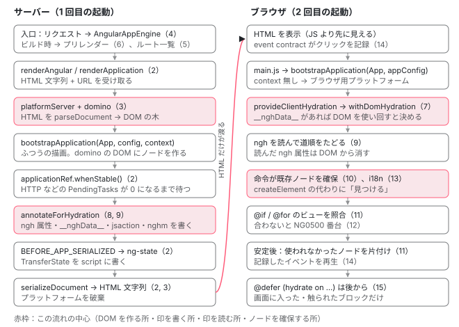

[目次](../README.md) › [SSR とハイドレーション](README.md) › 第 1 回 / 全 15 回

# SSR とハイドレーションの概観：サーバーで 1 回、ブラウザでもう 1 回

> リクエスト（またはビルド時のプリレンダー）→ AngularAppEngine → renderAngular（または renderApplication）→ platformServer と domino → whenStable → annotateForHydration → serializeDocument、ブラウザで bootstrapApplication → provideClientHydration → DOM ノードの確保 → 確保されなかったノードの片付け、という全体図。どの回がどこを扱うかの地図と、登場する関数・トークン・HTML の印（ngh / ngcm / nghm / ng-state / ng-server-context / jsaction / ngb）の表。

angular/angular · 読了 約 12 分 · 基礎 · [サイトで読む（デモが動きます）](https://angular-deep-dive-cyan.vercel.app/chapter/ssr-overview)

---

SSR（サーバーサイドレンダリング。サーバーで HTML を作ること）を使うと、同じアプリが**2 回**起動します。1 回目はサーバー（または `ng build` の途中）で起動して HTML の文字列を作り、2 回目はブラウザで起動してその HTML を使い回します。この章では、その 2 回の起動の間に何が起き、どの関数がどの印を HTML に残し、誰がそれを読むのかを 1 枚の地図にします。細部は第 2〜15 回で 1 つずつ読みます。

読む対象は、このサイト自身の `src/main.server.ts`・`src/app/app.config.server.ts`・`src/app/app.config.ts`、`@angular/build` の `utils/index-file/index-html-generator.ts` と `add-event-dispatch-contract.ts`、そして本番ビルドが書き出した HTML そのものです。

1. **1. 概観**（この章）
2. [2. renderApplication](02-ssr-render-application.md)
3. [3. platformServer と domino](03-ssr-platform-server.md)
4. [4. AngularAppEngine](04-ssr-app-engine.md)
5. [5. サーバールート](05-ssr-server-routes.md)
6. [6. プリレンダー](06-ssr-prerender.md)
7. [7. provideClientHydration](07-hydration-provide.md)
8. [8. ngh の書き出し](08-hydration-annotate.md)
9. [9. ノードの道順](09-hydration.md)
10. [10. ノードの確保](10-hydration-claim.md)
11. [11. コンテナと片付け](11-hydration-containers.md)
12. [12. 不一致のエラー](12-hydration-errors.md)
13. [13. i18n](13-hydration-i18n.md)
14. [14. イベントの再生](14-event-replay.md)
15. [15. インクリメンタル](15-incremental-hydration.md)

## 1. 3 つの言葉：SSR・プリレンダー・ハイドレーション

最初に言葉をそろえます。3 つとも「サーバーで HTML を作る」話に聞こえますが、指しているものが違います。

1. **SSR：リクエストが来たときにサーバーで描画する**

   Node.js などのサーバーが、URL ごとにアプリを起動して HTML を返します。`@angular/ssr` では `RenderMode.Server` のルートがこれです。入口は `AngularAppEngine.handle(request)`（[第 4 回](04-ssr-app-engine.md)）。
2. **プリレンダー：ビルドのときに 1 回だけ描画して、ファイルにしておく**

   描画の処理は SSR と同じで、*いつ*走るかだけが違います。結果は `index.html` として書き出され、配信は静的ファイルサーバーで済みます。`RenderMode.Prerender` のルートがこれです（[第 6 回](06-ssr-prerender.md)）。このサイトは全ルートがこれです。
3. **ハイドレーション：ブラウザで、届いた HTML の DOM ノードを捨てずに使う**

   ブラウザで起動したアプリが、テンプレートの命令を実行するときに DOM ノードを新しく作らず、HTML にすでにある同じノードを「確保」して使い回します。そのための道しるべが、サーバーが HTML に書き残す `ngh` 属性と `ng-state` の中身です（[第 7 回](07-hydration-provide.md)〜）。

つまり、SSR とプリレンダーは「サーバー側の 1 回目」の話、ハイドレーションは「ブラウザ側の 2 回目」の話です。プリレンダーした HTML もハイドレーションされます。このサイトがその例です。

## 2. このサイトでは何を書いているか

「読者が書くコード」は 3 ファイルだけです。まずサーバー用の入口。`angular.json` の `"server": "src/main.server.ts"` がこのファイルを指しています。

📄 `src/main.server.ts`

```ts
import { BootstrapContext, bootstrapApplication } from '@angular/platform-browser';
import { App } from './app/app';
import { config } from './app/app.config.server';

const bootstrap = (context: BootstrapContext) => bootstrapApplication(App, config, context);

export default bootstrap;
```

5 行目、ブラウザ用の `main.ts` と同じ `bootstrapApplication` を呼んでいます。違いは第 3 引数の `context` だけです。サーバーはリクエストごとに**プラットフォーム**（アプリの外側にある、1 つ上の注入器と `PlatformRef`）を作り、それを `context.platformRef` として渡してきます。ブラウザではこの引数を渡さないので、ブラウザ用のプラットフォームが作られます。この差を作る行は[第 2 回](02-ssr-render-application.md)で読みます。

📄 `src/app/app.config.server.ts`

```ts
const serverConfig: ApplicationConfig = {
  providers: [provideServerRendering(withRoutes(serverRoutes))],
};

export const config = mergeApplicationConfig(appConfig, serverConfig);
```

サーバーでだけ足すプロバイダは `@angular/ssr` の `provideServerRendering(withRoutes(serverRoutes))` です。中で `@angular/platform-server` の同名の関数を呼んでいます（[第 3 回](03-ssr-platform-server.md)）。`mergeApplicationConfig` でブラウザ用の `appConfig` と合わせるので、**サーバーでもブラウザ用のプロバイダが全部入ります**。

📄 `src/app/app.config.ts（抜粋）`

```
export const appConfig: ApplicationConfig = {
  providers: [
    provideBrowserGlobalErrorListeners(),
    provideRouter(routes, withInMemoryScrolling({ /* ... */ })),
    provideClientHydration(withIncrementalHydration()),
  ],
};
```

ブラウザ側でハイドレーションを有効にしているのは `provideClientHydration(...)` の 1 行です。この行は上の `mergeApplicationConfig` によって**サーバーにも入ります**。サーバーで `ngh` を書き出すかどうかも、このプロバイダが決めています（[第 2 回](02-ssr-render-application.md)の `prepareForHydration`）。

> [!TIP]
> **新卒エンジニアへ**
>
> 「ハイドレーションはブラウザの機能だから、サーバーには関係ない」は誤りです。`provideClientHydration` がサーバー側に無いと、サーバーは `ngh` も `__nghData__` も書かず、ブラウザは使い回す手がかりを持てません。

## 3. 全体図



*左がサーバー（このサイトではビルド時のプリレンダー）、右がブラウザ。丸数字はこのシリーズの回。HTML の文字列だけが左から右へ渡る。*

左の列は「ふつうの起動」に前後が足されたものです。起動して描画するところ（上から 4 つ目）は、ブラウザでの起動と**同じコード**が走ります。違うのは、DOM がブラウザの本物ではなく domino（Node.js で動く DOM の実装）であることと、描画が終わったあとに **DOM を文字列に戻して**返すことです。

右の列も「ふつうの起動」です。違うのは、テンプレートの命令がノードを作る代わりに、HTML にあるノードを見つけて使うことです。その切り替えは `provideClientHydration` が足すプロバイダが起動時に行います（[第 7 回](07-hydration-provide.md)）。

## 4. 登場する関数・トークン

| 名前 | ファイル | 何をするか | 回 |
| --- | --- | --- | --- |
| `renderApplication` | platform-server/src/utils.ts | 公開 API。プラットフォームを作り、起動し、安定を待って HTML 文字列を返す | 2 |
| `renderAngular` | angular/ssr/src/utils/ng.ts | `AngularServerApp` が呼ぶ。`renderApplication` は使わず、`platformServer` と `ɵrenderInternal` を直接呼ぶ | 4 |
| `platformServer` | platform-server/src/server.ts | サーバー用のプラットフォームを作る。`ngServerMode` を立てる | 3 |
| `INITIAL_CONFIG` | platform-server/src/tokens.ts | `{ document, url }`。HTML の文字列と URL をプラットフォームに渡す | 3 |
| `PlatformState` | platform-server/src/platform\_state.ts | `renderToString()` で DOM を文字列に戻す | 2 |
| `provideServerRendering`（platform-server 版） | platform-server/src/provide\_server.ts | サーバー用のアプリ側プロバイダ（`PLATFORM_SERVER_PROVIDERS`） | 3 |
| `provideServerRendering`（@angular/ssr 版） | angular/ssr/src/routes/route-config.ts | 上を呼んだうえで `withRoutes` / `withAppShell` を足す | 3, 5 |
| `AngularAppEngine` | angular/ssr/src/app-engine.ts | `Request` を受けて `Response` を返す。ロケールごとのアプリを選ぶ | 4 |
| `provideClientHydration` | platform-browser/src/hydration.ts | features を集め、`withDomHydration` などを足す | 7 |
| `withDomHydration` | core/src/hydration/api.ts | `IS_HYDRATION_DOM_REUSE_ENABLED` と、ブラウザでの初期化を足す | 7 |
| `IS_HYDRATION_DOM_REUSE_ENABLED` | core/src/hydration/tokens.ts | DOM を使い回すか。ブラウザでは `__nghData__` が届いたときだけ `true` | 7 |
| `TransferState` | core/src/transfer\_state.ts | サーバーからブラウザへ値を運ぶキーと値の箱 | [http](../http/11-http-transfer-cache.md) |
| `NGH_DATA_KEY` | core/src/hydration/utils.ts | `TransferState` のキー `'__nghData__'`。ビューの形の配列を入れる | 8, 9 |
| `annotateForHydration` | core/src/hydration/annotate.ts | サーバーで全ビューをたどり、`ngh` と `__nghData__` を書く | 8 |

## 5. HTML に残る印

サーバーとブラウザの間で渡るのは HTML の文字列だけです。だから、サーバーが知っていることは**すべて HTML の中に印として**書かれています。下の表は、このサイトの本番 HTML（`dist/.../browser/chapter/*/index.html` と `series/*/index.html`）で実際に見つかった印と、それを書く関数・読む関数です。

| 印 | 例 | 書く | 読む | 回 |
| --- | --- | --- | --- | --- |
| `ngh` 属性 | `<app-root ngh="7">` | サーバーの `annotateForHydration`。値は `__nghData__` 配列の添字 | ブラウザの `retrieveHydrationInfoImpl`（core/src/hydration/utils.ts）。読んだら属性を消す | 8, 10 |
| `<script id="ng-state">` | `{"__nghData__":[...]}` | サーバーの `BEFORE_APP_SERIALIZED` コールバック（platform-server/src/transfer\_state.ts）。id は `APP_ID + '-state'` | ブラウザの `TransferState` の factory（core/src/transfer\_state.ts） | 2, [http](../http/11-http-transfer-cache.md) |
| `<!--nghm-->` | `<body>` の最初の子 | サーバーの `appendSsrContentIntegrityMarker`（platform-server/src/utils.ts） | ブラウザの `verifySsrContentsIntegrity`。無ければ NG0507（CDN がコメントを消した印） | 2, 7 |
| `ng-server-context` 属性 | `ng-server-context="ssg"` | サーバーの `appendServerContextInfo`。値は `SERVER_CONTEXT`（@angular/ssr はプリレンダーなら `ssg`、SSR なら `ssr`） | Angular 本体は読まない。非推奨の `CommonEngine` が「プリレンダー済みのファイルか」の判定に使う。ハイドレーションのエラー表示では無視する属性 | 2 |
| `jsaction` 属性 | `jsaction="click:;"` | サーバーの `annotateForHydration` から呼ばれる `setJSActionAttributes`（core/src/event\_delegation\_utils.ts） | ブラウザの event contract（`ActionResolver`）。再生が済んだら `removeListeners` が消す | 14 |
| `<script id="ng-event-dispatch-contract">` | `<body>` の直後 | ビルド（@angular/build の `addEventDispatchContract`）。サーバーは不要なら消し、必要なら直後に `__jsaction_bootstrap(...)` を足す | ブラウザが HTML を読んだ時点で実行される（JS のバンドルより先） | 2, 14 |
| `ngb` 属性 | `ngb="d0"` | `setJSActionAttributes`。`@defer` の hydrate トリガーの中の要素に、ブロックの id を書く | ブラウザの `sharedMapFunction`。どのブロックを先にハイドレートするか決める | 15 |
| `<!--ngetn-->` / `<!--ngtns-->` | 空のテキストノード / 隣り合うテキストの区切り | サーバーの `annotateForHydration`（HTML にすると消えてしまうテキストノードの代わり） | ブラウザの `processTextNodeMarkersBeforeHydration`（core/src/hydration/utils.ts）が、確保の前に `ngetn` を空のテキストノードに置き換え、`ngtns` は消す | 9, 10 |
| `ngcm` 属性 | `<body ngcm>` | ビルド（@angular/build の `addNgcmAttribute`）。`RenderMode.Client` 用の HTML だけ | ブラウザの `isClientRenderModeEnabled`。「サーバーで描画していないのは意図どおり」として警告 NG0505 を出さない | 7 |
| `ngSkipHydration` 属性 | `<my-cmp ngSkipHydration>` | 利用者がテンプレートに書く | サーバーでは注釈を省き、ブラウザではその部品を作り直す | 12 |

このサイトの HTML には `ngcm` と `ngSkipHydration` はありません（全ルートがプリレンダーで、スキップする部品も無いため）。残りの 8 種類は、下のデモでこのページ自身の HTML から数えられます。

### ビルドが書く 2 つ：ngcm と event contract

表の中で、サーバーの描画ではなく**ビルド**が書くものが 2 つあります。`@angular/build` は `index.html` を 2 通りに加工します。

📄 `angular-cli/packages/angular/build/src/utils/index-file/index-html-generator.ts` L90–101 （▶ の行: 98–100）

```ts
 90 │     // CSR plugins
 91 │     if (options?.optimization?.styles?.inlineCritical) {
 92 │       this.csrPlugins.push(inlineCriticalCssPlugin(this));
 93 │     }
 94 │ 
 95 │     this.csrPlugins.push(addNoncePlugin());
 96 │ 
 97 │     // SSR plugins
 98 ▶     if (options.generateDedicatedSSRContent) {
 99 ▶       this.csrPlugins.push(addNgcmAttributePlugin());
100 ▶       this.ssrPlugins.push(addEventDispatchContractPlugin(), addNoncePlugin());
101 │     }
```

98 行目、SSR を使う設定のときだけ、2 種類の HTML を作ります。99 行目、ブラウザだけで描画する用（`index.csr.html`）には `ngcm` 属性を付けます。100 行目、サーバーで描画する用（`index.server.html`）には event contract のスクリプトを入れます。サーバーの描画はこの `index.server.html` を `INITIAL_CONFIG.document` として受け取って始まります。

📄 `angular-cli/packages/angular/build/src/utils/index-file/add-event-dispatch-contract.ts` L14–31 （▶ の行: 18–19, 25–26）

```ts
14 │ export async function addEventDispatchContract(html: string): Promise<string> {
15 │   const { rewriter, transformedContent } = await htmlRewritingStream(html);
16 │ 
17 │   jsActionContractScript ??=
18 ▶     '<script type="text/javascript" id="ng-event-dispatch-contract">' +
19 ▶     (await readFile(require.resolve('@angular/core/event-dispatch-contract.min.js'), 'utf-8')) +
20 │     '</script>';
21 │ 
22 │   rewriter.on('startTag', (tag) => {
23 │     rewriter.emitStartTag(tag);
24 │ 
25 ▶     if (tag.tagName === 'body') {
26 ▶       rewriter.emitRaw(jsActionContractScript);
27 │     }
28 │   });
29 │ 
30 │   return transformedContent();
31 │ }
```

18〜19 行目、`@angular/core/event-dispatch-contract.min.js` の中身を読んで `<script id="ng-event-dispatch-contract">` で包みます。25〜26 行目、`<body>` の開始タグの直後に置きます。JS のバンドルを待たずに実行されるので、バンドルが届く前のクリックも記録できます（[第 14 回](14-event-replay.md)）。サーバーはこのスクリプトを、ハイドレーションが無効のときや再生するイベントが無いときは消します（[第 2 回](02-ssr-render-application.md)）。

## 6. DEMO：このページの HTML を読む

> **🧪 DEMO — サーバーが書いた HTML と、いまの DOM を比べる**
>
> ボタンを押すと `fetch(location.pathname)` でこのページの HTML を同じオリジンから取り直し、`DOMParser` で解析して印を数えます（スクリプトは実行されません）。右の列は、いまブラウザが持っている DOM を同じ方法で数えたものです。
>
> ▶ [このデモはサイトで動かせます](https://angular-deep-dive-cyan.vercel.app/chapter/ssr-overview)

結果の読み方です。

- **`[ngh]` は、章のページでは「いまの DOM」でほぼ 0 になります。** ブラウザが各コンポーネントの ngh を読んだ時点で属性を消すからです（[第 10 回](10-hydration-claim.md)）。シリーズを 1 ページで読むページで押すと、まだ画面に入っていない章の分が残ります。章ごとの `@defer (hydrate on viewport)` がまだハイドレートしていないからです（[第 15 回](15-incremental-hydration.md)）。
- **ng-state のキーは `__nghData__`（と、シリーズのページでは `__nghDeferData__`）です。**`__nghData__` の件数が、`ngh` 属性の値として使われる添字の範囲です。
- **`__jsaction_bootstrap(document.body,"ng",["click"],[])`** の `"ng"` は `APP_ID`、`["click"]` はサーバーがテンプレートの中で見つけたイベントの種類です（[第 2 回](02-ssr-render-application.md)）。シリーズを 1 ページで読むページで押すと `["click","input"]` になります。第 3 回のデモにある `<textarea (input)=...>` など、どこかの章に `(input)` があるからです。
- `nghm` と event contract のスクリプトは、ハイドレーション後も DOM に残ります。消すコードは無く、残っていても害が無いからです。

## ここまでの流れ

- `ng build` — @angular/build — *index.server.html に event contract、index.csr.html に ngcm*
  - `AngularServerApp.handle → renderAngular` — angular/ssr/src/app.ts, utils/ng.ts — *プリレンダーでもリクエストでも同じ経路（第 4・6 回）*
    - `platformServer([INITIAL_CONFIG, ...])` — platform-server/src/server.ts — *domino の DOM を用意（第 3 回）*
    - 👤 `bootstrap({ platformRef })` — src/main.server.ts — *あなたの bootstrapApplication(App, config, context)*
    - `applicationRef.whenStable()` — core/src/application/application\_ref.ts
    - `renderInternal(platformRef, applicationRef)` — platform-server/src/utils.ts — *prepareForHydration → BEFORE\_APP\_SERIALIZED → renderToString（第 2 回）*
- `bootstrapApplication(App, appConfig)` — ブラウザ — *provideClientHydration が DOM の使い回しを有効にする（第 7 回）*
  - `retrieveHydrationInfo → locateOrCreate*` — core/src/hydration, render3/instructions — *ngh を読んでノードを確保（第 9〜13 回）*
  - `whenStable → cleanupDehydratedViews / イベント再生` — core/src/hydration — *第 11・14・15 回*

## 聞かれそうな質問

**Q. SSR とプリレンダーとハイドレーションの違いは？**

SSR とプリレンダーは、どちらもサーバー側でアプリを起動して HTML を作る処理で、中身は同じ `renderAngular` → `platformServer` → `renderInternal` です。違いは実行のタイミングで、SSR はリクエストごと、プリレンダーはビルドのとき 1 回です。`ng-server-context` 属性の値（`ssr` か `ssg`）でどちらで作られたかが HTML に残ります。ハイドレーションはブラウザ側の処理で、届いた HTML のノードを捨てずに使います。SSR でもプリレンダーでも、`provideClientHydration` があれば行われます。

**Q. ハイドレーションを入れないと何が起きますか？**

サーバーは HTML を作りますが、`ngh` も `__nghData__` も書きません（`IS_HYDRATION_DOM_REUSE_ENABLED` が無いので、[第 2 回](02-ssr-render-application.md)の `prepareForHydration` が先頭で戻る）。ブラウザでは、ルートコンポーネントの要素の中身を**いったん空にしてから**全部作り直します。要素を空にするかどうかは `PRESERVE_HOST_CONTENT` トークンで決まり、既定は `false`（空にする）で、`withDomHydration` がブラウザでだけ `IS_HYDRATION_DOM_REUSE_ENABLED` と同じ値にします（[第 12 回](12-hydration-errors.md)で `tokens.ts` を読みます）。この「捨てて作り直す」やり方は destructive hydration と呼ばれ、画面のちらつきや、作り直すまでの間に入力した内容が消える原因になります。

**Q. サーバーでもブラウザでも同じコンポーネントのコードが走るのに、なぜ壊れないのですか？**

「同じ API が、場所ごとに違う実装で provide されている」からです。`DOCUMENT` はサーバーでは domino の `Document`、`PlatformLocation` は `ServerPlatformLocation`、イベントは `ServerEventManagerPlugin` に差し替えられます（[第 3 回](03-ssr-platform-server.md)）。コンポーネントが `inject(DOCUMENT)` や `Renderer2` を通して DOM を触る限り、どちらでも動きます。逆に、`window` や `localStorage` をグローバルから直接触るコードはサーバーで止まります。domino が `globalThis` に足すのは `Element` などのクラスだけで、`window` は足さないからです（第 3 回）。

**Q. HTML はサーバーが作るのに、なぜブラウザでも同じ HTTP リクエストが二重に出ないのですか？**

サーバーで受け取った応答を `TransferState` に入れ、`ng-state` のスクリプトで運んでいるからです。ブラウザの `HttpClient` は、アプリが安定するまでの間、同じリクエストをその応答で返します。仕組みは [転送キャッシュの章](../http/11-http-transfer-cache.md)で読みました。ハイドレーション用の `__nghData__` も、同じ `ng-state` の箱に入っています。

## 読み終えて

- SSR とプリレンダーは「サーバー側の 1 回目」、ハイドレーションは「ブラウザ側の 2 回目」。このサイトは全ルートをプリレンダーし、ブラウザでハイドレーションする
- サーバーの起動は `bootstrapApplication(App, config, context)`。違いは `context.platformRef` と、DOM が domino であること
- サーバーからブラウザへ渡るのは HTML だけ。`ngh`・`ng-state`・`nghm`・`jsaction`・`ngb`・`ngetn` などの印に全部書かれている
- ブラウザは `ngh` を読んだら消す。だからハイドレーションの前と後で DOM の属性が違う
- event contract のスクリプトと `ngcm` はサーバーの描画ではなくビルドが書く

---

← 前: [テスト用バックエンド：HttpTestingController と TestRequest](../http/12-http-testing.md)  
次: [renderApplication：サーバーでアプリを起動し、安定を待って HTML にする](02-ssr-render-application.md) →
