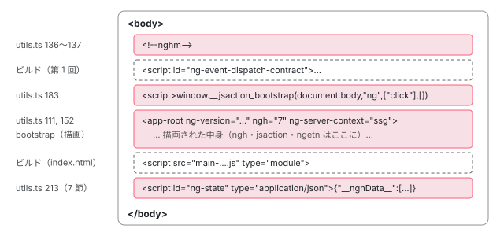

[目次](../README.md) › [SSR とハイドレーション](README.md) › 第 2 回 / 全 15 回

# renderApplication：サーバーでアプリを起動し、安定を待って HTML にする

> renderApplication / renderModule が createServerPlatform で platformServer を作り、bootstrap し、renderInternal で whenStable を待ってから prepareForHydration（annotateForHydration とイベント記録用スクリプトの挿入）、BEFORE\_APP\_SERIALIZED、PlatformState.renderToString と進み、最後にプラットフォームを破棄する行。ngServerMode、SERVER\_CONTEXT（ng-server-context 属性）、allowedHosts の検査。

angular/angular · 読了 約 13 分 · 中核 · [サイトで読む（デモが動きます）](https://angular-deep-dive-cyan.vercel.app/chapter/ssr-render-application)

---

サーバーで HTML を作る処理の中心は、`@angular/platform-server` の `utils.ts` にある 400 行ほどのコードです。この章では公開 API の `renderApplication` を入口に、プラットフォームを作る → 起動する → 安定を待つ → 印を書く → 文字列にする → 片付ける、の 6 段を 1 行ずつ追います。最後に、旧来の `renderModule` との違いと、`allowedHosts` の検査を読みます。

読む対象は `packages/platform-server/src/utils.ts`、`tokens.ts`、`platform_state.ts`、`transfer_state.ts` と、`packages/core/src/application/create_application.ts` です。

1. [1. 概観](01-ssr-overview.md)
2. **2. renderApplication**（この章）
3. [3. platformServer と domino](03-ssr-platform-server.md)
4. [4. AngularAppEngine](04-ssr-app-engine.md)
5. [5. サーバールート](05-ssr-server-routes.md)
6. [6. プリレンダー](06-ssr-prerender.md)
7. [7. provideClientHydration](07-hydration-provide.md)
8. [8. ngh の書き出し](08-hydration-annotate.md)
9. [9. ノードの道順](09-hydration.md)
10. [10. ノードの確保](10-hydration-claim.md)
11. [11. コンテナと片付け](11-hydration-containers.md)
12. [12. 不一致のエラー](12-hydration-errors.md)
13. [13. i18n](13-hydration-i18n.md)
14. [14. イベントの再生](14-event-replay.md)
15. [15. インクリメンタル](15-incremental-hydration.md)

## 1. 誰が renderApplication を呼ぶのか

先に呼び出し元を整理します。`renderApplication` は公開 API ですが、このサイトのような `@angular/ssr` を使う構成では**直接は呼ばれません**。

- `@angular/ssr` の `AngularServerApp`（SSR でもプリレンダーでも使う）は、`renderAngular`（`utils/ng.ts`）を呼びます。`renderAngular` は `platformServer` を自分で作り、起動・`whenStable` のあと、この章の 4 節で読む `renderInternal` を `ɵrenderInternal` という名前で直接呼びます（[第 4 回](04-ssr-app-engine.md)）。
- v22 で非推奨になった `CommonEngine`（`@angular/ssr/node`）は、`renderApplication` と `renderModule` をそのまま呼びます（これも第 4 回で引用しています）。

どちらの経路でも、HTML を作る本体は同じ `renderInternal` です。違いは、その前後（プラットフォームの作り方、リダイレクトの扱い）だけです。この章では、手順が 1 つの関数にまとまっている `renderApplication` で全体を読みます。

## 2. renderApplication：6 段の手順

📄 `angular/packages/platform-server/src/utils.ts` L342–363 （▶ の行: 343, 345–346, 356, 359, 362）

```ts
342 │ export async function renderApplication(
343 ▶   bootstrap: (context: BootstrapContext) => Promise<ApplicationRef>,
344 │   options: {
345 ▶     document?: string | Document;
346 ▶     url?: string;
347 │     platformProviders?: Provider[];
348 │     allowedHosts?: Readonly<string>[];
349 │   },
350 │ ): Promise<string> {
351 │   const renderAppLabel = 'renderApplication';
352 │   const bootstrapLabel = 'bootstrap';
353 │   const _renderLabel = '_render';
354 │   const {url, allowedHosts} = options;
355 │ 
356 ▶   validateAllowedHosts(url, allowedHosts);
357 │ 
358 │   startMeasuring(renderAppLabel);
359 ▶   const platformRef = createServerPlatform(options);
360 │   try {
361 │     startMeasuring(bootstrapLabel);
362 ▶     const applicationRef = await bootstrap({platformRef});
363 │     stopMeasuring(bootstrapLabel);
```

343 行目、第 1 引数は `bootstrap` 関数です。このサイトの `main.server.ts` が `export default` している `(context) => bootstrapApplication(App, config, context)` がこれです。345〜346 行目、`document` は HTML の文字列（`index.server.html` の中身）、`url` は描画するページの URL です。

356 行目で URL のホスト名を検査し（11 節）、359 行目でプラットフォームを作り（3 節）、362 行目で `bootstrap({platformRef})` を呼びます。ここで渡しているオブジェクトが、`bootstrapApplication` の第 3 引数 `context` です。

📄 `angular/packages/platform-server/src/utils.ts` L369–380 （▶ の行: 370, 373, 376–377）

```ts
369 │     // Block until application is stable.
370 ▶     await applicationRef.whenStable();
371 │     stopMeasuring(measuringLabel);
372 │ 
373 ▶     const rendered = await renderInternal(platformRef, applicationRef);
374 │     stopMeasuring(_renderLabel);
375 │     return rendered;
376 ▶   } finally {
377 ▶     await asyncDestroyPlatform(platformRef);
378 │     stopMeasuring(renderAppLabel);
379 │   }
380 │ }
```

370 行目で安定を待ち、373 行目で `renderInternal` が HTML の文字列を返します。376 行目の `finally` の中、377 行目で、成功しても失敗してもプラットフォームを破棄します。370 行目の `whenStable` が何を待っているのかは [PendingTasks の章](../zoneless/09-zoneless-pending-tasks.md)で、「初回のナビゲーションがそこに含まれる理由」は [ルーターの初回ナビゲーションの章](../router/06-router-initial-navigation.md)で読みました。

1. **プラットフォームを作る**

   `createServerPlatform(options)`（359 行目）。リクエストごとに新しく作る。
2. **起動する**

   `bootstrap({platformRef})`（362 行目）。中身はブラウザと同じ `bootstrapApplication`。
3. **安定を待つ**

   `applicationRef.whenStable()`（370 行目）。`PendingTasks` が 0 になるまで。
4. **印を書く**

   `renderInternal` の前半：`prepareForHydration` と `appendServerContextInfo`。
5. **文字列にする**

   `renderInternal` の後半：`BEFORE_APP_SERIALIZED` のコールバック → `renderToString()`。
6. **片付ける**

   `asyncDestroyPlatform(platformRef)`（377 行目）。

## 3. 段 1・2：プラットフォームを作り、context として渡す

📄 `angular/packages/platform-server/src/utils.ts` L55–74 （▶ の行: 59, 61, 63, 65–66, 69）

```ts
55 │ function createServerPlatform(options: PlatformOptions): PlatformRef {
56 │   const extraProviders = options.platformProviders ?? [];
57 │   const measuringLabel = 'createServerPlatform';
58 │   startMeasuring(measuringLabel);
59 ▶   const {document, url} = options;
60 │ 
61 ▶   const platform = platformServer([
62 │     {
63 ▶       provide: INITIAL_CONFIG,
64 │       useValue: {
65 ▶         document,
66 ▶         url,
67 │       },
68 │     },
69 ▶     extraProviders,
70 │   ]);
71 │ 
72 │   stopMeasuring(measuringLabel);
73 │   return platform;
74 │ }
```

59 行目で `document` と `url` を取り出し、61〜70 行目で `platformServer` に渡します。63〜67 行目、2 つは `INITIAL_CONFIG` というトークンの値としてプラットフォームの注入器に入ります。HTML の文字列がいつ DOM の木になるか、URL が誰に読まれるかは[第 3 回](03-ssr-platform-server.md)で追います。69 行目の `extraProviders` は呼び出し側の `platformProviders` です。

このプラットフォームを `bootstrapApplication` がどう使うかは、ここです。

📄 `angular/packages/core/src/application/create_application.ts` L44–58 （▶ の行: 47–48, 57–58）

```ts
44 │   const {rootComponent, appProviders, platformProviders, platformRef} = config;
45 │   profiler(ProfilerEvent.BootstrapApplicationStart);
46 │ 
47 ▶   if (typeof ngServerMode !== 'undefined' && ngServerMode && !platformRef) {
48 ▶     throw new RuntimeError(
49 │       RuntimeErrorCode.PLATFORM_NOT_FOUND,
50 │       ngDevMode &&
51 │         'Missing Platform: This may be due to using `bootstrapApplication` on the server without passing a `BootstrapContext`. ' +
52 │           'Please make sure that `bootstrapApplication` is called with a `context` argument.',
53 │     );
54 │   }
55 │ 
56 │   try {
57 ▶     const platformInjector =
58 ▶       platformRef?.injector ?? createOrReusePlatformInjector(platformProviders as StaticProvider[]);
```

57〜58 行目、`platformRef` があればその注入器を親にし、無ければブラウザ用のプラットフォームを作るか再利用します。47〜54 行目、**`ngServerMode` が立っているのに `platformRef` が無いとエラー**です。サーバーで `context` を渡し忘れると、ブラウザ用のプラットフォームを作ってしまい、リクエスト間で共有されてしまうのを防いでいます。`ngServerMode` を誰が立てるかは第 3 回で読みます。この関数の残りは [bootstrapApplication の章](../boot/07-boot-bootstrap-application.md)のとおりで、サーバーでも同じです。

## 4. 段 4・5：renderInternal

📄 `angular/packages/platform-server/src/utils.ts` L197–234 （▶ の行: 201–203, 208, 213, 215, 220, 225, 233）

```ts
197 │ export async function renderInternal(
198 │   platformRef: PlatformRef,
199 │   applicationRef: ApplicationRef,
200 │ ): Promise<string> {
201 ▶   const platformState = platformRef.injector.get(PlatformState);
202 ▶   prepareForHydration(platformState, applicationRef);
203 ▶   appendServerContextInfo(applicationRef);
204 │ 
205 │   // Run any BEFORE_APP_SERIALIZED callbacks just before rendering to string.
206 │   const environmentInjector = applicationRef.injector;
207 │   const errorHandler = environmentInjector.get(INTERNAL_APPLICATION_ERROR_HANDLER);
208 ▶   const callbacks = environmentInjector.get(BEFORE_APP_SERIALIZED, null);
209 │   if (callbacks) {
210 │     const asyncCallbacks: Promise<void>[] = [];
211 │     for (const callback of callbacks) {
212 │       try {
213 ▶         const callbackResult = callback();
214 │         if (callbackResult) {
215 ▶           asyncCallbacks.push(callbackResult);
216 │         }
217 │       } catch (e) {
218 │         // Delegate to the application's ErrorHandler so custom handlers
219 │         // (e.g. Sentry) are notified, rather than writing directly to console.
220 ▶         errorHandler(e);
221 │       }
222 │     }
223 │ 
224 │     if (asyncCallbacks.length) {
225 ▶       for (const result of await Promise.allSettled(asyncCallbacks)) {
226 │         if (result.status === 'rejected') {
227 │           errorHandler(result.reason);
228 │         }
229 │       }
230 │     }
231 │   }
232 │ 
233 ▶   return platformState.renderToString();
234 │ }
```

1. **201 行目：`PlatformState` を取る**

   プラットフォームの注入器にある、DOM を持っているオブジェクトです（8 節）。
2. **202 行目：`prepareForHydration`**

   `nghm` コメント、`ngh` 属性と `__nghData__`、イベント記録のスクリプトを書きます（5 節）。
3. **203 行目：`appendServerContextInfo`**

   ルートコンポーネントの要素に `ng-server-context` 属性を付けます（6 節）。
4. **208〜231 行目：`BEFORE_APP_SERIALIZED` のコールバックを全部呼ぶ**

   213 行目で 1 つずつ呼び、Promise を返したものは 215 行目で集めて、225 行目の `Promise.allSettled` でまとめて待ちます。例外は 220 行目と 227 行目で `INTERNAL_APPLICATION_ERROR_HANDLER` に渡し、**1 つが失敗しても HTML は作ります**。`ng-state` のスクリプトはここで書かれます（7 節）。
5. **233 行目：`platformState.renderToString()`**

   DOM の木を HTML の文字列に戻して返します（8 節）。

> [!NOTE]
> **ポイント**
>
> 順番に意味があります。`__nghData__` は 202 行目の中で `TransferState` に入り、`TransferState` は 213 行目のコールバックで `<script>` に書かれます。逆の順だと、`ng-state` にハイドレーションの情報が入りません。



*renderInternal が終わったときの body の並び（このサイトの本番 HTML）。左の行番号はそれを書いた行。ビルドが書いたものと、アプリの描画が書いたものも並べた。*

## 5. prepareForHydration：ハイドレーション用の印

📄 `angular/packages/platform-server/src/utils.ts` L95–125 （▶ の行: 101, 104, 106, 109, 111–113, 122）

```ts
 95 │ function prepareForHydration(platformState: PlatformState, applicationRef: ApplicationRef): void {
 96 │   const measuringLabel = 'prepareForHydration';
 97 │   startMeasuring(measuringLabel);
 98 │   const environmentInjector = applicationRef.injector;
 99 │   const doc = platformState.getDocument();
100 │ 
101 ▶   if (!environmentInjector.get(IS_HYDRATION_DOM_REUSE_ENABLED, false)) {
102 │     // Hydration is diabled, remove inlined event dispatch script.
103 │     // (which was injected by the build process) from the HTML.
104 ▶     removeEventDispatchScript(doc);
105 │ 
106 ▶     return;
107 │   }
108 │ 
109 ▶   appendSsrContentIntegrityMarker(doc);
110 │ 
111 ▶   const eventTypesToReplay = annotateForHydration(applicationRef, doc);
112 ▶   if (eventTypesToReplay.regular.size || eventTypesToReplay.capture.size) {
113 ▶     insertEventRecordScript(
114 │       environmentInjector.get(APP_ID),
115 │       doc,
116 │       eventTypesToReplay,
117 │       environmentInjector.get(CSP_NONCE, null),
118 │     );
119 │   } else {
120 │     // No events to replay, we should remove inlined event dispatch script
121 │     // (which was injected by the build process) from the HTML.
122 ▶     removeEventDispatchScript(doc);
123 │   }
124 │   stopMeasuring(measuringLabel);
125 │ }
```

1. **101〜107 行目：ハイドレーションが無効なら、ビルドが入れたスクリプトを消して終わる**

   `IS_HYDRATION_DOM_REUSE_ENABLED` は `provideClientHydration` の中の `withDomHydration` が provide するトークンです（[第 7 回](07-hydration-provide.md)）。サーバーでは provide されていれば `true` です。無ければ既定値の `false` になり、104 行目で event contract のスクリプト（[第 1 回](01-ssr-overview.md)）を消して 106 行目で戻ります。`ngh` も `nghm` も書かれません。
2. **109 行目：`nghm` コメントを入れる**

   下の 133〜139 行目です。
3. **111 行目：`annotateForHydration(applicationRef, doc)`**

   全ビューをたどって `ngh` 属性と `__nghData__` を書き、`jsaction` 属性を付け、見つけたイベントの種類を返します。中身は[第 8 回](08-hydration-annotate.md)で読みます。
4. **112〜123 行目：記録するイベントがあればスクリプトを足し、無ければ消す**

   `regular` は通常のイベント、`capture` はキャプチャ段階で聞くイベント（`focus` など）です。どちらかがあれば 113 行目でスクリプトを足し、どちらも無ければ 122 行目で event contract ごと消します。クリックの無いページに余計なスクリプトを残さないためです。

📄 `angular/packages/platform-server/src/utils.ts` L127–139 （▶ の行: 135–137）

```ts
127 │ /**
128 │  * Creates a marker comment node and append it into the `<body>`.
129 │  * Some CDNs have mechanisms to remove all comment node from HTML.
130 │  * This behaviour breaks hydration, so we'll detect on the client side if this
131 │  * marker comment is still available or else throw an error
132 │  */
133 │ function appendSsrContentIntegrityMarker(doc: Document) {
134 │   // Adding a ng hydration marker comment
135 ▶   const comment = doc.createComment(SSR_CONTENT_INTEGRITY_MARKER);
136 ▶   doc.body.firstChild
137 ▶     ? doc.body.insertBefore(comment, doc.body.firstChild)
138 │     : doc.body.append(comment);
139 │ }
```

135 行目で `<!--nghm-->` を作り、136〜137 行目で `<body>` の最初の子として入れます。129〜131 行目のコメントのとおり、CDN が HTML のコメントを消す最適化をしていると、`ngh` が指すコメントのアンカーまで消えてハイドレーションが壊れます。ブラウザはまずこの 1 個が残っているかを見て、無ければ NG0507 で止めます（[第 7 回](07-hydration-provide.md)）。

📄 `angular/packages/platform-server/src/utils.ts` L157–186 （▶ の行: 166, 169, 172, 174–176, 179, 183）

```ts
157 │ function insertEventRecordScript(
158 │   appId: string,
159 │   doc: Document,
160 │   eventTypesToReplay: {regular: Set<string>; capture: Set<string>},
161 │   nonce: string | null,
162 │ ): void {
163 │   const measuringLabel = 'insertEventRecordScript';
164 │   startMeasuring(measuringLabel);
165 │   const {regular, capture} = eventTypesToReplay;
166 ▶   const eventDispatchScript = findEventDispatchScript(doc);
167 │ 
168 │   // Note: this is only true when build with the CLI tooling, which inserts the script in the HTML
169 ▶   if (eventDispatchScript) {
170 │     // This is defined in packages/core/primitives/event-dispatch/contract_binary.ts
171 │     const replayScriptContents =
172 ▶       `window.__jsaction_bootstrap(` +
173 │       `document.body,` +
174 ▶       `"${appId}",` +
175 ▶       `${JSON.stringify(Array.from(regular))},` +
176 ▶       `${JSON.stringify(Array.from(capture))}` +
177 │       `);`;
178 │ 
179 ▶     const replayScript = createScript(doc, replayScriptContents, nonce);
180 │ 
181 │     // Insert replay script right after inlined event dispatch script, since it
182 │     // relies on `__jsaction_bootstrap` to be defined in the global scope.
183 ▶     eventDispatchScript.after(replayScript);
184 │   }
185 │   stopMeasuring(measuringLabel);
186 │ }
```

166 行目でビルドが入れた `#ng-event-dispatch-contract` を探します。168 行目のコメントのとおり、CLI でビルドしたときにしかありません。171〜177 行目で `window.__jsaction_bootstrap(document.body, "アプリの id", [通常のイベント], [キャプチャのイベント]);` という 1 行を組み立て、179 行目で `<script>` にし（CSP の `nonce` があれば付ける）、183 行目で contract のスクリプトの**直後**に置きます。`__jsaction_bootstrap` は contract のスクリプトが定義する関数なので、この順でないと動きません（[第 14 回](14-event-replay.md)）。

## 6. appendServerContextInfo：ng-server-context 属性

📄 `angular/packages/platform-server/src/utils.ts` L141–155 （▶ の行: 147–148, 150, 152）

```ts
141 │ /**
142 │  * Adds the `ng-server-context` attribute to host elements of all bootstrapped components
143 │  * within a given application.
144 │  */
145 │ function appendServerContextInfo(applicationRef: ApplicationRef) {
146 │   const injector = applicationRef.injector;
147 ▶   let serverContext = sanitizeServerContext(injector.get(SERVER_CONTEXT, DEFAULT_SERVER_CONTEXT));
148 ▶   applicationRef.components.forEach((componentRef) => {
149 │     const renderer = componentRef.injector.get(Renderer2);
150 ▶     const element = componentRef.location.nativeElement;
151 │     if (element) {
152 ▶       renderer.setAttribute(element, 'ng-server-context', serverContext);
153 │     }
154 │   });
155 │ }
```

📄 `angular/packages/platform-server/src/utils.ts` L249–269 （▶ の行: 252, 259, 267–268）

```ts
249 │ /**
250 │  * Specifies the value that should be used if no server context value has been provided.
251 │  */
252 ▶ const DEFAULT_SERVER_CONTEXT = 'other';
253 │ 
254 │ /**
255 │  * An internal token that allows providing extra information about the server context
256 │  * (e.g. whether SSR or SSG was used). The value is a string and characters other
257 │  * than [a-zA-Z0-9\-] are removed. See the default value in `DEFAULT_SERVER_CONTEXT` const.
258 │  */
259 ▶ export const SERVER_CONTEXT = new InjectionToken<string>('SERVER_CONTEXT');
260 │ 
261 │ /**
262 │  * Sanitizes provided server context:
263 │  * - removes all characters other than a-z, A-Z, 0-9 and `-`
264 │  * - returns `other` if nothing is provided or the string is empty after sanitization
265 │  */
266 │ function sanitizeServerContext(serverContext: string): string {
267 ▶   const context = serverContext.replace(/[^a-zA-Z0-9\-]/g, '');
268 ▶   return context.length > 0 ? context : DEFAULT_SERVER_CONTEXT;
269 │ }
```

147 行目、`SERVER_CONTEXT` を読みます。誰も provide していなければ 252 行目の `'other'` です。267 行目で英数字とハイフン以外を消し、空になったら 268 行目で `'other'` に戻します。属性値に任意の文字列が入らないようにするためです。148〜154 行目、起動したルートコンポーネント（`applicationRef.components`）の要素すべてに、152 行目で属性を付けます。

`@angular/ssr` の `AngularServerApp` は、プリレンダーなら `'ssg'`、SSR なら `'ssr'` を `SERVER_CONTEXT` として渡します（[第 4 回](04-ssr-app-engine.md)）。このサイトの HTML が `ng-server-context="ssg"` なのはそのためです。

## 7. BEFORE\_APP\_SERIALIZED：ng-state はここで書かれる

📄 `angular/packages/platform-server/src/tokens.ts` L36–46 （▶ の行: 42–43）

```ts
36 │ /**
37 │  * A function that will be executed when calling `renderApplication` or
38 │  * `renderModule` just before current platform state is rendered to string.
39 │  *
40 │  * @publicApi
41 │  */
42 ▶ export const BEFORE_APP_SERIALIZED = new InjectionToken<ReadonlyArray<() => void | Promise<void>>>(
43 ▶   'Server.RENDER_MODULE_HOOK',
44 │ );
45 │ 
46 │ export const ENABLE_DOM_EMULATION = new InjectionToken<boolean>('ENABLE_DOM_EMULATION');
```

42 行目、値の型は「引数なしで、`void` か `Promise<void>` を返す関数」の配列です。`multi: true` で provide された分が配列で返ってくるので、4 節の 211 行目の `for` で回せます。46 行目の `ENABLE_DOM_EMULATION` は 8 節と第 3 回で出てきます。

📄 `angular/packages/platform-server/src/transfer_state.ts` L23–37 （▶ の行: 33–35）

```ts
23 │ /** Tracks whether the server-side application transfer state has already been serialized. */
24 │ const TRANSFER_STATE_STATUS = new InjectionToken<{serialized: boolean}>(
25 │   typeof ngDevMode === 'undefined' || ngDevMode ? 'TRANSFER_STATE_STATUS' : '',
26 │   {
27 │     factory: () => ({serialized: false}),
28 │   },
29 │ );
30 │ 
31 │ export const TRANSFER_STATE_SERIALIZATION_PROVIDERS: Provider[] = [
32 │   {
33 ▶     provide: BEFORE_APP_SERIALIZED,
34 ▶     useFactory: serializeTransferStateFactory,
35 ▶     multi: true,
36 │   },
37 │ ];
```

platform-server 自身が 1 つ登録しています。33〜35 行目、`serializeTransferStateFactory` が返す関数がコールバックです。これが `TransferState.toJson()` を `<script id="ng-state" type="application/json">` に入れて `<body>` の最後に足します。その関数の中身は [転送キャッシュの章](../http/11-http-transfer-cache.md)で読みました。この配列 `TRANSFER_STATE_SERIALIZATION_PROVIDERS` は `PLATFORM_SERVER_PROVIDERS` の一部で、`provideServerRendering()` か `ServerModule` から入ります（第 3 回）。

## 8. renderToString：DOM を文字列に戻す

📄 `angular/packages/platform-server/src/platform_state.ts` L29–56 （▶ の行: 32, 34, 50–51, 53）

```ts
29 │ @Injectable()
30 │ export class PlatformState {
31 │   /* @internal */
32 ▶   _enableDomEmulation = enableDomEmulation(inject(Injector));
33 │ 
34 ▶   constructor(@Inject(DOCUMENT) private _doc: any) {}
35 │ 
36 │   /**
37 │    * Renders the current state of the platform to string.
38 │    */
39 │   renderToString(): string {
40 │     if (ngDevMode && !this._enableDomEmulation && !window?.document) {
41 │       throw new RuntimeError(
42 │         RuntimeErrorCode.DISABLED_DOM_EMULATION_IN_NON_BROWSER,
43 │         (typeof ngDevMode === 'undefined' || ngDevMode) &&
44 │           'Disabled DOM emulation should only run in browser environments',
45 │       );
46 │     }
47 │ 
48 │     const measuringLabel = 'renderToString';
49 │     startMeasuring(measuringLabel);
50 ▶     const rendered = this._enableDomEmulation
51 ▶       ? serializeDocument(this._doc)
52 │       : // In the case we run/test the platform-server in a browser environment
53 ▶         this._doc.documentElement.outerHTML;
54 │     stopMeasuring(measuringLabel);
55 │     return rendered;
56 │   }
```

34 行目、`PlatformState` は `DOCUMENT` を 1 つ持っているだけです。この `DOCUMENT` はプラットフォームの注入器にある、domino の `Document` です。アプリの描画も `annotateForHydration` も、すべてこの 1 つの `Document` を書き換えてきました。50〜51 行目、ふつうは domino の `serializeDocument`（中身は `doc.serialize()`）で文字列にします。32 行目の `_enableDomEmulation` が `false` のとき（platform-server をブラウザの中で動かすテスト用）は、53 行目で `outerHTML` を使います。

## 9. 段 6：片付け

📄 `angular/packages/platform-server/src/utils.ts` L236–247 （▶ の行: 242–243）

```ts
236 │ /**
237 │  * Destroy the application in a macrotask, this allows pending promises to be settled and errors
238 │  * to be surfaced to the users.
239 │  */
240 │ function asyncDestroyPlatform(platformRef: PlatformRef): Promise<void> {
241 │   return new Promise<void>((resolve) => {
242 ▶     setTimeout(() => {
243 ▶       platformRef.destroy();
244 │       resolve();
245 │     }, 0);
246 │   });
247 │ }
```

242 行目、すぐには破棄せず `setTimeout(..., 0)` で次のマクロタスクに回します。237〜238 行目のコメントのとおり、まだ途中の Promise を落ち着かせ、そのエラーを利用者に見せるためです。243 行目の `platformRef.destroy()` で、プラットフォームとその上のアプリ（`ApplicationRef`、全コンポーネント、注入器）がまとめて破棄されます。`platformServer` が `ngServerMode` を自分で立てていた場合は、ここで元に戻します（第 3 回）。

## 10. renderModule との違い

📄 `angular/packages/platform-server/src/utils.ts` L283–309 （▶ の行: 284, 288, 293–294, 296–297, 302, 305, 307）

```ts
283 │ export async function renderModule<T>(
284 ▶   moduleType: Type<T>,
285 │   options: {
286 │     document?: string | Document;
287 │     url?: string;
288 ▶     extraProviders?: StaticProvider[];
289 │     allowedHosts?: Readonly<string>[];
290 │   },
291 │ ): Promise<string> {
292 │   const {document, url, extraProviders: platformProviders, allowedHosts} = options;
293 ▶   validateAllowedHosts(url, allowedHosts);
294 ▶   const platformRef = createServerPlatform({document, url, platformProviders});
295 │   try {
296 ▶     const moduleRef = await platformRef.bootstrapModule(moduleType);
297 ▶     const applicationRef = moduleRef.injector.get(ApplicationRef);
298 │ 
299 │     const measuringLabel = 'whenStable';
300 │     startMeasuring(measuringLabel);
301 │     // Block until application is stable.
302 ▶     await applicationRef.whenStable();
303 │     stopMeasuring(measuringLabel);
304 │ 
305 ▶     return await renderInternal(platformRef, applicationRef);
306 │   } finally {
307 ▶     await asyncDestroyPlatform(platformRef);
308 │   }
309 │ }
```

手順は同じです。293 行目で検査、294 行目でプラットフォーム、296 行目で起動、302 行目で安定待ち、305 行目で `renderInternal`、307 行目で破棄。違いは起動のしかたと、引数の名前です。

|   | renderApplication | renderModule |
| --- | --- | --- |
| 第 1 引数 | `(context) => Promise<ApplicationRef>`（343 行目） | NgModule のクラス（284 行目） |
| 起動 | `bootstrap({platformRef})`（362 行目）。中で `bootstrapApplication` | `platformRef.bootstrapModule(moduleType)`（296 行目） |
| `ApplicationRef` の取り方 | bootstrap の戻り値 | `moduleRef.injector.get(ApplicationRef)`（297 行目） |
| プラットフォーム用プロバイダの引数名 | `platformProviders`（347 行目） | `extraProviders`（288 行目） |
| サーバー用プロバイダの入れ方 | config に `provideServerRendering()` | サーバー用 NgModule で `ServerModule` を import |
| 安定待ち・renderInternal・破棄 | 同じ（370・373・377 行目 / 302・305・307 行目） |   |

## 11. allowedHosts：URL のホスト名を検査する

📄 `angular/packages/platform-server/src/utils.ts` L382–398 （▶ の行: 383–385, 387–389）

```ts
382 │ function validateAllowedHosts(url: string | undefined, allowedHosts: string[] | undefined) {
383 ▶   if (typeof url === 'string') {
384 ▶     const parsedUrl = resolveUrl(url);
385 ▶     if (parsedUrl !== null) {
386 │       const hostname = parsedUrl.hostname;
387 ▶       const allowedHostsSet: ReadonlySet<string> = new Set(allowedHosts);
388 ▶       if (!isHostAllowed(hostname, allowedHostsSet)) {
389 ▶         throw new RuntimeError(
390 │           RuntimeErrorCode.HOST_NOT_ALLOWED,
391 │           typeof ngDevMode === 'undefined' || ngDevMode
392 │             ? `Host ${url} is not allowed. You can configure \`allowedHosts\` option.`
393 │             : url,
394 │         );
395 │       }
396 │     }
397 │   }
398 │ }
```

📄 `angular/packages/platform-server/src/utils.ts` L400–425 （▶ の行: 405, 409, 414, 418–419）

```ts
400 │ /**
401 │  * Checks if the hostname is allowed.
402 │  * @param hostname - The hostname to check.
403 │  * @param allowedHosts - A set of allowed hostnames.
404 │  * @returns `true` if the hostname is allowed, `false` otherwise.
405 ▶  * @note Used also in `@angular/ssr`.
406 │  * @private
407 │  */
408 │ export function isHostAllowed(hostname: string, allowedHosts: ReadonlySet<string>): boolean {
409 ▶   if (allowedHosts.has('*') || allowedHosts.has(hostname)) {
410 │     return true;
411 │   }
412 │ 
413 │   for (const allowedHost of allowedHosts) {
414 ▶     if (!allowedHost.startsWith('*.')) {
415 │       continue;
416 │     }
417 │ 
418 ▶     const domain = allowedHost.slice(1);
419 ▶     if (hostname.endsWith(domain)) {
420 │       return true;
421 │     }
422 │   }
423 │ 
424 │   return false;
425 │ }
```

1. **383〜385 行目：絶対 URL のときだけ検査する**

   `resolveUrl(url)` は基準の URL を渡さないと、`https://example.com/a` のような絶対 URL だけを解析し、`/a` のような相対 URL には `null` を返します（`url.ts` の `resolveUrl`）。`null` なら検査しません。ホスト名が無いので、外へ向くことも無いからです。
2. **387〜395 行目：許可リストに無ければ `HOST_NOT_ALLOWED` のエラー**

   `allowedHosts` を渡さなければ空の Set なので、絶対 URL はすべてエラーになります。
3. **409 行目：`'*'` か完全一致なら許可**

   414〜420 行目、`'*.example.com'` の形なら、418 行目で先頭の `*` を取った `'.example.com'` で終わるかを見ます。`'evil-example.com'` は `'.example.com'` で終わらないので通りません。

405 行目の注記には「`@angular/ssr` でも使う」とありますが、いまの `@angular/ssr` は同じ形の `isHostAllowed` を自分の `utils/validation.ts` に持っていて、そちらで `Request` のホスト名を検査します。このサイトの `angular.json` の `"security": { "allowedHosts": [] }` はそちらに渡る設定です（[第 4 回](04-ssr-app-engine.md)）。

## 12. DEMO：このページに残った痕跡と、書いた行

最後に、この章で読んだ行が本当にこのページの HTML を書いたのかを確かめます。`<app-root>` に付く `ng-version` だけは、この章の関数ではなく、ルートコンポーネントを作る `ComponentRef` 側が付けます。

📄 `angular/packages/core/src/render3/component_ref.ts` L442–452 （▶ の行: 449–450）

```ts
442 │ function createRootTView(
443 │   rootSelectorOrNode: any,
444 │   componentDef: ComponentDef<unknown>,
445 │   componentBindings: Binding[] | undefined,
446 │   directives: (Type<unknown> | DirectiveWithBindings<unknown>)[] | undefined,
447 │   allowNonStandaloneDirectives?: boolean,
448 │ ): TView {
449 ▶   const tAttributes = rootSelectorOrNode
450 ▶     ? ['ng-version', '0.0.0-PLACEHOLDER']
451 │     : // Extract attributes and classes from the first selector only to match VE behavior.
452 │       extractAttrsAndClassesFromSelector(componentDef.selectors[0]);
```

449〜450 行目、ルートの要素を外から渡されたとき（`bootstrapApplication` はこちら）だけ、`ng-version` 属性を付けます。`0.0.0-PLACEHOLDER` はリリースのときに実際の版に置き換わります。サーバーでもブラウザでも同じ値が付きます。

> **🧪 DEMO — サーバーが書いた HTML の、場所ごとの痕跡**
>
> ボタンを押すと `fetch(location.pathname)` でこのページの HTML を取り直し、`DOMParser` で解析します。第 1 回のデモは印の「数」を数えました。ここでは、`renderInternal` が書いた場所を 1 つずつ見て、書いた行と、いまの DOM の同じ場所を並べます。
>
> ▶ [このデモはサイトで動かせます](https://angular-deep-dive-cyan.vercel.app/chapter/ssr-render-application)

`ngh` だけが「いまの DOM」で消えています。ブラウザが読んで消したからです（[第 10 回](10-hydration-claim.md)）。`ng-server-context` と `ng-version` はブラウザで付け直されたのではなく、ハイドレーションでサーバーの要素がそのまま使われたので残っています。

## ここまでの呼び出し

- `renderApplication(bootstrap, {document, url})` — platform-server/src/utils.ts L342
  - `validateAllowedHosts(url, allowedHosts)` — utils.ts L382 — *絶対 URL のホスト名だけ検査*
  - `createServerPlatform(options)` — utils.ts L55
    - `platformServer([INITIAL_CONFIG, ...])` — server.ts L130 — *第 3 回*
  - 👤 `bootstrap({platformRef})` — src/main.server.ts — *bootstrapApplication(App, config, context)*
    - `internalCreateApplication(config)` — core/src/application/create\_application.ts L38 — *platformRef.injector を親に*
  - `applicationRef.whenStable()` — core/src/application/application\_ref.ts — *時間制限なし*
  - `renderInternal(platformRef, applicationRef)` — utils.ts L197
    - `prepareForHydration` — utils.ts L95 — *nghm → annotateForHydration → \_\_jsaction\_bootstrap*
    - `appendServerContextInfo` — utils.ts L145 — *ng-server-context*
    - `BEFORE_APP_SERIALIZED` の各コールバック — tokens.ts L42 — *ng-state を body の最後に*
    - `platformState.renderToString()` — platform\_state.ts L39 — *serializeDocument*
  - `asyncDestroyPlatform(platformRef)` — utils.ts L240 — *setTimeout 0 で destroy*

## 聞かれそうな質問

**Q. whenStable がいつまでも来なかったらどうなりますか？タイムアウトはありますか？**

`renderApplication` の 370 行目にも `renderModule` の 302 行目にも時間制限はありません。`await` がそのまま止まり、HTML は返りません。`setInterval` を止めずに回し続ける、終わらない `PendingTasks` を抱える、などで起きます（[PendingTasks の章](../zoneless/09-zoneless-pending-tasks.md)）。ハイドレーションの 10 秒の警告（`APPLICATION_IS_STABLE_TIMEOUT`）は**ブラウザ側**の開発モードだけの仕組みで、サーバーの描画を打ち切るものではありません（[第 7 回](07-hydration-provide.md)）。

**Q. なぜ 1 リクエストごとにプラットフォームを作り直すのですか？**

`DOCUMENT` と `INITIAL_CONFIG`（URL）と `PlatformLocation` が**プラットフォームの注入器**にあるからです（[第 3 回](03-ssr-platform-server.md)）。プラットフォームを使い回すと、同時に来た 2 つのリクエストが同じ `Document` に描画し、同じ URL を見ることになります。59〜69 行目で毎回 `INITIAL_CONFIG` を作り直し、377 行目で毎回破棄しているのはそのためです。create\_application.ts 47 行目の検査も、`context` を渡し忘れてブラウザ用の（使い回される）プラットフォームを作ることを防いでいます。

**Q. allowedHosts は何を防いでいますか？**

描画する URL のホスト名は、サーバーの `PlatformLocation.hostname` になり、`HttpClient` の相対 URL（`/api/...`）の前に付けられます（[第 3 回](03-ssr-platform-server.md)の `relativeUrlsTransformerInterceptorFn`）。その URL をリクエストの `Host` ヘッダーから作っていると、攻撃者が `Host: evil.example` を送るだけで、サーバーが `evil.example` に HTTP リクエストを出してしまいます。382〜398 行目の検査は、許可したホスト名以外の絶対 URL では描画を始めずにエラーにして、それを防ぎます。

**Q. BEFORE\_APP\_SERIALIZED に自分のコールバックを足すと、いつ呼ばれますか？**

`annotateForHydration`（202 行目の中）と `ng-server-context`（203 行目）のあと、`renderToString`（233 行目）の前です。DOM はもう最終形で、ここで DOM を変えるとそのまま HTML に出ます。ただし `ngh` の注釈はもう終わっているので、コンポーネントの中のノードを足したり消したりすると、ブラウザでのハイドレーションと食い違います。Promise を返せば 225 行目で待ってもらえ、例外や reject は 220・227 行目でエラーハンドラに渡されて、描画自体は続きます。

**Q. renderApplication を使わずに AngularAppEngine を使うと、手順は変わりますか？**

`renderInternal` から後ろは同じです。`@angular/ssr` の `renderAngular` は、`whenStable` のあとでルーターの最後のナビゲーションを見てリダイレクトかどうかを判定し、HTML の文字列化（`renderInternal`）は、必要になったときに `setTimeout` で遅らせて呼びます。違いはその前段だけです（[第 4 回](04-ssr-app-engine.md)）。

## 読み終えて

- `renderApplication` は、プラットフォームを作る → `bootstrap({platformRef})` → `whenStable` → `renderInternal` → 破棄、の順。`renderModule` は起動の 1 行だけが違う
- `renderInternal` の中は、`prepareForHydration`（nghm・ngh・jsaction のスクリプト）→ `ng-server-context` → `BEFORE_APP_SERIALIZED`（ng-state）→ `renderToString`
- ハイドレーションが無効なら `ngh` も `nghm` も書かれず、ビルドが入れた event contract のスクリプトも消される
- `whenStable` に時間制限は無い。`allowedHosts` は絶対 URL のホスト名だけを検査する
- @angular/ssr は `renderApplication` を通らず `ɵrenderInternal` を直接呼ぶ。本体は同じ

---

← 前: [SSR とハイドレーションの概観：サーバーで 1 回、ブラウザでもう 1 回](01-ssr-overview.md)  
次: [platformServer：domino の DOM、ServerPlatformLocation、サーバー用プロバイダ](03-ssr-platform-server.md) →
