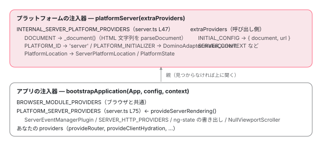

[目次](../README.md) › [SSR とハイドレーション](README.md) › 第 3 回 / 全 15 回

# platformServer：domino の DOM、ServerPlatformLocation、サーバー用プロバイダ

> platformServer が INTERNAL\_SERVER\_PLATFORM\_PROVIDERS で DominoAdapter を DOM アダプタにし、INITIAL\_CONFIG の document（HTML 文字列）を parseDocument する行。ServerPlatformLocation が url から pathname・search・hash を作る行、PLATFORM\_SERVER\_PROVIDERS と SERVER\_RENDER\_PROVIDERS、v22 で非推奨になった ServerXhr、platform-server の provideServerRendering と @angular/ssr の provideServerRendering の違い。

angular/angular · 読了 約 13 分 · 中核 · [サイトで読む（デモが動きます）](https://angular-deep-dive-cyan.vercel.app/chapter/ssr-platform-server)

---

サーバーで動くアプリは、ブラウザと同じコンポーネントのコードを実行します。違うのは、その下で `DOCUMENT`・`PlatformLocation`・イベント・HTTP を担当する実装です。この章では `platformServer()` が何を provide し、HTML の文字列がいつ domino（Node.js 用の DOM の実装）の `Document` になり、URL がどう `PlatformLocation` になるのかを、プラットフォーム側とアプリ側に分けて追います。

読む対象は `packages/platform-server/src/` の `server.ts`・`domino_adapter.ts`・`location.ts`・`server_events.ts`・`http.ts`・`provide_server.ts`、`packages/core/src/platform/platform.ts`、それに `@angular/ssr` の `routes/route-config.ts` です。

1. [1. 概観](01-ssr-overview.md)
2. [2. renderApplication](02-ssr-render-application.md)
3. **3. platformServer と domino**（この章）
4. [4. AngularAppEngine](04-ssr-app-engine.md)
5. [5. サーバールート](05-ssr-server-routes.md)
6. [6. プリレンダー](06-ssr-prerender.md)
7. [7. provideClientHydration](07-hydration-provide.md)
8. [8. ngh の書き出し](08-hydration-annotate.md)
9. [9. ノードの道順](09-hydration.md)
10. [10. ノードの確保](10-hydration-claim.md)
11. [11. コンテナと片付け](11-hydration-containers.md)
12. [12. 不一致のエラー](12-hydration-errors.md)
13. [13. i18n](13-hydration-i18n.md)
14. [14. イベントの再生](14-event-replay.md)
15. [15. インクリメンタル](15-incremental-hydration.md)

## 1. 2 階建て：プラットフォームのプロバイダと、アプリのプロバイダ

先に全体の形です。サーバー用のプロバイダは 2 か所から入ります。**プラットフォームの注入器**（リクエストごとに 1 つ）には `platformServer()` が入れ、**アプリの注入器**には `provideServerRendering()`（または `ServerModule`）が入れます。



*上がプラットフォームの注入器（platformServer が作る）、下がアプリの注入器（bootstrapApplication が作る）。下は上を親にして、見つからないトークンを上に聞く。*

この分け方には理由があります。`DOCUMENT` と URL は**リクエストごとに違う**ので、リクエストごとに作り直すプラットフォームに置きます。イベントや HTTP の差し替えはアプリの設定の一部なので、アプリの注入器に置きます。上から順に読みます。

## 2. platformServer：ngServerMode を立てて、プラットフォームを作る

📄 `angular/packages/platform-server/src/server.ts` L120–149 （▶ の行: 131–133, 136–140, 143–144）

```ts
120 │ /**
121 │  * Creates a server-side instance of an Angular platform.
122 │  *
123 │  * This platform should be used when performing server-side rendering of an Angular application.
124 │  * Standalone applications can be bootstrapped on the server using the `bootstrapApplication`
125 │  * function from `@angular/platform-browser`. When using `bootstrapApplication`, the `platformServer`
126 │  * should be created first and passed to the bootstrap function using the `BootstrapContext`.
127 │  *
128 │  * @publicApi
129 │  */
130 │ export function platformServer(extraProviders?: StaticProvider[] | undefined): PlatformRef {
131 ▶   const noServerModeSet = typeof ngServerMode === 'undefined';
132 ▶   if (noServerModeSet) {
133 ▶     globalThis['ngServerMode'] = true;
134 │   }
135 │ 
136 ▶   const platform = createPlatformFactory(
137 ▶     platformCore,
138 ▶     'server',
139 ▶     INTERNAL_SERVER_PLATFORM_PROVIDERS,
140 ▶   )(extraProviders);
141 │ 
142 │   if (noServerModeSet) {
143 ▶     platform.onDestroy(() => {
144 ▶       globalThis['ngServerMode'] = undefined;
145 │     });
146 │   }
147 │ 
148 │   return platform;
149 │ }
```

1. **131〜134 行目：`ngServerMode` が未定義なら `true` にする**

   `ngServerMode` は「いまサーバーで描画しているか」を表すグローバル変数です。`@angular/core` の各所（`getPlatform`、`createPlatform`、`withDomHydration` など）が `typeof ngServerMode !== 'undefined' && ngServerMode` の形で読みます。
2. **136〜140 行目：`platformCore` を親にした `'server'` という名前のプラットフォームを作る**

   `createPlatformFactory` は「プロバイダを足してプラットフォームを作る関数」を返し、その場で `(extraProviders)` で呼んでいます。139 行目の `INTERNAL_SERVER_PLATFORM_PROVIDERS` が、3 節で読む本体です。
3. **142〜146 行目：自分で立てたなら、破棄のときに戻す**

   `renderApplication` の最後の `platformRef.destroy()`（[第 2 回](02-ssr-render-application.md)）で、144 行目が `undefined` に戻します。

ただし、CLI でビルドしたサーバー用のバンドルでは、131 行目の `typeof ngServerMode === 'undefined'` は成り立ちません。ビルドがこの名前を定数に置き換えるからです。

📄 `angular-cli/packages/angular/build/src/tools/esbuild/application-code-bundle.ts` L527–533 （▶ の行: 532）

```ts
527 │ function getEsBuildServerCommonOptions(options: NormalizedApplicationBuildOptions): BuildOptions {
528 │   const isNodePlatform = options.ssrOptions?.platform !== Platform.Neutral;
529 │ 
530 │   const commonOptions = getEsBuildCommonOptions(options);
531 │   commonOptions.define ??= {};
532 ▶   commonOptions.define['ngServerMode'] = 'true';
533 │ 
```

532 行目、サーバー用のバンドルでは `ngServerMode` を `true` に置き換えます。ブラウザ用のバンドルでは `false` です（[ブラウザでの読み込みの章](../boot/06-boot-browser-load.md)で引用した `define`）。つまり 131〜134 行目と 142〜146 行目が効くのは、ビルドで置き換えていない環境（テストや、自分で `platformServer` を呼ぶ Node.js のスクリプト）だけです。置き換えられたバンドルでは `if (false)` になり、最適化で消えます。

### サーバーではプラットフォームをグローバルに覚えない

📄 `angular/packages/core/src/platform/platform.ts` L79–94 （▶ の行: 80–81, 83–84, 89–90, 93）

```ts
79 │   return (extraProviders: StaticProvider[] = []) => {
80 ▶     let platform = getPlatform();
81 ▶     if (!platform) {
82 │       const platformProviders: StaticProvider[] = [
83 ▶         ...providers,
84 ▶         ...extraProviders,
85 │         {provide: marker, useValue: true},
86 │       ];
87 │ 
88 │       platform =
89 ▶         parentPlatformFactory?.(platformProviders) ??
90 ▶         createPlatform(createPlatformInjector(platformProviders, desc));
91 │     }
92 │ 
93 ▶     return typeof ngServerMode !== 'undefined' && ngServerMode ? platform : assertPlatform(marker);
94 │   };
```

80 行目でまず既存のプラットフォームを探し、無ければ 82〜86 行目でプロバイダを並べます。83 行目の `providers` が `INTERNAL_SERVER_PLATFORM_PROVIDERS`、84 行目の `extraProviders` が `INITIAL_CONFIG` などです。89 行目で親の `platformCore` に渡し、最終的に 90 行目の `createPlatform` に届きます。93 行目、サーバーでは `assertPlatform`（「いまのプラットフォームが自分か」の検査）を飛ばして、作ったものをそのまま返します。

📄 `angular/packages/core/src/platform/platform.ts` L142–148 （▶ の行: 143–144）

```ts
142 │ export function getPlatform(): PlatformRef | null {
143 ▶   if (typeof ngServerMode !== 'undefined' && ngServerMode) {
144 ▶     return null;
145 │   }
146 │ 
147 │   return _platformInjector?.get(PlatformRef) ?? null;
148 │ }
```

📄 `angular/packages/core/src/platform/platform.ts` L52–58 （▶ の行: 54, 57）

```ts
52 │   // During SSR, using this setting and using an injector from the global can cause the
53 │   // injector to be used for a different requjest due to concurrency.
54 ▶   _platformInjector = typeof ngServerMode === 'undefined' || !ngServerMode ? injector : null;
55 │ 
56 │   const platform = injector.get(PlatformRef);
57 ▶   runPlatformInitializers(injector);
58 │   return platform;
```

143〜144 行目、サーバーでは `getPlatform()` が常に `null` です。だから 80 行目の探索は毎回空振りし、**毎回新しいプラットフォームが作られます**。54 行目、作った注入器もグローバル変数 `_platformInjector` には入れません。52〜53 行目のコメントのとおり、同時に来た別のリクエストに使われてしまうのを防ぐためです。57 行目で `PLATFORM_INITIALIZER` を実行します（[注入器の章](../boot/08-boot-injectors.md)の `runPlatformInitializers`）。サーバーではここで次節の `initDominoAdapter` が走ります。

## 3. INTERNAL\_SERVER\_PLATFORM\_PROVIDERS

📄 `angular/packages/platform-server/src/server.ts` L47–69 （▶ の行: 48–50, 52–53, 56, 61, 64, 66）

```ts
47 │ export const INTERNAL_SERVER_PLATFORM_PROVIDERS: StaticProvider[] = [
48 ▶   {provide: DOCUMENT, useFactory: _document},
49 ▶   {provide: PLATFORM_ID, useValue: PLATFORM_SERVER_ID},
50 ▶   {provide: PLATFORM_INITIALIZER, useFactory: initDominoAdapter, multi: true},
51 │   {
52 ▶     provide: PlatformLocation,
53 ▶     useClass: ServerPlatformLocation,
54 │     deps: [],
55 │   },
56 ▶   {provide: PlatformState, deps: [DOCUMENT]},
57 │ ];
58 │ 
59 │ function initDominoAdapter() {
60 │   const injector = inject(Injector);
61 ▶   const _enableDomEmulation = enableDomEmulation(injector);
62 │   return () => {
63 │     if (_enableDomEmulation) {
64 ▶       DominoAdapter.makeCurrent();
65 │     } else {
66 ▶       BrowserDomAdapter.makeCurrent();
67 │     }
68 │   };
69 │ }
```

| 行 | トークン | 値 | 誰が使う |
| --- | --- | --- | --- |
| 48 | `DOCUMENT` | `_document()` の戻り値（4 節） | Renderer、`PlatformState`、ハイドレーションの注釈、利用者の `inject(DOCUMENT)` |
| 49 | `PLATFORM_ID` | `'server'` | `isPlatformServer(id)` / `isPlatformBrowser(id)` |
| 50 | `PLATFORM_INITIALIZER` | `initDominoAdapter` | 2 節の 57 行目 |
| 52〜53 | `PlatformLocation` | `ServerPlatformLocation`（6 節） | `Location` → `Router`、HTTP の相対 URL の解決 |
| 56 | `PlatformState` | そのクラス（`DOCUMENT` を受け取る） | `renderInternal`（[第 2 回](02-ssr-render-application.md)） |

59〜69 行目の `initDominoAdapter` は `useFactory` なので、61 行目は注入コンテキストの中で走り、`ENABLE_DOM_EMULATION` を読みます。返した関数が 2 節の 57 行目で呼ばれ、64 行目で `DominoAdapter.makeCurrent()`（5 節）。66 行目の `BrowserDomAdapter` は、DOM エミュレーションを切ったとき（ブラウザの中で platform-server を動かす場合）の分岐です。

📄 `angular/packages/platform-server/src/platform_state.ts` L58–68 （▶ の行: 67）

```ts
58 │   /**
59 │    * Returns the current DOM state.
60 │    */
61 │   getDocument(): any {
62 │     return this._doc;
63 │   }
64 │ }
65 │ 
66 │ export function enableDomEmulation(injector: Injector): boolean {
67 ▶   return injector.get(ENABLE_DOM_EMULATION, true);
68 │ }
```

67 行目、`ENABLE_DOM_EMULATION` の既定は `true` です。angular と angular-cli の両リポジトリを検索しても、このトークンを provide している本番コードはありません。Node.js で動く限り、domino が使われると考えてかまいません。

## 4. HTML の文字列が Document になる：\_document

📄 `angular/packages/platform-server/src/tokens.ts` L11–34 （▶ の行: 21, 26, 34）

```ts
11 │ /**
12 │  * Config object passed to initialize the platform.
13 │  *
14 │  * @publicApi
15 │  */
16 │ export interface PlatformConfig {
17 │   /**
18 │    * The initial DOM to use to bootstrap the server application.
19 │    * @default create a new DOM using Domino
20 │    */
21 ▶   document?: string;
22 │   /**
23 │    * The URL for the current application state. This is used for initializing
24 │    * the platform's location. `protocol`, `hostname`, and `port`.
25 │    */
26 ▶   url?: string;
27 │ }
28 │ 
29 │ /**
30 │  * The DI token for setting the initial config for the platform.
31 │  *
32 │  * @publicApi
33 │  */
34 ▶ export const INITIAL_CONFIG = new InjectionToken<PlatformConfig>('Server.INITIAL_CONFIG');
```

21 行目の `document` は HTML の**文字列**、26 行目の `url` は描画するページの URL です。第 2 回の `createServerPlatform` が、この形で 34 行目の `INITIAL_CONFIG` に入れていました。

📄 `angular/packages/platform-server/src/server.ts` L95–118 （▶ の行: 97, 100, 102, 104–105, 107, 110–111, 113, 116）

```ts
 95 │ function _document() {
 96 │   const injector = inject(Injector);
 97 ▶   const config: PlatformConfig | null = injector.get(INITIAL_CONFIG, null);
 98 │   const _enableDomEmulation = enableDomEmulation(injector);
 99 │   let document: Document;
100 ▶   if (config && config.document) {
101 │     document =
102 ▶       typeof config.document === 'string'
103 │         ? _enableDomEmulation
104 ▶           ? parseDocument(
105 ▶               config.document,
106 │               config.url !== undefined
107 ▶                 ? resolveUrl(config.url, 'http://localhost').href
108 │                 : undefined,
109 │             )
110 ▶           : window.document
111 ▶         : config.document;
112 │   } else {
113 ▶     document = getDOM().createHtmlDocument();
114 │   }
115 │   // Tell ivy about the global document
116 ▶   ɵsetDocument(document);
117 │   return document;
118 │ }
```

1. **97 行目：`INITIAL_CONFIG` を読む**

   これは `DOCUMENT` の factory なので、誰かが最初に `DOCUMENT` を inject したときに 1 回だけ走ります（プラットフォームの注入器が値を覚える）。
2. **102〜109 行目：文字列なら domino で解析する**

   104 行目の `parseDocument(html, url)`（5 節）。107 行目、URL は `http://localhost` を基準に絶対 URL にしてから渡します。この URL が domino の `window.location` になり、6 節の `ServerPlatformLocation` が `document.location.origin` として読みます。
3. **110〜111 行目：エミュレーションが無いなら `window.document`、文字列でなければ渡された `Document` をそのまま**

   `renderApplication` の `document` オプションは `string | Document` を受け付けるので、111 行目はその `Document` の場合です。
4. **113 行目：何も渡されなければ空の文書**

   `getDOM().createHtmlDocument()`。domino のアダプタなら `<title>fakeTitle</title>` だけの文書です（5 節）。
5. **116 行目：`ɵsetDocument(document)`**

   Ivy の内部で `getDocument()` が返す文書を、この 1 つに設定します。`DOCUMENT` トークンを経由せずに文書を使う箇所（`core/src/sanitization/` や `render3/i18n/` など）もこれで同じ文書を見ます。

## 5. domino と DominoAdapter

📄 `angular/packages/platform-server/src/domino_adapter.ts` L18–39 （▶ の行: 21–22, 29–30, 38）

```ts
18 │ export function setDomTypes() {
19 │   // Make all Domino types available in the global env.
20 │   // NB: Any changes here should also be done in `packages/platform-server/init/src/shims.ts`.
21 ▶   Object.assign(globalThis, domino.impl);
22 ▶   (globalThis as any)['KeyboardEvent'] = domino.impl.Event;
23 │ }
24 │ 
25 │ /**
26 │  * Parses a document string to a Document object.
27 │  */
28 │ export function parseDocument(html: string, url = '/') {
29 ▶   let window = domino.createWindow(html, url);
30 ▶   let doc = window.document;
31 │   return doc;
32 │ }
33 │ 
34 │ /**
35 │  * Serializes a document to string.
36 │  */
37 │ export function serializeDocument(doc: Document): string {
38 ▶   return (doc as any).serialize();
39 │ }
```

21 行目、`domino.impl` の中身（DOM のクラス）を全部 `globalThis` に足します。22 行目、`KeyboardEvent` は domino に無いので `Event` で代用します。29 行目の `createWindow(html, url)` が HTML を解析して `window` 相当のオブジェクトを作り、30 行目でその `document` を返します。38 行目、文字列に戻すのは domino の `serialize()` です。

手元の Node.js（v24、インストール版 `@angular/platform-server` 22.1.6）で、21〜22 行目と同じ処理（`@angular/platform-server/init`）の前後で `globalThis` を比べると、増えたのは `Node`・`Element`・`HTMLElement`・`HTMLDivElement`・`Event`・`KeyboardEvent`・`Window` などの **94 個のクラスだけ**で、`window`・`document`・`localStorage` は増えませんでした。`instanceof HTMLElement` のような判定のためにクラスだけを足しています。

📄 `angular/packages/platform-server/src/domino_adapter.ts` L44–69 （▶ の行: 45–47, 50, 53–54, 58–59）

```ts
44 │ export class DominoAdapter extends BrowserDomAdapter {
45 ▶   static override makeCurrent() {
46 ▶     setDomTypes();
47 ▶     setRootDomAdapter(new DominoAdapter());
48 │   }
49 │ 
50 ▶   override readonly supportsDOMEvents = false;
51 │   private static defaultDoc: Document;
52 │ 
53 ▶   override createHtmlDocument(): Document {
54 ▶     return parseDocument('<html><head><title>fakeTitle</title></head><body></body></html>');
55 │   }
56 │ 
57 │   override getDefaultDocument(): Document {
58 ▶     if (!DominoAdapter.defaultDoc) {
59 ▶       DominoAdapter.defaultDoc = domino.createDocument();
60 │     }
61 │     return DominoAdapter.defaultDoc;
62 │   }
63 │ 
64 │   override isElementNode(node: any): boolean {
65 │     return node ? node.nodeType === DominoAdapter.defaultDoc.ELEMENT_NODE : false;
66 │   }
67 │   override isShadowRoot(node: any): boolean {
68 │     return node.shadowRoot == node;
69 │   }
```

📄 `angular/packages/platform-server/src/domino_adapter.ts` L106–127 （▶ の行: 107, 113, 117–118, 121–122）

```ts
106 │   override dispatchEvent(el: Node, evt: any) {
107 ▶     el.dispatchEvent(evt);
108 │ 
109 │     // Dispatch the event to the window also.
110 │     const doc = el.ownerDocument || el;
111 │     const win = (doc as any).defaultView;
112 │     if (win) {
113 ▶       win.dispatchEvent(evt);
114 │     }
115 │   }
116 │ 
117 ▶   override getUserAgent(): string {
118 ▶     return 'Fake user agent';
119 │   }
120 │ 
121 ▶   override getCookie(name: string): string {
122 ▶     throw new RuntimeError(
123 │       RuntimeErrorCode.GET_COOKIE_NOT_IMPLEMENTED,
124 │       (typeof ngDevMode === 'undefined' || ngDevMode) && 'getCookie has not been implemented',
125 │     );
126 │   }
127 │ }
```

DOM アダプタ（`DomAdapter`）は、Angular が DOM を直接触る数少ない箇所（`getDOM()` 経由）を差し替えるための抽象クラスです。45〜48 行目の `makeCurrent` で、DOM のクラスをグローバルに足し（46 行目）、自分をいまのアダプタにします（47 行目）。`DominoAdapter` は `BrowserDomAdapter` を継承し、ブラウザでしか動かないメソッドだけを上書きしています。

| メソッド | BrowserDomAdapter（ブラウザ） | DominoAdapter（サーバー） |
| --- | --- | --- |
| `supportsDOMEvents` | `true` | `false`（50 行目） |
| `createHtmlDocument()` | `document.implementation.createHTMLDocument` | `parseDocument('<html>...fakeTitle...')`（53〜55 行目） |
| `getDefaultDocument()` | グローバルの `document` | `domino.createDocument()` を 1 回だけ作って使い回す（57〜62 行目） |
| `getBaseHref(doc)` | グローバルの `document.head` から `<base>` を探し、相対パスにする | 渡された `doc.head` の子から探す。リクエストごとに文書が違うので、値をキャッシュしない |
| `dispatchEvent(el, evt)` | 要素にだけ | 要素と、その文書の `defaultView` にも（107〜114 行目） |
| `getUserAgent()` | `navigator.userAgent` | `'Fake user agent'`（118 行目） |
| `getCookie(name)` | `document.cookie` を解析 | 例外を投げる（121〜126 行目） |

`supportsDOMEvents` を読んでいる本番コードは、いまの angular リポジトリにはありません（定義だけが残っています）。サーバーでのイベントの扱いは、次の 7 節の `ServerEventManagerPlugin` が決めています。

> [!WARNING]
> **ハマりどころ**
>
> domino には**レイアウトが無い**ので、大きさや位置は計算されません。上と同じ Node.js で、domino の文書に `div` を足して確かめると、`offsetWidth` と `clientWidth` は `undefined`、`getBoundingClientRect` は関数として存在せず（呼ぶと `TypeError`）、`window.requestAnimationFrame` と `window.localStorage` も `undefined` でした。サーバーで要素の大きさを測るコードは、`afterNextRender` の中（サーバーでは呼ばれない）に移します。

## 6. ServerPlatformLocation：URL を分解して持つだけ

📄 `angular/packages/platform-server/src/location.ts` L26–58 （▶ の行: 28, 32, 37, 40, 44–47, 52–53）

```ts
26 │ @Injectable()
27 │ export class ServerPlatformLocation implements PlatformLocation {
28 ▶   public readonly href: string = '/';
29 │   public readonly hostname: string = '/';
30 │   public readonly protocol: string = '/';
31 │   public readonly port: string = '/';
32 ▶   public readonly pathname: string = '/';
33 │   public readonly search: string = '';
34 │   public readonly hash: string = '';
35 │   private _hashUpdate = new Subject<LocationChangeEvent>();
36 │   private readonly _doc = inject(DOCUMENT);
37 ▶   private readonly origin = this._doc.location.origin;
38 │ 
39 │   constructor() {
40 ▶     const config = inject(INITIAL_CONFIG, {optional: true});
41 │     if (!config) {
42 │       return;
43 │     }
44 ▶     if (config.url) {
45 ▶       const {protocol, hostname, port, pathname, search, hash, href, origin} = resolveUrl(
46 ▶         config.url,
47 ▶         this.origin,
48 │       );
49 │       this.protocol = protocol;
50 │       this.hostname = hostname;
51 │       this.port = port;
52 ▶       this.pathname = pathname;
53 ▶       this.search = search;
54 │       this.hash = hash;
55 │       this.href = href;
56 │       this.origin = origin;
57 │     }
58 │   }
```

28〜34 行目、値はすべて読み取り専用のフィールドで、初期値は `'/'` か空文字です。37 行目、`origin` は 4 節で domino に渡した URL から来ます。44〜57 行目、`INITIAL_CONFIG.url` があれば、`resolveUrl(config.url, this.origin)`（標準の `URL` で解析し、origin が怪しく変わっていないかを検査する関数）で分解し、`pathname`（52 行目）・`search`（53 行目）・`hash` などに入れます。`Router` は `Location` を通してこの `pathname` と `search` を読み、初回のナビゲーションの URL にします（[初回ナビゲーションの章](../router/06-router-initial-navigation.md)）。

📄 `angular/packages/platform-server/src/location.ts` L96–124 （▶ の行: 98–99, 102, 106, 109–110, 114, 118, 122–123）

```ts
 96 │   replaceState(state: any, title: string, newUrl: string): void {
 97 │     const oldUrl = this.url;
 98 ▶     const {pathname, search, hash, href, protocol} = resolveUrl(newUrl, this.origin, {
 99 ▶       allowOriginChange: false,
100 │     });
101 │     const writableThis = this as Writable<this>;
102 ▶     writableThis.pathname = pathname;
103 │     writableThis.search = search;
104 │     writableThis.href = href;
105 │     writableThis.protocol = protocol;
106 ▶     this.setHash(hash, oldUrl);
107 │   }
108 │ 
109 ▶   pushState(state: any, title: string, newUrl: string): void {
110 ▶     this.replaceState(state, title, newUrl);
111 │   }
112 │ 
113 │   forward(): void {
114 ▶     throw new Error('Not implemented');
115 │   }
116 │ 
117 │   back(): void {
118 ▶     throw new Error('Not implemented');
119 │   }
120 │ 
121 │   // History API isn't available on server, therefore return undefined
122 ▶   getState(): unknown {
123 ▶     return undefined;
124 │   }
```

1. **109〜111 行目：`pushState` は `replaceState` と同じ**

   履歴（戻る・進むのための積み上げ）を持たないので、積まずに置き換えるだけです。
2. **98〜105 行目：新しい URL でフィールドを上書きする**

   99 行目の `allowOriginChange: false` で、別の origin への移動はエラーにします。サーバーでリダイレクト（`redirectTo`）が起きると、`Router` がここを呼んで `pathname` が書き換わります。`@angular/ssr` は描画後にこの `pathname` を読み、要求された URL と違えばリダイレクトの応答にします（[第 4 回](04-ssr-app-engine.md)）。
3. **106 行目：`hash` が変わったときだけ `hashchange` を流す**

   `setHash` は `queueMicrotask` で `_hashUpdate` に流します。`popstate` は来ません（履歴が無いので）。
4. **113〜123 行目：`forward` / `back` は例外、`getState` は `undefined`**

   サーバーで `location.back()` を呼ぶコードは `Error('Not implemented')` で止まります。

## 7. アプリ側：PLATFORM\_SERVER\_PROVIDERS と ServerModule

📄 `angular/packages/platform-server/src/server.ts` L71–93 （▶ の行: 72, 76–81, 90–91）

```ts
71 │ export const SERVER_RENDER_PROVIDERS: Provider[] = [
72 ▶   {provide: EVENT_MANAGER_PLUGINS, multi: true, useClass: ServerEventManagerPlugin},
73 │ ];
74 │ 
75 │ export const PLATFORM_SERVER_PROVIDERS: Provider[] = [
76 ▶   TRANSFER_STATE_SERIALIZATION_PROVIDERS,
77 ▶   SERVER_RENDER_PROVIDERS,
78 ▶   SERVER_HTTP_PROVIDERS,
79 ▶   {provide: Testability, useValue: null}, // Keep for backwards-compatibility.
80 ▶   {provide: TESTABILITY, useValue: null},
81 ▶   {provide: ViewportScroller, useClass: NullViewportScroller},
82 │ ];
83 │ 
84 │ /**
85 │  * The ng module for the server.
86 │  *
87 │  * @publicApi
88 │  */
89 │ @NgModule({
90 ▶   exports: [BrowserModule],
91 ▶   providers: PLATFORM_SERVER_PROVIDERS,
92 │ })
93 │ export class ServerModule {}
```

1. **72 行目：イベントは `ServerEventManagerPlugin` が全部引き受ける**

   下の `server_events.ts` です。
2. **76 行目：`TRANSFER_STATE_SERIALIZATION_PROVIDERS`**

   `BEFORE_APP_SERIALIZED` に `ng-state` を書くコールバックを足します（[第 2 回](02-ssr-render-application.md)）。
3. **78 行目：`SERVER_HTTP_PROVIDERS`**

   相対 URL を絶対 URL に直すインターセプタと、XHR の実装（下の `http.ts`）。
4. **79〜81 行目：サーバーで意味の無いものを無効にする**

   `Testability`（Protractor 用）を `null`、`ViewportScroller` を何もしない `NullViewportScroller` にします。サーバーにはスクロールする画面が無いので、`withInMemoryScrolling` のスクロールはここで空振りします。
5. **89〜93 行目：`ServerModule` は同じ配列を持つ NgModule**

   90 行目で `BrowserModule` を export し、91 行目で同じ `PLATFORM_SERVER_PROVIDERS` を providers にします。`renderModule`（NgModule の構成）で使う入れ方です。

📄 `angular/packages/platform-server/src/server_events.ts` L13–32 （▶ の行: 20–21, 30）

```ts
13 │ @Injectable()
14 │ export class ServerEventManagerPlugin extends EventManagerPlugin {
15 │   constructor(@Inject(DOCUMENT) private doc: any) {
16 │     super(doc);
17 │   }
18 │ 
19 │   // Handle all events on the server.
20 ▶   override supports(eventName: string) {
21 ▶     return true;
22 │   }
23 │ 
24 │   override addEventListener(
25 │     element: HTMLElement,
26 │     eventName: string,
27 │     handler: Function,
28 │     options?: ListenerOptions,
29 │   ): Function {
30 ▶     return getDOM().onAndCancel(element, eventName, handler, options);
31 │   }
32 │ }
```

20〜22 行目、どんなイベント名でも「扱える」と答えます。`EVENT_MANAGER_PLUGINS` は `multi` なので、ブラウザ用のプラグイン（キー入力用など）も並んでいますが、`EventManager` はコンストラクタで `DomEventsPlugin` 以外のプラグインを**逆順**（後から provide されたものが先）に並べ、最初に `supports` が `true` と答えたものを使います（`platform-browser/src/dom/events/event_manager.ts`）。`ServerEventManagerPlugin` は `BROWSER_MODULE_PROVIDERS` のプラグインより後ろで provide されるので最初に聞かれ、サーバーではすべてのイベントがこれに来ます。30 行目で domino の要素に `addEventListener` します。サーバーではユーザーがいないのでイベントは発生しませんが、`(click)` を書いたテンプレートがサーバーで壊れないのはこのためです。

### HttpClient の相対 URL

📄 `angular/packages/platform-server/src/http.ts` L72–110 （▶ の行: 77, 79, 82–83, 88, 93–94, 96, 100, 104, 106–107）

```ts
 72 │ function relativeUrlsTransformerInterceptorFn(
 73 │   request: HttpRequest<unknown>,
 74 │   next: HttpHandlerFn,
 75 │ ): Observable<HttpEvent<unknown>> {
 76 │   const trimmedUrl = request.url.trim();
 77 ▶   if (URL_SCHEMA_REGEXP.test(trimmedUrl) && !HTTP_OR_HTTPS_NO_AUTHORITY_REGEXP.test(trimmedUrl)) {
 78 │     // URLs with a schema (and an authority for http(s)) should be left unchanged.
 79 ▶     return next(request);
 80 │   }
 81 │ 
 82 ▶   const platformLocation = inject(PlatformLocation);
 83 ▶   const {href, protocol, hostname, port} = platformLocation;
 84 │   if (!protocol.startsWith('http')) {
 85 │     return next(request);
 86 │   }
 87 │ 
 88 ▶   let urlPrefix = `${protocol}//${hostname}`;
 89 │   if (port) {
 90 │     urlPrefix += `:${port}`;
 91 │   }
 92 │ 
 93 ▶   const baseHref = platformLocation.getBaseHrefFromDOM() || href;
 94 ▶   const baseUrl = new URL(baseHref, urlPrefix);
 95 │ 
 96 ▶   const parsedUrl = resolveUrl(request.url, baseUrl, {
 97 │     allowProtocolRelative: true,
 98 │   });
 99 │ 
100 ▶   return next(request.clone({url: parsedUrl.toString()}));
101 │ }
102 │ 
103 │ export const SERVER_HTTP_PROVIDERS: Provider[] = [
104 ▶   {provide: XhrFactory, useClass: ServerXhr},
105 │   {
106 ▶     provide: HTTP_ROOT_INTERCEPTOR_FNS,
107 ▶     useValue: relativeUrlsTransformerInterceptorFn,
108 │     multi: true,
109 │   },
110 │ ];
```

1. **77〜80 行目：`https://...` のような絶対 URL はそのまま通す**

   スキーム（`http:` など）があり、`//` も続く URL です。
2. **82〜91 行目：`ServerPlatformLocation` から接頭辞を作る**

   6 節で `INITIAL_CONFIG.url` から分解した `protocol`・`hostname`・`port` で `https://example.com:4200` の形を作ります。
3. **93〜100 行目：`<base href>` を基準に解決して、リクエストを作り直す**

   93 行目の `getBaseHrefFromDOM()` は 5 節の `DominoAdapter.getBaseHref` です。100 行目で `request.clone({url})` して次に渡します。
4. **104〜109 行目：どこに入るか**

   106 行目、利用者のインターセプタとは別の `HTTP_ROOT_INTERCEPTOR_FNS` に入ります（[転送キャッシュの章](../http/11-http-transfer-cache.md)と同じトークン）。104 行目の `ServerXhr` は `withFetch()` を使わないときの XHR の実装で、v22 で非推奨です（[HttpXhrBackend の章](../http/07-http-backend-xhr.md)）。

## 8. provideServerRendering が 2 つある

📄 `angular/packages/platform-server/src/provide_server.ts` L32–45 （▶ の行: 35–36, 39–41, 44）

```ts
32 │ export function provideServerRendering(options?: {
33 │   maxResponseBodySize: number;
34 │ }): EnvironmentProviders {
35 ▶   if (typeof ngServerMode === 'undefined') {
36 ▶     globalThis['ngServerMode'] = true;
37 │   }
38 │ 
39 ▶   const providers = [...PLATFORM_SERVER_PROVIDERS];
40 ▶   if (options?.maxResponseBodySize) {
41 ▶     providers.push({provide: HTTP_FETCH_MAX_RESPONSE_SIZE, useValue: options.maxResponseBodySize});
42 │   }
43 │ 
44 ▶   return makeEnvironmentProviders(providers);
45 │ }
```

platform-server 版です。35〜37 行目で `ngServerMode` を立て（2 節と同じ書き方）、39 行目で 7 節の `PLATFORM_SERVER_PROVIDERS` を複製し、40〜42 行目で `maxResponseBodySize` があれば `HTTP_FETCH_MAX_RESPONSE_SIZE`（fetch で受け取る応答の大きさの上限）を足します。44 行目の `makeEnvironmentProviders` で包むので、コンポーネントの `providers` には書けません。

📄 `angular-cli/packages/angular/ssr/src/routes/route-config.ts` L437–473 （▶ の行: 444, 452–453, 459, 462, 465）

```ts
437 │ export function provideServerRendering(
438 │   ...args:
439 │     | ServerRenderingFeature<ServerRenderingFeatureKind>[]
440 │     | [ServerRenderingOptions, ...ServerRenderingFeature<ServerRenderingFeatureKind>[]]
441 │ ): EnvironmentProviders {
442 │   let options: ServerRenderingOptions | undefined;
443 │   let features: ServerRenderingFeature<ServerRenderingFeatureKind>[];
444 ▶   if (hasOptions(args)) {
445 │     const [first, ...rest] = args;
446 │     options = first;
447 │     features = rest;
448 │   } else {
449 │     features = args;
450 │   }
451 │ 
452 ▶   const providers: (Provider | EnvironmentProviders)[] = [
453 ▶     provideServerRenderingPlatformServer(options),
454 │   ];
455 │ 
456 │   let hasAppShell = false;
457 │   let hasServerRoutes = false;
458 │ 
459 ▶   for (const { ɵkind, ɵproviders } of features) {
460 │     hasAppShell ||= ɵkind === ServerRenderingFeatureKind.AppShell;
461 │     hasServerRoutes ||= ɵkind === ServerRenderingFeatureKind.ServerRoutes;
462 ▶     providers.push(...ɵproviders);
463 │   }
464 │ 
465 ▶   if (!hasServerRoutes && hasAppShell) {
466 │     throw new Error(
467 │       `Configuration error: found 'withAppShell()' without 'withRoutes()' in the same call to 'provideServerRendering()'.` +
468 │         `The 'withAppShell()' function requires 'withRoutes()' to be used.`,
469 │     );
470 │   }
471 │ 
472 │   return makeEnvironmentProviders(providers);
473 │ }
```

`@angular/ssr` 版です。このサイトの `app.config.server.ts` が使っているのはこちらです。453 行目、**最初に platform-server 版を呼びます**（ファイルの先頭で `provideServerRenderingPlatformServer` という別名で import している）。444 行目で、第 1 引数がオプション（`ɵkind` を持たないオブジェクト）か feature かを見分け、459〜463 行目で feature のプロバイダを積みます。465 行目、`withAppShell` だけで `withRoutes` が無ければエラーです。`withRoutes` が何を provide するかは[第 5 回](05-ssr-server-routes.md)で読みます。

|   | @angular/platform-server | @angular/ssr |
| --- | --- | --- |
| 引数 | `{ maxResponseBodySize }` だけ | オプション（省略可）+ `withRoutes` / `withAppShell` |
| 中身 | `PLATFORM_SERVER_PROVIDERS`（+ 上限） | platform-server 版（453 行目）+ feature のプロバイダ |
| `ngServerMode` | 未定義なら立てる（35〜37 行目） | platform-server 版の中で同じ |
| サーバーのルート設定 | 無し | `withRoutes(serverRoutes)` で `RenderMode` を指定（第 5 回） |
| 使う場面 | `renderApplication` を自分で呼ぶ / `CommonEngine` | `AngularAppEngine` / `AngularNodeAppEngine` とビルド時のプリレンダー |

## 9. DEMO：文字列 → Document → 文字列

domino の `parseDocument` と `serializeDocument` がしていることを、ブラウザの `DOMParser` と `outerHTML` で同じようにやってみます （domino 自体はブラウザのバンドルに入れていません）。`PlatformState.renderToString` も、DOM エミュレーションを切ったときは `outerHTML` を使います（[第 2 回](02-ssr-render-application.md)）。

> **🧪 DEMO — index.server.html を解析して、描画して、文字列に戻す**
>
> ① の文字列を `DOMParser.parseFromString(html, 'text/html')` で Document にし（`parseDocument` の役）、`app-root` があれば中身と `ng-server-context` 属性を書き込み（描画と `appendServerContextInfo` の役）、`documentElement.outerHTML` で文字列に戻します（`serializeDocument` の役）。
>
> ▶ [このデモはサイトで動かせます](https://angular-deep-dive-cyan.vercel.app/chapter/ssr-platform-server)

既定の入力で試すと、書いていない `<html>`・`<head>`・`<body>` が補われ、閉じていない `<p>` が閉じられて出てきます。HTML の解析器は、文字列を**仕様どおりの木**に直してから扱うということです。domino も HTML の解析器を持っていて、サーバーの描画も、この木を書き換えてから文字列に戻しています。ブラウザに届いた HTML がもう一度ブラウザで解析されたとき同じ木になることが、ハイドレーションの前提です（[第 12 回](12-hydration-errors.md)）。

## ここまでの呼び出し

- `platformServer(extraProviders)` — platform-server/src/server.ts L130 — *ngServerMode が未定義なら true*
  - `createPlatformFactory(platformCore, 'server', INTERNAL_SERVER_PLATFORM_PROVIDERS)` — core/src/platform/platform.ts L72
    - `createPlatform(injector)` — platform.ts L38 — *サーバーでは \_platformInjector に入れない*
      - `runPlatformInitializers → initDominoAdapter()` — server.ts L59
        - `DominoAdapter.makeCurrent()` — domino\_adapter.ts L45 — *DOM のクラスを globalThis へ*
- 👤 `bootstrapApplication(App, config, context)` — src/main.server.ts — *config に provideServerRendering()*
  - `inject(DOCUMENT) → _document()` — server.ts L95 — *parseDocument(INITIAL\_CONFIG.document, url)*
  - `new ServerPlatformLocation()` — location.ts L39 — *INITIAL\_CONFIG.url を分解*
  - `HttpClient.get('/api/...')` — http.ts L72 — *relativeUrlsTransformerInterceptorFn で絶対 URL に*

## 聞かれそうな質問

**Q. サーバーで window や localStorage を触るとどうなりますか？**

`ReferenceError` で止まります。domino\_adapter.ts 21 行目の `Object.assign(globalThis, domino.impl)` が足すのは DOM の**クラス**（94 個）だけで、`window`・`document`・`localStorage` というグローバル変数は作りません。`inject(DOCUMENT)` で得た domino の文書の `defaultView` には `window` 相当のオブジェクトがありますが、そこにも `localStorage` と `requestAnimationFrame` はありません。ブラウザだけの処理は、`isPlatformBrowser(inject(PLATFORM_ID))`（サーバーでは server.ts 49 行目で `'server'`）で分けるか、サーバーでは呼ばれない `afterNextRender` の中に書きます。

**Q. domino はブラウザの DOM と何が違いますか？**

HTML の解析・DOM の木・属性・イベントの登録はありますが、**レイアウトと描画がありません**。`offsetWidth` などの寸法は `undefined`、`getBoundingClientRect` は存在しません（5 節）。Angular 側の差し替えは `DominoAdapter` の 7 つのメソッドで、`getUserAgent()` は `'Fake user agent'`、`getCookie()` は例外（domino\_adapter.ts 117〜126 行目）です。クッキーが必要なら、`@angular/ssr` が provide する `REQUEST` トークンからリクエストのヘッダーを読みます。

**Q. サーバーで HttpClient.get('/api/items') と相対 URL で書いても届きますか？**

届きます。`SERVER_HTTP_PROVIDERS` の `relativeUrlsTransformerInterceptorFn`（http.ts 72〜101 行目）が、`ServerPlatformLocation` の `protocol`・`hostname`・`port` と `<base href>` から絶対 URL を作り直します。その `hostname` は描画を依頼した URL から来るので、URL を信頼できない入力から作ると、サーバーが意図しない宛先にリクエストを出します。それを止めるのが `allowedHosts` です（[第 2 回](02-ssr-render-application.md)）。

**Q. なぜ DOCUMENT はアプリではなくプラットフォームの注入器にあるのですか？**

HTML の文字列（`INITIAL_CONFIG`）がプラットフォームを作るときに渡されるからです（server.ts 97 行目でプラットフォームの注入器から読む）。プラットフォームをリクエストごとに作り（platform.ts 143〜144 行目で `getPlatform()` が常に `null`）、`DOCUMENT` もその中に置くことで、同時に処理している別のリクエストの文書と混ざらないようにしています。

**Q. provideServerRendering() と ServerModule を両方書いたらどうなりますか？**

どちらも同じ `PLATFORM_SERVER_PROVIDERS`（server.ts 75〜82 行目）を入れるので、`BEFORE_APP_SERIALIZED` のコールバック（`multi`）が 2 つになり、`ng-state` の書き出しが 2 回走ります。開発モードでは 2 回目の書き出しで、platform-server の `transfer_state.ts` が「サーバー用のプロバイダが 2 回 provide されている。片方を消して」という警告を出します。

## 読み終えて

- `platformServer` は `platformCore` に `INTERNAL_SERVER_PLATFORM_PROVIDERS` を足したプラットフォーム。サーバーではグローバルに覚えないので、毎回新しく作られる
- `DOCUMENT` の factory が `INITIAL_CONFIG.document`（HTML 文字列）を domino の `parseDocument` で解析する。`PlatformLocation` は `INITIAL_CONFIG.url` を分解して持つだけで、履歴は無い
- domino が `globalThis` に足すのは DOM のクラスだけ。`window`・`localStorage`・レイアウトは無い
- アプリ側の `PLATFORM_SERVER_PROVIDERS` は、イベント・HTTP の相対 URL・`ng-state` の書き出し・スクロールを差し替える
- `@angular/ssr` の `provideServerRendering` は platform-server 版を呼んだうえで `withRoutes` などを足す

---

← 前: [renderApplication：サーバーでアプリを起動し、安定を待って HTML にする](02-ssr-render-application.md)  
次: [AngularAppEngine と AngularServerApp：Request から Response まで](04-ssr-app-engine.md) →
