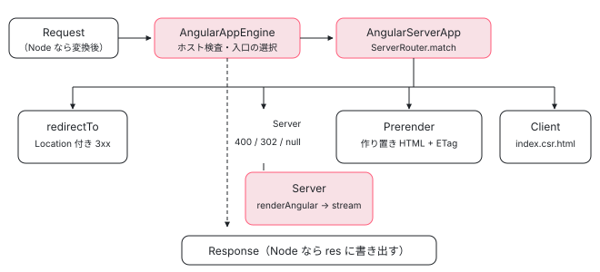

[目次](../README.md) › [SSR とハイドレーション](README.md) › 第 4 回 / 全 15 回

# AngularAppEngine と AngularServerApp：Request から Response まで

> @angular/ssr の AngularAppEngine.handle がホストを検査し、ロケールごとの入口を選んで AngularServerApp.handle に渡す行。ルート木で RenderMode を引き、Prerender のルートは作り置きの HTML を返し（無ければ本番では null）、Server のルートは renderAngular で描画し、Client のルートは index.csr.html を返す分岐。リダイレクトとステータス、重要 CSS のインライン化、プリロードのヒント、AngularNodeAppEngine が Node の req / res を Web の Request / Response に変える層。

angular/angular · 読了 約 14 分 · 発展 · [サイトで読む（デモが動きます）](https://angular-deep-dive-cyan.vercel.app/chapter/ssr-app-engine)

---

`@angular/ssr` のサーバー側の入口は `AngularAppEngine.handle(request)` の 1 つです。受け取るのは Web 標準の `Request`、返すのは `Response`（または「Angular の担当ではない」を表す `null`）。この章では、その間にある「ホストの検査 → 入口（ロケール）の選択 → `AngularServerApp.handle` → ルートの照合 → RenderMode ごとの分岐 → `renderAngular` → ヘッダーとステータスの組み立て」を 1 行ずつ追います。

読む対象は `packages/angular/ssr/src/app-engine.ts`、`app.ts`、`utils/ng.ts`、`utils/validation.ts`、`manifest.ts`、Node 用の層 `packages/angular/ssr/node/src/app-engine.ts`・`request.ts`・`response.ts` です（すべて angular-cli リポジトリ）。

1. [1. 概観](01-ssr-overview.md)
2. [2. renderApplication](02-ssr-render-application.md)
3. [3. platformServer と domino](03-ssr-platform-server.md)
4. **4. AngularAppEngine**（この章）
5. [5. サーバールート](05-ssr-server-routes.md)
6. [6. プリレンダー](06-ssr-prerender.md)
7. [7. provideClientHydration](07-hydration-provide.md)
8. [8. ngh の書き出し](08-hydration-annotate.md)
9. [9. ノードの道順](09-hydration.md)
10. [10. ノードの確保](10-hydration-claim.md)
11. [11. コンテナと片付け](11-hydration-containers.md)
12. [12. 不一致のエラー](12-hydration-errors.md)
13. [13. i18n](13-hydration-i18n.md)
14. [14. イベントの再生](14-event-replay.md)
15. [15. インクリメンタル](15-incremental-hydration.md)

## 0. 全体の流れ

先に道順を並べます。各ステップの行は、このあとの節で 1 つずつ引用します。

1. **Node の req → Web の Request（Node で動かすときだけ）**

   `AngularNodeAppEngine.handle` が `createWebRequestFromNodeRequest` で `IncomingMessage` を `Request` に作り直します（1 節）。
2. **ホストの検査**

   `AngularAppEngine.handle` が信用しないプロキシヘッダーを捨て、`Host` などを許可リストと照らします。外れたら 400 を返して終わり（2 節）。
3. **入口（ロケール）の選択**

   マニフェストの `entryPoints` から、URL のロケール部分に合う `main.server.mjs` を動的 import し、その中の `AngularServerApp` を取り出します（3 節）。
4. **ルート木で照合**

   `AngularServerApp.handle` が `ServerRouter.match` で URL を引き、`redirectTo`・`renderMode`・`status`・`headers` を得ます（4 節。木の作り方は第 5 回）。
5. **RenderMode で分岐**

   redirect なら Location 付きの応答、Prerender なら作り置きの HTML、Client なら `index.csr.html`、Server なら `renderAngular` で描画（5〜6 節）。
6. **Response を組み立てる**

   ステータスとヘッダーを付け、Server のときは本文をストリームで流します。Node ならそれを `writeResponseToNodeResponse` で `res` に書きます（8〜9 節）。



*AngularAppEngine は Web 標準の Request を受け、AngularServerApp に渡す。AngularServerApp はルート木で RenderMode を引いて 4 通りに分かれる。*

## 1. Node の req を Web の Request に：AngularNodeAppEngine

Express などの Node サーバーで使うのは `@angular/ssr/node` の `AngularNodeAppEngine` です。中身は薄い包み紙です。

📄 `angular-cli/packages/angular/ssr/node/src/app-engine.ts` L30–49 （▶ の行: 41–42, 45, 48）

```ts
30 │ export class AngularNodeAppEngine {
31 │   private readonly angularAppEngine: AngularAppEngine;
32 │   private readonly trustProxyHeaders?: boolean | readonly string[];
33 │ 
34 │   /**
35 │    * Creates a new instance of the Angular Node.js server application engine.
36 │    * @param options Options for the Angular Node.js server application engine.
37 │    */
38 │   constructor(options?: AngularNodeAppEngineOptions) {
39 │     const appEngineOptions: AngularAppEngineOptions = {
40 │       ...options,
41 ▶       allowedHosts: options?.allowedHosts ?? getAllowedHostsFromEnv(),
42 ▶       trustProxyHeaders: options?.trustProxyHeaders ?? getTrustProxyHeadersFromEnv(),
43 │     };
44 │ 
45 ▶     this.angularAppEngine = new AngularAppEngine(appEngineOptions);
46 │     this.trustProxyHeaders = appEngineOptions.trustProxyHeaders;
47 │ 
48 ▶     attachNodeGlobalErrorHandlers();
49 │   }
```

41〜42 行目、`allowedHosts` と `trustProxyHeaders` を省略すると環境変数（`NG_ALLOWED_HOSTS` など）から読みます。45 行目で本体の `AngularAppEngine` を 1 つ作って持ちます。48 行目はプロセス全体の未処理エラーのハンドラを付ける行です。

📄 `angular-cli/packages/angular/ssr/node/src/app-engine.ts` L78–88 （▶ の行: 83–85, 87）

```ts
78 │   async handle(
79 │     request: IncomingMessage | Http2ServerRequest | Request,
80 │     requestContext?: unknown,
81 │   ): Promise<Response | null> {
82 │     const webRequest =
83 ▶       request instanceof Request
84 ▶         ? request
85 ▶         : createWebRequestFromNodeRequest(request, this.trustProxyHeaders);
86 │ 
87 ▶     return this.angularAppEngine.handle(webRequest, requestContext);
88 │   }
```

83〜85 行目、すでに `Request` ならそのまま、Node の `IncomingMessage`／`Http2ServerRequest` なら変換します。87 行目で本体に渡すだけです。つまり**処理の中身は全部 Web 標準の型の上で書かれていて**、Node 専用なのはこの変換だけです。

📄 `angular-cli/packages/angular/ssr/node/src/request.ts` L50–75 （▶ の行: 56, 58, 63, 67, 71–72）

```ts
50 │ export function createWebRequestFromNodeRequest(
51 │   nodeRequest: IncomingMessage | Http2ServerRequest,
52 │   trustProxyHeaders?: boolean | readonly string[],
53 │ ): Request {
54 │   const trustProxyHeadersNormalized = normalizeTrustProxyHeaders(trustProxyHeaders);
55 │   const { headers, method = 'GET' } = nodeRequest;
56 ▶   const withBody = method !== 'GET' && method !== 'HEAD';
57 │   const referrer = headers.referer && URL.canParse(headers.referer) ? headers.referer : undefined;
58 ▶   const controller = new AbortController();
59 │   if (nodeRequest.aborted) {
60 │     controller.abort();
61 │   } else {
62 │     const onAbort = () => controller.abort();
63 ▶     nodeRequest.once('aborted', onAbort);
64 │     nodeRequest.once('close', () => nodeRequest.off('aborted', onAbort));
65 │   }
66 │ 
67 ▶   return new Request(createRequestUrl(nodeRequest, trustProxyHeadersNormalized), {
68 │     method,
69 │     signal: controller.signal,
70 │     headers: createRequestHeaders(headers),
71 ▶     body: withBody ? nodeRequest : undefined,
72 ▶     duplex: withBody ? 'half' : undefined,
73 │     referrer,
74 │   });
75 │ }
```

1. **56 行目：本文を持つかどうか**

   GET と HEAD 以外のときだけ本文を付けます。71 行目で Node のストリーム（`nodeRequest` 自体）をそのまま `body` に渡し、72 行目の `duplex: 'half'` は「本文をストリームで送る Request」に必要な指定です。
2. **58〜65 行目：接続が切れたら中断を伝える**

   `AbortController` を作り、Node 側の `'aborted'` イベントで `abort()` します。この `signal` は 4 節の `promiseWithAbort` まで届き、ブラウザが接続を切ったら描画待ちを打ち切ります。
3. **67 行目：URL を組み立てる**

   Node の `req.url` はパスだけなので、プロトコルとホストを足して完全な URL にします。それが次の `createRequestUrl` です。

📄 `angular-cli/packages/angular/ssr/node/src/request.ts` L127–153 （▶ の行: 130–133, 135, 137–138, 153）

```ts
127 │   const forwardedHeaderValue = getAllowedProxyHeaderValue(headers, 'forwarded', trustProxyHeaders);
128 │   const forwardedParams = parseForwardedHeader(forwardedHeaderValue);
129 │ 
130 ▶   const protocol =
131 ▶     forwardedParams.proto ??
132 ▶     getAllowedProxyHeaderValue(headers, 'x-forwarded-proto', trustProxyHeaders) ??
133 ▶     ('encrypted' in socket && socket.encrypted ? 'https' : 'http');
134 │ 
135 ▶   const hostname =
136 │     forwardedParams.host ??
137 ▶     getAllowedProxyHeaderValue(headers, 'x-forwarded-host', trustProxyHeaders) ??
138 ▶     headers.host ??
139 │     headers[':authority'];
140 │ 
141 │   if (Array.isArray(hostname)) {
142 │     throw new Error('host value cannot be an array.');
143 │   }
144 │ 
145 │   let hostnameWithPort = hostname;
146 │   if (!hostname?.includes(':')) {
147 │     const port = getAllowedProxyHeaderValue(headers, 'x-forwarded-port', trustProxyHeaders);
148 │     if (port) {
149 │       hostnameWithPort += `:${port}`;
150 │     }
151 │   }
152 │ 
153 ▶   return new URL(`${protocol}://${hostnameWithPort}${originalUrl ?? url}`);
```

130〜133 行目、プロトコルは `Forwarded` ヘッダーの proto → `X-Forwarded-Proto` → ソケットが TLS かどうか、の順で決めます。135〜139 行目、ホストも同じく `Forwarded` の host → `X-Forwarded-Host` → `Host` の順です。ただし `getAllowedProxyHeaderValue` は `trustProxyHeaders` で許した名前しか読みません。既定（`false`）ではプロキシヘッダーは無視され、`Host` だけが使われます。153 行目でそれらをつないだ URL が、以後 Angular がずっと使う `request.url` になります。

## 2. AngularAppEngine.handle：ホストの検査

📄 `angular-cli/packages/angular/ssr/src/app-engine.ts` L109–136 （▶ の行: 112, 119–120, 124, 126）

```ts
109 │   /**
110 │    * A cache that holds entry points, keyed by their potential locale string.
111 │    */
112 ▶   private readonly entryPointsCache = new Map<string, Promise<EntryPointExports>>();
113 │ 
114 │   /**
115 │    * Creates a new instance of the Angular server application engine.
116 │    * @param options Options for the Angular server application engine.
117 │    */
118 │   constructor(options?: AngularAppEngineOptions) {
119 ▶     this.allowedHosts = this.getAllowedHosts(options);
120 ▶     this.trustProxyHeaders = normalizeTrustProxyHeaders(options?.trustProxyHeaders);
121 │   }
122 │ 
123 │   private getAllowedHosts(options: AngularAppEngineOptions | undefined): ReadonlySet<string> {
124 ▶     const allowedHosts = new Set([...(options?.allowedHosts ?? []), ...this.manifest.allowedHosts]);
125 │ 
126 ▶     if (allowedHosts.has('*')) {
127 │       // eslint-disable-next-line no-console
128 │       console.warn(
129 │         'Allowing all hosts via "*" is a security risk. This configuration should only be used when ' +
130 │           'validation for "Host" and "X-Forwarded-Host" headers is performed in another layer, such as a load balancer or reverse proxy. ' +
131 │           'For more information see: https://angular.dev/best-practices/security#preventing-server-side-request-forgery-ssrf',
132 │       );
133 │     }
134 │ 
135 │     return allowedHosts;
136 │   }
```

119 行目で許可するホストの Set を作ります。124 行目のとおり、コンストラクタの `allowedHosts` と、ビルド時に `angular.json` の `security.allowedHosts` から書かれたマニフェストの `allowedHosts` を**合わせた**ものです。126 行目、`'*'` があると警告だけ出します（全部許可になる）。112 行目の `entryPointsCache` は 3 節で使います。

📄 `angular-cli/packages/angular/ssr/src/app-engine.ts` L161–182 （▶ の行: 163, 166, 168, 171, 173, 176, 178, 181）

```ts
161 │   async handle(request: Request, requestContext?: unknown): Promise<Response | null> {
162 │     const allowedHost = this.allowedHosts;
163 ▶     const securedRequest = sanitizeRequestHeaders(request, this.trustProxyHeaders);
164 │ 
165 │     try {
166 ▶       validateRequest(securedRequest, allowedHost, AngularAppEngine.ɵdisableAllowedHostsCheck);
167 │     } catch (error) {
168 ▶       return this.handleValidationError(securedRequest.url, error as Error);
169 │     }
170 │ 
171 ▶     const serverApp = await this.getAngularServerAppForRequest(securedRequest);
172 │     if (serverApp) {
173 ▶       return serverApp.handle(securedRequest, requestContext);
174 │     }
175 │ 
176 ▶     if (this.supportedLocales.length > 1) {
177 │       // Redirect to the preferred language if i18n is enabled.
178 ▶       return this.redirectBasedOnAcceptLanguage(securedRequest);
179 │     }
180 │ 
181 ▶     return null;
182 │   }
```

これが入口の全体です。163 行目でヘッダーを掃除し、166 行目で検査、失敗なら 168 行目で 400 を返します。171 行目で担当の `AngularServerApp` を探し、見つかれば 173 行目で丸ごと任せます。見つからず、ロケールが複数あれば 176〜178 行目で言語のリダイレクト（3 節の最後）、それも無ければ 181 行目で `null`。`null` は「Angular のページではない」という意味で、Express なら次のミドルウェア（静的ファイルなど）に回します。

📄 `angular-cli/packages/angular/ssr/src/utils/validation.ts` L97–124 （▶ の行: 106–107, 109, 113, 119–120）

```ts
 97 │ export function sanitizeRequestHeaders(
 98 │   request: Request,
 99 │   trustProxyHeaders: ReadonlySet<string>,
100 │ ): Request {
101 │   let headersDeleted = false;
102 │   const headers = new Headers();
103 │ 
104 │   for (const [key, value] of request.headers) {
105 │     const lowerKey = key.toLowerCase();
106 ▶     const isProxyHeader = lowerKey === 'forwarded' || lowerKey.startsWith('x-forwarded-');
107 ▶     if (isProxyHeader && !isProxyHeaderAllowed(lowerKey, trustProxyHeaders)) {
108 │       // eslint-disable-next-line no-console
109 ▶       console.warn(
110 │         `Received "${key}" header but "trustProxyHeaders" was not set up to allow it.\n` +
111 │           `For more information, see https://angular.dev/best-practices/security#configuring-trusted-proxy-headers`,
112 │       );
113 ▶       headersDeleted = true;
114 │     } else {
115 │       headers.set(key, value);
116 │     }
117 │   }
118 │ 
119 ▶   return headersDeleted
120 ▶     ? new Request(request, {
121 │         headers,
122 │       })
123 │     : request;
124 │ }
```

106 行目で `Forwarded` と `X-Forwarded-*` を見分け、107 行目で `trustProxyHeaders` に無いものは警告して**捨てます**。1 つでも捨てたら、119〜121 行目で残ったヘッダーだけの新しい `Request` を作ります。利用者が勝手に `X-Forwarded-Host: evil.example` を付けても、以後の処理（リダイレクト先の組み立てなど）には届きません。

📄 `angular-cli/packages/angular/ssr/src/utils/validation.ts` L63–87 （▶ の行: 68, 70–71, 84–85）

```ts
63 │ export function validateRequest(
64 │   request: Request,
65 │   allowedHosts: ReadonlySet<string>,
66 │   disableHostCheck: boolean,
67 │ ): void {
68 ▶   validateHeaders(request, allowedHosts, disableHostCheck);
69 │ 
70 ▶   if (!disableHostCheck) {
71 ▶     validateUrl(new URL(request.url), allowedHosts);
72 │   }
73 │ }
74 │ 
75 │ /**
76 │  * Validates that the hostname of a given URL is allowed.
77 │  *
78 │  * @param url - The URL object to validate.
79 │  * @param allowedHosts - A set of allowed hostnames.
80 │  * @throws Error if the hostname is not in the allowlist.
81 │  */
82 │ export function validateUrl(url: URL, allowedHosts: ReadonlySet<string>): void {
83 │   const { hostname } = url;
84 ▶   if (!isHostAllowed(hostname, allowedHosts)) {
85 ▶     throw new Error(`URL with hostname "${hostname}" is not allowed.`);
86 │   }
87 │ }
```

📄 `angular-cli/packages/angular/ssr/src/utils/validation.ts` L189–211 （▶ の行: 195–196, 198, 202, 206, 208）

```ts
189 │ function validateHeaders(
190 │   request: Request,
191 │   allowedHosts: ReadonlySet<string>,
192 │   disableHostCheck: boolean,
193 │ ): void {
194 │   const headers = request.headers;
195 ▶   for (const headerName of HOST_HEADERS_TO_VALIDATE) {
196 ▶     const headerValue = getFirstHeaderValue(headers.get(headerName));
197 │     if (headerValue && !disableHostCheck) {
198 ▶       verifyHostAllowed(headerName, headerValue, allowedHosts);
199 │     }
200 │   }
201 │ 
202 ▶   const forwarded = headers.get('forwarded');
203 │   if (forwarded) {
204 │     const forwardedParams = parseForwardedHeader(forwarded);
205 │     if (forwardedParams.host && !disableHostCheck) {
206 ▶       verifyHostAllowed('Forwarded "host"', forwardedParams.host, allowedHosts);
207 │     }
208 ▶     if (forwardedParams.proto && !VALID_PROTO_REGEX.test(forwardedParams.proto)) {
209 │       throw new Error('Header "forwarded" proto parameter must be either "http" or "https".');
210 │     }
211 │   }
```

68 行目で先にヘッダーを、71 行目で URL 自体のホスト名を調べます。195〜199 行目は `host` と `x-forwarded-host`（`HOST_HEADERS_TO_VALIDATE`）を、202〜206 行目は `Forwarded` の host を、同じ `verifyHostAllowed` にかけます。208 行目以降は proto やポートの形式検査で、こちらは `ɵdisableAllowedHostsCheck`（開発サーバーで使う）でも止まりません。

📄 `angular-cli/packages/angular/ssr/src/utils/validation.ts` L162–179 （▶ の行: 163, 168, 172–173）

```ts
162 │ function isHostAllowed(hostname: string, allowedHosts: ReadonlySet<string>): boolean {
163 ▶   if (allowedHosts.has('*') || allowedHosts.has(hostname)) {
164 │     return true;
165 │   }
166 │ 
167 │   for (const allowedHost of allowedHosts) {
168 ▶     if (!allowedHost.startsWith('*.')) {
169 │       continue;
170 │     }
171 │ 
172 ▶     const domain = allowedHost.slice(1);
173 ▶     if (hostname.endsWith(domain)) {
174 │       return true;
175 │     }
176 │   }
177 │ 
178 │   return false;
179 │ }
```

一致の規則はこれだけです。163 行目で `'*'` か完全一致、168〜173 行目で `'*.example.com'` の形なら `.example.com` で終わるか。これを守らせる理由は、サーバーで動く `HttpClient` が相対 URL を `request.url` のホストに対して解決するからです。偽の `Host` を通すと、サーバーが攻撃者の指定した先にリクエストを出せてしまいます（SSRF）。

## 3. 入口（ロケール）の選択と AngularServerApp の取り出し

エンジンが持つマニフェストの型から見ます。ビルドが `angular-app-engine-manifest.mjs` として書き出すものです。

📄 `angular-cli/packages/angular/ssr/src/manifest.ts` L55–82 （▶ の行: 62, 68, 76, 81）

```ts
55 │ export interface AngularAppEngineManifest {
56 │   /**
57 │    * A readonly record of entry points for the server application.
58 │    * Each entry consists of:
59 │    * - `key`: The url segment for the entry point.
60 │    * - `value`: A function that returns a promise resolving to an object of type `EntryPointExports`.
61 │    */
62 ▶   readonly entryPoints: Readonly<Record<string, (() => Promise<EntryPointExports>) | undefined>>;
63 │ 
64 │   /**
65 │    * The base path for the server application.
66 │    * This is used to determine the root path of the application.
67 │    */
68 ▶   readonly basePath: string;
69 │ 
70 │   /**
71 │    * A readonly record mapping supported locales to their respective entry-point paths.
72 │    * Each entry consists of:
73 │    * - `key`: The locale identifier (e.g., 'en', 'fr').
74 │    * - `value`: The url segment associated with that locale.
75 │    */
76 ▶   readonly supportedLocales: Readonly<Record<string, string>>;
77 │ 
78 │   /**
79 │    * A readonly array of allowed hostnames.
80 │    */
81 ▶   readonly allowedHosts: Readonly<string[]>;
82 │ }
```

62 行目の `entryPoints` は「URL の区切り（ロケールのサブパス）→ `main.server.mjs` を import する関数」の表です。i18n を使わないこのサイトのようなアプリでは、キーは空文字 `''` の 1 つだけです。

📄 `angular-cli/packages/angular/ssr/src/app-engine.ts` L263–302 （▶ の行: 264, 270, 275–276, 295–296, 299, 301）

```ts
263 │   private getEntryPointExports(potentialLocale: string): Promise<EntryPointExports> | undefined {
264 ▶     const cachedEntryPoint = this.entryPointsCache.get(potentialLocale);
265 │     if (cachedEntryPoint) {
266 │       return cachedEntryPoint;
267 │     }
268 │ 
269 │     const { entryPoints } = this.manifest;
270 ▶     const entryPoint = entryPoints[potentialLocale];
271 │     if (!entryPoint) {
272 │       return undefined;
273 │     }
274 │ 
275 ▶     const entryPointExports = entryPoint();
276 ▶     this.entryPointsCache.set(potentialLocale, entryPointExports);
277 │ 
278 │     return entryPointExports;
279 │   }
280 │ 
281 │   /**
282 │    * Retrieves the entry point for a given URL by determining the locale and mapping it to
283 │    * the appropriate application bundle.
284 │    *
285 │    * This method determines the appropriate entry point and locale for rendering the application by examining the URL.
286 │    * If there is only one entry point available, it is returned regardless of the URL.
287 │    * Otherwise, the method extracts a potential locale identifier from the URL and looks up the corresponding entry point.
288 │    *
289 │    * @param url - The URL of the request.
290 │    * @returns A promise that resolves to the entry point exports or `undefined` if not found.
291 │    */
292 │   private getEntryPointExportsForUrl(url: URL): Promise<EntryPointExports> | undefined {
293 │     const { basePath, supportedLocales } = this.manifest;
294 │ 
295 ▶     if (this.supportedLocales.length === 1) {
296 ▶       return this.getEntryPointExports(supportedLocales[this.supportedLocales[0]]);
297 │     }
298 │ 
299 ▶     const potentialLocale = getPotentialLocaleIdFromUrl(url, basePath);
300 │ 
301 ▶     return this.getEntryPointExports(potentialLocale) ?? this.getEntryPointExports('');
302 │   }
```

295〜296 行目、ロケールが 1 つなら URL を見ずにその入口を返します。複数なら 299 行目で URL の先頭のパス（`/fr/...` の `fr`）を取り出し、301 行目で一致するもの、無ければ `''` の入口を探します。275 行目の `entryPoint()` が動的 import で、276 行目で**その Promise をキャッシュ**します。サーバー用のバンドルを読み込むのは、ロケールごとに最初の 1 回だけです。

📄 `angular-cli/packages/angular/ssr/src/app-engine.ts` L236–255 （▶ の行: 239, 246–247, 249–251）

```ts
236 │   private async getAngularServerAppForRequest(request: Request): Promise<AngularServerApp | null> {
237 │     // Skip if the request looks like a file but not `/index.html`.
238 │     const url = new URL(request.url);
239 ▶     const entryPoint = await this.getEntryPointExportsForUrl(url);
240 │     if (!entryPoint) {
241 │       return null;
242 │     }
243 │ 
244 │     // Note: Using `instanceof` is not feasible here because `AngularServerApp` will
245 │     // be located in separate bundles, making `instanceof` checks unreliable.
246 ▶     const ɵgetOrCreateAngularServerApp =
247 ▶       entryPoint.ɵgetOrCreateAngularServerApp as typeof getOrCreateAngularServerApp;
248 │ 
249 ▶     const serverApp = ɵgetOrCreateAngularServerApp({
250 ▶       allowStaticRouteRender: AngularAppEngine.ɵallowStaticRouteRender,
251 ▶       hooks: AngularAppEngine.ɵhooks,
252 │     });
253 │ 
254 │     return serverApp;
255 │   }
```

📄 `angular-cli/packages/angular/ssr/src/app.ts` L454–469 （▶ の行: 454, 468）

```ts
454 ▶ let angularServerApp: AngularServerApp | undefined;
455 │ 
456 │ /**
457 │  * Retrieves or creates an instance of `AngularServerApp`.
458 │  * - If an instance of `AngularServerApp` already exists, it will return the existing one.
459 │  * - If no instance exists, it will create a new one with the provided options.
460 │  *
461 │  * @param options Optional configuration options for the server application.
462 │  *
463 │  * @returns The existing or newly created instance of `AngularServerApp`.
464 │  */
465 │ export function getOrCreateAngularServerApp(
466 │   options?: Readonly<AngularServerAppOptions>,
467 │ ): AngularServerApp {
468 ▶   return (angularServerApp ??= new AngularServerApp(options));
469 │ }
```

246〜247 行目、入口モジュールが export する `ɵgetOrCreateAngularServerApp` を呼びます。コメントのとおり、エンジンとアプリは別のバンドルにあるので `instanceof` は使えません。呼ばれる側は 454 行目のモジュール変数と 468 行目の `??=` で、**バンドルごとに 1 つ**の `AngularServerApp` を作って使い回します。250 行目の `ɵallowStaticRouteRender` は「Prerender のルートでもその場で描画してよいか」で、開発サーバーとプリレンダーのワーカーだけが `true` にします（第 6 回）。

📄 `angular-cli/packages/angular/ssr/src/app-engine.ts` L196–222 （▶ の行: 197, 203, 209, 213, 215, 217）

```ts
196 │     const { pathname } = new URL(request.url);
197 ▶     if (pathname !== basePath) {
198 │       return null;
199 │     }
200 │ 
201 │     // For requests to the base path (typically '/'), attempt to extract the preferred locale
202 │     // from the 'Accept-Language' header.
203 ▶     const preferredLocale = getPreferredLocale(
204 │       request.headers.get('Accept-Language') || '*',
205 │       this.supportedLocales,
206 │     );
207 │ 
208 │     if (preferredLocale) {
209 ▶       const subPath = supportedLocales[preferredLocale];
210 │       if (subPath !== undefined) {
211 │         const prefix = request.headers.get('X-Forwarded-Prefix') ?? '';
212 │ 
213 ▶         return createRedirectResponse(
214 │           joinUrlParts(prefix, pathname, subPath),
215 ▶           302,
216 │           // Use a 302 redirect as language preference may change.
217 ▶           { 'Vary': 'Accept-Language' },
218 │         );
219 │       }
220 │     }
221 │ 
222 │     return null;
```

i18n の補足です。入口が見つからなかったときに `handle` の 178 行目から呼ばれます。197 行目、ベースパス（多くは `/`）へのリクエストのときだけ、203 行目で `Accept-Language` から最適なロケールを選び、213〜218 行目で `/fr` などへ 302 で飛ばします。言語の好みは変わりうるので恒久的な 301 にはせず、217 行目の `Vary: Accept-Language` でキャッシュにも「ヘッダーごとに別物」と伝えます。

## 4. AngularServerApp.handle：ルートの照合

📄 `angular-cli/packages/angular/ssr/src/app.ts` L35–55 （▶ の行: 36–37, 52–54）

```ts
35 │ const WELL_KNOWN_NON_ANGULAR_URLS: ReadonlySet<string> = new Set<string>([
36 ▶   '/favicon.ico',
37 ▶   '/.well-known/appspecific/com.chrome.devtools.json',
38 │ ]);
39 │ 
40 │ /**
41 │  * A mapping of `RenderMode` enum values to corresponding string representations.
42 │  *
43 │  * This record is used to map each `RenderMode` to a specific string value that represents
44 │  * the server context. The string values are used internally to differentiate
45 │  * between various rendering strategies when processing routes.
46 │  *
47 │  * - `RenderMode.Prerender` maps to `'ssg'` (Static Site Generation).
48 │  * - `RenderMode.Server` maps to `'ssr'` (Server-Side Rendering).
49 │  * - `RenderMode.Client` maps to an empty string `''` (Client-Side Rendering, no server context needed).
50 │  */
51 │ const SERVER_CONTEXT_VALUE: Record<RenderMode, string> = {
52 ▶   [RenderMode.Prerender]: 'ssg',
53 ▶   [RenderMode.Server]: 'ssr',
54 ▶   [RenderMode.Client]: '',
55 │ };
```

先に定数を 2 つ。35〜38 行目は Angular が扱わない既知の URL（`/favicon.ico` と Chrome DevTools が勝手に取りに来るファイル）。51〜55 行目は RenderMode を `ng-server-context` 属性の値に写す表で、Prerender は `'ssg'`、Server は `'ssr'` です。この属性を `<app-root>` に書く行は [第 2 回](02-ssr-render-application.md)で読みます。

📄 `angular-cli/packages/angular/ssr/src/app.ts` L152–191 （▶ の行: 154, 158–159, 161, 166, 168, 171–172, 179–180, 186, 188）

```ts
152 │   async handle(request: Request, requestContext?: unknown): Promise<Response | null> {
153 │     const url = new URL(request.url);
154 ▶     if (WELL_KNOWN_NON_ANGULAR_URLS.has(url.pathname)) {
155 │       return null;
156 │     }
157 │ 
158 ▶     this.router ??= await ServerRouter.from(this.manifest, url);
159 ▶     const matchedRoute = this.router.match(url);
160 │ 
161 ▶     if (!matchedRoute) {
162 │       // Not a known Angular route.
163 │       return null;
164 │     }
165 │ 
166 ▶     const { redirectTo, status, renderMode, headers } = matchedRoute;
167 │ 
168 ▶     if (redirectTo !== undefined) {
169 │       return createRedirectResponse(
170 │         joinUrlParts(
171 ▶           request.headers.get('X-Forwarded-Prefix') ?? '',
172 ▶           buildPathWithParams(redirectTo, url.pathname),
173 │         ),
174 │         status,
175 │         headers,
176 │       );
177 │     }
178 │ 
179 ▶     if (renderMode === RenderMode.Prerender) {
180 ▶       const response = await this.handleServe(request, matchedRoute);
181 │       if (response) {
182 │         return response;
183 │       }
184 │     }
185 │ 
186 ▶     return promiseWithAbort(
187 │       this.handleRendering(request, matchedRoute, requestContext),
188 ▶       request.signal,
189 │       `Request for: ${request.url}`,
190 │     );
191 │   }
```

1. **154 行目：既知の非 Angular URL なら null**

   ここで弾くので、`/favicon.ico` のためにアプリを起動することはありません。
2. **158〜159 行目：ルート木を用意して照合**

   `ServerRouter.from` はマニフェストにビルド時のルート木があればそれを使い、無ければアプリを起動して取り出します。`??=` なので 1 つの `AngularServerApp` で 1 回だけです。木の作り方と `match` の規則は [第 5 回](05-ssr-server-routes.md)で読みます。
3. **161〜163 行目：当たらなければ null**

   Angular のルートに無い URL です。Router 側に `**` があれば、ここで null になることはありません。
4. **168〜176 行目：redirectTo があれば描画せずに 3xx**

   172 行目の `buildPathWithParams` は、ビルド時に `:id` を `*` に置き換えて保存したリダイレクト先（第 5 回の `resolveRedirectTo`）の `*` を、実際の URL の同じ位置の区切りで埋めます。171 行目でプロキシのパス接頭辞（`X-Forwarded-Prefix`）を前に付けます。ステータスは 174 行目のとおりルートの `status`（無ければ 302）。
5. **179〜184 行目：Prerender なら作り置きを探す**

   見つかればそれで終わり。見つからなければ下へ落ちます（5 節）。
6. **186〜190 行目：描画。ただし接続が切れたら打ち切る**

   `promiseWithAbort` は 188 行目の `request.signal` が abort したら `AbortError` で reject する Promise で包みます。1 節の 58〜65 行目がこの signal の出どころです。

## 5. Prerender：作り置きの HTML を返す

📄 `angular-cli/packages/angular/ssr/src/app.ts` L202–240 （▶ の行: 212, 216, 222, 226–227, 229–230, 233–235, 237）

```ts
202 │   private async handleServe(
203 │     request: Request,
204 │     matchedRoute: RouteTreeNodeMetadata,
205 │   ): Promise<Response | null> {
206 │     const { headers, renderMode } = matchedRoute;
207 │     if (renderMode !== RenderMode.Prerender) {
208 │       return null;
209 │     }
210 │ 
211 │     const { method } = request;
212 ▶     if (method !== 'GET' && method !== 'HEAD') {
213 │       return null;
214 │     }
215 │ 
216 ▶     const assetPath = this.buildServerAssetPathFromRequest(request);
217 │     const {
218 │       manifest: { locale },
219 │       assets,
220 │     } = this;
221 │ 
222 ▶     if (!assets.hasServerAsset(assetPath)) {
223 │       return null;
224 │     }
225 │ 
226 ▶     const { text, hash, size } = assets.getServerAsset(assetPath);
227 ▶     const etag = `"${hash}"`;
228 │ 
229 ▶     return request.headers.get('if-none-match') === etag
230 ▶       ? new Response(undefined, { status: 304, statusText: 'Not Modified' })
231 │       : new Response(await text(), {
232 │           headers: {
233 ▶             'Content-Length': size.toString(),
234 ▶             'ETag': etag,
235 ▶             'Content-Type': 'text/html;charset=UTF-8',
236 │             ...(locale !== undefined ? { 'Content-Language': locale } : {}),
237 ▶             ...headers,
238 │           },
239 │         });
240 │   }
```

212 行目、GET と HEAD だけです。POST はこの関数を素通りして描画側へ行きます。216 行目で URL をファイル名にし、222 行目でサーバーのアセット（ビルドが `angular-app-manifest.mjs` の `assets` に入れたもの。第 6 回）にあるか確かめます。226〜227 行目でビルド時のハッシュを ETag にし、229〜230 行目、ブラウザの `If-None-Match` と同じなら本文なしの 304。違えば 233〜237 行目のヘッダーで HTML を返します。237 行目の `...headers` がサーバールートに書いた `headers` です。

📄 `angular-cli/packages/angular/ssr/src/app.ts` L405–427 （▶ の行: 408, 413, 415, 421, 423, 426）

```ts
405 │   private buildServerAssetPathFromRequest(request: Request): string {
406 │     let { pathname: assetPath } = new URL(request.url);
407 │     try {
408 ▶       assetPath = decodeURIComponent(assetPath);
409 │     } catch {
410 │       // In case of malformed URI component, keep assetPath as is.
411 │     }
412 │ 
413 ▶     if (!assetPath.endsWith('/index.html')) {
414 │       // Append "index.html" to build the default asset path.
415 ▶       assetPath = joinUrlParts(assetPath, 'index.html');
416 │     }
417 │ 
418 │     const { baseHref } = this.manifest;
419 │ 
420 │     // Check if the asset path starts with the base href and the base href is not (`/` or ``).
421 ▶     if (baseHref.length > 1 && assetPath.startsWith(baseHref)) {
422 │       // Remove the base href from the start of the asset path to align with server-asset expectations.
423 ▶       assetPath = assetPath.slice(baseHref.length);
424 │     }
425 │ 
426 ▶     return stripLeadingSlash(assetPath);
427 │   }
```

413〜416 行目で `/chapter/router` を `/chapter/router/index.html` にし、421〜424 行目で `baseHref` を外し、426 行目で先頭の `/` を落とします。結果の `chapter/router/index.html` は、プリレンダーが書き出すファイルの置き場所（第 6 回の `getRouteOutPath`）と同じ形です。

> [!NOTE]
> **ポイント**
>
> このサイトは `outputMode: "static"` なので、本番（Vercel）では `AngularServerApp` は動いていません。Vercel が `dist/angular-deep-dive/browser/chapter/router/index.html` をそのまま配ります。`handleServe` がやっていること（URL → `index.html` のファイル → ETag 付きで返す）を、静的ホスティングが代わりにしている、と読めます。

## 6. handleRendering：Server と Client と、作り置きが無い Prerender

📄 `angular-cli/packages/angular/ssr/src/app.ts` L257–279 （▶ の行: 259–260, 272–273, 275, 277）

```ts
257 │     const { renderMode, headers, status, preload } = matchedRoute;
258 │ 
259 ▶     if (!this.allowStaticRouteRender && renderMode === RenderMode.Prerender) {
260 ▶       return null;
261 │     }
262 │ 
263 │     const url = new URL(request.url);
264 │     const platformProviders: StaticProvider[] = [];
265 │ 
266 │     const {
267 │       manifest: { bootstrap, locale },
268 │       assets,
269 │     } = this;
270 │ 
271 │     // Initialize the response with status and headers if available.
272 ▶     const responseInit = {
273 ▶       status,
274 │       headers: new Headers({
275 ▶         'Content-Type': 'text/html;charset=UTF-8',
276 │         ...(locale !== undefined ? { 'Content-Language': locale } : {}),
277 ▶         ...headers,
278 │       }),
279 │     };
```

259〜261 行目が大事です。**本番のサーバーでは、作り置きが見つからない Prerender のルートを描画しません**（`null` を返す）。その場で描くのは `allowStaticRouteRender` が真のとき、つまり開発サーバーとプリレンダーのワーカーだけです。272〜279 行目の `responseInit` は、あとで `new Response` に渡す「ステータスとヘッダー」の入れ物です。

📄 `angular-cli/packages/angular/ssr/src/app.ts` L281–303 （▶ の行: 281, 285, 289, 293–294, 297, 299–300, 302）

```ts
281 ▶     if (renderMode === RenderMode.Server) {
282 │       // Configure platform providers for request and response only for SSR.
283 │       platformProviders.push(
284 │         {
285 ▶           provide: REQUEST,
286 │           useValue: request,
287 │         },
288 │         {
289 ▶           provide: REQUEST_CONTEXT,
290 │           useValue: requestContext,
291 │         },
292 │         {
293 ▶           provide: RESPONSE_INIT,
294 ▶           useValue: responseInit,
295 │         },
296 │       );
297 ▶     } else if (renderMode === RenderMode.Client) {
298 │       // Serve the client-side rendered version if the route is configured for CSR.
299 ▶       let html = await this.assets.getServerAsset('index.csr.html').text();
300 ▶       html = await this.runTransformsOnHtml(html, url, preload);
301 │ 
302 ▶       return new Response(html, responseInit);
303 │     }
```

1. **281〜296 行目：Server のときだけ REQUEST 系のトークンを入れる**

   `REQUEST`（いま処理中の `Request`）・`REQUEST_CONTEXT`（`handle` の第 2 引数）・`RESPONSE_INIT` を**プラットフォームのプロバイダ**に積みます。プリレンダーではリクエストが実在しないので入れません。だからコンポーネントで `inject(REQUEST)` すると、Prerender のルートでは `null` です。294 行目は `responseInit` の**同じオブジェクト**を渡しているので、描画中にコンポーネントが `inject(RESPONSE_INIT).status = 404` と書けば、そのまま応答のステータスになります（Response を作るのは描画が終わったあと）。
2. **297〜302 行目：Client なら Angular を起動しない**

   299 行目で `index.csr.html`（ビルドが作る、中身が空の `<app-root>` の HTML）を読み、300 行目で 9 節の加工だけして 302 行目で返します。この HTML の `<body>` には `ngcm` 属性が付いていて、ブラウザ側のハイドレーションを止めます（[第 7 回](07-hydration-provide.md)）。

📄 `angular-cli/packages/angular/ssr/src/app.ts` L305–337 （▶ の行: 305, 307, 312–314, 316, 321, 324–325, 328–329, 332–334, 336）

```ts
305 ▶     if (locale !== undefined) {
306 │       platformProviders.push({
307 ▶         provide: LOCALE_ID,
308 │         useValue: locale,
309 │       });
310 │     }
311 │ 
312 ▶     this.boostrap ??= await bootstrap();
313 ▶     let html = await assets.getIndexServerHtml().text();
314 ▶     html = await this.runTransformsOnHtml(html, url, preload);
315 │ 
316 ▶     const result = await renderAngular(
317 │       html,
318 │       this.boostrap,
319 │       url,
320 │       platformProviders,
321 ▶       SERVER_CONTEXT_VALUE[renderMode],
322 │     );
323 │ 
324 ▶     if (result.hasNavigationError) {
325 ▶       return null;
326 │     }
327 │ 
328 ▶     if (result.redirectTo) {
329 ▶       return createRedirectResponse(result.redirectTo, responseInit.status, responseInit.headers);
330 │     }
331 │ 
332 ▶     if (renderMode === RenderMode.Prerender) {
333 ▶       const renderedHtml = await result.content();
334 ▶       const finalHtml = this.inlineCriticalCss(renderedHtml);
335 │ 
336 ▶       return new Response(finalHtml, responseInit);
337 │     }
```

305〜310 行目、ロケール別のバンドルなら `LOCALE_ID` を足します。312 行目でマニフェストの `bootstrap()`（`main.server.mjs` の default export を返す関数）を**最初の 1 回だけ**呼んで覚えます。313 行目の土台の HTML は `index.server.html`（`index.csr.html` とは別物。イベント記録用スクリプトなどが入ったサーバー用）で、314 行目で加工します。316〜322 行目で描画。321 行目で 51〜55 行目の表を引いて `'ssg'` か `'ssr'` を渡します。

戻り値で 3 通りに分かれます。324〜326 行目、ナビゲーションが失敗したら `null`。328〜330 行目、ガードなどで **別の URL に着地した**ら、その URL への 3xx（ステータスは `responseInit.status`、無ければ 302）。332〜336 行目、Prerender（開発サーバーかプリレンダー中）なら HTML を最後まで作り、重要 CSS を入れてから 1 つの文字列で返します。

## 7. renderAngular：1 リクエストに 1 つのプラットフォーム

📄 `angular-cli/packages/angular/ssr/src/utils/ng.ts` L69–107 （▶ の行: 70–71, 73, 75–76, 80–81, 85, 91, 95, 99, 103, 107）

```ts
 69 │   // A request to `http://www.example.com/page/index.html` will render the Angular route corresponding to `http://www.example.com/page`.
 70 ▶   const urlToRender = stripIndexHtmlFromURL(url);
 71 ▶   const platformRef = platformServer([
 72 │     {
 73 ▶       provide: INITIAL_CONFIG,
 74 │       useValue: {
 75 ▶         url: urlToRender.href,
 76 ▶         document: html,
 77 │       },
 78 │     },
 79 │     {
 80 ▶       provide: SERVER_CONTEXT,
 81 ▶       useValue: serverContext,
 82 │     },
 83 │     {
 84 │       // An Angular Console Provider that does not print a set of predefined logs.
 85 ▶       provide: ɵConsole,
 86 │       // Using `useClass` would necessitate decorating `Console` with `@Injectable`,
 87 │       // which would require switching from `ts_library` to `ng_module`. This change
 88 │       // would also necessitate various patches of `@angular/bazel` to support ESM.
 89 │       useFactory: () => new Console(),
 90 │     },
 91 ▶     ...platformProviders,
 92 │   ]);
 93 │ 
 94 │   let redirectTo: string | undefined;
 95 ▶   let hasNavigationError = true;
 96 │ 
 97 │   try {
 98 │     let applicationRef: ApplicationRef;
 99 ▶     if (isNgModule(bootstrap)) {
100 │       const moduleRef = await platformRef.bootstrapModule(bootstrap);
101 │       applicationRef = moduleRef.injector.get(ApplicationRef);
102 │     } else {
103 ▶       applicationRef = await bootstrap({ platformRef });
104 │     }
105 │ 
106 │     // Block until application is stable.
107 ▶     await applicationRef.whenStable();
```

1. **70〜92 行目：platformServer を作る**

   70 行目で末尾の `/index.html` を外した URL を、73〜77 行目の `INITIAL_CONFIG` に `url` と `document`（土台の HTML 文字列）として入れます。80〜81 行目の `SERVER_CONTEXT`、85 行目の `ɵConsole`（決まったログを出さない Console）、91 行目で 6 節の `REQUEST` などを足します。`platformServer` と `INITIAL_CONFIG` が何をするかは [第 3 回](03-ssr-platform-server.md)です。
2. **95 行目：最初は「失敗」にしておく**

   `hasNavigationError = true` から始め、成功が確かめられたときだけ `false` にします。
3. **99〜104 行目：起動**

   NgModule なら `bootstrapModule`、関数なら 103 行目で `bootstrap({ platformRef })`。後者は `src/main.server.ts` の `(context) => bootstrapApplication(App, config, context)` そのものです。
4. **107 行目：安定を待つ**

   `whenStable()` は保留中のタスク（HTTP、初回ナビゲーションなど）が無くなるまで待ちます（[PendingTasks の章](../zoneless/09-zoneless-pending-tasks.md)）。

📄 `angular-cli/packages/angular/ssr/src/utils/ng.ts` L109–138 （▶ の行: 112–113, 118, 120, 122–125, 132–133, 135–136）

```ts
109 │     // This code protect against app destruction during bootstrapping which is a
110 │     // valid case. We should not assume the `applicationRef` is not in destroyed state.
111 │     // Calling `envInjector.get` would throw `NG0205: Injector has already been destroyed`.
112 ▶     if (applicationRef.destroyed) {
113 ▶       return { hasNavigationError: true };
114 │     }
115 │ 
116 │     // TODO(alanagius): Find a way to avoid rendering here especially for redirects as any output will be discarded.
117 │     const envInjector = applicationRef.injector;
118 ▶     const routerIsProvided = !!envInjector.get(ActivatedRoute, null);
119 │     const router = envInjector.get(Router);
120 ▶     const lastSuccessfulNavigation = router.lastSuccessfulNavigation();
121 │ 
122 ▶     if (!routerIsProvided) {
123 ▶       hasNavigationError = false;
124 ▶     } else if (lastSuccessfulNavigation?.finalUrl) {
125 ▶       hasNavigationError = false;
126 │ 
127 │       const requestPrefix =
128 │         envInjector.get(APP_BASE_HREF, null, { optional: true }) ??
129 │         envInjector.get(REQUEST, null, { optional: true })?.headers.get('X-Forwarded-Prefix');
130 │ 
131 │       const { pathname, search, hash } = envInjector.get(PlatformLocation);
132 ▶       const finalUrl = constructSerializedUrl(router, { pathname, search, hash }, requestPrefix);
133 ▶       const urlToRenderString = constructSerializedUrl(router, urlToRender, requestPrefix);
134 │ 
135 ▶       if (urlToRenderString !== finalUrl) {
136 ▶         redirectTo = [pathname, search, hash].join('');
137 │       }
138 │     }
```

112〜114 行目、起動中にアプリが破棄されていたら失敗扱い。118 行目、`ActivatedRoute` が取れなければ Router を使わないアプリなので、122〜123 行目で無条件に成功です。120 行目の `lastSuccessfulNavigation()` に `finalUrl` があれば成功（124〜125 行目）。132〜133 行目で「着地した URL」と「頼まれた URL」を Router の規則で同じ形に直して比べ、違えば 136 行目で `redirectTo` にします。6 節の 328 行目はこれを受けています。

📄 `angular-cli/packages/angular/ssr/src/utils/ng.ts` L140–163 （▶ の行: 141, 144, 147–148, 151, 156, 160–161）

```ts
140 │     return {
141 ▶       destroy: () => void asyncDestroyPlatform(platformRef),
142 │       hasNavigationError,
143 │       redirectTo,
144 ▶       content: () =>
145 │         new Promise<string>((resolve, reject) => {
146 │           // Defer rendering to the next event loop iteration to avoid blocking, as most operations in `renderInternal` are synchronous.
147 ▶           setTimeout(() => {
148 ▶             renderInternal(platformRef, applicationRef)
149 │               .then(resolve)
150 │               .catch(reject)
151 ▶               .finally(() => void asyncDestroyPlatform(platformRef));
152 │           }, 0);
153 │         }),
154 │     };
155 │   } catch (error) {
156 ▶     await asyncDestroyPlatform(platformRef);
157 │ 
158 │     throw error;
159 │   } finally {
160 ▶     if (hasNavigationError || redirectTo) {
161 ▶       void asyncDestroyPlatform(platformRef);
162 │     }
163 │   }
```

返すのは HTML そのものではなく、144 行目の `content()` という関数です。呼ばれたら 147 行目の `setTimeout` で次のタスクに回してから、148 行目で platform-server の `renderInternal`（ハイドレーション用の注釈と HTML への直列化。[第 2 回](02-ssr-render-application.md)）を走らせ、151 行目で必ずプラットフォームを破棄します。160〜162 行目、失敗やリダイレクトで HTML が要らないときは `content()` を待たずに破棄します。こうして「ステータスとヘッダーを決める」と「HTML を作る」を分けたので、次の節でヘッダーを先に送れます。

## 8. 応答の本文：ストリームと重要 CSS とプリロード

📄 `angular-cli/packages/angular/ssr/src/app.ts` L339–357 （▶ の行: 340, 343–345, 348, 352–353, 357）

```ts
339 │     // Use a stream to send the response before finishing rendering and inling critical CSS, improving performance via header flushing.
340 ▶     const stream = new ReadableStream({
341 │       start: async (controller) => {
342 │         try {
343 ▶           let renderedHtml = await result.content();
344 ▶           renderedHtml = this.inlineCriticalCss(renderedHtml);
345 ▶           controller.enqueue(this.textEncoder.encode(renderedHtml));
346 │           controller.close();
347 │         } catch (error) {
348 ▶           result.destroy();
349 │           controller.error(error);
350 │         }
351 │       },
352 ▶       cancel: () => {
353 ▶         result.destroy();
354 │       },
355 │     });
356 │ 
357 ▶     return new Response(stream, responseInit);
```

Server のルートは 357 行目で `ReadableStream` を本文にした `Response` を**すぐ**返します。この時点でステータスとヘッダーは確定していて、Node ならすぐ送られます。本文は 343〜345 行目、`content()` の完了を待ってから 1 回で流します。348 行目は失敗時、352〜354 行目はクライアントが読むのをやめた時で、どちらも `destroy()` でプラットフォームを片付けます。

📄 `angular-cli/packages/angular/ssr/src/app.ts` L366–393 （▶ の行: 367–368, 373–374, 379, 386, 389, 391）

```ts
366 │   private inlineCriticalCss(html: string): string {
367 ▶     const { criticalCssPlans, nonce } = this.manifest;
368 ▶     if (!criticalCssPlans?.length) {
369 │       return html;
370 │     }
371 │ 
372 │     try {
373 ▶       this.inlineCriticalCssProcessor ??= createProcessor([...criticalCssPlans], {
374 ▶         preload: 'media-script',
375 │         nonce,
376 │         preloadFonts: true,
377 │         inlineFonts: true,
378 │         noscriptFallback: true,
379 ▶         cache: true,
380 │         logger: {
381 │           // eslint-disable-next-line no-console
382 │           warn: console.warn,
383 │         },
384 │       }).process;
385 │ 
386 ▶       return this.inlineCriticalCssProcessor(html);
387 │     } catch (error) {
388 │       // eslint-disable-next-line no-console
389 ▶       console.error('An error occurred while inlining critical CSS.', error);
390 │ 
391 ▶       return html;
392 │     }
393 │   }
```

重要 CSS のインライン化（画面の最初に見える部分に効くルールだけを `<style>` に入れ、残りは後から読む）です。367〜370 行目、ビルドが作った `criticalCssPlans`（CSS を事前に解析した結果）が無ければ何もしません。373 行目、`beasties/runtime` の処理関数を 1 回だけ作って使い回し、389〜391 行目、失敗しても元の HTML を返して応答は止めません。

📄 `angular-cli/packages/angular/ssr/src/app.ts` L437–451 （▶ の行: 442–443, 446–447）

```ts
437 │   private async runTransformsOnHtml(
438 │     html: string,
439 │     url: URL,
440 │     preload: readonly string[] | undefined,
441 │   ): Promise<string> {
442 ▶     if (this.hooks.has('html:transform:pre')) {
443 ▶       html = await this.hooks.run('html:transform:pre', { html, url });
444 │     }
445 │ 
446 ▶     if (preload?.length) {
447 ▶       html = appendPreloadHintsToHtml(html, preload);
448 │     }
449 │ 
450 │     return html;
451 │   }
```

📄 `angular-cli/packages/angular/ssr/src/app.ts` L500–514 （▶ の行: 501, 509–512）

```ts
500 │ function appendPreloadHintsToHtml(html: string, preload: readonly string[]): string {
501 ▶   const bodyCloseIdx = html.lastIndexOf('</body>');
502 │   if (bodyCloseIdx === -1) {
503 │     return html;
504 │   }
505 │ 
506 │   // Note: Module preloads should be placed at the end before the closing body tag to avoid a performance penalty.
507 │   // Placing them earlier can cause the browser to prioritize downloading these modules
508 │   // over other critical page resources like images, CSS, and fonts.
509 ▶   return [
510 ▶     html.slice(0, bodyCloseIdx),
511 ▶     ...preload.map((val) => `<link rel="modulepreload" href="${val}">`),
512 ▶     html.slice(bodyCloseIdx),
513 │   ].join('\n');
514 │ }
```

描画の**前**に土台の HTML へ入れる加工です。442〜444 行目は開発サーバーが登録するフック（Vite のスクリプト注入など）。446〜447 行目、照合したルートに `preload`（そのルートの遅延チャンクの一覧。第 5 回）があれば、501 行目で最後の `</body>` を探し、511 行目で `<link rel="modulepreload">` を差し込みます。下のデモで、このページの HTML の `modulepreload` の数を数えられます。ページごとに違う数になるのはこのためです。

## 9. Response を Node の res に書き戻す

📄 `angular-cli/packages/angular/ssr/node/src/response.ts` L39–76 （▶ の行: 48, 51–52, 59, 62, 66–67, 70, 72）

```ts
39 │ export async function writeResponseToNodeResponse(
40 │   source: Response,
41 │   destination: ServerResponse | Http2ServerResponse,
42 │ ): Promise<void> {
43 │   if (isResponseDestroyedOrClosed(destination)) {
44 │     return;
45 │   }
46 │ 
47 │   const { status, headers, body } = source;
48 ▶   destination.statusCode = status;
49 │ 
50 │   let cookieHeaderSet = false;
51 ▶   for (const [name, value] of headers.entries()) {
52 ▶     if (name === 'set-cookie') {
53 │       if (cookieHeaderSet) {
54 │         continue;
55 │       }
56 │ 
57 │       // Sets the 'set-cookie' header only once to ensure it is correctly applied.
58 │       // Concatenating 'set-cookie' values can lead to incorrect behavior, so we use a single value from `headers.getSetCookie()`.
59 ▶       destination.setHeader(name, headers.getSetCookie());
60 │       cookieHeaderSet = true;
61 │     } else {
62 ▶       destination.setHeader(name, value);
63 │     }
64 │   }
65 │ 
66 ▶   if ('flushHeaders' in destination) {
67 ▶     destination.flushHeaders();
68 │   }
69 │ 
70 ▶   if (!body) {
71 │     if (!isResponseDestroyedOrClosed(destination)) {
72 ▶       destination.end();
73 │     }
74 │ 
75 │     return;
76 │   }
```

48 行目でステータス、51〜64 行目でヘッダーを写します。`Set-Cookie` だけは 1 つの文字列につなぐと壊れるので、59 行目で `getSetCookie()` の配列のまま 1 回だけ設定します。66〜67 行目でヘッダーを先に送り（8 節のストリームが生きる所）、70〜76 行目、本文が無ければ（304 やリダイレクト）ここで終わり。あとは本文のストリームを読みながら `res.write` し、詰まったら `'drain'` を待ちます。

## RenderMode ごとに handle が返すもの

| 照合の結果 | 通る行 | Angular を起動するか | 返るもの |
| --- | --- | --- | --- |
| 当たらない／`/favicon.ico` | app.ts 154, 161 | しない | `null`（次のミドルウェアへ） |
| `redirectTo` あり | app.ts 168〜176 | しない | Location 付き 3xx（既定 302） |
| Prerender（作り置きあり、GET/HEAD） | app.ts 179〜183, 226〜239 | しない | HTML + ETag + Content-Length。一致すれば 304 |
| Prerender（作り置きなし） | app.ts 259〜261 | 本番はしない | `null`。開発サーバーとプリレンダー中だけ 332〜336 で描画して文字列の本文 |
| Client | app.ts 297〜302 | しない | `index.csr.html`（`ngcm` 付き） |
| Server | app.ts 281〜296, 316〜357 | 毎回する | 先にヘッダー、本文はストリーム。`ng-server-context="ssr"` |
| Server で別 URL に着地 | ng.ts 135〜136, app.ts 328〜330 | する（HTML は捨てる） | 着地先への 3xx |

> **🧪 DEMO — このサイトが実際に返すファイルを取りに行く**
>
> 同じオリジンの HTML を fetch して、ヘッダーと中身の印を数えます。本番では静的ホスティングが返しますが、中身は Prerender のルート（作り置き）と Client のルート（`index.csr.html`）がそれぞれ返すものと同じです。
>
> ▶ [このデモはサイトで動かせます](https://angular-deep-dive-cyan.vercel.app/chapter/ssr-app-engine)

「このページ」は `ng-server-context` が `ssg`（51〜55 行目の Prerender の値）で、`ngh` と `ng-state` があり、`modulepreload` が何本か付いています。`/index.csr.html` は `ngcm` 付きで、`ngh` も `ng-state` もありません。Client のルートで 299 行目が返すのはこの中身です。

## 呼び出しの連なり（Server のルート）

- 👤 `app.use((req, res, next) => engine.handle(req).then(...))` — src/server.ts（利用者）
  - `AngularNodeAppEngine.handle(req)` — ssr/node/src/app-engine.ts L78
    - `createWebRequestFromNodeRequest(req)` — ssr/node/src/request.ts L50 — *URL・ヘッダー・本文・abort signal*
    - `AngularAppEngine.handle(request)` — ssr/src/app-engine.ts L161
      - `sanitizeRequestHeaders / validateRequest` — ssr/src/utils/validation.ts L97, L63 — *外れたら 400*
      - `getAngularServerAppForRequest → getEntryPointExportsForUrl` — app-engine.ts L236, L292 — *main.server.mjs を動的 import（キャッシュ）*
      - `AngularServerApp.handle(request)` — ssr/src/app.ts L152
        - `ServerRouter.from(...).match(url)` — ssr/src/routes/router.ts — *第 5 回*
        - `handleRendering(request, matchedRoute)` — app.ts L252 — *REQUEST / RESPONSE\_INIT を積む*
          - `renderAngular(html, bootstrap, url, providers, 'ssr')` — ssr/src/utils/ng.ts L54
            - `platformServer([INITIAL_CONFIG, SERVER_CONTEXT, ...])` — platform-server — *第 3 回*
            - `bootstrap({ platformRef }) → whenStable()` — src/main.server.ts
          - `new Response(ReadableStream, responseInit)` — app.ts L357 — *本文は content() → renderInternal（第 2 回）*
  - `writeResponseToNodeResponse(response, res)` — ssr/node/src/response.ts L39

## 聞かれそうな質問

**Q. Express が無くても動きますか？**

動きます。`AngularAppEngine.handle`（161 行目）の引数は Web 標準の `Request`、戻り値は `Response` で、Node の型は出てきません。Node 用の `AngularNodeAppEngine` は 83〜85 行目の変換を足しただけの層です。`Request`／`Response` を扱える実行環境（Cloudflare Workers、Deno、Bun など）なら本体を直接呼べます。Express は `req`／`res` を渡す土台として使っているだけです。

**Q. CommonEngine とは何が違いますか？**

📄 `angular-cli/packages/angular/ssr/node/src/common-engine/common-engine.ts` L187–217 （▶ の行: 194, 208, 211–212, 216）

```ts
187 │   private async renderApplication(opts: CommonEngineRenderOptions): Promise<string> {
188 │     const moduleOrFactory = this.options?.bootstrap ?? opts.bootstrap;
189 │     if (!moduleOrFactory) {
190 │       throw new Error('A module or bootstrap option must be provided.');
191 │     }
192 │ 
193 │     const extraProviders: StaticProvider[] = [
194 ▶       { provide: ɵSERVER_CONTEXT, useValue: 'ssr' },
195 │       ...(opts.providers ?? []),
196 │       ...(this.options?.providers ?? []),
197 │     ];
198 │ 
199 │     let document = opts.document;
200 │     if (!document && opts.documentFilePath) {
201 │       document = await this.getDocument(opts.documentFilePath);
202 │     }
203 │ 
204 │     const commonRenderingOptions = {
205 │       url: opts.url,
206 │       document,
207 │       // Validation is already happened in the render method.
208 ▶       allowedHosts: ['*'],
209 │     };
210 │ 
211 ▶     return isBootstrapFn(moduleOrFactory)
212 ▶       ? renderApplication(moduleOrFactory, {
213 │           platformProviders: extraProviders,
214 │           ...commonRenderingOptions,
215 │         })
216 ▶       : renderModule(moduleOrFactory, { extraProviders, ...commonRenderingOptions });
217 │   }
```

`CommonEngine` は v22 で非推奨になった旧来の入口です（クラスの JSDoc に `@deprecated`）。ルート木を持たず、URL ごとに 211〜216 行目で `renderApplication`／`renderModule` を直接呼ぶだけです。194 行目のとおり、ページは常に `'ssr'` として描かれます。RenderMode・`headers`・`status`・ETag と 304・`REQUEST` トークン・ストリームの応答は、`AngularAppEngine` の側にしかありません。

**Q. Server のルートは毎回プラットフォームを作るのですか？重くないですか？**

作ります。ng.ts 71 行目の `platformServer(...)` はリクエストごとに呼ばれ、151 行目か 161 行目で必ず破棄します。DOM（domino）、注入器、Router の状態がリクエストごとに別なので、あるユーザーの状態が別のユーザーの HTML に混ざりません。一方、重い準備は 1 回だけです。`main.server.mjs` の import は 276 行目でキャッシュ、`AngularServerApp` は 468 行目で 1 つ、ルート木は 158 行目、`bootstrap` 関数は 312 行目、重要 CSS の処理関数は 373 行目でそれぞれ `??=` です。毎回かかるのは「アプリの起動から `whenStable` まで」と直列化の分で、それが嫌なルートを Prerender にします。

**Q. 許可していないホストでアクセスされると？**

`validateRequest` が投げ、`handle` の 168 行目で `400 Bad Request`（本文はエラーメッセージ）が返ります。Angular は起動しません。許可は `angular.json` の `security.allowedHosts`、エンジンの `allowedHosts`、Node なら環境変数 `NG_ALLOWED_HOSTS` で足します（124 行目、41 行目）。`X-Forwarded-Host` を使うロードバランサーの後ろでは、それに加えて `trustProxyHeaders` で信用する必要があります。そうしないと 107 行目で捨てられます。

**Q. Server のルートで 404 を返すには？**

コンポーネントなどで `inject(RESPONSE_INIT)` を取り、`null` でなければ `status = 404` を書きます。293〜294 行目で入れたのは 272 行目の `responseInit` と同じオブジェクトで、`new Response(..., responseInit)`（357 行目）は `whenStable` のあとに作られるので、描画中の書き換えが届きます。Prerender のルートでは 281 行目の分岐に入らないので、このトークンは `@angular/core` の既定の factory が返す `null` です。サーバールートの `status` で固定値を書くことになります（第 5 回）。

## 読み終えて

- `AngularAppEngine.handle` は Web 標準の `Request` → `Response | null`。Node 用の層は型の変換だけ。
- 最初にプロキシヘッダーの掃除とホストの許可リスト検査をし、外れたら Angular を起動せずに 400。
- ロケールごとの `main.server.mjs` を 1 回だけ import し、その中の `AngularServerApp`（1 つ）に任せる。
- `AngularServerApp.handle` はルート木で RenderMode を引き、redirect・作り置き（ETag/304）・`index.csr.html`・`renderAngular` に分かれる。本番では作り置きの無い Prerender は描かない。
- Server のルートはリクエストごとに `platformServer` を作って壊し、ヘッダーを先に送って本文をストリームで流す。

---

← 前: [platformServer：domino の DOM、ServerPlatformLocation、サーバー用プロバイダ](03-ssr-platform-server.md)  
次: [サーバールート：RenderMode と、Router の設定からルートを取り出す仕組み](05-ssr-server-routes.md) →
