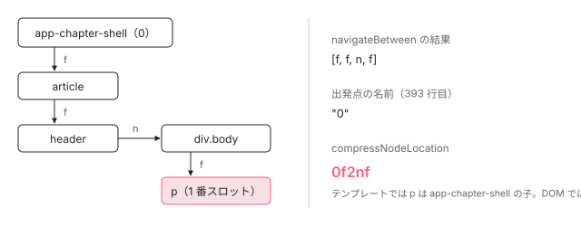

[目次](../README.md) › [SSR とハイドレーション](README.md) › 第 9 回 / 全 15 回

# ノードの道順：f と n の 2 文字と、連続をまとめる圧縮

> 確保するノードが兄弟の順で見つからないとき（投影されたノードなど）のために、サーバーが記録する道順。navigateBetween / calcPathForNode が親や前のノードから firstChild（f）と nextSibling（n）を並べた道順を作り、compressNodeLocation が連続を数字にまとめる行、ブラウザで decompressNodeLocation と navigateToNode が辿り直す行。

angular/angular · 読了 約 12 分 · 発展 · [サイトで読む（デモが動きます）](https://angular-deep-dive-cyan.vercel.app/chapter/hydration)

---

ブラウザは、サーバーが作った DOM ノードを、テンプレートの順番どおりに「親の最初の子」「前のノードの次の兄弟」として見つけていきます（[第 10 回](10-hydration-claim.md)）。ところが投影（`<ng-content>`）が絡むと、テンプレートでの順番と DOM での位置がずれ、この方法では見つかりません。この章では、そういうノードのためにサーバーが書く**道順**（`"0f2nf"` のような文字列）を、作る側・縮める側・辿る側の順に 1 行ずつ読みます。

読む対象は `packages/core/src/hydration/` の `node_lookup_utils.ts`・`compression.ts`・`interfaces.ts` と、`annotate.ts` の道順を書く 3 か所です。

1. [1. 概観](01-ssr-overview.md)
2. [2. renderApplication](02-ssr-render-application.md)
3. [3. platformServer と domino](03-ssr-platform-server.md)
4. [4. AngularAppEngine](04-ssr-app-engine.md)
5. [5. サーバールート](05-ssr-server-routes.md)
6. [6. プリレンダー](06-ssr-prerender.md)
7. [7. provideClientHydration](07-hydration-provide.md)
8. [8. ngh の書き出し](08-hydration-annotate.md)
9. **9. ノードの道順**（この章）
10. [10. ノードの確保](10-hydration-claim.md)
11. [11. コンテナと片付け](11-hydration-containers.md)
12. [12. 不一致のエラー](12-hydration-errors.md)
13. [13. i18n](13-hydration-i18n.md)
14. [14. イベントの再生](14-event-replay.md)
15. [15. インクリメンタル](15-incremental-hydration.md)

## 1. 道順の部品：出発点 3 種類と、移動 2 種類

📄 `angular/packages/core/src/hydration/interfaces.ts` L13–31 （▶ の行: 14, 17, 27, 29–30）

```ts
13 │ /** Encodes that the node lookup should start from the host node of this component. */
14 ▶ export const REFERENCE_NODE_HOST = 'h';
15 │ 
16 │ /** Encodes that the node lookup should start from the document body node. */
17 ▶ export const REFERENCE_NODE_BODY = 'b';
18 │ 
19 │ /**
20 │  * Describes navigation steps that the runtime logic need to perform,
21 │  * starting from a given (known) element.
22 │  * We're not using enum `NodeNavigationStep` because it produces more code overhead;
23 │  * thus, using plain `const` eliminates extra bytes. We can't use `const enum` due
24 │  * to single-file compilation restrictions.
25 │  */
26 │ 
27 ▶ export type NodeNavigationStep = 'f' | 'n';
28 │ 
29 ▶ export const NODE_NAVIGATION_STEP_FIRST_CHILD = 'f';
30 ▶ export const NODE_NAVIGATION_STEP_NEXT_SIBLING = 'n';
31 │ 
```

出発点（参照ノード）は、14 行目の `h`（このコンポーネントのホスト要素）、17 行目の `b`（`document.body`）、そして数字（そのビューの LView の何番スロットの要素か）の 3 種類です。数字の定数は無く、後で見る正規表現が `\d+` で読みます。

移動は 29 行目の `f`（`firstChild`、最初の子へ）と 30 行目の `n`（`nextSibling`、次の兄弟へ）の 2 つだけです。DOM の木は、この 2 つを並べればどこへでも行けます。22〜24 行目のコメントのとおり、`enum` にしないのは生成されるコードが増えるからです。

## 2. 道順が要るのはどんなときか（サーバー）

道順は [第 8 回](08-hydration-annotate.md)の SerializedView の `n`（`NODES`）に、スロット番号をキーにして入ります。書くのは 1 つの関数です。

📄 `angular/packages/core/src/hydration/annotate.ts` L506–521 （▶ の行: 517–518, 520）

```ts
506 │ /**
507 │  * Helper function to produce a node path (which navigation steps runtime logic
508 │  * needs to take to locate a node) and stores it in the `NODES` section of the
509 │  * current serialized view.
510 │  */
511 │ function appendSerializedNodePath(
512 │   ngh: SerializedView,
513 │   tNode: TNode,
514 │   lView: LView,
515 │   excludedParentNodes: Set<number> | null,
516 │ ) {
517 ▶   const noOffsetIndex = tNode.index - HEADER_OFFSET;
518 ▶   ngh[NODES] ??= {};
519 │   // Ensure we don't calculate the path multiple times.
520 ▶   ngh[NODES][noOffsetIndex] ??= calcPathForNode(tNode, lView, excludedParentNodes);
521 │ }
```

517 行目でスロット番号から `HEADER_OFFSET` を引き、518 行目で `n` を用意し、520 行目で `calcPathForNode` の結果を入れます。`??=` なので、同じノードの道順を 2 回計算しません。この関数を呼ぶ場所は `serializeLView` の中に 3 つあります。

### ① 子コンポーネントに投影したノードの先頭

📄 `angular/packages/core/src/hydration/annotate.ts` L618–656 （▶ の行: 618–619, 623, 629–630, 632, 637, 639, 652）

```ts
618 ▶     if (Array.isArray(tNode.projection)) {
619 ▶       for (const projectionHeadTNode of tNode.projection) {
620 │         // We may have `null`s in slots with no projected content.
621 │         if (!projectionHeadTNode) continue;
622 │ 
623 ▶         if (!Array.isArray(projectionHeadTNode)) {
624 │           // If we process re-projected content (i.e. `<ng-content>`
625 │           // appears at projection location), skip annotations for this content
626 │           // since all DOM nodes in this projection were handled while processing
627 │           // a parent lView, which contains those nodes.
628 │           if (
629 ▶             !isProjectionTNode(projectionHeadTNode) &&
630 ▶             !isInSkipHydrationBlock(projectionHeadTNode)
631 │           ) {
632 ▶             if (isDisconnectedNode(projectionHeadTNode, lView)) {
633 │               // Check whether this node is connected, since we may have a TNode
634 │               // in the data structure as a projection segment head, but the
635 │               // content projection slot might be disabled (e.g.
636 │               // <ng-content *ngIf="false" />).
637 ▶               appendDisconnectedNodeIndex(ngh, projectionHeadTNode);
638 │             } else {
639 ▶               appendSerializedNodePath(ngh, projectionHeadTNode, lView, i18nChildren);
640 │             }
641 │           }
642 │         } else {
643 │           // If a value is an array, it means that we are processing a projection
644 │           // where projectable nodes were passed in as DOM nodes (for example, when
645 │           // calling `ViewContainerRef.createComponent(CmpA, {projectableNodes: [...]})`).
646 │           //
647 │           // In this scenario, nodes can come from anywhere (either created manually,
648 │           // accessed via `document.querySelector`, etc) and may be in any state
649 │           // (attached or detached from the DOM tree). As a result, we can not reliably
650 │           // restore the state for such cases during hydration.
651 │ 
652 ▶           throw unsupportedProjectionOfDomNodes(unwrapRNode(lView[i]));
653 │         }
654 │       }
655 │     }
656 │ 
```

1. **618 行目：`tNode.projection` が配列 ＝ 中身を投影されるコンポーネントのホスト**

   `<app-chapter-shell>…中身…</app-chapter-shell>` と書くと、ホストの TNode の `projection` に、`<ng-content>` のスロットごとの「投影される先頭のノード」が入ります（子の `ɵɵprojectionDef` が入れる）。
2. **619〜623 行目：スロットごとに先頭のノードを見る**

   中身の無いスロットは `null` なので飛ばします。
3. **629〜630 行目：再投影と ngSkipHydration の中は書かない**

   先頭が `<ng-content>` 自身（親から来た中身をさらに子へ渡す再投影）なら、その DOM は親のビューを書くときに扱い済みです（624〜627 行目のコメント）。
4. **632〜637 行目：DOM に繋がっていなければ `d`、繋がっていれば 639 行目で道順**

   投影されたノードは、DOM では子コンポーネントのテンプレートの奥（`<ng-content>` を置いた場所）にあります。でも TNode の上では、親のテンプレートに書いた順番のままです。この食い違いを道順で埋めます。
5. **652 行目：DOM ノードをそのまま投影したら諦める**

   `createComponent(Cmp, {projectableNodes: [[el]]})` のように DOM ノードを直接渡すと、その DOM がどこから来たか分からないので NG0503 `UNSUPPORTED_PROJECTION_DOM_NODES` を投げます（646〜650 行目のコメント）。

### ② 投影で「次のノード」が変わるとき、親が DOM に無いとき

📄 `angular/packages/core/src/hydration/annotate.ts` L745–767 （▶ の行: 748, 752, 763）

```ts
745 │ /**
746 │  * Serializes node location in cases when it's needed, specifically:
747 │  *
748 ▶  *  1. If `tNode.projectionNext` is different from `tNode.next` - it means that
749 │  *     the next `tNode` after projection is different from the one in the original
750 │  *     template. Since hydration relies on `tNode.next`, this serialized info
751 │  *     is required to help runtime code find the node at the correct location.
752 ▶  *  2. In certain content projection-based use-cases, it's possible that only
753 │  *     a content of a projected element is rendered. In this case, content nodes
754 │  *     require an extra annotation, since runtime logic can't rely on parent-child
755 │  *     connection to identify the location of a node.
756 │  */
757 │ function conditionallyAnnotateNodePath(
758 │   ngh: SerializedView,
759 │   tNode: TNode,
760 │   lView: LView<unknown>,
761 │   excludedParentNodes: Set<number> | null,
762 │ ) {
763 ▶   if (isProjectionTNode(tNode)) {
764 │     // Do not annotate projection nodes (<ng-content />), since
765 │     // they don't have a corresponding DOM node representing them.
766 │     return;
767 │   }
```

📄 `angular/packages/core/src/hydration/annotate.ts` L768–790 （▶ の行: 770–772, 775, 782–786, 788）

```ts
768 │ 
769 │   // Handle case #1 described above.
770 ▶   if (
771 ▶     tNode.projectionNext &&
772 ▶     tNode.projectionNext !== tNode.next &&
773 │     !isInSkipHydrationBlock(tNode.projectionNext)
774 │   ) {
775 ▶     appendSerializedNodePath(ngh, tNode.projectionNext, lView, excludedParentNodes);
776 │   }
777 │ 
778 │   // Handle case #2 described above.
779 │   // Note: we only do that for the first node (i.e. when `tNode.prev === null`),
780 │   // the rest of the nodes would rely on the current node location, so no extra
781 │   // annotation is needed.
782 ▶   if (
783 ▶     tNode.prev === null &&
784 ▶     tNode.parent !== null &&
785 ▶     isDisconnectedNode(tNode.parent, lView) &&
786 ▶     !isDisconnectedNode(tNode, lView)
787 │   ) {
788 ▶     appendSerializedNodePath(ngh, tNode, lView, excludedParentNodes);
789 │   }
790 │ }
```

[第 8 回](08-hydration-annotate.md)で見た `serializeLView` の中で、コンテナの分岐の手前から、すべてのスロットについて呼ばれる判定です。763 行目、`<ng-content>` 自身は DOM ノードが無いので対象外です。

1. **770〜775 行目：場合 1（748〜751 行目）**

   `tNode.next` はテンプレートでの次のノード、`tNode.projectionNext` は投影された先での次のノードです。2 つが違うと、ブラウザが 772 行目の「次」を頼りに探しても別のノードに着きます。だから 775 行目で投影先での次のノードに道順を書きます。
2. **782〜788 行目：場合 2（752〜755 行目）**

   親の要素は投影されずに DOM から外れ、その中身だけが投影されて使われる場合です。親が DOM に無いので「親の最初の子」では辿れません。`tNode.prev === null`（783 行目）、つまり**最初の子だけ**に道順を書けば、残りの兄弟はそこから順に見つかります（779〜781 行目のコメント）。

### ③ `<ng-content>` と `@let` の次のノード

📄 `angular/packages/core/src/hydration/annotate.ts` L707–722 （▶ の行: 707, 711, 713, 721）

```ts
707 ▶       } else if (tNode.type & (TNodeType.Projection | TNodeType.LetDeclaration)) {
708 │         // Current TNode represents an `<ng-content>` slot or `@let` declaration,
709 │         // thus it has no DOM elements associated with it, so the **next sibling**
710 │         // node would not be able to find an anchor. In this case, use full path instead.
711 ▶         let nextTNode = tNode.next;
712 │         // Skip over all `<ng-content>` slots and `@let` declarations in a row.
713 ▶         while (
714 │           nextTNode !== null &&
715 │           nextTNode.type & (TNodeType.Projection | TNodeType.LetDeclaration)
716 │         ) {
717 │           nextTNode = nextTNode.next;
718 │         }
719 │         if (nextTNode && !isInSkipHydrationBlock(nextTNode)) {
720 │           // Handle a tNode after the `<ng-content>` slot.
721 ▶           appendSerializedNodePath(ngh, nextTNode, lView, i18nChildren);
722 │         }
```

707 行目、`<ng-content>` と `@let` は DOM にノードを持ちません。ブラウザは「前のノードの次の兄弟」で探すので、前のノードが DOM に無いと出発点がありません（708〜710 行目のコメント）。711〜718 行目で続けて並んだ `<ng-content>` と `@let` を飛ばし、721 行目でその次の本物のノードに道順を書きます。

## 3. calcPathForNode：出発点を決める

📄 `angular/packages/core/src/hydration/node_lookup_utils.ts` L356–394 （▶ の行: 377, 379, 384, 387–388, 391, 393）

```ts
356 │ export function calcPathForNode(
357 │   tNode: TNode,
358 │   lView: LView,
359 │   excludedParentNodes: Set<number> | null,
360 │ ): string {
361 │   let parentTNode = tNode.parent;
362 │   let parentIndex: number | string;
363 │   let parentRNode: RNode;
364 │   let referenceNodeName: string;
365 │ 
366 │   // Skip over all parent nodes that are disconnected from the DOM, such nodes
367 │   // can not be used as anchors.
368 │   //
369 │   // This might happen in certain content projection-based use-cases, where
370 │   // a content of an element is projected and used, when a parent element
371 │   // itself remains detached from DOM. In this scenario we try to find a parent
372 │   // element that is attached to DOM and can act as an anchor instead.
373 │   //
374 │   // It can also happen that the parent node should be excluded, for example,
375 │   // because it belongs to an i18n block, which requires paths which aren't
376 │   // relative to other views in an i18n block.
377 ▶   while (
378 │     parentTNode !== null &&
379 ▶     (isDisconnectedNode(parentTNode, lView) || excludedParentNodes?.has(parentTNode.index))
380 │   ) {
381 │     parentTNode = parentTNode.parent;
382 │   }
383 │ 
384 ▶   if (parentTNode === null || !(parentTNode.type & TNodeType.AnyRNode)) {
385 │     // If there is no parent TNode or a parent TNode does not represent an RNode
386 │     // (i.e. not a DOM node), use component host element as a reference node.
387 ▶     parentIndex = referenceNodeName = REFERENCE_NODE_HOST;
388 ▶     parentRNode = lView[DECLARATION_COMPONENT_VIEW][HOST]!;
389 │   } else {
390 │     // Use parent TNode as a reference node.
391 ▶     parentIndex = parentTNode.index;
392 │     parentRNode = unwrapRNode(lView[parentIndex]);
393 ▶     referenceNodeName = renderStringify(parentIndex - HEADER_OFFSET);
394 │   }
```

1. **377〜382 行目：使えない親は飛ばして上へ**

   DOM に繋がっていない親（2 節の場合 2）と、i18n ブロックの中の親（`excludedParentNodes`）は出発点にできないので、さらに親へ登ります。
2. **384〜388 行目：親が無い、または DOM ノードでない → `h`**

   テンプレートの一番上のノードや、親が `<ng-container>` のような DOM 要素でないノードは、ホスト要素から辿ります。
3. **390〜393 行目：親が要素 → その番号**

   393 行目で親のスロット番号から `HEADER_OFFSET` を引いた数を文字列にし、それが道順の先頭の数字になります。

📄 `angular/packages/core/src/hydration/node_lookup_utils.ts` L395–431 （▶ の行: 396, 402, 406–407, 410–411, 421–422, 427）

```ts
395 │   let rNode = unwrapRNode(lView[tNode.index]);
396 ▶   if (tNode.type & (TNodeType.AnyContainer | TNodeType.Icu)) {
397 │     // For <ng-container> nodes, instead of serializing a reference
398 │     // to the anchor comment node, serialize a location of the first
399 │     // DOM element. Paired with the container size (serialized as a part
400 │     // of `ngh.containers`), it should give enough information for runtime
401 │     // to hydrate nodes in this container.
402 ▶     const firstRNode = getFirstNativeNode(lView, tNode);
403 │ 
404 │     // If container is not empty, use a reference to the first element,
405 │     // otherwise, rNode would point to an anchor comment node.
406 ▶     if (firstRNode) {
407 ▶       rNode = firstRNode;
408 │     }
409 │   }
410 ▶   let path: string | null = calcPathBetween(parentRNode as Node, rNode as Node, referenceNodeName);
411 ▶   if (path === null && parentRNode !== rNode) {
412 │     // Searching for a path between elements within a host node failed.
413 │     // Trying to find a path to an element starting from the `document.body` instead.
414 │     //
415 │     // Important note: this type of reference is relatively unstable, since Angular
416 │     // may not be able to control parts of the page that the runtime logic navigates
417 │     // through. This is mostly needed to cover "portals" use-case (like menus, dialog boxes,
418 │     // etc), where nodes are content-projected (including direct DOM manipulations) outside
419 │     // of the host node. The better solution is to provide APIs to work with "portals",
420 │     // at which point this code path would not be needed.
421 ▶     const body = (parentRNode as Node).ownerDocument!.body as Node;
422 ▶     path = calcPathBetween(body, rNode as Node, REFERENCE_NODE_BODY);
423 │ 
424 │     if (path === null) {
425 │       // If the path is still empty, it's likely that this node is detached and
426 │       // won't be found during hydration.
427 ▶       throw nodeNotFoundError(lView, tNode);
428 │     }
429 │   }
430 │   return path!;
431 │ }
```

1. **396〜409 行目：コンテナなら、中の最初のノードを目的地にする**

   `<ng-container>` や `@if` の目印のコメントは中身の*後ろ*にあります。402 行目で中の最初の DOM ノードを取り、空でなければ 407 行目でそれを目的地にします（中身の数は `e` や `r` で別に伝わる）。
2. **410 行目：出発点から目的地までの道順を計算**

   中身は次の節です。
3. **411〜423 行目：見つからなければ body から**

   ホストの中で道が無いのは、ノードがホストの外に運ばれたとき（メニューやダイアログのような「ポータル」）です。422 行目で `b` から計算し直します。414〜420 行目のコメントは、この道順は Angular の管理外の DOM を通るので壊れやすい、と書いています。
4. **427 行目：それでも無ければエラー**

   DOM から外れたノードなので、NG0502 `HYDRATION_MISSING_NODE` です（サーバーの描画中に出ます）。

## 4. navigateBetween：f と n の列を作る

📄 `angular/packages/core/src/hydration/node_lookup_utils.ts` L339–350 （▶ の行: 347–349）

```ts
339 │ /**
340 │  * Calculates a path between 2 nodes in terms of `nextSibling` and `firstChild`
341 │  * navigations:
342 │  * - the `from` node is a known node, used as an starting point for the lookup
343 │  *   (the `fromNodeName` argument is a string representation of the node).
344 │  * - the `to` node is a node that the runtime logic would be looking up,
345 │  *   using the path generated by this function.
346 │  */
347 ▶ export function calcPathBetween(from: Node, to: Node, fromNodeName: string): string | null {
348 ▶   const path = navigateBetween(from, to);
349 ▶   return path === null ? null : compressNodeLocation(fromNodeName, path);
350 │ }
```

348 行目で移動の列を作り、349 行目で圧縮します。列を作る本体です。

📄 `angular/packages/core/src/hydration/node_lookup_utils.ts` L290–321 （▶ の行: 298, 300, 302–303, 306, 308–309, 314, 316, 318）

```ts
290 │ /**
291 │  * Generate a list of DOM navigation operations to get from node `start` to node `finish`.
292 │  *
293 │  * Note: assumes that node `start` occurs before node `finish` in an in-order traversal of the DOM
294 │  * tree. That is, we should be able to get from `start` to `finish` purely by using `.firstChild`
295 │  * and `.nextSibling` operations.
296 │  */
297 │ export function navigateBetween(start: Node, finish: Node): NodeNavigationStep[] | null {
298 ▶   if (start === finish) {
299 │     return [];
300 ▶   } else if (start.parentElement == null || finish.parentElement == null) {
301 │     return null;
302 ▶   } else if (start.parentElement === finish.parentElement) {
303 ▶     return navigateBetweenSiblings(start, finish);
304 │   } else {
305 │     // `finish` is a child of its parent, so the parent will always have a child.
306 ▶     const parent = finish.parentElement!;
307 │ 
308 ▶     const parentPath = navigateBetween(start, parent);
309 ▶     const childPath = navigateBetween(parent.firstChild!, finish);
310 │     if (!parentPath || !childPath) return null;
311 │ 
312 │     return [
313 │       // First navigate to `finish`'s parent
314 ▶       ...parentPath,
315 │       // Then to its first child.
316 ▶       NODE_NAVIGATION_STEP_FIRST_CHILD,
317 │       // And finally from that node to `finish` (maybe a no-op if we're already there).
318 ▶       ...childPath,
319 │     ];
320 │   }
321 │ }
```

📄 `angular/packages/core/src/hydration/node_lookup_utils.ts` L323–337 （▶ の行: 330–331, 336）

```ts
323 │ /**
324 │  * Calculates a path between 2 sibling nodes (generates a number of `NextSibling` navigations).
325 │  * Returns `null` if no such path exists between the given nodes.
326 │  */
327 │ function navigateBetweenSiblings(start: Node, finish: Node): NodeNavigationStep[] | null {
328 │   const nav: NodeNavigationStep[] = [];
329 │   let node: Node | null = null;
330 ▶   for (node = start; node != null && node !== finish; node = node.nextSibling) {
331 ▶     nav.push(NODE_NAVIGATION_STEP_NEXT_SIBLING);
332 │   }
333 │   // If the `node` becomes `null` or `undefined` at the end, that means that we
334 │   // didn't find the `end` node, thus return `null` (which would trigger serialization
335 │   // error to be produced).
336 ▶   return node == null ? null : nav;
337 │ }
```

この章自身の最初の段落を例に辿ります。`start` は `<app-chapter-shell>`、`finish` はその中の `<div class="body">` に投影された最初の `<p>` です。

1. **302 行目：親が同じか？→ 違う**

   `<p>` の親は `div.body`、`<app-chapter-shell>` の親は `<app-chapter-hydration>` です。
2. **306〜309 行目：目的地の親まで行き、その最初の子から目的地まで行く、に分ける**

   308 行目で `start → div.body` を再帰で求め、309 行目で `div.body.firstChild → <p>` を求めます。`<p>` は最初の子なので 298 行目で `[]` です。
3. **再帰：`start → div.body`**

   同じように `div.body` の親 `<article>` まで（さらに再帰して `[f]`）、`article.firstChild`（`<header>`）から `div.body` までは親が同じなので 303 行目 → 330〜331 行目で `[n]`。316 行目の `f` を挟んで `[f, f, n]` です。
4. **312〜319 行目：つなぐ**

   `[f, f, n]` ＋ 316 行目の `f` ＋ `[]` ＝ `[f, f, n, f]`。出発点の名前は 3 節の 393 行目で `"0"`（この章のテンプレートで `<app-chapter-shell>` は 0 番）なので、圧縮すると `"0f2nf"` です。



*この章の最初の段落（0 番スロットの &lt;app-chapter-shell&gt; に投影された &lt;p&gt;）への道順。f・f・n・f の 4 歩が 0f2nf の 5 文字になる。*

## 5. compressNodeLocation：同じ移動が続いたら数字にする

📄 `angular/packages/core/src/hydration/compression.ts` L22–47 （▶ の行: 31, 34, 36–37, 43）

```ts
22 │ /**
23 │  * Helper function that takes a reference node location and a set of navigation steps
24 │  * (from the reference node) to a target node and outputs a string that represents
25 │  * a location.
26 │  *
27 │  * For example, given: referenceNode = 'b' (body) and path = ['firstChild', 'firstChild',
28 │  * 'nextSibling'], the function returns: `bf2n`.
29 │  */
30 │ export function compressNodeLocation(referenceNode: string, path: NodeNavigationStep[]): string {
31 ▶   const result: Array<string | number> = [referenceNode];
32 │   for (const segment of path) {
33 │     const lastIdx = result.length - 1;
34 ▶     if (lastIdx > 0 && result[lastIdx - 1] === segment) {
35 │       // An empty string in a count slot represents 1 occurrence of an instruction.
36 ▶       const value = (result[lastIdx] || 1) as number;
37 ▶       result[lastIdx] = value + 1;
38 │     } else {
39 │       // Adding a new segment to the path.
40 │       // Using an empty string in a counter field to avoid encoding `1`s
41 │       // into the path, since they are implicit (e.g. `f1n1` vs `fn`), so
42 │       // it's enough to have a single char in this case.
43 ▶       result.push(segment, '');
44 │     }
45 │   }
46 │   return result.join('');
47 │ }
```

1. **31 行目：先頭は出発点の名前**

   以後、配列は「移動・回数・移動・回数…」の組で伸びます。
2. **34 行目：直前の組と同じ移動か？**

   `result[lastIdx - 1]` が直前の移動、`result[lastIdx]` がその回数の欄です。
3. **36〜37 行目：同じなら回数を 1 増やす**

   回数の欄が空文字（1 回）なら `|| 1` で 1 とみなし、2 にします。
4. **43 行目：違えば、移動と空文字を足す**

   40〜42 行目のコメントのとおり、**1 回のときは数字を書かない**ので `f1n1` ではなく `fn` です。

📄 `angular/packages/core/test/hydration/compression_spec.ts` L18–30 （▶ の行: 23, 25, 27–29）

```ts
18 │ describe('compression of node location', () => {
19 │   it('should handle basic cases', () => {
20 │     const fc = NODE_NAVIGATION_STEP_FIRST_CHILD;
21 │     const ns = NODE_NAVIGATION_STEP_NEXT_SIBLING;
22 │     const cases = [
23 ▶       [[REFERENCE_NODE_HOST, fc, 1], 'hf'],
24 │       [[REFERENCE_NODE_BODY, fc, 1], 'bf'],
25 ▶       [[0, fc, 1], '0f'],
26 │       [[15, fc, 1], '15f'],
27 ▶       [[15, fc, 4], '15f4'],
28 ▶       [[5, fc, 4, ns, 1, fc, 1], '5f4nf'],
29 ▶       [[7, ns, 4, fc, 1, ns, 1], '7n4fn'],
30 │     ];
```
*テストに並ぶ実例。左が \[出発点, 移動, 回数, …\]、右が圧縮後の文字列。*

28 行目の `'5f4nf'` は「5 番の要素から firstChild を 4 回、nextSibling を 1 回、firstChild を 1 回」です。圧縮しないで 1 歩 1 文字にすると `5ffffnf` の 7 文字、圧縮後は 5 文字です。

## 6. ブラウザ：道順を読み戻して辿る

📄 `angular/packages/core/src/hydration/node_lookup_utils.ts` L92–108 （▶ の行: 105–107）

```ts
 92 │ /**
 93 │  * Attempt to locate an RNode by a path, if it exists.
 94 │  *
 95 │  * @param hydrationInfo The hydration annotation data
 96 │  * @param lView the current lView
 97 │  * @param noOffsetIndex the instruction index
 98 │  * @returns an RNode that corresponds to the instruction index or null if no path exists
 99 │  */
100 │ export function tryLocateRNodeByPath(
101 │   hydrationInfo: DehydratedView,
102 │   lView: LView<unknown>,
103 │   noOffsetIndex: number,
104 │ ): RNode | null {
105 ▶   const nodes = hydrationInfo.data[NODES];
106 ▶   const path = nodes?.[noOffsetIndex];
107 ▶   return path ? locateRNodeByPath(path, lView) : null;
108 │ }
```

105〜106 行目で、そのスロットの道順が SerializedView の `n` にあるかを見て、あれば 107 行目で辿ります。命令がノードを探す本体 `locateNextRNode` も、まず `n` に道順があるかを見て、あればそれで辿り、無ければ兄弟の順で探します（[第 10 回](10-hydration-claim.md)）。

📄 `angular/packages/core/src/hydration/node_lookup_utils.ts` L270–288 （▶ の行: 275, 277–280, 284–285, 287）

```ts
270 │ /**
271 │  * Locates an RNode given a set of navigation instructions (which also contains
272 │  * a starting point node info).
273 │  */
274 │ function locateRNodeByPath(path: string, lView: LView): RNode {
275 ▶   const [referenceNode, ...navigationInstructions] = decompressNodeLocation(path);
276 │   let ref: Element;
277 ▶   if (referenceNode === REFERENCE_NODE_HOST) {
278 ▶     ref = lView[DECLARATION_COMPONENT_VIEW][HOST] as unknown as Element;
279 ▶   } else if (referenceNode === REFERENCE_NODE_BODY) {
280 ▶     ref = ɵɵresolveBody(
281 │       lView[DECLARATION_COMPONENT_VIEW][HOST] as RElement & {ownerDocument: Document},
282 │     ) as Element;
283 │   } else {
284 ▶     const parentElementId = Number(referenceNode);
285 ▶     ref = unwrapRNode((lView as any)[parentElementId + HEADER_OFFSET]) as Element;
286 │   }
287 ▶   return navigateToNode(ref, navigationInstructions);
288 │ }
```

1. **275 行目：読み戻す**

   先頭が出発点、残りが移動の組です（下の `decompressNodeLocation`）。
2. **277〜282 行目：`h` と `b`**

   `h` は 278 行目、この LView を宣言したコンポーネントのホスト要素。`b` は 280 行目の `ɵɵresolveBody` で、ホスト要素の `ownerDocument.body` です。
3. **284〜285 行目：数字なら LView のスロット**

   番号に `HEADER_OFFSET` を足して LView から要素を取ります。親の要素は子より先に作られるので、この時点でもう確保済みです。
4. **287 行目：辿る**

📄 `angular/packages/core/src/hydration/compression.ts` L11–20 （▶ の行: 19）

```ts
11 │ /**
12 │  * Regexp that extracts a reference node information from the compressed node location.
13 │  * The reference node is represented as either:
14 │  *  - a number which points to an LView slot
15 │  *  - the `b` char which indicates that the lookup should start from the `document.body`
16 │  *  - the `h` char to start lookup from the component host node (`lView[HOST]`)
17 │  */
18 │ const REF_EXTRACTOR_REGEXP: RegExp = /* @__PURE__ */ (() => {
19 ▶   return new RegExp(`^(\\d+)*(${REFERENCE_NODE_BODY}|${REFERENCE_NODE_HOST})*(.*)`);
20 │ })();
```

📄 `angular/packages/core/src/hydration/compression.ts` L49–75 （▶ の行: 64, 67, 70–71）

```ts
49 │ /**
50 │  * Helper function that reverts the `compressNodeLocation` and transforms a given
51 │  * string into an array where at 0th position there is a reference node info and
52 │  * after that it contains information (in pairs) about a navigation step and the
53 │  * number of repetitions.
54 │  *
55 │  * For example, the path like 'bf2n' will be transformed to:
56 │  * ['b', 'firstChild', 2, 'nextSibling', 1].
57 │  *
58 │  * This information is later consumed by the code that navigates the DOM to find
59 │  * a given node by its location.
60 │  */
61 │ export function decompressNodeLocation(
62 │   path: string,
63 │ ): [string | number, ...(number | NodeNavigationStep)[]] {
64 ▶   const matches = path.match(REF_EXTRACTOR_REGEXP)!;
65 │   const [_, refNodeId, refNodeName, rest] = matches;
66 │   // If a reference node is represented by an index, transform it to a number.
67 ▶   const ref = refNodeId ? parseInt(refNodeId, 10) : refNodeName;
68 │   const steps: (number | NodeNavigationStep)[] = [];
69 │   // Match all segments in a path.
70 ▶   for (const [_, step, count] of rest.matchAll(/(f|n)(\d*)/g)) {
71 ▶     const repeat = parseInt(count, 10) || 1;
72 │     steps.push(step as NodeNavigationStep, repeat);
73 │   }
74 │   return [ref, ...steps];
75 │ }
```

19 行目の正規表現 `^(\d+)*(b|h)*(.*)` で、先頭の数字か `b`/`h` と、残りを分けます。67 行目、数字なら `parseInt` で数にします。70 行目の `/(f|n)(\d*)/g` で残りを組に区切り、71 行目で**数字が無ければ 1**。圧縮のときに省いた 1 がここで戻ります。`'0f2nf'` は `[0, 'f', 2, 'n', 1, 'f', 1]` になります。

📄 `angular/packages/core/src/hydration/node_lookup_utils.ts` L220–252 （▶ の行: 226–230, 236, 238, 244–245, 247–248）

```ts
220 │ /**
221 │  * Helper function that navigates from a starting point node (the `from` node)
222 │  * using provided set of navigation instructions (within `path` argument).
223 │  */
224 │ function navigateToNode(from: Node, instructions: (number | NodeNavigationStep)[]): RNode {
225 │   let node = from;
226 ▶   for (let i = 0; i < instructions.length; i += 2) {
227 ▶     const step = instructions[i];
228 ▶     const repeat = instructions[i + 1] as number;
229 ▶     for (let r = 0; r < repeat; r++) {
230 ▶       if (ngDevMode && !node) {
231 │         throw nodeNotFoundAtPathError(from, stringifyNavigationInstructions(instructions));
232 │       }
233 │       // `nodeNotFoundAtPathError` above would normally catch a missing node too, but it's
234 │       // dev-mode only. Guard against it here so production throws a coded RuntimeError instead
235 │       // of a raw TypeError when dereferencing `node` below.
236 ▶       if (!node) {
237 │         throw new RuntimeError(
238 ▶           RuntimeErrorCode.HYDRATION_MISSING_NODE_ON_PATH,
239 │           ngDevMode &&
240 │             'During hydration Angular was unable to locate a node using a recorded navigation path. This usually means the client-rendered DOM no longer matches the server-rendered HTML.',
241 │         );
242 │       }
243 │       switch (step) {
244 ▶         case NODE_NAVIGATION_STEP_FIRST_CHILD:
245 ▶           node = node.firstChild!;
246 │           break;
247 ▶         case NODE_NAVIGATION_STEP_NEXT_SIBLING:
248 ▶           node = node.nextSibling!;
249 │           break;
250 │       }
251 │     }
252 │   }
```

226〜229 行目で組を 2 つずつ読み、移動を回数だけ繰り返します。244〜248 行目、`f` なら `firstChild`、`n` なら `nextSibling` を 1 回進むだけです。途中で `null` に当たると、開発ビルドでは 230 行目で詳しいメッセージ付きの NG0502、本番では 236〜238 行目で NG0509 `HYDRATION_MISSING_NODE_ON_PATH` を投げます。サーバーとブラウザで DOM の形が違う、という意味です（[第 12 回](12-hydration-errors.md)）。

## 7. 呼び出しの連なり

- `serializeLView(lView, …)` — annotate.ts L548（サーバー）
  - `appendSerializedNodePath(ngh, tNode, lView, …)` — L511 — *① 投影の先頭 L639 ② conditionallyAnnotateNodePath L775/L788 ③ ng-content の次 L721*
    - `calcPathForNode(tNode, lView, …)` — node\_lookup\_utils.ts L356 — *出発点を h / 親の番号 / b から選ぶ*
      - `calcPathBetween(from, to, name)` — L347
        - `navigateBetween(start, finish)` — L297 — *再帰で \[f, f, n, f\]*
        - `compressNodeLocation(name, path)` — compression.ts L30 — *"0f2nf"*
- `tryLocateRNodeByPath` / `locateNextRNode` — node\_lookup\_utils.ts（ブラウザ）
  - `locateRNodeByPath(path, lView)` — L274
    - `decompressNodeLocation(path)` — compression.ts L61 — *\[0, 'f', 2, 'n', 1, 'f', 1\]*
    - `navigateToNode(ref, instructions)` — L224 — *firstChild / nextSibling を回数だけ*

## 8. DEMO：道順を読み戻して、このページの HTML の上で辿る

> **🧪 DEMO — 道順の展開と、実際の DOM での歩き方**
>
> 上の欄の展開と再圧縮は、`decompressNodeLocation`（19・70・71 行目）と `compressNodeLocation`（34・36・43 行目）と同じ規則で**書き直した自作の関数**で計算しています。「このページの HTML を取り直す」を押すと、`fetch(location.pathname)` で取り直した HTML（ハイドレーション前の形）を `DOMParser` で解析し、この章の `<app-chapter-hydration>` の ngh が指す SerializedView から `n` の道順を取り出します。辿れる出発点は `0`（この章のテンプレートの 0 番 = `<app-chapter-shell>`）・`h`・`b` だけです。他の番号の要素を引くには実行時の LView が要るためです。
>
> ▶ [このデモはサイトで動かせます](https://angular-deep-dive-cyan.vercel.app/chapter/hydration)

`n` の道順は、どれも投影された中身の先頭です。`0f2nf` は 4 節で辿ったとおり、`<app-chapter-shell>` の `div.body` に入った最初の `<p>` です。ほかの道順は `<app-callout>` や `<app-figure>` に投影した中身の先頭で、出発点はそのホスト要素の番号です。投影されない普通の要素（`<h2>` や `<app-code>`）には道順がありません。

## 聞かれそうな質問

**Q. なぜすべてのノードに道順を書かないのですか？**

ほとんどのノードは、テンプレートの順番どおりに「親の最初の子」か「前のノードの次の兄弟」で見つかるからです。道順を書くのは 2 節の 3 か所、つまり投影の先頭（639 行目）、投影で次のノードが変わったときと親が DOM に無いとき（775・788 行目）、DOM ノードを持たない `<ng-content>`・`@let` の次（721 行目）だけです。全部に書くと HTML が膨らみ、兄弟の順で十分なところまで重くなります。

**Q. 投影で順番が変わる、とは具体的にどういうことですか？**

このサイトの章がそのまま例です。章のテンプレートでは `<p>` は `<app-chapter-shell>` の子として書かれていますが、DOM では `app-chapter-shell > article > div.body` の中にあります。ブラウザが「`<app-chapter-shell>` の最初の子」を取ると `<article>` になってしまうので、639 行目で `"0f2nf"` を書いておきます。2 番目以降の `<h2>` などは、DOM でも `<p>` の次の兄弟なので道順は要りません。

**Q. 圧縮でどれくらい縮みますか？**

同じ移動の連続を数字にするだけなので、連続が長いほど効きます。テストの `'15f4'`（27 行目）は 1 歩 1 文字なら `15ffff` で 6 文字、`'7n4fn'`（29 行目）は `7nnnnfn` で 7 文字が 5 文字です。1 回だけの移動に `1` を書かない工夫（40〜42 行目）のおかげで、連続が無くても長くはなりません。このサイトの道順は 4〜6 文字程度で、TransferState の中ではごく一部です。

**Q. `b` で始まる道順を見かけました。何がまずいのですか？**

ホストの中で道が見つからず、422 行目で body から計算し直したものです。414〜420 行目のコメントのとおり、Angular が管理しない body 直下の DOM（広告やブラウザ拡張が足す要素）を通るので、それらが増減すると道順がずれて 236〜238 行目のエラーになります。ノードをホストの外へ運ぶ処理（ポータル）がある画面で出ます。

**Q. 道順を辿った先が違うノードだったら？**

`navigateToNode` は着いたノードが正しいかを見ません。`null` に当たったときだけ 230・236 行目で投げます。着いたノードの種類やタグ名が期待と違うかは、確保する側（命令）が開発ビルドで `validateMatchingNode` により調べ、NG0500 を出します（[第 12 回](12-hydration-errors.md)）。

## 読み終えて

- 道順は「出発点（スロット番号・`h`・`b`）＋ `f`/`n` の列」。SerializedView の `n` に、スロット番号をキーにして入る。
- 書くのは投影が絡むときだけ。投影の先頭、`projectionNext` が `next` と違うとき、親が DOM に無いとき、`<ng-content>`・`@let` の次。
- `navigateBetween` は「目的地の親まで行く ＋ f ＋ その最初の子から目的地まで」を再帰で組み立てる。ホストの中に無ければ body から。
- 圧縮は連続を数字にし、1 回なら数字を書かない。読み戻しは数字が無ければ 1。
- ブラウザは道順を辿って `null` に当たると NG0502（開発）/ NG0509（本番）を投げる。

---

← 前: [annotateForHydration：サーバーで DOM の形を ngh に書き出す](08-hydration-annotate.md)  
次: [DOM ノードの確保：命令がノードを作らずに見つける](10-hydration-claim.md) →
