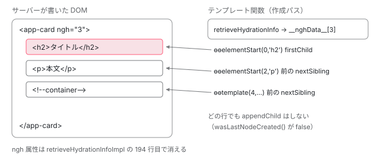

[目次](../README.md) › [SSR とハイドレーション](README.md) › 第 10 回 / 全 15 回

# DOM ノードの確保：命令がノードを作らずに見つける

> ブラウザで ɵɵelementStart などの命令が、ハイドレーション中は \_locateOrCreateElementNode を通って document.createElement の代わりに locateNextRNode で既存のノードを見つける行。retrieveHydrationInfo が ngh 属性を読んで DehydratedView を作り、属性を消す行、markRNodeAsClaimedByHydration（確保の印は開発モードだけ）、テキストノードとコメント、属性やリスナーの付け方が作るときと同じになる理由。canHydrateNode と ngSkipHydration の範囲。

angular/angular · 読了 約 14 分 · 発展 · [サイトで読む（デモが動きます）](https://angular-deep-dive-cyan.vercel.app/chapter/hydration-claim)

---

ブラウザに届いた HTML には、もう `<app-root>` の中身が全部あります。ハイドレーション（サーバーが描いた DOM を捨てずに、Angular のデータ構造につなぎ直す処理）では、テンプレート関数の `ɵɵelementStart` や `ɵɵtext` が **ノードを作らずに、既にあるノードを探して受け取ります**。この章では、その「作る」と「探す」の分かれ目の行、探す順番を決める `locateNextRNode`、`ngh` 属性が読まれて消える行を 1 つずつ確認します。

読む対象は `packages/core/src/hydration/utils.ts`、`hydration/node_lookup_utils.ts`、`render3/instructions/element.ts`・`text.ts`・`element_container.ts` です。

1. [1. 概観](01-ssr-overview.md)
2. [2. renderApplication](02-ssr-render-application.md)
3. [3. platformServer と domino](03-ssr-platform-server.md)
4. [4. AngularAppEngine](04-ssr-app-engine.md)
5. [5. サーバールート](05-ssr-server-routes.md)
6. [6. プリレンダー](06-ssr-prerender.md)
7. [7. provideClientHydration](07-hydration-provide.md)
8. [8. ngh の書き出し](08-hydration-annotate.md)
9. [9. ノードの道順](09-hydration.md)
10. **10. ノードの確保**（この章）
11. [11. コンテナと片付け](11-hydration-containers.md)
12. [12. 不一致のエラー](12-hydration-errors.md)
13. [13. i18n](13-hydration-i18n.md)
14. [14. イベントの再生](14-event-replay.md)
15. [15. インクリメンタル](15-incremental-hydration.md)

> [!NOTE]
> **ポイント**
>
> 前提：[第 7 回](07-hydration-provide.md)で見たとおり、`withDomHydration` の `ENVIRONMENT_INITIALIZER` は、ブラウザで `IS_HYDRATION_DOM_REUSE_ENABLED` が真のときだけ `enableHydrationRuntimeSupport()` を呼びます。そこで `enableRetrieveHydrationInfoImpl()` や `enableLocateOrCreateElementNodeImpl()` などが呼ばれ、この章で読む「探す版」の実装に差し替わります。呼ばれなければ、どの関数も「作るだけ」の既定の実装のままです。

## 1. 入口：コンポーネントのホスト要素で ngh を読む

ハイドレーションの単位はコンポーネントです。サーバーは各コンポーネントのホスト要素に `ngh="番号"` を書き、番号の先の中身（`SerializedView`）を TransferState の `__nghData__` に入れました （[第 8 回](08-hydration-annotate.md)）。ブラウザでそれを読むのは、コンポーネントのビューを作る直前です。

📄 `angular/packages/core/src/render3/instructions/render.ts` L38–43 （▶ の行: 40–41）

```ts
38 │   const hostRNode = componentView[HOST];
39 │   // Populate an LView with hydration info retrieved from the DOM via TransferState.
40 ▶   if (hostRNode !== null && componentView[HYDRATION] === null) {
41 ▶     componentView[HYDRATION] = retrieveHydrationInfo(hostRNode, componentView[INJECTOR]);
42 │   }
43 │ 
```
*renderComponent の途中（関数の全体は boot-first-render の章）*

40〜41 行目。子コンポーネントの `LView`（ビューの実行時データの配列）の `HOST` スロットにはホスト要素が入っています。その要素を `retrieveHydrationInfo` に渡し、結果を `LView[HYDRATION]` に入れます。ルートコンポーネント（`<app-root>`）だけは別の入口で、`ComponentFactory.create` がルートの `LView` を作るときに `retrieveHydrationInfo(hostElement, rootViewInjector, true)` を最後の引数に渡します （`createLView` はそれを `lView[HYDRATION]` に代入するだけ。[boot-application-ref](../boot/10-boot-application-ref.md) で読んだ行です）。

### retrieveHydrationInfoImpl：属性を読んで TransferState を引く

📄 `angular/packages/core/src/hydration/utils.ts` L121–147 （▶ の行: 126–127, 139–141, 145–146）

```ts
121 │ export function retrieveHydrationInfoImpl(
122 │   rNode: RElement,
123 │   injector: Injector,
124 │   isRootView = false,
125 │ ): DehydratedView | null {
126 ▶   let nghAttrValue = rNode.getAttribute(NGH_ATTR_NAME);
127 ▶   if (nghAttrValue == null) return null;
128 │ 
129 │   // For cases when a root component also acts as an anchor node for a ViewContainerRef
130 │   // (for example, when ViewContainerRef is injected in a root component), there is a need
131 │   // to serialize information about the component itself, as well as an LContainer that
132 │   // represents this ViewContainerRef. Effectively, we need to serialize 2 pieces of info:
133 │   // (1) hydration info for the root component itself and (2) hydration info for the
134 │   // ViewContainerRef instance (an LContainer). Each piece of information is included into
135 │   // the hydration data (in the TransferState object) separately, thus we end up with 2 ids.
136 │   // Since we only have 1 root element, we encode both bits of info into a single string:
137 │   // ids are separated by the `|` char (e.g. `10|25`, where `10` is the ngh for a component view
138 │   // and 25 is the `ngh` for a root view which holds LContainer).
139 ▶   const [componentViewNgh, rootViewNgh] = nghAttrValue.split('|');
140 ▶   nghAttrValue = isRootView ? rootViewNgh : componentViewNgh;
141 ▶   if (!nghAttrValue) return null;
142 │ 
143 │   // We've read one of the ngh ids, keep the remaining one, so that
144 │   // we can set it back on the DOM element.
145 ▶   const rootNgh = rootViewNgh ? `|${rootViewNgh}` : '';
146 ▶   const remainingNgh = isRootView ? componentViewNgh : rootNgh;
147 │ 
```

126〜127 行目で `ngh` 属性を読み、無ければ `null` を返します。`null` が入った `LView` は、中のノードを全部「作る」モードで処理します（3 節の `canHydrateNode`）。

139〜141 行目は `|` で区切った 2 つの番号の扱いです。ルートコンポーネントが `ViewContainerRef` を inject して 自分の隣にビューを並べるときだけ、`ngh="10|25"` のように 2 つ書かれます。ふつうは 1 つだけなので、`isRootView = true` で呼ばれたときは `rootViewNgh` が `undefined` になり、141 行目で `null` を返します。その場合属性は消さずに残り、あとで `renderComponent`（40 行目）がもう一度読みます。145〜146 行目は、2 つのうち使わなかった方を覚えておく変数です。

📄 `angular/packages/core/src/hydration/utils.ts` L148–170 （▶ の行: 152, 155, 159, 167–169）

```ts
148 │   let data: SerializedView = {};
149 │   // An element might have an empty `ngh` attribute value (e.g. `<comp ngh="" />`),
150 │   // which means that no special annotations are required. Do not attempt to read
151 │   // from the TransferState in this case.
152 ▶   if (nghAttrValue !== '') {
153 │     const transferState = injector.get(TransferState, null, {optional: true});
154 │     if (transferState !== null) {
155 ▶       const nghData = transferState.get(NGH_DATA_KEY, []);
156 │ 
157 │       // The nghAttrValue is always a number referencing an index
158 │       // in the hydration TransferState data.
159 ▶       data = nghData[Number(nghAttrValue)];
160 │ 
161 │       // If the `ngh` attribute exists and has a non-empty value,
162 │       // the hydration info *must* be present in the TransferState.
163 │       // If there is no data for some reasons, this is an error.
164 │       ngDevMode && assertDefined(data, 'Unable to retrieve hydration info from the TransferState.');
165 │     }
166 │   }
167 ▶   const dehydratedView: DehydratedView = {
168 ▶     data,
169 ▶     firstChild: rNode.firstChild ?? null,
170 │   };
```

152 行目。`ngh=""`（空）は「特別な記録は要らない」という意味なので、TransferState を読まずに空の `{}` のままにします。155 行目で `NGH_DATA_KEY`（`'__nghData__'`）の配列を取り、159 行目で **属性の値を配列の添字として** 1 つ取り出します。167〜170 行目で `DehydratedView` を作ります。`firstChild` はホスト要素の最初の子、つまりこのコンポーネントの中身の先頭ノードです。

📄 `angular/packages/core/src/hydration/utils.ts` L172–211 （▶ の行: 180, 184, 187, 190, 194, 200, 210）

```ts
172 │   if (isRootView) {
173 │     // If there is hydration info present for the root view, it means that there was
174 │     // a ViewContainerRef injected in the root component. The root component host element
175 │     // acted as an anchor node in this scenario. As a result, the DOM nodes that represent
176 │     // embedded views in this ViewContainerRef are located as siblings to the host node,
177 │     // i.e. `<app-root /><#VIEW1><#VIEW2>...<!--container-->`. In this case, the current
178 │     // node becomes the first child of this root view and the next sibling is the first
179 │     // element in the DOM segment.
180 ▶     dehydratedView.firstChild = rNode;
181 │ 
182 │     // We use `0` here, since this is the slot (right after the HEADER_OFFSET)
183 │     // where a component LView or an LContainer is located in a root LView.
184 ▶     setSegmentHead(dehydratedView, 0, rNode.nextSibling);
185 │   }
186 │ 
187 ▶   if (remainingNgh) {
188 │     // If we have only used one of the ngh ids, store the remaining one
189 │     // back on this RNode.
190 ▶     rNode.setAttribute(NGH_ATTR_NAME, remainingNgh);
191 │   } else {
192 │     // The `ngh` attribute is cleared from the DOM node now
193 │     // that the data has been retrieved for all indices.
194 ▶     rNode.removeAttribute(NGH_ATTR_NAME);
195 │   }
196 │ 
197 │   // Note: don't check whether this node was claimed for hydration,
198 │   // because this node might've been previously claimed while processing
199 │   // template instructions.
200 ▶   ngDevMode && markRNodeAsClaimedByHydration(rNode, /* checkIfAlreadyClaimed */ false);
201 │   ngDevMode && ngDevMode.hydratedComponents++;
202 │ 
203 │   return dehydratedView;
204 │ }
205 │ 
206 │ /**
207 │  * Sets the implementation for the `retrieveHydrationInfo` function.
208 │  */
209 │ export function enableRetrieveHydrationInfoImpl() {
210 ▶   _retrieveHydrationInfoImpl = retrieveHydrationInfoImpl;
211 │ }
```

180〜184 行目はルートが `ViewContainerRef` の目印を兼ねる場合で、ホスト要素自身を先頭とし、次の兄弟からをコンテナの区間とします。**194 行目で `ngh` 属性を DOM から消します**。2 つ書かれていて片方しか使っていなければ、190 行目で残りの方だけを書き戻します。だから、ハイドレーションが済んだ要素を開発者ツールで見ても `ngh` はありません（このページで 6 節のデモで確かめます）。

200 行目の `markRNodeAsClaimedByHydration` は `ngDevMode &&` 付きです。本番ビルドでは呼ばれません（5 節）。210 行目が、[第 7 回](07-hydration-provide.md)の `enableHydrationRuntimeSupport` から呼ばれる差し替え関数です。差し替える前の `_retrieveHydrationInfoImpl` は `() => null` なので、ハイドレーションを使わないアプリではこの 80 行が呼ばれることはなく、参照もされないので本番バンドルから消えます。

### DehydratedView の中身

📄 `angular/packages/core/src/hydration/interfaces.ts` L193–220 （▶ の行: 203, 214, 220）

```ts
193 │ /**
194 │  * An object that contains hydration-related information serialized
195 │  * on the server, as well as the necessary references to segments of
196 │  * the DOM, to facilitate the hydration process for a given hydration
197 │  * boundary on the client.
198 │  */
199 │ export interface DehydratedView {
200 │   /**
201 │    * The readonly hydration annotation data.
202 │    */
203 ▶   data: Readonly<SerializedView>;
204 │ 
205 │   /**
206 │    * A reference to the first child in a DOM segment associated
207 │    * with a given hydration boundary.
208 │    *
209 │    * Once a view becomes hydrated, the value is set to `null`, which
210 │    * indicates that further detaching/attaching view actions should result
211 │    * in invoking corresponding DOM actions (attaching DOM nodes action is
212 │    * skipped when we hydrate, since nodes are already in the DOM).
213 │    */
214 ▶   firstChild: RNode | null;
215 │ 
216 │   /**
217 │    * Stores references to first nodes in DOM segments that
218 │    * represent either an <ng-container> or a view container.
219 │    */
220 ▶   segmentHeads?: {[index: number]: RNode | null};
```

203 行目の `data` がサーバーの記録（`SerializedView`）、214 行目の `firstChild` が探し始めの位置、220 行目の `segmentHeads` は `<ng-container>` やコンテナが始まる位置を、命令が進むたびに書き込んでいくメモです（4 節）。つまり `DehydratedView` は「サーバーの記録」と「DOM の上の現在地」の組です。

## 2. 作るか探すか：locateOrCreateElementNodeImpl

`ɵɵelementStart` は `elementLikeStartShared` にノードを用意する関数を渡します。その関数の既定の実装は `createElementNode` を呼ぶだけでした（[ivy-create-instructions](../ivy/09-ivy-create-instructions.md)）。差し替え後はこうなります。

📄 `angular/packages/core/src/render3/instructions/element.ts` L331–363 （▶ の行: 338–339, 343, 347–350, 353, 361）

```ts
331 │ function locateOrCreateElementNodeImpl(
332 │   tView: TView,
333 │   lView: LView,
334 │   tNode: TNode,
335 │   name: string,
336 │   index: number,
337 │ ): RElement {
338 ▶   const isNodeCreationMode = !canHydrateNode(lView, tNode);
339 ▶   lastNodeWasCreated(isNodeCreationMode);
340 │ 
341 │   // Regular creation mode.
342 │   if (isNodeCreationMode) {
343 ▶     return createElementNode(lView[RENDERER], name, getNamespace());
344 │   }
345 │ 
346 │   // Hydration mode, looking up an existing element in DOM.
347 ▶   const hydrationInfo = lView[HYDRATION]!;
348 ▶   const native = locateNextRNode<RElement>(hydrationInfo, tView, lView, tNode)!;
349 ▶   ngDevMode && validateMatchingNode(native, Node.ELEMENT_NODE, name, lView, tNode);
350 ▶   ngDevMode && markRNodeAsClaimedByHydration(native);
351 │ 
352 │   // This element might also be an anchor of a view container.
353 ▶   if (getSerializedContainerViews(hydrationInfo, index)) {
354 │     // Important note: this element acts as an anchor, but it's **not** a part
355 │     // of the embedded view, so we start the segment **after** this element, taking
356 │     // a reference to the next sibling. For example, the following template:
357 │     // `<div #vcrTarget>` is represented in the DOM as `<div></div>...<!--container-->`,
358 │     // so while processing a `<div>` instruction, point to the next sibling as a
359 │     // start of a segment.
360 │     ngDevMode && validateNodeExists(native.nextSibling, lView, tNode);
361 ▶     setSegmentHead(hydrationInfo, index, native.nextSibling);
362 │   }
363 │ 
```

1. **338〜339 行目：探せるかを決め、結果を覚える**

   `canHydrateNode`（3 節）が偽なら「作る」モードです。どちらになったかを `lastNodeWasCreated` でグローバルの旗に書きます。
2. **343 行目：作るモードなら、いつもどおり作る**

   `createElementNode` は `document.createElement` の薄い包みです。
3. **347〜348 行目：探すモードなら locateNextRNode**

   `LView[HYDRATION]` の `DehydratedView` と、今の `TNode`（テンプレートの中の 1 ノードの静的な情報）を渡して、対応する既存の DOM ノードを受け取ります（4 節）。
4. **349〜350 行目：開発モードだけ、確かめて印を付ける**

   `validateMatchingNode` はタグ名が合っているかを調べ、違えば NG0500 を投げます（[第 12 回](12-hydration-errors.md)）。その後に「確保した」印を付けます。どちらも本番では消えます。
5. **353〜361 行目：この要素がコンテナの目印も兼ねるとき**

   `<div #vcr>` のように要素自身が `ViewContainerRef` の置き場になる場合、DOM は `<div></div>…ビュー…<!--container-->` と並びます。361 行目で「次の兄弟からがこのコンテナの区間」と `segmentHeads` に書きます。コンテナの中身の扱いは[第 11 回](11-hydration-containers.md)です。

### 見つけたノードは「挿入しない」

受け取ったノードは、作ったときと同じく `lView[HEADER_OFFSET + index]` に入れられ、静的な属性の設定もそのまま走ります （`elementLikeStartShared` の前半。[ivy-create-instructions](../ivy/09-ivy-create-instructions.md)）。違うのは最後だけです。

📄 `angular/packages/core/src/render3/instructions/shared.ts` L612–616 （▶ の行: 612, 615）

```ts
612 ▶   if (wasLastNodeCreated() && (!isElement || !isDetachedByI18n(tNode))) {
613 │     // In the i18n case, the translation may have removed this element, so only add it if it is not
614 │     // detached. See `TNodeType.Placeholder` and `LFrame.inI18n` for more context.
615 ▶     appendChild(tView, lView, native, tNode);
616 │   }
```
*elementLikeStartShared の後半*

612 行目の `wasLastNodeCreated()` は、339 行目で書いた旗を読みます。探して見つけたノードは既に DOM の正しい場所にあるので、615 行目の `appendChild` を飛ばします。**「作る」と「探す」の違いは、ノードの出どころと、この 1 回の挿入の有無だけ**です。それ以外（`LView` への格納、ディレクティブの生成、リスナーの登録、更新パスのバインディング）は同じコードが同じ順で走ります。

## 3. 探してよいか：canHydrateNode

📄 `angular/packages/core/src/hydration/utils.ts` L503–531 （▶ の行: 508, 514, 522, 526–529）

```ts
503 │ /**
504 │  * Checks whether a node is annotated as "disconnected", i.e. not present
505 │  * in the DOM at serialization time. We should not attempt hydration for
506 │  * such nodes and instead, use a regular "creation mode".
507 │  */
508 ▶ export function isDisconnectedNode(hydrationInfo: DehydratedView, index: number): boolean {
509 │   // Check if we are processing disconnected info for the first time.
510 │   if (typeof hydrationInfo.disconnectedNodes === 'undefined') {
511 │     const nodeIds = hydrationInfo.data[DISCONNECTED_NODES];
512 │     hydrationInfo.disconnectedNodes = nodeIds ? new Set(nodeIds) : null;
513 │   }
514 ▶   return !!initDisconnectedNodes(hydrationInfo)?.has(index);
515 │ }
516 │ 
517 │ /**
518 │  * Checks whether a node can be hydrated.
519 │  * @param lView View in which the node instance is placed.
520 │  * @param tNode Node to be checked.
521 │  */
522 ▶ export function canHydrateNode(lView: LView, tNode: TNode): boolean {
523 │   const hydrationInfo = lView[HYDRATION];
524 │ 
525 │   return (
526 ▶     hydrationInfo !== null &&
527 ▶     !isInSkipHydrationBlock() &&
528 ▶     !isDetachedByI18n(tNode) &&
529 ▶     !isDisconnectedNode(hydrationInfo, tNode.index - HEADER_OFFSET)
530 │   );
531 │ }
```

4 つの条件が全部真のときだけ探します。

1. **526 行目：`LView[HYDRATION]` がある**

   ホスト要素に `ngh` が無かったビュー、クライアントで新しく作るビューは `null` なので、全部作ります。
2. **527 行目：`ngSkipHydration` の区間の中ではない**

   引数なしの `isInSkipHydrationBlock()` は `render3/state.ts` のもので、「今 `ngSkipHydration` の付いたホスト要素の内側を処理中か」というグローバルの状態を見ます（その状態に入る行は 7 節）。
3. **528 行目：i18n で切り離されたノードではない**

   翻訳でノードが消える・並び替わる場合の話で、[第 13 回](13-hydration-i18n.md)で扱います。
4. **529 行目：サーバーで DOM に無かったノードではない**

   514 行目、`SerializedView` の `d`（`DISCONNECTED_NODES`）に番号が入っていたノードです。例えば、親が投影しようとした子要素を受け取る `<ng-content>` が子コンポーネントのテンプレートに無かった場合、その子要素は `TNode` も DOM ノードもあるのに、ページの DOM ツリーにはつながりません。そういうノードを、サーバーが `d` に記録しておきます。508 行目の関数は最初の 1 回だけ配列を `Set` にします。

## 4. どこを探すか：locateNextRNode

ここがこの章の中心です。DOM 全体を検索するのではありません。**1 つ前に処理したノードからの相対位置**で、次のノードを決めます。

📄 `angular/packages/core/src/hydration/node_lookup_utils.ts` L119–150 （▶ の行: 126, 130, 132–133, 136, 140, 147, 149）

```ts
119 │ export function locateNextRNode<T extends RNode>(
120 │   hydrationInfo: DehydratedView,
121 │   tView: TView,
122 │   lView: LView<unknown>,
123 │   tNode: TNode,
124 │ ): T | null {
125 │   const noOffsetIndex = getNoOffsetIndex(tNode);
126 ▶   let native = locateI18nRNodeByIndex(hydrationInfo, noOffsetIndex);
127 │ 
128 │   if (native === undefined) {
129 │     const nodes = hydrationInfo.data[NODES];
130 ▶     if (nodes?.[noOffsetIndex]) {
131 │       // We know the exact location of the node.
132 ▶       native = locateRNodeByPath(nodes[noOffsetIndex], lView);
133 ▶     } else if (tView.firstChild === tNode) {
134 │       // We create a first node in this view, so we use a reference
135 │       // to the first child in this DOM segment.
136 ▶       native = hydrationInfo.firstChild;
137 │     } else {
138 │       // Locate a node based on a previous sibling or a parent node.
139 │       const previousTNodeParent = tNode.prev === null;
140 ▶       const previousTNode = (tNode.prev ?? tNode.parent)!;
141 │       ngDevMode &&
142 │         assertDefined(
143 │           previousTNode,
144 │           'Unexpected state: current TNode does not have a connection ' +
145 │             'to the previous node or a parent node.',
146 │         );
147 ▶       if (isFirstElementInNgContainer(tNode)) {
148 │         const noOffsetParentIndex = getNoOffsetIndex(tNode.parent!);
149 ▶         native = getSegmentHead(hydrationInfo, noOffsetParentIndex);
150 │       } else {
```

📄 `angular/packages/core/src/hydration/node_lookup_utils.ts` L151–179 （▶ の行: 151, 153, 162, 170, 172）

```ts
151 ▶         let previousRElement = getNativeByTNode(previousTNode, lView);
152 │         if (previousTNodeParent) {
153 ▶           native = (previousRElement as RElement).firstChild;
154 │         } else {
155 │           // If the previous node is an element, but it also has container info,
156 │           // this means that we are processing a node like `<div #vcrTarget>`, which is
157 │           // represented in the DOM as `<div></div>...<!--container-->`.
158 │           // In this case, there are nodes *after* this element and we need to skip
159 │           // all of them to reach an element that we are looking for.
160 │           const noOffsetPrevSiblingIndex = getNoOffsetIndex(previousTNode);
161 │           const segmentHead = getSegmentHead(hydrationInfo, noOffsetPrevSiblingIndex);
162 ▶           if (previousTNode.type === TNodeType.Element && segmentHead) {
163 │             const numRootNodesToSkip = calcSerializedContainerSize(
164 │               hydrationInfo,
165 │               noOffsetPrevSiblingIndex,
166 │             );
167 │             // `+1` stands for an anchor comment node after all the views in this container.
168 │             const nodesToSkip = numRootNodesToSkip + 1;
169 │             // First node after this segment.
170 ▶             native = siblingAfter(nodesToSkip, segmentHead);
171 │           } else {
172 ▶             native = previousRElement.nextSibling;
173 │           }
174 │         }
175 │       }
176 │     }
177 │   }
178 │   return native as T;
179 │ }
```

1. **126 行目：i18n の表から引けるなら、それを使う**

   `locateI18nRNodeByIndex` は i18n ブロックの中だけ値を返し、それ以外は `undefined` です（第 13 回）。
2. **130〜132 行目：道順が記録されていれば、道順で辿る**

   `n`（`NODES`）に `"0f2nf"` のような道順があるノードは、`locateRNodeByPath` で親から「最初の子・次の兄弟」を辿ります。道順の読み方は[第 9 回](09-hydration.md)です。
3. **133〜136 行目：ビューの最初のノードなら `firstChild`**

   `tView.firstChild === tNode` なら、1 節の 169 行目で入れた「ホスト要素の最初の子」を使います。
4. **147〜149 行目：`<ng-container>` の最初の子なら、区間の先頭**

   `<ng-container>` は DOM ではコメント 1 つで、子はそのコメントの*前*に兄弟として並びます。そこで、親の `<ng-container>` を処理したときに書いた `segmentHeads` を読みます。
5. **151〜153 行目：前に兄弟が無ければ、親の `firstChild`**

   `tNode.prev` が `null` のとき 140 行目で親の `TNode` を取り、その DOM ノードの最初の子を返します。
6. **172 行目：ふつうは前の兄弟の `nextSibling`**

   ほとんどのノードはここで決まります。
7. **162〜170 行目：前の兄弟がコンテナの目印を兼ねる要素なら、ビューを飛ばす**

   `<div #vcr>` の後ろにはそのコンテナのビューのノードと目印のコメントが並んでいるので、その数（`calcSerializedContainerSize` + 1）だけ `siblingAfter` で進みます。

📄 `angular/packages/core/src/hydration/node_lookup_utils.ts` L181–201 （▶ の行: 184, 187, 191–193, 198）

```ts
181 │ /**
182 │  * Skips over a specified number of nodes and returns the next sibling node after that.
183 │  */
184 ▶ export function siblingAfter<T extends RNode>(skip: number, from: RNode): T | null {
185 │   let currentNode = from;
186 │   for (let i = 0; i < skip; i++) {
187 ▶     ngDevMode && validateSiblingNodeExists(currentNode);
188 │     // `validateSiblingNodeExists` above would normally catch a missing sibling too, but it's
189 │     // dev-mode only. Guard against it here so production throws a coded RuntimeError instead
190 │     // of a raw TypeError when dereferencing `currentNode` below.
191 ▶     if (currentNode == null) {
192 ▶       throw new RuntimeError(
193 ▶         RuntimeErrorCode.HYDRATION_MISSING_SIBLINGS,
194 │         ngDevMode &&
195 │           'During hydration Angular expected more sibling nodes to be present. This usually means the client-rendered DOM no longer matches the server-rendered HTML.',
196 │       );
197 │     }
198 ▶     currentNode = currentNode.nextSibling!;
199 │   }
200 │   return currentNode as T;
201 │ }
```

184 行目、`siblingAfter` は `nextSibling` を `skip` 回たどるだけです。187 行目は開発モードの確認、191〜197 行目は本番でも残る確認で、兄弟が足りなければ NG0501 を投げます（第 12 回）。



*ホスト要素の ngh から DehydratedView を作り、命令が 1 つ進むたびに「前のノードの次」を受け取る*

## 5. テキストとコメント

要素以外の命令も、同じ形の「探す版」を持っています。テキストから。

📄 `angular/packages/core/src/render3/instructions/text.ts` L66–96 （▶ の行: 76, 86, 88–89, 95）

```ts
66 │ /**
67 │  * Enables hydration code path (to lookup existing elements in DOM)
68 │  * in addition to the regular creation mode of text nodes.
69 │  */
70 │ function locateOrCreateTextNodeImpl(
71 │   tView: TView,
72 │   lView: LView,
73 │   tNode: TNode,
74 │   value: string,
75 │ ): RText {
76 ▶   const isNodeCreationMode = !canHydrateNode(lView, tNode);
77 │   lastNodeWasCreated(isNodeCreationMode);
78 │ 
79 │   // Regular creation mode.
80 │   if (isNodeCreationMode) {
81 │     return createTextNode(lView[RENDERER], value);
82 │   }
83 │ 
84 │   // Hydration mode, looking up an existing element in DOM.
85 │   const hydrationInfo = lView[HYDRATION]!;
86 ▶   const textNative = locateNextRNode(hydrationInfo, tView, lView, tNode) as RText;
87 │ 
88 ▶   ngDevMode && validateMatchingNode(textNative, Node.TEXT_NODE, null, lView, tNode);
89 ▶   ngDevMode && markRNodeAsClaimedByHydration(textNative);
90 │ 
91 │   return textNative;
92 │ }
93 │ 
94 │ export function enableLocateOrCreateTextNodeImpl() {
95 ▶   _locateOrCreateTextNode = locateOrCreateTextNodeImpl;
96 │ }
```

76 行目と 86 行目は要素と同じです。88 行目、テキストは `Node.TEXT_NODE` かどうかだけを確かめ、**文字の中身は比べません**。補間 `{{ x }}` の値は、この後の更新パスで `ɵɵtextInterpolate` が書き込むからです。

`<ng-container>` の目印（コメント）は少し違います。

📄 `angular/packages/core/src/render3/instructions/element_container.ts` L231–269 （▶ の行: 250, 253, 260–261, 264–265）

```ts
231 │ function locateOrCreateElementContainerNode(
232 │   tView: TView,
233 │   lView: LView,
234 │   tNode: TNode,
235 │   commentText: string,
236 │   index: number,
237 │ ): RComment {
238 │   let comment: RComment;
239 │   const isNodeCreationMode = !canHydrateNode(lView, tNode);
240 │ 
241 │   lastNodeWasCreated(isNodeCreationMode);
242 │ 
243 │   // Regular creation mode.
244 │   if (isNodeCreationMode) {
245 │     return createCommentNode(lView[RENDERER], ngDevMode ? commentText : '');
246 │   }
247 │ 
248 │   // Hydration mode, looking up existing elements in DOM.
249 │   const hydrationInfo = lView[HYDRATION]!;
250 ▶   const currentRNode = locateNextRNode(hydrationInfo, tView, lView, tNode)!;
251 │   ngDevMode && validateNodeExists(currentRNode, lView, tNode);
252 │ 
253 ▶   const ngContainerSize = getNgContainerSize(hydrationInfo, index) as number;
254 │   ngDevMode &&
255 │     assertNumber(
256 │       ngContainerSize,
257 │       'Unexpected state: hydrating an <ng-container>, ' + 'but no hydration info is available.',
258 │     );
259 │ 
260 ▶   setSegmentHead(hydrationInfo, index, currentRNode);
261 ▶   comment = siblingAfter<RComment>(ngContainerSize, currentRNode)!;
262 │ 
263 │   if (ngDevMode) {
264 ▶     validateMatchingNode(comment, Node.COMMENT_NODE, null, lView, tNode);
265 ▶     markRNodeAsClaimedByHydration(comment);
266 │   }
267 │ 
268 │   return comment;
269 │ }
```

250 行目で見つかるのは*コメントではなく*、`<ng-container>` の中身の最初のノードです （DOM では中身が先、コメントが後ろ）。260 行目でそれを区間の先頭として記録し（4 節の 149 行目がこれを読みます）、253 行目で取った中身のノード数だけ 261 行目で進んで、やっとコメントに着きます。サーバーが `e`（`ELEMENT_CONTAINERS`）に書いた数がここで使われます。

### 消えたテキストノードを戻す：processTextNodeMarkersBeforeHydration

テキストノードには、HTML にした時点で形が崩れる 2 つの場合があります。空のテキストは HTML に何も残らず、隣り合う 2 つのテキストはブラウザが 1 つにまとめて解析します。サーバーは前者を `<!--ngetn-->`、後者の境目を `<!--ngtns-->` というコメントで残しました（[第 8 回](08-hydration-annotate.md)）。

📄 `angular/packages/core/src/hydration/utils.ts` L253–289 （▶ の行: 264, 268, 279, 283–284, 286）

```ts
253 │ /**
254 │  * Restores text nodes and separators into the DOM that were lost during SSR
255 │  * serialization. The hydration process replaces empty text nodes and text
256 │  * nodes that are immediately adjacent to other text nodes with comment nodes
257 │  * that this method filters on to restore those missing nodes that the
258 │  * hydration process is expecting to be present.
259 │  *
260 │  * @param node The app's root HTML Element
261 │  */
262 │ export function processTextNodeMarkersBeforeHydration(node: HTMLElement) {
263 │   const doc = getDocument();
264 ▶   const commentNodesIterator = doc.createNodeIterator(node, NodeFilter.SHOW_COMMENT, {
265 │     acceptNode(node) {
266 │       const content = getTextNodeContent(node);
267 │       const isTextNodeMarker =
268 ▶         content === TextNodeMarker.EmptyNode || content === TextNodeMarker.Separator;
269 │       return isTextNodeMarker ? NodeFilter.FILTER_ACCEPT : NodeFilter.FILTER_REJECT;
270 │     },
271 │   });
272 │   let currentNode: Comment;
273 │   // We cannot modify the DOM while using the commentIterator,
274 │   // because it throws off the iterator state.
275 │   // So we collect all marker nodes first and then follow up with
276 │   // applying the changes to the DOM: either inserting an empty node
277 │   // or just removing the marker if it was used as a separator.
278 │   const nodes = [];
279 ▶   while ((currentNode = commentNodesIterator.nextNode() as Comment)) {
280 │     nodes.push(currentNode);
281 │   }
282 │   for (const node of nodes) {
283 ▶     if (node.textContent === TextNodeMarker.EmptyNode) {
284 ▶       node.replaceWith(doc.createTextNode(''));
285 │     } else {
286 ▶       node.remove();
287 │     }
288 │   }
289 │ }
```

264 行目でコメントだけを辿るイテレータを作り、268 行目で 2 種類の印だけを受け付けます。279〜281 行目でまず全部集め（辿りながら DOM を変えるとイテレータが狂うため）、283〜284 行目で `ngetn` は空のテキストノードに置き換え、286 行目で `ngtns` はただ消します。消すと、テキストの間にあった区切りが無くなるのでは？と思うかもしれません。ブラウザの HTML パーサーはコメントの前後で別々のテキストノードを作っているので、コメントを消しても 2 つのテキストノードは 2 つのまま残ります。

これはアプリのルート要素に対して、命令が走る前に 1 回だけ実行されます。呼び出しは `locateHostElement` の `applyRootElementTransform` 経由で、差し替えの仕組みは[第 7 回](07-hydration-provide.md)で読みます。

## 6. 確保の印：開発モードだけの \_\_ngDebugHydrationInfo\_\_

📄 `angular/packages/core/src/hydration/utils.ts` L311–342 （▶ の行: 311, 318, 322, 331, 337–338, 340–341）

```ts
311 ▶ const HYDRATION_INFO_KEY = '__ngDebugHydrationInfo__';
312 │ 
313 │ export type HydratedNode = {
314 │   [HYDRATION_INFO_KEY]?: HydrationInfo;
315 │ } & Element;
316 │ 
317 │ function patchHydrationInfo(node: RNode, info: HydrationInfo) {
318 ▶   (node as HydratedNode)[HYDRATION_INFO_KEY] = info;
319 │ }
320 │ 
321 │ export function readHydrationInfo(node: RNode): HydrationInfo | null {
322 ▶   return (node as HydratedNode)[HYDRATION_INFO_KEY] ?? null;
323 │ }
324 │ 
325 │ /**
326 │  * Marks a node as "claimed" by hydration process.
327 │  * This is needed to make assessments in tests whether
328 │  * the hydration process handled all nodes.
329 │  */
330 │ export function markRNodeAsClaimedByHydration(node: RNode, checkIfAlreadyClaimed = true) {
331 ▶   if (!ngDevMode) {
332 │     throw new Error(
333 │       'Calling `markRNodeAsClaimedByHydration` in prod mode ' +
334 │         'is not supported and likely a mistake.',
335 │     );
336 │   }
337 ▶   if (checkIfAlreadyClaimed && isRNodeClaimedForHydration(node)) {
338 ▶     throw new Error('Trying to claim a node, which was claimed already.');
339 │   }
340 ▶   patchHydrationInfo(node, {status: HydrationStatus.Hydrated});
341 ▶   ngDevMode.hydratedNodes++;
342 │ }
```

311 行目、印はノードに直接生やすプロパティ `__ngDebugHydrationInfo__` です（属性ではないので HTML には出ません）。331〜336 行目、本番モードで呼ぶと例外になるので、呼び出し側は必ず `ngDevMode &&` を付けています（2 節の 350 行目、5 節の 89 行目）。337〜338 行目、同じノードを 2 回確保しようとすると例外です。2 つの `TNode` が同じ DOM ノードを指したら、それは道順の計算の誤りだからです。この印は、Angular DevTools がコンポーネントごとにハイドレーションの結果を表示するときと、テストで「全部のノードを確保したか」を数えるとき（341 行目の `ngDevMode.hydratedNodes`）に使われます。

本番でも付くものもあります。`elementLikeStartShared` の `attachPatchData` がノードに付ける `__ngContext__` （`LView` の ID）は、作ったノードにも見つけたノードにも同じように付きます。

> **🧪 DEMO — このページの ngh は、どこで消えたか**
>
> ボタンを押すと、`fetch(location.pathname)` でこのページの元の HTML（プリレンダーで書かれたもの）を取り直し、`ngh` を持つ要素を集めます。同じタグ名の何番目かで今の DOM の要素と対応付け、今の `ngh`、`__ngContext__`、`__ngDebugHydrationInfo__` があるかを並べます。元の HTML にあって今は無い `ngh` は、retrieveHydrationInfoImpl の 194 行目で消されたものです。
>
> ▶ [このデモはサイトで動かせます](https://angular-deep-dive-cyan.vercel.app/chapter/hydration-claim)

## 7. ngSkipHydration：探すのをやめる範囲

2 節の関数の残りです。間にある「本番でも残る確認」は[第 12 回](12-hydration-errors.md)で読みます。

📄 `angular/packages/core/src/render3/instructions/element.ts` L389–414 （▶ の行: 393–395, 399, 402, 405, 413）

```ts
389 │     // Checks if the skip hydration attribute is present during hydration so we know to
390 │     // skip attempting to hydrate this block. We check both TNode and RElement for an
391 │     // attribute: the RElement case is needed for i18n cases, when we add it to host
392 │     // elements during the annotation phase (after all internal data structures are setup).
393 ▶     if (hasSkipHydrationAttrOnTNode(tNode) || hasSkipHydrationAttrOnRElement(native)) {
394 ▶       if (isComponentHost(tNode)) {
395 ▶         enterSkipHydrationBlock(tNode);
396 │ 
397 │         // Since this isn't hydratable, we need to empty the node
398 │         // so there's no duplicate content after render
399 ▶         clearElementContents(native);
400 │ 
401 │         ngDevMode && markRNodeAsSkippedByHydration(native);
402 ▶       } else if (ngDevMode) {
403 │         // If this is not a component host, throw an error.
404 │         // Hydration can be skipped on per-component basis only.
405 ▶         throw invalidSkipHydrationHost(native);
406 │       }
407 │     }
408 │   }
409 │   return native;
410 │ }
411 │ 
412 │ export function enableLocateOrCreateElementNodeImpl() {
413 ▶   _locateOrCreateElementNode = locateOrCreateElementNodeImpl;
414 │ }
```

1. **393 行目：`ngSkipHydration` 属性があるか**

   テンプレートに書いた静的な属性（`TNode` 側）と、DOM の属性（i18n で後から足された場合）の両方を見ます。
2. **394〜395 行目：コンポーネントのホストなら、区間に入る**

   `enterSkipHydrationBlock(tNode)` がこの `TNode` をグローバルに覚えます。以後、3 節の 527 行目が真になり、このホスト要素の `ɵɵelementEnd` で抜けるまで、中の命令は全部「作る」モードになります。
3. **399 行目：サーバーが描いた中身を消す**

   作り直すので、残しておくと二重に表示されます。サーバー側でも、このホストには `ngh` を書きません（第 8 回）。
4. **402〜405 行目：ホストでなければ、開発モードではエラー**

   ふつうの `<div ngSkipHydration>` は NG0504 です（第 12 回）。

413 行目は、1 節の `enableRetrieveHydrationInfoImpl` と同じ差し替え関数です。

## ここまでの呼び出し

- `ComponentFactory.create()` — render3/component\_ref.ts — *ルートの LView に retrieveHydrationInfo(host, injector, true)*
  - `renderComponent(hostLView, idx)` — render3/instructions/render.ts L32
    - `retrieveHydrationInfoImpl(host, injector)` — hydration/utils.ts L121 — *ngh → \_\_nghData\_\_\[n\] → DehydratedView、ngh を消す*
    - `renderView → templateFn(RenderFlags.Create)` — render3/instructions/render.ts
      - `ɵɵelementStart → elementLikeStartShared` — render3/instructions/shared.ts L577
        - `locateOrCreateElementNodeImpl` — render3/instructions/element.ts L331
          - `canHydrateNode(lView, tNode)` — hydration/utils.ts L522
          - `locateNextRNode(hydrationInfo, …)` — hydration/node\_lookup\_utils.ts L119 — *道順 / firstChild / 前の nextSibling*
          - `markRNodeAsClaimedByHydration` — hydration/utils.ts L330 — *開発モードだけ*
        - `wasLastNodeCreated() === false` — render3/instructions/shared.ts L612 — *appendChild を飛ばす*
      - `ɵɵtext → locateOrCreateTextNodeImpl` — render3/instructions/text.ts L70

## 聞かれそうな質問

**Q. 確保したノードに、属性を付け直しますか？**

静的な属性は付け直します。`elementLikeStartShared` は見つけたノードにも `setupStaticAttributes` を呼ぶので、サーバーと同じ値を同じように `setAttribute` します（見た目は変わりません）。ハイドレーションのための印（`__ngDebugHydrationInfo__`）は属性ではなくプロパティで、しかも開発モードだけです（311・331 行目）。逆に属性を外すのは `ngh` だけで、194 行目です。

**Q. リスナーはどう付くのですか？**

作ったときと同じです。`ɵɵlistener` は `lView` に入ったノードを取り出して `renderer.listen` を呼びます （[zoneless-listener-path](../zoneless/08-zoneless-listener-path.md)）。見つけたノードも同じスロットに入っているので（2 節）、リスナーは既存のノードに付きます。それまでに押されたクリックを取りこぼさない仕組みは[第 14 回](14-event-replay.md)です。

**Q. サーバーとブラウザで属性値や文字が違ったら？**

エラーにはなりません。開発モードの確認もノードの種類とタグ名だけで（349 行目・88 行目）、属性や文字の中身は比べません。バインディングの付いた属性や補間は、最初の更新パスで必ず書き込まれる（前回値が無いので必ず「変わった」扱い）ので、ブラウザの値で上書きされます。静的なテキストは比べないので、サーバーとブラウザで違えばサーバーの文字のまま残ります。

**Q. DOM 全体を検索しているのですか？**

していません。`locateNextRNode` は「1 つ前に処理したノードの次」か「親の最初の子」を返すだけで（153・172 行目）、投影などで順番が崩れるノードだけサーバーが道順を記録します（130〜132 行目）。だから処理はノード数に比例し、セレクタ検索もありません。

**Q. 本番ビルドでは「確保した」ことをどう確かめますか？**

確かめません。`validateMatchingNode` と `markRNodeAsClaimedByHydration` はどちらも `ngDevMode &&` 付きです（349〜350 行目）。本番で残るのは、ノードが無い・要素でないときに素の `TypeError` ではなく番号付きのエラーにするための最小限の確認だけです（第 12 回）。

## 読み終えて

- 入口はコンポーネントのホスト要素。`ngh` の番号で `__nghData__` を引き、`DehydratedView` を `LView[HYDRATION]` に入れ、属性を消す。
- 命令は `canHydrateNode` が真なら `locateNextRNode` で探し、偽なら作る。違いはノードの出どころと `appendChild` の有無だけ。
- 探し方は「前の兄弟の次」「親の最初の子」が基本。`<ng-container>` とコンテナは区間の先頭を `segmentHeads` に書いて飛ばす。
- 空のテキストと隣り合うテキストは `ngetn` / `ngtns` のコメントから命令の前に戻す。
- 「確保の印」と一致の確認は開発モードだけ。`ngSkipHydration` はコンポーネントのホストで区間に入り、中身を消して作り直す。

---

← 前: [ノードの道順：f と n の 2 文字と、連続をまとめる圧縮](09-hydration.md)  
次: [@if・@for のビューと片付け：脱水されたビューを探して使い回す](11-hydration-containers.md) →
