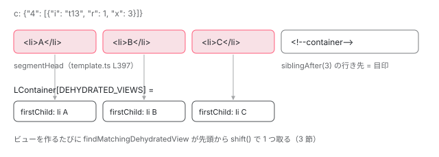

[目次](../README.md) › [SSR とハイドレーション](README.md) › 第 11 回 / 全 15 回

# @if・@for のビューと片付け：脱水されたビューを探して使い回す

> locateDehydratedViewsInContainer がコンテナのアンカーの前にある脱水済みビュー（DehydratedContainerView）を数で切り出す行、ビューを作るときに findMatchingDehydratedView がテンプレートの番号で一致するものを取り出す行、使われなかったビューを cleanupDehydratedViews が whenStable の後に DOM から消す行。サーバーとブラウザで @if の分岐が違ったときに何が起きるか。

angular/angular · 読了 約 13 分 · 発展 · [サイトで読む（デモが動きます）](https://angular-deep-dive-cyan.vercel.app/chapter/hydration-containers)

---

`@if` や `@for` の中身は、コンポーネントとは別の「埋め込みビュー」で、ブラウザでは更新パスの中で作られます。ハイドレーションでは、そのビューを作るたびに「サーバーが描いた、まだ持ち主のいないビュー」を 1 つ受け取って使い回します。この章では、その在庫（脱水されたビュー＝`DehydratedContainerView`）がどこで作られ、どの行で取り出され、使われなかったものがいつ DOM から消えるのかを追います。

読む対象は `packages/core/src/hydration/views.ts` と `hydration/cleanup.ts`、命令側の `render3/instructions/template.ts`・`control_flow.ts`、`linker/view_container_ref.ts` です。

1. [1. 概観](01-ssr-overview.md)
2. [2. renderApplication](02-ssr-render-application.md)
3. [3. platformServer と domino](03-ssr-platform-server.md)
4. [4. AngularAppEngine](04-ssr-app-engine.md)
5. [5. サーバールート](05-ssr-server-routes.md)
6. [6. プリレンダー](06-ssr-prerender.md)
7. [7. provideClientHydration](07-hydration-provide.md)
8. [8. ngh の書き出し](08-hydration-annotate.md)
9. [9. ノードの道順](09-hydration.md)
10. [10. ノードの確保](10-hydration-claim.md)
11. **11. コンテナと片付け**（この章）
12. [12. 不一致のエラー](12-hydration-errors.md)
13. [13. i18n](13-hydration-i18n.md)
14. [14. イベントの再生](14-event-replay.md)
15. [15. インクリメンタル](15-incremental-hydration.md)

## 0. サーバーが残した記録：このページの実物

このサイトのプリレンダー結果の 1 つ（`/chapter/http-transfer-cache`）の `__nghData__` には、次のような記録があります。コンテナ（`LContainer`。`@if`・`@for`・`<router-outlet>` などがビューを並べる箱）ごとに、中にあったビューが配列で書かれています。

| 記録（一部） | 読み方 |
| --- | --- |
| `"t": {"4": "t13"}, "c": {"4": [{"i": "t13", "r": 1, "x": 25}]}` | スロット 4 のコンテナのテンプレートは `t13`。そのビューが 25 個連続し、各ビューのルートノードは 1 個 |
| `"c": {"5": []}` | スロット 5 のコンテナは、サーバーではビュー 0 個（`@if` が偽だった、など） |
| `"c": {"23": [{"i": "c1318312449", "r": 1}]}` | `<app-root>` の `<router-outlet>`。`i` が `c…` なのはテンプレートでなくコンポーネント（章のコンポーネント）のビューだから |

`i`（`TEMPLATE_ID`）・`r`（`NUM_ROOT_NODES`）・`x`（`MULTIPLIER`）の書き方は [第 8 回](08-hydration-annotate.md)で読みました。この章はブラウザ側でこれを読む話です。

## 1. コンテナの目印を見つけ、ビューの区間を飛ばす

コンテナの目印（コメント `<!--container-->`）は、DOM ではコンテナの*ビューの後ろ*にあります。`ɵɵtemplate` も `@if` の `ɵɵconditionalCreate`・`@for` の `ɵɵrepeaterCreate` も、中で同じ `templateCreate` を通り、そこから次の関数が呼ばれます。目印を探す実装です。

📄 `angular/packages/core/src/render3/instructions/template.ts` L359–390 （▶ の行: 365, 368, 378–380, 388–389）

```ts
359 │ function locateOrCreateContainerAnchorImpl(
360 │   tView: TView,
361 │   lView: LView,
362 │   tNode: TNode,
363 │   index: number,
364 │ ): RComment {
365 ▶   const isNodeCreationMode = !canHydrateNode(lView, tNode);
366 │   lastNodeWasCreated(isNodeCreationMode);
367 │ 
368 ▶   const ssrId = lView[HYDRATION]?.data[TEMPLATES]?.[index] ?? null;
369 │ 
370 │   // Apply `ssrId` value to the underlying TView if it was not previously set.
371 │   //
372 │   // There might be situations when the same component is present in a template
373 │   // multiple times and some instances are opted-out of using hydration via
374 │   // `ngSkipHydration` attribute. In this scenario, at the time a TView is created,
375 │   // the `ssrId` might be `null` (if the first component is opted-out of hydration).
376 │   // The code below makes sure that the `ssrId` is applied to the TView if it's still
377 │   // `null` and verifies we never try to override it with a different value.
378 ▶   if (ssrId !== null && tNode.tView !== null) {
379 ▶     if (tNode.tView.ssrId === null) {
380 ▶       tNode.tView.ssrId = ssrId;
381 │     } else {
382 │       ngDevMode &&
383 │         assertEqual(tNode.tView.ssrId, ssrId, 'Unexpected value of the `ssrId` for this TView');
384 │     }
385 │   }
386 │ 
387 │   // Regular creation mode.
388 ▶   if (isNodeCreationMode) {
389 ▶     return createContainerAnchorImpl(tView, lView, tNode, index);
390 │   }
```

368 行目、サーバーの記録の `t`（`TEMPLATES`）からこのスロットのテンプレート ID を読みます。378〜380 行目で、それをテンプレートの `TView`（ビューの設計図）の `ssrId` に書きます。**この `ssrId` が、あとで在庫のビューと照合する鍵になります**（3 節）。365 行目で探せないと分かったら、388〜389 行目でふつうに作ります。

📄 `angular/packages/core/src/render3/instructions/template.ts` L391–411 （▶ の行: 394, 397–399）

```ts
391 │ 
392 │   const hydrationInfo = lView[HYDRATION]!;
393 │   // Hydration mode, looking up existing elements in DOM.
394 ▶   const currentRNode = locateNextRNode(hydrationInfo, tView, lView, tNode)!;
395 │   ngDevMode && validateNodeExists(currentRNode, lView, tNode);
396 │ 
397 ▶   setSegmentHead(hydrationInfo, index, currentRNode);
398 ▶   const viewContainerSize = calcSerializedContainerSize(hydrationInfo, index);
399 ▶   const comment = siblingAfter<RComment>(viewContainerSize, currentRNode)!;
400 │ 
401 │   if (ngDevMode) {
402 │     validateMatchingNode(comment, Node.COMMENT_NODE, null, lView, tNode);
403 │     markRNodeAsClaimedByHydration(comment);
404 │   }
405 │ 
406 │   return comment;
407 │ }
408 │ 
409 │ export function enableLocateOrCreateContainerAnchorImpl() {
410 │   _locateOrCreateContainerAnchor = locateOrCreateContainerAnchorImpl;
411 │ }
```

1. **394 行目：`locateNextRNode` が返すのは、1 つ目のビューの先頭ノード**

   前の兄弟の次にあるのは目印ではなく、ビューの中身です（[第 10 回](10-hydration-claim.md)の探し方そのまま）。
2. **397 行目：そこを区間の先頭として覚える**

   `segmentHeads[index]` に入れます。2 節でこれを読みます。
3. **398〜399 行目：ビューのルートノードの合計だけ進むと、目印のコメント**

   `calcSerializedContainerSize` の中身は次の引用です。

📄 `angular/packages/core/src/hydration/utils.ts` L470–488 （▶ の行: 474, 485）

```ts
470 │ export function getSerializedContainerViews(
471 │   hydrationInfo: DehydratedView,
472 │   index: number,
473 │ ): SerializedContainerView[] | null {
474 ▶   return hydrationInfo.data[CONTAINERS]?.[index] ?? null;
475 │ }
476 │ 
477 │ /**
478 │  * Computes the size of a serialized container (the number of root nodes)
479 │  * by calculating the sum of root nodes in all dehydrated views in this container.
480 │  */
481 │ export function calcSerializedContainerSize(hydrationInfo: DehydratedView, index: number): number {
482 │   const views = getSerializedContainerViews(hydrationInfo, index) ?? [];
483 │   let numNodes = 0;
484 │   for (let view of views) {
485 ▶     numNodes += view[NUM_ROOT_NODES] * (view[MULTIPLIER] ?? 1);
486 │   }
487 │   return numNodes;
488 │ }
```

485 行目、`r × (x ?? 1)` の和です。上の表の `{"r": 1, "x": 25}` なら 25 個進みます。

## 2. 在庫を作る：DehydratedContainerView に切り分ける

`templateCreate` は目印を受け取って `LContainer` を作った直後に `populateDehydratedViewsInLContainer` を呼びます （[ivy-lcontainer](../ivy/11-ivy-lcontainer.md) で読んだ `templateCreate` の最後の行）。差し替え後の実装です。

📄 `angular/packages/core/src/linker/view_container_ref.ts` L799–822 （▶ の行: 807, 811, 813–816, 820）

```ts
799 │ function populateDehydratedViewsInLContainerImpl(
800 │   lContainer: LContainer,
801 │   tNode: TNode,
802 │   hostLView: LView,
803 │ ): boolean {
804 │   // We already have a native element (anchor) set and the process
805 │   // of finding dehydrated views happened (so the `lContainer[DEHYDRATED_VIEWS]`
806 │   // is not null), exit early.
807 ▶   if (lContainer[NATIVE] && lContainer[DEHYDRATED_VIEWS]) {
808 │     return true;
809 │   }
810 │ 
811 ▶   const hydrationInfo = hostLView[HYDRATION];
812 │   const noOffsetIndex = tNode.index - HEADER_OFFSET;
813 ▶   const isNodeCreationMode =
814 ▶     !hydrationInfo ||
815 ▶     isInSkipHydrationBlock(tNode) ||
816 ▶     isDisconnectedNode(hydrationInfo, noOffsetIndex);
817 │ 
818 │   // Regular creation mode.
819 │   if (isNodeCreationMode) {
820 ▶     return false;
821 │   }
822 │ 
```

📄 `angular/packages/core/src/linker/view_container_ref.ts` L823–860 （▶ の行: 824, 826, 838, 841, 856–857）

```ts
823 │   // Hydration mode, looking up an anchor node and dehydrated views in DOM.
824 ▶   const currentRNode: RNode | null = getSegmentHead(hydrationInfo, noOffsetIndex);
825 │ 
826 ▶   const serializedViews = hydrationInfo.data[CONTAINERS]?.[noOffsetIndex];
827 │   if (serializedViews === undefined) {
828 │     ngDevMode &&
829 │       console.warn(
830 │         'Unexpected state: no hydration info available for a given TNode, ' +
831 │           'which represents a view container.',
832 │       );
833 │ 
834 │     // This ViewContainerRef was created for an element through a query
835 │     // (for example `viewChild(..., {read: ViewContainerRef})`) and there
836 │     // is no corresponding serialized container data in hydration metadata.
837 │     // Fall back to creation mode and insert an anchor on demand.
838 ▶     return false;
839 │   }
840 │ 
841 ▶   const [commentNode, dehydratedViews] = locateDehydratedViewsInContainer(
842 │     currentRNode!,
843 │     serializedViews,
844 │   );
845 │ 
846 │   if (ngDevMode) {
847 │     validateMatchingNode(commentNode, Node.COMMENT_NODE, null, hostLView, tNode, true);
848 │     // Do not throw in case this node is already claimed (thus `false` as a second
849 │     // argument). If this container is created based on an `<ng-template>`, the comment
850 │     // node would be already claimed from the `template` instruction. If an element acts
851 │     // as an anchor (e.g. <div #vcRef>), a separate comment node would be created/located,
852 │     // so we need to claim it here.
853 │     markRNodeAsClaimedByHydration(commentNode, false);
854 │   }
855 │ 
856 ▶   lContainer[NATIVE] = commentNode as RComment;
857 ▶   lContainer[DEHYDRATED_VIEWS] = dehydratedViews;
858 │ 
859 │   return true;
860 │ }
```

813〜816 行目の条件は[第 10 回](10-hydration-claim.md)の `canHydrateNode` とほぼ同じです。824 行目で 1 節の 397 行目が書いた区間の先頭を読み、826 行目でこのスロットの記録（`c`）を取り、841 行目で切り分けます。857 行目、結果を `LContainer[DEHYDRATED_VIEWS]` に入れます。これが在庫です。838 行目、記録が無いとき（クエリで後から `ViewContainerRef` を取ったときなど）は在庫なしで作るモードに戻ります。

📄 `angular/packages/core/src/hydration/views.ts` L25–58 （▶ の行: 35, 38–40, 43, 46, 51, 53, 57）

```ts
25 │ /**
26 │  * Given a current DOM node and a serialized information about the views
27 │  * in a container, walks over the DOM structure, collecting the list of
28 │  * dehydrated views.
29 │  */
30 │ export function locateDehydratedViewsInContainer(
31 │   currentRNode: RNode,
32 │   serializedViews: SerializedContainerView[],
33 │ ): [RNode, DehydratedContainerView[]] {
34 │   const dehydratedViews: DehydratedContainerView[] = [];
35 ▶   for (const serializedView of serializedViews) {
36 │     // Repeats a view multiple times as needed, based on the serialized information
37 │     // (for example, for *ngFor-produced views).
38 ▶     for (let i = 0; i < (serializedView[MULTIPLIER] ?? 1); i++) {
39 ▶       const view: DehydratedContainerView = {
40 ▶         data: serializedView,
41 │         firstChild: null,
42 │       };
43 ▶       if (serializedView[NUM_ROOT_NODES] > 0) {
44 │         // Keep reference to the first node in this view,
45 │         // so it can be accessed while invoking template instructions.
46 ▶         view.firstChild = currentRNode as HTMLElement;
47 │ 
48 │         // Move over to the next node after this view, which can
49 │         // either be a first node of the next view or an anchor comment
50 │         // node after the last view in a container.
51 ▶         currentRNode = siblingAfter(serializedView[NUM_ROOT_NODES], currentRNode)!;
52 │       }
53 ▶       dehydratedViews.push(view);
54 │     }
55 │   }
56 │ 
57 ▶   return [currentRNode, dehydratedViews];
58 │ }
```

38 行目、**`x`（`MULTIPLIER`）の回数だけ同じ記録を繰り返し**、ビュー 1 つずつに分けます。サーバーが「同じテンプレートのビューが 25 個」と 1 行にまとめたものを、ここで 25 個の `DehydratedContainerView` に戻すわけです。39〜42 行目、各ビューは記録（`data`）と先頭ノード（`firstChild`）の組です。46 行目で現在地を先頭として覚え、51 行目で `r` 個進んで次のビューへ。最後まで進むと現在地は目印のコメントにいて、57 行目でそれも返します。43 行目、ルートノードが 0 個のビュー（中身が全部 `@if` の偽など）は進みません。



*@for が 3 件描いたコンテナ。記録 1 行（x: 3）を 3 つの DehydratedContainerView に切り、末尾のコメントが LContainer の目印になる*

## 3. 在庫から 1 つ取る：findMatchingDehydratedView

在庫を作るのは作成パスですが、`@for` の中のビューが作られるのは更新パスです（`ɵɵrepeater` がコレクションを照合して足りない分を作る）。その「作る」の実装がこれです。

📄 `angular/packages/core/src/render3/instructions/control_flow.ts` L458–472 （▶ の行: 459, 461, 467）

```ts
458 │   override create(index: number, value: unknown): LView<RepeaterContext<unknown>> {
459 ▶     const dehydratedView = findMatchingDehydratedView(
460 │       this.lContainer,
461 ▶       this.templateTNode.tView!.ssrId,
462 │     );
463 │     const embeddedLView = createAndRenderEmbeddedLView(
464 │       this.hostLView,
465 │       this.templateTNode,
466 │       new RepeaterContext(this.lContainer, value, index),
467 ▶       {dehydratedView},
468 │     );
469 │     ngDevMode && this.operationsCounter?.recordCreate();
470 │ 
471 │     return embeddedLView;
472 │   }
```
*@for の LiveCollectionLContainerImpl.create*

459〜461 行目、ビューを 1 つ作る前に、テンプレートの `ssrId`（1 節の 380 行目で書いた ID）を鍵にして在庫を引きます。467 行目でそれを `createAndRenderEmbeddedLView` に渡すと、新しい埋め込みビューの `LView[HYDRATION]` になります （`createLView` の最後の引数。[ivy-lview](../ivy/06-ivy-lview.md)）。そのビューの命令は、[第 10 回](10-hydration-claim.md)のとおり `firstChild` から順にノードを確保していきます。`ViewContainerRef.createEmbeddedView` も同じ形です。

📄 `angular/packages/core/src/linker/view_container_ref.ts` L404–414 （▶ の行: 404, 413）

```ts
404 ▶     const dehydratedView = findMatchingDehydratedView(this._lContainer, templateRef.ssrId);
405 │     const viewRef = templateRef.createEmbeddedViewImpl(
406 │       context || <any>{},
407 │       injector,
408 │       dehydratedView,
409 │     );
410 │     if (onError) {
411 │       (viewRef as R3ViewRef<any>)._lView![ON_ERROR] = onError;
412 │     }
413 ▶     this.insertImpl(viewRef, index, shouldAddViewToDom(this._hostTNode, dehydratedView));
414 │     return viewRef;
```

`createComponent` の場合は鍵が `componentDef.id`（`c…`）になります。0 節の表の `<router-outlet>` の記録がそれで、ルーターが章のコンポーネントを作るときに、サーバーが描いた章の DOM を受け取ります。取り出す本体です。

📄 `angular/packages/core/src/hydration/views.ts` L81–111 （▶ の行: 94–95, 101–102, 110）

```ts
 81 │ /**
 82 │  * Retrieves the next dehydrated view from the LContainer and verifies that
 83 │  * it matches a given template id (from the TView that was used to create this
 84 │  * instance of a view). If the id doesn't match, that means that we are in an
 85 │  * unexpected state and can not complete the reconciliation process. Thus,
 86 │  * all dehydrated views from this LContainer are removed (including corresponding
 87 │  * DOM nodes) and the rendering is performed as if there were no dehydrated views
 88 │  * in this container.
 89 │  */
 90 │ function findMatchingDehydratedViewImpl(
 91 │   lContainer: LContainer,
 92 │   template: string | null,
 93 │ ): DehydratedContainerView | null {
 94 ▶   if (hasMatchingDehydratedView(lContainer, template)) {
 95 ▶     return lContainer[DEHYDRATED_VIEWS]!.shift()!;
 96 │   } else {
 97 │     // Otherwise, we are at the state when reconciliation can not be completed,
 98 │     // thus we remove all dehydrated views within this container (remove them
 99 │     // from internal data structures as well as delete associated elements from
100 │     // the DOM tree).
101 ▶     removeDehydratedViews(lContainer);
102 ▶     return null;
103 │   }
104 │ }
105 │ 
106 │ export function findMatchingDehydratedView(
107 │   lContainer: LContainer,
108 │   template: string | null,
109 │ ): DehydratedContainerView | null {
110 ▶   return _findMatchingDehydratedViewImpl(lContainer, template);
111 │ }
```

📄 `angular/packages/core/src/hydration/views.ts` L180–189 （▶ の行: 182, 188）

```ts
180 │ function hasMatchingDehydratedView(lContainer: LContainer, template: string | null): boolean {
181 │   const views = lContainer[DEHYDRATED_VIEWS];
182 ▶   if (!template || views === null || views.length === 0) {
183 │     return false;
184 │   }
185 │   // Verify whether the first dehydrated view in the container matches
186 │   // the template id passed to this function (that originated from a TView
187 │   // that was used to create an instance of an embedded or component views.
188 ▶   return views[0].data[TEMPLATE_ID] === template;
189 │ }
```

1. **188 行目：在庫の*先頭*の `i` と鍵を比べる**

   先頭しか見ません。ビューは DOM の順に並んでいて、作る順も同じだからです。
2. **95 行目：一致すれば `shift()` で取り出す**

   在庫が 1 つ減り、次の呼び出しでは 2 番目が先頭になります。
3. **101〜102 行目：一致しなければ、在庫を全部捨てる**

   182 行目、在庫が空でも一致しない扱いです。順番が崩れた以上、残りの在庫も信用できないので、`removeDehydratedViews`（5 節）でこのコンテナの在庫と DOM を**その場で**消し、`null` を返します。`null` を受け取った側はビューを普通に作ります。

### 受け取ったビューは DOM に挿入しない

📄 `angular/packages/core/src/render3/view_manipulation.ts` L73–87 （▶ の行: 85）

```ts
73 │ /**
74 │  * Returns whether an elements that belong to a view should be
75 │  * inserted into the DOM. For client-only cases, DOM elements are
76 │  * always inserted. For hydration cases, we check whether serialized
77 │  * info is available for a view and the view is not in a "skip hydration"
78 │  * block (in which case view contents was re-created, thus needing insertion).
79 │  */
80 │ export function shouldAddViewToDom(
81 │   tNode: TNode,
82 │   dehydratedView?: DehydratedContainerView | null,
83 │ ): boolean {
84 │   return (
85 ▶     !dehydratedView || dehydratedView.firstChild === null || hasInSkipHydrationBlockFlag(tNode)
86 │   );
87 │ }
```

85 行目。在庫から受け取ったビュー（`firstChild` がある）は、`addLViewToLContainer` で `LContainer` に登録されても、DOM への挿入はしません。ノードは最初から正しい場所にあるからです。在庫が無かった（`null`）ビューは挿入します。[第 10 回](10-hydration-claim.md)の `appendChild` を飛ばす仕組みの、ビュー単位版です。

## 4. @if の分岐がサーバーと違ったら

`@if / @else` は、分岐ごとに別のテンプレートと別のコンテナを持ちます（[ivy-lcontainer](../ivy/11-ivy-lcontainer.md)）。`ɵɵconditional` は選んだ分岐のコンテナについて `findAndReconcileMatchingDehydratedViews` を呼びます。

📄 `angular/packages/core/src/hydration/views.ts` L113–137 （▶ の行: 118–119, 125–126）

```ts
113 │ export function findAndReconcileMatchingDehydratedViewsImpl(
114 │   lContainer: LContainer,
115 │   templateTNode: TNode,
116 │   hostLView: LView,
117 │ ): DehydratedContainerView | null {
118 ▶   if (templateTNode.tView!.ssrId === null) return null;
119 ▶   const dehydratedView = findMatchingDehydratedView(lContainer, templateTNode.tView!.ssrId);
120 │ 
121 │   // we know that an ssrId was generated, but we were unable to match it to
122 │   // a dehydrated view, which means that we may have changed branches
123 │   // between server and client. We'll need to find and remove those
124 │   // stale dehydrated views.
125 ▶   if (hostLView[TVIEW].firstUpdatePass && dehydratedView === null) {
126 ▶     removeStaleDehydratedBranch(hostLView, templateTNode);
127 │   }
128 │   return dehydratedView;
129 │ }
130 │ 
131 │ export function findAndReconcileMatchingDehydratedViews(
132 │   lContainer: LContainer,
133 │   templateTNode: TNode,
134 │   hostLView: LView,
135 │ ): DehydratedContainerView | null {
136 │   return _findAndReconcileMatchingDehydratedViewsImpl(lContainer, templateTNode, hostLView);
137 │ }
```

サーバーで分岐 A、ブラウザで分岐 B を選んだとします。B のコンテナの在庫はサーバーでは空（`c: []`）なので、119 行目は `null` です。すると 125 行目、このテンプレートで初めての更新パスなら、126 行目で「古い分岐」を探して消しに行きます。

📄 `angular/packages/core/src/hydration/views.ts` L139–178 （▶ の行: 149, 153, 155, 160, 163, 166, 174）

```ts
139 │ /**
140 │  * In the case that we have control flow that changes branches between server and
141 │  * client, we're left with dehydrated content that will not be used. We need to find
142 │  * it and clean it up at the right time so that we don't see duplicate content for
143 │  * a few moments before the application reaches stability. This navigates the
144 │  * control flow containers by looking at the TNodeFlags to find the matching
145 │  * dehydrated content for the branch that is now stale from the server and removes it.
146 │  */
147 │ function removeStaleDehydratedBranch(hostLView: LView, tNode: TNode): void {
148 │   let currentTNode: TNode | null = tNode;
149 ▶   while (currentTNode) {
150 │     // We can return here if we've found the dehydrated view and cleaned it up.
151 │     // Otherwise we continue on until we either find it or reach the start of
152 │     // the control flow.
153 ▶     if (cleanupMatchingDehydratedViews(hostLView, currentTNode)) return;
154 │ 
155 ▶     if ((currentTNode.flags & TNodeFlags.isControlFlowStart) === TNodeFlags.isControlFlowStart) {
156 │       // we've hit the top of the control flow loop
157 │       break;
158 │     }
159 │ 
160 ▶     currentTNode = currentTNode.prev;
161 │   }
162 │ 
163 ▶   currentTNode = tNode.next; // jump to place we started so we can navigate down from there
164 │ 
165 │   while (currentTNode) {
166 ▶     if ((currentTNode.flags & TNodeFlags.isInControlFlow) !== TNodeFlags.isInControlFlow) {
167 │       // we've exited control flow and need to exit the loop.
168 │       break;
169 │     }
170 │ 
171 │     // Similar to above, we can return here if we've found the dehydrated view
172 │     // and cleaned it up. Otherwise we continue on until we either find it or
173 │     // reach the end of the control flow.
174 ▶     if (cleanupMatchingDehydratedViews(hostLView, currentTNode)) return;
175 │ 
176 │     currentTNode = currentTNode.next;
177 │   }
178 │ }
```

📄 `angular/packages/core/src/hydration/views.ts` L191–203 （▶ の行: 192, 195, 198–199）

```ts
191 │ function cleanupMatchingDehydratedViews(hostLView: LView, currentTNode: TNode): boolean {
192 ▶   const ssrId = currentTNode.tView?.ssrId;
193 │   if (ssrId == null /* check both `null` and `undefined` */) return false;
194 │ 
195 ▶   const container = hostLView[currentTNode.index];
196 │   // if we can find the dehydrated view in this container, we know we've found the stale view
197 │   // and we can remove it.
198 ▶   if (isLContainer(container) && hasMatchingDehydratedView(container, ssrId)) {
199 ▶     removeDehydratedViews(container);
200 │     return true;
201 │   }
202 │   return false;
203 │ }
```

1. **149〜160 行目：前の兄弟 `TNode` へ戻りながら探す**

   `@if` の各分岐のテンプレートは、同じビューの中で兄弟の `TNode` として並んでいます。155 行目、最初の分岐（`isControlFlowStart` の印）に着いたら止まります。
2. **163〜177 行目：見つからなければ、後ろの兄弟へ**

   166 行目、`isInControlFlow` の印が無い `TNode` に出たら、この `@if` の外なので止まります。
3. **192〜199 行目：そのコンテナに「自分のテンプレートの在庫」があれば、古い分岐**

   195 行目で兄弟のコンテナを取り、198 行目で在庫の先頭がそのコンテナ自身の `ssrId` と一致すれば、199 行目で在庫と DOM を消します。

なぜ 5 節の後片付けを待たずにここで消すのか。139〜146 行目のコメントのとおり、待つと安定するまでの間、サーバーの分岐 A とブラウザの分岐 B が**両方画面に出る**からです。この仕組みは v20.0.0 で入った修正（`fix(core): fixes timing of hydration cleanup on control flow (#60425)`）で、v22 の新機能ではありません。

## 5. 使われなかった在庫を消す：cleanupDehydratedViews

在庫が余るのは、例えばサーバーで 5 件、ブラウザで 3 件だった `@for` です。3 回取り出したあと 2 つ残ります。これを消すのは、[第 7 回](07-hydration-provide.md)で見た `withDomHydration` の `APP_BOOTSTRAP_LISTENER` で、`whenStableWithTimeout(appRef)` が解決したあとに `cleanupDehydratedViews(appRef)` を呼びます。

📄 `angular/packages/core/src/hydration/cleanup.ts` L125–145 （▶ の行: 130, 132, 135, 137, 140）

```ts
125 │ /**
126 │  * Walks over all views registered within the ApplicationRef and removes
127 │  * all dehydrated views from all `LContainer`s along the way.
128 │  */
129 │ export function cleanupDehydratedViews(appRef: ApplicationRef) {
130 ▶   const viewRefs = appRef._views;
131 │   for (const viewRef of viewRefs) {
132 ▶     const lNode = getLNodeForHydration(viewRef);
133 │     // An `lView` might be `null` if a `ViewRef` represents
134 │     // an embedded view (not a component view).
135 ▶     if (lNode !== null && lNode[HOST] !== null) {
136 │       if (isLView(lNode)) {
137 ▶         cleanupLView(lNode);
138 │       } else {
139 │         // Cleanup in all views within this view container
140 ▶         cleanupLContainer(lNode);
141 │       }
142 │       ngDevMode && ngDevMode.dehydratedViewsCleanupRuns++;
143 │     }
144 │   }
145 │ }
```

130 行目、`ApplicationRef` に登録されたルートのビュー（ふつうは `<app-root>` 1 つ）から始めます。137 行目でコンポーネントの `LView` なら `cleanupLView`、140 行目でルートがコンテナを兼ねるなら `cleanupLContainer` へ。

📄 `angular/packages/core/src/hydration/cleanup.ts` L86–123 （▶ の行: 91, 97–98, 101–102, 114–115, 117–118, 120）

```ts
 86 │ /**
 87 │  * Walks over all views within this LContainer invokes dehydrated views
 88 │  * cleanup function for each one.
 89 │  */
 90 │ export function cleanupLContainer(lContainer: LContainer) {
 91 ▶   removeDehydratedViews(lContainer);
 92 │ 
 93 │   // The host could be an LView if this container is on a component node.
 94 │   // In this case, descend into host LView for further cleanup. See also
 95 │   // LContainer[HOST] docs for additional information.
 96 │   const hostLView = lContainer[HOST];
 97 ▶   if (isLView(hostLView)) {
 98 ▶     cleanupLView(hostLView);
 99 │   }
100 │ 
101 ▶   for (let i = CONTAINER_HEADER_OFFSET; i < lContainer.length; i++) {
102 ▶     cleanupLView(lContainer[i] as LView);
103 │   }
104 │ }
105 │ 
106 │ /**
107 │  * Walks over `LContainer`s and components registered within
108 │  * this LView and invokes dehydrated views cleanup function for each one.
109 │  */
110 │ export function cleanupLView(lView: LView) {
111 │   cleanupI18nHydrationData(lView);
112 │ 
113 │   const tView = lView[TVIEW];
114 ▶   for (let i = HEADER_OFFSET; i < tView.bindingStartIndex; i++) {
115 ▶     if (isLContainer(lView[i])) {
116 │       const lContainer = lView[i];
117 ▶       cleanupLContainer(lContainer);
118 ▶     } else if (isLView(lView[i])) {
119 │       // This is a component, enter the `cleanupLView` recursively.
120 ▶       cleanupLView(lView[i]);
121 │     }
122 │   }
123 │ }
```

木を全部たどります。114 行目、`LView` の各スロットのうち、115〜117 行目でコンテナならそのコンテナへ、118〜120 行目で子コンポーネントの `LView` ならそこへ入ります。コンテナに入ると、91 行目でまず自分の在庫を消し、101〜102 行目で中の各ビューへ降ります。消す本体は次の 2 つです。

📄 `angular/packages/core/src/hydration/cleanup.ts` L28–54 （▶ の行: 34, 42–43, 45, 53）

```ts
28 │ /**
29 │  * Removes all dehydrated views from a given LContainer:
30 │  * both in internal data structure, as well as removing
31 │  * corresponding DOM nodes that belong to that dehydrated view.
32 │  */
33 │ export function removeDehydratedViews(lContainer: LContainer) {
34 ▶   const views = lContainer[DEHYDRATED_VIEWS] ?? [];
35 │   const parentLView = lContainer[PARENT];
36 │   const renderer = parentLView[RENDERER];
37 │   const retainedViews = [];
38 │   for (const view of views) {
39 │     // Do not clean up contents of `@defer` blocks.
40 │     // The cleanup for this content would happen once a given block
41 │     // is triggered and hydrated.
42 ▶     if (view.data[DEFER_BLOCK_ID] !== undefined) {
43 ▶       retainedViews.push(view);
44 │     } else {
45 ▶       removeDehydratedView(view, renderer);
46 │       ngDevMode && ngDevMode.dehydratedViewsRemoved++;
47 │     }
48 │   }
49 │   // Reset the value to an array to indicate that no
50 │   // further processing of dehydrated views is needed for
51 │   // this view container (i.e. do not trigger the lookup process
52 │   // once again in case a `ViewContainerRef` is created later).
53 ▶   lContainer[DEHYDRATED_VIEWS] = retainedViews;
54 │ }
```

📄 `angular/packages/core/src/hydration/cleanup.ts` L68–84 （▶ の行: 73, 75–76, 78–79）

```ts
68 │ /**
69 │  * Helper function to remove all nodes from a dehydrated view.
70 │  */
71 │ function removeDehydratedView(dehydratedView: DehydratedContainerView, renderer: Renderer) {
72 │   let nodesRemoved = 0;
73 ▶   let currentRNode = dehydratedView.firstChild;
74 │   if (currentRNode) {
75 ▶     const numNodes = dehydratedView.data[NUM_ROOT_NODES];
76 ▶     while (nodesRemoved < numNodes) {
77 │       ngDevMode && validateSiblingNodeExists(currentRNode);
78 ▶       const nextSibling: RNode = currentRNode.nextSibling!;
79 ▶       nativeRemoveNode(renderer, currentRNode, false);
80 │       currentRNode = nextSibling;
81 │       nodesRemoved++;
82 │     }
83 │   }
84 │ }
```

1. **42〜43 行目：`@defer` のビューは残す**

   インクリメンタルハイドレーションでまだ起こしていない `@defer` ブロックの中身は、在庫のまま残します。そのブロックがハイドレーションされたときに片付けます（[第 15 回](15-incremental-hydration.md)）。
2. **73〜82 行目：`firstChild` から `r` 個のノードを消す**

   78 行目で次を先に覚えてから、79 行目で消します。
3. **53 行目：在庫を `[]` にする**

   `null` ではなく空配列にするのは、「もう探し終えた」の印です。あとで同じコンテナに `ViewContainerRef` が作られても、`populateDehydratedViewsInLContainerImpl` の 807 行目で早く抜けます。

> **🧪 DEMO — このページのコンテナの記録を数える**
>
> ボタンを押すと、`fetch(location.pathname)` でこのページの元の HTML を取り直し、`<script id="ng-state">` の `__nghData__` から、すべての `c`（コンテナの記録）を コンテナのビューの中まで再帰で集めます。「在庫のビュー数」は locateDehydratedViewsInContainer の 38 行目と同じ `x ?? 1` の和、「ルートノード数」は calcSerializedContainerSize の 485 行目と同じ式で、この章のコードが計算しています（Angular の関数は呼んでいません）。
>
> ▶ [このデモはサイトで動かせます](https://angular-deep-dive-cyan.vercel.app/chapter/hydration-containers)

## ここまでの呼び出し

- `ɵɵrepeaterCreate / ɵɵconditionalCreate → templateCreate` — render3/instructions/template.ts — *作成パス*
  - `locateOrCreateContainerAnchorImpl` — render3/instructions/template.ts L359 — *ssrId を TView へ、区間を飛ばして目印へ*
  - `populateDehydratedViewsInLContainerImpl` — linker/view\_container\_ref.ts L799
    - `locateDehydratedViewsInContainer` — hydration/views.ts L30 — *x 回繰り返して在庫に*
- `ɵɵrepeater → LiveCollectionLContainerImpl.create` — render3/instructions/control\_flow.ts L458 — *更新パス*
  - `findMatchingDehydratedViewImpl` — hydration/views.ts L90 — *先頭が一致すれば shift、違えば全部捨てる*
  - `createAndRenderEmbeddedLView(…, {dehydratedView})` — render3/view\_manipulation.ts — *LView\[HYDRATION\] になる*
  - `shouldAddViewToDom → false` — render3/view\_manipulation.ts L80
- `whenStableWithTimeout(appRef).then(…)` — hydration/api.ts — *第 7 回*
  - `cleanupDehydratedViews(appRef)` — hydration/cleanup.ts L129
    - `cleanupLView / cleanupLContainer → removeDehydratedViews` — hydration/cleanup.ts L33 — *@defer の在庫は残す*

## 聞かれそうな質問

**Q. サーバーでは 3 件、ブラウザでは 5 件だったら？**

1〜3 件目は在庫を `shift()` で受け取り（95 行目）、DOM に挿入しません（85 行目）。4 件目では在庫が空なので 182 行目で不一致になり、101 行目の `removeDehydratedViews` は空の在庫に対して何もせず、`null` が返ります。4・5 件目は普通に作られ、`shouldAddViewToDom` が真なので目印の前に挿入されます。エラーにはなりません。

**Q. 逆に、サーバーで 5 件、ブラウザで 3 件なら？**

3 回取り出したあと、在庫が 2 つ残ります。残りはアプリが安定したあと `cleanupDehydratedViews` がたどり着いたとき、45 行目・79 行目で DOM から消えます。それまでの間は、サーバーが描いた 4・5 件目が画面に残っています。

**Q. @if の分岐がサーバーと違うと？**

選んだ分岐のコンテナには在庫が無いので普通に作って挿入し、125〜126 行目で兄弟の分岐のコンテナを探して、サーバーの分岐の在庫と DOM を 199 行目で**すぐに**消します（安定を待たない）。ちなみに一致の確認はテンプレート ID だけなので、同じ分岐で中のデータが違うだけなら在庫は使われ、値は更新パスで書き換わります。

**Q. 片付けのタイミングが whenStable の後なのはなぜ？**

サーバーが `ngh` を書いたのも、アプリが安定した時点の DOM だからです（[第 7 回](07-hydration-provide.md)の `withDomHydration` のコメントにも「サーバーでシリアライズを始める時と同じタイミング」とあります）。ブラウザでも、データの到着を待ってから描かれるビューは安定するまでの間に作られ、在庫を受け取れます。早く消すと、それらが使うはずだった DOM まで消してしまいます。

**Q. 在庫と違うテンプレートのビューを先に作ったら？**

188 行目の比較が偽になり、101 行目でそのコンテナの在庫を全部その場で捨てます。そのコンテナのビューは以後すべて新しく作られます。見た目は同じでも、DOM ノードは作り直されています。

## 読み終えて

- コンテナの目印は DOM でビューの*後ろ*。`r × (x ?? 1)` の合計だけ進んで目印に着く。
- `locateDehydratedViewsInContainer` が記録を `x` 回繰り返して、ビュー 1 つずつの在庫（`DEHYDRATED_VIEWS`）にする。
- ビューを作るたびに `findMatchingDehydratedView` が在庫の先頭を `ssrId` で照合し、一致すれば `shift()`、違えば全部捨てる。
- `@if` の分岐が違うときは、古い分岐の在庫をその場で消す（v20 から）。
- 余った在庫は安定後に `cleanupDehydratedViews` が木をたどって消す。`@defer` の在庫だけは残す。

---

← 前: [DOM ノードの確保：命令がノードを作らずに見つける](10-hydration-claim.md)  
次: [ハイドレーションの不一致：NG0500 番台のエラーと ngSkipHydration](12-hydration-errors.md) →
