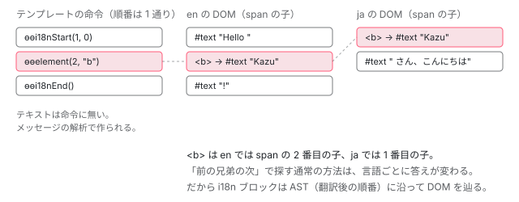

[目次](../README.md) › [SSR とハイドレーション](README.md) › 第 13 回 / 全 15 回

# i18n のハイドレーション：翻訳で順番が変わるノードを辿る

> withI18nSupport を付けないと i18n を含むコンポーネントに ngSkipHydration が付いて丸ごと作り直される理由、サーバーで trySerializeI18nBlock が i18n のノードごとに DOM 上の位置を記録する行、ブラウザで prepareI18nBlockForHydration が翻訳後の構造を辿ってノードを集める行、ICU のケースの確保と後片付け。

angular/angular · 読了 約 12 分 · 発展 · [サイトで読む（デモが動きます）](https://angular-deep-dive-cyan.vercel.app/chapter/hydration-i18n)

---

`i18n` 属性を付けたブロックは、翻訳によって**テンプレートに書いた順番と DOM の順番が入れ替わります**。この章では、`withI18nSupport()` が無いと i18n を含むコンポーネントがまるごと作り直される理由と、付けたときにサーバーが何を書き出し、ブラウザがどの順で DOM を辿ってノードを確保するのかを、行番号で追います。ICU（`plural` / `select`）のケースがサーバーとブラウザで違ったときの後片付けまで読みます。

読む対象は `packages/core/src/hydration/i18n.ts`（ほぼ全体）、`hydration/api.ts`、`hydration/annotate.ts`、それに命令側の `render3/instructions/i18n.ts` と `render3/i18n/i18n_apply.ts` です。

1. [1. 概観](01-ssr-overview.md)
2. [2. renderApplication](02-ssr-render-application.md)
3. [3. platformServer と domino](03-ssr-platform-server.md)
4. [4. AngularAppEngine](04-ssr-app-engine.md)
5. [5. サーバールート](05-ssr-server-routes.md)
6. [6. プリレンダー](06-ssr-prerender.md)
7. [7. provideClientHydration](07-hydration-provide.md)
8. [8. ngh の書き出し](08-hydration-annotate.md)
9. [9. ノードの道順](09-hydration.md)
10. [10. ノードの確保](10-hydration-claim.md)
11. [11. コンテナと片付け](11-hydration-containers.md)
12. [12. 不一致のエラー](12-hydration-errors.md)
13. **13. i18n**（この章）
14. [14. イベントの再生](14-event-replay.md)
15. [15. インクリメンタル](15-incremental-hydration.md)

## 1. なぜ i18n だけ別扱いなのか

例として、次のテンプレートを英語と日本語で表示する場合を考えます。`<span i18n>Hello <b>{{ name }}</b>!</span>`。日本語訳は「`<b>{{ name }}</b> さん、こんにちは`」とします。コンパイラはこのブロックを `ɵɵi18nStart(1, 0)` と `ɵɵelement(2, "b")` という命令にし、メッセージ本体は `"Hello �#2��0��/#2�!"` という 1 本の文字列にして `consts` に置きます （`�#2�` は「番号 2 の要素の開始」、`�0�` は 0 番目の補間の目印です）。

📄 `angular/packages/core/src/render3/instructions/i18n.ts` L70–105 （▶ の行: 71, 73–74, 87, 91, 93, 103–104）

```ts
 70 │   ngDevMode && assertDefined(tView, `tView should be defined`);
 71 ▶   const message = getConstant<string>(tView.consts, messageIndex)!;
 72 │   const parentTNode = getCurrentParentTNode() as TElementNode | null;
 73 ▶   if (tView.firstCreatePass) {
 74 ▶     i18nStartFirstCreatePass(
 75 │       tView,
 76 │       parentTNode === null ? 0 : parentTNode.index,
 77 │       lView,
 78 │       adjustedIndex,
 79 │       message,
 80 │       subTemplateIndex,
 81 │     );
 82 │   }
 83 │ 
 84 │   // Set a flag that this LView has i18n blocks.
 85 │   // The flag is later used to determine whether this component should
 86 │   // be hydrated (currently hydration is not supported for i18n blocks).
 87 ▶   if (tView.type === TViewType.Embedded) {
 88 │     // Annotate host component's LView (not embedded view's LView),
 89 │     // since hydration can be skipped on per-component basis only.
 90 │     const componentLView = lView[DECLARATION_COMPONENT_VIEW];
 91 ▶     componentLView[FLAGS] |= LViewFlags.HasI18n;
 92 │   } else {
 93 ▶     lView[FLAGS] |= LViewFlags.HasI18n;
 94 │   }
 95 │ 
 96 │   const tI18n = tView.data[adjustedIndex] as TI18n;
 97 │   const sameViewParentTNode = parentTNode === lView[T_HOST] ? null : parentTNode;
 98 │   const parentRNode = getClosestRElement(tView, sameViewParentTNode, lView);
 99 │   // If `parentTNode` is an `ElementContainer` than it has `<!--ng-container--->`.
100 │   // When we do inserts we have to make sure to insert in front of `<!--ng-container--->`.
101 │   const insertInFrontOf =
102 │     parentTNode && parentTNode.type & TNodeType.ElementContainer ? lView[parentTNode.index] : null;
103 ▶   prepareI18nBlockForHydration(lView, adjustedIndex, parentTNode, subTemplateIndex);
104 ▶   applyCreateOpCodes(lView, tI18n.create, parentRNode, insertInFrontOf);
105 │   setInI18nBlock(true);
```

71 行目で `consts` からメッセージ文字列を取り出し、73〜81 行目の初回だけ `i18nStartFirstCreatePass` がそれを解析します。ビルド時に翻訳した場合も、実行時に `$localize` で翻訳した場合も、ここで取り出す文字列は**すでに翻訳済み**です。103 行目の `prepareI18nBlockForHydration` が、この章のブラウザ側の入口です。104 行目の `applyCreateOpCodes`（テキストノードを作る処理）より**前**に呼ばれる点を覚えておいてください。87〜94 行目の `LViewFlags.HasI18n` は 2 節で使います。

📄 `angular/packages/core/src/render3/i18n/i18n_parse.ts` L213–248 （▶ の行: 219, 229, 236–237, 242, 245）

```ts
213 │     } else {
214 │       // Odd indexes are placeholders (elements and sub-templates)
215 │       // At this point value is something like: '/#1:2' (originally coming from '�/#1:2�')
216 │       const isClosing = value.charCodeAt(0) === CharCode.SLASH;
217 │       const type = value.charCodeAt(isClosing ? 1 : 0);
218 │       ngDevMode && assertOneOf(type, CharCode.STAR, CharCode.HASH);
219 ▶       const index = HEADER_OFFSET + Number.parseInt(value.substring(isClosing ? 2 : 1));
220 │       if (isClosing) {
221 │         existingTNodeStack.shift();
222 │         astStack.shift();
223 │         setCurrentTNode(getCurrentParentTNode()!, false);
224 │       } else {
225 │         const tNode = createTNodePlaceholder(tView, existingTNodeStack[0], index);
226 │         existingTNodeStack.unshift([]);
227 │         setCurrentTNode(tNode, true);
228 │ 
229 ▶         const placeholderNode: I18nPlaceholderNode = {
230 │           kind: I18nNodeKind.PLACEHOLDER,
231 │           index,
232 │           children: [],
233 │           type:
234 │             type === CharCode.HASH ? I18nPlaceholderType.ELEMENT : I18nPlaceholderType.SUBTEMPLATE,
235 │         };
236 ▶         astStack[0].push(placeholderNode);
237 ▶         astStack.unshift(placeholderNode.children);
238 │       }
239 │     }
240 │   }
241 │ 
242 ▶   tView.data[index] = <TI18n>{
243 │     create: createOpCodes,
244 │     update: updateOpCodes,
245 ▶     ast: astStack[0],
246 │     parentTNodeIndex,
247 │   };
248 │ }
```

解析の後半です。`�#2�` のような目印を見つけると、219 行目で番号（2 に `HEADER_OFFSET` を足したもの）を取り出し、229〜237 行目で `PLACEHOLDER` ノードを AST（構文木）に積みます。242〜247 行目で、作った AST を `tView.data[index]` の `TI18n` に保存します。この `ast` は**翻訳後の文の順番**で並んでいます。英語なら「テキスト → b → テキスト」、日本語なら「b → テキスト」です。テンプレートの命令の順番（`ɵɵelement(2, "b")` が 1 つあるだけ）とは関係がありません。

📄 `angular/packages/core/src/render3/interfaces/i18n.ts` L459–495 （▶ の行: 461, 467, 470, 480, 486, 489）

```ts
459 │ export interface I18nICUNode {
460 │   /** The AST node kind */
461 ▶   kind: I18nNodeKind.ICU;
462 │ 
463 │   /** The LView index */
464 │   index: number;
465 │ 
466 │   /** The branching cases */
467 ▶   cases: Array<Array<I18nNode>>;
468 │ 
469 │   /** The LView index that stores the active case */
470 ▶   currentCaseLViewIndex: number;
471 │ }
472 │ 
473 │ /**
474 │  * Represents special content that is embedded into the translation. This can
475 │  * either be a special built-in element, such as <ng-container> and <ng-content>,
476 │  * or it can be a sub-template, for example, from a structural directive.
477 │  */
478 │ export interface I18nPlaceholderNode {
479 │   /** The AST node kind */
480 ▶   kind: I18nNodeKind.PLACEHOLDER;
481 │ 
482 │   /** The LView index */
483 │   index: number;
484 │ 
485 │   /** The child nodes */
486 ▶   children: Array<I18nNode>;
487 │ 
488 │   /** The placeholder type */
489 ▶   type: I18nPlaceholderType;
490 │ }
491 │ 
492 │ export const enum I18nPlaceholderType {
493 │   ELEMENT,
494 │   SUBTEMPLATE,
495 │ }
```

AST のノードは 4 種類です。`ICU` は 467 行目の `cases` にケースごとの子を持ち、470 行目の `currentCaseLViewIndex` が「いまどのケースか」を入れる LView の位置です。`PLACEHOLDER` はテンプレートに書いた要素（`<b>`）や `*ngIf` などのサブテンプレートで、489 行目の `type` で区別します。



*同じテンプレートでも、翻訳によって DOM の並びが変わる。ハイドレーションは翻訳後の AST の順番で DOM を辿る必要がある。*

## 2. withI18nSupport が無いとき：コンポーネントごと作り直す

i18n ブロックを含むコンポーネントは、既定では**ハイドレーションの対象から外れます**。外すのはサーバー側、`ngh` 属性を書き出す関数です。

📄 `angular/packages/core/src/hydration/annotate.ts` L819–843 （▶ の行: 827, 835–836, 838, 840）

```ts
819 │ function annotateHostElementForHydration(
820 │   element: RElement,
821 │   lView: LView,
822 │   parentDeferBlockId: string | null,
823 │   context: HydrationContext,
824 │ ): number | null {
825 │   const renderer = lView[RENDERER];
826 │   if (
827 ▶     (hasI18n(lView) && !isI18nHydrationSupportEnabled()) ||
828 │     componentUsesShadowDomEncapsulation(lView)
829 │   ) {
830 │     // Attach the skip hydration attribute if this component:
831 │     // - either has i18n blocks, since hydrating such blocks is not yet supported
832 │     // - or uses ShadowDom view encapsulation, since Domino doesn't support
833 │     //   shadow DOM, so we can not guarantee that client and server representations
834 │     //   would exactly match
835 ▶     renderer.setAttribute(element, SKIP_HYDRATION_ATTR_NAME, '');
836 ▶     return null;
837 │   } else {
838 ▶     const ngh = serializeLView(lView, parentDeferBlockId, context);
839 │     const index = context.serializedViewCollection.add(ngh);
840 ▶     renderer.setAttribute(element, NGH_ATTR_NAME, index.toString());
841 │     return index;
842 │   }
843 │ }
```

827 行目。`hasI18n(lView)`（1 節 87〜94 行目で立てた `HasI18n` フラグ）が真で、`isI18nHydrationSupportEnabled()` が偽なら、835 行目でホスト要素に `ngSkipHydration` 属性を付け、836 行目で `null` を返して `ngh` を書きません。ふつうは 838〜840 行目で `serializeLView` の結果を `ngh="数字"` として書きます。`ngSkipHydration` が付いたコンポーネントは、ブラウザでサーバーの DOM を捨てて作り直されます （`ngSkipHydration` の読み取りは [第 9 回](09-hydration.md)）。フラグは 87〜91 行目のとおり、埋め込みビュー（`@if` の中など）に i18n があっても**宣言元のコンポーネントの LView** に立つので、外れる単位はコンポーネントです。

📄 `angular/packages/core/src/hydration/i18n.ts` L35–74 （▶ の行: 35, 37, 41–42, 45, 64, 68, 71, 73）

```ts
35 ▶ let _isI18nHydrationSupportEnabled = false;
36 │ 
37 ▶ let _prepareI18nBlockForHydrationImpl: typeof prepareI18nBlockForHydrationImpl = () => {
38 │   // noop unless `enablePrepareI18nBlockForHydrationImpl` is invoked.
39 │ };
40 │ 
41 ▶ export function setIsI18nHydrationSupportEnabled(enabled: boolean) {
42 ▶   _isI18nHydrationSupportEnabled = enabled;
43 │ }
44 │ 
45 ▶ export function isI18nHydrationSupportEnabled() {
46 │   return _isI18nHydrationSupportEnabled;
47 │ }
48 │ 
49 │ /**
50 │  * Prepares an i18n block and its children, located at the given
51 │  * view and instruction index, for hydration.
52 │  *
53 │  * @param lView lView with the i18n block
54 │  * @param index index of the i18n block in the lView
55 │  * @param parentTNode TNode of the parent of the i18n block
56 │  * @param subTemplateIndex sub-template index, or -1 for the main template
57 │  */
58 │ export function prepareI18nBlockForHydration(
59 │   lView: LView,
60 │   index: number,
61 │   parentTNode: TNode | null,
62 │   subTemplateIndex: number,
63 │ ): void {
64 ▶   _prepareI18nBlockForHydrationImpl(lView, index, parentTNode, subTemplateIndex);
65 │ }
66 │ 
67 │ export function enablePrepareI18nBlockForHydrationImpl() {
68 ▶   _prepareI18nBlockForHydrationImpl = prepareI18nBlockForHydrationImpl;
69 │ }
70 │ 
71 ▶ export function isI18nHydrationEnabled(injector?: Injector) {
72 │   injector = injector ?? inject(Injector);
73 ▶   return injector.get(IS_I18N_HYDRATION_ENABLED, false);
74 │ }
```

i18n のハイドレーションには**種類の違う 2 つの「オン」**があります。

1. **35 行目：モジュール変数 `_isI18nHydrationSupportEnabled`**

   41〜47 行目の setter / getter で読み書きします。827 行目（annotate.ts）と、後で見るブラウザ側の `prepareI18nBlockForHydrationImpl`・`locateOrCreateNodeImpl` がこれを見ます。`withDomHydration` の初期化子が毎回いったん `false` に戻します （[第 7 回](07-hydration-provide.md)で読んだ `setIsI18nHydrationSupportEnabled(false)`）。
2. **71〜74 行目：トークン `IS_I18N_HYDRATION_ENABLED`**

   こちらは DI のトークンで、既定値は 73 行目の `false`。サーバーの書き出し（4 節の `trySerializeI18nBlock`）がこれを見ます。
3. **37〜39 行目・64 行目：実装の差し替え口**

   `_prepareI18nBlockForHydrationImpl` は最初は何もしない関数で、64 行目の呼び出しは空振りします。68 行目の `enablePrepareI18nBlockForHydrationImpl()` が呼ばれて初めて本物に替わります。使わないアプリのバンドルから i18n ハイドレーションのコードを消す（ツリーシェイク）ための形です。

## 3. withI18nSupport が足すもの

📄 `angular/packages/core/src/hydration/api.ts` L309–332 （▶ の行: 317–318, 321, 323–325）

```ts
309 │ /**
310 │  * Returns a set of providers required to setup support for i18n hydration.
311 │  * Requires hydration to be enabled separately.
312 │  * @see [I18N](guide/hydration#i18n)
313 │  */
314 │ export function withI18nSupport(): Provider[] {
315 │   return [
316 │     {
317 ▶       provide: IS_I18N_HYDRATION_ENABLED,
318 ▶       useFactory: () => inject(IS_HYDRATION_DOM_REUSE_ENABLED),
319 │     },
320 │     {
321 ▶       provide: ENVIRONMENT_INITIALIZER,
322 │       useValue: () => {
323 ▶         if (inject(IS_HYDRATION_DOM_REUSE_ENABLED)) {
324 ▶           enableI18nHydrationRuntimeSupport();
325 ▶           setIsI18nHydrationSupportEnabled(true);
326 │           performanceMarkFeature('NgI18nHydration');
327 │         }
328 │       },
329 │       multi: true,
330 │     },
331 │   ];
332 │ }
```

317〜318 行目で `IS_I18N_HYDRATION_ENABLED` を「DOM 再利用が有効かどうか」と同じ値にします。321〜329 行目の `ENVIRONMENT_INITIALIZER` は、DOM 再利用が有効なら 324 行目で実装を差し替え、325 行目でモジュール変数を `true` にします。この初期化子には `ngServerMode` の分岐がありません。**サーバーでも動きます**。サーバーでも 827 行目の判定を通すには、サーバーでもモジュール変数が `true` になっている必要があるからです。`provideClientHydration` は `withDomHydration()` を機能の providers より前に並べるので、「いったん false」→「true」の順になります（[第 7 回](07-hydration-provide.md)）。

📄 `angular/packages/core/src/hydration/api.ts` L112–124 （▶ の行: 120–122）

```ts
112 │ /**
113 │  * Brings the necessary i18n hydration code in tree-shakable manner.
114 │  * Similar to `enableHydrationRuntimeSupport`, the code is only
115 │  * present when `withI18nSupport` is invoked.
116 │  */
117 │ function enableI18nHydrationRuntimeSupport() {
118 │   if (!isI18nHydrationRuntimeSupportEnabled) {
119 │     isI18nHydrationRuntimeSupportEnabled = true;
120 ▶     enableLocateOrCreateI18nNodeImpl();
121 ▶     enablePrepareI18nBlockForHydrationImpl();
122 ▶     enableClaimDehydratedIcuCaseImpl();
123 │   }
124 │ }
```

差し替えるのは 3 つです。120 行目がテキスト・コメントノードの「探すか作るか」（6 節）、121 行目が DOM を辿る準備（5 節）、122 行目が ICU のケースの確保（7 節）です。

## 4. サーバー：i18n ブロックの「道しるべ」を書き出す

📄 `angular/packages/core/src/hydration/annotate.ts` L559–582 （▶ の行: 566, 568–569, 571, 575, 578, 581）

```ts
559 │   // Iterate over DOM element references in an LView.
560 │   for (let i = HEADER_OFFSET; i < tView.bindingStartIndex; i++) {
561 │     const tNode = tView.data[i];
562 │     const noOffsetIndex = i - HEADER_OFFSET;
563 │ 
564 │     // Attempt to serialize any i18n data for the given slot. We do this first, as i18n
565 │     // has its own process for serialization.
566 ▶     const i18nData = trySerializeI18nBlock(lView, i, context);
567 │     if (i18nData) {
568 ▶       ngh[I18N_DATA] ??= {};
569 ▶       ngh[I18N_DATA][noOffsetIndex] = i18nData.caseQueue;
570 │ 
571 ▶       for (const nodeNoOffsetIndex of i18nData.disconnectedNodes) {
572 │         appendDisconnectedNodeIndex(ngh, nodeNoOffsetIndex);
573 │       }
574 │ 
575 ▶       for (const nodeNoOffsetIndex of i18nData.disjointNodes) {
576 │         const tNode = tView.data[nodeNoOffsetIndex + HEADER_OFFSET] as TNode;
577 │         ngDevMode && assertTNode(tNode);
578 ▶         appendSerializedNodePath(ngh, tNode, lView, i18nChildren);
579 │       }
580 │ 
581 ▶       continue;
582 │     }
```

ビューを直列化する `serializeLView` は、LView の枠を 1 つずつ見るとき、**最初に** 566 行目で i18n ブロックかどうかを試します。i18n なら 568〜569 行目でケースの列（`caseQueue`）を `ngh[I18N_DATA]` に入れ、571〜579 行目で「DOM から外れたノード」と「離れた所にあるノード」を書き、581 行目の `continue` で通常の処理を飛ばします。

📄 `angular/packages/core/src/hydration/interfaces.ts` L105–113 （▶ の行: 113）

```ts
105 │   [DISCONNECTED_NODES]?: number[];
106 │ 
107 │   /**
108 │    * Serialized information about i18n blocks in a template.
109 │    * Key-value pairs where a key is an index of the corresponding
110 │    * i18n entry within an LView, and the value is a list of
111 │    * active ICU cases.
112 │    */
113 ▶   [I18N_DATA]?: Record<number, number[]>;
```

113 行目。キーは i18n ブロックの位置、値は「有効な ICU ケースの番号の列」です。定数 `I18N_DATA` の中身は 1 文字の `'l'` なので、`ng-state` には `"l":{"1":[0]}` のような形で出ます。

📄 `angular/packages/core/src/hydration/i18n.ts` L178–210 （▶ の行: 183, 189, 194, 203, 205–208）

```ts
178 │ export function trySerializeI18nBlock(
179 │   lView: LView,
180 │   index: number,
181 │   context: HydrationContext,
182 │ ): SerializedI18nBlock | null {
183 ▶   if (!context.isI18nHydrationEnabled) {
184 │     return null;
185 │   }
186 │ 
187 │   const tView = lView[TVIEW];
188 │   const tI18n = tView.data[index] as TI18n | undefined;
189 ▶   if (!tI18n || !tI18n.ast) {
190 │     return null;
191 │   }
192 │ 
193 │   const parentTNode = tView.data[tI18n.parentTNodeIndex] as TNode;
194 ▶   if (parentTNode && isI18nInSkipHydrationBlock(parentTNode)) {
195 │     return null;
196 │   }
197 │ 
198 │   const serializedI18nBlock: SerializedI18nBlock = {
199 │     caseQueue: [],
200 │     disconnectedNodes: new Set(),
201 │     disjointNodes: new Set(),
202 │   };
203 ▶   serializeI18nBlock(lView, serializedI18nBlock, context, tI18n.ast);
204 │ 
205 ▶   return serializedI18nBlock.caseQueue.length === 0 &&
206 ▶     serializedI18nBlock.disconnectedNodes.size === 0 &&
207 ▶     serializedI18nBlock.disjointNodes.size === 0
208 ▶     ? null
209 │     : serializedI18nBlock;
210 │ }
```

1. **183 行目：トークンが偽なら何もしない**

   `context.isI18nHydrationEnabled` は `IS_I18N_HYDRATION_ENABLED` を読んだ値です。
2. **189 行目：この枠が i18n ブロックでなければ何もしない**

   `tView.data[index]` に `ast` を持つ `TI18n` があるかで判定します。
3. **194 行目：`ngSkipHydration` の中なら何もしない**
4. **203 行目：AST を辿る**

   中身は次の `serializeI18nBlock` / `serializeI18nNode` です。
5. **205〜209 行目：書くことが無ければ `null`**

   ICU が無く、外れたノードも離れたノードも無ければ、**何も書きません**。「Hello &lt;b&gt;…&lt;/b&gt;!」のような単純なブロックは道しるべ無しで辿れる、ということです。

📄 `angular/packages/core/src/hydration/i18n.ts` L137–167 （▶ の行: 147, 155, 166）

```ts
137 │ /**
138 │  * Resulting data from serializing an i18n block.
139 │  */
140 │ export interface SerializedI18nBlock {
141 │   /**
142 │    * A queue of active ICU cases from a depth-first traversal
143 │    * of the i18n AST. This is serialized to the client in order
144 │    * to correctly associate DOM nodes with i18n nodes during
145 │    * hydration.
146 │    */
147 ▶   caseQueue: Array<number>;
148 │ 
149 │   /**
150 │    * A set of indices in the lView of the block for nodes
151 │    * that are disconnected from the DOM. In i18n, this can
152 │    * happen when using content projection but some nodes are
153 │    * not selected by an <ng-content />.
154 │    */
155 ▶   disconnectedNodes: Set<number>;
156 │ 
157 │   /**
158 │    * A set of indices in the lView of the block for nodes
159 │    * considered "disjoint", indicating that we need to serialize
160 │    * a path to the node in order to hydrate it.
161 │    *
162 │    * A node is considered disjoint when its RNode does not
163 │    * directly follow the RNode of the previous i18n node, for
164 │    * example, because of content projection.
165 │    */
166 ▶   disjointNodes: Set<number>;
167 │ }
```

📄 `angular/packages/core/src/hydration/i18n.ts` L212–245 （▶ の行: 219–220, 222–223, 225, 243–244）

```ts
212 │ function serializeI18nBlock(
213 │   lView: LView,
214 │   serializedI18nBlock: SerializedI18nBlock,
215 │   context: HydrationContext,
216 │   nodes: I18nNode[],
217 │ ): Node | null {
218 │   let prevRNode = null;
219 ▶   for (const node of nodes) {
220 ▶     const nextRNode = serializeI18nNode(lView, serializedI18nBlock, context, node);
221 │     if (nextRNode) {
222 ▶       if (isDisjointNode(prevRNode, nextRNode)) {
223 ▶         serializedI18nBlock.disjointNodes.add(node.index - HEADER_OFFSET);
224 │       }
225 ▶       prevRNode = nextRNode;
226 │     }
227 │   }
228 │   return prevRNode;
229 │ }
230 │ 
231 │ /**
232 │  * Helper to determine whether the given nodes are "disjoint".
233 │  *
234 │  * The i18n hydration process walks through the DOM and i18n nodes
235 │  * at the same time. It expects the sibling DOM node of the previous
236 │  * i18n node to be the first node of the next i18n node.
237 │  *
238 │  * In cases of content projection, this won't always be the case. So
239 │  * when we detect that, we mark the node as "disjoint", ensuring that
240 │  * we will serialize the path to the node. This way, when we hydrate the
241 │  * i18n node, we will be able to find the correct place to start.
242 │  */
243 ▶ function isDisjointNode(prevNode: Node | null, nextNode: Node) {
244 ▶   return prevNode && prevNode.nextSibling !== nextNode;
245 │ }
```

219〜227 行目で AST の兄弟を順に処理し、それぞれの「最初の DOM ノード」を受け取ります。222 行目、前のノードの `nextSibling` が今のノードでなければ（244 行目）**離れている（disjoint）**とみなし、223 行目で番号を記録します。ブラウザは「前のノードの次の兄弟」を順に辿るので、それが成り立たない所だけ道順（パス）を書く、という作りです。コンテンツ投影（`<ng-content>`）で順番がずれたときに起きます。

📄 `angular/packages/core/src/hydration/i18n.ts` L251–290 （▶ の行: 257–259, 266, 272, 277, 281–283, 289）

```ts
251 │ function serializeI18nNode(
252 │   lView: LView,
253 │   serializedI18nBlock: SerializedI18nBlock,
254 │   context: HydrationContext,
255 │   node: I18nNode,
256 │ ): Node | null {
257 ▶   const maybeRNode = unwrapRNode(lView[node.index]!);
258 ▶   if (!maybeRNode || isDisconnectedRNode(maybeRNode)) {
259 ▶     serializedI18nBlock.disconnectedNodes.add(node.index - HEADER_OFFSET);
260 │     return null;
261 │   }
262 │ 
263 │   const rNode = maybeRNode as Node;
264 │   switch (node.kind) {
265 │     case I18nNodeKind.TEXT: {
266 ▶       processTextNodeBeforeSerialization(context, rNode);
267 │       break;
268 │     }
269 │ 
270 │     case I18nNodeKind.ELEMENT:
271 │     case I18nNodeKind.PLACEHOLDER: {
272 ▶       serializeI18nBlock(lView, serializedI18nBlock, context, node.children);
273 │       break;
274 │     }
275 │ 
276 │     case I18nNodeKind.ICU: {
277 ▶       const currentCase = lView[node.currentCaseLViewIndex] as number | null;
278 │       if (currentCase != null) {
279 │         // i18n uses a negative value to signal a change to a new case, so we
280 │         // need to invert it to get the proper value.
281 ▶         const caseIdx = currentCase < 0 ? ~currentCase : currentCase;
282 ▶         serializedI18nBlock.caseQueue.push(caseIdx);
283 ▶         serializeI18nBlock(lView, serializedI18nBlock, context, node.cases[caseIdx]);
284 │       }
285 │       break;
286 │     }
287 │   }
288 │ 
289 ▶   return getFirstNativeNodeForI18nNode(lView, node) as Node | null;
290 │ }
```

1. **257〜260 行目：DOM に無いノード**

   投影されなかったノードは `disconnectedNodes` に入れます。ブラウザはそれを「作る」側に回します。
2. **266 行目：テキスト**

   空のテキストや隣り合うテキストに目印のコメントを入れる準備です（[第 9 回](09-hydration.md)の `ngtns`）。
3. **272 行目：要素・プレースホルダー**

   子の AST に再帰します。
4. **277〜284 行目：ICU**

   277 行目で LView から今のケース番号を読みます。281 行目、ケースが切り替わった直後は負の値（ビット反転 `~`）で入っているので戻し、282 行目で `caseQueue` に積みます。283 行目で**選ばれたケースの中だけ**に再帰します。深さ優先で積むので、入れ子の ICU も 1 本の列になります。

📄 `angular/packages/core/src/hydration/i18n.ts` L95–134 （▶ の行: 99, 111, 113, 123–124, 129–130）

```ts
 95 │ function collectI18nChildren(tView: TView): Set<number> | null {
 96 │   const children = new Set<number>();
 97 │ 
 98 │   function collectI18nViews(node: I18nNode) {
 99 ▶     children.add(node.index);
100 │ 
101 │     switch (node.kind) {
102 │       case I18nNodeKind.ELEMENT:
103 │       case I18nNodeKind.PLACEHOLDER: {
104 │         for (const childNode of node.children) {
105 │           collectI18nViews(childNode);
106 │         }
107 │         break;
108 │       }
109 │ 
110 │       case I18nNodeKind.ICU: {
111 ▶         for (const caseNodes of node.cases) {
112 │           for (const caseNode of caseNodes) {
113 ▶             collectI18nViews(caseNode);
114 │           }
115 │         }
116 │         break;
117 │       }
118 │     }
119 │   }
120 │ 
121 │   // Traverse through the AST of each i18n block in the LView,
122 │   // and collect every instruction index.
123 ▶   for (let i = HEADER_OFFSET; i < tView.bindingStartIndex; i++) {
124 ▶     const tI18n = tView.data[i] as TI18n | undefined;
125 │     if (!tI18n || !tI18n.ast) {
126 │       continue;
127 │     }
128 │ 
129 ▶     for (const node of tI18n.ast) {
130 ▶       collectI18nViews(node);
131 │     }
132 │   }
133 │ 
134 │   return children.size === 0 ? null : children;
```

4 節冒頭の 578 行目で使った `i18nChildren` を作る関数です。123〜131 行目で LView の全ての i18n ブロックの AST を辿り、99 行目で**i18n ブロックの中にある番号を全部**集めます。ICU は 111〜115 行目のとおり全ケースを集めます。この集合は、通常のノードの道順を計算する `calcPathForNode` に「基準の親として使ってはいけない番号」として渡されます。i18n ブロックの中の要素は言語によって位置が変わるので、ブロックの外のノードの道しるべに使えないからです。

## 5. ブラウザ：翻訳後の AST に沿って DOM を辿る

ブラウザでは、1 節 103 行目の `prepareI18nBlockForHydration` が、i18n ブロックの**全ノードを先にまとめて**見つけます。

📄 `angular/packages/core/src/hydration/i18n.ts` L412–449 （▶ の行: 413, 418, 421, 432, 437, 442, 448）

```ts
412 │   const hydrationInfo = lView[HYDRATION];
413 ▶   if (!hydrationInfo) {
414 │     return;
415 │   }
416 │ 
417 │   if (
418 ▶     !isI18nHydrationSupportEnabled() ||
419 │     (parentTNode &&
420 │       (isI18nInSkipHydrationBlock(parentTNode) ||
421 ▶         isDisconnectedNode(hydrationInfo, parentTNode.index - HEADER_OFFSET)))
422 │   ) {
423 │     return;
424 │   }
425 │ 
426 │   const tView = lView[TVIEW];
427 │   const tI18n = tView.data[index] as TI18n;
428 │   ngDevMode &&
429 │     assertDefined(tI18n, 'Expected i18n data to be present in a given TView slot during hydration');
430 │ 
431 │   function findHydrationRoot() {
432 ▶     if (isRootTemplateMessage(subTemplateIndex)) {
433 │       // This is the root of an i18n block. In this case, our hydration root will
434 │       // depend on where our parent TNode (i.e. the block with i18n applied) is
435 │       // in the DOM.
436 │       ngDevMode && assertDefined(parentTNode, 'Expected parent TNode while hydrating i18n root');
437 ▶       const rootNode = locateNextRNode(hydrationInfo!, tView, lView, parentTNode!) as Node;
438 │ 
439 │       // If this i18n block is attached to an <ng-container>, then we want to begin
440 │       // hydrating directly with the RNode. Otherwise, for a TNode with a physical DOM
441 │       // element, we want to recurse into the first child and begin there.
442 ▶       return parentTNode!.type & TNodeType.ElementContainer ? rootNode : rootNode.firstChild;
443 │     }
444 │ 
445 │     // This is a nested template in an i18n block. In this case, the entire view
446 │     // is translated, and part of a dehydrated view in a container. This means that
447 │     // we can simply begin hydration with the first dehydrated child.
448 ▶     return hydrationInfo?.firstChild as Node;
449 │   }
```

413 行目、ハイドレーションの情報が無い（作るモード）ビューなら終わり。418 行目、モジュール変数が偽なら終わり（`withI18nSupport` が無ければここで止まる）。`findHydrationRoot` は辿り始める DOM ノードを決めます。i18n 属性を付けた要素そのもの（例の `<span>`）は通常どおり 437 行目の `locateNextRNode` で探し、442 行目でその `firstChild` から始めます。`<ng-container i18n>` なら物理的な要素が無いので、コメントの位置から始めます。

📄 `angular/packages/core/src/hydration/i18n.ts` L451–472 （▶ の行: 455–456, 462, 464–465, 471）

```ts
451 │   const currentNode = findHydrationRoot();
452 │   ngDevMode && assertDefined(currentNode, 'Expected root i18n node during hydration');
453 │ 
454 │   const disconnectedNodes = initDisconnectedNodes(hydrationInfo) ?? new Set();
455 ▶   const i18nNodes = (hydrationInfo.i18nNodes ??= new Map<number, RNode | null>());
456 ▶   const caseQueue = hydrationInfo.data[I18N_DATA]?.[index - HEADER_OFFSET] ?? [];
457 │   const dehydratedIcuData = (hydrationInfo.dehydratedIcuData ??= new Map<
458 │     number,
459 │     DehydratedIcuData
460 │   >());
461 │ 
462 ▶   collectI18nNodesFromDom(
463 │     {hydrationInfo, lView, i18nNodes, disconnectedNodes, caseQueue, dehydratedIcuData},
464 ▶     {currentNode, isConnected: true},
465 ▶     tI18n.ast,
466 │   );
467 │ 
468 │   // Nodes from inactive ICU cases should be considered disconnected. We track them above
469 │   // because they aren't (and shouldn't be) serialized. Since we may mutate or create a
470 │   // new set, we need to be sure to write the expected value back to the DehydratedView.
471 ▶   hydrationInfo.disconnectedNodes = disconnectedNodes.size === 0 ? null : disconnectedNodes;
472 │ }
```

455 行目で結果の入れ物 `hydrationInfo.i18nNodes`（番号 → DOM ノード の Map）を用意し、456 行目でサーバーが書いた `caseQueue` を取り出します。462〜466 行目で、状態 `{currentNode, isConnected: true}` を持って AST を辿ります。

📄 `angular/packages/core/src/hydration/i18n.ts` L474–508 （▶ の行: 481, 485, 490–491, 496, 505–506）

```ts
474 │ function collectI18nNodesFromDom(
475 │   context: I18nHydrationContext,
476 │   state: I18nHydrationState,
477 │   nodeOrNodes: I18nNode | I18nNode[],
478 │ ) {
479 │   if (Array.isArray(nodeOrNodes)) {
480 │     let nextState = state;
481 ▶     for (const node of nodeOrNodes) {
482 │       // Whenever a node doesn't directly follow the previous RNode, it
483 │       // is given a path. We need to resume collecting nodes from that location
484 │       // until and unless we find another disjoint node.
485 ▶       const targetNode = tryLocateRNodeByPath(
486 │         context.hydrationInfo,
487 │         context.lView,
488 │         node.index - HEADER_OFFSET,
489 │       );
490 ▶       if (targetNode) {
491 ▶         nextState = forkHydrationState(state, targetNode as Node);
492 │       }
493 │       collectI18nNodesFromDom(context, nextState, node);
494 │     }
495 │   } else {
496 ▶     if (context.disconnectedNodes.has(nodeOrNodes.index - HEADER_OFFSET)) {
497 │       // i18n nodes can be considered disconnected if e.g. they were projected.
498 │       // In that case, we have to make sure to skip over them.
499 │       return;
500 │     }
501 │ 
502 │     switch (nodeOrNodes.kind) {
503 │       case I18nNodeKind.TEXT: {
504 │         // Claim a text node for hydration
505 ▶         const currentNode = appendI18nNodeToCollection(context, state, nodeOrNodes);
506 ▶         setCurrentNode(state, currentNode?.nextSibling ?? null);
507 │         break;
508 │       }
```

📄 `angular/packages/core/src/hydration/i18n.ts` L357–379 （▶ の行: 366–367, 373, 375）

```ts
357 │ function appendI18nNodeToCollection(
358 │   context: I18nHydrationContext,
359 │   state: I18nHydrationState,
360 │   astNode: I18nNode,
361 │ ) {
362 │   const noOffsetIndex = astNode.index - HEADER_OFFSET;
363 │   const {disconnectedNodes} = context;
364 │   const currentNode = state.currentNode;
365 │ 
366 ▶   if (state.isConnected) {
367 ▶     context.i18nNodes.set(noOffsetIndex, currentNode);
368 │ 
369 │     // We expect the node to be connected, so ensure that it
370 │     // is not in the set, regardless of whether we found it,
371 │     // so that the downstream error handling can provide the
372 │     // proper context.
373 ▶     disconnectedNodes.delete(noOffsetIndex);
374 │   } else {
375 ▶     disconnectedNodes.add(noOffsetIndex);
376 │   }
377 │ 
378 │   return currentNode;
379 │ }
```

1. **481〜494 行目：兄弟を順に**

   485 行目、サーバーが「離れている」と書いたノードは道順を持っているので、その位置へ飛び（491 行目）、そこから続けます。
2. **496〜500 行目：外れたノードは飛ばす**
3. **503〜507 行目：テキストは「今のノード」を確保して次へ**

   `appendI18nNodeToCollection` の 367 行目で `i18nNodes.set(番号, 今の DOM ノード)`。506 行目で今のノードを `nextSibling` に進めます。375 行目、つながっていない状態（選ばれなかった ICU ケースの中）なら、確保せずに「外れた」に入れます。

📄 `angular/packages/core/src/hydration/i18n.ts` L510–522 （▶ の行: 512, 514, 519–520）

```ts
510 │       case I18nNodeKind.ELEMENT: {
511 │         // Recurse into the current element's children...
512 ▶         collectI18nNodesFromDom(
513 │           context,
514 ▶           forkHydrationState(state, state.currentNode?.firstChild ?? null),
515 │           nodeOrNodes.children,
516 │         );
517 │ 
518 │         // And claim the parent element itself.
519 ▶         const currentNode = appendI18nNodeToCollection(context, state, nodeOrNodes);
520 ▶         setCurrentNode(state, currentNode?.nextSibling ?? null);
521 │         break;
522 │       }
```

📄 `angular/packages/core/src/hydration/i18n.ts` L524–563 （▶ の行: 532, 536, 548, 550, 553, 557, 559）

```ts
524 │       case I18nNodeKind.PLACEHOLDER: {
525 │         const noOffsetIndex = nodeOrNodes.index - HEADER_OFFSET;
526 │         const {hydrationInfo} = context;
527 │         const containerSize = getNgContainerSize(hydrationInfo, noOffsetIndex);
528 │ 
529 │         switch (nodeOrNodes.type) {
530 │           case I18nPlaceholderType.ELEMENT: {
531 │             // Hydration expects to find the head of the element.
532 ▶             const currentNode = appendI18nNodeToCollection(context, state, nodeOrNodes);
533 │ 
534 │             // A TNode for the node may not yet if we're hydrating during the first pass,
535 │             // so use the serialized data to determine if this is an <ng-container>.
536 ▶             if (isSerializedElementContainer(hydrationInfo, noOffsetIndex)) {
537 │               // An <ng-container> doesn't have a physical DOM node, so we need to
538 │               // continue hydrating from siblings.
539 │               collectI18nNodesFromDom(context, state, nodeOrNodes.children);
540 │ 
541 │               // Skip over the anchor element. It will be claimed by the
542 │               // downstream container hydration.
543 │               const nextNode = skipSiblingNodes(state, 1);
544 │               setCurrentNode(state, nextNode);
545 │             } else {
546 │               // Non-container elements represent an actual node in the DOM, so we
547 │               // need to continue hydration with the children, and claim the node.
548 ▶               collectI18nNodesFromDom(
549 │                 context,
550 ▶                 forkHydrationState(state, state.currentNode?.firstChild ?? null),
551 │                 nodeOrNodes.children,
552 │               );
553 ▶               setCurrentNode(state, currentNode?.nextSibling ?? null);
554 │ 
555 │               // Elements can also be the anchor of a view container, so there may
556 │               // be elements after this node that we need to skip.
557 ▶               if (containerSize !== null) {
558 │                 // `+1` stands for an anchor node after all of the views in the container.
559 ▶                 const nextNode = skipSiblingNodes(state, containerSize + 1);
560 │                 setCurrentNode(state, nextNode);
561 │               }
562 │             }
563 │             break;
```

例の `<b>` は `PLACEHOLDER`（`ELEMENT` 型）です。532 行目で今のノード（`<b>`）を確保し、548〜552 行目で `firstChild` から子に入り、553 行目で `<b>` の次の兄弟へ進みます。536 行目、`<ng-container>` なら DOM の要素が無いので子を今の位置から続けて辿ります。557〜561 行目、要素がビューコンテナの目印も兼ねる場合は、中のビューの数 + 1 個を飛ばします。

> **🧪 DEMO — 例のブロックを collectI18nNodesFromDom が辿る順番**
>
> `<span i18n>Hello <b>{{ name }}</b>!</span>`（name は "Kazu"）を、サーバーとブラウザが同じ言語で描画した場合です。上の 5 つの引用の分岐を、そのまま表にしています。
>
> 翻訳後のメッセージ: `"Hello �#2��0��/#2�!"`
>
> &lt;b&gt; を確保するのは、en では 2 歩目、ja では 1 歩目です。どちらも `i18nNodes` の同じキー 2 に入るので、後で `ɵɵelement(2, "b")` が実行されたときは、言語に関係なく正しい &lt;b&gt; が見つかります。
>
> ▶ [このデモはサイトで動かせます](https://angular-deep-dive-cyan.vercel.app/chapter/hydration-i18n)

## 6. 命令の側：集めた Map から取り出す

1 節 104 行目の `applyCreateOpCodes` はテキストノードを作るたびに `_locateOrCreateNode` を呼びます。3 節 120 行目の差し替えで、その中身が次の関数になります。

📄 `angular/packages/core/src/render3/i18n/i18n_apply.ts` L148–187 （▶ の行: 156–157, 160, 163–164, 167, 169, 173–174）

```ts
148 │ function locateOrCreateNodeImpl(
149 │   lView: LView,
150 │   index: number,
151 │   textOrName: string,
152 │   nodeType: typeof Node.COMMENT_NODE | typeof Node.TEXT_NODE | typeof Node.ELEMENT_NODE,
153 │ ) {
154 │   const hydrationInfo = lView[HYDRATION];
155 │   const noOffsetIndex = index - HEADER_OFFSET;
156 ▶   const isNodeCreationMode =
157 ▶     !isI18nHydrationSupportEnabled() ||
158 │     !hydrationInfo ||
159 │     isInSkipHydrationBlock() ||
160 ▶     isDisconnectedNode(hydrationInfo, noOffsetIndex);
161 │ 
162 │   lastNodeWasCreated(isNodeCreationMode);
163 ▶   if (isNodeCreationMode) {
164 ▶     return createNodeWithoutHydration(lView, textOrName, nodeType);
165 │   }
166 │ 
167 ▶   const native = locateI18nRNodeByIndex(hydrationInfo!, noOffsetIndex) as RNode;
168 │ 
169 ▶   // TODO: Improve error handling
170 │   //
171 │   // Other hydration paths use validateMatchingNode() in order to provide
172 │   // detailed information in development mode about the expected DOM.
173 ▶   // However, not every node in an i18n block has a TNode. Instead, we
174 ▶   // need to be able to use the AST to generate a similar message.
175 │   ngDevMode && assertDefined(native, 'expected native element');
176 │   ngDevMode && assertEqual((native as Node).nodeType, nodeType, 'expected matching nodeType');
177 │   ngDevMode &&
178 │     nodeType === Node.ELEMENT_NODE &&
179 │     assertEqual(
180 │       (native as HTMLElement).tagName.toLowerCase(),
181 │       textOrName.toLowerCase(),
182 │       'expecting matching tagName',
183 │     );
184 │   ngDevMode && markRNodeAsClaimedByHydration(native);
185 │ 
186 │   return native;
187 │ }
```

156〜160 行目のどれかが真なら「作るモード」です。`withI18nSupport` が無い（157 行目）、ハイドレーション情報が無い、`ngSkipHydration` の中、外れたノード、のいずれかです。そうでなければ 167 行目で 5 節の Map から取り出します。**DOM を探し回らず、Map を引くだけ**です。169〜174 行目のコメントのとおり、i18n のノードには `TNode` が無いものがあるので、通常の不一致エラー（[第 12 回](12-hydration-errors.md)）の詳しいメッセージはまだ出せず、開発モードの assert だけです。

📄 `angular/packages/core/src/hydration/node_lookup_utils.ts` L81–90 （▶ の行: 85, 87）

```ts
81 │ export function locateI18nRNodeByIndex<T extends RNode>(
82 │   hydrationInfo: DehydratedView,
83 │   noOffsetIndex: number,
84 │ ): T | null | undefined {
85 ▶   const i18nNodes = hydrationInfo.i18nNodes;
86 │   if (i18nNodes) {
87 ▶     return i18nNodes.get(noOffsetIndex) as T | null | undefined;
88 │   }
89 │   return undefined;
90 │ }
```

`<b>` のような要素は `ɵɵelement` 命令の側で探されますが、その探索（[第 10 回](10-hydration-claim.md)の `locateNextRNode`）は最初にこの関数で `i18nNodes` を引きます。見つかればそれを使い、無ければ（`undefined`）通常の道順の探索に進みます。

## 7. ICU：ケースがサーバーとブラウザで違ったら

📄 `angular/packages/core/src/hydration/i18n.ts` L587–617 （▶ の行: 590–591, 595, 598, 603, 607, 611）

```ts
587 │       case I18nNodeKind.ICU: {
588 │         // If the current node is connected, we need to pop the next case from the
589 │         // queue, so that the active case is also considered connected.
590 ▶         const selectedCase = state.isConnected ? context.caseQueue.shift()! : null;
591 ▶         const childState = {currentNode: null, isConnected: false};
592 │ 
593 │         // We traverse through each case, even if it's not active,
594 │         // so that we correctly populate disconnected nodes.
595 ▶         for (let i = 0; i < nodeOrNodes.cases.length; i++) {
596 │           collectI18nNodesFromDom(
597 │             context,
598 ▶             i === selectedCase ? state : childState,
599 │             nodeOrNodes.cases[i],
600 │           );
601 │         }
602 │ 
603 ▶         if (selectedCase !== null) {
604 │           // ICUs represent a branching state, and the selected case could be different
605 │           // than what it was on the server. In that case, we need to be able to clean
606 │           // up the nodes from the original case. To do that, we store the selected case.
607 ▶           context.dehydratedIcuData.set(nodeOrNodes.index, {case: selectedCase, node: nodeOrNodes});
608 │         }
609 │ 
610 │         // Hydration expects to find the ICU anchor element.
611 ▶         const currentNode = appendI18nNodeToCollection(context, state, nodeOrNodes);
612 │         setCurrentNode(state, currentNode?.nextSibling ?? null);
613 │         break;
614 │       }
615 │     }
616 │   }
617 │ }
```

590 行目で `caseQueue` の先頭を取り出します。これがサーバーで選ばれていたケースです。595〜601 行目は**全ケース**を辿りますが、選ばれたケースだけ今の状態（つながっている）で、それ以外は 591 行目の「つながっていない」状態で辿ります。後者のノードは 375 行目で「外れた」に入り、ブラウザで作られる側になります。607 行目で「サーバーではこのケースだった」を `dehydratedIcuData` に記録します。

📄 `angular/packages/core/src/render3/i18n/i18n_apply.ts` L530–547 （▶ の行: 532, 534, 536, 542, 544）

```ts
530 │ function applyIcuSwitchCase(tView: TView, tIcu: TIcu, lView: LView, value: string) {
531 │   // Rebuild a new case for this ICU
532 ▶   const caseIndex = getCaseIndex(tIcu, value);
533 │   let activeCaseIndex = getCurrentICUCaseIndex(tIcu, lView);
534 ▶   if (activeCaseIndex !== caseIndex) {
535 │     applyIcuSwitchCaseRemove(tView, tIcu, lView);
536 ▶     lView[tIcu.currentCaseLViewIndex] = caseIndex === null ? null : ~caseIndex;
537 │     if (caseIndex !== null) {
538 │       // Add the nodes for the new case
539 │       const anchorRNode = lView[tIcu.anchorIdx];
540 │       if (anchorRNode) {
541 │         ngDevMode && assertDomNode(anchorRNode);
542 ▶         applyMutableOpCodes(tView, tIcu.create[caseIndex], lView, anchorRNode);
543 │       }
544 ▶       claimDehydratedIcuCase(lView, tIcu.anchorIdx, caseIndex);
545 │     }
546 │   }
547 │ }
```

ブラウザで ICU の値が評価されると、532 行目でケースを決め、542 行目でそのケースのノードを作ります（6 節の関数を通るので、サーバーと同じケースなら Map から確保されます）。544 行目で `claimDehydratedIcuCase` を呼びます。

📄 `angular/packages/core/src/hydration/i18n.ts` L619–645 （▶ の行: 639, 642）

```ts
619 │ let _claimDehydratedIcuCaseImpl: typeof claimDehydratedIcuCaseImpl = () => {
620 │   // noop unless `enableClaimDehydratedIcuCaseImpl` is invoked
621 │ };
622 │ 
623 │ /**
624 │  * Mark the case for the ICU node at the given index in the view as claimed,
625 │  * allowing its nodes to be hydrated and not cleaned up.
626 │  */
627 │ export function claimDehydratedIcuCase(lView: LView, icuIndex: number, caseIndex: number) {
628 │   _claimDehydratedIcuCaseImpl(lView, icuIndex, caseIndex);
629 │ }
630 │ 
631 │ export function enableClaimDehydratedIcuCaseImpl() {
632 │   _claimDehydratedIcuCaseImpl = claimDehydratedIcuCaseImpl;
633 │ }
634 │ 
635 │ function claimDehydratedIcuCaseImpl(lView: LView, icuIndex: number, caseIndex: number) {
636 │   const dehydratedIcuDataMap = lView[HYDRATION]?.dehydratedIcuData;
637 │   if (dehydratedIcuDataMap) {
638 │     const dehydratedIcuData = dehydratedIcuDataMap.get(icuIndex);
639 ▶     if (dehydratedIcuData?.case === caseIndex) {
640 │       // If the case we're attempting to claim matches the dehydrated one,
641 │       // we remove it from the map to mark it as "claimed."
642 ▶       dehydratedIcuDataMap.delete(icuIndex);
643 │     }
644 │   }
645 │ }
```

📄 `angular/packages/core/src/hydration/i18n.ts` L647–677 （▶ の行: 656–657, 661–662, 671–672, 674）

```ts
647 │ /**
648 │  * Clean up all i18n hydration data associated with the given view.
649 │  */
650 │ export function cleanupI18nHydrationData(lView: LView) {
651 │   const hydrationInfo = lView[HYDRATION];
652 │   if (hydrationInfo) {
653 │     const {i18nNodes, dehydratedIcuData: dehydratedIcuDataMap} = hydrationInfo;
654 │     if (i18nNodes && dehydratedIcuDataMap) {
655 │       const renderer = lView[RENDERER];
656 ▶       for (const dehydratedIcuData of dehydratedIcuDataMap.values()) {
657 ▶         cleanupDehydratedIcuData(renderer, i18nNodes, dehydratedIcuData);
658 │       }
659 │     }
660 │ 
661 ▶     hydrationInfo.i18nNodes = undefined;
662 ▶     hydrationInfo.dehydratedIcuData = undefined;
663 │   }
664 │ }
665 │ 
666 │ function cleanupDehydratedIcuData(
667 │   renderer: Renderer,
668 │   i18nNodes: Map<number, RNode | null>,
669 │   dehydratedIcuData: DehydratedIcuData,
670 │ ) {
671 ▶   for (const node of dehydratedIcuData.node.cases[dehydratedIcuData.case]) {
672 ▶     const rNode = i18nNodes.get(node.index - HEADER_OFFSET);
673 │     if (rNode) {
674 ▶       nativeRemoveNode(renderer, rNode, false);
675 │     }
676 │   }
677 │ }
```

1. **同じケースだった：639〜642 行目で記録を消す**

   「確保済み」の印です。片付けの対象から外れます。
2. **違うケースだった：記録が残る**

   ブラウザのケースは 542 行目で（外れた扱いなので）新しく作られています。サーバーのケースのノードは DOM に残ったままです。
3. **安定後の片付け：656〜658 行目**

   残った記録ごとに、671〜675 行目で**サーバーで選ばれていたケースのノード**を 5 節の Map から引いて DOM から外します。661〜662 行目で Map 自体も捨てます。呼ぶのは、アプリが安定した後の `cleanupLView`（[第 11 回](11-hydration-containers.md)）で、先頭でこの関数を呼びます。

> [!NOTE]
> **ポイント**
>
> platform-server のテスト `full_app_hydration_spec.ts` の「should cleanup dehydrated ICU cases」は、`{isServer, select, true {SERVER-ONLY} false {CLIENT-ONLY}}` を使って、サーバーの HTML に SERVER-ONLY があり、安定後のブラウザの DOM では CLIENT-ONLY だけになることを確かめています。

## ここまでの呼び出し

- `annotateHostElementForHydration()` — hydration/annotate.ts L819 — *サーバー。HasI18n かつ未対応なら ngSkipHydration*
  - `serializeLView()` — annotate.ts L548
    - `trySerializeI18nBlock()` — hydration/i18n.ts L178 — *caseQueue / disconnected / disjoint*
      - `serializeI18nBlock()` ⇄ `serializeI18nNode()` — i18n.ts L212 / L251
- `ɵɵi18nStart()` — render3/instructions/i18n.ts — *ブラウザ。翻訳済みメッセージから AST*
  - `prepareI18nBlockForHydration()` — i18n.ts L58 → Impl L406
    - `collectI18nNodesFromDom()` — i18n.ts L474 — *AST に沿って DOM を辿り i18nNodes に*
  - `applyCreateOpCodes()` — render3/i18n/i18n\_apply.ts L204
    - `locateOrCreateNodeImpl()` — i18n\_apply.ts L148 — *i18nNodes から取り出す*
- `applyIcuSwitchCase()` → `claimDehydratedIcuCase()` — i18n\_apply.ts L530 / i18n.ts L627
- `cleanupLView()` → `cleanupI18nHydrationData()` — hydration/cleanup.ts / i18n.ts L650 — *確保されなかったケースを外す*

## 聞かれそうな質問

**Q. なぜ i18n だけ別扱いなのですか？**

翻訳でテンプレートの順番と DOM の順番が一致しなくなるからです。i18n\_parse.ts 242〜247 行目のとおり、ブロックの構造は**翻訳後のメッセージ**から作った AST で、テキストノードには命令が無く、`<b>` の位置も言語ごとに変わります。そこで i18n.ts 462〜466 行目で、命令を実行する前に AST の順で DOM を辿り、番号 → ノードの Map を作ってしまいます。サーバーは 205〜209 行目のとおり、それだけでは辿れない所（ICU・外れた・離れた）だけを書きます。

**Q. withI18nSupport() を付け忘れるとどうなりますか？エラーになりますか？**

エラーにはなりません。annotate.ts 827〜836 行目で、i18n を含むコンポーネントのホストに `ngSkipHydration` が付き、ブラウザでそのコンポーネントの DOM が作り直されます。画面は正しく出ますが、作り直しの分だけ遅く、ちらつくこともあります。`withI18nSupport` はサーバーとブラウザの両方で必要です（api.ts 321〜329 行目の初期化子に `ngServerMode` の分岐が無く、サーバーでも 827 行目の判定に効く）。同じ `provideClientHydration(...)` をサーバー設定も共有していれば両方に入ります。

**Q. ICU（plural / select）のケースがサーバーとブラウザで違うとどうなりますか？**

不一致エラーにはならず、ブラウザのケースが新しく作られ、サーバーのケースは安定後に消されます。i18n.ts 595〜601 行目で選ばれなかったケースは「外れた」扱い、607 行目でサーバーのケースを記録、ブラウザで同じケースが選ばれれば 642 行目で記録が消え、違えば残って 671〜675 行目で DOM から外されます。安定するまでの間は両方のケースの DOM が並んで見えることがあります。

**Q. $localize の実行時翻訳とビルド時翻訳で、ハイドレーションに違いはありますか？**

ハイドレーションのコードは同じです。render3/instructions/i18n.ts 71 行目で `consts` から取り出す時点で、どちらの方式でも文字列は翻訳済みで、そこから AST が作られます。条件は、**サーバーとブラウザが同じ翻訳を使う**ことです。違う言語の文から AST を作ると、5 節で辿る順番そのものがサーバーの DOM と食い違います。

**Q. コンテンツ投影（ng-content）の中に翻訳した要素があっても大丈夫ですか？**

大丈夫です。そのためにサーバーは 2 つの情報を書きます。投影されずに DOM に無いノードは 258〜259 行目で `disconnectedNodes` に、DOM 上で前のノードの直後に無いノードは 222〜223 行目で `disjointNodes` にして道順を書きます。ブラウザは 485〜492 行目で道順の位置へ飛び、496〜500 行目で外れたノードを飛ばします。

## 読み終えて

- i18n ブロックは翻訳後の AST（i18n\_parse.ts 242〜247 行目）でできていて、テンプレートの命令の順番とは別物。
- `withI18nSupport` が無ければ、サーバーが annotate.ts 835 行目で `ngSkipHydration` を付け、コンポーネントごと作り直される。
- サーバーは ICU のケースの列と、外れた・離れたノードだけを書く。単純なブロックは何も書かない（i18n.ts 205〜209 行目）。
- ブラウザは `ɵɵi18nStart` の中で先に AST の順に DOM を辿り、`i18nNodes` の Map を作る。命令はそこから取り出すだけ。
- ICU のケースが変わったら、サーバーのケースの DOM は安定後の `cleanupI18nHydrationData` が消す。

---

← 前: [ハイドレーションの不一致：NG0500 番台のエラーと ngSkipHydration](12-hydration-errors.md)  
次: [イベントの記録と再生：JS が来る前のクリックを失わない](14-event-replay.md) →
