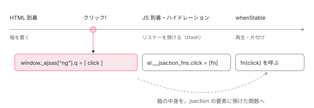

[目次](../README.md) › [SSR とハイドレーション](README.md) › 第 14 回 / 全 15 回

# イベントの記録と再生：JS が来る前のクリックを失わない

> サーバーで jsaction 属性を付け、ng-event-dispatch-contract のスクリプトで早期のイベント契約（EarlyEventContract）を置き、ブラウザでハイドレーション前のイベントを window.\_ejsas\[appId\].q に貯める行。withEventReplay が EventDispatcher を作り、ハイドレーション後に貯めたイベントを本物のリスナーに渡し直す行、stashEventListener、記録の対象になるイベントの種類。

angular/angular · 読了 約 13 分 · 発展 · [サイトで読む（デモが動きます）](https://angular-deep-dive-cyan.vercel.app/chapter/event-replay)

---

SSR したページは、JS が届く前から見えていてボタンも押せます。でもその時点ではリスナーがありません。この章では、その間のクリックを**どこに貯め、いつ、どのリスナーに渡し直すのか**を、サーバーで付ける `jsaction` 属性から、ハイドレーション後の後片付けまで 1 本の流れで追います。「何のイベントが記録されるのか」「`preventDefault` は効くのか」にも行番号で答えます。

読む対象は `packages/core/src/hydration/event_replay.ts`、`core/src/event_delegation_utils.ts`、それに `core/primitives/event-dispatch/src/` の `earlyeventcontract.ts`・`bootstrap_app_scoped.ts`・`eventcontract.ts`・`dispatcher.ts`・`event_dispatcher.ts`・`action_resolver.ts` です。

1. [1. 概観](01-ssr-overview.md)
2. [2. renderApplication](02-ssr-render-application.md)
3. [3. platformServer と domino](03-ssr-platform-server.md)
4. [4. AngularAppEngine](04-ssr-app-engine.md)
5. [5. サーバールート](05-ssr-server-routes.md)
6. [6. プリレンダー](06-ssr-prerender.md)
7. [7. provideClientHydration](07-hydration-provide.md)
8. [8. ngh の書き出し](08-hydration-annotate.md)
9. [9. ノードの道順](09-hydration.md)
10. [10. ノードの確保](10-hydration-claim.md)
11. [11. コンテナと片付け](11-hydration-containers.md)
12. [12. 不一致のエラー](12-hydration-errors.md)
13. [13. i18n](13-hydration-i18n.md)
14. **14. イベントの再生**（この章）
15. [15. インクリメンタル](15-incremental-hydration.md)

## 0. 全体の流れ

仕組みの元は **JSAction** という小さなイベント委譲ライブラリで、`core/primitives/event-dispatch` に入っています。README は「Angular の内部で使うライブラリ。公開 API ではない」と書き、Angular や Wiz のようなフレームワークから設定して使うものだと説明しています。比喩を 1 つだけ使うと「受付の箱」です。JS が来るまでは `<body>` に置いた箱にイベントを入れておき、担当者（Angular のリスナー）がそろったら箱の中身を順に渡します。以下、実物です。

1. **サーバー：リスナーのある要素に `jsaction="click:;"` を付ける**

   2〜3 節。
2. **サーバー：HTML に「箱を置く」スクリプトと「どのイベントを入れるか」の 1 行を入れる**

   4 節。
3. **ブラウザ（JS 前）：`<body>` のリスナーがイベントを `window._ejsas[appId].q` に貯める**

   4 節。
4. **ブラウザ（ハイドレーション中）：Angular のリスナーを要素に預ける（stash）**

   5 節。
5. **ブラウザ（安定後）：貯めたイベントを、`jsaction` を手がかりに預けたリスナーへ渡す**

   6〜7 節。
6. **ブラウザ：`jsaction` 属性と預けたリスナーを外し、契約を片付ける**

   8 節。



*時間は左から右。JS が届く前のクリックは body の箱（q）に入り、アプリが安定した後、jsaction を手がかりに要素へ預けたリスナーに渡される。*

## 1. 記録の対象になるイベント

📄 `angular/packages/core/primitives/event-dispatch/src/event_type.ts` L295–318 （▶ の行: 295–296, 298, 300, 305, 312, 317）

```ts
295 ▶ export const BUBBLE_EVENT_TYPES = [
296 ▶   EventType.CLICK,
297 │   EventType.DBLCLICK,
298 ▶   EventType.FOCUSIN,
299 │   EventType.FOCUSOUT,
300 ▶   EventType.KEYDOWN,
301 │   EventType.KEYUP,
302 │   EventType.KEYPRESS,
303 │   EventType.MOUSEOVER,
304 │   EventType.MOUSEOUT,
305 ▶   EventType.SUBMIT,
306 │   EventType.TOUCHSTART,
307 │   EventType.TOUCHEND,
308 │   EventType.TOUCHMOVE,
309 │   'touchcancel',
310 │ 
311 │   'auxclick',
312 ▶   'change',
313 │   'compositionstart',
314 │   'compositionupdate',
315 │   'compositionend',
316 │   'beforeinput',
317 ▶   'input',
318 │   'select',
```

📄 `angular/packages/core/primitives/event-dispatch/src/event_type.ts` L357–380 （▶ の行: 358–360, 371, 375, 380）

```ts
357 │ /** All event types that are registered in the capture phase. */
358 ▶ export const CAPTURE_EVENT_TYPES = [
359 ▶   EventType.FOCUS,
360 ▶   EventType.BLUR,
361 │   EventType.ERROR,
362 │   EventType.LOAD,
363 │   EventType.TOGGLE,
364 │ ];
365 │ 
366 │ /**
367 │  * Whether or not an event type should be registered in the capture phase.
368 │  * @param eventType
369 │  * @returns bool
370 │  */
371 ▶ export const isCaptureEventType = (eventType: string) =>
372 │   CAPTURE_EVENT_TYPES.indexOf(eventType) >= 0;
373 │ 
374 │ /** All event types that are registered early.  */
375 ▶ const EARLY_EVENT_TYPES = BUBBLE_EVENT_TYPES.concat(CAPTURE_EVENT_TYPES);
376 │ 
377 │ /**
378 │  * Whether or not an event type is registered in the early contract.
379 │  */
380 ▶ export const isEarlyEventType = (eventType: string) => EARLY_EVENT_TYPES.indexOf(eventType) >= 0;
```

記録できるのは 375 行目の `EARLY_EVENT_TYPES`、つまり泡立つ（bubble）イベントの一覧 `BUBBLE_EVENT_TYPES`（295 行目〜。この引用の後ろにもドラッグ・ポインター・ページ表示などが続きます）と、358〜364 行目の 5 つ（`focus` / `blur` / `error` / `load` / `toggle`）です。後者は泡立たないので、`<body>` で拾うには capture 段階で聞く必要があり、別の一覧になっています。一覧に無いもの（`scroll`、`mouseenter`、`resize` など）は記録されません。

## 2. サーバー：どの要素の、どのイベントか

📄 `angular/packages/core/src/hydration/annotate.ts` L548–558 （▶ の行: 556–558）

```ts
548 │ function serializeLView(
549 │   lView: LView,
550 │   parentDeferBlockId: string | null = null,
551 │   context: HydrationContext,
552 │ ): SerializedView {
553 │   const ngh: SerializedView = {};
554 │   const tView = lView[TVIEW];
555 │   const i18nChildren = getOrComputeI18nChildren(tView, context);
556 ▶   const nativeElementsToEventTypes = context.shouldReplayEvents
557 ▶     ? collectDomEventsInfo(tView, lView, context.eventTypesToReplay)
558 ▶     : null;
```

ビューを直列化する `serializeLView` の冒頭です（全体は [第 8 回](08-hydration-annotate.md)）。再生が有効なら 557 行目で、このビューの「要素 → イベント名の列」の Map を作ります。

📄 `angular/packages/core/src/hydration/event_replay.ts` L241–272 （▶ の行: 241, 247–248, 251–252, 254, 256, 262–263, 266–267, 269）

```ts
241 ▶   for (let i = 0; i < tCleanup.length; ) {
242 │     const firstParam = tCleanup[i++];
243 │     const secondParam = tCleanup[i++];
244 │     if (typeof firstParam !== 'string') {
245 │       continue;
246 │     }
247 ▶     const eventType = firstParam;
248 ▶     if (!isEarlyEventType(eventType)) {
249 │       continue;
250 │     }
251 ▶     if (isCaptureEventType(eventType)) {
252 ▶       eventTypesToReplay.capture.add(eventType);
253 │     } else {
254 ▶       eventTypesToReplay.regular.add(eventType);
255 │     }
256 ▶     const listenerElement = unwrapRNode(lView[secondParam]) as any as Element;
257 │     i++; // move the cursor to the next position (location of the listener idx)
258 │     const useCaptureOrIndx = tCleanup[i++];
259 │     // if useCaptureOrIndx is boolean then report it as is.
260 │     // if useCaptureOrIndx is positive number then it in unsubscribe method
261 │     // if useCaptureOrIndx is negative number then it is a Subscription
262 ▶     const isDomEvent = typeof useCaptureOrIndx === 'boolean' || useCaptureOrIndx >= 0;
263 ▶     if (!isDomEvent) {
264 │       continue;
265 │     }
266 ▶     if (!domEventsInfo.has(listenerElement)) {
267 ▶       domEventsInfo.set(listenerElement, [eventType]);
268 │     } else {
269 ▶       domEventsInfo.get(listenerElement)!.push(eventType);
270 │     }
271 │   }
272 │   return domEventsInfo;
```

1. **241 行目：`tView.cleanup` を 4 つずつ読む**

   テンプレートで `(click)` などのリスナーを登録すると、後片付け用に 「イベント名・要素の番号・lCleanup の位置・capture か出力か」の 4 つが `tView.cleanup` に積まれます （積む側は [ivy-destroy の章](../ivy/17-ivy-destroy.md)の `storeListenerCleanup`）。**サーバーでもリスナーの登録自体は行われる**ので、この表はサーバーにもあります。
2. **248 行目：1 節の一覧に無いイベントは飛ばす**
3. **251〜255 行目：アプリ全体の「再生するイベントの種類」に足す**

   この集合が 4 節のスクリプトの引数になります。
4. **262〜265 行目：DOM のリスナーだけ**

   4 つ目の値が負なら `@Output` の購読です。DOM のイベントではないので除きます。
5. **266〜270 行目：要素ごとにイベント名を並べる**

📄 `angular/packages/core/src/hydration/annotate.ts` L729–743 （▶ の行: 731, 733–734, 737）

```ts
729 │     // Attach `jsaction` attribute to elements that have registered listeners,
730 │     // thus potentially having a need to do an event replay.
731 ▶     if (nativeElementsToEventTypes && tNode.type & TNodeType.Element) {
732 │       const nativeElement = unwrapRNode(lView[i]) as Element;
733 ▶       if (nativeElementsToEventTypes.has(nativeElement)) {
734 ▶         setJSActionAttributes(
735 │           nativeElement,
736 │           nativeElementsToEventTypes.get(nativeElement)!,
737 ▶           parentDeferBlockId,
738 │         );
739 │       }
740 │     }
741 │   }
742 │   return ngh;
743 │ }
```

📄 `angular/packages/core/src/event_delegation_utils.ts` L25–50 （▶ の行: 32, 35, 41, 44, 46–48）

```ts
25 │ export function setJSActionAttributes(
26 │   nativeElement: Element,
27 │   eventTypes: string[],
28 │   parentDeferBlockId: string | null = null,
29 │ ) {
30 │   // jsaction attributes specifically should be applied to elements and not comment nodes.
31 │   // Comment nodes also have no setAttribute function. So this avoids errors.
32 ▶   if (eventTypes.length === 0 || nativeElement.nodeType !== Node.ELEMENT_NODE) {
33 │     return;
34 │   }
35 ▶   const existingAttr = nativeElement.getAttribute(Attribute.JSACTION);
36 │   // we dedupe cases where hydrate triggers are used as it's possible that
37 │   // someone may have added an event binding to the root node that matches what the
38 │   // hydrate trigger adds.
39 │   const parts = eventTypes.reduce((prev, curr) => {
40 │     // if there is no existing attribute OR it's not in the existing one, we need to add it
41 ▶     return (existingAttr?.indexOf(curr) ?? -1) === -1 ? prev + curr + ':;' : prev;
42 │   }, '');
43 │   //  This is required to be a module accessor to appease security tests on setAttribute.
44 ▶   nativeElement.setAttribute(Attribute.JSACTION, `${existingAttr ?? ''}${parts}`);
45 │ 
46 ▶   const blockName = parentDeferBlockId ?? '';
47 ▶   if (blockName !== '' && parts.length > 0) {
48 ▶     nativeElement.setAttribute(DEFER_BLOCK_SSR_ID_ATTRIBUTE, blockName);
49 │   }
50 │ }
```

41 行目、イベント名ごとに `"click" + ":;"` をつなぎ、44 行目で `jsaction` 属性にします。JSAction の文法は「`イベント名:処理名;`」ですが、Angular は処理名を空にします（7 節で、空でも良い理由を見ます）。35〜42 行目は、すでに同じ名前が入っていれば足さない重複よけです。46〜49 行目、要素が `@defer` ブロックの中なら、ブロックの番号を `ngb` 属性にも書きます（[第 15 回](15-incremental-hydration.md)で使います）。

## 3. サーバー：HTML に入る 2 つのスクリプト

集めた種類は `annotateForHydration` の戻り値になり、`prepareForHydration` が `insertEventRecordScript` に渡します（[第 2 回](02-ssr-render-application.md)）。入るのは次の 2 つです。

| スクリプト | 誰が入れるか | 中身 |
| --- | --- | --- |
| `<script id="ng-event-dispatch-contract">` | ビルド時に CLI が `<body>` の直後へ（[第 1 回](01-ssr-overview.md)の `addEventDispatchContract`） | `@angular/core/event-dispatch-contract.min.js`。`contract_binary.ts` の 1 行で、`window.__jsaction_bootstrap` に次節の関数を置く |
| そのすぐ後ろの無名スクリプト | レンダリング時に platform-server の `insertEventRecordScript` | `window.__jsaction_bootstrap(document.body,"ng",["click"],[]);` — 第 3・4 引数が 2 節で集めた種類（泡立つ / capture） |

集めた種類が空なら、`prepareForHydration` は 1 つ目のスクリプトも HTML から消します。引数はページごとに違います。このサイトでは、この章だけのページなら第 3 引数が `["click"]`、入力欄のあるデモを含むシリーズのページなら `["click","input"]` で、第 4 引数はどちらも空です（下の DEMO で確かめられます）。

## 4. ブラウザ（JS 前）：body に置く箱

📄 `angular/packages/core/primitives/event-dispatch/src/bootstrap_app_scoped.ts` L19–37 （▶ の行: 23, 30–31, 34–36）

```ts
19 │ /**
20 │  * Creates an `EarlyJsactionData`, adds events to it, and populates it on a nested object on
21 │  * the window.
22 │  */
23 ▶ export function bootstrapAppScopedEarlyEventContract(
24 │   container: HTMLElement,
25 │   appId: string,
26 │   bubbleEventTypes: string[],
27 │   captureEventTypes: string[],
28 │   dataContainer: EarlyJsactionDataContainer = window,
29 │ ) {
30 ▶   const earlyJsactionData = createEarlyJsactionData(container);
31 ▶   if (!dataContainer._ejsas) {
32 │     dataContainer._ejsas = {};
33 │   }
34 ▶   dataContainer._ejsas[appId] = earlyJsactionData;
35 ▶   addEvents(earlyJsactionData, bubbleEventTypes);
36 ▶   addEvents(earlyJsactionData, captureEventTypes, /* capture= */ true);
37 │ }
```

📄 `angular/packages/core/primitives/event-dispatch/src/earlyeventcontract.ts` L67–106 （▶ の行: 69–71, 73–74, 78–80, 104）

```ts
 67 │ /** Creates an `EarlyJsactionData` object. */
 68 │ export function createEarlyJsactionData(container: HTMLElement) {
 69 ▶   const q: EventInfo[] = [];
 70 ▶   const d = (eventInfo: EventInfo) => {
 71 ▶     q.push(eventInfo);
 72 │   };
 73 ▶   const h = (event: Event) => {
 74 ▶     d(
 75 │       createEventInfoFromParameters(
 76 │         event.type,
 77 │         event,
 78 ▶         event.target as Element,
 79 ▶         container,
 80 ▶         Date.now(),
 81 │       ),
 82 │     );
 83 │   };
 84 │   return {
 85 │     c: container,
 86 │     q,
 87 │     et: [],
 88 │     etc: [],
 89 │     d,
 90 │     h,
 91 │   };
 92 │ }
 93 │ 
 94 │ /** Add all the events to the container stored in the `EarlyJsactionData`. */
 95 │ export function addEvents(
 96 │   earlyJsactionData: EarlyJsactionData,
 97 │   types: string[],
 98 │   capture?: boolean,
 99 │ ) {
100 │   for (let i = 0; i < types.length; i++) {
101 │     const eventType = types[i];
102 │     const eventTypes = capture ? earlyJsactionData.etc : earlyJsactionData.et;
103 │     eventTypes.push(eventType);
104 ▶     earlyJsactionData.c.addEventListener(eventType, earlyJsactionData.h, capture);
105 │   }
106 │ }
```

📄 `angular/packages/core/primitives/event-dispatch/src/earlyeventcontract.ts` L23–44 （▶ の行: 28, 31, 34, 37, 40, 43）

```ts
23 │ /**
24 │  * Defines the early jsaction data types.
25 │  */
26 │ export declare interface EarlyJsactionData {
27 │   /** List used to keep track of the early JSAction event types. */
28 ▶   et: string[];
29 │ 
30 │   /** List used to keep track of the early JSAction capture event types. */
31 ▶   etc: string[];
32 │ 
33 │   /** Early JSAction handler for all events. */
34 ▶   h: (event: Event) => void;
35 │ 
36 │   /** Dispatcher handler. Initializes to populating `q`. */
37 ▶   d: (eventInfo: EventInfo) => void;
38 │ 
39 │   /** List used to push `EventInfo` objects if the dispatcher is not registered. */
40 ▶   q: EventInfo[];
41 │ 
42 │   /** Container for listening to events. */
43 ▶   c: HTMLElement;
44 │ }
```

1. **bootstrap\_app\_scoped.ts 30 行目：箱を作る**

   `createEarlyJsactionData(document.body)`。69 行目の配列 `q` が箱、73〜83 行目の `h` が `<body>` に付けるリスナーです。`h` はイベントを受けると、種類・イベント本体・`target`・コンテナ・時刻（80 行目の `Date.now()`）を `EventInfo` にまとめ、71 行目で `q` に積むだけです。**リスナーを呼ぶ処理は 1 行もありません。**
2. **34 行目：`window._ejsas[appId]` に置く**

   `appId` は `APP_ID`（既定は `"ng"`）。1 ページに複数のアプリがあっても別々の箱になります。
3. **35〜36 行目 → 104 行目：`<body>` に `addEventListener`**

   種類ごとに 1 個だけです。要素ごとには付けません。102〜103 行目で、付けた種類を `et` / `etc`（28・31 行目）に控えます。

> [!TIP]
> **新卒エンジニアへ**
>
> この時点では `jsaction` 属性は使っていません。`<body>` の中のどこで起きたクリックでも、種類が一覧にあれば箱に入ります。どの要素のリスナーに渡すかは、再生のとき（7 節）に `jsaction` を見て決めます。

## 5. ブラウザ（ハイドレーション中）：リスナーを要素に預ける

📄 `angular/packages/core/src/hydration/event_replay.ts` L76–96 （▶ の行: 79, 82, 86–87）

```ts
76 │ export function withEventReplay(): Provider[] {
77 │   const providers: Provider[] = [
78 │     {
79 ▶       provide: IS_EVENT_REPLAY_ENABLED,
80 │       useFactory: () => {
81 │         let isEnabled = true;
82 ▶         if (typeof ngServerMode === 'undefined' || !ngServerMode) {
83 │           // Note: globalThis[CONTRACT_PROPERTY] may be undefined in case Event Replay feature
84 │           // is enabled, but there are no events configured in this application, in which case
85 │           // we don't activate this feature, since there are no events to replay.
86 ▶           const appId = inject(APP_ID);
87 ▶           isEnabled = !!window._ejsas?.[appId];
88 │         }
89 │         if (isEnabled) {
90 │           performanceMarkFeature('NgEventReplay');
91 │         }
92 │         return isEnabled;
93 │       },
94 │     },
95 │   ];
96 │ 
```

87 行目。ブラウザでの `IS_EVENT_REPLAY_ENABLED` は `window._ejsas?.[appId]` があるかどうかで決まります。`withEventReplay()` を書いていても、サーバーが種類 0 個でスクリプトを入れなかったページでは偽です。

📄 `angular/packages/core/src/hydration/event_replay.ts` L97–131 （▶ の行: 100, 107, 109–110, 112, 118–120, 126）

```ts
 97 │   if (typeof ngServerMode === 'undefined' || !ngServerMode) {
 98 │     providers.push(
 99 │       {
100 ▶         provide: ENVIRONMENT_INITIALIZER,
101 │         useValue: () => {
102 │           const appRef = inject(ApplicationRef);
103 │           const {injector} = appRef;
104 │           // We have to check for the appRef here due to the possibility of multiple apps
105 │           // being present on the same page. We only want to enable event replay for the
106 │           // apps that actually want it.
107 ▶           if (!appsWithEventReplay.has(appRef)) {
108 │             const jsActionMap = inject(JSACTION_BLOCK_ELEMENT_MAP);
109 ▶             if (shouldEnableEventReplay(injector)) {
110 ▶               enableStashEventListenerImpl();
111 │               const appId = injector.get(APP_ID);
112 ▶               const clearStashFn = setStashFn(
113 │                 appId,
114 │                 (rEl: RNode, eventName: string, listenerFn: VoidFunction) => {
115 │                   // If a user binds to a ng-container and uses a directive that binds using a host listener,
116 │                   // this element could be a comment node. So we need to ensure we have an actual element
117 │                   // node before stashing anything.
118 ▶                   if ((rEl as Node).nodeType !== Node.ELEMENT_NODE) return;
119 ▶                   sharedStashFunction(rEl as RElement, eventName, listenerFn);
120 ▶                   sharedMapFunction(rEl as RElement, jsActionMap);
121 │                 },
122 │               );
123 │               // Clean up the reference to the function set by the environment initializer,
124 │               // as the function closure may capture injected elements and prevent them
125 │               // from being properly garbage collected.
126 ▶               appRef.onDestroy(clearStashFn);
127 │             }
128 │           }
129 │         },
130 │         multi: true,
131 │       },
```

インジェクタの初期化時（`ENVIRONMENT_INITIALIZER`）、110 行目で預ける実装を有効にし、112〜122 行目でこのアプリ用の預け方を登録します。118 行目、`<ng-container>` のコメントノードには預けません。119 行目で要素にリスナーを、120 行目で「ブロック名 → 要素」の Map に要素を入れます。

📄 `angular/packages/core/src/render3/view/listeners.ts` L169–181 （▶ の行: 172, 181）

```ts
169 │     const native = getNativeByTNode(tNode, lView) as RElement;
170 │     const target = eventTargetResolver ? eventTargetResolver(native) : native;
171 │ 
172 ▶     stashEventListenerImpl(lView, target, eventName, wrappedListener);
173 │ 
174 │     // For element-local listeners (not global targets like document/window), store the
175 │     // native element on the wrapped listener so that when it fires it can mark the
176 │     // (event, element) pair as handled, preventing jsaction from replaying an event that
177 │     // was already dispatched by the real DOM listener post-hydration (see #67328).
178 │     if (!eventTargetResolver) {
179 │       (wrappedListener as any).__ngNativeEl__ = native as unknown as Element;
180 │     }
181 ▶     const cleanupFn = renderer.listen(target as RElement, eventName, wrappedListener);
```

📄 `angular/packages/core/src/event_delegation_utils.ts` L189–220 （▶ の行: 195, 207, 213–215）

```ts
189 │ export function stashEventListenerImpl(
190 │   lView: LView,
191 │   target: RElement | EventTarget,
192 │   eventName: string,
193 │   wrappedListener: WrappedEventCallback,
194 │ ): void {
195 ▶   _stashEventListenerImpl(lView, target, eventName, wrappedListener);
196 │ }
197 │ 
198 │ /**
199 │  * Enables the event listener stashing logic in a tree-shakable way.
200 │  *
201 │  * This function lazily sets the implementation of `_stashEventListenerImpl`
202 │  * so that it becomes active only when `withEventReplay` is invoked. This ensures
203 │  * that the stashing logic is excluded from production builds unless needed.
204 │  */
205 │ export function enableStashEventListenerImpl(): void {
206 │   if (!isStashEventListenerImplEnabled) {
207 ▶     _stashEventListenerImpl = (
208 │       lView: LView,
209 │       target: RElement | EventTarget,
210 │       eventName: string,
211 │       wrappedListener: EventCallback,
212 │     ) => {
213 ▶       const appId = lView[INJECTOR].get(APP_ID);
214 ▶       const stashEventListener = stashEventListeners.get(appId);
215 ▶       stashEventListener?.(target as RElement, eventName, wrappedListener);
216 │     };
217 │ 
218 │     isStashEventListenerImplEnabled = true;
219 │   }
220 │ }
```

📄 `angular/packages/core/src/event_delegation_utils.ts` L150–162 （▶ の行: 150, 160）

```ts
150 ▶ const stashEventListeners = new Map<string, StashEventListener>();
151 │ 
152 │ /**
153 │  * Registers a stashing function for a specific application ID.
154 │  *
155 │  * @param appId The unique identifier for the application instance.
156 │  * @param fn The stashing function to associate with this app ID.
157 │  * @returns A cleanup function that removes the stashing function when called.
158 │  */
159 │ export function setStashFn(appId: string, fn: StashEventListener) {
160 ▶   stashEventListeners.set(appId, fn);
161 │   return () => stashEventListeners.delete(appId);
162 │ }
```

📄 `angular/packages/core/src/event_delegation_utils.ts` L52–69 （▶ の行: 54, 56, 58, 63–64, 68）

```ts
52 │ export const sharedStashFunction = (rEl: RElement, eventType: string, listenerFn: Function) => {
53 │   const el = rEl as unknown as Element;
54 ▶   const eventListenerMap = el.__jsaction_fns ?? new Map();
55 │   const eventListeners = eventListenerMap.get(eventType) ?? [];
56 ▶   eventListeners.push(listenerFn);
57 │   eventListenerMap.set(eventType, eventListeners);
58 ▶   el.__jsaction_fns = eventListenerMap;
59 │ };
60 │ 
61 │ export const sharedMapFunction = (rEl: RElement, jsActionMap: Map<string, Set<Element>>) => {
62 │   const el = rEl as unknown as Element;
63 ▶   let blockName = el.getAttribute(DEFER_BLOCK_SSR_ID_ATTRIBUTE) ?? '';
64 ▶   const blockSet = jsActionMap.get(blockName) ?? new Set<Element>();
65 │   if (!blockSet.has(el)) {
66 │     blockSet.add(el);
67 │   }
68 ▶   jsActionMap.set(blockName, blockSet);
69 │ };
```

1. **listeners.ts 172 行目：リスナー登録のたびに預ける**

   テンプレートの `(click)` は `listenToDomEvent` を通り、181 行目の本物の `addEventListener`（`renderer.listen`）の直前で `stashEventListenerImpl` を呼びます。リスナー登録そのものは [(click) からの経路](../zoneless/08-zoneless-listener-path.md)の章で読みました。
2. **event\_delegation\_utils.ts 213〜215 行目：アプリの預け方を引く**

   LView のインジェクタから `APP_ID` を読み、160 行目で登録した関数を呼びます。
3. **54〜58 行目：要素の `__jsaction_fns` にしまう**

   `Map<イベント名, 関数[]>` を要素オブジェクトのプロパティとして持たせます。預けるのはテンプレートが作った `wrapListener` 済みの関数なので、呼べば `markViewDirty` も含めて本物と同じ処理になります。
4. **63〜68 行目：ブロック名ごとに要素を覚える**

   `ngb` 属性が無い要素は空文字 `''` の組に入ります。8 節の片付けでこの組を使います。

181 行目のとおり本物のリスナーも付くので、ハイドレーション後のクリックは普通に動きます。預けたリスナーは「ハイドレーション前に起きたイベント」を渡すためだけに使います。

## 6. ブラウザ（安定後）：再生を始める

📄 `angular/packages/core/src/hydration/event_replay.ts` L160–197 （▶ の行: 163, 174–175, 177–178, 184, 189, 191）

```ts
160 │             // Kick off event replay logic once hydration for the initial part
161 │             // of the application is completed. This timing is similar to the unclaimed
162 │             // dehydrated views cleanup timing.
163 ▶             appRef.whenStable().then(() => {
164 │               // Note: we have to check whether the application is destroyed before
165 │               // performing other operations with the `injector`.
166 │               // The application may be destroyed **before** it becomes stable, so when
167 │               // the `whenStable` resolves, the injector might already be in
168 │               // a destroyed state. Thus, calling `injector.get` would throw an error
169 │               // indicating that the injector has already been destroyed.
170 │               if (appRef.destroyed) {
171 │                 return;
172 │               }
173 │ 
174 ▶               const eventContractDetails = injector.get(JSACTION_EVENT_CONTRACT);
175 ▶               initEventReplay(eventContractDetails, injector);
176 │               const jsActionMap = injector.get(JSACTION_BLOCK_ELEMENT_MAP);
177 ▶               jsActionMap.get(EAGER_CONTENT_LISTENERS_KEY)?.forEach(removeListeners);
178 ▶               jsActionMap.delete(EAGER_CONTENT_LISTENERS_KEY);
179 │ 
180 │               const eventContract = eventContractDetails.instance!;
181 │               // This removes event listeners registered through the container manager,
182 │               // as listeners registered on `document.body` might never be removed if we
183 │               // don't clean up the contract.
184 ▶               if (isIncrementalHydrationEnabled(injector)) {
185 │                 // When incremental hydration is enabled, we cannot clean up the event
186 │                 // contract immediately because we're unaware if there are any deferred
187 │                 // blocks to hydrate. We can only schedule a contract cleanup when the
188 │                 // app is destroyed.
189 ▶                 appRef.onDestroy(() => eventContract.cleanUp());
190 │               } else {
191 ▶                 eventContract.cleanUp();
192 │               }
193 │             });
194 │           };
195 │         },
196 │         multi: true,
197 │       },
```

163 行目、`APP_BOOTSTRAP_LISTENER` の中で `appRef.whenStable()` を待ちます。最初のハイドレーションが終わり、預けるべきリスナーが全部預けられた後、という意味です。同じタイミングで、使われなかった脱水ビューの片付け（[第 11 回](11-hydration-containers.md)）も走ります。175 行目が再生、177〜178 行目が後片付け（8 節）です。

📄 `angular/packages/core/src/hydration/event_replay.ts` L204–224 （▶ の行: 207–209, 211, 214, 217–221, 223）

```ts
204 │ const initEventReplay = (eventDelegation: EventContractDetails, injector: Injector) => {
205 │   const appId = injector.get(APP_ID);
206 │   // This is set in packages/platform-server/src/utils.ts
207 ▶   const earlyJsactionData = window._ejsas![appId]!;
208 ▶   const eventContract = (eventDelegation.instance = new EventContract(
209 ▶     new EventContractContainer(earlyJsactionData.c),
210 │   ));
211 ▶   for (const et of earlyJsactionData.et) {
212 │     eventContract.addEvent(et);
213 │   }
214 ▶   for (const et of earlyJsactionData.etc) {
215 │     eventContract.addEvent(et);
216 │   }
217 ▶   const eventInfos = getAppScopedQueuedEventInfos(appId);
218 ▶   eventContract.replayEarlyEventInfos(eventInfos);
219 ▶   clearAppScopedEarlyEventContract(appId);
220 ▶   const dispatcher = new EventDispatcher((event) => {
221 ▶     invokeRegisteredReplayListeners(injector, event, event.currentTarget as Element);
222 │   });
223 ▶   registerDispatcher(eventContract, dispatcher);
224 │ };
```

1. **207〜210 行目：本物の `EventContract` を同じ `<body>` に作る**

   `earlyJsactionData.c` は 4 節の `document.body` です。
2. **211〜216 行目：同じ種類を登録する**

   ここで付くリスナーは、この先（インクリメンタルハイドレーションでは）アプリが終わるまで残ります。
3. **217〜218 行目：箱の中身（`q`）を渡す**
4. **219 行目：`window._ejsas[appId]` を `undefined` にする**
5. **220〜223 行目：配り役（dispatcher）を登録する**

   配り役は、各イベントを 221 行目の `invokeRegisteredReplayListeners` に渡します。

📄 `angular/packages/core/primitives/event-dispatch/src/eventcontract.ts` L126–134 （▶ の行: 127, 129–130, 133）

```ts
126 │   private handleEventInfo(eventInfo: eventInfoLib.EventInfo) {
127 ▶     if (!this.dispatcher) {
128 │       // All events are queued when the dispatcher isn't yet loaded.
129 ▶       eventInfoLib.setIsReplay(eventInfo, true);
130 ▶       this.queuedEventInfos?.push(eventInfo);
131 │       return;
132 │     }
133 ▶     this.dispatcher(eventInfo);
134 │   }
```

📄 `angular/packages/core/primitives/event-dispatch/src/eventcontract.ts` L211–223 （▶ の行: 213, 216, 219–220）

```ts
211 │   replayEarlyEventInfos(earlyEventInfos: eventInfoLib.EventInfo[]) {
212 │     for (let i = 0; i < earlyEventInfos.length; i++) {
213 ▶       const earlyEventInfo: eventInfoLib.EventInfo = earlyEventInfos[i];
214 │       const eventTypes = this.getEventTypesForBrowserEventType(earlyEventInfo.eventType);
215 │       for (let j = 0; j < eventTypes.length; j++) {
216 ▶         const eventInfo = eventInfoLib.cloneEventInfo(earlyEventInfo);
217 │         // EventInfo eventType maps to JSAction's internal event type,
218 │         // rather than the browser event type.
219 ▶         eventInfoLib.setEventType(eventInfo, eventTypes[j]);
220 ▶         this.handleEventInfo(eventInfo);
221 │       }
222 │     }
223 │   }
```

📄 `angular/packages/core/primitives/event-dispatch/src/eventcontract.ts` L270–288 （▶ の行: 280, 282, 284, 286）

```ts
270 │   registerDispatcher(dispatcher: Dispatcher, restriction: Restriction) {
271 │     this.ecrd(dispatcher, restriction);
272 │   }
273 │ 
274 │   /**
275 │    * Unrenamed alias for registerDispatcher. Necessary for any codebases that
276 │    * split the `EventContract` and `Dispatcher` code into different compilation
277 │    * units.
278 │    */
279 │   ecrd(dispatcher: Dispatcher, restriction: Restriction) {
280 ▶     this.dispatcher = dispatcher;
281 │ 
282 ▶     if (this.queuedEventInfos?.length) {
283 │       for (let i = 0; i < this.queuedEventInfos.length; i++) {
284 ▶         this.handleEventInfo(this.queuedEventInfos[i]);
285 │       }
286 ▶       this.queuedEventInfos = null;
287 │     }
288 │   }
```

順番が大事です。218 行目の `replayEarlyEventInfos` の時点では、まだ配り役がいません（223 行目より前）。そのため 220 行目 → 127〜131 行目で、各イベントに**「再生」の印（129 行目の `setIsReplay`）**を付けて `queuedEventInfos` に積み直します。223 行目の `registerDispatcher` が `ecrd` を呼ぶと、280 行目で配り役が入り、282〜287 行目で積んだ順に配ります。**再生の順番は、ユーザーが操作した順番のまま**です。

## 7. 配り役：jsaction を見て要素を決め、預けたリスナーを呼ぶ

📄 `angular/packages/core/primitives/event-dispatch/src/dispatcher.ts` L78–91 （▶ の行: 80–81, 83–84, 90）

```ts
78 │   dispatch(eventInfo: EventInfo): void {
79 │     const eventInfoWrapper = new EventInfoWrapper(eventInfo);
80 ▶     this.actionResolver?.resolveEventType(eventInfo);
81 ▶     this.actionResolver?.resolveAction(eventInfo);
82 │     const action = eventInfoWrapper.getAction();
83 ▶     if (action && shouldPreventDefaultBeforeDispatching(action.element, eventInfoWrapper)) {
84 ▶       eventLib.preventDefault(eventInfoWrapper.getEvent());
85 │     }
86 │     if (this.eventReplayer && eventInfoWrapper.getIsReplay()) {
87 │       this.scheduleEventInfoWrapperReplay(eventInfoWrapper);
88 │       return;
89 │     }
90 ▶     this.dispatchDelegate(eventInfoWrapper);
91 │   }
```

📄 `angular/packages/core/primitives/event-dispatch/src/action_resolver.ts` L135–155 （▶ の行: 137, 139, 142, 146, 148）

```ts
135 │   private populateAction(eventInfo: eventInfoLib.EventInfo, currentTarget: Element) {
136 │     let actionElement: Element | null = currentTarget;
137 ▶     while (actionElement && actionElement !== eventInfoLib.getContainer(eventInfo)) {
138 │       if (actionElement.nodeType === Node.ELEMENT_NODE) {
139 ▶         this.populateActionOnElement(actionElement, eventInfo);
140 │       }
141 │ 
142 ▶       if (eventInfoLib.getAction(eventInfo)) {
143 │         // An event is handled by at most one jsaction. Thus we stop at the
144 │         // first matching jsaction specified in a jsaction attribute up the
145 │         // ancestor chain of the event target node.
146 ▶         break;
147 │       }
148 ▶       actionElement = this.getParentNode(actionElement);
149 │     }
150 │ 
151 │     const action = eventInfoLib.getAction(eventInfo);
152 │     if (!action) {
153 │       // No action found.
154 │       return;
155 │     }
```

📄 `angular/packages/core/primitives/event-dispatch/src/action_resolver.ts` L251–280 （▶ の行: 254, 262, 268, 270–272）

```ts
251 │   private parseActions(actionElement: Element): {[key: string]: string | undefined} {
252 │     let actionMap: {[key: string]: string | undefined} | undefined = cache.get(actionElement);
253 │     if (!actionMap) {
254 ▶       const jsactionAttribute = actionElement.getAttribute(Attribute.JSACTION);
255 │       if (!jsactionAttribute) {
256 │         actionMap = EMPTY_ACTION_MAP;
257 │         cache.set(actionElement, actionMap);
258 │       } else {
259 │         actionMap = cache.getParsed(jsactionAttribute);
260 │         if (!actionMap) {
261 │           actionMap = {};
262 ▶           const values = jsactionAttribute.split(REGEXP_SEMICOLON);
263 │           for (let idx = 0; idx < values.length; idx++) {
264 │             const value = values[idx];
265 │             if (!value) {
266 │               continue;
267 │             }
268 ▶             const colon = value.indexOf(Char.EVENT_ACTION_SEPARATOR);
269 │             const hasColon = colon !== -1;
270 ▶             const type = hasColon ? value.substr(0, colon).trim() : DEFAULT_EVENT_TYPE;
271 ▶             const action = hasColon ? value.substr(colon + 1).trim() : value;
272 ▶             actionMap[type] = action;
273 │           }
274 │           cache.setParsed(jsactionAttribute, actionMap);
275 │         }
276 │         cache.set(actionElement, actionMap);
277 │       }
278 │     }
279 │     return actionMap;
280 │   }
```

81 行目の `resolveAction` が、イベントの `target` から 137〜149 行目で親へ親へと上り、`jsaction` を持つ最初の要素を探します。属性の読み方は 262〜273 行目です。`"click:;"` を `;` で割ると `"click:"`、268〜271 行目で `:` の前後に分けて `{click: ''}` になります。処理名は空文字ですが、`undefined` ではないので「この要素に click の担当がいる」と判定されます。Angular は処理名を使わず、要素に預けた `__jsaction_fns` から引くので、名前は要りません。

📄 `angular/packages/core/primitives/event-dispatch/src/event_dispatcher.ts` L77–103 （▶ の行: 83–84, 87–88, 96–97, 100）

```ts
 77 │   dispatch(eventInfo: EventInfo): void {
 78 │     this.dispatcher.dispatch(eventInfo);
 79 │   }
 80 │ 
 81 │   /** Internal method that does basic disaptching. */
 82 │   private dispatchToDelegate(eventInfoWrapper: EventInfoWrapper) {
 83 ▶     if (eventInfoWrapper.getIsReplay()) {
 84 ▶       prepareEventForReplay(eventInfoWrapper);
 85 │     }
 86 │     prepareEventForBubbling(eventInfoWrapper);
 87 ▶     while (eventInfoWrapper.getAction()) {
 88 ▶       prepareEventForDispatch(eventInfoWrapper);
 89 │       // If this is a capture event, ONLY dispatch if the action element is the target.
 90 │       if (
 91 │         isCaptureEventType(eventInfoWrapper.getEventType()) &&
 92 │         eventInfoWrapper.getAction()!.element !== eventInfoWrapper.getTargetElement()
 93 │       ) {
 94 │         return;
 95 │       }
 96 ▶       this.dispatchDelegate(eventInfoWrapper.getEvent(), eventInfoWrapper.getAction()!.name);
 97 ▶       if (propagationStopped(eventInfoWrapper)) {
 98 │         return;
 99 │       }
100 ▶       this.actionResolver.resolveParentAction(eventInfoWrapper.eventInfo);
101 │     }
102 │   }
103 │ }
```

📄 `angular/packages/core/primitives/event-dispatch/src/event_dispatcher.ts` L121–138 （▶ の行: 125–127, 129）

```ts
121 │ function prepareEventForReplay(eventInfoWrapper: EventInfoWrapper) {
122 │   const event = eventInfoWrapper.getEvent();
123 │   const target = eventInfoWrapper.getTargetElement();
124 │   const originalPreventDefault = event.preventDefault.bind(event);
125 ▶   patchEventInstance(event, 'target', target);
126 ▶   patchEventInstance(event, 'eventPhase', EventPhase.REPLAY);
127 ▶   patchEventInstance(event, 'preventDefault', () => {
128 │     originalPreventDefault();
129 ▶     throw new Error(
130 │       PREVENT_DEFAULT_ERROR_MESSAGE + (ngDevMode ? PREVENT_DEFAULT_ERROR_MESSAGE_DETAILS : ''),
131 │     );
132 │   });
133 │   patchEventInstance(event, 'composedPath', () => {
134 │     throw new Error(
135 │       COMPOSED_PATH_ERROR_MESSAGE + (ngDevMode ? COMPOSED_PATH_ERROR_MESSAGE_DETAILS : ''),
136 │     );
137 │   });
138 │ }
```

1. **83〜85 行目：再生なら Event を作り替える**

   126 行目で `eventPhase` を `EventPhase.REPLAY`（値 101）に、125 行目で `target` を貼り直します。127〜132 行目、`preventDefault()` は呼ぶと**エラーを投げます**。ブラウザの既定動作はとっくに終わっているからです。
2. **87〜101 行目：泡立ちを真似る**

   96 行目で担当の要素について配り、97 行目で `stopPropagation` されていなければ、100 行目で親の方向に次の `jsaction` 要素を探して続けます。

📄 `angular/packages/core/src/hydration/event_replay.ts` L275–287 （▶ の行: 280, 282–285）

```ts
275 │ export function invokeRegisteredReplayListeners(
276 │   injector: Injector,
277 │   event: Event,
278 │   currentTarget: Element | null,
279 │ ) {
280 ▶   const blockName =
281 │     (currentTarget && currentTarget.getAttribute(DEFER_BLOCK_SSR_ID_ATTRIBUTE)) ?? '';
282 ▶   if (/d\d+/.test(blockName)) {
283 ▶     hydrateAndInvokeBlockListeners(blockName, injector, event, currentTarget!);
284 ▶   } else if (event.eventPhase === EventPhase.REPLAY) {
285 ▶     invokeListeners(event, currentTarget);
286 │   }
287 │ }
```

📄 `angular/packages/core/src/event_delegation_utils.ts` L104–134 （▶ の行: 109, 124–125, 128, 131–132）

```ts
104 │ // Tracks (event, element) pairs already dispatched by a real DOM listener
105 │ // post-hydration. Keyed per element so that jsaction can still replay the same
106 │ // event on a *different* element (e.g. incremental hydration replays on a
107 │ // deferred block's element, not the trigger that originally fired). Prevents
108 │ // double-invocation when a component hydrates before app stability (#67328).
109 ▶ const handledEventElements = new WeakMap<Event, WeakSet<Element>>();
110 │ 
111 │ export function markEventHandledForElement(event: Event, element: Element): void {
112 │   // Guard: WeakMap requires object keys. Synthetic events from triggerEventHandler in tests
113 │   // may be null or primitives, which are not real DOM events and don't need tracking.
114 │   if (event == null || typeof event !== 'object') return;
115 │   let elements = handledEventElements.get(event);
116 │   if (!elements) {
117 │     elements = new WeakSet<Element>();
118 │     handledEventElements.set(event, elements);
119 │   }
120 │   elements.add(element);
121 │ }
122 │ 
123 │ export function invokeListeners(event: Event, currentTarget: Element | null) {
124 ▶   const handlerFns = currentTarget?.__jsaction_fns?.get(event.type);
125 ▶   if (!handlerFns || !currentTarget?.isConnected) {
126 │     return;
127 │   }
128 ▶   if (currentTarget && handledEventElements.get(event)?.has(currentTarget)) {
129 │     return;
130 │   }
131 ▶   for (const handler of handlerFns) {
132 ▶     handler(event);
133 │   }
134 │ }
```

280 行目で要素の `ngb` を読み、`@defer` ブロックの中なら 283 行目へ（9 節）、そうでなく再生のイベントなら 285 行目で `invokeListeners`。124 行目で預けたリスナーを引き、131〜133 行目で順に呼びます。125 行目、要素がもう DOM に無ければ呼びません。128 行目は二重実行よけです。ハイドレーション後に本物のリスナーが同じイベントを受けていたら（`wrapListener` が 109 行目の `WeakMap` に印を付ける）、再生しません。

## 8. 後片付け

📄 `angular/packages/core/src/event_delegation_utils.ts` L71–91 （▶ の行: 83, 87–90）

```ts
71 │ export function removeListenersFromBlocks(
72 │   blockNames: string[],
73 │   jsActionMap: Map<string, Set<Element>>,
74 │ ) {
75 │   if (blockNames.length > 0) {
76 │     let blockList: Element[] = [];
77 │     for (let blockName of blockNames) {
78 │       if (jsActionMap.has(blockName)) {
79 │         blockList = [...blockList, ...jsActionMap.get(blockName)!];
80 │       }
81 │     }
82 │     const replayList = new Set(blockList);
83 ▶     replayList.forEach(removeListeners);
84 │   }
85 │ }
86 │ 
87 ▶ export const removeListeners = (el: Element) => {
88 ▶   el.removeAttribute(Attribute.JSACTION);
89 ▶   el.removeAttribute(DEFER_BLOCK_SSR_ID_ATTRIBUTE);
90 ▶   el.__jsaction_fns = undefined;
91 │ };
```

6 節 177〜178 行目、ブロック名 `''`（`@defer` の外）の要素全部に 87〜91 行目の `removeListeners` を行い、`jsaction`・`ngb` 属性と `__jsaction_fns` を消します。そのあと 184〜192 行目で、インクリメンタルハイドレーションが有効なら契約を**残し**（189 行目、アプリ破棄時に片付け）、無効ならその場で 191 行目の `cleanUp()` をします。v22 の `provideClientHydration` はインクリメンタルハイドレーションを既定で入れるので、ふつうは「残す」側です。残った契約は、まだハイドレートしていない `@defer` ブロックの中のクリックを受けるために使います（次節）。

## 9. ハイドレート前の @defer ブロックの中で押されたら

📄 `angular/packages/core/src/hydration/event_replay.ts` L289–316 （▶ の行: 295–297, 302, 306–307, 310, 314）

```ts
289 │ function hydrateAndInvokeBlockListeners(
290 │   blockName: string,
291 │   injector: Injector,
292 │   event: Event,
293 │   currentTarget: Element,
294 │ ) {
295 ▶   const queue = injector.get(EVENT_REPLAY_QUEUE);
296 ▶   queue.push({event, currentTarget});
297 ▶   triggerHydrationFromBlockName(injector, blockName, createReplayQueuedBlockEventsFn(queue));
298 │ }
299 │ 
300 │ function createReplayQueuedBlockEventsFn(queue: EventReplayQueue) {
301 │   return (hydratedBlocks: string[]) => {
302 ▶     const hydrated = new Set<string>(hydratedBlocks);
303 │     const newQueue: EventReplayQueue = [];
304 │     for (let {event, currentTarget} of queue) {
305 │       const blockName = currentTarget.getAttribute(DEFER_BLOCK_SSR_ID_ATTRIBUTE)!;
306 ▶       if (hydrated.has(blockName)) {
307 ▶         invokeListeners(event, currentTarget);
308 │       } else {
309 │         // requeue events that weren't yet hydrated
310 ▶         newQueue.push({event, currentTarget});
311 │       }
312 │     }
313 │     queue.length = 0;
314 ▶     queue.push(...newQueue);
315 │   };
316 │ }
```

296 行目でイベントを `EVENT_REPLAY_QUEUE` に積み、297 行目でそのブロックのハイドレーションを始めます。終わると 301 行目の関数が「ハイドレートしたブロックの名前」の列で呼ばれ、306〜307 行目でそのブロックの要素のイベントだけを渡し、残りは 310 行目で積み直します。ブロックを親から順にハイドレートする部分は [第 15 回](15-incremental-hydration.md)で読みます。

> **🧪 DEMO — このページの元の HTML に入っていた jsaction**
>
> ボタンを押すと、今開いている URL の HTML を同じオリジンから取り直し（`fetch(location.pathname)`）、`DOMParser` で読みます。スクリプトは実行しません。比べるために、今の DOM と `window._ejsas` も読みます。
>
> ▶ [このデモはサイトで動かせます](https://angular-deep-dive-cyan.vercel.app/chapter/event-replay)

## ここまでの呼び出し

- `serializeLView()` — hydration/annotate.ts L548 — *サーバー*
  - `collectDomEventsInfo()` — hydration/event\_replay.ts L230 — *tView.cleanup から要素 → 種類*
  - `setJSActionAttributes()` — core/src/event\_delegation\_utils.ts L25 — *jsaction="click:;"、ngb*
- `insertEventRecordScript()` — platform-server/src/utils.ts L157 — *\_\_jsaction\_bootstrap(...) の 1 行*
- `bootstrapAppScopedEarlyEventContract()` — event-dispatch/src/bootstrap\_app\_scoped.ts L23 — *ブラウザ・JS 前。\_ejsas\[appId\].q に貯める*
- `listenToDomEvent()` — render3/view/listeners.ts L117 — *ハイドレーション中*
  - `stashEventListenerImpl()` — event\_delegation\_utils.ts L189 — *\_\_jsaction\_fns に預ける*
- `appRef.whenStable().then(...)` — event\_replay.ts L163
  - `initEventReplay()` — event\_replay.ts L204
    - `EventContract.replayEarlyEventInfos()` — eventcontract.ts L211 — *再生の印を付けて積む*
    - `registerDispatcher()` → `ecrd()` — eventcontract.ts L279 — *積んだ順に配る*
      - `Dispatcher.dispatch()` → `ActionResolver.resolveAction()` — dispatcher.ts L78 / action\_resolver.ts L104
      - `EventDispatcher.dispatchToDelegate()` — event\_dispatcher.ts L82 — *eventPhase = REPLAY、泡立ちの真似*
        - `invokeRegisteredReplayListeners()` → `invokeListeners()` — event\_replay.ts L275 / event\_delegation\_utils.ts L123
  - `removeListeners()` — event\_delegation\_utils.ts L87 — *jsaction・ngb・\_\_jsaction\_fns を消す*

## 聞かれそうな質問

**Q. JS が来る前のイベントは全部記録されますか？**

いいえ。2 つの条件があります。1 つは種類で、event\_type.ts 375 行目の一覧（`click`・`input`・`keydown`・`submit` など。`scroll` や `mouseenter` は無い）に入っていること。もう 1 つはページで、サーバーでその種類のリスナーがテンプレートに 1 つでもあったこと（event\_replay.ts 248〜255 行目で集めた種類だけが `<body>` で聞かれる）です。さらに、再生でリスナーが呼ばれるのは `jsaction` を持つ要素とその祖先だけです（action\_resolver.ts 137〜149 行目）。`@Output` の購読は DOM イベントではないので対象外です（event\_replay.ts 262〜265 行目）。

**Q. 再生の順番は？preventDefault() はどうなりますか？**

操作した順です。eventcontract.ts 282〜287 行目で、貯めた順に配ります。1 つのイベントの中では、event\_dispatcher.ts 87〜101 行目で target に近い `jsaction` 要素から親へ泡立ちを真似ます。再生中の `preventDefault()` は 127〜132 行目でエラーになります。フォームの送信やリンクの移動は、記録した時点でブラウザが済ませています。再生かどうかは `event.eventPhase === EventPhase.REPLAY`（126 行目）で見分けられます。なお、ハイドレート前の `@defer` ブロックの中の `<a>` のクリックは「再生」ではなく契約が生で受けるので、dispatcher.ts 83〜85 行目で先に `preventDefault` され、ページ遷移は起きません（ブロックのハイドレート後にリスナーが呼ばれる）。

**Q. Wiz や jsaction とどういう関係ですか？**

`core/primitives/event-dispatch` の中身が JSAction そのものです。README は「Angular の内部ライブラリで公開 API ではない」と書き、Angular や Wiz のようなフレームワークから設定して使うと説明しています。`jsaction` 属性の「`イベント:処理名;`」という文法（action\_resolver.ts 262〜273 行目）も JSAction のものです。Angular は処理名を空にし（event\_delegation\_utils.ts 41 行目）、代わりに要素に預けた関数（54〜58 行目）を呼びます。

**Q. ハイドレーションが終わった後にクリックすると、二重に呼ばれませんか？**

呼ばれません。`@defer` の外の要素は、安定後に event\_replay.ts 177〜178 行目で `jsaction` が消えるので、契約が残っていても担当の要素が見つかりません。そもそも再生でないイベントは 284 行目の条件で `invokeListeners` まで行きません。安定前にハイドレートした要素で本物のリスナーが先に受けた場合も、event\_delegation\_utils.ts 128 行目で再生を止めます。

**Q. withEventReplay() を書いたのに \_ejsas がありません**

ページに再生する種類が無かったか、すでに再生が終わったかです。種類が 0 個ならサーバーはスクリプトを入れず、event\_replay.ts 87 行目で `IS_EVENT_REPLAY_ENABLED` が偽になります。再生が終わった後は 219 行目で `_ejsas[appId]` が `undefined` になります（キーは残る）。

## 読み終えて

- サーバーは `tView.cleanup` から「要素 → イベントの種類」を集め、`jsaction="click:;"` を付ける。
- JS 前のブラウザでは、`<body>` の 1 個のリスナーがイベントを `_ejsas[appId].q` に積むだけ。
- ハイドレーション中、テンプレートのリスナーは本物の登録と同時に要素の `__jsaction_fns` に預けられる。
- 安定後、積んだ順に `jsaction` の要素を探して預けたリスナーを呼ぶ。`eventPhase` は REPLAY、`preventDefault` はエラー。
- `@defer` の外の `jsaction` は消え、契約はインクリメンタルハイドレーションのために残る。

---

← 前: [i18n のハイドレーション：翻訳で順番が変わるノードを辿る](13-hydration-i18n.md)  
次: [インクリメンタルハイドレーション：@defer の hydrate トリガーで必要な所だけ](15-incremental-hydration.md) →
