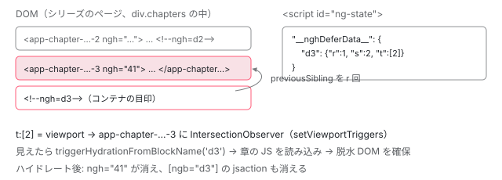

[目次](../README.md) › [SSR とハイドレーション](README.md) › 第 15 回 / 全 15 回

# インクリメンタルハイドレーション：@defer の hydrate トリガーで必要な所だけ

> @defer (hydrate on viewport) などの hydrate トリガーが、サーバーでは中身を描画して NGH\_DEFER\_BLOCKS\_KEY に記録し、ブラウザでは中身の JS を読まずに脱水のまま残る仕組み。ɵɵenableIncrementalHydrationRuntime、トリガーが jsaction に変わる行（convertHydrateTriggersToJsAction）、発火したときに親のブロックから順にハイドレートする getParentBlockHydrationQueue、hydrate never。このサイトのシリーズページが章ごとにこれを使っている様子。

angular/angular · 読了 約 14 分 · 発展 · [サイトで読む（デモが動きます）](https://angular-deep-dive-cyan.vercel.app/chapter/incremental-hydration)

---

ふつうのハイドレーションは、ページ全体を 1 回でつなぎ直します。インクリメンタルハイドレーションは、`@defer` ブロックを単位にして、**必要になったブロックだけを、必要になったときに**つなぎ直します。この章では、`hydrate on viewport` のようなトリガーを持つブロックが、サーバーでは中身まで描画されて記録され、ブラウザでは中身の JS を読まずに脱水（サーバーの DOM だけがある状態）のまま残り、トリガーが来たら親のブロックから順に読み込んでハイドレートされるまでを追います。

読む対象は `packages/core/src/hydration/` の `api.ts`・`incremental_runtime.ts`・`annotate.ts`・`utils.ts`・`cleanup.ts`、`core/src/defer/` の `triggering.ts`・`instructions.ts`・`registry.ts`、それにコンパイラの `insert_incremental_hydration_runtime.ts` です。

1. [1. 概観](01-ssr-overview.md)
2. [2. renderApplication](02-ssr-render-application.md)
3. [3. platformServer と domino](03-ssr-platform-server.md)
4. [4. AngularAppEngine](04-ssr-app-engine.md)
5. [5. サーバールート](05-ssr-server-routes.md)
6. [6. プリレンダー](06-ssr-prerender.md)
7. [7. provideClientHydration](07-hydration-provide.md)
8. [8. ngh の書き出し](08-hydration-annotate.md)
9. [9. ノードの道順](09-hydration.md)
10. [10. ノードの確保](10-hydration-claim.md)
11. [11. コンテナと片付け](11-hydration-containers.md)
12. [12. 不一致のエラー](12-hydration-errors.md)
13. [13. i18n](13-hydration-i18n.md)
14. [14. イベントの再生](14-event-replay.md)
15. **15. インクリメンタル**（この章）

## 0. このサイトでの使い方と、全体の流れ

シリーズを 1 ページで読むページ（たとえば [このシリーズのページ](README.md)）は、`scripts/gen-routes.mjs` が章ごとに次の形で生成しています。

`@defer (on immediate; hydrate on viewport) { <app-chapter-xxx /> } @placeholder { <div class="chapter-placeholder"> }`

1 ページに 15 章、数 MB の HTML がありますが、ブラウザでハイドレートされるのは画面に入った章だけです。中で何が起きているかを 7 段に分けます。

1. **コンパイラ：hydrate トリガーを持つ `@defer` の前に `ɵɵenableIncrementalHydrationRuntime()` を出す**

   2 節。
2. **サーバー：ふつうの `@defer` は placeholder を描くが、hydrate トリガーがあれば中身を描く**

   3 節。
3. **サーバー：ブロックに `d0`, `d1`, … の番号を振り、トリガーを `__nghDeferData__` に記録する**

   4 節。
4. **ブラウザ：ブロックは登録だけして、脱水の DOM を残す**

   5 節。
5. **ブラウザ：記録をもとに、viewport などのトリガーを DOM に仕掛ける**

   6 節。
6. **ブラウザ：発火したら、親のブロックから順に依存を読み込んでハイドレートする**

   7 節。
7. **ブラウザ：トリガー・jsaction・脱水ビューを片付ける**

   7 節の最後。

## 1. 有効にする：withIncrementalHydration

📄 `angular/packages/core/src/hydration/api.ts` L334–355 （▶ の行: 340, 345, 347–348, 351–352）

```ts
334 │ /**
335 │  * Returns a set of providers required to setup support for incremental hydration.
336 │  * Requires hydration to be enabled separately.
337 │  * Enabling incremental hydration also enables event replay for the entire app.
338 │  * @see [Incremental Hydration](guide/incremental-hydration#how-do-you-enable-incremental-hydration-in-angular)
339 │  *
340 ▶  * @deprecated Since v22.0.0, incremental hydration is enabled by default with `provideClientHydration`.
341 │  * Intent to remove in v24.
342 │  */
343 │ export function withIncrementalHydration(): Provider[] {
344 │   const providers: Provider[] = [
345 ▶     withEventReplay(),
346 │     {
347 ▶       provide: IS_INCREMENTAL_HYDRATION_ENABLED,
348 ▶       useValue: true,
349 │     },
350 │     {
351 ▶       provide: DEHYDRATED_BLOCK_REGISTRY,
352 ▶       useFactory: createDehydratedBlockRegistry,
353 │     },
354 │   ];
355 │ 
```

340 行目、v22 で非推奨になりました。`provideClientHydration` が既定で入れるからです （`withNoIncrementalHydration()` で外す。[第 7 回](07-hydration-provide.md)）。345 行目、**イベントの再生（[第 14 回](14-event-replay.md)）も必ず入ります**。347〜348 行目のフラグがサーバーとブラウザの分岐に使われ、351〜352 行目でブロックの登録簿（`DehydratedBlockRegistry`）を用意します。

📄 `angular/packages/core/src/hydration/api.ts` L356–385 （▶ の行: 356, 359, 361–362, 368, 373–375）

```ts
356 ▶   if (typeof ngServerMode === 'undefined' || !ngServerMode) {
357 │     providers.push(
358 │       {
359 ▶         provide: INCREMENTAL_HYDRATION_BOOTSTRAP,
360 │         useFactory: () => ({
361 ▶           requested: false,
362 ▶           activated: false,
363 │           injector: inject(Injector),
364 │           document: inject(DOCUMENT),
365 │         }),
366 │       },
367 │       {
368 ▶         provide: APP_BOOTSTRAP_LISTENER,
369 │         useFactory: () => {
370 │           const state = inject(INCREMENTAL_HYDRATION_BOOTSTRAP);
371 │ 
372 │           return () => {
373 ▶             if (!state.requested) {
374 ▶               state.requested = true;
375 ▶               runIncrementalHydrationBootstrap(state);
376 │             }
377 │           };
378 │         },
379 │         multi: true,
380 │       },
381 │     );
382 │   }
383 │ 
384 │   return providers;
385 │ }
```

ブラウザだけ（356 行目）、359〜366 行目で「起動の状態」`{requested, activated}` を用意し、368〜377 行目のブートストラップ後のリスナーで `requested` を立ててから 375 行目を呼びます。`activated` は次節のコンパイラが出す命令が立てます。

> [!NOTE]
> **ポイント**
>
> このサイトの `app.config.ts` は `provideClientHydration(withIncrementalHydration())` と書いています。インストール版（22.1.6）でも `provideClientHydration` が既定で入れるので、引数は無くても同じ動きです。書くと同じ providers が 2 回入りますが、ブートストラップ後のリスナーは 373 行目の `requested` で 2 回目を飛ばし、イベントの再生側も `appsWithEventReplay` で 2 回目を飛ばすので、動きは変わりません。`@deprecated` は型定義の印で、実行時に警告は出ません。

## 2. コンパイラが出す命令：ɵɵenableIncrementalHydrationRuntime

📄 `angular/packages/compiler/src/template/pipeline/src/phases/insert_incremental_hydration_runtime.ts` L12–37 （▶ の行: 24, 26, 28–29, 33）

```ts
12 │ /**
13 │  * For each view that contains at least one `@defer` block with hydrate triggers,
14 │  * insert a single `EnableIncrementalHydrationRuntime` op before the first such
15 │  * `Defer` op. This results in a top-level `ɵɵenableIncrementalHydrationRuntime()`
16 │  * instruction call being emitted once per "create" block, activating the
17 │  * incremental hydration runtime regardless of how many hydrating defer blocks
18 │  * are present in that view.
19 │  */
20 │ export function insertIncrementalHydrationRuntime(job: ComponentCompilationJob): void {
21 │   for (const unit of job.units) {
22 │     for (const op of unit.create) {
23 │       if (
24 ▶         op.kind === ir.OpKind.Defer &&
25 │         op.flags !== null &&
26 ▶         (op.flags & ir.TDeferDetailsFlags.HasHydrateTriggers) !== 0
27 │       ) {
28 ▶         ir.OpList.insertBefore<ir.CreateOp>(
29 ▶           ir.createEnableIncrementalHydrationRuntimeOp(op.sourceSpan),
30 │           op,
31 │         );
32 │         // Only the first hydrating defer in the view needs the activator.
33 ▶         break;
34 │       }
35 │     }
36 │   }
37 │ }
```

コンパイラは、ビューの作成命令の中に hydrate トリガーを持つ `@defer`（26 行目のフラグ `HasHydrateTriggers`）を見つけると、28〜31 行目でその直前に 1 つだけ `EnableIncrementalHydrationRuntime` を差し込みます。33 行目で、ビューごとに 1 回だけです。後の段で `ɵɵenableIncrementalHydrationRuntime()` の呼び出しになります。

📄 `angular/packages/core/src/hydration/incremental_runtime.ts` L70–106 （▶ の行: 81, 84, 88, 90–94, 98, 101–103）

```ts
 70 │ /**
 71 │  * Activates the incremental-hydration runtime.
 72 │  *
 73 │  * Emitted by the Angular compiler before the first hydrating `@defer` block in
 74 │  * a creation block. The first call swaps in the real implementations. Every
 75 │  * client call also notifies the current application that the runtime is
 76 │  * available.
 77 │  *
 78 │  * @codeGenApi
 79 │  */
 80 │ export function ɵɵenableIncrementalHydrationRuntime(): void {
 81 ▶   if (!isIncrementalHydrationRuntimeActive) {
 82 │     isIncrementalHydrationRuntimeActive = true;
 83 │ 
 84 ▶     enableRetrieveDeferBlockDataImpl();
 85 │ 
 86 │     performanceMarkFeature('NgIncrementalHydration');
 87 │ 
 88 ▶     _dehydratedBlockRegistryFactory = () => new DehydratedBlockRegistry();
 89 │ 
 90 ▶     _runIncrementalHydrationBootstrap = (injector, doc) => {
 91 ▶       const deferBlockData = processBlockData(injector);
 92 ▶       const commentsByBlockId = gatherDeferBlocksCommentNodes(doc, doc.body);
 93 ▶       processAndInitTriggers(injector, deferBlockData, commentsByBlockId);
 94 ▶       appendDeferBlocksToJSActionMap(doc, injector);
 95 │     };
 96 │   }
 97 │ 
 98 ▶   if (typeof ngServerMode === 'undefined' || !ngServerMode) {
 99 │     const injector = getLView()[INJECTOR];
100 │     const state = injector.get(INCREMENTAL_HYDRATION_BOOTSTRAP, null, {optional: true});
101 ▶     if (state !== null && !state.activated) {
102 ▶       state.activated = true;
103 ▶       runIncrementalHydrationBootstrap(state);
104 │     }
105 │   }
106 │ }
```

📄 `angular/packages/core/src/hydration/incremental_runtime.ts` L52–68 （▶ の行: 56–57, 64–66）

```ts
52 │ /**
53 │  * Returns the `DehydratedBlockRegistry` used by incremental hydration, or
54 │  * `null` if the runtime has not been activated.
55 │  */
56 ▶ export function createDehydratedBlockRegistry(): DehydratedBlockRegistry | null {
57 ▶   return _dehydratedBlockRegistryFactory();
58 │ }
59 │ 
60 │ /**
61 │  * Runs incremental hydration bootstrap once application bootstrap and the
62 │  * compiler-generated runtime activation have both occurred.
63 │  */
64 ▶ export function runIncrementalHydrationBootstrap(state: IncrementalHydrationBootstrapState): void {
65 ▶   if (state.requested && state.activated) {
66 ▶     _runIncrementalHydrationBootstrap(state.injector, state.document);
67 │   }
68 │ }
```

1. **81〜96 行目：初回だけ本物に差し替える**

   84 行目で `__nghDeferData__` を読む関数、88 行目で登録簿の作り方、90〜95 行目で「ブラウザで起動するときの処理」を入れます。hydrate トリガーを 1 つも使わないアプリでは、この命令が出ないので、これらのコードはバンドルから消えます（56〜57 行目の登録簿も `null` のまま）。
2. **98〜105 行目：ブラウザでは `activated` を立てる**

   103 行目 → 65 行目。1 節の `requested`（ブートストラップ済み）と `activated`（hydrate トリガーを持つテンプレートが実行された）が **両方そろったときだけ** 66 行目で起動します。どちらが先でも、後から来たほうが起動します。
3. **91〜94 行目：起動の中身**

   91 行目で記録を読み、92 行目で `<!--ngh=dN-->` のコメントを集め、93 行目でトリガーを仕掛け（6 節）、94 行目で jsaction の対応表を作ります。

## 3. サーバー：hydrate トリガーがあれば中身を描く

📄 `angular/packages/core/src/defer/triggering.ts` L609–638 （▶ の行: 615, 623, 627, 632, 634–635）

```ts
609 │ /**
610 │  * Defines whether a regular trigger logic (e.g. "on viewport") should be attached
611 │  * to a defer block. This function defines a condition, which mutually excludes
612 │  * `deferOn*` and `deferHydrateOn*` triggers, to make sure only one of the trigger
613 │  * types is active for a block with the current state.
614 │  */
615 ▶ function shouldAttachRegularTrigger(lView: LView, tNode: TNode): boolean {
616 │   const injector = lView[INJECTOR];
617 │ 
618 │   const tDetails = getTDeferBlockDetails(lView[TVIEW], tNode);
619 │   const incrementalHydrationEnabled = isIncrementalHydrationEnabled(injector);
620 │   const _hasHydrateTriggers = hasHydrateTriggers(tDetails.flags);
621 │ 
622 │   // On the server:
623 ▶   if (typeof ngServerMode !== 'undefined' && ngServerMode) {
624 │     // Regular triggers are activated on the server when:
625 │     //  - Either Incremental Hydration is *not* enabled
626 │     //  - Or Incremental Hydration is enabled, but a given block doesn't have "hydrate" triggers
627 ▶     return !incrementalHydrationEnabled || !_hasHydrateTriggers;
628 │   }
629 │ 
630 │   // On the client:
631 │   const lDetails = getLDeferBlockDetails(lView, tNode);
632 ▶   const wasServerSideRendered = lDetails[SSR_UNIQUE_ID] !== null;
633 │ 
634 ▶   if (_hasHydrateTriggers && wasServerSideRendered && incrementalHydrationEnabled) {
635 ▶     return false;
636 │   }
637 │   return true;
638 │ }
```

📄 `angular/packages/core/src/defer/instructions.ts` L855–884 （▶ の行: 867, 870–871, 880, 882）

```ts
855 │ export function ɵɵdeferHydrateOnViewport(options?: IntersectionObserverInit) {
856 │   const lView = getLView();
857 │   const tNode = getCurrentTNode()!;
858 │ 
859 │   if (ngDevMode) {
860 │     trackTriggerForDebugging(
861 │       lView[TVIEW],
862 │       tNode,
863 │       `hydrate on viewport${options ? `(${JSON.stringify(options)})` : ''}`,
864 │     );
865 │   }
866 │ 
867 ▶   if (!shouldAttachTrigger(TriggerType.Hydrate, lView, tNode)) return;
868 │ 
869 │   const hydrateTriggers = getHydrateTriggers(getTView(), tNode);
870 ▶   hydrateTriggers.set(
871 ▶     DeferBlockTrigger.Viewport,
872 │     options
873 │       ? {
874 │           type: DeferBlockTrigger.Viewport,
875 │           intersectionObserverOptions: options,
876 │         }
877 │       : null,
878 │   );
879 │ 
880 ▶   if (typeof ngServerMode !== 'undefined' && ngServerMode) {
881 │     // We are on the server and SSR for defer blocks is enabled.
882 ▶     triggerDeferBlock(TriggerType.Hydrate, lView, tNode);
883 │   }
884 │   // The actual triggering of hydration on viewport happens in triggering.ts,
```

`@defer` のトリガーは「ふつう（`on ...`）」と「hydrate（`hydrate on ...`）」の 2 組あり、`shouldAttachRegularTrigger` がどちらか一方だけを有効にします。サーバーでは 627 行目、インクリメンタルが有効でブロックが hydrate トリガーを持つなら、**ふつうのトリガーは付けません**。代わりに hydrate 側の命令が動き、882 行目で `triggerDeferBlock(TriggerType.Hydrate, ...)` を呼んで、その場で中身を描画します。ふつうの `@defer` はサーバーでは placeholder を描くだけなので（[@defer の章](../template/03-defer.md)）、ここが大きな違いです。870〜878 行目で、トリガーの種類を `hydrateTriggers` の Map に記録します。これを次節で書き出します。

## 4. サーバー：ブロックを記録する

📄 `angular/packages/core/src/hydration/annotate.ts` L376–410 （▶ の行: 383–384, 386–387, 391, 395–396, 399, 401, 404, 406, 409）

```ts
376 │       let isHydrateNeverBlock = false;
377 │ 
378 │       // If this is a defer block, serialize extra info.
379 │       if (isDeferBlock(lView[TVIEW], tNode)) {
380 │         const lDetails = getLDeferBlockDetails(lView, tNode);
381 │         const tDetails = getTDeferBlockDetails(lView[TVIEW], tNode);
382 │ 
383 ▶         if (context.isIncrementalHydrationEnabled && tDetails.hydrateTriggers !== null) {
384 ▶           const deferBlockId = `d${context.deferBlocks.size}`;
385 │ 
386 ▶           if (tDetails.hydrateTriggers.has(DeferBlockTrigger.Never)) {
387 ▶             isHydrateNeverBlock = true;
388 │           }
389 │ 
390 │           let rootNodes: any[] = [];
391 ▶           collectNativeNodesInLContainer(lContainer, rootNodes);
392 │ 
393 │           // Add defer block into info context.deferBlocks
394 │           const deferBlockInfo: SerializedDeferBlock = {
395 ▶             [NUM_ROOT_NODES]: rootNodes.length,
396 ▶             [DEFER_BLOCK_STATE]: lDetails[CURRENT_DEFER_BLOCK_STATE],
397 │           };
398 │ 
399 ▶           const serializedTriggers = serializeHydrateTriggers(tDetails.hydrateTriggers);
400 │           if (serializedTriggers.length > 0) {
401 ▶             deferBlockInfo[DEFER_HYDRATE_TRIGGERS] = serializedTriggers;
402 │           }
403 │ 
404 ▶           if (parentDeferBlockId !== null) {
405 │             // Serialize parent id only when it's present.
406 ▶             deferBlockInfo[DEFER_PARENT_BLOCK_ID] = parentDeferBlockId;
407 │           }
408 │ 
409 ▶           context.deferBlocks.set(deferBlockId, deferBlockInfo);
410 │ 
```

📄 `angular/packages/core/src/hydration/annotate.ts` L411–436 （▶ の行: 414, 424, 426, 430, 435）

```ts
411 │           const node = unwrapRNode(lContainer);
412 │           if (node !== undefined) {
413 │             if ((node as Node).nodeType === Node.COMMENT_NODE) {
414 ▶               annotateDeferBlockAnchorForHydration(node as RComment, deferBlockId);
415 │             }
416 │           } else {
417 │             ngDevMode && validateNodeExists(node, childLView, tNode);
418 │             ngDevMode &&
419 │               validateMatchingNode(node, Node.COMMENT_NODE, null, childLView, tNode, true);
420 │ 
421 │             annotateDeferBlockAnchorForHydration(node as RComment, deferBlockId);
422 │           }
423 │ 
424 ▶           if (!isHydrateNeverBlock) {
425 │             // Add JSAction attributes for root nodes that use some hydration triggers
426 ▶             annotateDeferBlockRootNodesWithJsAction(tDetails, rootNodes, deferBlockId, context);
427 │           }
428 │ 
429 │           // Use current block id as parent for nested routes.
430 ▶           parentDeferBlockId = deferBlockId;
431 │ 
432 │           // Serialize extra info into the view object.
433 │           // TODO(incremental-hydration): this should be serialized and included at a different level
434 │           // (not at the view level).
435 ▶           serializedView[DEFER_BLOCK_ID] = deferBlockId;
436 │         }
```

1. **384 行目：番号を振る**

   見つけた順に `d0`, `d1`, …。
2. **391〜402 行目：1 ブロック分の記録**

   `r`（`NUM_ROOT_NODES`）= 中身の最上位の DOM ノードの数、`s`（`DEFER_BLOCK_STATE`）= 描いた状態、`t`（`DEFER_HYDRATE_TRIGGERS`）= トリガー。
3. **404〜407 行目・430 行目：親子関係**

   入れ子のブロックは `p`（`DEFER_PARENT_BLOCK_ID`）に親の番号を持ちます。430 行目で、この中の子にとって自分が親になります。
4. **414 行目：目印のコメント**

   ブロックのコンテナの目印コメントの中身を `ngh=d3` のように書き換えます。ブラウザはこのコメントからブロックの DOM を見つけます。
5. **424〜427 行目：interaction / hover は jsaction にする**

   下の `annotateDeferBlockRootNodesWithJsAction`。`hydrate never` のブロックは飛ばします（8 節）。

📄 `angular/packages/core/src/hydration/annotate.ts` L482–504 （▶ の行: 485–489, 493, 495, 497, 499）

```ts
482 │ function serializeHydrateTriggers(
483 │   triggerMap: Map<DeferBlockTrigger, HydrateTriggerDetails | null>,
484 │ ): (DeferBlockTrigger | SerializedTriggerDetails)[] {
485 ▶   const serializableDeferBlockTrigger = new Set<DeferBlockTrigger>([
486 ▶     DeferBlockTrigger.Idle,
487 ▶     DeferBlockTrigger.Immediate,
488 ▶     DeferBlockTrigger.Viewport,
489 ▶     DeferBlockTrigger.Timer,
490 │   ]);
491 │   let triggers: (DeferBlockTrigger | SerializedTriggerDetails)[] = [];
492 │   for (let [trigger, details] of triggerMap) {
493 ▶     if (serializableDeferBlockTrigger.has(trigger)) {
494 │       if (details === null) {
495 ▶         triggers.push(trigger);
496 │       } else if (details.type === DeferBlockTrigger.Timer) {
497 ▶         triggers.push({trigger, delay: details.delay});
498 │       } else {
499 ▶         triggers.push({trigger, intersectionObserverOptions: details.intersectionObserverOptions});
500 │       }
501 │     }
502 │   }
503 │   return triggers;
504 │ }
```

`t` に書くのは 485〜490 行目の 4 種類（`idle` / `immediate` / `viewport` / `timer`）だけです。`DeferBlockTrigger` の値は `Idle = 0`, `Immediate = 1`, `Viewport = 2` …（[@defer の章](../template/03-defer.md)の enum）なので、このサイトの章は `"t":[2]` になります。497・499 行目、`timer(…)` の時間や viewport の `IntersectionObserver` の設定があればオブジェクトで書きます。

📄 `angular/packages/core/src/hydration/utils.ts` L58–69 （▶ の行: 62, 67）

```ts
58 │ /**
59 │  * The name of the key used in the TransferState collection,
60 │  * where serialized defer block information is located.
61 │  */
62 ▶ export const TRANSFER_STATE_DEFER_BLOCKS_INFO = '__nghDeferData__';
63 │ 
64 │ /**
65 │  * Lookup key used to retrieve defer block datain `TransferState`.
66 │  */
67 ▶ export const NGH_DEFER_BLOCKS_KEY: StateKey<{[key: string]: SerializedDeferBlock}> = makeStateKey<{
68 │   [key: string]: SerializedDeferBlock;
69 │ }>(TRANSFER_STATE_DEFER_BLOCKS_INFO);
```

集めた記録は、すべてのビューを書き終えたあと `TransferState` のキー `__nghDeferData__`（62 行目）に 1 つのオブジェクトとして入り、`<script id="ng-state">` に出ます（`TransferState` の書き出しは [http-transfer-cache](../http/11-http-transfer-cache.md)）。このサイトのシリーズページなら `{"d0":{"r":1,"s":2,"t":[2]}, "d1": …}` です。

📄 `angular/packages/core/src/hydration/utils.ts` L578–591 （▶ の行: 583–584, 586–587）

```ts
578 │ export function convertHydrateTriggersToJsAction(
579 │   triggers: Map<DeferBlockTrigger, HydrateTriggerDetails | null> | null,
580 │ ): string[] {
581 │   let actionList: string[] = [];
582 │   if (triggers !== null) {
583 ▶     if (triggers.has(DeferBlockTrigger.Hover)) {
584 ▶       actionList.push(...hoverEventNames);
585 │     }
586 ▶     if (triggers.has(DeferBlockTrigger.Interaction)) {
587 ▶       actionList.push(...interactionEventNames);
588 │     }
589 │   }
590 │   return actionList;
591 │ }
```

📄 `angular/packages/core/src/hydration/annotate.ts` L890–916 （▶ の行: 903, 905, 909, 913）

```ts
890 │ /**
891 │  * Incremental hydration requires that any defer block root node
892 │  * with interaction or hover triggers have all of their root nodes
893 │  * trigger hydration with those events. So we need to make sure all
894 │  * the root nodes of that block have the proper jsaction attribute
895 │  * to ensure hydration is triggered, since the content is dehydrated
896 │  */
897 │ function annotateDeferBlockRootNodesWithJsAction(
898 │   tDetails: TDeferBlockDetails,
899 │   rootNodes: any[],
900 │   parentDeferBlockId: string,
901 │   context: HydrationContext,
902 │ ) {
903 ▶   const actionList = convertHydrateTriggersToJsAction(tDetails.hydrateTriggers);
904 │   for (let et of actionList) {
905 ▶     context.eventTypesToReplay.regular.add(et);
906 │   }
907 │ 
908 │   if (actionList.length > 0) {
909 ▶     const elementNodes = (rootNodes as HTMLElement[]).filter(
910 │       (rn) => rn.nodeType === Node.ELEMENT_NODE,
911 │     );
912 │     for (let rNode of elementNodes) {
913 ▶       setJSActionAttributes(rNode, actionList, parentDeferBlockId);
914 │     }
915 │   }
916 │ }
```

`hover` と `interaction` は `t` に書かず、583〜588 行目でイベント名 （`interaction` は `click`・`keydown`、`hover` は `mouseenter`・`mouseover`・`focusin`）に変えます。905 行目で再生するイベントの種類に足し、913 行目でブロックの最上位の要素に `jsaction` と `ngb` を付けます。つまり、これらのトリガーは**イベントの再生の仕組みに乗って**発火します（[第 14 回](14-event-replay.md)の 9 節）。

| hydrate トリガー | サーバーが書く場所 | ブラウザで発火させるもの |
| --- | --- | --- |
| `on viewport` | `t` に 2 | 6 節の `setViewportTriggers`（`IntersectionObserver`） |
| `on idle` / `on immediate` / `on timer` | `t` に 0 / 1 / `{trigger:5, delay}` | 6 節の `setIdleTriggers` ほか |
| `on interaction` / `on hover` | 最上位の要素の `jsaction` と `ngb` | イベント契約 → `hydrateAndInvokeBlockListeners` |
| `when 式` | なし | 親のビューの変更検知で式を評価（8 節） |
| `never` | なし（jsaction も付けない） | なし（8 節） |

## 5. ブラウザ：登録だけして、脱水のまま残す

ブラウザでも、親のテンプレート（このサイトならシリーズのページ）が実行されれば `ɵɵdefer` 命令が動きます。3 節の `shouldAttachRegularTrigger` のブラウザ側は 632〜635 行目で、「hydrate トリガーがあり、サーバーで描かれていて（`SSR_UNIQUE_ID` がある）、インクリメンタルが有効」なら `false` を返します。**ふつうのトリガー（この例の `on immediate`）は付かず、中身の依存の読み込みも始まりません。**

📄 `angular/packages/core/src/defer/instructions.ts` L175–211 （▶ の行: 180, 184, 186, 198, 206, 209–210）

```ts
175 │   const lContainer = lView[adjustedIndex];
176 │ 
177 │   // If hydration is enabled, looks up dehydrated views in the DOM
178 │   // using hydration annotation info and stores those views on LContainer.
179 │   // In client-only mode, this function is a noop.
180 ▶   populateDehydratedViewsInLContainer(lContainer, tNode, lView);
181 │ 
182 │   let ssrBlockState = null;
183 │   let ssrUniqueId: string | null = null;
184 ▶   if (lContainer[DEHYDRATED_VIEWS]?.length > 0) {
185 │     const info = lContainer[DEHYDRATED_VIEWS][0].data;
186 ▶     ssrUniqueId = info[DEFER_BLOCK_ID] ?? null;
187 │     ssrBlockState = info[SERIALIZED_DEFER_BLOCK_STATE];
188 │   }
189 │ 
190 │   // Init instance-specific defer details and store it.
191 │   const lDetails: LDeferBlockDetails = [
192 │     null, // NEXT_DEFER_BLOCK_STATE
193 │     DeferBlockInternalState.Initial, // DEFER_BLOCK_STATE
194 │     null, // STATE_IS_FROZEN_UNTIL
195 │     null, // LOADING_AFTER_CLEANUP_FN
196 │     null, // TRIGGER_CLEANUP_FNS
197 │     null, // PREFETCH_TRIGGER_CLEANUP_FNS
198 ▶     ssrUniqueId, // SSR_UNIQUE_ID
199 │     ssrBlockState, // SSR_BLOCK_STATE
200 │     null, // ON_COMPLETE_FNS
201 │     null, // HYDRATE_TRIGGER_CLEANUP_FNS
202 │   ];
203 │   setLDeferBlockDetails(lView, adjustedIndex, lDetails);
204 │ 
205 │   let registry: DehydratedBlockRegistry | null = null;
206 ▶   if (ssrUniqueId !== null && incrementalHydrationEnabled) {
207 │     // Store this defer block in the registry, to have an access to
208 │     // internal data structures from hydration runtime code.
209 ▶     registry = injector.get(DEHYDRATED_BLOCK_REGISTRY);
210 ▶     registry.add(ssrUniqueId, {lView, tNode, lContainer});
211 │   }
```

180 行目で、サーバーの DOM の中からこのブロックの脱水ビューを探して LContainer に付けます。184〜188 行目で、そのビューの記録から `d3` のような番号（`SSR_UNIQUE_ID`）を読み、206〜211 行目で登録簿に `{lView, tNode, lContainer}` を入れます。ここまでで中身のコンポーネントは**1 つも作られていません**。

アプリが安定すると、使われなかった脱水ビューは `removeDehydratedViews` が消しますが、`DEFER_BLOCK_ID` を持つ `@defer` のビューだけは消さずに残します（その行は [第 11 回](11-hydration-containers.md)で読みます）。だから、ハイドレートしていない章も画面にはサーバーの HTML のまま見えています。

## 6. ブラウザ：トリガーを仕掛ける

📄 `angular/packages/core/src/hydration/utils.ts` L722–748 （▶ の行: 730–733, 742, 745）

```ts
722 │ /**
723 │  * Creates a summary of the given serialized defer block, which is used later to properly initialize
724 │  * specific triggers.
725 │  */
726 │ function createBlockSummary(blockInfo: SerializedDeferBlock): BlockSummary {
727 │   return {
728 │     data: blockInfo,
729 │     hydrate: {
730 ▶       idle: hasHydrateTrigger(blockInfo, DeferBlockTrigger.Idle),
731 ▶       immediate: hasHydrateTrigger(blockInfo, DeferBlockTrigger.Immediate),
732 ▶       timer: getHydrateTimerTrigger(blockInfo),
733 ▶       viewport: getHydrateViewportTrigger(blockInfo),
734 │     },
735 │   };
736 │ }
737 │ 
738 │ /**
739 │  * Processes all of the defer block data in the transfer state and creates a map of the summaries
740 │  */
741 │ export function processBlockData(injector: Injector): Map<string, BlockSummary> {
742 ▶   const blockData = retrieveDeferBlockData(injector);
743 │   let blockDetails = new Map<string, BlockSummary>();
744 │   for (let blockId in blockData) {
745 ▶     blockDetails.set(blockId, createBlockSummary(blockData[blockId]));
746 │   }
747 │   return blockDetails;
748 │ }
```

📄 `angular/packages/core/src/hydration/utils.ts` L702–716 （▶ の行: 708–709, 711）

```ts
702 │ function getHydrateViewportTrigger(
703 │   blockData: SerializedDeferBlock,
704 │ ): true | IntersectionObserverInit | null {
705 │   const details = blockData[DEFER_HYDRATE_TRIGGERS];
706 │   if (details) {
707 │     for (const current of details) {
708 ▶       if (current === DeferBlockTrigger.Viewport) {
709 ▶         return true;
710 │       } else if (typeof current === 'object' && current.trigger === DeferBlockTrigger.Viewport) {
711 ▶         return current.intersectionObserverOptions || true;
712 │       }
713 │     }
714 │   }
715 │   return null;
716 │ }
```

2 節 91 行目の `processBlockData` は、742 行目で `__nghDeferData__` を読み、ブロックごとに 730〜733 行目の要約（`idle` / `immediate` / `timer` / `viewport`）を作ります。viewport は 708〜711 行目、`t` に 2 があれば `true`、設定付きならその設定です。

📄 `angular/packages/core/src/defer/triggering.ts` L664–700 （▶ の行: 665, 667, 669–671, 674, 686, 690, 698）

```ts
664 │   for (let [blockId, blockSummary] of blockData) {
665 ▶     const commentNode = nodes.get(blockId);
666 │     if (commentNode !== undefined) {
667 ▶       const numRootNodes = blockSummary.data[NUM_ROOT_NODES];
668 │       let currentNode: Comment | HTMLElement = commentNode;
669 ▶       for (let i = 0; i < numRootNodes; i++) {
670 ▶         currentNode = currentNode.previousSibling as HTMLElement;
671 ▶         if (currentNode.nodeType !== Node.ELEMENT_NODE) {
672 │           continue;
673 │         }
674 ▶         const elementTrigger: ElementTrigger = {el: currentNode, blockName: blockId};
675 │         // hydrate
676 │         if (blockSummary.hydrate.idle) {
677 │           idleElements.push(elementTrigger);
678 │         }
679 │         if (blockSummary.hydrate.immediate) {
680 │           immediateElements.push(elementTrigger);
681 │         }
682 │         if (blockSummary.hydrate.timer !== null) {
683 │           elementTrigger.delay = blockSummary.hydrate.timer;
684 │           timerElements.push(elementTrigger);
685 │         }
686 ▶         if (blockSummary.hydrate.viewport) {
687 │           if (typeof blockSummary.hydrate.viewport !== 'boolean') {
688 │             elementTrigger.intersectionObserverOptions = blockSummary.hydrate.viewport;
689 │           }
690 ▶           viewportElements.push(elementTrigger);
691 │         }
692 │       }
693 │     }
694 │   }
695 │ 
696 │   setIdleTriggers(injector, idleElements);
697 │   setImmediateTriggers(injector, immediateElements);
698 ▶   setViewportTriggers(injector, viewportElements);
699 │   setTimerTriggers(injector, timerElements);
700 │ }
```



*サーバーが書いた DOM と ng-state。目印のコメント ngh=d3 の前の r 個の兄弟がブロックの中身で、そこに viewport の監視を付ける。ハイドレートされると中のホスト要素から ngh 属性が消える。*

📄 `angular/packages/core/src/defer/triggering.ts` L711–724 （▶ の行: 715–717, 721）

```ts
711 │ function setViewportTriggers(injector: Injector, elementTriggers: ElementTrigger[]) {
712 │   if (elementTriggers.length > 0) {
713 │     const registry = injector.get(DEHYDRATED_BLOCK_REGISTRY);
714 │     for (let elementTrigger of elementTriggers) {
715 ▶       const cleanupFn = onViewportWrapper(
716 ▶         elementTrigger.el,
717 ▶         () => triggerHydrationFromBlockName(injector, elementTrigger.blockName),
718 │         injector,
719 │         elementTrigger.intersectionObserverOptions,
720 │       );
721 ▶       registry.addCleanupFn(elementTrigger.blockName, cleanupFn);
722 │     }
723 │   }
724 │ }
```

1. **665 行目：目印のコメントを引く**

   2 節 92 行目で集めた「番号 → `<!--ngh=d3-->`」の Map です。
2. **667〜673 行目：コメントの前の兄弟を `r` 個さかのぼる**

   ブロックの中身は目印のコメントの**前**に並んでいます。このサイトでは `r` が 1 で、章のホスト要素 `<app-chapter-…>` 1 個です。
3. **674〜691 行目：種類ごとに振り分ける**
4. **715〜720 行目：要素ごとに viewport を監視する**

   `onViewportWrapper` は `@defer` の `on viewport` と同じ `IntersectionObserver` の仕組みです（[@defer の章](../template/03-defer.md)）。見えたら 717 行目で `triggerHydrationFromBlockName(injector, 'd3')`。721 行目で監視の解除関数を登録簿に預けます。

📄 `angular/packages/core/src/hydration/utils.ts` L633–653 （▶ の行: 634, 636, 639–640, 651）

```ts
633 │ function gatherDeferBlocksByJSActionAttribute(doc: Document): Set<HTMLElement> {
634 ▶   const jsactionNodes = doc.body.querySelectorAll('[jsaction]');
635 │   const blockMap = new Set<HTMLElement>();
636 ▶   const eventTypes = [hoverEventNames.join(':;'), interactionEventNames.join(':;')].join('|');
637 │   for (let node of jsactionNodes) {
638 │     const attr = node.getAttribute('jsaction');
639 ▶     const blockId = node.getAttribute('ngb');
640 ▶     if (attr?.match(eventTypes) && blockId !== null) {
641 │       blockMap.add(node as HTMLElement);
642 │     }
643 │   }
644 │   return blockMap;
645 │ }
646 │ 
647 │ export function appendDeferBlocksToJSActionMap(doc: Document, injector: Injector) {
648 │   const blockMap = gatherDeferBlocksByJSActionAttribute(doc);
649 │   const jsActionMap = injector.get(JSACTION_BLOCK_ELEMENT_MAP);
650 │   for (let rNode of blockMap) {
651 ▶     sharedMapFunction(rNode, jsActionMap);
652 │   }
653 │ }
```

2 節 94 行目の続きです。634 行目で `[jsaction]` を全部集め、`ngb` を持ち、interaction / hover のイベント名を含む要素だけを 651 行目でブロック名ごとの対応表に入れます。ハイドレート後に属性を消すためです。

## 7. ブラウザ：発火したら、親から順に

📄 `angular/packages/core/src/defer/triggering.ts` L374–414 （▶ の行: 383, 391–392, 396–397, 402, 406, 410–411, 414）

```ts
374 │ export async function triggerHydrationFromBlockName(
375 │   injector: Injector,
376 │   blockName: string,
377 │   replayQueuedEventsFn?: Function,
378 │ ) {
379 │   const dehydratedBlockRegistry = injector.get(DEHYDRATED_BLOCK_REGISTRY);
380 │   const blocksBeingHydrated = dehydratedBlockRegistry.hydrating;
381 │ 
382 │   // Make sure we don't hydrate/trigger the same thing multiple times
383 ▶   if (blocksBeingHydrated.has(blockName)) {
384 │     return;
385 │   }
386 │ 
387 │   // Trigger resource loading and hydration for the blocks in the queue in the order of highest block
388 │   // to lowest block. Once a block has finished resource loading, after next render fires after hydration
389 │   // finishes. The new block will have its defer instruction called and will be in the registry.
390 │   // Due to timing related to potential nested control flow, this has to be scheduled after the next render.
391 ▶   const {parentBlockPromise, hydrationQueue} = getParentBlockHydrationQueue(blockName, injector);
392 ▶   if (hydrationQueue.length === 0) return;
393 │ 
394 │   // It's possible that the hydrationQueue topmost item is actually in the process of hydrating and has
395 │   // a promise already. In that case, we don't want to destroy that promise and queue it again.
396 ▶   if (parentBlockPromise !== null) {
397 ▶     hydrationQueue.shift();
398 │   }
399 │ 
400 │   // The hydrating map in the registry prevents re-triggering hydration for a block that's already in
401 │   // the hydration queue. Here we generate promises for each of the blocks about to be hydrated
402 ▶   populateHydratingStateForQueue(dehydratedBlockRegistry, hydrationQueue);
403 │ 
404 │   // We await this after populating the hydration state so we can prevent re-triggering hydration for
405 │   // the same blocks while this promise is being awaited.
406 ▶   if (parentBlockPromise !== null) {
407 │     await parentBlockPromise;
408 │   }
409 │ 
410 ▶   const topmostParentBlock = hydrationQueue[0];
411 ▶   if (dehydratedBlockRegistry.has(topmostParentBlock)) {
412 │     // the topmost parent block is already in the registry and we can proceed
413 │     // with hydration.
414 ▶     await triggerHydrationForBlockQueue(injector, hydrationQueue, replayQueuedEventsFn);
```

📄 `angular/packages/core/src/hydration/utils.ts` L600–631 （▶ の行: 606, 613, 621–623, 627–628）

```ts
600 │ export function getParentBlockHydrationQueue(
601 │   deferBlockId: string,
602 │   injector: Injector,
603 │ ): {parentBlockPromise: Promise<void> | null; hydrationQueue: string[]} {
604 │   const dehydratedBlockRegistry = injector.get(DEHYDRATED_BLOCK_REGISTRY);
605 │   const transferState = injector.get(TransferState);
606 ▶   const deferBlockParents = transferState.get(NGH_DEFER_BLOCKS_KEY, {});
607 │ 
608 │   let isTopMostDeferBlock = false;
609 │   let currentBlockId: string | undefined = deferBlockId;
610 │   let parentBlockPromise: Promise<void> | null = null;
611 │   const hydrationQueue: string[] = [];
612 │ 
613 ▶   while (!isTopMostDeferBlock && currentBlockId) {
614 │     ngDevMode &&
615 │       assertEqual(
616 │         hydrationQueue.indexOf(currentBlockId),
617 │         -1,
618 │         'Internal error: defer block hierarchy has a cycle.',
619 │       );
620 │ 
621 ▶     isTopMostDeferBlock = dehydratedBlockRegistry.has(currentBlockId);
622 ▶     const hydratingParentBlock = dehydratedBlockRegistry.hydrating.get(currentBlockId);
623 ▶     if (parentBlockPromise === null && hydratingParentBlock != null) {
624 │       parentBlockPromise = hydratingParentBlock.promise;
625 │       break;
626 │     }
627 ▶     hydrationQueue.unshift(currentBlockId);
628 ▶     currentBlockId = deferBlockParents[currentBlockId][DEFER_PARENT_BLOCK_ID];
629 │   }
630 │   return {parentBlockPromise, hydrationQueue};
631 │ }
```

1. **383 行目：すでにハイドレート中なら何もしない**
2. **391 行目 → 600 行目：親をたどって列を作る**

   613〜629 行目、記録の `p`（628 行目）を上へたどり、627 行目の `unshift` で**先頭に**足していきます。621 行目、登録簿にある（= `ɵɵdefer` がもう実行された）ブロックに着いたら止まります。子のブロックが見えても、親がまだ脱水なら、列は `[親, 子]` になります。622〜625 行目、途中のブロックがすでにハイドレート中なら、その完了の Promise を待つ側に回ります（396〜397 行目、406〜408 行目）。
3. **402 行目：列の全ブロックを「ハイドレート中」にする**

   ブロックごとに Promise を作ります。これで 383 行目の重複よけが効きます。
4. **410〜414 行目：先頭のブロックが登録簿にあれば始める**

   無ければ（遅延読み込みのルートなどで、まだ `ɵɵdefer` が動いていない）、登録された時点で続きを呼ぶよう予約します。

📄 `angular/packages/core/src/defer/triggering.ts` L444–478 （▶ の行: 448–449, 452, 454, 459–460, 465, 469, 478）

```ts
444 │   const dehydratedBlockRegistry = injector.get(DEHYDRATED_BLOCK_REGISTRY);
445 │   const blocksBeingHydrated = dehydratedBlockRegistry.hydrating;
446 │ 
447 │   // Indicate that we have some pending async work.
448 ▶   const pendingTasks = injector.get(PendingTasksInternal);
449 ▶   const taskId = pendingTasks.add();
450 │ 
451 │   // Actually do the triggering and hydration of the queue of blocks
452 ▶   for (let blockQueueIdx = 0; blockQueueIdx < hydrationQueue.length; blockQueueIdx++) {
453 │     const dehydratedBlockId = hydrationQueue[blockQueueIdx];
454 ▶     const dehydratedDeferBlock = dehydratedBlockRegistry.get(dehydratedBlockId);
455 │ 
456 │     if (dehydratedDeferBlock != null) {
457 │       // trigger the block resources and await next render for hydration. This should result
458 │       // in the next block ɵɵdefer instruction being called and that block being added to the dehydrated registry.
459 ▶       await triggerResourceLoadingForHydration(dehydratedDeferBlock);
460 ▶       await nextRender(injector);
461 │ 
462 │       // if the content has changed since server rendering, we need to check for the expected block
463 │       // being in the registry or if errors occurred. In that case, we need to clean up the remaining expected
464 │       // content that won't be rendered or fetched.
465 ▶       if (deferBlockHasErrored(dehydratedDeferBlock)) {
466 │         // Either the expected block has not yet had its ɵɵdefer instruction called or the block errored out when fetching
467 │         // resources. In the former case, either we're hydrating too soon or the client and server differ. In both cases,
468 │         // we need to clean up child content and promises.
469 ▶         removeDehydratedViewList(dehydratedDeferBlock);
470 │         cleanupRemainingHydrationQueue(
471 │           hydrationQueue.slice(blockQueueIdx),
472 │           dehydratedBlockRegistry,
473 │         );
474 │         break;
475 │       }
476 │       // The defer block has not errored and we've finished fetching resources and rendering.
477 │       // At this point it is safe to resolve the hydration promise.
478 ▶       blocksBeingHydrated.get(dehydratedBlockId)!.resolve();
```

📄 `angular/packages/core/src/defer/triggering.ts` L559–574 （▶ の行: 561, 571–572）

```ts
559 │ // Waits for the next render cycle to complete
560 │ function nextRender(injector: Injector): Promise<void> {
561 ▶   return new Promise<void>((resolveFn) => afterNextRender(resolveFn, {injector}));
562 │ }
563 │ 
564 │ async function triggerResourceLoadingForHydration(
565 │   dehydratedBlock: DehydratedDeferBlock,
566 │ ): Promise<void> {
567 │   const {tNode, lView} = dehydratedBlock;
568 │   const lDetails = getLDeferBlockDetails(lView, tNode);
569 │ 
570 │   return new Promise<void>((resolve) => {
571 ▶     onDeferBlockCompletion(lDetails, resolve);
572 ▶     triggerDeferBlock(TriggerType.Hydrate, lView, tNode);
573 │   });
574 │ }
```

1. **448〜449 行目：`PendingTasks` に 1 つ足す**

   終わるまでアプリは「安定していない」状態になります（[PendingTasks の章](../zoneless/09-zoneless-pending-tasks.md)）。
2. **452〜460 行目：列の順に、読み込み → 次の描画を待つ**

   459 行目 → 572 行目、`triggerDeferBlock(TriggerType.Hydrate, ...)` でブロックの依存（このサイトなら章のコンポーネントの JS の chunk）を読み込み、読み終えたら中身を描きます。このときハイドレーション情報があるので、新しく DOM を作らず**脱水の DOM を確保**します（確保の仕組みは [第 10 回](10-hydration-claim.md)）。460 行目の `nextRender`（561 行目の `afterNextRender`）を待つのは、親の中身が描かれて初めて子の `ɵɵdefer` が動き、子が登録簿に入るからです。
3. **465〜475 行目：失敗したら**

   読み込みに失敗したら、このブロックの脱水 DOM と列の残りを片付けて止めます。登録簿にブロックが見つからない（サーバーとブラウザで中身が変わった）ときも、すぐ後ろの `else` 側で同じように片付けます。
4. **478 行目：このブロックの Promise を解決**

📄 `angular/packages/core/src/defer/triggering.ts` L488–508 （▶ の行: 491, 494, 497–498, 502）

```ts
488 │   const lastBlockName = hydrationQueue[hydrationQueue.length - 1];
489 │ 
490 │   // Await hydration completion for the last block.
491 ▶   await blocksBeingHydrated.get(lastBlockName)?.promise;
492 │ 
493 │   // All async work is done, remove the taskId from the registry.
494 ▶   pendingTasks.remove(taskId);
495 │ 
496 │   // Replay any queued events, if any exist and the replay operation was requested.
497 ▶   if (replayQueuedEventsFn) {
498 ▶     replayQueuedEventsFn(hydrationQueue);
499 │   }
500 │ 
501 │   // Cleanup after hydration of all affected defer blocks.
502 ▶   cleanupHydratedDeferBlocks(
503 │     dehydratedBlockRegistry.get(lastBlockName),
504 │     hydrationQueue,
505 │     dehydratedBlockRegistry,
506 │     injector.get(ApplicationRef),
507 │   );
508 │ }
```

📄 `angular/packages/core/src/hydration/cleanup.ts` L147–163 （▶ の行: 159–161）

```ts
147 │ /**
148 │  * post hydration cleanup handling for defer blocks that were incrementally
149 │  * hydrated. This removes all the jsaction attributes, timers, observers,
150 │  * dehydrated views and containers
151 │  */
152 │ export function cleanupHydratedDeferBlocks(
153 │   deferBlock: DehydratedDeferBlock | null,
154 │   hydratedBlocks: string[],
155 │   registry: DehydratedBlockRegistry,
156 │   appRef: ApplicationRef,
157 │ ): void {
158 │   if (deferBlock !== null) {
159 ▶     registry.cleanup(hydratedBlocks);
160 ▶     cleanupLContainer(deferBlock.lContainer);
161 ▶     cleanupDehydratedViews(appRef);
162 │   }
163 │ }
```

📄 `angular/packages/core/src/defer/registry.ts` L34–74 （▶ の行: 35, 41, 63, 65–68, 71–72）

```ts
34 │ export class DehydratedBlockRegistry {
35 ▶   private registry = new Map<string, DehydratedDeferBlock>();
36 │   private cleanupFns = new Map<string, Function[]>();
37 │   private jsActionMap: Map<string, Set<Element>> = inject(JSACTION_BLOCK_ELEMENT_MAP);
38 │   private contract: EventContractDetails = inject(JSACTION_EVENT_CONTRACT);
39 │ 
40 │   add(blockId: string, info: DehydratedDeferBlock) {
41 ▶     this.registry.set(blockId, info);
42 │     // It's possible that hydration is queued that's waiting for the
43 │     // resolution of a lazy loaded route. In this case, we ensure
44 │     // the callback function is called to continue the hydration process
45 │     // for the queued block set.
46 │     if (this.awaitingCallbacks.has(blockId)) {
47 │       const awaitingCallbacks = this.awaitingCallbacks.get(blockId)!;
48 │       for (const cb of awaitingCallbacks) {
49 │         cb();
50 │       }
51 │     }
52 │   }
53 │ 
54 │   get(blockId: string): DehydratedDeferBlock | null {
55 │     return this.registry.get(blockId) ?? null;
56 │   }
57 │ 
58 │   has(blockId: string): boolean {
59 │     return this.registry.has(blockId);
60 │   }
61 │ 
62 │   cleanup(hydratedBlocks: string[]) {
63 ▶     removeListenersFromBlocks(hydratedBlocks, this.jsActionMap);
64 │     for (let blockId of hydratedBlocks) {
65 ▶       this.registry.delete(blockId);
66 ▶       this.jsActionMap.delete(blockId);
67 ▶       this.invokeTriggerCleanupFns(blockId);
68 ▶       this.hydrating.delete(blockId);
69 │       this.awaitingCallbacks.delete(blockId);
70 │     }
71 ▶     if (this.size === 0) {
72 ▶       this.contract.instance?.cleanUp();
73 │     }
74 │   }
```

494 行目で `PendingTasks` を戻し、497〜499 行目で、クリックが発端なら貯めていたイベントを渡します（[第 14 回](14-event-replay.md)の 9 節）。502〜507 行目 → 159〜161 行目で片付けです。登録簿の `cleanup` は、63 行目でブロックの要素の `jsaction` と `ngb` を消し、65〜69 行目で登録・トリガーの解除（viewport の監視をやめる）・Promise を捨てます。71〜73 行目、登録簿が空になったら、残しておいたイベント契約も `cleanUp()` します。

## 8. hydrate never と hydrate when

📄 `angular/packages/core/src/defer/instructions.ts` L342–363 （▶ の行: 357, 359, 361）

```ts
342 │ /**
343 │  * Specifies that hydration never occurs.
344 │  * @codeGenApi
345 │  */
346 │ export function ɵɵdeferHydrateNever() {
347 │   const lView = getLView();
348 │   const tNode = getCurrentTNode()!;
349 │ 
350 │   if (ngDevMode) {
351 │     trackTriggerForDebugging(lView[TVIEW], tNode, 'hydrate never');
352 │   }
353 │ 
354 │   if (!shouldAttachTrigger(TriggerType.Hydrate, lView, tNode)) return;
355 │ 
356 │   const hydrateTriggers = getHydrateTriggers(getTView(), tNode);
357 ▶   hydrateTriggers.set(DeferBlockTrigger.Never, null);
358 │ 
359 ▶   if (typeof ngServerMode !== 'undefined' && ngServerMode) {
360 │     // We are on the server and SSR for defer blocks is enabled.
361 ▶     triggerDeferBlock(TriggerType.Hydrate, lView, tNode);
362 │   }
363 │ }
```

`hydrate never` もサーバーでは 361 行目で中身を描きます。でも 4 節の 386〜388 行目で印が付き、424 行目で jsaction を付けず、485〜490 行目の一覧にも無いので `t` にも書かれません。ブラウザで発火させるものが**何も無い**ので、その中身は 5 節の最後で見たとおり片付けでも残される**サーバーの HTML のまま**です。中のリスナーも動きません。

📄 `angular/packages/core/src/defer/instructions.ts` L317–340 （▶ の行: 317–318, 320, 322, 326, 331, 333）

```ts
317 ▶   if (bindingUpdated(lView, bindingIndex, rawValue)) {
318 ▶     if (typeof ngServerMode !== 'undefined' && ngServerMode) {
319 │       // We are on the server and SSR for defer blocks is enabled.
320 ▶       triggerDeferBlock(TriggerType.Hydrate, lView, tNode);
321 │     } else {
322 ▶       const injector = lView[INJECTOR];
323 │       const prevConsumer = setActiveConsumer(null);
324 │       try {
325 │         const value = Boolean(rawValue); // handle truthy or falsy values
326 ▶         if (value === true) {
327 │           // The `when` condition has changed to `true`, trigger defer block loading
328 │           // if the block is either in initial (nothing is rendered) or a placeholder
329 │           // state.
330 │           const lDetails = getLDeferBlockDetails(lView, tNode);
331 ▶           const ssrUniqueId = lDetails[SSR_UNIQUE_ID]!;
332 │           ngDevMode && assertSsrIdDefined(ssrUniqueId);
333 ▶           triggerHydrationFromBlockName(injector, ssrUniqueId);
334 │         }
335 │       } finally {
336 │         setActiveConsumer(prevConsumer);
337 │       }
338 │     }
339 │   }
340 │ }
```

`hydrate when 式` は記録に残りません。ブラウザでは、親のビューの変更検知でこの命令が毎回実行され、317 行目で値が変わったときだけ、326 行目で真なら 331 行目で自分の番号を読み、333 行目で 7 節の `triggerHydrationFromBlockName` を呼びます。親がまだ脱水なら、この命令自体が実行されません。

> **🧪 DEMO — このページの @defer ブロックと、いまハイドレート済みの数**
>
> この章だけのページには `@defer` がありません。[シリーズを 1 ページで読むページ](README.md)でこの章を開くと、15 章ぶんのブロックが見えます。
>
> ▶ [このデモはサイトで動かせます](https://angular-deep-dive-cyan.vercel.app/chapter/incremental-hydration)

## ここまでの呼び出し

- `insertIncrementalHydrationRuntime(job)` — compiler/.../phases/insert\_incremental\_hydration\_runtime.ts L20 — *コンパイル時*
- `ɵɵdeferHydrateOnViewport()` — core/src/defer/instructions.ts L855 — *サーバー。triggerDeferBlock(Hydrate) で中身を描く*
- `serializeLContainer の @defer 分岐` — hydration/annotate.ts L379 — *d0…、r / s / t / p、ngh=dN、jsaction*
- `ɵɵdefer()` — defer/instructions.ts L125 — *ブラウザ。登録簿に add、脱水のまま*
- `ɵɵenableIncrementalHydrationRuntime()` — hydration/incremental\_runtime.ts L80 — *activated*
  - `processBlockData()` → `processAndInitTriggers()` — hydration/utils.ts L741 / defer/triggering.ts L655
    - `setViewportTriggers()` — triggering.ts L711 — *IntersectionObserver*
- `triggerHydrationFromBlockName(injector, 'd3')` — triggering.ts L374 — *見えた*
  - `getParentBlockHydrationQueue()` — hydration/utils.ts L600 — *\[親, …, 子\]*
  - `triggerHydrationForBlockQueue()` — triggering.ts L439
    - `triggerResourceLoadingForHydration()` → `triggerDeferBlock(Hydrate)` — triggering.ts L564 / L320 — *依存を読み込み、脱水 DOM を確保して描く*
    - `cleanupHydratedDeferBlocks()` — hydration/cleanup.ts L152
      - `DehydratedBlockRegistry.cleanup()` — defer/registry.ts L62 — *jsaction・トリガー・契約*

## 聞かれそうな質問

**Q. on immediate と hydrate on viewport を両方書くのはなぜですか？**

2 組のトリガーは同時には効かず、どちらを使うかは「そのブロックがサーバーで描かれたか」で決まるからです。triggering.ts 632〜635 行目のとおり、サーバーで描かれたブロックは hydrate 側（viewport）だけ。一方、別のページからリンクでこのページに来た場合（SPA の画面遷移）はサーバーの DOM が無く、`SSR_UNIQUE_ID` が `null` なので 637 行目でふつうの側が使われます。そのときふつうのトリガーを書いていないと、コンパイラが `on idle` を補います。

📄 `angular/packages/compiler/src/template/pipeline/src/ingest.ts` L964–978 （▶ の行: 964–966, 969, 973）

```ts
964 ▶   // If no (non-prefetching or hydrating) defer triggers were provided, default to `idle`.
965 ▶   const hasConcreteTrigger =
966 ▶     deferOnOps.some((op) => op.modifier === ir.DeferOpModifierKind.NONE) ||
967 │     deferWhenOps.some((op) => op.modifier === ir.DeferOpModifierKind.NONE);
968 │ 
969 ▶   if (!hasConcreteTrigger) {
970 │     deferOnOps.push(
971 │       ir.createDeferOnOp(
972 │         deferXref,
973 ▶         {kind: ir.DeferTriggerKind.Idle, timeout: null},
974 │         ir.DeferOpModifierKind.NONE,
975 │         null!,
976 │       ),
977 │     );
978 │   }
```

964〜978 行目。hydrate や prefetch ではない（`modifier === NONE` の）トリガーが 1 つも無ければ `idle` を足します。`on immediate` を書いておけば、SPA の遷移で開いたときに、ブラウザの手が空くのを待たずにすぐ全章を描きます。

**Q. ハイドレート前の章のボタン（リンク）を押すとどうなりますか？**

押したイベントがきっかけで、その章がハイドレートされてからリスナーが呼ばれます。リスナーのある要素はサーバーで `jsaction` と `ngb="d3"` を付けられ（[第 14 回](14-event-replay.md) 2 節）、インクリメンタルが有効なら契約は残っているので、event\_replay.ts の `hydrateAndInvokeBlockListeners` が イベントを積んで `triggerHydrationFromBlockName` を呼びます。ハイドレートが終わると triggering.ts 497〜499 行目でそのイベントが渡されます。`<a>` のクリックはその前にブラウザの遷移が止められます。

**Q. hydrate never はいつ使いますか？**

操作しない静的な部分（長い本文、フッター、説明の図など）で、ブラウザに JS を送りたくないときです。instructions.ts 361 行目でサーバーは描きますが、ブラウザで発火させるものが無いので、中身の依存は読み込まれず、DOM は脱水ビューの片付けでも消されない（`removeDehydratedViews` が `@defer` のビューを残す）ので、サーバーの HTML のままです。中にボタンを置いても動かない（annotate.ts 424 行目で jsaction も付かない）ことに注意します。

**Q. 入れ子のブロックで、子だけが画面に入ったら？**

親から順にハイドレートします。hydration/utils.ts 613〜629 行目で記録の `p` をたどって `[親, 子]` の列を作り、triggering.ts 452〜460 行目で親を読み込んで描き、次の描画を待って子の `ɵɵdefer` が登録簿に入ってから子へ進みます。子の中身だけを先にハイドレートすることはありません。

**Q. インクリメンタルハイドレーション中に「安定」はどうなりますか？**

ブロックのハイドレート中は `PendingTasks` に 1 つ入るので（triggering.ts 448〜449 行目、494 行目で戻す）、その間 `whenStable` は待ちます。最初の安定（イベントの再生や脱水ビューの片付けが走るタイミング）は、画面に入っていないブロックを待ちません。それらはまだ発火していないからです。

## 読み終えて

- hydrate トリガーを持つ `@defer` は、サーバーで中身まで描かれ、`__nghDeferData__` に `r / s / t / p` が記録される。
- ブラウザでは `ɵɵdefer` が登録簿に入れるだけで、ふつうのトリガーは付かず、脱水の DOM はそのまま残る。
- viewport / idle / timer / immediate は記録から仕掛け、interaction / hover は jsaction に変えてイベントの再生に乗せる。
- 発火したら `getParentBlockHydrationQueue` で親からの列を作り、1 段ずつ読み込み → 次の描画を待つ。
- `hydrate never` は永久にサーバーの HTML のまま。`hydrate when` は親の変更検知で式を見る。

---

← 前: [イベントの記録と再生：JS が来る前のクリックを失わない](14-event-replay.md)  
次: [CLI とビルドの概観：ng コマンド・architect・builder・schematics](../cli/01-cli-overview.md) →
