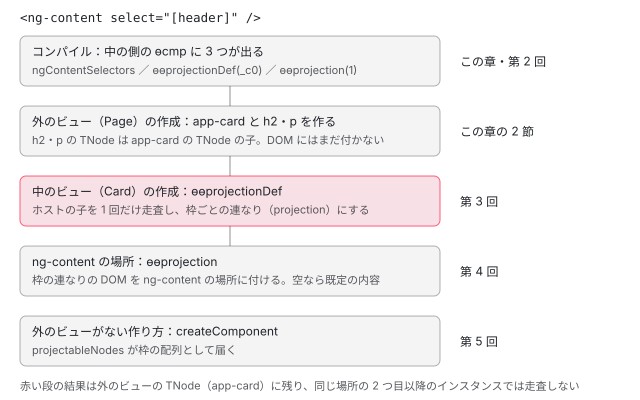

[目次](../README.md) › [ng-content と投影の内側](README.md) › 第 1 回 / 全 6 回

# 1 行の ng-content が生むもの：投影の全体像

> &lt;ng-content&gt; と &lt;ng-content select="\[header\]"&gt;、既定の内容つきの枠を書いたコンポーネントと、それを使う側のテンプレートを本物のコンパイラにかけ、出てきた ngContentSelectors・ɵɵprojectionDef・ɵɵprojection と、使う側の何も変わらない出力を指さす。枠の番号は配列の位置で \* も特別扱いされないこと、命令のコメントの 2 か所が古いこと。「枠を宣言するのは中の側、ノードを作るのは外の側」という分担と、実行時に振り分け → 描画と進む地図。

angular/angular · 読了 約 12 分 · 基礎 · [サイトで読む（デモが動きます）](https://angular-deep-dive-cyan.vercel.app/chapter/proj-what-declared)

---

この章では、コンポーネントのテンプレートに `<ng-content>` を 1 行書いたことが、**コンパイル後に何になり、実行時にどの順で何が動くのか**を、本物のコンパイラの出力で指さします。答えを先に言うと、枠を宣言するのは**中の側**（`<ng-content>` を書いたコンポーネント）だけで、ɵcmp の `ngContentSelectors`、テンプレート関数の先頭の `ɵɵprojectionDef`、`<ng-content>` の場所の `ɵɵprojection` の 3 つになります。**外の側**（そのコンポーネントを使う側）の出力は、投影のために 1 文字も変わりません。

この章はシリーズの地図です。それぞれの段の中身は第 2〜5 回で読みます。この章で引用するのは、2 つの命令の約束を書いたコメント `packages/core/src/render3/instructions/projection.ts` と、出力を固めているテスト `packages/compiler-cli/test/compliance/test_cases/r3_compiler_compliance/components_and_directives/content_projection/` です。`select` の照合の規則（タグ名・属性・クラスだけ）は、template シリーズの [ng-content のセレクタは CSS ではない](../template/02-projection.md) が先に読んでいます。このシリーズはその続きです。

1. **1. 1 行の ng-content が生むもの**（この章）
2. [2. コンパイラの側](02-proj-compile.md)
3. [3. 振り分け](03-proj-distribute.md)
4. [4. 描画と再投影](04-proj-render.md)
5. [5. 動的な投影とよくある誤解](05-proj-dynamic.md)
6. [6. spec と issue](06-proj-tests-issues.md)

## 1. 本物のコンパイラにかける

小さなコンポーネントを 3 つ書き、このサイトの node\_modules にある `@angular/compiler-cli` の `NgtscProgram`（`ngc` と同じ AOT のコンパイラ）でコンパイルしました（@angular/compiler-cli 22.1.6 / TypeScript 6.0.3。記録のスクリプトは章の最後）。`Card` が中の側で、`<ng-content>` を 3 つ持ちます。`select="[header]"` の枠、`select` の無い枠、既定の内容（何も投影されなかったときに出す中身。英語では fallback content）つきの `select="[footer]"` の枠です。`Page` が外の側で、`<app-card>` の中に `<h2 header>` と `<p>` を書きます。`Plain` は比べるためのもので、`Page` の `<app-card>` を `<section>` にしただけです。

📄 `demo.ts（コンパイルしたもの）` L1–35 （▶ の行: 6–8, 17–19, 28）

```
 1 │ import {Component} from '@angular/core';
 2 │ 
 3 │ @Component({
 4 │   selector: 'app-card',
 5 │   template: `
 6 ▶     <header><ng-content select="[header]" /></header>
 7 ▶     <ng-content />
 8 ▶     <footer><ng-content select="[footer]">(no footer)</ng-content></footer>
 9 │   `,
10 │ })
11 │ export class Card {}
12 │ 
13 │ @Component({
14 │   selector: 'app-page',
15 │   imports: [Card],
16 │   template: `
17 ▶     <app-card>
18 ▶       <h2 header>Title</h2>
19 ▶       <p>Body</p>
20 │     </app-card>
21 │   `,
22 │ })
23 │ export class Page {}
24 │ 
25 │ @Component({
26 │   selector: 'app-plain',
27 │   template: `
28 ▶     <section>
29 │       <h2 header>Title</h2>
30 │       <p>Body</p>
31 │     </section>
32 │   `,
33 │ })
34 │ export class Plain {}
35 │ 
```

出てきた `demo.js` のうち、定数の 2 行と、既定の内容の関数と、`class Card` の部分です。投影に関係する行を強調しています。診断（エラーと警告）は 0 件でした。

📄 `out/demo.js（記録。定数と class Card）` L1–18 （▶ の行: 1–3, 8–9, 11, 13, 15）

```
 1 ▶ const _c0 = [[["", "header", ""]], "*", [["", "footer", ""]]];
 2 ▶ const _c1 = ["[header]", "*", "[footer]"];
 3 ▶ function Card_ProjectionFallback_4_Template(rf, ctx) { if (rf & 1) {
 4 │     i0.ɵɵtext(0, "(no footer)");
 5 │ } }
 6 │ export class Card {
 7 │     static ɵfac = function Card_Factory(__ngFactoryType__) { return new (__ngFactoryType__ || Card)(); };
 8 ▶     static ɵcmp = /*@__PURE__*/ i0.ɵɵdefineComponent({ type: Card, selectors: [["app-card"]], ngContentSelectors: _c1, decls: 6, vars: 0, template: function Card_Template(rf, ctx) { if (rf & 1) {
 9 ▶             i0.ɵɵprojectionDef(_c0);
10 │             i0.ɵɵdomElementStart(0, "header");
11 ▶             i0.ɵɵprojection(1);
12 │             i0.ɵɵdomElementEnd();
13 ▶             i0.ɵɵprojection(2, 1);
14 │             i0.ɵɵdomElementStart(3, "footer");
15 ▶             i0.ɵɵprojection(4, 2, null, Card_ProjectionFallback_4_Template, 1, 0);
16 │             i0.ɵɵdomElementEnd();
17 │         } }, encapsulation: 2 });
18 │ }
```

中の側に出たものを、上から 1 つずつ指さします。

1. **2 行目と 8 行目：`_c1 = ["[header]", "*", "[footer]"]` が `ngContentSelectors` になる**

   テンプレートに書いた `select` の値が、**書いたままの文字列**で並びます。`select` の無い `<ng-content />` は `"*"`（何でも受ける枠）です。8 行目で ɵcmp の `ngContentSelectors` に入ります。実行時にこの配列を読むのは、振り分けではなく、`createComponent` の `projectableNodes`（[第 5 回](05-proj-dynamic.md)）などです（4 節）。
2. **1 行目と 9 行目：`ɵɵprojectionDef(_c0)` が、テンプレート関数の作成の段の先頭に出る**

   `_c0` は同じ 3 つの枠を、**解析済みの形**にした配列です。`[["", "header", ""]]` は「タグ名は問わない（`""`）、属性 `header` を持ち、値は問わない（`""`）」という 1 つのセレクタを、さらに配列で包んだもの（カンマで並べた複数のセレクタの一覧）です。`"*"` だけは文字列のまま残ります。この形の作り方は [第 2 回](02-proj-compile.md)、この配列で外の側の子を枠に分ける処理は [第 3 回](03-proj-distribute.md) で読みます。9 行目は 10 行目の `<header>` よりも前、つまり Card のビューのどの要素よりも先に呼ばれます。
3. **11 行目：`ɵɵprojection(1)` ＝ 1 番のノードに、0 番の枠を描く**

   1 つ目の引数 `1` は、この `<ng-content>` のノードの番号（スロットの番号。10 行目の `<header>` が 0 番）です。2 つ目の引数（枠の番号）は 0 のとき省かれます。0 番の枠は `_c0[0]`、つまり `[header]` です。
4. **13 行目：`ɵɵprojection(2, 1)` ＝ `*` の枠も、ただの 1 番**

   `select` の無い枠は、配列の中の位置そのままの `1` です。`*` を特別扱いして 0 番にする、ということはしません（3 節のコメントとの食い違いに注意）。
5. **3 行目と 15 行目：既定の内容は別のテンプレート関数になり、`ɵɵprojection` の 4〜6 番目の引数で渡る**

   `(no footer)` は 3〜5 行目の `Card_ProjectionFallback_4_Template` になりました。15 行目の `ɵɵprojection(4, 2, null, Card_ProjectionFallback_4_Template, 1, 0)` は、ノード 4 番・枠 2 番・静的な属性なし（`null`）・既定の内容の関数・その関数の decls が 1・vars が 0、の順です。8 行目の `decls: 6` が、要素 2 つと ng-content 3 つを足した 5 より 1 つ多いのは、既定の内容の入れ物（4 + 1 = 5 番）の分です。枠が空のときだけ描く仕組みは [第 4 回](04-proj-render.md) で読みます。

> [!TIP]
> **新卒エンジニアへ**
>
> 10・12・14・16 行目が `ɵɵelementStart` ではなく `ɵɵdomElementStart` なのは、Card に依存のディレクティブが無いからで、投影とは関係ありません（[standalone-used-only](../standalone/04-standalone-used-only.md) の DomOnly）。

## 2. 外の側の出力は、投影のために何も変わらない

同じ記録の `class Page` と `class Plain` です。

📄 `out/demo.js（記録。class Page と class Plain）` L1–22 （▶ の行: 3–9, 14–15）

```
 1 │ export class Page {
 2 │     static ɵfac = function Page_Factory(__ngFactoryType__) { return new (__ngFactoryType__ || Page)(); };
 3 ▶     static ɵcmp = /*@__PURE__*/ i0.ɵɵdefineComponent({ type: Page, selectors: [["app-page"]], decls: 5, vars: 0, consts: [["header", ""]], template: function Page_Template(rf, ctx) { if (rf & 1) {
 4 ▶             i0.ɵɵelementStart(0, "app-card")(1, "h2", 0);
 5 ▶             i0.ɵɵtext(2, "Title");
 6 ▶             i0.ɵɵelementEnd();
 7 ▶             i0.ɵɵelementStart(3, "p");
 8 ▶             i0.ɵɵtext(4, "Body");
 9 ▶             i0.ɵɵelementEnd()();
10 │         } }, dependencies: [Card], encapsulation: 2 });
11 │ }
12 │ export class Plain {
13 │     static ɵfac = function Plain_Factory(__ngFactoryType__) { return new (__ngFactoryType__ || Plain)(); };
14 ▶     static ɵcmp = /*@__PURE__*/ i0.ɵɵdefineComponent({ type: Plain, selectors: [["app-plain"]], decls: 5, vars: 0, consts: [["header", ""]], template: function Plain_Template(rf, ctx) { if (rf & 1) {
15 ▶             i0.ɵɵdomElementStart(0, "section")(1, "h2", 0);
16 │             i0.ɵɵtext(2, "Title");
17 │             i0.ɵɵdomElementEnd();
18 │             i0.ɵɵdomElementStart(3, "p");
19 │             i0.ɵɵtext(4, "Body");
20 │             i0.ɵɵdomElementEnd()();
21 │         } }, encapsulation: 2 });
22 │ }
```

- **4〜9 行目**：`<app-card>` の中に書いた `<h2 header>` と `<p>` は、**Page のテンプレート関数の中で**、ふつうの要素として作られます。`ɵɵelementStart(0, "app-card")(1, "h2", 0)` は「0 番に app-card を開き、続けて 1 番に h2 を開く」で、`app-card` を閉じるのは 9 行目の 2 つ目の `ɵɵelementEnd()` です。だから h2 と p のノード（TNode）は、`app-card` のノードの**子**として Page のビューに残ります（[ivy-tnode](../ivy/04-ivy-tnode.md)）。
- **3 行目と 14 行目**：`consts: [["header", ""]]` は h2 の静的な属性 `header=""` です。振り分けで `[header]` と照合されるのはこの配列です（第 3 回）。`header` が「投影用の属性」として特別に扱われているわけではありません。
- **15 行目と比べる**：Plain の出力は、タグ名が `"section"` で、命令が `ɵɵdomElementStart`（1 節の tip と同じ理由）なこと以外は Page と同じ形です。`ɵɵprojection` に当たる命令も、「この子をどの枠へ」という情報も、外の側には**どこにも出ません**。

もう 1 つ、h2 と p は Page のビューで作られた時点では DOM のどこにも付きません。親のノードがコンポーネントのホストなら付け先を決めない、という判断は [ivy-create-instructions](../ivy/09-ivy-create-instructions.md) で読んだ `getClosestRElement` の中にあります（Shadow DOM のときだけはすぐ付けます）。付けるのは、あとで Card のビューの `ɵɵprojection` です。

## 3. 2 つの命令の約束（と、古くなったコメント）

出力が呼ぶ 2 つの命令の説明です。まず `ɵɵprojectionDef`。

📄 `angular/packages/core/src/render3/instructions/projection.ts` L71–95 （▶ の行: 72–75, 77–78, 81, 85–86, 89–92）

```ts
71 │ /**
72 ▶  * Instruction to distribute projectable nodes among <ng-content> occurrences in a given template.
73 ▶  * It takes all the selectors from the entire component's template and decides where
74 ▶  * each projected node belongs (it re-distributes nodes among "buckets" where each "bucket" is
75 ▶  * backed by a selector).
76 │  *
77 ▶  * This function requires CSS selectors to be provided in 2 forms: parsed (by a compiler) and text,
78 ▶  * un-parsed form.
79 │  *
80 │  * The parsed form is needed for efficient matching of a node against a given CSS selector.
81 ▶  * The un-parsed, textual form is needed for support of the ngProjectAs attribute.
82 │  *
83 │  * Having a CSS selector in 2 different formats is not ideal, but alternatives have even more
84 │  * drawbacks:
85 ▶  * - having only a textual form would require runtime parsing of CSS selectors;
86 ▶  * - we can't have only a parsed as we can't re-construct textual form from it (as entered by a
87 │  * template author).
88 │  *
89 ▶  * @param projectionSlots? A collection of projection slots. A projection slot can be based
90 ▶  *        on a parsed CSS selectors or set to the wildcard selector ("*") in order to match
91 ▶  *        all nodes which do not match any selector. If not specified, a single wildcard
92 ▶  *        selector projection slot will be defined.
93 │  *
94 │  * @codeGenApi
95 │  */
```

72〜75 行目のとおり、`ɵɵprojectionDef` は「テンプレート全体の**すべての**セレクタを受け取り、投影されるノードを、セレクタごとのバケツ（枠）に分け直す」命令です。89〜92 行目は引数の説明で、枠は「解析済みのセレクタ」か「`"*"`」で、引数を省くと `"*"` の枠が 1 つだけあるものとみなします（ng-content が select の無い 1 つだけのときに、コンパイラは引数を省きます。DEMO の「ng-content 1 つだけ」）。

> [!WARNING]
> **ハマりどころ**
>
> 77〜87 行目は「セレクタは解析済みの形と**テキストの形**の 2 つが要る。テキストの形は `ngProjectAs` のため」と書いていますが、今の命令が受け取るのは解析済みの形だけです（1 節の 9 行目の引数は 1 つ）。2019-04 の「perf(ivy): avoid storing raw selectors in projectionDef」（def73a6728e、#29578）で、テキストの引数をやめて `ngProjectAs` の値をコンパイル時に解析する形に変わり、81 行目の説明は残りました。今の `ngProjectAs` の扱いは [第 2 回](02-proj-compile.md)・[第 3 回](03-proj-distribute.md) で読みます。

次に `ɵɵprojection` です。

📄 `angular/packages/core/src/render3/instructions/projection.ts` L133–148 （▶ の行: 137–142, 144–145）

```ts
133 │ /**
134 │  * Inserts previously re-distributed projected nodes. This instruction must be preceded by a call
135 │  * to the projectionDef instruction.
136 │  *
137 ▶  * @param nodeIndex Index of the projection node.
138 ▶  * @param selectorIndex Index of the slot selector.
139 ▶  *  - 0 when the selector is `*` (or unspecified as this is the default value),
140 ▶  *  - 1 based index of the selector from the {@link projectionDef}
141 ▶  * @param attrs Static attributes set on the `ng-content` node.
142 ▶  * @param fallbackTemplateFn Template function with fallback content.
143 │  *   Will be rendered if the slot is empty at runtime.
144 ▶  * @param fallbackDecls Number of declarations in the fallback template.
145 ▶  * @param fallbackVars Number of variables in the fallback template.
146 │  *
147 │  * @codeGenApi
148 │  */
```

- **137 行目 `nodeIndex`**：`<ng-content>` のノードの番号。1 節の 11 行目の `1`。
- **138〜140 行目 `selectorIndex`**：枠の番号。コメントは「`*` のときは 0、それ以外は 1 から数えた番号」と書いていますが、1 節の 13 行目では `*` の枠が `1` でした。2019-05 の「fix(ivy): unable to project into multiple slots with default selector」（aca339e8642、#30561）で `*` も配列の中の 1 つの枠になり、番号は `ɵɵprojectionDef` の配列の**位置**（0 から）になりました。コメントはその前の形のままです。
- **141 行目 `attrs`**：`<ng-content>` に書いた静的な属性。再投影（ng-content を、さらに別のコンポーネントの ng-content に渡す）のときに、この ng-content 自身が照合される側になるために使います（[第 4 回](04-proj-render.md)）。
- **142〜145 行目**：既定の内容のテンプレート関数と、その decls・vars。1 節の 15 行目の後ろ 3 つです。

## 4. ngContentSelectors は 2 か所に残る

同じ記録の `demo.d.ts`（型の宣言の出力）です。

📄 `out/demo.d.ts（記録）` L1–14 （▶ の行: 4, 8）

```
 1 │ import * as i0 from "@angular/core";
 2 │ export declare class Card {
 3 │     static ɵfac: i0.ɵɵFactoryDeclaration<Card, never>;
 4 ▶     static ɵcmp: i0.ɵɵComponentDeclaration<Card, "app-card", never, {}, {}, never, ["[header]", "*", "[footer]"], true, never>;
 5 │ }
 6 │ export declare class Page {
 7 │     static ɵfac: i0.ɵɵFactoryDeclaration<Page, never>;
 8 ▶     static ɵcmp: i0.ɵɵComponentDeclaration<Page, "app-page", never, {}, {}, never, never, true, never>;
 9 │ }
10 │ export declare class Plain {
11 │     static ɵfac: i0.ɵɵFactoryDeclaration<Plain, never>;
12 │     static ɵcmp: i0.ɵɵComponentDeclaration<Plain, "app-plain", never, {}, {}, never, never, true, never>;
13 │ }
14 │ 
```

4 行目の `ɵɵComponentDeclaration` の 7 つ目の型引数が、`["[header]", "*", "[footer]"]` です。Page（8 行目）は ng-content を持たないので `never` です。ライブラリとして配られたコンポーネントは .d.ts しか読めないので、それを使う側のコンパイラは、ここから枠のセレクタを知ります。使い道は、制御フローの中の要素が枠に届かないときの拡張診断（[第 2 回](02-proj-compile.md)）です。

| どこに | 形 | 誰が読むか |
| --- | --- | --- |
| `ɵɵprojectionDef` の引数（1 節 1・9 行目） | 解析済み。`*` は文字列 | 実行時の振り分け（第 3 回） |
| ɵcmp の `ngContentSelectors`（1 節 2・8 行目） | 書いたままの文字列 | createComponent の projectableNodes（第 5 回）、公開 API の `reflectComponentType(…).ngContentSelectors`、それを読む Angular Elements の投影（[elements-connect](../elements/04-elements-connect.md)） |
| .d.ts の型引数（この節 4 行目） | 書いたままの文字列 | 使う側のコンパイラの型検査（第 2 回） |

この 3 つは同じ並びとは限りません。`@if` の中に `<ng-content>` があると、ɵcmp と .d.ts で順番が入れ替わります（第 2 回の記録）。

## 5. 地図：1 行の ng-content が、子を描くまで



*外の側のビューが子のノードを作り、中の側のビューが作られるときに 1 回だけ枠に分け、ng-content の場所で描く（右が詳しく読む回）*

いちばん大事なのは 2 段目と 3 段目の順番です。**子のノードは外のビューで先に作られ**、中のビューの作成はそのあとです。`renderView` は自分のテンプレート関数を実行し終えてから、子のコンポーネントのビューを描きます（[boot-first-render](../boot/11-boot-first-render.md)）。だから Card のテンプレート関数の先頭の `ɵɵprojectionDef` が走るとき、`app-card` の子の TNode はもう全部そろっています。投影は「中の側が、外の側の作り終えたノードを、自分の DOM の中に借りてくる」仕組みで、ノードの持ち主（作った LView、変更検知、破棄）は外の側のままです。

## 6. 呼び出しの連なり

- 👤 `<ng-content select="[header]" />` — Card のテンプレート
- `htmlAstToRender3Ast` → `t.Content` — compiler の r3\_template\_transform.ts — *[compiler-r3-ast](../compiler/07-compiler-r3-ast.md)*
- `ingestContent` → `generateProjectionDefs` → `reify` — compiler の template/pipeline — *第 2 回*
- 👤 `実行時：Page のビューを作る` — core
  - `Page_Template(1, ctx)` → `ɵɵelementStart(0, "app-card")(1, "h2", 0)` — instructions/element.ts — *2 節の 4 行目*
    - `getClosestRElement` → `null` — node\_manipulation.ts — *h2 はまだ DOM に付かない*
  - `renderChildComponents` → `renderComponent` → `renderView(Card)` — instructions/render.ts — *Page のテンプレート関数のあと*
    - `Card_Template(1, ctx)` → `ɵɵprojectionDef(_c0)` — instructions/projection.ts — *第 3 回*
      - `matchingProjectionSlotIndex` — instructions/projection.ts — *[projection](../template/02-projection.md)・第 3 回*
    - `ɵɵprojection(1)` → `applyProjection` — instructions/projection.ts → node\_manipulation.ts — *第 4 回*
    - `ɵɵprojection(4, 2, null, Card_ProjectionFallback_4_Template, 1, 0)` — instructions/projection.ts — *枠が空なら既定の内容（第 4 回）*

## 7. DEMO：中の側のテンプレートを書き換えて、ブラウザでコンパイルする

> **🧪 DEMO — このページの上の @angular/compiler で、投影の命令を出す**
>
> 「コンパイルする」を押すと、このサイトの `@angular/compiler`（22.1.6）をその場で読み込み（それまでは読み込みません）、JIT の入口 `CompilerFacadeImpl.compileComponent` に欄のテンプレートを渡して、**評価する直前の JS の文字列**を受け取ります（評価はしません）。表の値は、すべてその JS の中の定数と `ɵɵprojection` の引数から読んでいます。JIT の書き出しなので定数は `const` ではなく `var` で、文字列は `'` で囲まれます。依存を渡していないので、要素は `ɵɵdomElementStart` になります。
>
> 例を選ぶか欄を書き換えて、「コンパイルする」を押してください。
>
> ▶ [このデモはサイトで動かせます](https://angular-deep-dive-cyan.vercel.app/chapter/proj-what-declared)

例ごとに確かめられることです（このサイトの本番ビルドで確かめました）。

1. **本文の Card**

   1 節の記録と同じ `_c0`・`_c1`・`ɵɵprojection(4, 2, null, Demo_ProjectionFallback_4_Template, 1, 0)` が出ます（クラスの名前が Demo になるだけ）。
2. **ng-content 1 つだけ**

   `ɵɵprojectionDef()` が**引数なし**になり、解析済みの定数も出ません。`ngContentSelectors` は `['*']` です。3 節の 89〜92 行目の「省けば \* の枠が 1 つ」の形です。
3. **@if の中の ng-content**

   `[side]` の `ɵɵprojection(0, 1)` は `Demo_Conditional_0_Template` の中に出ますが、`ɵɵprojectionDef` は外側の `Demo_Template` の先頭に 1 つだけです。枠の番号は `*` が 0、`[side]` が 1 で、書いた順と逆になります（第 2 回）。
4. **\* を 2 つ**

   `['*', [['', 'spacer', '']], '*']` のように `*` の枠が 2 つ並びます。どの枠にも合わない子が入るのは**最後の**`*` の枠です（第 3 回）。
5. **外の側（使う側）**

   投影に関係する行が 1 つも出ません。`<app-card>` の中の h2 と p は、ふつうの `ɵɵdomElementStart` です（2 節と同じ）。

## テストと直し方

### 出力の形を固めているテスト

1 節の出力の形は、コンパイラの **compliance テスト**（入力の .ts をコンパイルし、出力を期待する .js と比べるテスト）が固めています。`content_projection/TEST_CASES.json` の最初の場面です。

📄 `angular/packages/compiler-cli/test/compliance/test_cases/r3_compiler_compliance/components_and_directives/content_projection/TEST_CASES.json` L4–27 （▶ の行: 5–6, 12–13, 18, 22–23）

```json
 4 │     {
 5 ▶       "description": "should support content projection in root template",
 6 ▶       "inputFiles": ["root_template.ts"],
 7 │       "expectations": [
 8 │         {
 9 │           "failureMessage": "Incorrect SimpleComponent definition",
10 │           "files": [
11 │             {
12 ▶               "expected": "root_template_simple_def.js",
13 ▶               "generated": "root_template.js"
14 │             }
15 │           ]
16 │         },
17 │         {
18 ▶           "failureMessage": "Incorrect ComplexComponent definition",
19 │           "files": [
20 │             {
21 │               "expected": "root_template_complex_def.js",
22 ▶               "generated": "root_template.js"
23 ▶             }
24 │           ]
25 │         }
26 │       ]
27 │     },
```

📄 `angular/packages/compiler-cli/test/compliance/test_cases/r3_compiler_compliance/components_and_directives/content_projection/root_template.ts` L10–18 （▶ の行: 13–14）

```ts
10 │ @Component({
11 │     selector: 'complex',
12 │     template: `
13 ▶     <div id="first"><ng-content select="span[title=toFirst]"></ng-content></div>
14 ▶     <div id="second"><ng-content SELECT="span[title=toSecond]"></ng-content></div>`,
15 │     standalone: false
16 │ })
17 │ export class ComplexComponent {
18 │ }
```

📄 `angular/packages/compiler-cli/test/compliance/test_cases/r3_compiler_compliance/components_and_directives/content_projection/root_template_complex_def.js` L1–26 （▶ の行: 1, 9, 15, 17, 20）

```js
 1 ▶ const $c1$ = [[["span", "title", "tofirst"]], [["span", "title", "tosecond"]]];
 2 │ // ...
 3 │ export class ComplexComponent {
 4 │   // ...
 5 │   static ɵcmp = /*@__PURE__*/ $r3$.ɵɵdefineComponent({
 6 │     type: ComplexComponent,
 7 │     selectors: [["complex"]],
 8 │     standalone: false,
 9 ▶     ngContentSelectors: $c2$,
10 │     decls: 4,
11 │     vars: 0,
12 │     consts: [["id","first"], ["id","second"]],
13 │     template:  function ComplexComponent_Template(rf, ctx) {
14 │       if (rf & 1) {
15 ▶         $r3$.ɵɵprojectionDef($c1$);
16 │         $r3$.ɵɵelementStart(0, "div", 0);
17 ▶         $r3$.ɵɵprojection(1);
18 │         $r3$.ɵɵelementEnd();
19 │         $r3$.ɵɵelementStart(2, "div", 1);
20 ▶         $r3$.ɵɵprojection(3, 1);
21 │         $r3$.ɵɵelementEnd();
22 │       }
23 │     },
24 │     encapsulation: 2
25 │   });
26 │ }
```

TEST\_CASES.json の 5・6 行目が場面の名前と入力のファイル、12・22 行目が期待する出力のファイル、13・23 行目がそれと比べる生成物です。1 つの入力から、2 つのコンポーネントの部分を別々に比べています。入力の 13・14 行目は `span[title=toFirst]` と `span[title=toSecond]` の 2 つの枠です。14 行目はわざと `SELECT` と大文字で書いています（属性の名前は小文字にしてから比べる。[compiler-r3-ast](../compiler/07-compiler-r3-ast.md) の `preparseElement`）。期待する出力は、1 行目の解析済みの定数（値が `tofirst` と小文字になる）と、9 行目の `ngContentSelectors`、15 行目の `ɵɵprojectionDef($c1$)`、17 行目の `ɵɵprojection(1)`、20 行目の `ɵɵprojection(3, 1)` です。`$c1$` のような `$…$` は「名前は何でもよいが、同じ名前は同じものを指す」という印、`// ...` は「この間は比べない」という印です。

### 手元で走らせた結果

📄 `ターミナル（~/angular-research/angular で）`

```
cd ~/angular-research/angular
pnpm bazel test //packages/compiler-cli/test/compliance/full:full \
  --test_arg=--filter=content_projection --nocache_test_results --test_output=all
```

📄 `出力（2026-11-11 に実行。抜粋）`

```
Ran 5 of 612 specs
5 specs, 0 failures
Ran 5 of 612 specs
5 specs, 0 failures
//packages/compiler-cli/test/compliance/full:full                        PASSED in 1.2s
```

テストは 2 つの shard（分けて並べて走らせる単位）に分かれ、合わせて 10 件（`content_projection/TEST_CASES.json` の 10 の場面）が通っています。

### 直すとしたら

- 出力の形（どの命令を、どの引数で、どこに出すか）は compiler の `template/pipeline/src/phases/generate_projection_def.ts` と `instruction.ts` の `projection`（第 2 回）。期待する .js は `content_projection/TEST_CASES.json` に場面を足して並べます。
- 3 節の 2 つの古いコメントは `packages/core/src/render3/instructions/projection.ts` の 77〜87 行目と 138〜140 行目です。振る舞いは変わらないので、テストは変わりません。
- 実行時の振る舞いのテストは `packages/core/test/acceptance/content_spec.ts` です（[第 6 回](06-proj-tests-issues.md)）。

## 記録のスクリプト

1 節と 4 節の記録は、次のスクリプトを `angular-deep-dive` を cwd にして Node で走らせた結果です（第 2 回の記録も同じスクリプトです）。これは記録です。ページを開いたときにコンパイルしているのではありません。

📄 `record-proj.mjs（記録のスクリプト）`

```
// ng-content シリーズ（第 1〜2 回）の記録。angular-deep-dive を cwd にして `node <このファイル> > proj.json` で走らせる。
// 本物の @angular/compiler-cli（このサイトの node_modules）の NgtscProgram で小さなファイルをコンパイルし、
// 場面ごとに出力の .js・.d.ts と診断を JSON で出す。拡張診断（extendedDiagnostics）は既定の設定のまま。
import fs from 'node:fs';
import os from 'node:os';
import path from 'node:path';
import {createRequire} from 'node:module';
import {pathToFileURL} from 'node:url';

const req = createRequire(path.resolve('package.json'));
const load = (id) => import(pathToFileURL(req.resolve(id)).href);
const {default: ts} = await load('typescript');
const {NgtscProgram, VERSION} = await load('@angular/compiler-cli');

const NODE_MODULES = path.resolve('node_modules');

// ---- 場面 ----------------------------------------------------------------
const SCENES = {
  // 第 1 回: 中の側（Card）と外の側（Page）。Plain は Page の app-card を section にしただけ
  what: {
    chapter: 1,
    source: `import {Component} from '@angular/core';

@Component({
  selector: 'app-card',
  template: \`
    <header><ng-content select="[header]" /></header>
    <ng-content />
    <footer><ng-content select="[footer]">(no footer)</ng-content></footer>
  \`,
})
export class Card {}

@Component({
  selector: 'app-page',
  imports: [Card],
  template: \`
    <app-card>
      <h2 header>Title</h2>
      <p>Body</p>
    </app-card>
  \`,
})
export class Page {}

@Component({
  selector: 'app-plain',
  template: \`
    <section>
      <h2 header>Title</h2>
      <p>Body</p>
    </section>
  \`,
})
export class Plain {}
`,
  },
  // 第 2 回: 制御フローの中の 2 つの要素（NG8011）と、1 つだけの要素
  ng8011: {
    chapter: 2,
    source: `import {Component} from '@angular/core';

@Component({
  selector: 'app-tabs',
  template: \`<ng-content select="[tab]" /><ng-content />\`,
})
export class Tabs {}

@Component({
  selector: 'app-uses',
  imports: [Tabs],
  template: \`
    <app-tabs>
      @if (show) {
        <div tab>one</div>
        <div tab>two</div>
      }
      @if (show) {
        <div tab>only</div>
      }
    </app-tabs>
  \`,
})
export class Uses {
  show = true;
}
`,
  },
  // 第 2 回: @if の中の ng-content と、外の ng-content（ngContentSelectors と .d.ts の並び）
  order: {
    chapter: 2,
    source: `import {Component} from '@angular/core';

@Component({
  selector: 'app-order',
  template: \`
    @if (wide) {
      <ng-content select="[side]" />
    }
    <ng-content />
  \`,
})
export class Order {
  wide = true;
}
`,
  },
  // 第 2 回: ngProjectAs を空で書いた場合（定数の 4 つ目）
  projectAsEmpty: {
    chapter: 2,
    source: `import {Component} from '@angular/core';

@Component({
  selector: 'app-slot',
  template: \`<ng-content select="[header]" /><ng-content />\`,
})
export class Slot {}

@Component({
  selector: 'app-empty',
  imports: [Slot],
  template: \`<app-slot><div ngProjectAs="">x</div></app-slot>\`,
})
export class Empty {}
`,
  },
  // 第 2 回: ngProjectAs をバインディングで書いた場合
  projectAsBound: {
    chapter: 2,
    source: `import {Component} from '@angular/core';

@Component({
  selector: 'app-slot',
  template: \`<ng-content select="[header]" />\`,
})
export class Slot {}

@Component({
  selector: 'app-bound',
  imports: [Slot],
  template: \`<app-slot><div [ngProjectAs]="sel">x</div></app-slot>\`,
})
export class Bound {
  sel = '[header]';
}
`,
  },
};

// ---- コンパイル ----------------------------------------------------------
function compile(source) {
  const dir = fs.mkdtempSync(path.join(os.tmpdir(), 'proj-rec-'));
  try {
    fs.symlinkSync(NODE_MODULES, path.join(dir, 'node_modules'), 'dir');
    const file = path.join(dir, 'demo.ts');
    fs.writeFileSync(file, source);
    const options = {
      target: ts.ScriptTarget.ES2022,
      module: ts.ModuleKind.ES2022,
      moduleResolution: ts.ModuleResolutionKind.Bundler,
      strict: true,
      skipLibCheck: true,
      declaration: true,
      outDir: path.join(dir, 'out'),
      strictTemplates: true,
    };
    const program = new NgtscProgram([file], options, ts.createCompilerHost(options));
    const diagnostics = [
      ...program.getTsSemanticDiagnostics(),
      ...program.getNgStructuralDiagnostics(),
      ...program.getNgSemanticDiagnostics(),
    ].map((d) => ({
      code: String(d.code).startsWith('-99') ? 'NG' + String(d.code).slice(3) : 'TS' + d.code,
      category: ts.DiagnosticCategory[d.category],
      line: d.file && d.start !== undefined ? d.file.getLineAndCharacterOfPosition(d.start).line + 1 : null,
      text: ts.flattenDiagnosticMessageText(d.messageText, '\n'),
    }));
    let js = '';
    let dts = '';
    try {
      program.emit();
      js = fs.readFileSync(path.join(dir, 'out', 'demo.js'), 'utf8');
      dts = fs.readFileSync(path.join(dir, 'out', 'demo.d.ts'), 'utf8');
    } catch (e) {
      js = 'emit に失敗: ' + (e instanceof Error ? e.message : String(e));
    }
    return {diagnostics, js, dts};
  } finally {
    fs.rmSync(dir, {recursive: true, force: true});
  }
}

const out = {compilerCli: VERSION.full, typescript: ts.version, scenes: {}};
for (const [name, scene] of Object.entries(SCENES)) {
  out.scenes[name] = {chapter: scene.chapter, source: scene.source, ...compile(scene.source)};
}
console.log(JSON.stringify(out, null, 2));

```

## 聞かれそうな質問

**Q. &lt;ng-content select="\[header\]"&gt; と書くと、コンパイル後のどこに何が出ますか？**

中の側の ɵcmp に 3 つ出ます。`ngContentSelectors` に書いたままの `"[header]"`（1 節の 2・8 行目）、テンプレート関数の作成の段の先頭に解析済みの `[["", "header", ""]]` を渡す `ɵɵprojectionDef`（1・9 行目）、ng-content の場所に `ɵɵprojection(ノード番号, 枠の番号)`（11 行目）です。

**Q. 使う側の &lt;app-card&gt;&lt;h2 header&gt;…&lt;/app-card&gt; は、どう出力されますか？**

ふつうの要素の命令だけです（2 節の 4〜9 行目）。h2 は使う側のビューで作られ、`app-card` のノードの子になります。投影の命令も、どの枠に入るかの情報も、使う側には出ません。`<section>` にしたときとの違いはタグ名だけです。

**Q. 枠の番号はどう決まりますか？\* は 0 番ですか？**

`ɵɵprojectionDef` の配列の位置（0 から）です。`*` も 1 つの枠として位置どおりの番号になります（1 節の 13 行目の `ɵɵprojection(2, 1)`）。projection.ts 138〜140 行目のコメントの「\* は 0、ほかは 1 から」は、2019 年の変更より前の形です。

**Q. ngContentSelectors は実行時の振り分けに使われますか？**

使われません。振り分けに使うのは `ɵɵprojectionDef` の引数の解析済みの形です（3 節の 89〜92 行目、1 節の 9 行目）。`ngContentSelectors` は createComponent の projectableNodes や Angular Elements が枠の数と並びを知るためのもので、.d.ts の同じ一覧は使う側の型検査が読みます（4 節）。

**Q. 既定の内容（ng-content の中に書いた中身）はどこに行きますか？**

別のテンプレート関数（1 節の 3〜5 行目の `Card_ProjectionFallback_4_Template`）になり、`ɵɵprojection` の 4〜6 番目の引数として渡ります（15 行目、3 節の 142〜145 行目）。描くかどうかは実行時に枠が空かどうかで決まります（第 4 回）。

## 読み終えて

- 枠を宣言するのは中の側だけ。ɵcmp の `ngContentSelectors`、作成の段の先頭の `ɵɵprojectionDef`、ng-content の場所の `ɵɵprojection` の 3 つになる。
- 外の側の出力は投影のために変わらない。子のノードは外のビューで作られ、ホストの TNode の子として残る。
- 振り分けは中のビューの作成のとき（外のビューの作成のあと）で、描くのは `ɵɵprojection`。ノードの持ち主は外の側のまま。
- 枠の番号は配列の位置。`*` も特別扱いされない。命令のコメントの 2 か所（テキストのセレクタ、1 から数える番号）は古い。

---

← 前: [spec と issue を読む：クエリの振る舞いを決めているテスト](../qry/07-qry-tests-issues.md)  
次: [コンパイラの側：select の解析、ngProjectAs、既定の内容](02-proj-compile.md) →
