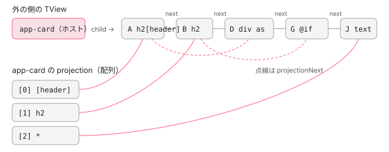

[目次](../README.md) › [ng-content と投影の内側](README.md) › 第 3 回 / 全 6 回

# 振り分け：ɵɵprojectionDef がホストの子を枠に分けるまで

> ɵɵprojectionDef が、外の側の TView にあるホストの TNode に projection が無いときだけ、ホストの直接の子を 1 回だけ走査し、matchingProjectionSlotIndex で枠を決めて projectionNext の連結リストに繋ぐ行（template シリーズで読んだ範囲の先）。最初に合った枠が勝つこと、ngProjectAs は getProjectAsAttrValue で取り出され isSelectorInSelectorList で完全一致で比べられること（空の値は TypeError）、@if・@for・ng-container・テキストがそれぞれ 1 つのノードとして振り分けられること。ページの上の本物で振り分けの結果と TNode を見る。

angular/angular · 読了 約 13 分 · 中核 · [サイトで読む（デモが動きます）](https://angular-deep-dive-cyan.vercel.app/chapter/proj-distribute)

---

この章では、中の側のテンプレート関数の先頭の `ɵɵprojectionDef`（[第 1 回](01-proj-what-declared.md)）が、**外の側で作られたホストの子のノードを、どの順で、どの枠に分けて、どこに覚えるか**を読みます。分かるのは、振り分けが「ホストの TNode に 1 回だけ」であること、最初に合った枠が勝つこと、`ngProjectAs` が照合を**置き換える**（しかも完全一致で比べる）こと、`@if`・`@for`・`ng-container`・テキストが、それぞれ 1 つのノードとして振り分けられることです。

読む対象は `packages/core/src/render3/instructions/projection.ts`（ɵɵprojectionDef と matchingProjectionSlotIndex）、`node_selector_matcher.ts`（getProjectAsAttrValue と isSelectorInSelectorList）、`interfaces/node.ts`（TNode の `projection`）、それにコンテナに写る属性を作る compiler の `ingest.ts` です。ɵɵprojectionDef のループの本体と、`'*'` を最後に回す `matchingProjectionSlotIndex` の本体は、template シリーズの [ng-content のセレクタは CSS ではない](../template/02-projection.md) が引用しています。この章はその先を読みます。

1. [1. 1 行の ng-content が生むもの](01-proj-what-declared.md)
2. [2. コンパイラの側](02-proj-compile.md)
3. **3. 振り分け**（この章）
4. [4. 描画と再投影](04-proj-render.md)
5. [5. 動的な投影とよくある誤解](05-proj-dynamic.md)
6. [6. spec と issue](06-proj-tests-issues.md)

## 1. ɵɵprojectionDef の入口：結果は外の側の TNode に残る

📄 `angular/packages/core/src/render3/instructions/projection.ts` L89–102 （▶ の行: 96–97, 99–102）

```ts
 89 │  * @param projectionSlots? A collection of projection slots. A projection slot can be based
 90 │  *        on a parsed CSS selectors or set to the wildcard selector ("*") in order to match
 91 │  *        all nodes which do not match any selector. If not specified, a single wildcard
 92 │  *        selector projection slot will be defined.
 93 │  *
 94 │  * @codeGenApi
 95 │  */
 96 ▶ export function ɵɵprojectionDef(projectionSlots?: (string | (string | number)[][])[]): void {
 97 ▶   const componentNode = getLView()[DECLARATION_COMPONENT_VIEW][T_HOST] as TElementNode;
 98 │ 
 99 ▶   if (!componentNode.projection) {
100 ▶     // If no explicit projection slots are defined, fall back to a single
101 ▶     // projection slot with the wildcard selector.
102 ▶     const numProjectionSlots = projectionSlots ? projectionSlots.length : 1;
```

1. **97 行目：`getLView()[DECLARATION_COMPONENT_VIEW][T_HOST]` ＝ ホストの TNode**

   `getLView()` はいま実行しているビュー、つまり中の側（Card）のビューです（[第 2 回](02-proj-compile.md)の 4 節のとおり、この命令はいつもルートのテンプレート関数の先頭にあります）。`DECLARATION_COMPONENT_VIEW` はそのビューを宣言したコンポーネントのビュー（ここでは Card のビュー自身）、`T_HOST` はそのビューのホストの TNode です。ホストの TNode（`<app-card>`）は、**外の側の TView** に属する設計図です（[ivy-tnode](../ivy/04-ivy-tnode.md)）。
2. **99 行目：`componentNode.projection` がまだ無いときだけ振り分ける**

   条件は `firstCreatePass`（[ivy-first-create-pass](../ivy/08-ivy-first-create-pass.md)）ではなく、ホストの TNode に結果が入っているかどうかです。TNode はテンプレートの同じ場所の全インスタンスで共有されるので、`@for` で `<app-card>` を 100 回作っても、振り分けは最初の 1 回だけです。外の側の同じ場所に書かれた子はいつも同じなので、結果も同じだからです。逆に、外の側の別の場所に書いた `<app-card>` は別の TNode なので、別に振り分けます。
3. **100〜102 行目：引数が無ければ、枠は 1 つ**

   `projectionSlots` が無い（`ɵɵprojectionDef()`。ng-content が select の無い 1 つだけ）なら、枠の数は 1 です。このあとのループは、ホストの子を `child` から `next` で順にたどり、`@let` を飛ばし、引数があれば `matchingProjectionSlotIndex`（3 節）で、無ければ 0 番に決め、枠ごとの連結リストの末尾に足します（[projection](../template/02-projection.md) の 1 節）。

> [!NOTE]
> **ポイント**
>
> 「1 回だけ」は、Card のテンプレートを変えずに中身だけを入れ替える仕組みが無いということでもあります。外の側の子は作られたときから決まっているので、振り分けをやり直す必要がありません。`@if` で子を出し入れしても、振り分けられているのは `@if` の入れ物のノードで、中身が増えても減っても入れ物は同じ枠のままです（5 節）。

## 2. projection：枠ごとの先頭と、projectionNext の連なり

振り分けの結果の入れ物、TNode の `projection` の説明です。

📄 `angular/packages/core/src/render3/interfaces/node.ts` L566–594 （▶ の行: 567, 580–581, 583–586, 588, 590–592）

````ts
566 │   /**
567 ▶    * List of projected TNodes for a given component host element OR index into the said nodes.
568 │    *
569 │    * For easier discussion assume this example:
570 │    * `<parent>`'s view definition:
571 │    * ```html
572 │    * <child id="c1">content1</child>
573 │    * <child id="c2"><span>content2</span></child>
574 │    * ```
575 │    * `<child>`'s view definition:
576 │    * ```html
577 │    * <ng-content id="cont1"></ng-content>
578 │    * ```
579 │    *
580 ▶    * If `Array.isArray(projection)` then `TNode` is a host element:
581 ▶    * - `projection` stores the content nodes which are to be projected.
582 │    *    - The nodes represent categories defined by the selector: For example:
583 ▶    *      `<ng-content/><ng-content select="abc"/>` would represent the heads for `<ng-content/>`
584 ▶    *      and `<ng-content select="abc"/>` respectively.
585 ▶    *    - The nodes we store in `projection` are heads only, we used `.next` to get their
586 ▶    *      siblings.
587 │    *    - The nodes `.next` is sorted/rewritten as part of the projection setup.
588 ▶    *    - `projection` size is equal to the number of projections `<ng-content>`. The size of
589 │    *      `c1` will be `1` because `<child>` has only one `<ng-content>`.
590 ▶    * - we store `projection` with the host (`c1`, `c2`) rather than the `<ng-content>` (`cont1`)
591 ▶    *   because the same component (`<child>`) can be used in multiple locations (`c1`, `c2`) and
592 ▶    * as a result have different set of nodes to project.
593 │    * - without `projection` it would be difficult to efficiently traverse nodes to be projected.
594 │    *
````

- **580〜581 行目**：`projection` が配列なら、その TNode はホストの要素で、投影される中身を持ちます。
- **583〜584 行目**：配列の 1 つ 1 つは、枠（`<ng-content/>` と `<ng-content select="abc"/>`）ごとの**先頭**です。588 行目のとおり、長さは ng-content の数です。
- **585〜586 行目**：先頭からあとは「`.next` でたどる」と書いてありますが、今のコードがたどるのは `.next` ではなく `projectionNext` です（DEMO の表 1 は `projectionNext` をたどった結果です）。`next` は外の側のテンプレートに書いた順の兄弟のまま変わらず、枠ごとの並びは別の `projectionNext` に作ります（`projectionNext` の説明は [ivy-tnode](../ivy/04-ivy-tnode.md) が引用しています）。
- **590〜592 行目**：結果を ng-content の側ではなくホストの側に持つのは、同じ中の側のコンポーネントが、外の側の別々の場所（`c1`・`c2`）で別々の子を持つからです。1 節の 99 行目の判定も、この置き場所が前提です。



*外の側の TView の中の、ホスト app-card と子の TNode。next は書いた順、projection と projectionNext は枠ごとの順*

## 3. matchingProjectionSlotIndex：最初に合った枠が勝つ

📄 `angular/packages/core/src/render3/instructions/projection.ts` L36–50 （▶ の行: 37–38, 40–42, 44, 48–50）

```ts
36 │ /**
37 ▶  * Checks a given node against matching projection slots and returns the
38 ▶  * determined slot index. Returns "null" if no slot matched the given node.
39 │  *
40 ▶  * This function takes into account the parsed ngProjectAs selector from the
41 ▶  * node's attributes. If present, it will check whether the ngProjectAs selector
42 ▶  * matches any of the projection slot selectors.
43 │  */
44 ▶ export function matchingProjectionSlotIndex(
45 │   tNode: TNode,
46 │   projectionSlots: ProjectionSlots,
47 │ ): number | null {
48 ▶   let wildcardNgContentIndex = null;
49 ▶   const ngProjectAsAttrVal = getProjectAsAttrValue(tNode);
50 ▶   for (let i = 0; i < projectionSlots.length; i++) {
```

37〜38 行目のとおり、1 つのノードを枠の一覧と照らし合わせ、決まった枠の番号を返します（どれにも合わなければ `null`）。40〜42 行目と 49 行目のとおり、照合の前にノードの `ngProjectAs` を読みます（4 節）。50 行目からのループ（[projection](../template/02-projection.md) の 2 節が引用）は、枠を**上から順に**見て、`'*'` はその場では合わせずに番号を覚えるだけにし、合った枠があれば**その時点で返します**。どこにも合わなければ、最後に覚えた `'*'` の番号です（`'*'` が無ければ `null`）。

- **最初に合った枠が勝つ**：`<h2 header>` は `[header]`（0 番）と `h2`（1 番）の両方に合いますが、0 番で返ります。ほかの枠に「より詳しく合う」かは比べません。DEMO の A です。
- **`'*'` は最後の 1 つ**：`'*'` が 2 つあれば、どれにも合わない子は**後ろの**`'*'` に入ります（番号を上書きして覚えるから）。前の `'*'` は空のままで、そこへ入れるには createComponent の projectableNodes を使います（[第 5 回](05-proj-dynamic.md)）。
- **`null` は捨てる**：`'*'` の無いコンポーネントでは、どの枠にも合わない子はどの連なりにも入らず、描かれません。それでも外の側のビューで**作られて**はいます（DEMO の「\* の枠を外す」。作られたまま描かれない話は [第 4 回](04-proj-render.md)・[第 5 回](05-proj-dynamic.md)）。

## 4. ngProjectAs：照合を置き換え、完全一致で比べる

📄 `angular/packages/core/src/render3/node_selector_matcher.ts` L300–311 （▶ の行: 300–301, 303–307, 310）

```ts
300 ▶ export function getProjectAsAttrValue(tNode: TNode): CssSelector | null {
301 ▶   const nodeAttrs = tNode.attrs;
302 │   if (nodeAttrs != null) {
303 ▶     const ngProjectAsAttrIdx = nodeAttrs.indexOf(AttributeMarker.ProjectAs);
304 ▶     // only check for ngProjectAs in attribute names, don't accidentally match attribute's value
305 ▶     // (attribute names are stored at even indexes)
306 ▶     if ((ngProjectAsAttrIdx & 1) === 0) {
307 ▶       return nodeAttrs[ngProjectAsAttrIdx + 1] as CssSelector;
308 │     }
309 │   }
310 ▶   return null;
311 │ }
```

303 行目で属性の定数から `AttributeMarker.ProjectAs`（5）を探し、306 行目で「見つかった位置が偶数か」を確かめて、307 行目でその次の要素（解析済みのセレクタ 1 つ）を返します。304〜305 行目のコメントのとおり、属性の名前は偶数の位置にあるので、値として 5 が偶然入っていても間違えないための確認です。`indexOf` が `-1` を返したときも `-1 & 1` は 1 なので 310 行目の `null` です。5 の印が静的な属性のすぐ後ろ（偶数の位置）に来るように並べているのは compiler の側です（[compiler-consts-pure](../compiler/14-compiler-consts-pure.md)。2020-01-02 の 4d7a9db44c4「fix(ivy): Ensure ngProjectAs marker name appears at even attribute index」、#34617）。

3 節の 49 行目で `null` 以外が返ると、そのノードは**自分のタグ名や属性では照合されず**、次の関数で比べられます。

📄 `angular/packages/core/src/render3/node_selector_matcher.ts` L339–358 （▶ の行: 344–345, 347–348, 350–352, 355）

```ts
339 │ /**
340 │  * Checks whether a selector is inside a CssSelectorList
341 │  * @param selector Selector to be checked.
342 │  * @param list List in which to look for the selector.
343 │  */
344 ▶ export function isSelectorInSelectorList(selector: CssSelector, list: CssSelectorList): boolean {
345 ▶   selectorListLoop: for (let i = 0; i < list.length; i++) {
346 │     const currentSelectorInList = list[i];
347 ▶     if (selector.length !== currentSelectorInList.length) {
348 ▶       continue;
349 │     }
350 ▶     for (let j = 0; j < selector.length; j++) {
351 ▶       if (selector[j] !== currentSelectorInList[j]) {
352 ▶         continue selectorListLoop;
353 │       }
354 │     }
355 ▶     return true;
356 │   }
357 │   return false;
358 │ }
```

- **347〜354 行目**：枠のセレクタの一覧の 1 つ 1 つと、**長さが同じで、要素が 1 つずつ全部 `===`** かを見ます。つまり「合うか」ではなく「同じ配列か」です。`ngProjectAs="[header]"`（`["", "header", ""]`）は `select="[header]"` と同じ配列なので入りますが（DEMO の D）、`ngProjectAs="div[header]"`（`["div", "header", ""]`）は、CSS なら `[header]` に合うのに、配列が違うので入りません（DEMO の E は `*` の枠）。
- **置き換え**：`<h2 ngProjectAs="p">` は、h2 なのに `h2` の枠に入りません（DEMO の F）。content\_spec.ts の「should not match selectors against node having ngProjectAs attribute」（1078 行目）がこれを固めています。

> [!WARNING]
> **ハマりどころ**
>
> `ngProjectAs=""`（空）だと、[第 2 回](02-proj-compile.md)の 7 節のとおり定数の 5 の次が `undefined` です。307 行目は `undefined` を返し、3 節の 49 行目の `ngProjectAsAttrVal === null` は偽なので、347 行目の `selector.length` で `TypeError: Cannot read properties of undefined (reading 'length')` になります（`'*'` 以外の枠が 1 つでもあるとき）。DEMO の最後の項目で確かめられます。

📄 `再現（このサイトの 22.1.6。DEMO の最後の項目と同じ形）` L1–12

```
 1 │ @Component({
 2 │   selector: 'app-slot',
 3 │   template: '<ng-content select="[header]" /><ng-content />',
 4 │ })
 5 │ class Slot {}
 6 │ 
 7 │ @Component({
 8 │   imports: [Slot],
 9 │   template: '<app-slot><div ngProjectAs="">x</div></app-slot>',
10 │ })
11 │ class App {}
12 │ // → 最初の描画で TypeError: Cannot read properties of undefined (reading 'length')
```

## 5. 何が「1 つのノード」として振り分けられるか

振り分けの単位は、ホストの**直接の子**の TNode です。ホストの子は外の側のテンプレートに書いた順に、`child` と `next` でつながっています（[ivy-tnode](../ivy/04-ivy-tnode.md)）。種類ごとに、照合に使われるタグ名（TNode の `value`）と属性（`attrs`）が違います。

### @if・@for・@switch・ng-template：コンテナのノード

`@if` の中身は、外の側のビューの中の埋め込みビューです。ホストの直接の子は、その入れ物（コンテナの TNode）です。だから中身の要素がいくつあっても、振り分けられるのは入れ物 1 つで、全部が同じ枠に行きます。`@if` と `@else` は枝ごとに別の入れ物です。入れ物のタグ名と属性は、[第 2 回](02-proj-compile.md)の 8 節の「ルートの要素が 1 つだけ」のときに compiler が写したものです。その写しの続きです。

📄 `angular/packages/compiler/src/template/pipeline/src/ingest.ts` L2118–2142 （▶ の行: 2120, 2122–2123, 2125–2126, 2128–2130）

```ts
2118 │   // If we've found a single root node, its tag name and attributes can be
2119 │   // copied to the surrounding template to be used for content projection.
2120 ▶   if (root !== null) {
2121 │     // Collect the static attributes for content projection purposes.
2122 ▶     for (const attr of root.attributes) {
2123 ▶       if (!attr.name.startsWith(ANIMATE_PREFIX)) {
2124 │         const securityContext = domSchema.securityContext(NG_TEMPLATE_TAG_NAME, attr.name, true);
2125 ▶         unit.update.push(
2126 ▶           ir.createBindingOp(
2127 │             xref,
2128 ▶             ir.BindingKind.Attribute,
2129 ▶             attr.name,
2130 ▶             o.literal(attr.value),
2131 │             null,
2132 │             securityContext,
2133 │             true,
2134 │             false,
2135 │             null,
2136 │             asMessage(attr.i18n),
2137 │             attr.sourceSpan,
2138 │           ),
2139 │         );
2140 │       }
2141 │     }
2142 │ 
```

📄 `angular/packages/compiler/src/template/pipeline/src/ingest.ts` L2166–2175 （▶ の行: 2168, 2170–2171）

```ts
2166 │     }
2167 │ 
2168 ▶     const tagName = root instanceof t.Element ? root.name : root.tagName;
2169 │ 
2170 ▶     // Don't pass along `ng-template` tag name since it enables directive matching.
2171 ▶     return tagName === NG_TEMPLATE_TAG_NAME ? null : tagName;
2172 │   }
2173 │ 
2174 │   return null;
2175 │ }
```

2122〜2141 行目で、ルートの要素の静的な属性（アニメーションのものを除く）を、入れ物の属性の binding op（`BindingKind.Attribute`）として写します。`ngProjectAs` も静的な属性なので一緒に写り、入れ物の定数にも 5 の印が付きます。2168 行目でタグ名を取り、2171 行目で返します（`ng-template` だけは、ディレクティブの照合を起こさないよう渡しません）。これが `ɵɵconditionalCreate(2, …, "div", 0)` の `"div"` と `0` です。

実行時の照合は、コンテナのタグ名を、投影のときだけ使います。

📄 `angular/packages/core/src/render3/node_selector_matcher.ts` L74–93 （▶ の行: 79–80, 83–84, 86–92）

```ts
74 │ /**
75 │  * Checks whether the `tNode` represents an inline template (e.g. `*ngFor`).
76 │  *
77 │  * @param tNode current TNode
78 │  */
79 ▶ export function isInlineTemplate(tNode: TNode): boolean {
80 ▶   return tNode.type === TNodeType.Container && tNode.value !== NG_TEMPLATE_SELECTOR;
81 │ }
82 │ 
83 ▶ /**
84 ▶  * Function that checks whether a given tNode matches tag-based selector and has a valid type.
85 │  *
86 ▶  * Matching can be performed in 2 modes: projection mode (when we project nodes) and regular
87 ▶  * directive matching mode:
88 ▶  * - in the "directive matching" mode we do _not_ take TContainer's tagName into account if it is
89 ▶  * different from NG_TEMPLATE_SELECTOR (value different from NG_TEMPLATE_SELECTOR indicates that a
90 ▶  * tag name was extracted from * syntax so we would match the same directive twice);
91 ▶  * - in the "projection" mode, we use a tag name potentially extracted from the * syntax processing
92 ▶  * (applicable to TNodeType.Container only).
93 │  */
```

📄 `angular/packages/core/src/render3/node_selector_matcher.ts` L207–235 （▶ の行: 213, 217, 220, 222, 224）

```ts
207 │ /**
208 │  * Examines the attribute's definition array for a node to find the index of the
209 │  * attribute that matches the given `name`.
210 │  *
211 │  * NOTE: This will not match namespaced attributes.
212 │  *
213 ▶  * Attribute matching depends upon `isInlineTemplate` and `isProjectionMode`.
214 │  * The following table summarizes which types of attributes we attempt to match:
215 │  *
216 │  * ===========================================================================================================
217 ▶  * Modes                   | Normal Attributes | Bindings Attributes | Template Attributes | I18n
218 │  * Attributes
219 │  * ===========================================================================================================
220 ▶  * Inline + Projection     | YES               | YES                 | NO                  | YES
221 │  * -----------------------------------------------------------------------------------------------------------
222 ▶  * Inline + Directive      | NO                | NO                  | YES                 | NO
223 │  * -----------------------------------------------------------------------------------------------------------
224 ▶  * Non-inline + Projection | YES               | YES                 | NO                  | YES
225 │  * -----------------------------------------------------------------------------------------------------------
226 │  * Non-inline + Directive  | YES               | YES                 | NO                  | YES
227 │  * ===========================================================================================================
228 │  *
229 │  * @param name the name of the attribute to find
230 │  * @param attrs the attribute array to examine
231 │  * @param isInlineTemplate true if the node being matched is an inline template (e.g. `*ngFor`)
232 │  * rather than a manually expanded template node (e.g `<ng-template>`).
233 │  * @param isProjectionMode true if we are matching against content projection otherwise we are
234 │  * matching against directives.
235 │  */
```

79〜80 行目の `isInlineTemplate` は「コンテナで、タグ名が `ng-template` でない」もの、つまり `*ngIf` や `@if` で写されたタグ名を持つ入れ物です。86〜92 行目のとおり、ディレクティブの照合ではその写したタグ名を使いません（同じディレクティブに 2 回合ってしまうから）が、**投影の照合では使います**。属性も 213〜227 行目の表の 220 行目（Inline + Projection）のとおり、ふつうの属性とバインディングの属性を見ます。だから `@if (on) { <h2>…</h2> }` の入れ物は `h2` の枠に入ります（DEMO の G）。

- **ルートが 2 つ**：写しが無いので入れ物の `value` は `null` で、`*` の枠です（DEMO の H。第 2 回の NG8011 の場合）。
- **@if の中の svg**：このサイトの 22.1.6 では、入れ物のタグ名が名前空間つきの `":svg:svg"` のまま写るので `select="svg"` に合わず、`*` の枠に入ります。`@if` の外の `<svg>` の TNode の `value` は `"svg"` なので、そちらは `svg` の枠です（DEMO の 2 つの svg）。新しい本家（angular-main）の 2026-10-03 の 0244a1cb312（#71163、issue #71162）は、2168 行目の前で名前空間を外すように直しています。

### ng-container：ElementContainer のノード

`<ng-container>` もホストの直接の子として 1 つのノードで、`value` は `"ng-container"` です。中の要素は ng-container の子なので照合されません。`<ng-container><h2>…</h2></ng-container>` は `h2` の枠ではなく `*` の枠です（DEMO の I）。ng-container ごと枠に入れたいときは、ng-container 自身に属性か `ngProjectAs` を書きます。

### テキスト：value がテキストそのもの

テキストの TNode は、`ɵɵtext(番号, "文字列")` の静的な文字列を `value` に、`attrs` を `null` にして作られます（[ivy-create-instructions](../ivy/09-ivy-create-instructions.md)）。属性やクラスの枠には合わないので、ふつうは `*` の枠に入ります（DEMO の J）。ただしタグ名の照合は TNode の `value` と比べるだけで、83〜84 行目の説明（「タグ名と**型**が合うか」）と違い、本体（[standalone-directive-registry](../standalone/07-standalone-directive-registry.md) が引用）はコンテナかどうかしか見ません。そのため、空白を含まず **ちょうど `h2` とだけ書いたテキスト**は、`select="h2"` の枠に入ります（DEMO の「h2」とだけ書いたテキスト）。テンプレートを整形していればテキストの前後に空白が付くので、ふつうは起きません。

### @let：振り分けない

子のビューから読まれる `@let` は、外の側のビューに `@let` の TNode（型 128）を作り、ホストの子の 1 つになります。ɵɵprojectionDef のループは `TNodeType.LetDeclaration` を飛ばすので、どの枠にも入りません（DEMO の表 2）。同じビューの中でしか読まれない `@let` は、compiler がただの変数にしてしまい、TNode そのものが作られません。

## 6. DEMO：ページの上で本物の振り分けを見る

> **🧪 DEMO — 外の側の子を選び、本物の ɵɵprojectionDef に振り分けさせる**
>
> 「組み立てて描く」を押すと、このサイトの `@angular/compiler`（22.1.6）を読み込み（それまでは読み込みません）、選んだ子を並べた外の側のテンプレートを、**そのたびに新しいコンポーネントとしてコンパイル**して描きます。コンパイルは JIT の入口 `CompilerFacadeImpl.compileComponent` に、本物の `JitEvaluator` と、core の本物の命令（`ɵɵprojectionDef` など）を渡して行い、できた ɵcmp をクラスに付けて `ViewContainerRef.createComponent` で描きます。新しいクラスは新しい TView なので、ホストの TNode も新しく、振り分けは毎回 1 回目です（1 節の 99 行目）。中の側は 4 つの枠 `[header]`・`h2, .title`・`*`・`svg` を持ちます。描いたあと、外の側の TView の中のホストの TNode を探して、`projection` と `projectionNext`、`child` と `next` を読みます（このサイトの 22.1.6 の非公開の形。確かめるためだけに読む）。
>
> ▶ [このデモはサイトで動かせます](https://angular-deep-dive-cyan.vercel.app/chapter/proj-distribute)

最初に選ばれている 6 つで確かめられることです（このサイトの本番ビルドで確かめました）。

1. **A：h2 に header 属性**

   枠 0（`[header]`）。枠 1 の `h2` にも合いますが、先に合った 0 番で決まります（3 節）。
2. **B：ただの h2**

   枠 1。表 1 の枠 1 の連なりの先頭です。
3. **E：ngProjectAs="div\[header\]"**

   枠 2（`*`）。属性の定数は `["ngProjectAs", "div[header]", 5, ["div", "header", ""]]` で、`["", "header", ""]` と配列が違います（4 節の 347〜354 行目）。
4. **G：@if の中に h2 が 1 つ**

   枠 1。表 1 のノードは「コンテナ value="h2"」で、写されたタグ名です（5 節）。
5. **H：@if の中に h2 が 2 つ**

   枠 2（`*`）。ノードは「コンテナ value=null」で、写しがありません。
6. **J：テキスト**

   枠 2。前後の空白ごと 1 つのテキストの TNode です。

「\* の枠を外す」をオンにして描くと、枠 2 だった子は表 1 のどこにも出ず、表 2 で「どの枠にも入らない（null）」になり、画面にも出ません。「ngProjectAs="" の div」を選んで描くと、4 節の `TypeError` がそのまま出ます（DEMO が受け取って表示します）。

## 7. 呼び出しの連なり

- 👤 `<app-card><h2 header>…</h2>…</app-card>` — 外の側のテンプレート
- `ingestControlFlowInsertionPoint` — compiler の pipeline/src/ingest.ts L2118-2142・L2166-2175 — *@if の入れ物にタグ名と属性を写す（第 2 回）*
- 👤 `実行時：外の側のビューの作成` — core
  - `ɵɵelementStart`・`ɵɵconditionalCreate`・`ɵɵtext` — instructions/\*.ts — *ホストの子の TNode（child → next）*
  - `renderChildComponents` → `renderView(Card)` — instructions/render.ts — *第 1 回の 5 節*
    - `Card_Template(1)` → `ɵɵprojectionDef(_c0)` — instructions/projection.ts L96-102 — *ホストの TNode に projection が無いときだけ*
      - `matchingProjectionSlotIndex(子, _c0)` — instructions/projection.ts L44-50 — *子ごと。最初に合った枠*
        - `getProjectAsAttrValue` — node\_selector\_matcher.ts L300-311 — *ProjectAs の印（5）の次*
        - `isSelectorInSelectorList` — node\_selector\_matcher.ts L344-358 — *ngProjectAs があるとき。完全一致*
        - `isNodeMatchingSelectorList(…, true)` — node\_selector\_matcher.ts — *ngProjectAs が無いとき。投影のモード（[projection](../template/02-projection.md)）*
      - `tails[枠].projectionNext = 子` — instructions/projection.ts — *枠ごとの連結リスト*
    - `ɵɵprojection(1)` → `applyProjection` — instructions/projection.ts — *連なりを描く（第 4 回）*

## テストと直し方

### 「最初に合った枠」を固めているテスト

📄 `angular/packages/core/test/acceptance/content_spec.ts` L901–928 （▶ の行: 901, 904–905, 914, 926）

```ts
901 ▶     it('should project nodes into the first matching selector', () => {
902 │       @Component({
903 │         selector: 'child',
904 ▶         template: `<div id="first"><ng-content select="span"></ng-content></div>
905 ▶           <div id="second"><ng-content select="span.toSecond"></ng-content></div>`,
906 │         standalone: false,
907 │ 
908 │         changeDetection: ChangeDetectionStrategy.Eager,
909 │       })
910 │       class Child {}
911 │ 
912 │       @Component({
913 │         selector: 'parent',
914 ▶         template: `<child><span class="toFirst">1</span><span class="toSecond">2</span></child>`,
915 │         standalone: false,
916 │ 
917 │         changeDetection: ChangeDetectionStrategy.Eager,
918 │       })
919 │       class Parent {}
920 │ 
921 │       TestBed.configureTestingModule({declarations: [Child, Parent]});
922 │       const fixture = TestBed.createComponent(Parent);
923 │       fixture.detectChanges();
924 │ 
925 │       expect(getElementHtml(fixture.nativeElement)).toEqual(
926 ▶         '<child><div id="first"><span class="toFirst">1</span><span class="toSecond">2</span></div><div id="second"></div></child>',
927 │       );
928 │     });
```

904〜905 行目の枠は `span` と `span.toSecond` の 2 つで、914 行目の 2 つの span は、2 つ目（`class="toSecond"`）も含めて両方 `#first` に入り、`#second` は空です（926 行目）。`span.toSecond` のほうが詳しく合うことは考えません（3 節）。

### ngProjectAs の「最初の 1 つ」を固めているテスト

📄 `angular/packages/core/test/acceptance/content_spec.ts` L1349–1379 （▶ の行: 1353, 1365, 1378）

```ts
1349 │   it('should not match multiple selectors in ngProjectAs', () => {
1350 │     @Component({
1351 │       selector: 'card',
1352 │       template: `
1353 ▶         <ng-content select="[card-title]"></ng-content>
1354 │         content
1355 │       `,
1356 │       standalone: false,
1357 │ 
1358 │       changeDetection: ChangeDetectionStrategy.Eager,
1359 │     })
1360 │     class Card {}
1361 │ 
1362 │     @Component({
1363 │       template: `
1364 │         <card>
1365 ▶           <h1 ngProjectAs="[non-existing-title-slot],[card-title]">Title</h1>
1366 │         </card>
1367 │       `,
1368 │       standalone: false,
1369 │ 
1370 │       changeDetection: ChangeDetectionStrategy.Eager,
1371 │     })
1372 │     class App {}
1373 │ 
1374 │     TestBed.configureTestingModule({declarations: [Card, App]});
1375 │     const fixture = TestBed.createComponent(App);
1376 │     fixture.detectChanges();
1377 │ 
1378 ▶     expect(fixture.nativeElement.textContent).not.toEqual('Title content');
1379 │   });
```

1365 行目の `ngProjectAs="[non-existing-title-slot],[card-title]"` は、最初の `[non-existing-title-slot]` だけが定数になる（第 2 回の 7 節）ので、1353 行目の `[card-title]` の枠に入らず、1378 行目で「Title content にならない」ことを確かめます。このテストは否定（`not.toEqual`）だけで、どこに入ったかまでは確かめていません。ng-content が 1 つだけで `'*'` が無いので、h1 はどこにも描かれません（3 節の `null`）。

### 手元で走らせた結果

📄 `ターミナル（~/angular-research/angular で）`

```
cd ~/angular-research/angular
pnpm bazel test //packages/core/test/acceptance:acceptance --nocache_test_results --test_output=all \
  '--test_arg=--filter=^projection with selectors'
```

📄 `出力（2026-11-11 に実行。抜粋）`

```
Ran 11 of 2693 specs
11 specs, 0 failures
//packages/core/test/acceptance:acceptance                               PASSED in 1.3s
```

`describe('projection')`（30 行目）の中の `describe('with selectors')`（811 行目）の 11 の `it`（812〜1138 行目。901 行目の「should project nodes into the first matching selector」と 1078 行目の「should not match selectors against node having ngProjectAs attribute」を含む）が通りました。1349 行目の it は `with selectors` の外なので、`'--test_arg=--filter=should not match multiple selectors in ngProjectAs'` で別に走らせられます。

### 直すとしたら

- 振り分けそのもの（1 回だけ・最初に合った枠・`@let` を飛ばす）は `instructions/projection.ts` の `ɵɵprojectionDef` と `matchingProjectionSlotIndex`。テストは content\_spec.ts の 811 行目の `describe('with selectors')` に足します。
- `ngProjectAs=""` の `TypeError` は、定数を作る compiler の `const_collection.ts`（第 2 回の 7 節）か、読む側の `node_selector_matcher.ts` の `getProjectAsAttrValue`（307 行目が `undefined` を返す）のどちらでも止められます。実行時のテストは content\_spec.ts、出力のテストは compliance の `content_projection/` です。
- ngProjectAs の完全一致（347〜354 行目）を「合うか」の照合に変えると、今は `*` に入っている子の行き先が変わるので、振る舞いの変更になります。
- テキストがタグ名の枠に合う件は、node\_selector\_matcher.ts の `hasTagAndTypeMatch`（83〜84 行目の説明と本体の差）です。

## 聞かれそうな質問

**Q. 振り分けはいつ、何回行われますか？**

中の側のビューを作るとき、テンプレート関数の先頭の `ɵɵprojectionDef` で行われます。結果は外の側の TView の中のホストの TNode の `projection` に入り、99 行目の `if (!componentNode.projection)` のとおり、同じ場所の 2 つ目以降のインスタンスでは走査しません（1 節）。

**Q. 2 つの枠のセレクタに合う子は、どちらに入りますか？**

上に書いた（番号の小さい）ほうです。`matchingProjectionSlotIndex` は合った時点で返します（3 節。content\_spec.ts の 901 行目の it）。`*` だけは例外で、どこにも合わなかったときの最後の行き先です。

**Q. ngProjectAs="div\[header\]" と書いたのに、select="\[header\]" に入らないのはなぜですか？**

`ngProjectAs` があると、照合は `isSelectorInSelectorList` の「配列として同じか」（347〜354 行目）に置き換わるからです。`["div", "header", ""]` と `["", "header", ""]` は違う配列です。`ngProjectAs` には枠の `select` と同じ文字列を書きます。

**Q. @if の中の要素は、どの枠に入りますか？**

@if の入れ物ごと、1 つのノードとして振り分けられます。ルートの要素が 1 つなら、そのタグ名と属性が入れ物に写っていて（ingest.ts の 2122〜2141・2168〜2171 行目）、投影のモードの照合はそれを使います（node\_selector\_matcher.ts の 86〜92 行目）。2 つ以上なら写しが無く、`*` の枠です。

**Q. ng-container の中の要素は、select で選べますか？**

選べません。振り分けられるのはホストの直接の子の ng-container で、中の要素は照合されません（5 節）。ng-container 自身に属性か `ngProjectAs` を付けます。

**Q. どの枠にも合わず、\* の枠も無い子はどうなりますか？**

`matchingProjectionSlotIndex` が `null` を返し、どの連なりにも入らないので描かれません。外の側のビューで作られてはいるので、コンポーネントならインスタンスもあります（3 節、DEMO の「\* の枠を外す」）。

## 読み終えて

- 振り分けは `ɵɵprojectionDef` がホストの直接の子を `child`・`next` でたどって行い、結果は外の側のホストの TNode の `projection`（枠ごとの先頭）と `projectionNext` に残る。同じ場所では 1 回だけ。
- 枠は上から順に見て、最初に合った枠が勝つ。`*` は最後の行き先で、2 つあれば後ろのほう。無ければ捨てられる。
- `ngProjectAs` があると、自分のタグ名と属性では照合されず、解析済みのセレクタが枠と「同じ配列か」で比べられる。空の `ngProjectAs` は `TypeError` になる。
- `@if`・`@for` は入れ物ごと、`ng-container` は自分ごと、テキストは 1 つのノードとして振り分けられる。@if の入れ物はルートの要素が 1 つのときだけタグ名と属性を持つ。

---

← 前: [コンパイラの側：select の解析、ngProjectAs、既定の内容](02-proj-compile.md)  
次: [描画と再投影：ɵɵprojection、applyProjectionRecursive、既定の内容](04-proj-render.md) →
