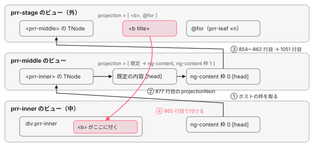

[目次](../README.md) › [ng-content と投影の内側](README.md) › 第 4 回 / 全 6 回

# 描画と再投影：ɵɵprojection、applyProjectionRecursive、既定の内容

> ɵɵprojection が枠のノードを ng-content の場所に付ける行と、node\_manipulation.ts の applyProjectionRecursive・applyNodes・getProjectionNodes。ノードの持ち主は外のビューのまま、入れ子の ng-content（再投影）を外へ外へとたどる道。既定の内容（insertFallbackContent）は「枠の先頭の TNode が null か」だけで決まり、@if の子・残った空白・再投影の ng-content では出ないこと。投影されたコンポーネントが、ng-content が描かれなくても作られる理由。

angular/angular · 読了 約 14 分 · 中核 · [サイトで読む（デモが動きます）](https://angular-deep-dive-cyan.vercel.app/chapter/proj-render)

---

この章では、[第 3 回](03-proj-distribute.md)で枠に分けたノードが、実際に `<ng-content>` の場所の DOM に付くまでを読みます。分かることは 3 つです。`ɵɵprojection` はノードを作らず、外のビューで作り終えたノードを付けるだけであること。投影されたノードを入れ子の `ng-content` でもう一度投影する（再投影）とき、`applyNodes` と `applyProjectionRecursive` が互いを呼んで外へ外へとたどること。既定の内容（fallback）は「枠の連結リストの先頭が `null` か」だけで決まり、`@if` の子や空白のテキストでも「空ではない」になることです。

読むファイルは `packages/core/src/render3/instructions/projection.ts`（`ɵɵprojection`・`insertFallbackContent`）、`render3/instructions/template.ts`（`declareNoDirectiveHostTemplate`）、`render3/node_manipulation.ts`（`getProjectionNodes`・`applyNodes`・`applyProjectionRecursive`）です。`applyProjection` の前半と、DOM ノードの配列を付ける枝は [Elements の投影の章](../elements/04-elements-connect.md)で読んだので、ここではその先を読みます。行番号は手元の木（8576f161ae4）のものです。新しい本家（angular-main）では、node\_manipulation.ts の引用の行が 2 行ずつ後ろにずれます（[第 6 回](06-proj-tests-issues.md)の 3 節）。projection.ts は同じです。

1. [1. 1 行の ng-content が生むもの](01-proj-what-declared.md)
2. [2. コンパイラの側](02-proj-compile.md)
3. [3. 振り分け](03-proj-distribute.md)
4. **4. 描画と再投影**（この章）
5. [5. 動的な投影とよくある誤解](05-proj-dynamic.md)
6. [6. spec と issue](06-proj-tests-issues.md)

この章の DEMO（8 節）で使う部品です。本文の説明は、この 3 つの部品と 5 つのケースで何が起きるかを例にします。

📄 `DEMO の部品のテンプレート（読みやすく改行したもの）` L1–16

```
 1 │ <!-- prr-inner -->
 2 │ <div class="prr-inner">inner
 3 │   <ng-content select="[head]"><i>inner の既定（head）</i></ng-content> |
 4 │   <ng-content><i>inner の既定（本文）</i></ng-content>
 5 │ </div>
 6 │ 
 7 │ <!-- prr-middle（prr-inner に自分の ng-content を渡す） -->
 8 │ <div class="prr-middle">middle
 9 │   <prr-inner>
10 │     <ng-content select="[title]" head><i>middle の既定（title）</i></ng-content>
11 │     <ng-content />
12 │   </prr-inner>
13 │ </div>
14 │ 
15 │ <!-- prr-box -->
16 │ <span class="prr-box"><ng-content><i>box の既定</i></ng-content></span>
```

📄 `DEMO で使う側（prr-stage）のテンプレート` L1–10

```
 1 │ <!-- 1 -->
 2 │ <prr-middle />
 3 │ <!-- 2 -->
 4 │ <prr-middle><b title>タイトル</b>@for (n of leaves(); track n) {<prr-leaf [n]="n" />}</prr-middle>
 5 │ <!-- 3 -->
 6 │ <prr-middle>@if (showTitle()) {<b title>@if のタイトル</b>}</prr-middle>
 7 │ <!-- 4 -->
 8 │ <prr-box> </prr-box>
 9 │ <!-- 5 -->
10 │ <prr-ws />（中身は preserveWhitespaces: true の <prr-box> </prr-box>）
```

## 1. 子のノードは、外のビューで先に作られる

ケース 2 の `<b title>` と `<prr-leaf>` は、**prr-stage のテンプレート関数**が作ります。`<prr-middle>` の子として書かれていても、命令は prr-stage の中の `ɵɵelementStart` と `ɵɵrepeaterCreate` です（[第 1 回](01-proj-what-declared.md)の「使う側の出力は投影のために何も変わらない」）。作った要素を親の DOM に付けるかどうかは `getClosestRElement` が決め、親がコンポーネントのホストで、カプセル化が `None` か `Emulated` なら `null` を返して付けません（[DOM を組む命令の章](../ivy/09-ivy-create-instructions.md)で読んだ `getClosestRElement` の分岐）。

1. **prr-stage の作成の段**

   `<b title>` の要素と、`@for` のコンテナと、その中の `<prr-leaf>` を作ります。`PrrLeaf` のコンストラクタはここで走ります（DEMO の「葉の作成」が増えるのはこの時点）。どれもまだ DOM のどこにも付いていません。
2. **子のコンポーネントのビューを作る**

   prr-stage のテンプレート関数が終わってから、`<prr-middle>` のビューが作られます（作成の段の最後に子のコンポーネントを描く順番は [最初の描画の章](../boot/11-boot-first-render.md)）。
3. **prr-middle のテンプレート関数**

   先頭の `ɵɵprojectionDef` がホストの子を枠に分け（[第 3 回](03-proj-distribute.md)）、続く `ɵɵprojection` が枠のノードを付けます（2〜5 節）。

だから **投影されるコンポーネントは、`ɵɵprojection` が呼ばれるかどうかと関係なく作られます**。`ɵɵprojection` がしないことの話は、[第 5 回](05-proj-dynamic.md)で @if と並べて確かめます。

## 2. ɵɵprojection の前半：既定の内容は、毎回「宣言」だけはする

コンパイラが prr-middle のテンプレートから作った命令です（記録。[第 2 回](02-proj-compile.md)で読んだ出力と同じ形）。

📄 `prr-middle のテンプレート（クラス名を Demo にして、このサイトの @angular/compiler 22.1.6 の JIT の入口で Node から文字列にした記録。作成の段の抜粋）` L1–11 （▶ の行: 8–9）

```
 1 │ // _c0 = [[['', 'title', '']], '*']、_c2 = ['head', '']
 2 │ if (rf & 1) {
 3 │   i0.ɵɵprojectionDef(_c0);
 4 │   i0.ɵɵelementStart(0,'div',0)(1,'span',1);
 5 │   i0.ɵɵtext(2,'middle');
 6 │   i0.ɵɵelementEnd();
 7 │   i0.ɵɵelementStart(3,'prr-inner');
 8 ▶   i0.ɵɵprojection(4,0,_c2,Demo_ProjectionFallback_4_Template,2,0);
 9 ▶   i0.ɵɵprojection(6,1);
10 │   i0.ɵɵelementEnd()();
11 │ }
```

8 行目の `ɵɵprojection(4, 0, _c2, …Fallback_4_Template, 2, 0)` は、ノードの番号 4、枠 0、属性 `['head', '']`、既定の内容のテンプレート関数とその decls・vars です。9 行目の既定の内容が無い ng-content は、番号 6 で枠 1 だけを渡します。番号が 5 を飛ばしているのは、既定の内容のテンプレートが 5 番を使うからです。

📄 `angular/packages/core/src/render3/instructions/projection.ts` L149–175 （▶ の行: 159, 161–165, 168, 173）

```ts
149 │ export function ɵɵprojection(
150 │   nodeIndex: number,
151 │   selectorIndex: number = 0,
152 │   attrs?: TAttributes | null,
153 │   fallbackTemplateFn?: ComponentTemplate<unknown>,
154 │   fallbackDecls?: number,
155 │   fallbackVars?: number,
156 │ ): void {
157 │   const lView = getLView();
158 │   const tView = getTView();
159 ▶   const fallbackIndex = fallbackTemplateFn ? nodeIndex + 1 : null;
160 │ 
161 ▶   // Fallback content needs to be declared no matter whether the slot is empty since different
162 ▶   // instances of the component may or may not insert it. Also it needs to be declare *before*
163 ▶   // the projection node in order to work correctly with hydration.
164 ▶   if (fallbackIndex !== null) {
165 ▶     declareNoDirectiveHostTemplate(
166 │       lView,
167 │       tView,
168 ▶       fallbackIndex,
169 │       fallbackTemplateFn!,
170 │       fallbackDecls!,
171 │       fallbackVars!,
172 │       null,
173 ▶       attrs,
174 │     );
175 │   }
```

1. **159 行目：既定の内容の番号は nodeIndex + 1**

   テンプレート関数が渡されたときだけ番号を決めます。8 行目の例では 5 番です。
2. **164〜175 行目：枠が空かどうかを見る前に、必ず宣言する**

   161〜163 行目のコメントのとおり、同じコンポーネントでもインスタンスによって既定の内容を出したり出さなかったりするので、TNode（静的な情報。[ivy-tnode](../ivy/04-ivy-tnode.md)）は最初の作成のときに必ず作っておく必要があります。宣言するのは `ng-template` と同じコンテナです。
3. **173 行目：ng-content の属性を、コンテナにも渡す**

   この `attrs` が、再投影のときに効きます（次の引用と 6 節）。

📄 `angular/packages/core/src/render3/instructions/template.ts` L200–223 （▶ の行: 216–217, 220, 222–223）

```ts
200 │ export function declareNoDirectiveHostTemplate(
201 │   declarationLView: LView,
202 │   declarationTView: TView,
203 │   index: number,
204 │   templateFn: ComponentTemplate<any> | null,
205 │   decls: number,
206 │   vars: number,
207 │   tagName?: string | null,
208 │   attrs?: TAttributes | null,
209 │   flags?: TNodeFlags,
210 │   localRefsIndex?: number | null,
211 │   localRefExtractor?: LocalRefExtractor,
212 │ ): TNode {
213 │   const adjustedIndex = index + HEADER_OFFSET;
214 │   let tNode: TContainerNode;
215 │ 
216 ▶   if (declarationTView.firstCreatePass) {
217 ▶     tNode = getOrCreateTNode(
218 │       declarationTView,
219 │       adjustedIndex,
220 ▶       TNodeType.Container,
221 │       tagName || null,
222 ▶       attrs || null,
223 ▶     );
```

`declareNoDirectiveHostTemplate` は、最初の作成のとき（216 行目）だけ `getOrCreateTNode` でコンテナの TNode を作り、222 行目で ng-content の属性をそのまま付けます。prr-middle の既定の内容のコンテナは、`head` の属性を持ったまま `<prr-inner>` の子になります。これで prr-inner の `select="[head]"` の枠に、ng-content と同じように振り分けられます。この 1 行は、既定の内容を再投影できるようにした修正（`2fc11eae9ea`、PR #54854）で足されました。

## 3. ɵɵprojection の後半：空なら既定の内容、空でなければ付ける

📄 `angular/packages/core/src/render3/instructions/projection.ts` L176–205 （▶ の行: 177, 180, 185–187, 192, 195–197, 199–201, 203）

```ts
176 │ 
177 ▶   const tProjectionNode = getOrCreateTNode(
178 │     tView,
179 │     HEADER_OFFSET + nodeIndex,
180 ▶     TNodeType.Projection,
181 │     null,
182 │     attrs || null,
183 │   );
184 │ 
185 ▶   // We can't use viewData[HOST_NODE] because projection nodes can be nested in embedded views.
186 ▶   if (tProjectionNode.projection === null) {
187 ▶     tProjectionNode.projection = selectorIndex;
188 │   }
189 │ 
190 │   // `<ng-content>` has no content. Even if there's fallback
191 │   // content, the fallback is shown next to it.
192 ▶   setCurrentTNodeAsNotParent();
193 │ 
194 │   const hydrationInfo = lView[HYDRATION];
195 ▶   const isNodeCreationMode = !hydrationInfo || isInSkipHydrationBlock();
196 ▶   const componentHostNode = lView[DECLARATION_COMPONENT_VIEW][T_HOST] as TElementNode;
197 ▶   const isEmpty = componentHostNode.projection![tProjectionNode.projection] === null;
198 │ 
199 ▶   if (isEmpty && fallbackIndex !== null) {
200 ▶     insertFallbackContent(lView, tView, fallbackIndex);
201 ▶   } else if (isNodeCreationMode && !isDetachedByI18n(tProjectionNode)) {
202 │     // re-distribution of projectable nodes is stored on a component's view level
203 ▶     applyProjection(tView, lView, tProjectionNode);
204 │   }
205 │ }
```

1. **177〜183 行目：ng-content の TNode**

   種類は `TNodeType.Projection`（16）です。DEMO の表 2 に「ng-content（自分の枠 0）」と出ているのがこれです。
2. **186〜188 行目：何番の枠を出すか**

   TNode の `projection` に枠の番号を入れます。ホストの TNode の `projection`（枠の配列）と同じ名前ですが、ng-content の側では数です。185 行目のコメントのとおり、ng-content は `@if` などの埋め込みビューの中にも置けるので、ホストはビューの `HOST` ではなく 196 行目の道で探します。
3. **192 行目：ng-content は子を持たない**

   既定の内容は ng-content の「中」ではなく、隣のコンテナとして描かれます（190〜191 行目のコメント）。
4. **196 行目：DECLARATION\_COMPONENT\_VIEW から、ホストの TNode**

   このビューを宣言したコンポーネントのビュー（埋め込みビューの中なら、それを含むコンポーネントのビュー）の `T_HOST`、つまり使う側のテンプレートにある `<prr-middle>` の TNode です。
5. **197 行目：空かどうか**

   ホストの TNode の `projection[枠の番号]` が `null` なら空です。**見ているのは連結リストの先頭の TNode だけ**で、その TNode が実行時に何かを描くかどうかは見ません。
6. **199〜200 行目：空で、既定の内容があれば、それを出す**

   このときは 203 行目の `applyProjection` を呼びません。
7. **201〜203 行目：それ以外は付ける**

   195 行目の `isNodeCreationMode` は、ハイドレーション（サーバーで描いた DOM を使い回す）の最中は偽で、すでに正しい場所にある DOM を動かしません。i18n で外されたノードも飛ばします。

> [!WARNING]
> **ハマりどころ**
>
> 197 行目の「空」は TNode の有無なので、**データで切り替わりません**。ケース 3 の `@if (showTitle())` は、条件が偽でも `@if` のコンテナの TNode が枠 0 にいるので空ではなく、`middle の既定（title）` は一度も出ません（DEMO の表 2 のケース 3 の枠 0）。逆に、空白だけのテキストはコンパイラが消すので（[HTML の構文解析の章](../compiler/04-compiler-html-parser.md)の空白の除去）、ケース 4 の `<prr-box> </prr-box>` は空で、既定の内容が出ます。同じ書き方でも、`preserveWhitespaces: true` のコンポーネント（ケース 5）では空白がテキストの TNode として残り、既定の内容は出ません。

## 4. insertFallbackContent：既定の内容は、中のコンポーネントのビュー

📄 `angular/packages/core/src/render3/instructions/projection.ts` L207–225 （▶ の行: 209–211, 215–216, 219, 222–223）

```ts
207 │ /** Inserts the fallback content of a projection slot. Assumes there's no projected content. */
208 │ function insertFallbackContent(lView: LView, tView: TView, fallbackIndex: number) {
209 ▶   const adjustedIndex = HEADER_OFFSET + fallbackIndex;
210 ▶   const fallbackTNode = tView.data[adjustedIndex] as TNode;
211 ▶   const fallbackLContainer = lView[adjustedIndex];
212 │   ngDevMode && assertTNode(fallbackTNode);
213 │   ngDevMode && assertLContainer(fallbackLContainer);
214 │ 
215 ▶   const dehydratedView = findMatchingDehydratedView(fallbackLContainer, fallbackTNode.tView!.ssrId);
216 ▶   const fallbackLView = createAndRenderEmbeddedLView(lView, fallbackTNode, undefined, {
217 │     dehydratedView,
218 │   });
219 ▶   addLViewToLContainer(
220 │     fallbackLContainer,
221 │     fallbackLView,
222 ▶     0,
223 ▶     shouldAddViewToDom(fallbackTNode, dehydratedView),
224 │   );
225 │ }
```

1. **209〜211 行目：宣言しておいたコンテナを取り出す**

   2 節の 164〜175 行目で作った TNode と LContainer（ビューの入れ物。[ivy-lcontainer](../ivy/11-ivy-lcontainer.md)）です。
2. **215 行目：ハイドレーションの道**

   サーバーで描いた既定の内容があれば、それを使い回す相手として探します。
3. **216 行目：埋め込みビューを作って描く**

   1 つ目の引数の `lView` は ɵɵprojection を呼んだビュー、つまり**中のコンポーネント（prr-middle）のビュー**です。既定の内容の中の式やディレクティブは、外ではなく中のコンポーネントのものとして動きます。ここで初めて作るので、既定の内容の中のコンポーネントは、出さないときには作られません。
4. **219〜224 行目：コンテナの 0 番に入れる**

   222 行目の 0 は、コンテナの先頭という意味です。223 行目の `shouldAddViewToDom` は、ハイドレーションで DOM が既にあるときに入れ直さないための判定です。DOM に付ける先は、`addLViewToLContainer`（[ivy-lcontainer](../ivy/11-ivy-lcontainer.md)）が読む、コンテナの印のコメントの今の親です。再投影の途中（ng-content の親がコンポーネントのホスト）では、印のコメント自体が作られたときに付けられていない（親の要素が `null`）ので、ビューもまだ付きません。付けるのは、その先の ng-content の `applyProjection` です（6 節）。

## 5. applyProjectionRecursive と applyNodes：ノードの持ち主は外のビュー

`applyProjection` は、ng-content の親の要素と「この前に入れる」ノードを決めて `applyProjectionRecursive` を呼びます。そこで、枠の中身が DOM ノードの配列（`projectableNodes`）なら 1 つずつ付けます（[Elements の投影の章](../elements/04-elements-connect.md)で読んだ範囲）。ふつうのテンプレートから来た枠は、その続きの `else` です。

📄 `angular/packages/core/src/render3/node_manipulation.ts` L1049–1067 （▶ の行: 1050–1051, 1054, 1057, 1060–1061, 1064）

```ts
1049 │   } else {
1050 ▶     let nodeToProject: TNode | null = nodeToProjectOrRNodes;
1051 ▶     const projectedComponentLView = componentLView[PARENT] as LView;
1052 │     // If a parent <ng-content> is located within a skip hydration block,
1053 │     // annotate an actual node that is being projected with the same flag too.
1054 ▶     if (hasInSkipHydrationBlockFlag(tProjectionNode)) {
1055 │       nodeToProject.flags |= TNodeFlags.inSkipHydrationBlock;
1056 │     }
1057 ▶     applyNodes(
1058 │       renderer,
1059 │       action,
1060 ▶       nodeToProject,
1061 ▶       projectedComponentLView,
1062 │       parentRElement,
1063 │       beforeNode,
1064 ▶       true,
1065 │     );
1066 │   }
1067 │ }
```

1. **1050 行目：枠の連結リストの先頭の TNode**

   `applyProjectionRecursive` の前半（Elements の章の引用）で、ホストの TNode の `projection[枠の番号]` から取り出したものです。
2. **1051 行目：その TNode の持ち主のビュー**

   `componentLView` は ng-content を宣言したコンポーネントのビュー（prr-middle）で、その `PARENT` は、そのコンポーネントを使っているビュー（prr-stage）です。枠のノードは**外のビューの TNode**なので、値（DOM ノード）も外のビューの LView から読みます。
3. **1054〜1056 行目：ハイドレーションを飛ばす印を引き継ぐ**

   ng-content が `ngSkipHydration` の中にあれば、投影されるノードにも同じ印を付けます。
4. **1057〜1065 行目：applyNodes を「投影の向き」で**

   最後の引数 `true` が `isProjection` です。

📄 `angular/packages/core/src/render3/node_manipulation.ts` L753–762 （▶ の行: 755–757, 759）

```ts
753 │ export function getProjectionNodes(lView: LView, tNode: TNode | null): TNode | RNode[] | null {
754 │   if (tNode !== null) {
755 ▶     const componentView = lView[DECLARATION_COMPONENT_VIEW];
756 ▶     const componentHost = componentView[T_HOST] as TElementNode;
757 ▶     const slotIdx = tNode.projection as number;
758 │     ngDevMode && assertProjectionSlots(lView);
759 ▶     return componentHost.projection![slotIdx];
760 │   }
761 │   return null;
762 │ }
```

同じ取り出し方をもう 1 か所が使います。`getProjectionNodes` は、ng-content の TNode から 755〜756 行目でホストの TNode を、757 行目で枠の番号を取り、759 行目で連結リストの先頭を返します。これは、ある位置の「最初の DOM ノード」を探す `getFirstNativeNode` が、ng-content に行き当たったときに使います（[第 5 回](05-proj-dynamic.md)で配列の場合を読みます）。

📄 `angular/packages/core/src/render3/node_manipulation.ts` L784–816 （▶ の行: 791, 793, 798, 808, 810–813）

```ts
784 │ function applyNodes(
785 │   renderer: Renderer,
786 │   action: WalkTNodeTreeAction,
787 │   tNode: TNode | null,
788 │   lView: LView,
789 │   parentRElement: RElement | null,
790 │   beforeNode: RNode | null,
791 ▶   isProjection: boolean,
792 │ ) {
793 ▶   while (tNode != null) {
794 │     ngDevMode && assertTNodeForLView(tNode, lView);
795 │     const injector = lView[INJECTOR];
796 │ 
797 │     // Let declarations don't have corresponding DOM nodes so we skip over them.
798 ▶     if (tNode.type === TNodeType.LetDeclaration) {
799 │       tNode = tNode.next;
800 │       continue;
801 │     }
802 │ 
803 │     ngDevMode &&
804 │       assertTNodeType(
805 │         tNode,
806 │         TNodeType.AnyRNode | TNodeType.AnyContainer | TNodeType.Projection | TNodeType.Icu,
807 │       );
808 ▶     const rawSlotValue = lView[tNode.index];
809 │     const tNodeType = tNode.type;
810 ▶     if (isProjection) {
811 ▶       if (action === WalkTNodeTreeAction.Create) {
812 ▶         rawSlotValue && attachPatchData(unwrapRNode(rawSlotValue), lView);
813 ▶         tNode.flags |= TNodeFlags.isProjected;
814 │       }
815 │     }
816 │     if (!isDetachedByI18n(tNode)) {
```

1. **793 行目：TNode を 1 つずつ**

   どの TNode から始めて、どの向きに進むかは最後の 877 行目（次の引用）が決めます。
2. **798〜801 行目：@let は飛ばす**

   `@let` には DOM ノードがありません（振り分けでも枠を占めません。[projection の章](../template/02-projection.md)で読んだ `ɵɵprojectionDef` の分岐）。
3. **808 行目：値は lView\[tNode.index\]**

   ここでの `lView` は 1051 行目の外のビューです。
4. **810〜814 行目：投影の向きで、作成のときだけ**

   DOM ノードに外のビューを結び付け（812 行目。DOM からコンポーネントを引く `ng.getComponent` などが使う）、TNode に `isProjected` の印を付けます（813 行目）。

📄 `angular/packages/core/src/render3/node_manipulation.ts` L854–879 （▶ の行: 854–855, 858–859, 865, 870, 877）

```ts
854 ▶       } else if (tNodeType & TNodeType.Projection) {
855 ▶         applyProjectionRecursive(
856 │           renderer,
857 │           action,
858 ▶           lView,
859 ▶           tNode as TProjectionNode,
860 │           parentRElement,
861 │           beforeNode,
862 │         );
863 │       } else {
864 │         ngDevMode && assertTNodeType(tNode, TNodeType.AnyRNode | TNodeType.Container);
865 ▶         applyToElementOrContainer(
866 │           action,
867 │           renderer,
868 │           injector,
869 │           parentRElement,
870 ▶           rawSlotValue,
871 │           tNode,
872 │           beforeNode,
873 │           lView,
874 │         );
875 │       }
876 │     }
877 ▶     tNode = isProjection ? tNode.projectionNext : tNode.next;
878 │   }
879 │ }
```

1. **854〜862 行目：枠の中に ng-content があれば、さらにたどる**

   これが再投影です。858 行目の `lView` は今歩いているビュー（1 段外）なので、`applyProjectionRecursive` の先頭はそのビューを宣言したコンポーネントのホストの TNode を読み、1051 行目でもう 1 段外のビューへ進みます。
2. **863〜874 行目：要素とコンテナは、その場で付ける**

   `applyToElementOrContainer` が、作成なら `appendChild` か `insertBefore`、コンテナならその中のビューも付けます（[DOM の層の章](../template/05-dom.md)）。要素の子までは降りません。子は要素ごと動きます。
3. **877 行目：次へ**

   投影の向きでは `projectionNext`（同じ枠の次のノード）、ふつうのビューを歩くときは `next`（兄弟）です。同じ `applyNodes` が、ビューの根を歩く `applyView` と、枠を歩く投影の両方を受け持っています。

## 6. 再投影：ケース 1 とケース 2 を 1 段ずつ



*prr-inner の ng-content から、prr-inner のホストの枠 → prr-middle の ng-content → prr-middle のホストの枠 → prr-stage の &lt;b&gt; とたどる。DOM ノードの持ち主は prr-stage のまま、付く先は prr-inner の div。*

ケース 2 の `<b title>タイトル</b>` が付くまでです。

1. **prr-middle の ɵɵprojection(4, 0, …)**

   prr-middle のホストの枠 0 は `<b>` なので空ではなく（197 行目）、`applyProjection` を呼びます。ところがこの ng-content の親は `<prr-inner>`（コンポーネントのホスト）なので、親の要素は `null` で、DOM には何も付きません（810〜814 行目の印付けだけ）。
2. **prr-inner のビューを作る**

   prr-inner の `ɵɵprojectionDef` は、`<prr-inner>` の子（prr-middle のビューの TNode）を分けます。`head` の属性を持つ「既定の内容のコンテナ」と「ng-content 枠 0」が枠 0 へ、属性の無い「ng-content 枠 1」が枠 1 へ入ります（DEMO の表 2 の最後の行）。
3. **prr-inner の ɵɵprojection(3, 0, …)**

   枠 0 は空ではないので、親の `div.prr-inner` を親の要素にして `applyProjectionRecursive` へ。`applyProjectionRecursive` の先頭で `<prr-inner>` の枠 0 を取り、1051 行目で prr-middle のビューを持ち主にして `applyNodes` を呼びます（図の ①）。
4. **枠 0 の 1 つ目：既定の内容のコンテナ**

   865 行目で、コンテナの印のコメントと中のビューを付けます。ケース 2 では prr-middle の枠 0 が空ではなかったので、中のビューは 0 個です。877 行目で次へ（図の ②）。
5. **枠 0 の 2 つ目：prr-middle の ng-content**

   854 行目に入り、prr-middle のビューで `applyProjectionRecursive`。今度は `<prr-middle>` の枠 0、持ち主は prr-stage のビューです（図の ③）。
6. **&lt;b title&gt; を付ける**

   865 行目で、親の要素（`div.prr-inner`。ずっと同じものが渡ってくる）に付けます（図の ④）。`<b>` の値を読んだのは 808 行目の prr-stage の LView です。

ケース 1（`<prr-middle />`）では、prr-middle の枠 0 が空なので、prr-middle の ɵɵprojection は既定の内容を出します（199〜200 行目）。そのビューはコンテナに入りますが、コンテナの印のコメントは `<prr-inner>` の子として作られたので DOM に付いておらず、ビューもまだ付きません。prr-inner の ɵɵprojection が上の手順の 4 番目でコンテナを付けるとき、中のビュー（`middle の既定（title）`）も一緒に付きます。一方、枠 1 は prr-middle の 2 つ目の ng-content（既定の内容なし）を持っているので、prr-inner から見ると空ではありません。**prr-inner の `inner の既定（本文）` は出ず、何も出ません**（DEMO の表 1 のケース 1）。

## 7. 既定の内容が出る条件のまとめ

| 使う側に書いたもの | 枠の先頭 | 既定の内容 | 根拠 |
| --- | --- | --- | --- |
| 何も書かない・コメントだけ | `null` | 出る | 197・199 行目 |
| 空白だけ（既定の `preserveWhitespaces: false`） | `null`（コンパイラが消す） | 出る | ケース 4 |
| 空白だけ（`preserveWhitespaces: true`） | テキストの TNode | 出ない | ケース 5 |
| `@if`・`@for`・`<ng-container />` | コンテナの TNode | 条件や中身によらず出ない | ケース 3。spec の 1865・1911 行目 |
| 中のコンポーネントの ng-content（再投影） | ng-content の TNode | 中の既定の内容は出ない。外の ng-content の既定の内容が、属性ごと再投影される | 173・222 行目。ケース 1 |
| `projectableNodes` で `[]` を渡す | `null` | 出る | [第 5 回](05-proj-dynamic.md) |

## 8. DEMO：ページの上の本物で、再投影と既定の内容を見る

> **🧪 DEMO — 2 段の再投影と既定の内容（5 つのケース）**
>
> 「描く」を押すと、最初に見せた prr-stage をこのページに出し、描き終わったあとで 3 つを読みます。表 1 は DOM の文字、表 3 は葉の DOM の親と `inject` の結果です。表 2 は、`prr-stage` と `prr-middle` が `inject(ChangeDetectorRef)` で受けた ViewRef の `_lView` から TView を取り、ホストの TNode の `projection` と `projectionNext` をそのまま並べたものです。これらは公開の API ではなく、このサイトの 22.1.6 の名前を**確かめるためだけ**に読んでいます（本番ビルドでも同じ名前で残っています）。
>
> ▶ [このデモはサイトで動かせます](https://angular-deep-dive-cyan.vercel.app/chapter/proj-render)

表から確かめられることです（このサイトの本番ビルドで確かめました）。

1. **持ち主と付く先**

   表 3 で、葉の DOM の親は `div.prr-inner`（中の中のビュー）ですが、`inject(PrrMiddle)` は見え、`inject(PrrInner)` は `null` です。注入器は、葉が**書かれた場所**（prr-stage の `<prr-middle>` の子）から親をたどります（[NodeInjector の探索の章](../di/11-di-node-injector-lookup.md)）。
2. **作成と破棄**

   「葉を足す」で作成が 1 増え、「葉を減らす」で破棄が 1 増えます。葉を作り壊しているのは prr-stage の `@for` で、prr-inner の ng-content は何も作りません。「片付ける」で prr-stage ごと壊すと、残りの葉も破棄されます。
3. **@if のタイトル**

   ケース 3 は、切り替えても `middle の既定（title）` が出ません。表 2 のケース 3 の枠 0 は、条件によらず「コンテナ（b）\[title\]」です（コンパイラはブロックの中身の要素名と属性をコンテナに付けます。[第 3 回](03-proj-distribute.md)）。
4. **共有される TNode**

   表 2 の最後の行の `<prr-inner>` は、prr-middle の TView にあるので、ケース 1〜3 の 3 つのインスタンスで 1 つです。中身は「既定の内容のコンテナ → ng-content」で、ケースによって変わりません。インスタンスごとに違うのは、その先（prr-stage の TView の `<prr-middle>`）の枠です。

## 9. 呼び出しの連なり

- 👤 `<prr-middle><b title>…</b>…</prr-middle>` — prr-stage のテンプレート — *子は prr-stage のビューで作る*
  - `ɵɵelementStart` → `appendChild` → `getClosestRElement` — node\_manipulation.ts L557-573 — *親がホストなので null。付けない*
- `prr-middle のテンプレート関数（作成）` — 子のコンポーネントは親の作成の段の最後
  - `ɵɵprojectionDef` — projection.ts L96-131 — *第 3 回*
  - `ɵɵprojection(4, 0, attrs, fallback)` — projection.ts L149-205
    - `declareNoDirectiveHostTemplate` — projection.ts L164-175・template.ts L216-223 — *属性つきのコンテナ*
    - `isEmpty ? insertFallbackContent : applyProjection` — projection.ts L197-204
      - `createAndRenderEmbeddedLView` → `addLViewToLContainer` — projection.ts L216-224 — *空のとき*
- `prr-inner のテンプレート関数（作成）`
  - `ɵɵprojection(3, 0)` → `applyProjection` — node\_manipulation.ts L988-1001 — *親は div.prr-inner*
    - `applyProjectionRecursive` — L1017-1067 — *prr-inner のホストの枠 0、持ち主は prr-middle のビュー*
      - `applyNodes(…, isProjection = true)` — L784-879
        - `applyToElementOrContainer` — L865 — *既定の内容のコンテナ*
        - `applyProjectionRecursive` — L854-862 — *prr-middle のホストの枠 0、持ち主は prr-stage のビュー*
          - `applyNodes` → `applyToElementOrContainer` — L865 — *&lt;b title&gt; を div.prr-inner に付ける*

## テストと直し方

### 描画と既定の内容を固めているテスト

core の `packages/core/test/acceptance/content_spec.ts` の一番外の `describe('projection')`（30 行目）から 3 つです。まず再投影です。

📄 `angular/packages/core/test/acceptance/content_spec.ts` L120–156 （▶ の行: 120, 123, 132, 141, 152–153）

```ts
120 ▶   it('should be able to re-project content', () => {
121 │     @Component({
122 │       selector: 'grand-child',
123 ▶       template: `<div><ng-content></ng-content></div>`,
124 │       standalone: false,
125 │ 
126 │       changeDetection: ChangeDetectionStrategy.Eager,
127 │     })
128 │     class GrandChild {}
129 │ 
130 │     @Component({
131 │       selector: 'child',
132 ▶       template: `<grand-child><ng-content></ng-content></grand-child>`,
133 │       standalone: false,
134 │ 
135 │       changeDetection: ChangeDetectionStrategy.Eager,
136 │     })
137 │     class Child {}
138 │ 
139 │     @Component({
140 │       selector: 'parent',
141 ▶       template: `<child><b>Hello</b>World!</child>`,
142 │       standalone: false,
143 │ 
144 │       changeDetection: ChangeDetectionStrategy.Eager,
145 │     })
146 │     class Parent {}
147 │ 
148 │     TestBed.configureTestingModule({declarations: [Parent, Child, GrandChild]});
149 │     const fixture = TestBed.createComponent(Parent);
150 │     fixture.detectChanges();
151 │ 
152 ▶     expect(fixture.nativeElement.innerHTML).toBe(
153 ▶       '<child><grand-child><div><b>Hello</b>World!</div></grand-child></child>',
154 │     );
155 │   });
156 │ 
```

123 行目の grand-child、132 行目の child（grand-child に自分の ng-content を渡す）、141 行目の parent の 3 段です。152〜153 行目で、parent の書いた `<b>Hello</b>World!` が grand-child の `<div>` の中にあることを確かめます。6 節の手順そのものです。既定の内容の describe（1768 行目の `describe('fallback content')`）からは 2 つです。

📄 `angular/packages/core/test/acceptance/content_spec.ts` L2217–2256 （▶ の行: 2217–2218, 2229–2230, 2243, 2254–2255）

```ts
2217 ▶           <ng-content select="[inner-header]">Inner header fallback</ng-content>
2218 ▶           <ng-content select="[inner-footer]">Inner footer fallback</ng-content>
2219 │         `,
2220 │ 
2221 │         changeDetection: ChangeDetectionStrategy.Eager,
2222 │       })
2223 │       class InnerProjection {}
2224 │ 
2225 │       @Component({
2226 │         selector: 'projection',
2227 │         template: `
2228 │           <inner-projection>
2229 ▶             <ng-content select="[outer-header]" inner-header>Outer header fallback</ng-content>
2230 ▶             <ng-content select="[outer-footer]" inner-footer>Outer footer fallback</ng-content>
2231 │           </inner-projection>
2232 │         `,
2233 │         imports: [InnerProjection],
2234 │ 
2235 │         changeDetection: ChangeDetectionStrategy.Eager,
2236 │       })
2237 │       class Projection {}
2238 │ 
2239 │       @Component({
2240 │         imports: [Projection],
2241 │         template: `
2242 │           <projection>
2243 ▶             <span outer-header>Outer header override</span>
2244 │           </projection>
2245 │         `,
2246 │ 
2247 │         changeDetection: ChangeDetectionStrategy.Eager,
2248 │       })
2249 │       class App {}
2250 │ 
2251 │       const fixture = TestBed.createComponent(App);
2252 │       const content = getElementHtml(fixture.nativeElement);
2253 │ 
2254 ▶       expect(content).toContain('Outer header override');
2255 ▶       expect(content).toContain('Outer footer fallback');
2256 │     });
```

2229〜2230 行目の外の ng-content は、`inner-header` と `inner-footer` の属性を持ち、既定の内容もあります。2243 行目の App は `outer-header` だけを渡すので、footer の側は外の既定の内容（2230 行目）が 173・222 行目の属性ごと inner の枠に入り、2255 行目で `Outer footer fallback` が見つかります。中の 2218 行目の `Inner footer fallback` は出ません（この it は出ないことまでは確かめていません）。

📄 `angular/packages/core/test/acceptance/content_spec.ts` L1865–1900 （▶ の行: 1865, 1868, 1880–1882, 1894–1895）

```ts
1865 ▶     it('should not render the fallback content if there is a control flow expression', () => {
1866 │       @Component({
1867 │         selector: 'projection',
1868 ▶         template: `<ng-content>Wildcard fallback</ng-content>|<ng-content select="span"
1869 │             >Span fallback</ng-content
1870 │           >`,
1871 │ 
1872 │         changeDetection: ChangeDetectionStrategy.Eager,
1873 │       })
1874 │       class Projection {}
1875 │ 
1876 │       @Component({
1877 │         imports: [Projection],
1878 │         template: `
1879 │           <projection>
1880 ▶             @if (showSpan) {
1881 ▶               <span>Span override</span>
1882 ▶             }
1883 │           </projection>
1884 │         `,
1885 │ 
1886 │         changeDetection: ChangeDetectionStrategy.Eager,
1887 │       })
1888 │       class App {
1889 │         showSpan = false;
1890 │       }
1891 │ 
1892 │       const fixture = TestBed.createComponent(App);
1893 │       fixture.detectChanges();
1894 ▶       expect(getElementHtml(fixture.nativeElement)).toContain(
1895 ▶         `<projection>Wildcard fallback|</projection>`,
1896 │       );
1897 │ 
1898 │       fixture.componentInstance.showSpan = true;
1899 │       fixture.detectChanges();
1900 │       expect(getElementHtml(fixture.nativeElement)).toContain(
```

1880〜1882 行目の `@if (showSpan)` は、中身が `<span>` 1 つなので span の枠（1868 行目の 2 つ目の ng-content）に入り、偽のあいだもその枠の先頭にいます。1894〜1895 行目で、ワイルドカードの枠（空）は `Wildcard fallback` を出し、span の枠は `Span fallback` を出さないことを確かめます。3 節の 197 行目の「TNode の有無で決まる」を、名指しで固めている it です。

### 手元で走らせた結果

📄 `ターミナル（~/angular-research/angular で）`

```
cd ~/angular-research/angular
pnpm bazel test //packages/core/test/acceptance:acceptance \
  '--test_arg=--filter=^projection ' --nocache_test_results --test_output=all
pnpm bazel test //packages/core/test/acceptance:acceptance \
  '--test_arg=--filter=^projection fallback content' --nocache_test_results --test_output=all
```

📄 `出力（2026-11-11 に実行。抜粋）`

```
Ran 63 of 2693 specs
63 specs, 0 failures
//packages/core/test/acceptance:acceptance                               PASSED in 1.5s
Ran 18 of 2693 specs
18 specs, 0 failures
//packages/core/test/acceptance:acceptance                               PASSED in 1.3s
```

`^projection `（後ろに空白）で、content\_spec.ts の一番外の describe の 63 件（grep で数えた `it(` の行と同じ）が、`^projection fallback content` で 1768 行目からの 18 件が通りました。`//packages/core/test/acceptance:acceptance` は Node の jasmine なので `--filter` が効きます。同じ名前の一番外の describe（`projection`）は linker/projection\_integration\_spec.ts にもありますが、そちらは別のターゲット（`//packages/core/test:test`）です（[第 6 回](06-proj-tests-issues.md)）。

### 直すとしたら

- 既定の内容を出すかどうかは `ɵɵprojection` の 197〜204 行目です。「実行時に何も描かれていなければ既定の内容」にするには、作成の段の 1 回の判定では足りず、`@if` の中身が変わるたびに判定し直す仕組みが要ります（今はどこにもありません）。it は content\_spec.ts の `describe('fallback content')`（1768 行目）に足し、1865 行目の it の期待値も変わります。
- 既定の内容のビューを作って入れるのは `insertFallbackContent`（208〜225 行目）。ハイドレーションの道（215 行目）を変えるなら、`packages/platform-server/test/hydration_spec.ts` の側にも it が要ります（97eea8d50ea の修正は両方を変えています）。
- 枠のノードを付ける・外す・壊すのは `applyProjectionRecursive` と `applyNodes`。作成のほか、ビューを外す・入れるときにも同じ道を通るので（[第 5 回](05-proj-dynamic.md)）、変えたら `^projection ` の 63 件と `//packages/core/test:test` の `^projection ` を両方走らせます。

## 聞かれそうな質問

**Q. ng-content が描かれないのに、投影したコンポーネントのコンストラクタが走るのはなぜですか？**

投影されるノードは、使う側のテンプレート関数が自分のビューで作るからです。ɵɵprojection（149〜205 行目）はノードを作らず、203 行目の `applyProjection` で付けるだけです。作るのは 1 節の手順の 1 番目、付けるのは 3 番目で、付ける命令が呼ばれなくても 1 番目は終わっています。

**Q. `@if` で包んだ子を渡すと、既定の内容が出ないのはなぜですか？**

197 行目は、ホストの TNode の枠の先頭が `null` かどうかだけを見ます。`@if` はコンテナの TNode として枠に入るので、条件が偽でも空ではありません（DEMO のケース 3、spec の 1865 行目）。

**Q. 再投影すると、内側のコンポーネントの既定の内容が出ないことがあるのはなぜですか？**

内側から見た枠の中身は、外側のテンプレートの ng-content の TNode です。外側に何も渡されていなくても、その TNode は枠の先頭にいるので 197 行目では空ではありません（DEMO のケース 1 の「inner の既定（本文）」）。外側の ng-content に既定の内容を書けば、173 行目で属性ごと渡したコンテナが内側の枠に入り、そちらが出ます。

**Q. 投影されたノードは、どのビューに属していますか？**

書かれたテンプレートのビューです。1051 行目で持ち主を `componentLView[PARENT]`（使う側のビュー）にし、808 行目でそのビューの LView から DOM ノードを読みます。DI も書かれた場所からたどるので、DEMO の表 3 で `inject(PrrInner)` は `null` です。

**Q. 既定の内容の中の式は、どちらのコンポーネントの値を読みますか？**

中のコンポーネント（ng-content を書いた側）です。216 行目の `createAndRenderEmbeddedLView` は、ɵɵprojection を呼んだビューを宣言のビューにして埋め込みビューを作ります。spec の 1934 行目の it がデータのバインディングを、2088 行目の it がホストのコンポーネントを注入できることを確かめています。

## 読み終えて

- `ɵɵprojection` はノードを作らない。外のビューで作り終えたノードを、197 行目で空でなければ `applyProjection` で付ける。
- 枠のノードの持ち主は外のビュー（1051 行目）。`applyNodes` の 854 行目と `applyProjectionRecursive` が互いを呼び、再投影を外へ外へとたどる。
- 既定の内容は「枠の先頭の TNode が null か」で決まり、毎回宣言だけはする（164〜175 行目）。`@if`・`ng-container`・残った空白・再投影の ng-content は「空ではない」。
- 既定の内容は中のコンポーネントのビューに作られ、ng-content の属性ごと再投影できる（173・222 行目）。

---

← 前: [振り分け：ɵɵprojectionDef がホストの子を枠に分けるまで](03-proj-distribute.md)  
次: [動的な投影：createComponent の projectableNodes と、よくある誤解](05-proj-dynamic.md) →
