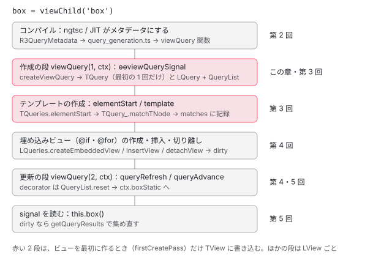

[目次](../README.md) › [クエリ（viewChild・contentChildren）の内側](README.md) › 第 1 回 / 全 7 回

# 1 行の viewChild が生むもの：クエリの全体像

> viewChild('box')・viewChildren(Item)・contentChild(TemplateRef) と比べるための @ViewChild('box', {static: true}) を書いたコンポーネントを本物のコンパイラにかけ、出てきた viewQuery / contentQueries 関数・ɵɵviewQuerySignal と ɵɵviewQuery の連なり・ɵɵqueryAdvance(2)・述語（文字列の定数か型か）・フラグ（5 と 7）を指さす。命令が自分を返して連なる行、signal の版が同じ createViewQuery に番号を結ぶ行。実行時に TQuery が作られ、ノードと照合され、LQuery に結果が溜まり、QueryList や signal に届くまでの地図。

angular/angular · 読了 約 12 分 · 基礎 · [サイトで読む（デモが動きます）](https://angular-deep-dive-cyan.vercel.app/chapter/qry-what-declared)

---

この章では、クラスに `box = viewChild('box')` と 1 行書いたことが、**コンパイル後に何になり、実行時にどの順で何が動くのか**を、本物のコンパイラの出力で指さします。答えを先に言うと、クエリの宣言は `viewQuery`（ビューのクエリ）と `contentQueries`（コンテンツのクエリ）という 2 つの関数になります。どちらも `rf & 1`（作成の段）でクエリを作り、`rf & 2`（更新の段）で結果を入れる（decorator のクエリ）か、番号を進めるだけ（signal のクエリ）です。

この章はシリーズの地図です。それぞれの段の中身は第 2〜6 回で読みます。この章で引用するのは、出力が呼ぶ命令 `packages/core/src/render3/instructions/queries.ts`・`instructions/queries_signals.ts`、結果の入れ物の形 `render3/interfaces/query.ts`、出力を固めているテスト `packages/compiler-cli/test/compliance/test_cases/signal_queries/` です。viewChild という関数そのもの（authoring/queries.ts）が何を返すかは [authoring](../signals/11-authoring.md) が読んでいます。

1. **1. 1 行の viewChild が生むもの**（この章）
2. [2. コンパイラの側](02-qry-compile.md)
3. [3. TQuery の照合](03-qry-tquery-match.md)
4. [4. LQuery と結果の集め方](04-qry-lquery-results.md)
5. [5. 更新の時機](05-qry-refresh-timing.md)
6. [6. コンテンツのクエリ](06-qry-content-projection.md)
7. [7. spec と issue](07-qry-tests-issues.md)

## 1. 本物のコンパイラにかける

小さなコンポーネントを 1 つ書き、このサイトの node\_modules にある `@angular/compiler-cli` の `NgtscProgram`（`ngc` と同じ AOT のコンパイラ）でコンパイルしました（@angular/compiler-cli 22.1.6 / TypeScript 6.0.3。記録のスクリプトは章の最後）。クエリは 4 つです。文字列で探す `viewChild('box')`、型で探す `viewChildren(Item)`、コンテンツを探す `contentChild(TemplateRef)`、比べるための decorator 版 `@ViewChild('box', { static: true })` です。

📄 `demo.ts（コンパイルしたもの）` L1–26 （▶ の行: 21–24）

```
 1 │ import {Component, ElementRef, TemplateRef, ViewChild, contentChild, input, viewChild, viewChildren} from '@angular/core';
 2 │ 
 3 │ @Component({selector: 'app-item', template: '{{ n() }}'})
 4 │ export class Item {
 5 │   n = input(0);
 6 │ }
 7 │ 
 8 │ @Component({
 9 │   selector: 'app-what',
10 │   imports: [Item],
11 │   template: `
12 │     <div #box>box</div>
13 │     <app-item [n]="1" />
14 │     @if (more) {
15 │       <app-item [n]="2" />
16 │     }
17 │   `,
18 │ })
19 │ export class What {
20 │   more = true;
21 ▶   box = viewChild('box');
22 ▶   items = viewChildren(Item);
23 ▶   tpl = contentChild(TemplateRef);
24 ▶   @ViewChild('box', {static: true}) boxStatic!: ElementRef;
25 │ }
26 │ 
```

出てきた `demo.js` のうち、定数 `_c0` の行と `class What` の部分です。クエリに関係する行を強調しています。診断（エラーと警告）は 0 件でした。

📄 `out/demo.js（記録。_c0 の行と class What）` L1–35 （▶ の行: 1, 12–13, 15–18, 20, 22）

```
 1 ▶ const _c0 = ["box"];
 2 │ export class What {
 3 │     more = true;
 4 │     box = viewChild('box', /* @ts-ignore */
 5 │     ...(ngDevMode ? [{ debugName: "box" }] : /* istanbul ignore next */ []));
 6 │     items = viewChildren(Item, /* @ts-ignore */
 7 │     ...(ngDevMode ? [{ debugName: "items" }] : /* istanbul ignore next */ []));
 8 │     tpl = contentChild(TemplateRef, /* @ts-ignore */
 9 │     ...(ngDevMode ? [{ debugName: "tpl" }] : /* istanbul ignore next */ []));
10 │     boxStatic;
11 │     static ɵfac = function What_Factory(__ngFactoryType__) { return new (__ngFactoryType__ || What)(); };
12 ▶     static ɵcmp = /*@__PURE__*/ i0.ɵɵdefineComponent({ type: What, selectors: [["app-what"]], contentQueries: function What_ContentQueries(rf, ctx, dirIndex) { if (rf & 1) {
13 ▶             i0.ɵɵcontentQuerySignal(dirIndex, ctx.tpl, TemplateRef, 5);
14 │         } if (rf & 2) {
15 ▶             i0.ɵɵqueryAdvance();
16 ▶         } }, viewQuery: function What_Query(rf, ctx) { if (rf & 1) {
17 ▶             i0.ɵɵviewQuerySignal(ctx.box, _c0, 5)(ctx.items, Item, 5);
18 ▶             i0.ɵɵviewQuery(_c0, 7);
19 │         } if (rf & 2) {
20 ▶             i0.ɵɵqueryAdvance(2);
21 │             let _t;
22 ▶             i0.ɵɵqueryRefresh(_t = i0.ɵɵloadQuery()) && (ctx.boxStatic = _t.first);
23 │         } }, decls: 5, vars: 2, consts: [["box", ""], [3, "n"]], template: function What_Template(rf, ctx) { if (rf & 1) {
24 │             i0.ɵɵelementStart(0, "div", null, 0);
25 │             i0.ɵɵtext(2, "box");
26 │             i0.ɵɵelementEnd();
27 │             i0.ɵɵelement(3, "app-item", 1);
28 │             i0.ɵɵconditionalCreate(4, What_Conditional_4_Template, 1, 1, "app-item", 1);
29 │         } if (rf & 2) {
30 │             i0.ɵɵadvance(3);
31 │             i0.ɵɵproperty("n", 1);
32 │             i0.ɵɵadvance();
33 │             i0.ɵɵconditional(ctx.more ? 4 : -1);
34 │         } }, dependencies: [Item], encapsulation: 2 });
35 │ }
```

4 つのクエリが、出力のどこになったかを 1 つずつ指さします。

1. **16〜23 行目：`viewQuery: function What_Query(rf, ctx)` ＝ビューのクエリの関数**

   ビューのクエリ（viewChild・viewChildren・@ViewChild・@ViewChildren）は、まとめて 1 つの関数になります。引数の `rf` は RenderFlags（1 が作成、2 が更新。[ivy-template-function](../ivy/03-ivy-template-function.md)）、`ctx` はコンポーネントのインスタンスです。テンプレート関数（23 行目の `What_Template`）とは**別の関数**で、テンプレートの中身を何も知りません。
2. **17 行目：`ɵɵviewQuerySignal(ctx.box, _c0, 5)(ctx.items, Item, 5)` ＝ signal のクエリを 2 つ作る**

   signal のクエリは `ɵɵviewQuerySignal` です。1 つ目の引数 `ctx.box` は、クラスのフィールド（4 行目の `viewChild('box')` が返した signal）そのもので、実行時に「このクエリの結果はこの signal に届ける」と結びつけるために渡します。2 つ目は**述語**（何を探すか）で、`'box'` は 1 行目の定数 `_c0 = ["box"]`（文字列の配列）に、`Item` は型がそのまま入ります。3 つ目の `5` がフラグです。`(…)(…)` と続けて呼べるのは、命令が自分自身を返すからです（2 節）。
3. **18 行目：`ɵɵviewQuery(_c0, 7)` ＝ decorator のクエリを作る**

   `@ViewChild` は signal を持たないので、述語とフラグだけです。同じ `'box'` なので、定数は 17 行目と同じ `_c0` を使い回します。フラグは `7` で、17 行目の `5` との差は `static: true` の分の 2 です（フラグのビットは 3 節）。
4. **20 行目：`ɵɵqueryAdvance(2)` ＝ signal の 2 つは、更新の段では番号を進めるだけ**

   更新の段は、クエリを作った順に番号 0・1・2 を歩きます。0（box）と 1（items）は signal のクエリなので、ここで結果を集めません（読まれたときに集める。[第 5 回](05-qry-refresh-timing.md)）。2 つまとめて飛ばすのが `ɵɵqueryAdvance(2)` です。
5. **22 行目：`ɵɵqueryRefresh(_t = ɵɵloadQuery()) && (ctx.boxStatic = _t.first)` ＝ decorator のクエリは結果をフィールドに入れる**

   番号 2 の `QueryList` を読み出し（`ɵɵloadQuery`）、集め直す必要があれば集め直して true を返し（`ɵɵqueryRefresh`）、そのときだけ `ctx.boxStatic` に先頭（`_t.first`）を入れます。`@ViewChildren` なら `_t.first` ではなく `_t`（QueryList そのもの）です。この 2 つの命令の中身は [第 4 回](04-qry-lquery-results.md) と [第 5 回](05-qry-refresh-timing.md) で読みます。
6. **12〜16 行目：`contentQueries: function What_ContentQueries(rf, ctx, dirIndex)` ＝コンテンツのクエリの関数**

   `contentChild(TemplateRef)` は別の関数に入ります。3 つ目の引数 `dirIndex` は、このコンポーネントが置かれた要素の上での、ディレクティブの番号です。13 行目の `ɵɵcontentQuerySignal(dirIndex, ctx.tpl, TemplateRef, 5)` は、それを先頭に足しただけで、ビューのクエリと同じ形です。15 行目の `ɵɵqueryAdvance()` も同じ理由で 1 つ進めるだけです。コンテンツのクエリは、このコンポーネントを**使う側**のテンプレートで、ホストの要素が作られたときに呼ばれます（[第 6 回](06-qry-content-projection.md)）。
7. **23〜24 行目：テンプレートの側には、クエリの命令が 1 つも無い**

   `<div #box>` は `ɵɵelementStart(0, "div", null, 0)` になり、4 つ目の `0` は `consts[0] = ["box", ""]`（参照名の一覧）を指します。コンパイラは「`#box` が `viewChild('box')` に合う」ことを**確かめません**。どのノードが合うかを決めるのは実行時の照合です（[第 3 回](03-qry-tquery-match.md)）。

> [!TIP]
> **新卒エンジニアへ**
>
> 4〜9 行目の `...(ngDevMode ? [{ debugName: "box" }] : [])` は、開発のときだけ signal に名前を付けるために ngtsc が足した引数で、クエリの仕組みとは関係ありません。`boxStatic` は decorator が消えて、ただのフィールド（10 行目）になりました。

## 2. 出力が呼ぶ命令：作って、自分を返す

17 行目と 18 行目の命令の定義です。decorator のクエリの命令から見ます。

📄 `angular/packages/core/src/render3/instructions/queries.ts` L23–61 （▶ の行: 35, 41–42, 54, 59–60）

```ts
23 │ /**
24 │  * Registers a QueryList, associated with a content query, for later refresh (part of a view
25 │  * refresh).
26 │  *
27 │  * @param directiveIndex Current directive index
28 │  * @param predicate The type for which the query will search
29 │  * @param flags Flags associated with the query
30 │  * @param read What to save in the query
31 │  * @returns QueryList<T>
32 │  *
33 │  * @codeGenApi
34 │  */
35 ▶ export function ɵɵcontentQuery<T>(
36 │   directiveIndex: number,
37 │   predicate: ProviderToken<unknown> | string | string[],
38 │   flags: number,
39 │   read?: any,
40 │ ): typeof ɵɵcontentQuery {
41 ▶   createContentQuery<T>(directiveIndex, predicate, flags, read);
42 ▶   return ɵɵcontentQuery;
43 │ }
44 │ 
45 │ /**
46 │  * Creates a new view query by initializing internal data structures.
47 │  *
48 │  * @param predicate The type for which the query will search
49 │  * @param flags Flags associated with the query
50 │  * @param read What to save in the query
51 │  *
52 │  * @codeGenApi
53 │  */
54 ▶ export function ɵɵviewQuery<T>(
55 │   predicate: ProviderToken<unknown> | string | string[],
56 │   flags: number,
57 │   read?: any,
58 │ ): typeof ɵɵviewQuery {
59 ▶   createViewQuery(predicate, flags, read);
60 ▶   return ɵɵviewQuery;
61 │ }
```

54〜61 行目の `ɵɵviewQuery` は、59 行目で `createViewQuery`（query.ts）を呼び、60 行目で**自分自身**を返すだけです。だから出力は `ɵɵviewQuery(a)(b)(c)` と続けて書けます（2025 年 12 月の「perf(compiler): chain query creation instructions」で、出力をこの形に縮めました）。35〜43 行目の `ɵɵcontentQuery` も同じ形で、41 行目の `createContentQuery` に `directiveIndex` を渡すところだけが違います。

📄 `angular/packages/core/src/render3/instructions/queries_signals.ts` L15–54 （▶ の行: 33–34, 48–49, 54）

```ts
15 │ /**
16 │  * Creates a new content query and binds it to a signal created by an authoring function.
17 │  *
18 │  * @param directiveIndex Current directive index
19 │  * @param target The target signal to which the query should be bound
20 │  * @param predicate The type for which the query will search
21 │  * @param flags Flags associated with the query
22 │  * @param read What to save in the query
23 │  *
24 │  * @codeGenApi
25 │  */
26 │ export function ɵɵcontentQuerySignal<T>(
27 │   directiveIndex: number,
28 │   target: Signal<T>,
29 │   predicate: ProviderToken<unknown> | string[] | string,
30 │   flags: number,
31 │   read?: any,
32 │ ): typeof ɵɵcontentQuerySignal {
33 ▶   bindQueryToSignal(target, createContentQuery(directiveIndex, predicate, flags, read));
34 ▶   return ɵɵcontentQuerySignal;
35 │ }
36 │ 
37 │ /**
38 │  * Creates a new view query by initializing internal data structures and binding a new query to the
39 │  * target signal.
40 │  *
41 │  * @param target The target signal to assign the query results to.
42 │  * @param predicate The type or label that should match a given query
43 │  * @param flags Flags associated with the query
44 │  * @param read What to save in the query
45 │  *
46 │  * @codeGenApi
47 │  */
48 ▶ export function ɵɵviewQuerySignal(
49 ▶   target: Signal<unknown>,
50 │   predicate: ProviderToken<unknown> | string[] | string,
51 │   flags: number,
52 │   read?: ProviderToken<unknown>,
53 │ ): typeof ɵɵviewQuerySignal {
54 ▶   bindQueryToSignal(target, createViewQuery(predicate, flags, read));
```

signal の版は、同じ `createViewQuery`（54 行目）・`createContentQuery`（33 行目）を呼んだうえで、その戻り値を `bindQueryToSignal` に渡します。`createViewQuery` の戻り値は、そのビューのクエリの一覧（LView の `QUERIES`）の中の**番号**です。`bindQueryToSignal` は、48 行目の `target`（`ctx.box`）の signal に、その LView と番号を覚えさせる関数です（query\_reactive.ts。[authoring](../signals/11-authoring.md) が引用しています）。つまり decorator と signal の違いは、**作るものは同じで、結果の受け取り方だけが違う**ことです。

## 3. 述語・read・フラグ：TQuery に残る 3 つ

`createViewQuery` は、受け取った述語・フラグ・read を 1 つのオブジェクトにまとめて、ビューの設計図（TView）に残します。その形です。

📄 `angular/packages/core/src/render3/interfaces/query.ts` L15–22 （▶ の行: 19–21）

```ts
15 │ /**
16 │  * An object representing query metadata extracted from query annotations.
17 │  */
18 │ export interface TQueryMetadata {
19 ▶   predicate: ProviderToken<unknown> | string[];
20 ▶   read: any;
21 ▶   flags: QueryFlags;
22 │ }
```

- **19 行目 `predicate`**：文字列の配列（`['box']`）なら**参照名**（テンプレートの `#box`）で、型（`Item`・`TemplateRef`）ならノードの注入器のトークンで探します（[第 3 回](03-qry-tquery-match.md)）。
- **20 行目 `read`**：合ったノードから、何を取り出して結果にするか。省くと、要素なら `ElementRef`、`ng-template` なら `TemplateRef`、参照名がコンポーネントを指していればそのインスタンスです（第 3 回）。
- **21 行目 `flags`**：3 つのビットの和です。`descendants` が 1（子孫まで探す）、`isStatic` が 2（作成の段で結果を入れる）、`emitDistinctChangesOnly` が 4（結果が変わったときだけ `changes` を流す）。1 節の `5` は 1 + 4、`7` は 1 + 2 + 4 です。どの書き方でどのビットが立つかは [第 2 回](02-qry-compile.md)で読みます。

## 4. 地図：1 行が結果になるまで



*viewChild('box') の 1 行が、コンパイル時に関数になり、実行時に TQuery・照合・LQuery を通って signal に届くまで（右が詳しく読む回）*

TView と LView の言葉を 1 つずつ。**TView** は同じテンプレートの全インスタンスで共有する設計図で（[ivy-tview](../ivy/05-ivy-tview.md)）、ここにはクエリの**TQuery**（何を探すか・どのノードが合ったか）が入ります。**LView** はインスタンスごとの配列で（[ivy-lview](../ivy/06-ivy-lview.md)）、ここには**LQuery**（そのインスタンスの結果と QueryList）が入ります。「どのノードが合うか」はテンプレートが同じなら変わらないので、照合はビューの最初の作成のとき（[firstCreatePass](../ivy/08-ivy-first-create-pass.md)）に 1 回だけで、結果の記録を TView で共有します。

## 5. 呼び出しの連なり

- 👤 `box = viewChild('box')` — あなたのクラス
- `tryParseSignalQueryFromInitializer` → `R3QueryMetadata` — ngtsc の query\_functions.ts — *第 2 回*
- `createViewQueriesFunction` — compiler の query\_generation.ts — *viewQuery 関数（1 節の 16〜23 行目）*
- 👤 `実行時：ビューを作る` — core
  - `renderView` → `executeViewQueryFn(RenderFlags.Create)` — instructions/render.ts — *テンプレート関数より先（[boot-first-render](../boot/11-boot-first-render.md)）*
    - `What_Query(1, ctx)` → `ɵɵviewQuerySignal(ctx.box, _c0, 5)` — queries\_signals.ts L48-54
      - `createViewQuery` → `createTQuery`・`createLQuery` — queries/query.ts — *第 3 回・第 4 回*
      - `bindQueryToSignal(ctx.box, 番号)` — queries/query\_reactive.ts
  - `What_Template(1, ctx)` → `ɵɵelementStart(0, "div", null, 0)` — instructions/element.ts
    - `tView.queries.elementStart` → `TQuery_.matchTNode` — queries/query.ts — *firstCreatePass だけ。第 3 回*
- 👤 `実行時：変更検知` — core
  - `refreshView` → `executeViewQueryFn(RenderFlags.Update)` — instructions/change\_detection.ts — *[cd-refresh-view](../cd/03-cd-refresh-view.md)*
    - `ɵɵqueryAdvance(2)`・`ɵɵqueryRefresh(ɵɵloadQuery())` — queries\_signals.ts・queries.ts — *第 5 回*
- 👤 `this.box()` — あなたのコード — *読まれたときに集める（第 5 回）*

## 6. DEMO：クエリを書き換えて、ブラウザでコンパイルする

> **🧪 DEMO — このページの上の @angular/compiler で、クエリの関数を出す**
>
> 「コンパイルする」を押すと、このサイトの `@angular/compiler`（22.1.6）をその場で読み込み（それまでは読み込みません）、JIT の入口 `CompilerFacadeImpl.compileComponent` を呼んで、**評価する直前の JS の文字列**を受け取ります。`viewQuery` と `contentQueries` を組み立てているのは本物の query\_generation.ts です。欄の 1 行 1 行を R3QueryMetadata にするところだけは、TypeScript を読めないこのページが、ngtsc と同じ既定値と並べ方（[第 2 回](02-qry-compile.md)）で真似しています。JIT の書き出しなので、型の述語が `i0.resolveForwardRef(Item)` で包まれます（なぜ包まれるかも第 2 回）。テンプレートの側は依存（dependencies）を渡していないので、要素が `ɵɵdomElementStart` になります（1 節の記録は `Item` を使うので `ɵɵelementStart`）。
>
> 例を選ぶか欄を書き換えて、「コンパイルする」を押してください。
>
> ▶ [このデモはサイトで動かせます](https://angular-deep-dive-cyan.vercel.app/chapter/qry-what-declared)

例ごとに確かめられることです（このサイトの本番ビルドで確かめました）。

1. **本文の 4 つ**

   1 節の記録と同じ並びとフラグ（5・5・7、content は 5）になります。`ɵɵqueryAdvance(2)` のあとに `ɵɵqueryRefresh` が 1 つです。
2. **signal だけ**

   更新の段は `ɵɵqueryAdvance(2)`（view）と `ɵɵqueryAdvance(2)`（content）だけになり、`let _t`（JIT では `var _t`）も出ません。`contentChildren(Item)` のフラグは 4 で、descendants のビットが立ちません。
3. **decorator だけ**

   欄では `@ViewChildren` を先に書きましたが、出力は `@ViewChild`（番号 0）が先です。ngtsc は decorator のクエリを「単数 → 複数」の順に並べ直します（第 2 回）。`ɵɵqueryAdvance` は出ません。
4. **signal と decorator を交互に**

   書いた順は a・b・c・d ですが、番号は b・d（signal）→ a → c の順になり、作成の段は `ɵɵviewQuerySignal` の連なりと `ɵɵviewQuery` の連なりの 2 文に分かれます。更新の段は `ɵɵqueryAdvance(2)` のあと a と c の `ɵɵqueryRefresh` です。
5. **カンマと read**

   `'a, b'` は定数 `['a', 'b']` に分かれ、`read` の型は 3 つ目の引数（signal なら 4 つ目）に付きます。
6. **クエリなし**

   `viewQuery` も `contentQueries` も出力に出ません。テンプレートに `#box` があっても変わりません。

## テストと直し方

### 出力の形を固めているテスト

1 節の出力の形は、コンパイラの **compliance テスト**（入力の .ts をコンパイルし、出力を期待する .js と比べるテスト）が固めています。signal と decorator を混ぜた場面がこれです。

📄 `angular/packages/compiler-cli/test/compliance/test_cases/signal_queries/TEST_CASES.json` L34–49 （▶ の行: 35–36, 41）

```json
34 │     {
35 ▶       "description": "should handle a mix of decorator-based and signal-based queries",
36 ▶       "inputFiles": ["mixed_query_variants.ts"],
37 │       "expectations": [
38 │         {
39 │           "files": [
40 │             {
41 ▶               "expected": "mixed_query_variants.js",
42 │               "generated": "mixed_query_variants.js"
43 │             }
44 │           ],
45 │           "failureMessage": "Incorrect output"
46 │         }
47 │       ]
48 │     }
49 │   ]
```

📄 `angular/packages/compiler-cli/test/compliance/test_cases/signal_queries/mixed_query_variants.ts` L1–11 （▶ の行: 6–7, 9–10）

```ts
 1 │ import {ContentChild, contentChild, Directive, ViewChild, viewChild} from '@angular/core';
 2 │ 
 3 │ @Directive({
 4 │ })
 5 │ export class TestDir {
 6 ▶   @ViewChild('locator1') decoratorViewChild: unknown;
 7 ▶   signalViewChild = viewChild('locator1');
 8 │ 
 9 ▶   @ContentChild('locator2') decoratorContentChild: unknown;
10 ▶   signalContentChild = contentChild('locator2');
11 │ }
```

📄 `angular/packages/compiler-cli/test/compliance/test_cases/signal_queries/mixed_query_variants.js` L1–27 （▶ の行: 7–8, 10, 12, 17–18, 20, 22）

```js
 1 │ export class TestDir {
 2 │   …
 3 │   static ɵdir = /* @__PURE__ */ $r3$.ɵɵdefineDirective({
 4 │     …
 5 │     contentQueries: function TestDir_ContentQueries(rf, ctx, dirIndex) {
 6 │       if (rf & 1) {
 7 ▶         i0.ɵɵcontentQuerySignal(dirIndex, ctx.signalContentChild, _c0, 5);
 8 ▶         i0.ɵɵcontentQuery(dirIndex, _c0, 5);
 9 │       } if (rf & 2) {
10 ▶         i0.ɵɵqueryAdvance();
11 │         let _t;
12 ▶         i0.ɵɵqueryRefresh(_t = i0.ɵɵloadQuery()) && (ctx.decoratorContentChild = _t.first);
13 │       }
14 │     },
15 │     viewQuery: function TestDir_Query(rf, ctx) {
16 │       if (rf & 1) {
17 ▶         i0.ɵɵviewQuerySignal(ctx.signalViewChild, _c1, 5);
18 ▶         i0.ɵɵviewQuery(_c1, 5);
19 │       } if (rf & 2) {
20 ▶         i0.ɵɵqueryAdvance();
21 │         let _t;
22 ▶         i0.ɵɵqueryRefresh(_t = i0.ɵɵloadQuery()) && (ctx.decoratorViewChild = _t.first);
23 │       }
24 │     }
25 │     …
26 │   });
27 │ }
```

入力は 6・7 行目と 9・10 行目で、decorator を先に書いています。期待する出力は、17・18 行目（作成の段）で signal（`ɵɵviewQuerySignal`）が先、decorator（`ɵɵviewQuery`）が後で、20 行目の `ɵɵqueryAdvance()` で signal の 1 つを飛ばしてから、22 行目で decorator の結果を入れます。7〜12 行目のコンテンツのクエリも同じ形です。つまりこのテストは「書いた順ではなく signal が先」「更新の段の番号がそれに合う」の 2 つを確かめています。`…` は「この間は比べない」という印です。

> [!NOTE]
> **ポイント**
>
> 新しい本家（angular-main、74961c66242）では、2026-10-27 の「test(compiler-cli): migrate compliance test expectations to full-file goldens」（#71343）で、この期待する .js が `…` を使わない**ファイル全体**の形に書き直されています。import の行、`_c0`・`_c1` の定数、`signalViewChild = viewChild("locator1", ...(ngDevMode ? …))` のフィールドまで並び、比べる中身（作成の段で signal が先、`ɵɵqueryAdvance()` のあとに `ɵɵqueryRefresh`）は同じです。

### 手元で走らせた結果

📄 `ターミナル（~/angular-research/angular で）`

```
cd ~/angular-research/angular
pnpm bazel test //packages/compiler-cli/test/compliance/full:full \
  --test_arg=--filter=signal_queries --nocache_test_results --test_output=all
```

📄 `出力（2026-11-10 に実行。抜粋）`

```
Ran 1 of 615 specs
1 spec, 0 failures
Ran 2 of 616 specs
2 specs, 0 failures
//packages/compiler-cli/test/compliance/full:full                        PASSED in 1.2s
```

テストは 2 つの shard（分けて並べて走らせる単位）に分かれ、合わせて 3 件（signal\_queries の TEST\_CASES.json の 3 つの場面）が通っています。同じ日に `--test_arg=--filter=components_and_directives/queries`（decorator のクエリの場面）でも 5 + 6 件が通りました。

### 直すとしたら

- 出力の形（どの命令を、どの順で、どの引数で出すか）は compiler の `packages/compiler/src/render3/view/query_generation.ts`（第 2 回）。期待する .js は `signal_queries/` と `r3_compiler_compliance/components_and_directives/queries/` の TEST\_CASES.json に場面を足して並べます。
- 命令の側（自分を返す・signal に結ぶ）は 2 節の `instructions/queries.ts`・`queries_signals.ts`。振る舞いのテストは `packages/core/test/acceptance/authoring/signal_queries_spec.ts` と `acceptance/query_spec.ts` です（[第 7 回](07-qry-tests-issues.md)）。
- 命令の引数の形を変えると、部分コンパイルの出力をつなぐリンカー（[cli-linker](../cli/06-cli-linker.md)）と JIT の両方が同じ query\_generation.ts を通るので、compliance の `linked` の側も一緒に変わります。

## 記録のスクリプト

1 節の記録は、次のスクリプトを `angular-deep-dive` を cwd にして Node で走らせた結果です（第 2 回の記録も同じスクリプトです）。これは記録です。ページを開いたときにコンパイルしているのではありません。

📄 `record-qry.mjs（記録のスクリプト）`

```
// クエリ シリーズ（第 1〜2 回）の記録。angular-deep-dive を cwd にして `node <このファイル> > qry.json` で走らせる。
// 本物の @angular/compiler-cli（このサイトの node_modules）の NgtscProgram で小さなファイルをコンパイルし、
// 場面ごとに出力の .js と診断を JSON で出す。部分コンパイル（compilationMode: 'partial'）の場面では、
// 出力をさらにリンカー（Babel のプラグイン）に通した結果も出す。
// 最後に、同じクラスを JIT（デコレータを関数として呼ぶ）でコンパイルし、できた viewQuery / contentQueries 関数の文字列を出す。
import fs from 'node:fs';
import os from 'node:os';
import path from 'node:path';
import {createRequire} from 'node:module';
import {pathToFileURL} from 'node:url';

const req = createRequire(path.resolve('package.json'));
const load = (id) => import(pathToFileURL(req.resolve(id)).href);
const {default: ts} = await load('typescript');
const {NgtscProgram, VERSION} = await load('@angular/compiler-cli');
const babel = await load('@babel/core');
const {createEs2015LinkerPlugin} = await load('@angular/compiler-cli/linker/babel');
const {NodeJSFileSystem, ConsoleLogger, LogLevel} = await load('@angular/compiler-cli');

const NODE_MODULES = path.resolve('node_modules');

// ---- 場面 ----------------------------------------------------------------
const SCENES = {
  // 第 1 回: 1 行の viewChild が生むもの
  what: {
    chapter: 1,
    source: `import {Component, ElementRef, TemplateRef, ViewChild, contentChild, input, viewChild, viewChildren} from '@angular/core';

@Component({selector: 'app-item', template: '{{ n() }}'})
export class Item {
  n = input(0);
}

@Component({
  selector: 'app-what',
  imports: [Item],
  template: \`
    <div #box>box</div>
    <app-item [n]="1" />
    @if (more) {
      <app-item [n]="2" />
    }
  \`,
})
export class What {
  more = true;
  box = viewChild('box');
  items = viewChildren(Item);
  tpl = contentChild(TemplateRef);
  @ViewChild('box', {static: true}) boxStatic!: ElementRef;
}
`,
  },
  // 第 2 回: オプションと既定値（decorator と signal、view と content）
  options: {
    chapter: 2,
    partial: true,
    source: `import {ContentChild, ContentChildren, Directive, ElementRef, ViewChild, ViewChildren, contentChildren, forwardRef, viewChild} from '@angular/core';

@Directive({selector: '[appItem]'})
export class Item {}

@Directive({selector: '[appOpts]'})
export class Opts {
  @ViewChildren('a, b') many: unknown;
  @ViewChild('a') one: unknown;
  @ViewChild('a', {static: true}) oneStatic: unknown;
  @ViewChildren(Item, {read: ElementRef, emitDistinctChangesOnly: false}) els: unknown;
  sig = viewChild(forwardRef(() => Item));
  @ContentChildren(Item) direct: unknown;
  @ContentChildren(Item, {descendants: true}) deep: unknown;
  @ContentChild('c') c: unknown;
  sigContent = contentChildren(Item);
}
`,
  },
};

// ---- コンパイル ----------------------------------------------------------
function compile(source, mode) {
  const dir = fs.mkdtempSync(path.join(os.tmpdir(), 'qry-rec-'));
  try {
    fs.symlinkSync(NODE_MODULES, path.join(dir, 'node_modules'), 'dir');
    const file = path.join(dir, 'demo.ts');
    fs.writeFileSync(file, source);
    const options = {
      target: ts.ScriptTarget.ES2022,
      module: ts.ModuleKind.ES2022,
      moduleResolution: ts.ModuleResolutionKind.Bundler,
      strict: true,
      skipLibCheck: true,
      outDir: path.join(dir, 'out'),
      strictTemplates: true,
      ...(mode === 'partial' ? {compilationMode: 'partial'} : {}),
    };
    const program = new NgtscProgram([file], options, ts.createCompilerHost(options));
    const diagnostics = [
      ...program.getTsSemanticDiagnostics(),
      ...program.getNgStructuralDiagnostics(),
      ...program.getNgSemanticDiagnostics(),
    ].map((d) => ({
      code: String(d.code).startsWith('-99') ? 'NG' + String(d.code).slice(3) : 'TS' + d.code,
      category: ts.DiagnosticCategory[d.category],
      text: ts.flattenDiagnosticMessageText(d.messageText, '\n'),
    }));
    program.emit();
    const js = fs.readFileSync(path.join(dir, 'out', 'demo.js'), 'utf8');
    return {diagnostics, js};
  } finally {
    fs.rmSync(dir, {recursive: true, force: true});
  }
}

function link(js) {
  const fileSystem = new NodeJSFileSystem();
  const logger = new ConsoleLogger(LogLevel.warn);
  const plugin = createEs2015LinkerPlugin({fileSystem, logger, linkerJitMode: false});
  return babel.transformSync(js, {filename: 'demo.js', plugins: [plugin], compact: false, configFile: false, babelrc: false}).code;
}

// ---- JIT: 同じ decorator を関数として呼び、できた関数の文字列を見る -------------------
async function jitScene() {
  await load('@angular/compiler');
  const core = await load('@angular/core');
  const {ContentChild, ContentChildren, Directive, ElementRef, ViewChild, ViewChildren, forwardRef} = core;
  class Item {}
  Directive({selector: '[appItem]'})(Item);
  class Opts {}
  const prop = (dec, name) => dec(Opts.prototype, name);
  prop(ViewChildren('a, b'), 'many');
  prop(ViewChild('a'), 'one');
  prop(ViewChild('a', {static: true}), 'oneStatic');
  prop(ViewChildren(Item, {read: ElementRef, emitDistinctChangesOnly: false}), 'els');
  prop(ViewChild(forwardRef(() => Item)), 'fwd');
  prop(ContentChildren(Item), 'direct');
  prop(ContentChildren(Item, {descendants: true}), 'deep');
  prop(ContentChild('c'), 'c');
  // JIT で signal クエリを伝える形（ngtsc の setClassMetadata が書き出すのと同じ isSignal: true）
  prop(ViewChild('s', {isSignal: true}), 'sigOne');
  Directive({selector: '[appOpts]'})(Opts);
  const def = Opts.ɵdir;
  return {viewQuery: def.viewQuery.toString(), contentQueries: def.contentQueries.toString()};
}

const out = {compilerCli: VERSION.full, typescript: ts.version, scenes: {}};
for (const [name, scene] of Object.entries(SCENES)) {
  const full = compile(scene.source, 'full');
  const rec = {chapter: scene.chapter, source: scene.source, ...full};
  if (scene.partial) {
    const partial = compile(scene.source, 'partial');
    rec.partialJs = partial.js;
    rec.linkedJs = link(partial.js);
  }
  out.scenes[name] = rec;
}
out.jit = await jitScene();
console.log(JSON.stringify(out, null, 2));

```

## 聞かれそうな質問

**Q. viewChild('box') と書くと、コンパイル後のどこに何が出ますか？**

ɵcmp の `viewQuery` 関数の作成の段に `ɵɵviewQuerySignal(ctx.box, _c0, 5)`、更新の段に `ɵɵqueryAdvance()`（ほかの signal と合わせて数がまとまる）が出ます（1 節の 17・20 行目）。`_c0 = ["box"]` は述語の定数で、テンプレートの `#box` とはコンパイル時には結ばれません。

**Q. decorator（@ViewChild）と signal（viewChild）で、出力はどこが違いますか？**

作成の段は、signal の版が 1 つ目の引数に signal（`ctx.box`）を足すだけです（17・18 行目）。更新の段は、decorator が `ɵɵqueryRefresh` で結果をフィールドに入れ、signal は `ɵɵqueryAdvance` で番号を進めるだけです（20・22 行目）。作る中身はどちらも同じ `createViewQuery` です（queries.ts 59 行目と queries\_signals.ts 54 行目）。

**Q. なぜ ɵɵviewQuery(…)(…) と続けて書けるのですか？**

命令が最後に自分自身を返すからです（queries.ts 60 行目の `return ɵɵviewQuery`、queries\_signals.ts の 34 行目も同じ）。同じ命令の呼び出しを 1 つの式にまとめ、出力を短くしています。

**Q. フラグの 5 と 7 は何ですか？**

descendants（1）・isStatic（2）・emitDistinctChangesOnly（4）の和です。`5` は 1 + 4、`@ViewChild('box', { static: true })` の `7` は 1 + 2 + 4 です（interfaces/query.ts 21 行目の `flags`。ビットの定義は第 2 回）。

**Q. テンプレートに #box が無くても、コンパイルは通りますか？**

通ります。クエリの関数はテンプレートを見ずに作られ（DEMO でテンプレートを変えても viewQuery は変わらない）、合うノードは実行時の照合で探します。無ければ signal は `undefined` を返します（required にしたときだけエラー。第 5 回）。

## 読み終えて

- クエリの宣言は、ɵcmp の `viewQuery` と `contentQueries` の 2 つの関数になる。テンプレート関数とは別で、テンプレートを知らない。
- 作成の段は `ɵɵviewQuery` / `ɵɵviewQuerySignal` で、どちらも `createViewQuery` を呼んで自分を返す。signal の版はさらに signal に番号を結ぶ。
- 更新の段は、decorator が `ɵɵqueryRefresh` で結果を入れ、signal は `ɵɵqueryAdvance` で番号を進めるだけ。番号は作った順で、signal が先。
- TQuery に残るのは述語・read・フラグの 3 つ。どのノードが合うかは、実行時の最初の作成のときに 1 回だけ調べる。

---

← 前: [spec と issue を読む：pipe の振る舞いを決めているテスト](../pipe/06-pipe-tests-issues.md)  
次: [コンパイラの側：query\_generation と QueryFlags、ngtsc と JIT と部分コンパイル](02-qry-compile.md) →
