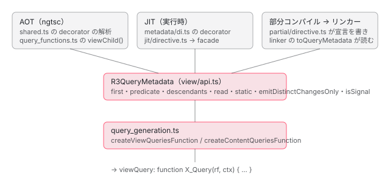

[目次](../README.md) › [クエリ（viewChild・contentChildren）の内側](README.md) › 第 2 回 / 全 7 回

# コンパイラの側：query\_generation と QueryFlags、ngtsc と JIT と部分コンパイル

> compiler の query\_generation.ts が R3QueryMetadata から viewQuery / contentQueries 関数を組み立てる行。toQueryFlags（descendants・isStatic・emitDistinctChangesOnly の 3 ビット。isSignal はフラグではなく命令の名前で分ける）、述語の定数化とカンマの分割、read の引数、signal を先にまとめる作成の段と ɵɵqueryAdvance をまとめる collapseAdvanceStatements。ngtsc が @ViewChild と viewChild() をメタデータにして signal → 単数 → 複数の順に並べる行、JIT（metadata/di.ts と jit/directive.ts）と部分コンパイル + リンカーが同じ関数に合流すること、単数のクエリだけ AOT と JIT でフラグが 4 違うこと。

angular/angular · 読了 約 13 分 · 中核 · [サイトで読む（デモが動きます）](https://angular-deep-dive-cyan.vercel.app/chapter/qry-compile)

---

この章では、[第 1 回](01-qry-what-declared.md)で見た `viewQuery` / `contentQueries` の関数を、**コンパイラのどの関数が、どの値から組み立てるのか**を読みます。入口は 3 つあります。AOT の ngtsc、実行時に decorator を読む JIT、ライブラリ向けの部分コンパイル（とそれを仕上げるリンカー）です。3 つとも、クエリ 1 つを `R3QueryMetadata` という同じ形にしてから、同じ `query_generation.ts` に渡します。違いが出るのは「既定値をどこで決めるか」と「並べる順」です。

読むファイルは、組み立てる側の `packages/compiler/src/render3/view/query_generation.ts`（全部）、フラグの定義 `packages/core/src/render3/interfaces/query.ts`、ngtsc の `packages/compiler-cli/src/ngtsc/annotations/directive/src/shared.ts`・`query_functions.ts`、JIT の `packages/core/src/render3/jit/directive.ts`・`packages/core/src/metadata/di.ts`・`packages/compiler/src/jit_compiler_facade.ts`、部分コンパイルの `packages/compiler/src/render3/partial/directive.ts` とリンカーの `partial_directive_linker_1.ts` です。デコレーターの解析全体は [ngtsc-directive-handler](../ngtsc/09-ngtsc-directive-handler.md)、初期化子の関数（`input()` など）の見つけ方は [signals-input-compile](../signals/12-signals-input-compile.md) が読んでいます。

1. [1. 1 行の viewChild が生むもの](01-qry-what-declared.md)
2. **2. コンパイラの側**（この章）
3. [3. TQuery の照合](03-qry-tquery-match.md)
4. [4. LQuery と結果の集め方](04-qry-lquery-results.md)
5. [5. 更新の時機](05-qry-refresh-timing.md)
6. [6. コンテンツのクエリ](06-qry-content-projection.md)
7. [7. spec と issue](07-qry-tests-issues.md)



*3 つの入口が R3QueryMetadata で合流し、同じ query\_generation.ts が関数を作る*

## 1. 記録：同じクラスを 3 つの入口にかける

オプションを変えたクエリを 9 つ書いたディレクティブを、このサイトの node\_modules の本物のコンパイラにかけました（@angular/compiler-cli 22.1.6 / TypeScript 6.0.3。記録のスクリプトは章の最後）。フル（ふつうの AOT）・部分コンパイル・部分コンパイルの出力をリンカーに通したもの・JIT（decorator を関数として呼ぶ）の 4 つです。

📄 `demo.ts（コンパイルしたもの）` L1–18 （▶ の行: 8–16）

```
 1 │ import {ContentChild, ContentChildren, Directive, ElementRef, ViewChild, ViewChildren, contentChildren, forwardRef, viewChild} from '@angular/core';
 2 │ 
 3 │ @Directive({selector: '[appItem]'})
 4 │ export class Item {}
 5 │ 
 6 │ @Directive({selector: '[appOpts]'})
 7 │ export class Opts {
 8 ▶   @ViewChildren('a, b') many: unknown;
 9 ▶   @ViewChild('a') one: unknown;
10 ▶   @ViewChild('a', {static: true}) oneStatic: unknown;
11 ▶   @ViewChildren(Item, {read: ElementRef, emitDistinctChangesOnly: false}) els: unknown;
12 ▶   sig = viewChild(forwardRef(() => Item));
13 ▶   @ContentChildren(Item) direct: unknown;
14 ▶   @ContentChildren(Item, {descendants: true}) deep: unknown;
15 ▶   @ContentChild('c') c: unknown;
16 ▶   sigContent = contentChildren(Item);
17 │ }
18 │ 
```

📄 `out/demo.js（フル。定数 3 行と Opts の ɵdir）` L1–23 （▶ の行: 1–3, 5–6, 8, 14–15, 17）

```
 1 ▶ const _c0 = ["c"];
 2 ▶ const _c1 = ["a"];
 3 ▶ const _c2 = ["a", "b"];
 4 │     static ɵdir = /*@__PURE__*/ i0.ɵɵdefineDirective({ type: Opts, selectors: [["", "appOpts", ""]], contentQueries: function Opts_ContentQueries(rf, ctx, dirIndex) { if (rf & 1) {
 5 ▶             i0.ɵɵcontentQuerySignal(dirIndex, ctx.sigContent, Item, 4);
 6 ▶             i0.ɵɵcontentQuery(dirIndex, _c0, 5)(dirIndex, Item, 4)(dirIndex, Item, 5);
 7 │         } if (rf & 2) {
 8 ▶             i0.ɵɵqueryAdvance();
 9 │             let _t;
10 │             i0.ɵɵqueryRefresh(_t = i0.ɵɵloadQuery()) && (ctx.c = _t.first);
11 │             i0.ɵɵqueryRefresh(_t = i0.ɵɵloadQuery()) && (ctx.direct = _t);
12 │             i0.ɵɵqueryRefresh(_t = i0.ɵɵloadQuery()) && (ctx.deep = _t);
13 │         } }, viewQuery: function Opts_Query(rf, ctx) { if (rf & 1) {
14 ▶             i0.ɵɵviewQuerySignal(ctx.sig, Item, 5);
15 ▶             i0.ɵɵviewQuery(_c1, 5)(_c1, 7)(_c2, 5)(Item, 1, ElementRef);
16 │         } if (rf & 2) {
17 ▶             i0.ɵɵqueryAdvance();
18 │             let _t;
19 │             i0.ɵɵqueryRefresh(_t = i0.ɵɵloadQuery()) && (ctx.one = _t.first);
20 │             i0.ɵɵqueryRefresh(_t = i0.ɵɵloadQuery()) && (ctx.oneStatic = _t.first);
21 │             i0.ɵɵqueryRefresh(_t = i0.ɵɵloadQuery()) && (ctx.many = _t);
22 │             i0.ɵɵqueryRefresh(_t = i0.ɵɵloadQuery()) && (ctx.els = _t);
23 │         } } });
```

この出力を、2〜4 節で 1 行ずつ「どの関数のどの行が書いたか」に戻します。先に目に付くことを 4 つ挙げます。

- **番号の順が書いた順と違う**。view の 15 行目は `one`・`oneStatic`・`many`・`els` の順で、ソースの 8 行目の `many` が 3 番目に下がり、signal の `sig`（14 行目）が先頭です（2 節）。
- **フラグが 1・4・5・7 と違う**。`@ViewChildren(Item, { read: ElementRef, emitDistinctChangesOnly: false })` は `1`、`@ContentChildren(Item)` は `4` です（3 節）。
- **`'a, b'` は定数 `_c2 = ["a", "b"]` に分かれ**、`'a'` の 2 つは同じ `_c1` を使い回します（3 節）。
- **`forwardRef(() => Item)` は消えて `Item` だけ**が 14 行目に残ります（2 節・3 節）。

## 2. ngtsc：decorator と viewChild() を R3QueryMetadata にする

### decorator の場合

📄 `angular/packages/compiler-cli/src/ngtsc/annotations/directive/src/shared.ts` L506–545 （▶ の行: 506–507, 510, 517, 519, 521, 523–524, 534–535）

```ts
506 ▶   const first = name === 'ViewChild' || name === 'ContentChild';
507 ▶   const forwardReferenceTarget = tryUnwrapForwardRef(args[0], reflector);
508 │   const node = forwardReferenceTarget ?? args[0];
509 │ 
510 ▶   const arg = evaluator.evaluate(node);
511 │ 
512 │   /** Whether or not this query should collect only static results (see view/api.ts)  */
513 │   let isStatic: boolean = false;
514 │ 
515 │   // Extract the predicate
516 │   let predicate: MaybeForwardRefExpression | string[] | null = null;
517 ▶   if (arg instanceof Reference || arg instanceof DynamicValue) {
518 │     // References and predicates that could not be evaluated statically are emitted as is.
519 ▶     predicate = createMayBeForwardRefExpression(
520 │       new WrappedNodeExpr(node),
521 ▶       forwardReferenceTarget !== null ? ForwardRefHandling.Unwrapped : ForwardRefHandling.None,
522 │     );
523 ▶   } else if (typeof arg === 'string') {
524 ▶     predicate = [arg];
525 │   } else if (isStringArrayOrDie(arg, `@${name} predicate`, node)) {
526 │     predicate = arg;
527 │   } else {
528 │     throw createValueHasWrongTypeError(node, arg, `@${name} predicate cannot be interpreted`);
529 │   }
530 │ 
531 │   // Extract the read and descendants options.
532 │   let read: Expression | null = null;
533 │   // The default value for descendants is true for every decorator except @ContentChildren.
534 ▶   let descendants: boolean = name !== 'ContentChildren';
535 ▶   let emitDistinctChangesOnly: boolean = emitDistinctChangesOnlyDefaultValue;
536 │   if (args.length === 2) {
537 │     const optionsExpr = unwrapExpression(args[1]);
538 │     if (!ts.isObjectLiteralExpression(optionsExpr)) {
539 │       throw new FatalDiagnosticError(
540 │         ErrorCode.DECORATOR_ARG_NOT_LITERAL,
541 │         optionsExpr,
542 │         `@${name} options must be an object literal`,
543 │       );
544 │     }
545 │     const options = reflectObjectLiteral(optionsExpr);
```

1. **506 行目：`first`**

   名前が `ViewChild` か `ContentChild` なら true。更新の段で `_t.first` を入れるか `_t` を入れるかがこれで決まります（1 節の 19〜22 行目）。
2. **507・510 行目：述語を静的に評価する**

   `forwardRef(() => X)` なら中身を取り出してから（507 行目）、`evaluator.evaluate`（動かさずに値を読む部品。[ngtsc-partial-evaluator](../ngtsc/05-ngtsc-partial-evaluator.md)）にかけます。
3. **517〜522 行目：クラスへの参照なら式のまま**

   評価の結果がクラス（`Reference`）なら、ソースの式を包んで残します。forwardRef を外したときは `Unwrapped`、そうでなければ `None` の印が付きます（521 行目）。この印が 3 節の `getQueryPredicate` で効きます。
4. **523〜524 行目：文字列なら 1 要素の配列**

   `'a, b'` は `['a, b']` のままで、ここではカンマで分けません。
5. **534・535 行目：既定値**

   `descendants` は `ContentChildren` のときだけ false、`emitDistinctChangesOnly` は `emitDistinctChangesOnlyDefaultValue`（true）です。2 つ目の引数のオブジェクトにキーがあれば上書きします。

📄 `angular/packages/compiler-cli/src/ngtsc/annotations/directive/src/shared.ts` L576–605 （▶ の行: 576, 585, 597, 603）

```ts
576 ▶     if (options.has('static')) {
577 │       const staticValue = evaluator.evaluate(options.get('static')!);
578 │       if (typeof staticValue !== 'boolean') {
579 │         throw createValueHasWrongTypeError(
580 │           node,
581 │           staticValue,
582 │           `@${name} options.static must be a boolean`,
583 │         );
584 │       }
585 ▶       isStatic = staticValue;
586 │     }
587 │   } else if (args.length > 2) {
588 │     // Too many arguments.
589 │     throw new FatalDiagnosticError(
590 │       ErrorCode.DECORATOR_ARITY_WRONG,
591 │       node,
592 │       `@${name} has too many arguments`,
593 │     );
594 │   }
595 │ 
596 │   return {
597 ▶     isSignal: false,
598 │     propertyName,
599 │     predicate,
600 │     first,
601 │     descendants,
602 │     read,
603 ▶     static: isStatic,
604 │     emitDistinctChangesOnly,
605 │   };
```

576〜586 行目が `static` で、真偽値でなければエラーです。596〜605 行目がこの関数の答えで、597 行目の `isSignal: false` が decorator のクエリの印です。

### viewChild() の場合

📄 `angular/packages/compiler-cli/src/ngtsc/annotations/directive/src/query_functions.ts` L59–69 （▶ の行: 60）

```ts
59 │ // The `descendants` option is enabled by default, except for content children.
60 ▶ const defaultDescendantsValue = (type: QueryFunctionName) => type !== 'contentChildren';
61 │ 
62 │ /**
63 │  * Attempts to detect a possible query definition for the given class member.
64 │  *
65 │  * This function checks for all possible variants of queries and matches the
66 │  * first one. The query is then analyzed and its resolved metadata is returned.
67 │  *
68 │  * @returns Resolved query metadata, or null if no query is declared.
69 │  */
```

📄 `angular/packages/compiler-cli/src/ngtsc/annotations/directive/src/query_functions.ts` L91–130 （▶ の行: 92, 103, 111–112, 114, 120, 122–124）

```ts
 91 │   const {functionName} = query.api;
 92 ▶   const isSingleQuery = functionName === 'viewChild' || functionName === 'contentChild';
 93 │   const predicateNode = query.call.arguments[0] as ts.Expression | undefined;
 94 │   if (predicateNode === undefined) {
 95 │     throw new FatalDiagnosticError(
 96 │       ErrorCode.VALUE_HAS_WRONG_TYPE,
 97 │       query.call,
 98 │       'No locator specified.',
 99 │     );
100 │   }
101 │ 
102 │   const optionsNode = query.call.arguments[1] as ts.Expression | undefined;
103 ▶   if (optionsNode !== undefined && !ts.isObjectLiteralExpression(optionsNode)) {
104 │     throw new FatalDiagnosticError(
105 │       ErrorCode.VALUE_HAS_WRONG_TYPE,
106 │       optionsNode,
107 │       'Argument needs to be an object literal.',
108 │     );
109 │   }
110 │   const options = optionsNode && reflectObjectLiteral(optionsNode);
111 ▶   const read = options?.has('read') ? parseReadOption(options.get('read')!) : null;
112 ▶   const descendants = options?.has('descendants')
113 │     ? parseDescendantsOption(options.get('descendants')!)
114 ▶     : defaultDescendantsValue(functionName);
115 │ 
116 │   return {
117 │     name: functionName,
118 │     call: query.call,
119 │     metadata: {
120 ▶       isSignal: true,
121 │       propertyName: member.name,
122 ▶       static: false,
123 ▶       emitDistinctChangesOnly: true,
124 ▶       predicate: parseLocator(predicateNode, reflector),
125 │       first: isSingleQuery,
126 │       read,
127 │       descendants,
128 │     },
129 │   };
130 │ }
```

初期化子の `viewChild(…)` の呼び出しを見つける `tryParseInitializerApi` は [signals-input-compile](../signals/12-signals-input-compile.md) で読みました。見つけたあとがこの範囲です。103 行目で、2 つ目の引数は**オブジェクトの字面**でなければエラーです（decorator と違い、評価しません）。読むキーは `read`（111 行目）と `descendants`（112 行目）の 2 つだけで、`descendants` の既定は 60 行目の `defaultDescendantsValue`、`contentChildren` のときだけ false です（114 行目）。答えの 120〜128 行目では `isSignal: true`、**`static: false` と `emitDistinctChangesOnly: true` が決め打ち**です（122・123 行目）。signal のクエリは static にできず、フラグは必ず 4 のビットを持ちます。124 行目の `parseLocator` は、文字列なら `[text]`、forwardRef なら外して `Unwrapped` にします（同じファイルの `parseLocator`）。

### 並べる順

📄 `angular/packages/compiler-cli/src/ngtsc/annotations/directive/src/shared.ts` L1815–1825 （▶ の行: 1815–1816, 1818–1819）

```ts
1815 ▶   // For backwards compatibility, decorator-based queries are grouped and
1816 ▶   // ordered in a specific way. The order needs to match with what we had in:
1817 │   // https://github.com/angular/angular/blob/8737544d6963bf664f752de273e919575cca08ac/packages/compiler-cli/src/ngtsc/annotations/directive/src/shared.ts#L94-L111.
1818 ▶   const decoratorViewChild: R3QueryMetadata[] = [];
1819 ▶   const decoratorViewChildren: R3QueryMetadata[] = [];
1820 │   const decoratorContentChild: R3QueryMetadata[] = [];
1821 │   const decoratorContentChildren: R3QueryMetadata[] = [];
1822 │ 
1823 │   for (const member of members) {
1824 │     const decoratorQuery = tryGetQueryFromFieldDecorator(member, reflector, evaluator, isCore);
1825 │     const signalQuery = tryParseSignalQueryFromInitializer(member, reflector, importTracker);
```

📄 `angular/packages/compiler-cli/src/ngtsc/annotations/directive/src/shared.ts` L1844–1877 （▶ の行: 1846–1847, 1849–1850, 1863, 1874–1875）

```ts
1844 │     if (decoratorQuery !== null) {
1845 │       switch (decoratorQuery.name) {
1846 ▶         case 'ViewChild':
1847 ▶           decoratorViewChild.push(decoratorQuery.metadata);
1848 │           break;
1849 ▶         case 'ViewChildren':
1850 ▶           decoratorViewChildren.push(decoratorQuery.metadata);
1851 │           break;
1852 │         case 'ContentChild':
1853 │           decoratorContentChild.push(decoratorQuery.metadata);
1854 │           break;
1855 │         case 'ContentChildren':
1856 │           decoratorContentChildren.push(decoratorQuery.metadata);
1857 │           break;
1858 │       }
1859 │     } else if (signalQuery !== null) {
1860 │       switch (signalQuery.name) {
1861 │         case 'viewChild':
1862 │         case 'viewChildren':
1863 ▶           viewQueries.push(signalQuery.metadata);
1864 │           break;
1865 │         case 'contentChild':
1866 │         case 'contentChildren':
1867 │           contentQueries.push(signalQuery.metadata);
1868 │           break;
1869 │       }
1870 │     }
1871 │   }
1872 │ 
1873 │   return {
1874 ▶     viewQueries: [...viewQueries, ...decoratorViewChild, ...decoratorViewChildren],
1875 ▶     contentQueries: [...contentQueries, ...decoratorContentChild, ...decoratorContentChildren],
1876 │   };
1877 │ }
```

クラスのメンバーを上から見ながら、decorator のクエリは種類ごとの 4 つの配列に（1846〜1857 行目）、signal のクエリは `viewQueries` / `contentQueries` に直接（1859〜1869 行目）入れます。最後の 1874 行目で **signal → `@ViewChild` → `@ViewChildren`** の順につなぎます。1815〜1817 行目のコメントのとおり、decorator の側の「単数が先」は昔の出力との互換のためです。1 節で `many`（`@ViewChildren`）が 3 番目に下がったのはこの行です。

> [!WARNING]
> **ハマりどころ**
>
> 「signal が先」は好みではなく、**3 節の query\_generation.ts が前提にしている順**です。作成の段は signal の命令を先にまとめて出し、更新の段は渡された配列の順に並べるので、配列の中で decorator が signal より前にあると、更新の段の `ɵɵqueryRefresh` が別のクエリの番号を読みます（3 節の最後）。ngtsc はこの行で、JIT は 4 節の `extractQueriesMetadata` で、この順を守っています。

## 3. query\_generation.ts：関数を組み立てる

### フラグ

📄 `angular/packages/compiler/src/render3/view/query_generation.ts` L23–33 （▶ の行: 26, 28）

```ts
23 │ /**
24 │  * A set of flags to be used with Queries.
25 │  *
26 ▶  * NOTE: Ensure changes here are in sync with `packages/core/src/render3/interfaces/query.ts`
27 │  */
28 ▶ export const enum QueryFlags {
29 │   /**
30 │    * No flags
31 │    */
32 │   none = 0b0000,
33 │ 
```

📄 `angular/packages/core/src/render3/interfaces/query.ts` L24–53 （▶ の行: 27, 29, 38, 45, 52）

```ts
24 │ /**
25 │  * A set of flags to be used with Queries.
26 │  *
27 ▶  * NOTE: Ensure changes here are reflected in `packages/compiler/src/render3/view/compiler.ts`
28 │  */
29 ▶ export const enum QueryFlags {
30 │   /**
31 │    * No flags
32 │    */
33 │   none = 0b0000,
34 │ 
35 │   /**
36 │    * Whether or not the query should descend into children.
37 │    */
38 ▶   descendants = 0b0001,
39 │ 
40 │   /**
41 │    * The query can be computed statically and hence can be assigned eagerly.
42 │    *
43 │    * NOTE: Backwards compatibility with ViewEngine.
44 │    */
45 ▶   isStatic = 0b0010,
46 │ 
47 │   /**
48 │    * If the `QueryList` should fire change event only if actual change to query was computed (vs old
49 │    * behavior where the change was fired whenever the query was recomputed, even if the recomputed
50 │    * query resulted in the same list.)
51 │    */
52 ▶   emitDistinctChangesOnly = 0b0100,
53 │ }
```

📄 `angular/packages/compiler/src/render3/view/query_generation.ts` L54–65 （▶ の行: 61–63）

```ts
54 │ /**
55 │  * Translates query flags into `TQueryFlags` type in
56 │  * packages/core/src/render3/interfaces/query.ts
57 │  * @param query
58 │  */
59 │ function toQueryFlags(query: R3QueryMetadata): number {
60 │   return (
61 ▶     (query.descendants ? QueryFlags.descendants : QueryFlags.none) |
62 ▶     (query.static ? QueryFlags.isStatic : QueryFlags.none) |
63 ▶     (query.emitDistinctChangesOnly ? QueryFlags.emitDistinctChangesOnly : QueryFlags.none)
64 │   );
65 │ }
```

同じ `QueryFlags` が、compiler（query\_generation.ts 28 行目）と core（interfaces/query.ts 29 行目）に 2 回書かれています。出力には数しか残らないので、両方の値が同じでないと実行時に意味が変わります。それを人に守らせるのが、query\_generation.ts 26 行目と interfaces/query.ts 27 行目の NOTE です。ただし core の側の NOTE は `packages/compiler/src/render3/view/compiler.ts` を指していて、今の定義は compiler.ts ではなく query\_generation.ts にあります（compiler.ts は `createViewQueriesFunction` を import して呼ぶだけ）。`toQueryFlags`（59〜65 行目）は、61〜63 行目で 3 つの真偽値をビットにして足すだけです。**`isSignal` はフラグに入りません**。signal かどうかは、命令の名前（`ɵɵviewQuerySignal`）で分けます。

### 述語と引数

📄 `angular/packages/compiler/src/render3/view/query_generation.ts` L67–88 （▶ の行: 68, 74, 77, 81–85）

```ts
67 │ function getQueryPredicate(query: R3QueryMetadata, constantPool: ConstantPool): o.Expression {
68 ▶   if (Array.isArray(query.predicate)) {
69 │     let predicate: o.Expression[] = [];
70 │     query.predicate.forEach((selector: string): void => {
71 │       // Each item in predicates array may contain strings with comma-separated refs
72 │       // (for ex. 'ref, ref1, ..., refN'), thus we extract individual refs and store them
73 │       // as separate array entities
74 ▶       const selectors = selector.split(',').map((token) => o.literal(token.trim()));
75 │       predicate.push(...selectors);
76 │     });
77 ▶     return constantPool.getConstLiteral(o.literalArr(predicate), true);
78 │   } else {
79 │     // The original predicate may have been wrapped in a `forwardRef()` call.
80 │     switch (query.predicate.forwardRef) {
81 ▶       case ForwardRefHandling.None:
82 ▶       case ForwardRefHandling.Unwrapped:
83 ▶         return query.predicate.expression;
84 ▶       case ForwardRefHandling.Wrapped:
85 ▶         return o.importExpr(R3.resolveForwardRef).callFn([query.predicate.expression]);
86 │     }
87 │   }
88 │ }
```

文字列の述語は 74 行目で**ここで初めてカンマで分け**、`trim` します。77 行目の `getConstLiteral(…, true)` の `true` は「1 回しか使わなくても定数にする」で、同じ中身の配列は同じ定数を指します（1 節の `_c1` が 2 回使われる。定数の扱いは [compiler-consts-pure](../compiler/14-compiler-consts-pure.md)）。型の述語は 2 節の印で分かれます。`None` と `Unwrapped` は式をそのまま（83 行目）、`Wrapped` だけ `ɵɵresolveForwardRef(式)` で包みます（85 行目）。ngtsc は `Wrapped` を作らないので、AOT の出力に `resolveForwardRef` は出ません。

📄 `angular/packages/compiler/src/render3/view/query_generation.ts` L90–107 （▶ の行: 96–97, 99–100, 102–104）

```ts
 90 │ function getQueryCreateParameters(
 91 │   query: R3QueryMetadata,
 92 │   constantPool: ConstantPool,
 93 │   prependParams?: o.Expression[],
 94 │ ): o.Expression[] {
 95 │   const parameters: o.Expression[] = [];
 96 ▶   if (prependParams !== undefined) {
 97 ▶     parameters.push(...prependParams);
 98 │   }
 99 ▶   if (query.isSignal) {
100 ▶     parameters.push(new o.ReadPropExpr(o.variable(CONTEXT_NAME), query.propertyName));
101 │   }
102 ▶   parameters.push(getQueryPredicate(query, constantPool), o.literal(toQueryFlags(query)));
103 ▶   if (query.read) {
104 ▶     parameters.push(query.read);
105 │   }
106 │   return parameters;
107 │ }
```

命令の引数の並びはこの関数が決めます。コンテンツのクエリは先頭に `dirIndex`（96〜98 行目）、signal なら次に `ctx.プロパティ`（99〜101 行目）、続いて述語とフラグ（102 行目）、`read` があれば最後に足します（103〜105 行目）。`read` が無いときは引数自体を出しません。

### ビューのクエリの関数

📄 `angular/packages/compiler/src/render3/view/query_generation.ts` L165–205 （▶ の行: 173–175, 180, 182–184, 187, 191–193, 197, 199, 203–204）

```ts
165 │ // Define and update any view queries
166 │ export function createViewQueriesFunction(
167 │   viewQueries: R3QueryMetadata[],
168 │   constantPool: ConstantPool,
169 │   name?: string,
170 │ ): o.Expression {
171 │   const createStatements: o.Statement[] = [];
172 │   const updateStatements: (o.Statement | typeof queryAdvancePlaceholder)[] = [];
173 ▶   const tempAllocator = temporaryAllocator((st) => updateStatements.push(st), TEMPORARY_NAME);
174 ▶   let viewQuerySignalCall: o.Expression | null = null;
175 ▶   let viewQueryCall: o.Expression | null = null;
176 │ 
177 │   viewQueries.forEach((query: R3QueryMetadata) => {
178 │     // creation call, e.g. r3.viewQuery(somePredicate, true) or
179 │     //                r3.viewQuerySignal(ctx.prop, somePredicate, true);
180 ▶     const params = getQueryCreateParameters(query, constantPool);
181 │ 
182 ▶     if (query.isSignal) {
183 ▶       viewQuerySignalCall ??= o.importExpr(R3.viewQuerySignal);
184 ▶       viewQuerySignalCall = viewQuerySignalCall.callFn(params);
185 │     } else {
186 │       viewQueryCall ??= o.importExpr(R3.viewQuery);
187 ▶       viewQueryCall = viewQueryCall.callFn(params);
188 │     }
189 │ 
190 │     // Signal queries update lazily and we just advance the index.
191 ▶     if (query.isSignal) {
192 ▶       updateStatements.push(queryAdvancePlaceholder);
193 ▶       return;
194 │     }
195 │ 
196 │     // update, e.g. (r3.queryRefresh(tmp = r3.loadQuery()) && (ctx.someDir = tmp));
197 ▶     const temporary = tempAllocator();
198 │     const getQueryList = o.importExpr(R3.loadQuery).callFn([]);
199 ▶     const refresh = o.importExpr(R3.queryRefresh).callFn([temporary.set(getQueryList)]);
200 │     const updateDirective = o
201 │       .variable(CONTEXT_NAME)
202 │       .prop(query.propertyName)
203 ▶       .set(query.first ? temporary.prop('first') : temporary);
204 ▶     updateStatements.push(refresh.and(updateDirective).toStmt());
205 │   });
```

1. **182〜188 行目：作成の命令を「つなげて」いく**

   signal と decorator で別の変数に、`callFn` を重ねます。1 つ目で `importExpr(R3.viewQuerySignal)` を作り、2 つ目からはその呼び出しの結果をさらに呼ぶので、`ɵɵviewQuery(a)(b)(c)` の形になります（第 1 回の 2 節の「自分を返す」命令とこれが対になっています）。
2. **191〜194 行目：signal は更新の段に印を置くだけ**

   `queryAdvancePlaceholder`（同じファイルで作った Symbol）を積んで、次のクエリへ進みます。
3. **197〜204 行目：decorator は `queryRefresh(tmp = loadQuery()) && (ctx.prop = tmp)`**

   一時変数 `_t` は 173 行目の `temporaryAllocator` が 1 つだけ宣言します。203 行目で `first` なら `tmp.first`、そうでなければ `tmp` です。

📄 `angular/packages/compiler/src/render3/view/query_generation.ts` L207–226 （▶ の行: 207–208, 211–212, 215, 219–220）

```ts
207 ▶   if (viewQuerySignalCall !== null) {
208 ▶     createStatements.push(new o.ExpressionStatement(viewQuerySignalCall));
209 │   }
210 │ 
211 ▶   if (viewQueryCall !== null) {
212 ▶     createStatements.push(new o.ExpressionStatement(viewQueryCall));
213 │   }
214 │ 
215 ▶   const viewQueryFnName = name ? `${name}_Query` : null;
216 │   return o.fn(
217 │     [new o.FnParam(RENDER_FLAGS, o.NUMBER_TYPE), new o.FnParam(CONTEXT_NAME, o.DYNAMIC_TYPE)],
218 │     [
219 ▶       renderFlagCheckIfStmt(core.RenderFlags.Create, createStatements),
220 ▶       renderFlagCheckIfStmt(core.RenderFlags.Update, collapseAdvanceStatements(updateStatements)),
221 │     ],
222 │     o.INFERRED_TYPE,
223 │     null,
224 │     viewQueryFnName,
225 │   );
226 │ }
```

207〜213 行目で、作成の段の文を **signal の連なり → decorator の連なり**の順に 2 文だけ置きます。215 行目の関数名 `Opts_Query`、219〜220 行目の `if (rf & 1)` / `if (rf & 2)` です。ここで作成の段の順が「配列の順」ではなく「signal が先」に決まるので、2 節の並べる順が欠かせません。

📄 `angular/packages/compiler/src/render3/view/query_generation.ts` L134–163 （▶ の行: 141, 144, 152, 154–155, 157）

```ts
134 │ function collapseAdvanceStatements(
135 │   statements: (o.Statement | typeof queryAdvancePlaceholder)[],
136 │ ): o.Statement[] {
137 │   const result: o.Statement[] = [];
138 │   let advanceCollapseCount = 0;
139 │   const flushAdvanceCount = () => {
140 │     if (advanceCollapseCount > 0) {
141 ▶       result.unshift(
142 │         o
143 │           .importExpr(R3.queryAdvance)
144 ▶           .callFn(advanceCollapseCount === 1 ? [] : [o.literal(advanceCollapseCount)])
145 │           .toStmt(),
146 │       );
147 │       advanceCollapseCount = 0;
148 │     }
149 │   };
150 │ 
151 │   // Iterate through statements in reverse and collapse advance placeholders.
152 ▶   for (let i = statements.length - 1; i >= 0; i--) {
153 │     const st = statements[i];
154 ▶     if (st === queryAdvancePlaceholder) {
155 ▶       advanceCollapseCount++;
156 │     } else {
157 ▶       flushAdvanceCount();
158 │       result.unshift(st);
159 │     }
160 │   }
161 │   flushAdvanceCount();
162 │   return result;
163 │ }
```

更新の段の文の並びを**後ろから**見て（152 行目）、印が続くあいだは数え（155 行目）、ふつうの文が来たら数えた分を 1 つの `ɵɵqueryAdvance(n)` にして前に足します（141〜145 行目）。1 つだけなら引数なし（144 行目）です。第 1 回の 2 つの signal が `ɵɵqueryAdvance(2)` になったのはこの関数です。

> [!NOTE]
> **さらに深く**
>
> 配列の順が `[@ViewChild('a') a, viewChild('b') b]` のままこの関数に来たとすると、作成の段は 207〜213 行目で b → a の順（b が番号 0、a が番号 1）、更新の段は配列の順で `ɵɵqueryRefresh(…) && (ctx.a = _t.first)` → `ɵɵqueryAdvance()` になり、a の `ɵɵqueryRefresh` は番号 0（b のクエリ）を読みます。これが 2 節の並べる順が守っているものです。ngtsc と JIT はどちらも並べ直してから渡すので、ふつうのコードでこの形は出ません。

### コンテンツのクエリの関数

📄 `angular/packages/compiler/src/render3/view/query_generation.ts` L240–257 （▶ の行: 243, 245–247, 254–255）

```ts
240 │   for (const query of queries) {
241 │     // creation, e.g. r3.contentQuery(dirIndex, somePredicate, true, null) or
242 │     //                r3.contentQuerySignal(dirIndex, propName, somePredicate, <flags>, <read>).
243 ▶     const params = getQueryCreateParameters(query, constantPool, [o.variable('dirIndex')]);
244 │ 
245 ▶     if (query.isSignal) {
246 ▶       contentQuerySignalCall ??= o.importExpr(R3.contentQuerySignal);
247 ▶       contentQuerySignalCall = contentQuerySignalCall.callFn(params);
248 │     } else {
249 │       contentQueryCall ??= o.importExpr(R3.contentQuery);
250 │       contentQueryCall = contentQueryCall.callFn(params);
251 │     }
252 │ 
253 │     // Signal queries update lazily and we just advance the index.
254 ▶     if (query.isSignal) {
255 ▶       updateStatements.push(queryAdvancePlaceholder);
256 │       continue;
257 │     }
```

`createContentQueriesFunction` は `createViewQueriesFunction` と同じ作りで、違いは 243 行目で `dirIndex` を先頭に足すことと、関数の引数が 3 つ（`rf, ctx, dirIndex`）なことだけです。`dirIndex` がどこから来るかは [第 6 回](06-qry-content-projection.md)で読みます。

## 4. JIT：実行時に decorator から同じ形を作る

JIT（実行時に decorator を動かしてコンパイルする道。[standalone-decorator](../standalone/02-standalone-decorator.md)）では、ngtsc の代わりに core が decorator の値を読みます。decorator の既定値は ngtsc とは別の場所、`metadata/di.ts` にあります。

📄 `angular/packages/core/src/metadata/di.ts` L396–407 （▶ の行: 402–404）

```ts
396 │ export const ViewChildren: ViewChildrenDecorator = makePropDecorator(
397 │   'ViewChildren',
398 │   (selector?: any, opts: any = {}) => ({
399 │     selector,
400 │     first: false,
401 │     isViewQuery: true,
402 ▶     descendants: true,
403 ▶     emitDistinctChangesOnly: emitDistinctChangesOnlyDefaultValue,
404 ▶     ...opts,
405 │   }),
406 │   Query,
407 │ );
```

📄 `angular/packages/core/src/metadata/di.ts` L494–504 （▶ の行: 498, 500–501）

```ts
494 │ export const ViewChild: ViewChildDecorator = makePropDecorator(
495 │   'ViewChild',
496 │   (selector: any, opts: any) => ({
497 │     selector,
498 ▶     first: true,
499 │     isViewQuery: true,
500 ▶     descendants: true,
501 ▶     ...opts,
502 │   }),
503 │   Query,
504 │ );
```

`@ViewChildren` は 403 行目で `emitDistinctChangesOnly` の既定を入れますが、`@ViewChild`（494〜504 行目）には **その行がありません**。同じファイルの `@ContentChild` の定義も同じ形です。

📄 `angular/packages/core/src/render3/jit/directive.ts` L436–451 （▶ の行: 437, 443, 447–449）

```ts
436 │ function convertToR3QueryPredicate(selector: any): any | string[] {
437 ▶   return typeof selector === 'string' ? splitByComma(selector) : resolveForwardRef(selector);
438 │ }
439 │ 
440 │ export function convertToR3QueryMetadata(propertyName: string, ann: Query): R3QueryMetadataFacade {
441 │   return {
442 │     propertyName: propertyName,
443 ▶     predicate: convertToR3QueryPredicate(ann.selector),
444 │     descendants: ann.descendants,
445 │     first: ann.first,
446 │     read: ann.read ? ann.read : null,
447 ▶     static: !!ann.static,
448 ▶     emitDistinctChangesOnly: !!ann.emitDistinctChangesOnly,
449 ▶     isSignal: !!ann.isSignal,
450 │   };
451 │ }
```

437 行目で、文字列は `splitByComma` で**ここで**分けます（ngtsc は 3 節の 74 行目で分けるので、分ける場所が違います。結果は同じです）。型は `resolveForwardRef` で中身にします。448 行目の `!!ann.emitDistinctChangesOnly` は、`@ViewChild` では `undefined` なので **false** です。ngtsc は true（2 節の 535 行目）なので、単数のクエリのフラグだけ AOT と JIT で 4 違います。449 行目の `isSignal` は、ngtsc が JIT のために書き出す `{ type: ViewChild, args: ['box', { isSignal: true }] }`（第 1 回の記録の setClassMetadata）から来ます。

📄 `angular/packages/core/src/render3/jit/directive.ts` L452–486 （▶ の行: 459, 474–475, 477, 484–485）

```ts
452 │ function extractQueriesMetadata(
453 │   type: Type<any>,
454 │   propMetadata: {[key: string]: any[]},
455 │   isQueryAnn: (ann: any) => ann is Query,
456 │ ): R3QueryMetadataFacade[] {
457 │   const signalQueriesMeta: R3QueryMetadataFacade[] = [];
458 │   const decoratorQueriesMeta: R3QueryMetadataFacade[] = [];
459 ▶   for (const field in propMetadata) {
460 │     if (Object.hasOwn(propMetadata, field)) {
461 │       const annotations = propMetadata[field];
462 │       annotations.forEach((ann) => {
463 │         if (isQueryAnn(ann)) {
464 │           if (!ann.selector) {
465 │             throw new Error(
466 │               `Can't construct a query for the property "${field}" of ` +
467 │                 `"${stringifyForError(type)}" since the query selector wasn't defined.`,
468 │             );
469 │           }
470 │           if (annotations.some(isInputAnnotation)) {
471 │             throw new Error(`Cannot combine @Input decorators with query decorators`);
472 │           }
473 │           const queryMeta = convertToR3QueryMetadata(field, ann);
474 ▶           if (queryMeta.isSignal) {
475 ▶             signalQueriesMeta.push(queryMeta);
476 │           } else {
477 ▶             decoratorQueriesMeta.push(queryMeta);
478 │           }
479 │         }
480 │       });
481 │     }
482 │   }
483 │ 
484 ▶   // We match the behavior of AOT here by having signal queries first, then the decorator queries.
485 ▶   return [...signalQueriesMeta, ...decoratorQueriesMeta];
486 │ }
```

`propMetadata` のフィールドを並んでいる順に見て（459 行目）、signal と decorator の 2 つの配列に分け（474〜478 行目）、484〜485 行目で **signal が先**につなぎます。ngtsc と違い、`@ViewChild` と `@ViewChildren` の並べ替えはしません。この配列が facade（compiler の JIT の入口）に渡ります。

📄 `angular/packages/compiler/src/jit_compiler_facade.ts` L481–515 （▶ の行: 485–486, 497, 499, 502, 510, 512, 514）

```ts
481 │ function convertToR3QueryMetadata(facade: R3QueryMetadataFacade): R3QueryMetadata {
482 │   return {
483 │     ...facade,
484 │     isSignal: facade.isSignal,
485 ▶     predicate: convertQueryPredicate(facade.predicate),
486 ▶     read: facade.read ? new WrappedNodeExpr(facade.read) : null,
487 │     static: facade.static,
488 │     emitDistinctChangesOnly: facade.emitDistinctChangesOnly,
489 │   };
490 │ }
491 │ 
492 │ function convertQueryDeclarationToMetadata(
493 │   declaration: R3DeclareQueryMetadataFacade,
494 │ ): R3QueryMetadata {
495 │   return {
496 │     propertyName: declaration.propertyName,
497 ▶     first: declaration.first ?? false,
498 │     predicate: convertQueryPredicate(declaration.predicate),
499 ▶     descendants: declaration.descendants ?? false,
500 │     read: declaration.read ? new WrappedNodeExpr(declaration.read) : null,
501 │     static: declaration.static ?? false,
502 ▶     emitDistinctChangesOnly: declaration.emitDistinctChangesOnly ?? true,
503 │     isSignal: !!declaration.isSignal,
504 │   };
505 │ }
506 │ 
507 │ function convertQueryPredicate(
508 │   predicate: OpaqueValue | string[],
509 │ ): MaybeForwardRefExpression | string[] {
510 ▶   return Array.isArray(predicate)
511 │     ? // The predicate is an array of strings so pass it through.
512 ▶       predicate
513 │     : // The predicate is a type - assume that we will need to unwrap any `forwardRef()` calls.
514 ▶       createMayBeForwardRefExpression(new WrappedNodeExpr(predicate), ForwardRefHandling.Wrapped);
515 │ }
```

`convertToR3QueryMetadata`（481〜490 行目）は値を移すだけで、述語は 507〜515 行目の `convertQueryPredicate` を通ります。型の述語は **必ず `Wrapped`** です（514 行目）。だから JIT の出力では、forwardRef を書いていなくても `resolveForwardRef(Item)` で包まれます（3 節の 85 行目）。core が 437 行目ですでに中身にしているので、実行時には何もしない呼び出しです。

📄 `JIT の viewQuery と contentQueries（記録。ɵdir の関数を toString したもの）` L1–24 （▶ の行: 3–4, 7, 17）

```
 1 │ function Opts_Query(rf, ctx) {
 2 │   if (rf & 1) {
 3 ▶     jit___viewQuerySignal_7(ctx.sigOne,_c1,1);
 4 ▶     jit___viewQuery_8(_c2,5)(_c3,1)(_c3,3)(jit_resolveForwardRef_3(jit_Item_4),1,jit_ElementRef_9)(jit_resolveForwardRef_3(jit_Item_4),1);
 5 │   }
 6 │   if (rf & 2) {
 7 ▶     jit___queryAdvance_10();
 8 │     var _t;
 9 │     (jit___queryRefresh_5((_t = jit___loadQuery_6())) && (ctx.many = _t));
10 │     (jit___queryRefresh_5((_t = jit___loadQuery_6())) && (ctx.one = _t.first));
11 │     (jit___queryRefresh_5((_t = jit___loadQuery_6())) && (ctx.oneStatic = _t.first));
12 │     (jit___queryRefresh_5((_t = jit___loadQuery_6())) && (ctx.els = _t));
13 │     (jit___queryRefresh_5((_t = jit___loadQuery_6())) && (ctx.fwd = _t.first));
14 │   }
15 │ }
16 │ function Opts_ContentQueries(rf, ctx, dirIndex) {
17 ▶   if (rf & 1) { jit___contentQuery_2(dirIndex,jit_resolveForwardRef_3(jit_Item_4),4)(dirIndex,jit_resolveForwardRef_3(jit_Item_4),5)(dirIndex,_c0,1); }
18 │   if (rf & 2) {
19 │     var _t;
20 │     (jit___queryRefresh_5((_t = jit___loadQuery_6())) && (ctx.direct = _t));
21 │     (jit___queryRefresh_5((_t = jit___loadQuery_6())) && (ctx.deep = _t));
22 │     (jit___queryRefresh_5((_t = jit___loadQuery_6())) && (ctx.c = _t.first));
23 │   }
24 │ }
```

- 3 行目：JIT で `isSignal: true` の `@ViewChild('s')` は、フラグが `1`（AOT の viewChild は 5）。448 行目の結果です。
- 4 行目：`one` は `1`、`oneStatic` は `3`（AOT は 5 と 7）。並びは書いた順の `many`・`one`・`oneStatic`…で、AOT の「単数が先」になっていません。型の述語はすべて `jit_resolveForwardRef_3(jit_Item_4)`。
- 7 行目：signal の 1 つ分の `ɵɵqueryAdvance` は JIT でも出ます。作成と更新の順は、JIT の中では揃っています。
- 17 行目：コンテンツのクエリも書いた順（`direct`・`deep`・`c`）で、`@ContentChild('c')` は `1` です。

> [!NOTE]
> **ポイント**
>
> 単数のクエリ（`@ViewChild`・`@ContentChild`・JIT の viewChild）で 4 のビットが違っても、結果の値は変わりません。4 のビットが効くのは `QueryList` の `changes` の流し方で、単数のクエリはフィールドに `_t.first` を入れるだけで QueryList を見せないからです（QueryList の作り方は [第 4 回](04-qry-lquery-results.md)）。

## 5. 部分コンパイルとリンカー：宣言に書いて、読み戻す

ライブラリは `compilationMode: 'partial'` でコンパイルし、命令の代わりに**宣言**（`ɵɵngDeclareDirective({ … })`）を書きます。アプリのビルドでリンカーがそれを読み、フルの出力に仕上げます（[cli-linker](../cli/06-cli-linker.md)）。クエリ 1 つの宣言を書くのがこの関数です。

📄 `angular/packages/compiler/src/render3/partial/directive.ts` L174–204 （▶ の行: 177, 182–184, 186, 189, 193–194, 197, 200）

```ts
174 │ function compileQuery(query: R3QueryMetadata): o.LiteralMapExpr {
175 │   const meta = new DefinitionMap<R3DeclareQueryMetadata>();
176 │   meta.set('propertyName', o.literal(query.propertyName));
177 ▶   if (query.first) {
178 │     meta.set('first', o.literal(true));
179 │   }
180 │   meta.set(
181 │     'predicate',
182 ▶     Array.isArray(query.predicate)
183 ▶       ? asLiteral(query.predicate)
184 ▶       : convertFromMaybeForwardRefExpression(query.predicate),
185 │   );
186 ▶   if (!query.emitDistinctChangesOnly) {
187 │     // `emitDistinctChangesOnly` is special because we expect it to be `true`.
188 │     // Therefore we explicitly emit the field, and explicitly place it only when it's `false`.
189 ▶     meta.set('emitDistinctChangesOnly', o.literal(false));
190 │   } else {
191 │     // The linker will assume that an absent `emitDistinctChangesOnly` flag is by default `true`.
192 │   }
193 ▶   if (query.descendants) {
194 ▶     meta.set('descendants', o.literal(true));
195 │   }
196 │   meta.set('read', query.read);
197 ▶   if (query.static) {
198 │     meta.set('static', o.literal(true));
199 │   }
200 ▶   if (query.isSignal) {
201 │     meta.set('isSignal', o.literal(true));
202 │   }
203 │   return meta.toLiteralMap();
204 │ }
```

既定と違うときだけ書く作りです。`first` は true のときだけ（177 行目）、`emitDistinctChangesOnly` は **false のときだけ**（186〜192 行目）、`descendants` は true のときだけ（193 行目）、`static` と `isSignal` も true のときだけです。述語は文字列の配列ならそのまま（183 行目。カンマで分ける前の `['a, b']`）、型なら forwardRef の印に従って式に戻します（184 行目）。

📄 `out/demo.js（部分コンパイル。ɵɵngDeclareDirective の queries と viewQueries を 1 件 1 行に整形）` L1–14 （▶ の行: 3, 5, 9, 12–13）

```
 1 │ // minVersion: "17.2.0"
 2 │ queries: [
 3 ▶   { propertyName: "sigContent", predicate: Item, isSignal: true },
 4 │   { propertyName: "c", first: true, predicate: ["c"], descendants: true },
 5 ▶   { propertyName: "direct", predicate: Item },
 6 │   { propertyName: "deep", predicate: Item, descendants: true }
 7 │ ],
 8 │ viewQueries: [
 9 ▶   { propertyName: "sig", first: true, predicate: i0.forwardRef(() => Item), descendants: true, isSignal: true },
10 │   { propertyName: "one", first: true, predicate: ["a"], descendants: true },
11 │   { propertyName: "oneStatic", first: true, predicate: ["a"], descendants: true, static: true },
12 ▶   { propertyName: "many", predicate: ["a, b"], descendants: true },
13 ▶   { propertyName: "els", predicate: Item, emitDistinctChangesOnly: false, descendants: true, read: ElementRef }
14 │ ]
```

3 行目の signal の宣言には `descendants` がありません（contentChildren の既定 false）。9 行目は `Unwrapped` の述語が `i0.forwardRef(() => Item)` に戻されたものです。12 行目は `["a, b"]` のまま、13 行目だけに `emitDistinctChangesOnly: false` があります。1 行目の `minVersion: "17.2.0"` は、signal のクエリがあるとリンカーに求める版が上がるためです（同じファイルの `getMinimumVersionForPartialOutput`）。

📄 `angular/packages/compiler-cli/linker/src/file_linker/partial_linkers/partial_directive_linker_1.ts` L234–256 （▶ の行: 240, 242, 246, 248–251, 253–254）

```ts
234 │ function toQueryMetadata<TExpression>(
235 │   obj: AstObject<R3DeclareQueryMetadata, TExpression>,
236 │ ): R3QueryMetadata {
237 │   let predicate: R3QueryMetadata['predicate'];
238 │   const predicateExpr = obj.getValue('predicate');
239 │   if (predicateExpr.isArray()) {
240 ▶     predicate = predicateExpr.getArray().map((entry) => entry.getString());
241 │   } else {
242 ▶     predicate = extractForwardRef(predicateExpr);
243 │   }
244 │   return {
245 │     propertyName: obj.getString('propertyName'),
246 ▶     first: obj.has('first') ? obj.getBoolean('first') : false,
247 │     predicate,
248 ▶     descendants: obj.has('descendants') ? obj.getBoolean('descendants') : false,
249 ▶     emitDistinctChangesOnly: obj.has('emitDistinctChangesOnly')
250 ▶       ? obj.getBoolean('emitDistinctChangesOnly')
251 ▶       : true,
252 │     read: obj.has('read') ? obj.getOpaque('read') : null,
253 ▶     static: obj.has('static') ? obj.getBoolean('static') : false,
254 ▶     isSignal: obj.has('isSignal') ? obj.getBoolean('isSignal') : false,
255 │   };
256 │ }
```

リンカーは逆向きに読みます。無ければ `first` は false（246 行目）、`descendants` は false（248 行目）、`emitDistinctChangesOnly` は **true**（249〜251 行目）。書く側の「既定と違うときだけ」とちょうど対になっています。242 行目の `extractForwardRef` が `forwardRef(() => Item)` をまた外します。こうしてできた R3QueryMetadata を同じ query\_generation.ts に渡すので、リンクの結果はフルの出力と同じになります。

📄 `リンカーを通した結果（記録。viewQuery の部分）` L1–14 （▶ の行: 3–4, 7）

```
 1 │     viewQuery: function Opts_Query(rf, ctx) {
 2 │       if (rf & 1) {
 3 ▶         i0.ɵɵviewQuerySignal(ctx.sig, Item, 5);
 4 ▶         i0.ɵɵviewQuery(_c1, 5)(_c1, 7)(_c2, 5)(Item, 1, ElementRef);
 5 │       }
 6 │       if (rf & 2) {
 7 ▶         i0.ɵɵqueryAdvance();
 8 │         let _t;
 9 │         i0.ɵɵqueryRefresh(_t = i0.ɵɵloadQuery()) && (ctx.one = _t.first);
10 │         i0.ɵɵqueryRefresh(_t = i0.ɵɵloadQuery()) && (ctx.oneStatic = _t.first);
11 │         i0.ɵɵqueryRefresh(_t = i0.ɵɵloadQuery()) && (ctx.many = _t);
12 │         i0.ɵɵqueryRefresh(_t = i0.ɵɵloadQuery()) && (ctx.els = _t);
13 │       }
14 │     }
```

1 節のフルの出力の 13〜23 行目と、空白と改行を除いて同じです。JIT で宣言を読む道（`compileDirectiveDeclaration`）も、facade の 492〜505 行目で同じ既定値を入れます。

## 6. 呼び出しの連なり

- 👤 `@ViewChild('a') one`・`sig = viewChild(…)` — あなたのクラス
- `DirectiveDecoratorHandler.analyze` → `extractDirectiveMetadata` — ngtsc の shared.ts — *[ngtsc-directive-handler](../ngtsc/09-ngtsc-directive-handler.md)*
  - `parseQueriesOfClassFields` — shared.ts L1815-1877 — *signal → 単数 → 複数*
    - `tryGetQueryFromFieldDecorator` → `extractDecoratorQueryMetadata` — shared.ts L506-605
    - `tryParseSignalQueryFromInitializer` — query\_functions.ts L91-130
- `compileDirectiveFromMetadata` / `compileComponentFromMetadata` — render3/view/compiler.ts
  - `createViewQueriesFunction` / `createContentQueriesFunction` — query\_generation.ts L165-226・L240-257
    - `getQueryCreateParameters` → `getQueryPredicate`・`toQueryFlags` — query\_generation.ts L54-107
    - `collapseAdvanceStatements` — query\_generation.ts L134-163
- 👤 `JIT` — core
  - `ViewChild(…)` の decorator → `directiveMetadata` → `extractQueriesMetadata` — metadata/di.ts・jit/directive.ts L452-486
  - `CompilerFacadeImpl.compileDirective` → `convertToR3QueryMetadata` — jit\_compiler\_facade.ts L481-515 — *同じ createViewQueriesFunction へ*
- 👤 `部分コンパイル` — ライブラリ
  - `compileDeclareDirectiveFromMetadata` → `compileQuery` — partial/directive.ts L174-204
  - `PartialDirectiveLinkerVersion1` → `toQueryMetadata` — partial\_directive\_linker\_1.ts L234-256 — *同じ createViewQueriesFunction へ*

## 7. DEMO：オプションを切り替えて、フラグと出力を比べる

> **🧪 DEMO — このページの上の @angular/compiler で、1 つのクエリをコンパイルする**
>
> 書き方とオプションを選んで「コンパイルする」を押すと、このサイトの `@angular/compiler`（22.1.6）をその場で読み込み（それまでは読み込みません）、本物の `compileDirectiveFromMetadata`（3 節の query\_generation.ts）と `compileDeclareDirectiveFromMetadata`（5 節の compileQuery）を呼んで、できた式を文字列にします。選んだものを R3QueryMetadata にするところは、TypeScript も decorator も動かさずに、2 節（ngtsc）か 4 節（JIT）の規則をこのページが真似しています。どの行の規則で決まったかを下に並べます。
>
> メタデータ（R3QueryMetadata にあたるもの）：first = true、isSignal = true、述語 = \['a'\]、read = null
>
> 選んでから「コンパイルする」を押してください。
>
> ▶ [このデモはサイトで動かせます](https://angular-deep-dive-cyan.vercel.app/chapter/qry-compile)

確かめられることです（このサイトの本番ビルドで確かめました）。

1. **`@ViewChild` を AOT と JIT で**

   AOT は `ɵɵviewQuery(_c0,5)`、JIT は `ɵɵviewQuery(_c0,1)`。static を true にすると 7 と 3。差はいつも 4（emitDistinctChangesOnly）です。`@ViewChildren` にすると、どちらも 5 に揃います。
2. **`contentChildren()` と `@ContentChildren`**

   どちらもフラグは 4（descendants なし）。descendants を true にすると 5 です。`contentChild()` と `@ContentChild` は既定で descendants が立ちます。
3. **述語を `'a, b'` に**

   フルの出力の定数はどちらの規則でも `['a', 'b']`。AOT の部分コンパイルの宣言は `predicate: ['a, b']` のままで、分けるのは query\_generation.ts です。
4. **述語を型と forwardRef に**

   AOT は `Item`（宣言は型なら `Item`、forwardRef なら `i0.forwardRef(() => Item)`）、JIT はどちらでも `i0.resolveForwardRef(Item)` です。
5. **read を足す**

   作成の命令の最後に `ElementRef` などが 1 つ増えます。フラグは変わりません。
6. **emitDistinctChangesOnly を false に（decorator）**

   フラグから 4 が消え、宣言にだけ `emitDistinctChangesOnly: false` が出ます。true にしても宣言には何も出ません（186〜192 行目）。

## テストと直し方

### 出力の形を固めているテスト

フラグの組み合わせは、compliance テストの `components_and_directives/queries/` が固めています。emitDistinctChangesOnly の場面です。

📄 `angular/packages/compiler-cli/test/compliance/test_cases/r3_compiler_compliance/components_and_directives/queries/query_with_emit_distinct_changes_only.ts` L13–19 （▶ の行: 14–15, 17–18）

```ts
13 │ export class ContentQueryComponent {
14 ▶   @ContentChildren('myRef', {emitDistinctChangesOnly: true}) myRefs!: QueryList<ElementRef>;
15 ▶   @ContentChildren('myRef', {emitDistinctChangesOnly: false}) oldMyRefs!: QueryList<ElementRef>;
16 │ 
17 ▶   @ViewChildren(SomeDirective, {emitDistinctChangesOnly: true}) someDirs!: QueryList<any>;
18 ▶   @ViewChildren(SomeDirective, {emitDistinctChangesOnly: false}) oldSomeDirs!: QueryList<any>;
19 │ }
```

📄 `angular/packages/compiler-cli/test/compliance/test_cases/r3_compiler_compliance/components_and_directives/queries/query_with_emit_distinct_changes_only.js` L1–30 （▶ の行: 9, 20）

```js
 1 │ const $e0_attrs$ = ["myRef"];
 2 │ // ...
 3 │ export class ContentQueryComponent {
 4 │   // ...
 5 │   static ɵcmp = /*@__PURE__*/ $r3$.ɵɵdefineComponent({
 6 │     // ...
 7 │     contentQueries: function ContentQueryComponent_ContentQueries(rf, ctx, dirIndex) {
 8 │       if (rf & 1) {
 9 ▶         $r3$.ɵɵcontentQuery(dirIndex, $e0_attrs$, __QueryFlags.emitDistinctChangesOnly__)(dirIndex, $e0_attrs$, __QueryFlags.none__);
10 │       }
11 │       if (rf & 2) {
12 │         let $tmp$;
13 │         $r3$.ɵɵqueryRefresh($tmp$ = $r3$.ɵɵloadQuery()) && (ctx.myRefs = $tmp$);
14 │         $r3$.ɵɵqueryRefresh($tmp$ = $r3$.ɵɵloadQuery()) && (ctx.oldMyRefs = $tmp$);
15 │       }
16 │     },
17 │     // ...
18 │     viewQuery: function ContentQueryComponent_Query(rf, ctx) {
19 │       if (rf & 1) {
20 ▶         $r3$.ɵɵviewQuery(SomeDirective, __QueryFlags.emitDistinctChangesOnly__|__QueryFlags.descendants__)(SomeDirective, __QueryFlags.descendants__);
21 │       }
22 │       if (rf & 2) {
23 │         let $tmp$;
24 │         $r3$.ɵɵqueryRefresh($tmp$ = $r3$.ɵɵloadQuery()) && (ctx.someDirs = $tmp$);
25 │         $r3$.ɵɵqueryRefresh($tmp$ = $r3$.ɵɵloadQuery()) && (ctx.oldSomeDirs = $tmp$);
26 │       }
27 │     },
28 │     //...
29 │   });
30 │ }
```

期待する出力は、フラグを数ではなく `__QueryFlags.emitDistinctChangesOnly__` のような名前で書きます。9 行目の `@ContentChildren` の 2 つは 4 と 0（none）、20 行目の `@ViewChildren` の 2 つは 5 と 1 です。名前は、テストの道具が比べる前に数に置き換えます。

📄 `angular/packages/compiler-cli/test/compliance/test_helpers/expected_file_macros.ts` L195–208 （▶ の行: 195, 199, 203, 205）

```ts
195 ▶ const QueryFlagsMap: Record<string, QueryFlags> = {
196 │   none: QueryFlags.none,
197 │   descendants: QueryFlags.descendants,
198 │   isStatic: QueryFlags.isStatic,
199 ▶   emitDistinctChangesOnly: QueryFlags.emitDistinctChangesOnly,
200 │ };
201 │ 
202 │ function getQueryFlag(member: string): number {
203 ▶   const marker = QueryFlagsMap[member];
204 │   if (typeof marker !== 'number') {
205 ▶     throw new Error('Unknown SelectorFlag: ' + member);
206 │   }
207 │   return marker;
208 │ }
```

195〜200 行目の表は compiler の `QueryFlags`（3 節の 28 行目の定義）を引くので、ビットの値を変えると期待する出力を書き換えずに追いかけます。205 行目のエラーの文が `Unknown SelectorFlag` になっているのは、同じファイルのセレクタのフラグの関数から写した名残です（クエリのフラグの名前を間違えたときに出る文）。

> [!NOTE]
> **ポイント**
>
> 新しい本家（angular-main、74961c66242）では、2026-10-27 の #71343（compliance の期待値をファイル全体の golden に移す変更）で、この .js は `i0.ɵɵcontentQuery(dirIndex, _c0, 4)(dirIndex, _c0, 0)`・`i0.ɵɵviewQuery(SomeDirective, 5)(SomeDirective, 1)` と**数で**書かれるようになりました。`expected_file_macros.ts` 自体は angular-main にも同じ形で残っています。

### 手元で走らせた結果

📄 `ターミナル（~/angular-research/angular で）`

```
cd ~/angular-research/angular
pnpm bazel test //packages/compiler-cli/test/compliance/full:full \
  --test_arg=--filter=components_and_directives/queries --nocache_test_results --test_output=all
pnpm bazel test //packages/compiler-cli/test/compliance/linked:linked \
  --test_arg=--filter=queries --nocache_test_results --test_output=all
pnpm bazel test //packages/compiler-cli/test/ngtsc:ngtsc \
  '--test_arg=--filter=signal-based queries' --nocache_test_results --test_output=all
```

📄 `出力（2026-11-10 に実行。抜粋）`

```
Ran 5 of 611 specs
5 specs, 0 failures
Ran 6 of 612 specs
6 specs, 0 failures
//packages/compiler-cli/test/compliance/full:full                        PASSED in 1.3s
Ran 7 of 582 specs
7 specs, 0 failures
Ran 7 of 582 specs
7 specs, 0 failures
//packages/compiler-cli/test/compliance/linked:linked                    PASSED in 1.1s
Ran 23 of 6685 specs
23 specs, 0 failures
//packages/compiler-cli/test/ngtsc:ngtsc                                 PASSED in 2.8s
```

フルの compliance は 2 つの shard で 5 + 6 件（`queries/TEST_CASES.json` の 11 場面）、リンカーを通す `linked` は filter を `queries` にして 7 + 7 件（queries の 11 場面と signal\_queries の 3 場面）、ngtsc の `signal-based queries` の describe（`packages/compiler-cli/test/ngtsc/authoring_queries_spec.ts` の 19 行目）は 23 件が通りました。ngtsc の spec のうち、2 節の 103 行目（オブジェクトの字面でないとエラー）と 111 行目の read の形は、309 行目の it「should report an error when \`read\` option is complex」と 46〜127 行目の read の it が確かめています。

### 直すとしたら

- 既定値（descendants・emitDistinctChangesOnly・static）を変えるなら、AOT は shared.ts の `extractDecoratorQueryMetadata`（534・535 行目）と query\_functions.ts（60・122・123 行目）、JIT は metadata/di.ts と jit/directive.ts の `convertToR3QueryMetadata`、部分コンパイルは partial/directive.ts の `compileQuery` とリンカーの `toQueryMetadata`。4 か所を揃えないと、入口ごとに違うフラグになります（今の単数のクエリの 4 の差がその例です）。
- 出力の形は query\_generation.ts。期待する .js は `queries/TEST_CASES.json` と `signal_queries/TEST_CASES.json` に場面を足し、部分コンパイルの期待値 `GOLDEN_PARTIAL.js` も同じ場所で並べ直します（`update_all_goldens.js`）。
- JIT の側の確かめは `packages/core/test/render3/jit/declare_directive_spec.ts`（宣言を JIT で読む道）と、core の acceptance の query\_spec.ts（[第 7 回](07-qry-tests-issues.md)）です。

## 記録のスクリプト

1・4・5 節の記録は、[第 1 回](01-qry-what-declared.md)と同じ次のスクリプトを、`angular-deep-dive` を cwd にして Node で走らせた結果です。ページを開いたときにコンパイルしているのではありません。

📄 `record-qry.mjs（記録のスクリプト）`

```
// クエリ シリーズ（第 1〜2 回）の記録。angular-deep-dive を cwd にして `node <このファイル> > qry.json` で走らせる。
// 本物の @angular/compiler-cli（このサイトの node_modules）の NgtscProgram で小さなファイルをコンパイルし、
// 場面ごとに出力の .js と診断を JSON で出す。部分コンパイル（compilationMode: 'partial'）の場面では、
// 出力をさらにリンカー（Babel のプラグイン）に通した結果も出す。
// 最後に、同じクラスを JIT（デコレータを関数として呼ぶ）でコンパイルし、できた viewQuery / contentQueries 関数の文字列を出す。
import fs from 'node:fs';
import os from 'node:os';
import path from 'node:path';
import {createRequire} from 'node:module';
import {pathToFileURL} from 'node:url';

const req = createRequire(path.resolve('package.json'));
const load = (id) => import(pathToFileURL(req.resolve(id)).href);
const {default: ts} = await load('typescript');
const {NgtscProgram, VERSION} = await load('@angular/compiler-cli');
const babel = await load('@babel/core');
const {createEs2015LinkerPlugin} = await load('@angular/compiler-cli/linker/babel');
const {NodeJSFileSystem, ConsoleLogger, LogLevel} = await load('@angular/compiler-cli');

const NODE_MODULES = path.resolve('node_modules');

// ---- 場面 ----------------------------------------------------------------
const SCENES = {
  // 第 1 回: 1 行の viewChild が生むもの
  what: {
    chapter: 1,
    source: `import {Component, ElementRef, TemplateRef, ViewChild, contentChild, input, viewChild, viewChildren} from '@angular/core';

@Component({selector: 'app-item', template: '{{ n() }}'})
export class Item {
  n = input(0);
}

@Component({
  selector: 'app-what',
  imports: [Item],
  template: \`
    <div #box>box</div>
    <app-item [n]="1" />
    @if (more) {
      <app-item [n]="2" />
    }
  \`,
})
export class What {
  more = true;
  box = viewChild('box');
  items = viewChildren(Item);
  tpl = contentChild(TemplateRef);
  @ViewChild('box', {static: true}) boxStatic!: ElementRef;
}
`,
  },
  // 第 2 回: オプションと既定値（decorator と signal、view と content）
  options: {
    chapter: 2,
    partial: true,
    source: `import {ContentChild, ContentChildren, Directive, ElementRef, ViewChild, ViewChildren, contentChildren, forwardRef, viewChild} from '@angular/core';

@Directive({selector: '[appItem]'})
export class Item {}

@Directive({selector: '[appOpts]'})
export class Opts {
  @ViewChildren('a, b') many: unknown;
  @ViewChild('a') one: unknown;
  @ViewChild('a', {static: true}) oneStatic: unknown;
  @ViewChildren(Item, {read: ElementRef, emitDistinctChangesOnly: false}) els: unknown;
  sig = viewChild(forwardRef(() => Item));
  @ContentChildren(Item) direct: unknown;
  @ContentChildren(Item, {descendants: true}) deep: unknown;
  @ContentChild('c') c: unknown;
  sigContent = contentChildren(Item);
}
`,
  },
};

// ---- コンパイル ----------------------------------------------------------
function compile(source, mode) {
  const dir = fs.mkdtempSync(path.join(os.tmpdir(), 'qry-rec-'));
  try {
    fs.symlinkSync(NODE_MODULES, path.join(dir, 'node_modules'), 'dir');
    const file = path.join(dir, 'demo.ts');
    fs.writeFileSync(file, source);
    const options = {
      target: ts.ScriptTarget.ES2022,
      module: ts.ModuleKind.ES2022,
      moduleResolution: ts.ModuleResolutionKind.Bundler,
      strict: true,
      skipLibCheck: true,
      outDir: path.join(dir, 'out'),
      strictTemplates: true,
      ...(mode === 'partial' ? {compilationMode: 'partial'} : {}),
    };
    const program = new NgtscProgram([file], options, ts.createCompilerHost(options));
    const diagnostics = [
      ...program.getTsSemanticDiagnostics(),
      ...program.getNgStructuralDiagnostics(),
      ...program.getNgSemanticDiagnostics(),
    ].map((d) => ({
      code: String(d.code).startsWith('-99') ? 'NG' + String(d.code).slice(3) : 'TS' + d.code,
      category: ts.DiagnosticCategory[d.category],
      text: ts.flattenDiagnosticMessageText(d.messageText, '\n'),
    }));
    program.emit();
    const js = fs.readFileSync(path.join(dir, 'out', 'demo.js'), 'utf8');
    return {diagnostics, js};
  } finally {
    fs.rmSync(dir, {recursive: true, force: true});
  }
}

function link(js) {
  const fileSystem = new NodeJSFileSystem();
  const logger = new ConsoleLogger(LogLevel.warn);
  const plugin = createEs2015LinkerPlugin({fileSystem, logger, linkerJitMode: false});
  return babel.transformSync(js, {filename: 'demo.js', plugins: [plugin], compact: false, configFile: false, babelrc: false}).code;
}

// ---- JIT: 同じ decorator を関数として呼び、できた関数の文字列を見る -------------------
async function jitScene() {
  await load('@angular/compiler');
  const core = await load('@angular/core');
  const {ContentChild, ContentChildren, Directive, ElementRef, ViewChild, ViewChildren, forwardRef} = core;
  class Item {}
  Directive({selector: '[appItem]'})(Item);
  class Opts {}
  const prop = (dec, name) => dec(Opts.prototype, name);
  prop(ViewChildren('a, b'), 'many');
  prop(ViewChild('a'), 'one');
  prop(ViewChild('a', {static: true}), 'oneStatic');
  prop(ViewChildren(Item, {read: ElementRef, emitDistinctChangesOnly: false}), 'els');
  prop(ViewChild(forwardRef(() => Item)), 'fwd');
  prop(ContentChildren(Item), 'direct');
  prop(ContentChildren(Item, {descendants: true}), 'deep');
  prop(ContentChild('c'), 'c');
  // JIT で signal クエリを伝える形（ngtsc の setClassMetadata が書き出すのと同じ isSignal: true）
  prop(ViewChild('s', {isSignal: true}), 'sigOne');
  Directive({selector: '[appOpts]'})(Opts);
  const def = Opts.ɵdir;
  return {viewQuery: def.viewQuery.toString(), contentQueries: def.contentQueries.toString()};
}

const out = {compilerCli: VERSION.full, typescript: ts.version, scenes: {}};
for (const [name, scene] of Object.entries(SCENES)) {
  const full = compile(scene.source, 'full');
  const rec = {chapter: scene.chapter, source: scene.source, ...full};
  if (scene.partial) {
    const partial = compile(scene.source, 'partial');
    rec.partialJs = partial.js;
    rec.linkedJs = link(partial.js);
  }
  out.scenes[name] = rec;
}
out.jit = await jitScene();
console.log(JSON.stringify(out, null, 2));

```

## 聞かれそうな質問

**Q. QueryFlags のビットは何がありますか？isSignal はどこにありますか？**

descendants（1）・isStatic（2）・emitDistinctChangesOnly（4）の 3 つです（interfaces/query.ts 38・45・52 行目、query\_generation.ts の 61〜63 行目）。isSignal はフラグではなく、命令の名前（`ɵɵviewQuerySignal`）で分けます。

**Q. descendants の既定はなぜクエリによって違うのですか？**

コンテンツの「複数」（`@ContentChildren` と `contentChildren()`）だけ false で、ほかは true です（shared.ts 534 行目、query\_functions.ts 60 行目、metadata/di.ts）。false のときにどこまで見るかは [第 3 回](03-qry-tquery-match.md)の `isApplyingToNode` です。

**Q. @ViewChild('a, b') のカンマはどこで分けていますか？**

AOT では query\_generation.ts の 74 行目（それまで R3QueryMetadata も部分コンパイルの宣言も `['a, b']`）、JIT では jit/directive.ts の 437 行目です。どちらでも分けられなかったときのために、実行時の `TQueryMetadata_` も文字列を分けます（第 3 回）。

**Q. signal のクエリと decorator のクエリを混ぜても大丈夫ですか？**

大丈夫です。作成の段は signal を先にまとめて出し（query\_generation.ts 207〜213 行目）、ngtsc（shared.ts 1874 行目）と JIT（jit/directive.ts 484〜485 行目）は配列も signal を先に並べるので、更新の段の `ɵɵqueryAdvance` と `ɵɵqueryRefresh` の番号が作成の順に合います。compliance の `mixed_query_variants` がこれを確かめています（第 1 回）。

**Q. AOT と JIT で出力が違うことはありますか？**

あります。単数の decorator（と JIT の viewChild）のフラグが 4 違い（metadata/di.ts の 494〜504 行目に emitDistinctChangesOnly が無い）、decorator のクエリの並びが違い（AOT は単数が先、JIT は書いた順）、JIT は型の述語を `resolveForwardRef` で包みます（jit\_compiler\_facade.ts 514 行目）。どれも結果の値は変わりません。

**Q. 部分コンパイルの宣言に emitDistinctChangesOnly が無いのはなぜですか？**

true が既定で、false のときだけ書くからです（partial/directive.ts 186〜192 行目）。リンカーは無ければ true と読みます（partial\_directive\_linker\_1.ts 249〜251 行目）。descendants は逆で、true のときだけ書き、無ければ false です。

## 読み終えて

- ngtsc・JIT・部分コンパイル + リンカーの 3 つの入口は、どれもクエリを R3QueryMetadata にして同じ query\_generation.ts に渡す。
- フラグは descendants（1）・isStatic（2）・emitDistinctChangesOnly（4）の和。同じ定義が compiler と core に 2 回あり、NOTE で揃えている。
- 作成の段は signal の連なりを先に出し、更新の段は配列の順。だから ngtsc と JIT は signal を先に並べてから渡す。signal の分は collapseAdvanceStatements が ɵɵqueryAdvance(n) にまとめる。
- 文字列の述語のカンマは AOT では query\_generation.ts で、JIT では core で分ける。型の述語は JIT だけ resolveForwardRef で包まれる。
- 単数の decorator は、AOT と JIT でフラグが 4 違う。既定値の置き場所が入口ごとに別だから。

---

← 前: [1 行の viewChild が生むもの：クエリの全体像](01-qry-what-declared.md)  
次: [TQuery の照合：どのノードが「合う」のか、read で何を返すのか](03-qry-tquery-match.md) →
