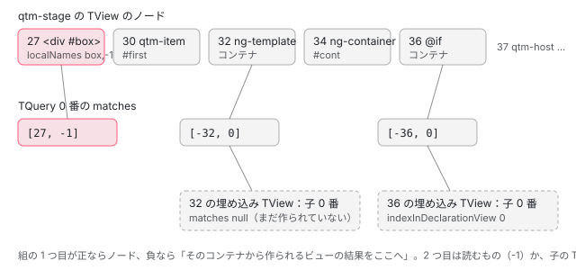

[目次](../README.md) › [クエリ（viewChild・contentChildren）の内側](README.md) › 第 3 回 / 全 7 回

# TQuery の照合：どのノードが「合う」のか、read で何を返すのか

> ビューの作成中に elementStart と template から呼ばれる TQueries / TQuery\_ の行。文字列の述語は参照名（#box、tNode.localNames）で、型の述語はノードの注入器のトークンで照合する matchTNode。matches に積む \[ノードの番号, 読むもの\] の組と、read が無いときに ElementRef・TemplateRef・コンポーネントのどれを返すか（createResultByTNodeType）、read: ViewContainerRef などの特別なトークン（-2）。TemplateRef の述語が @if のブロックにも合うこと、descendants: false のときに直接の子だけを見る isApplyingToNode、ng-template の中に入るときに子の TQuery を作る embeddedTView。ページの上の本物で TView の matches を読む。

angular/angular · 読了 約 14 分 · 中核 · [サイトで読む（デモが動きます）](https://angular-deep-dive-cyan.vercel.app/chapter/qry-tquery-match)

---

この章では、[第 1 回](01-qry-what-declared.md)の `ɵɵviewQuerySignal(ctx.box, _c0, 5)` が作った **TQuery** が、テンプレートのノードを 1 つずつ見て 「このノードは合う」と記録するまでを読みます。分かることは 3 つです。文字列の述語（`'box'`）は参照名（`#box`）で、型の述語（`Item`）はノードの注入器のトークンで照合すること。記録は `[ノードの番号, 何を読むか]` の 2 つの数の組で、`read` の有無で 2 つ目の数が決まること。照合はビューの最初の作成のとき（firstCreatePass）だけで、`ng-template` の中には子の TQuery を作って入っていくことです。

読むファイルは `packages/core/src/render3/queries/query.ts`（TQueryMetadata\_・TQueries\_・TQuery\_・createViewQuery・createTQuery）と `render3/interfaces/query.ts`、照合を呼ぶ側の `render3/view/elements.ts`・`instructions/template.ts`、参照名の表を作る `render3/view/directives.ts` です。記録した組から実際の値（ElementRef など）を作る `materializeViewResults` と、埋め込みビューの結果の集め方は [第 4 回](04-qry-lquery-results.md)です。

1. [1. 1 行の viewChild が生むもの](01-qry-what-declared.md)
2. [2. コンパイラの側](02-qry-compile.md)
3. **3. TQuery の照合**（この章）
4. [4. LQuery と結果の集め方](04-qry-lquery-results.md)
5. [5. 更新の時機](05-qry-refresh-timing.md)
6. [6. コンテンツのクエリ](06-qry-content-projection.md)
7. [7. spec と issue](07-qry-tests-issues.md)

この章の DEMO（8 節）で使う部品です。本文の行番号の説明は、このテンプレートで何が起きるかを例にします。

📄 `qtm-stage のテンプレート` L1–12 （▶ の行: 1–5）

```
 1 ▶ <div #box qtmMark>box</div>
 2 ▶ <qtm-item #first [n]="1" />
 3 ▶ <ng-template #tpl><qtm-item [n]="9" /></ng-template>
 4 ▶ <ng-container #cont></ng-container>
 5 ▶ @if (more()) {
 6 │   <qtm-item [n]="2" />
 7 │ }
 8 │ <qtm-host>
 9 │   <qtm-item [n]="3" />
10 │   <ng-container><qtm-item [n]="4" /></ng-container>
11 │   <div><qtm-item [n]="5" /></div>
12 │ </qtm-host>
```

📄 `qtm-stage のクエリ（すべて signal のクエリ）` L1–12

```
 1 │ box = viewChild('box');
 2 │ boxMark = viewChild('box', {read: QtmMark});
 3 │ boxTpl = viewChild('box', {read: TemplateRef});
 4 │ boxInj = viewChild('box', {read: Injector});
 5 │ first = viewChild('first');
 6 │ firstEl = viewChild('first', {read: ElementRef});
 7 │ tpl = viewChild('tpl');
 8 │ tplVcr = viewChild('tpl', {read: ViewContainerRef});
 9 │ cont = viewChild('cont');
10 │ anyTpl = viewChildren(TemplateRef);
11 │ items = viewChildren(QtmItem);
12 │ host = viewChild(QtmHost);
```

## 1. 作成の段：createViewQuery が TQuery を 1 つ足す

第 1 回で見た `ɵɵviewQuery` と `ɵɵviewQuerySignal` は、どちらもこの関数を呼びます。

📄 `angular/packages/core/src/render3/queries/query.ts` L488–503 （▶ の行: 495–498, 502）

```ts
488 │ export function createViewQuery<T>(
489 │   predicate: ProviderToken<unknown> | string[] | string,
490 │   flags: QueryFlags,
491 │   read?: any,
492 │ ): number {
493 │   ngDevMode && assertNumber(flags, 'Expecting flags');
494 │   const tView = getTView();
495 ▶   if (tView.firstCreatePass) {
496 ▶     createTQuery(tView, new TQueryMetadata_(predicate, flags, read), -1);
497 ▶     if ((flags & QueryFlags.isStatic) === QueryFlags.isStatic) {
498 ▶       tView.staticViewQueries = true;
499 │     }
500 │   }
501 │ 
502 ▶   return createLQuery<T>(tView, getLView(), flags);
503 │ }
```

1. **495 行目：最初の作成のときだけ**

   `tView.firstCreatePass` は、このテンプレートの最初のインスタンスを作っている間だけ true です（[ivy-first-create-pass](../ivy/08-ivy-first-create-pass.md)）。2 つ目のインスタンスからは 496〜499 行目を飛ばし、最初に作った TQuery を使い回します。
2. **496 行目：TQuery を作る**

   述語・フラグ・read を `TQueryMetadata_` にまとめ、3 つ目の引数 `-1`（ビューのクエリなので「宣言したノード」は無い）で `createTQuery` に渡します。
3. **497〜499 行目：static の印**

   フラグに isStatic（2）があれば、TView に「作成の段でも結果を入れる」と印を付けます。この印を誰が見るかは [第 5 回](05-qry-refresh-timing.md)です。
4. **502 行目：インスタンスごとの LQuery**

   `createLQuery` は firstCreatePass に関係なく毎回、この LView に `QueryList` と LQuery を 1 つずつ足し、その番号を返します（[第 4 回](04-qry-lquery-results.md)）。第 1 回の signal に結ぶ番号はこれです。

📄 `angular/packages/core/src/render3/queries/query.ts` L525–533 （▶ の行: 526–527, 531–532）

```ts
525 │ /** Splits multiple selectors in the locator. */
526 ▶ function splitQueryMultiSelectors(locator: string): string[] {
527 ▶   return locator.split(',').map((s) => s.trim());
528 │ }
529 │ 
530 │ export function createTQuery(tView: TView, metadata: TQueryMetadata, nodeIndex: number): void {
531 ▶   if (tView.queries === null) tView.queries = new TQueries_();
532 ▶   tView.queries.track(new TQuery_(metadata, nodeIndex));
533 │ }
```

📄 `angular/packages/core/src/render3/queries/query.ts` L95–109 （▶ の行: 102–104, 106）

```ts
 95 │ export class TQueryMetadata_ implements TQueryMetadata {
 96 │   public predicate: ProviderToken<unknown> | string[];
 97 │   constructor(
 98 │     predicate: ProviderToken<unknown> | string[] | string,
 99 │     public flags: QueryFlags,
100 │     public read: any = null,
101 │   ) {
102 ▶     // Compiler might not be able to pre-optimize and split multiple selectors.
103 ▶     if (typeof predicate === 'string') {
104 ▶       this.predicate = splitQueryMultiSelectors(predicate);
105 │     } else {
106 ▶       this.predicate = predicate;
107 │     }
108 │   }
109 │ }
```

531 行目で、TView に最初のクエリが来たときに `TQueries_`（TQuery の一覧）を作り、532 行目で末尾に足します。足した順が番号で、作成の段の命令の順（signal が先。[第 2 回](02-qry-compile.md)）と同じです。`TQueryMetadata_` の 102〜104 行目は、述語がまだ文字列 1 つのとき（AOT の出力ではすでに配列）に、526〜528 行目の `splitQueryMultiSelectors` でカンマを分けます。型の述語はそのままです（106 行目）。

> [!NOTE]
> **ポイント**
>
> コンポーネントの `viewQuery` は、テンプレート関数より**先**に作成の段で呼ばれます（instructions/render.ts の `renderView`。[boot-first-render](../boot/11-boot-first-render.md)）。だからテンプレートの最初の要素を作るときには、もう `tView.queries` に全部の TQuery が並んでいます。コンテンツのクエリは、ホストの要素を作ったときに後から足されます（DEMO の表 2 の 12・13 番。[第 6 回](06-qry-content-projection.md)）。

## 2. テンプレートの作成：要素と ng-template が TQueries を呼ぶ

📄 `angular/packages/core/src/render3/view/elements.ts` L64–78 （▶ の行: 65–66, 75–76）

```ts
64 │ 
65 ▶   if (tView.queries !== null) {
66 ▶     tView.queries.elementStart(tView, tNode);
67 │   }
68 │ 
69 │   return tNode;
70 │ }
71 │ 
72 │ export function directiveHostEndFirstCreatePass(tView: TView, tNode: TNode) {
73 │   ngDevMode && assertFirstCreatePass(tView);
74 │   registerPostOrderHooks(tView, tNode);
75 ▶   if (isContentQueryHost(tNode)) {
76 ▶     tView.queries!.elementEnd(tNode);
77 │   }
78 │ }
```

📄 `angular/packages/core/src/render3/view/elements.ts` L97–121 （▶ の行: 100, 104, 116–117）

```ts
 97 │ 
 98 │   if (localRefsIndex != null) {
 99 │     const refs = getConstant<string[]>(tViewConsts, localRefsIndex)!;
100 ▶     tNode.localNames = [];
101 │ 
102 │     for (let i = 0; i < refs.length; i += 2) {
103 │       // Always -1 since DOM-only instructions can only refer to the native node.
104 ▶       tNode.localNames.push(refs[i], -1);
105 │     }
106 │   }
107 │ 
108 │   if (tNode.attrs !== null) {
109 │     computeStaticStyling(tNode, tNode.attrs, false);
110 │   }
111 │ 
112 │   if (tNode.mergedAttrs !== null) {
113 │     computeStaticStyling(tNode, tNode.mergedAttrs, true);
114 │   }
115 │ 
116 ▶   if (tView.queries !== null) {
117 ▶     tView.queries.elementStart(tView, tNode);
118 │   }
119 │ 
120 │   return tNode;
121 │ }
```

📄 `angular/packages/core/src/render3/instructions/template.ts` L81–88 （▶ の行: 83–85）

```ts
81 │     ));
82 │ 
83 ▶     if (declarationTView.queries !== null) {
84 ▶       declarationTView.queries.template(declarationTView, tNode);
85 ▶       embeddedTView.queries = declarationTView.queries.embeddedTView(tNode);
86 │     }
87 │   }
88 │ 
```

- **elements.ts 65〜66 行目**：`ɵɵelementStart` と `ɵɵelementContainerStart` の最初の作成（`directiveHostFirstCreatePass`）の最後に、TNode（ノードの静的な情報。[ivy-tnode](../ivy/04-ivy-tnode.md)）ができたところで `tView.queries.elementStart` を呼びます。ディレクティブの照合（`resolveDirectives`）がこの関数の前半で終わっているので、照合の時点でこのノードに乗ったディレクティブと参照名が分かっています。
- **elements.ts 116〜117 行目**：ディレクティブを 1 つも使わないテンプレート向けの `ɵɵdomElementStart` の側（`domOnlyFirstCreatePass`）も同じ呼び出しです。こちらは参照名をすべて `-1`（要素そのもの）で記録します（104 行目）。
- **elements.ts 75〜76 行目**：要素の終わり（`directiveHostEndFirstCreatePass`）では、コンテンツのクエリを持つホストのときだけ `elementEnd` を呼びます（4 節の `_appliesToNextNode`）。
- **template.ts 83〜85 行目**：`<ng-template>` と、`@if`・`@for` などのブロック（どれも `templateCreate` を通るコンテナのノード）では、まず 84 行目でこのノード自身を照合し、85 行目で埋め込みビューの TView に**子の TQueries** を作ります（6 節）。

📄 `angular/packages/core/src/render3/queries/query.ts` L111–147 （▶ の行: 115–116, 120–121, 133–134, 137, 146）

```ts
111 │ class TQueries_ implements TQueries {
112 │   constructor(private queries: TQuery[] = []) {}
113 │ 
114 │   elementStart(tView: TView, tNode: TNode): void {
115 ▶     ngDevMode &&
116 ▶       assertFirstCreatePass(
117 │         tView,
118 │         'Queries should collect results on the first template pass only',
119 │       );
120 ▶     for (let i = 0; i < this.queries.length; i++) {
121 ▶       this.queries[i].elementStart(tView, tNode);
122 │     }
123 │   }
124 │   elementEnd(tNode: TNode): void {
125 │     for (let i = 0; i < this.queries.length; i++) {
126 │       this.queries[i].elementEnd(tNode);
127 │     }
128 │   }
129 │   embeddedTView(tNode: TNode): TQueries | null {
130 │     let queriesForTemplateRef: TQuery[] | null = null;
131 │ 
132 │     for (let i = 0; i < this.length; i++) {
133 ▶       const childQueryIndex = queriesForTemplateRef !== null ? queriesForTemplateRef.length : 0;
134 ▶       const tqueryClone = this.getByIndex(i).embeddedTView(tNode, childQueryIndex);
135 │ 
136 │       if (tqueryClone) {
137 ▶         tqueryClone.indexInDeclarationView = i;
138 │         if (queriesForTemplateRef !== null) {
139 │           queriesForTemplateRef.push(tqueryClone);
140 │         } else {
141 │           queriesForTemplateRef = [tqueryClone];
142 │         }
143 │       }
144 │     }
145 │ 
146 ▶     return queriesForTemplateRef !== null ? new TQueries_(queriesForTemplateRef) : null;
147 │   }
```

📄 `angular/packages/core/src/render3/queries/query.ts` L149–172 （▶ の行: 155–156, 169–170）

```ts
149 │   template(tView: TView, tNode: TNode): void {
150 │     ngDevMode &&
151 │       assertFirstCreatePass(
152 │         tView,
153 │         'Queries should collect results on the first template pass only',
154 │       );
155 ▶     for (let i = 0; i < this.queries.length; i++) {
156 ▶       this.queries[i].template(tView, tNode);
157 │     }
158 │   }
159 │ 
160 │   getByIndex(index: number): TQuery {
161 │     ngDevMode && assertIndexInRange(this.queries, index);
162 │     return this.queries[index];
163 │   }
164 │ 
165 │   get length(): number {
166 │     return this.queries.length;
167 │   }
168 │ 
169 ▶   track(tquery: TQuery): void {
170 ▶     this.queries.push(tquery);
171 │   }
172 │ }
```

`TQueries_` は、受けた呼び出しを全部の TQuery に配るだけです（120〜122 行目、155〜157 行目）。115〜119 行目は開発ビルドだけの確かめで、firstCreatePass でないのに照合しようとしたら止めます。クエリが 12 個あれば、要素 1 つにつき `TQuery_.elementStart` が 12 回呼ばれます。

## 3. TQuery\_：何を持っているか

📄 `angular/packages/core/src/render3/queries/query.ts` L174–198 （▶ の行: 175–177, 184, 191, 195, 197）

```ts
174 │ class TQuery_ implements TQuery {
175 ▶   matches: number[] | null = null;
176 ▶   indexInDeclarationView = -1;
177 ▶   crossesNgTemplate = false;
178 │ 
179 │   /**
180 │    * A node index on which a query was declared (-1 for view queries and ones inherited from the
181 │    * declaration template). We use this index (alongside with _appliesToNextNode flag) to know
182 │    * when to apply content queries to elements in a template.
183 │    */
184 ▶   private _declarationNodeIndex: number;
185 │ 
186 │   /**
187 │    * A flag indicating if a given query still applies to nodes it is crossing. We use this flag
188 │    * (alongside with _declarationNodeIndex) to know when to stop applying content queries to
189 │    * elements in a template.
190 │    */
191 ▶   private _appliesToNextNode = true;
192 │ 
193 │   constructor(
194 │     public metadata: TQueryMetadata,
195 ▶     nodeIndex: number = -1,
196 │   ) {
197 ▶     this._declarationNodeIndex = nodeIndex;
198 │   }
```

📄 `angular/packages/core/src/render3/interfaces/query.ts` L73–97 （▶ の行: 74–76, 80–81, 85–86, 88）

```ts
73 │   /**
74 ▶    * Matches collected on the first template pass. Each match is a pair of:
75 ▶    * - TNode index;
76 ▶    * - match index;
77 │    *
78 │    * A TNode index can be either:
79 │    * - a positive number (the most common case) to indicate a matching TNode;
80 ▶    * - a negative number to indicate that a given query is crossing a <ng-template> element and
81 ▶    * results from views created based on TemplateRef should be inserted at this place.
82 │    *
83 │    * A match index is a number used to find an actual value (for a given node) when query results
84 │    * are materialized. This index can have one of the following values:
85 ▶    * - -2 - indicates that we need to read a special token (TemplateRef, ViewContainerRef etc.);
86 ▶    * - -1 - indicates that we need to read a default value based on the node type (TemplateRef for
87 │    * ng-template and ElementRef for other elements);
88 ▶    * - a positive number - index of an injectable to be read from the element injector.
89 │    */
90 │   matches: number[] | null;
91 │ 
92 │   /**
93 │    * A flag indicating if a given query crosses an <ng-template> element. This flag exists for
94 │    * performance reasons: we can notice that queries not crossing any <ng-template> elements will
95 │    * have matches from a given view only (and adapt processing accordingly).
96 │    */
97 │   crossesNgTemplate: boolean;
```

照合の結果は 175 行目の `matches` に、**2 つの数で 1 組**で積まれます（interfaces/query.ts 74〜76 行目）。1 つ目はノードの番号で、負なら「`ng-template` を越えた印」（80〜81 行目）。2 つ目は何を読むかで、`-1` はノードの型で決める（86 行目）、`-2` は read の特別なトークン（85 行目）、0 以上はノードの注入器の中の番号（88 行目）です。184 行目の `_declarationNodeIndex` は、コンテンツのクエリなら宣言したホストのノードの番号、ビューのクエリなら `-1`（195 行目の既定）です。



*TQuery 0 番（viewChild('box')）の matches と、ノード・埋め込みビューの関係（番号はこのサイトの 22.1.6 の値）*

DEMO の表 2 を、この読み方で読みます（このサイトの 22.1.6 では、テンプレートの最初のノード `<div #box>` の番号が 27 です）。

- `box = viewChild('box')` の `[27, -1]`：ノード 27（`<div>`）が合い、読むものは型で決める（要素なので ElementRef）。
- `boxMark = viewChild('box', {read: QtmMark})` の `[27, 57]`：同じノードで、tView.data の 57 番（QtmMark のディレクティブの定義）のインスタンスを読む。
- `[-32, 0]`・`[-36, 0]`：ノード 32（`<ng-template #tpl>`）と 36（`@if`）の埋め込みビューの、子の TQuery 0 番の結果をここに差し込む、という印。

> [!WARNING]
> **ハマりどころ**
>
> 番号 27 は、このサイトの `@angular/core` 22.1.6 の LView の頭の大きさ（`HEADER_OFFSET`）が 27 だからです。読んでいる 22.2.0-next.7 の interfaces/view.ts では 28 になっていて（22.2.0-next.6 の「feat(core): add ErrorBoundary programmatic APIs」で LView に `ON_ERROR` が足された）、同じテンプレートなら 28 から始まります。テンプレートの命令の番号（`ɵɵelementStart(0, …)` の 0）に HEADER\_OFFSET を足したものが TNode の番号です（[ivy-lview](../ivy/06-ivy-lview.md)）。

## 4. elementStart：まず「このノードを見るか」を決める

📄 `angular/packages/core/src/render3/queries/query.ts` L200–225 （▶ の行: 201–202, 207–208, 213, 217–218, 221–222）

```ts
200 │   elementStart(tView: TView, tNode: TNode): void {
201 ▶     if (this.isApplyingToNode(tNode)) {
202 ▶       this.matchTNode(tView, tNode);
203 │     }
204 │   }
205 │ 
206 │   elementEnd(tNode: TNode): void {
207 ▶     if (this._declarationNodeIndex === tNode.index) {
208 ▶       this._appliesToNextNode = false;
209 │     }
210 │   }
211 │ 
212 │   template(tView: TView, tNode: TNode): void {
213 ▶     this.elementStart(tView, tNode);
214 │   }
215 │ 
216 │   embeddedTView(tNode: TNode, childQueryIndex: number): TQuery | null {
217 ▶     if (this.isApplyingToNode(tNode)) {
218 ▶       this.crossesNgTemplate = true;
219 │       // A marker indicating a `<ng-template>` element (a placeholder for query results from
220 │       // embedded views created based on this `<ng-template>`).
221 ▶       this.addMatch(-tNode.index, childQueryIndex);
222 ▶       return new TQuery_(this.metadata);
223 │     }
224 │     return null;
225 │   }
```

📄 `angular/packages/core/src/render3/queries/query.ts` L227–254 （▶ の行: 229–230, 233, 244, 246–247, 251, 253）

```ts
227 │   private isApplyingToNode(tNode: TNode): boolean {
228 │     if (
229 ▶       this._appliesToNextNode &&
230 ▶       (this.metadata.flags & QueryFlags.descendants) !== QueryFlags.descendants
231 │     ) {
232 │       const declarationNodeIdx = this._declarationNodeIndex;
233 ▶       let parent = tNode.parent;
234 │       // Determine if a given TNode is a "direct" child of a node on which a content query was
235 │       // declared (only direct children of query's host node can match with the descendants: false
236 │       // option). There are 3 main use-case / conditions to consider here:
237 │       // - <needs-target><i #target></i></needs-target>: here <i #target> parent node is a query
238 │       // host node;
239 │       // - <needs-target><ng-template [ngIf]="true"><i #target></i></ng-template></needs-target>:
240 │       // here <i #target> parent node is null;
241 │       // - <needs-target><ng-container><i #target></i></ng-container></needs-target>: here we need
242 │       // to go past `<ng-container>` to determine <i #target> parent node (but we shouldn't traverse
243 │       // up past the query's host node!).
244 ▶       while (
245 │         parent !== null &&
246 ▶         parent.type & TNodeType.ElementContainer &&
247 ▶         parent.index !== declarationNodeIdx
248 │       ) {
249 │         parent = parent.parent;
250 │       }
251 ▶       return declarationNodeIdx === (parent !== null ? parent.index : -1);
252 │     }
253 ▶     return this._appliesToNextNode;
254 │   }
```

1. **201〜202 行目：見るなら照合**

   `isApplyingToNode` が true のときだけ `matchTNode` へ進みます。`template`（212〜214 行目）も同じ道です。
2. **253 行目：descendants があれば `_appliesToNextNode` のまま**

   ビューのクエリはこれが true のまま変わらないので、ビューの全ノードを見ます。コンテンツのクエリは、ホストの要素の終わり（207〜208 行目）で false になり、それより後のノードを見なくなります。
3. **229〜251 行目：descendants が無いときは「直接の子」だけ**

   233 行目でノードの親をたどり、246 行目の `TNodeType.ElementContainer`（`<ng-container>`）は 1 段飛ばします（247 行目でホスト自身は越えない）。251 行目で、たどり着いた親がホストのノードなら見る、です。DEMO の `QtmHost.direct`（descendants 無し）は、`<qtm-host>` の直下の item 3 と、`<ng-container>` の中の item 4 には合い、`<div>` の中の item 5 には合いません。`deep` は 3 つとも合います（表 2 の 12・13 番）。

## 5. matchTNode：文字列は参照名、型は注入器のトークン

📄 `angular/packages/core/src/render3/queries/query.ts` L256–282 （▶ の行: 258, 261, 263, 266, 270–272, 275, 278）

```ts
256 │   private matchTNode(tView: TView, tNode: TNode): void {
257 │     const predicate = this.metadata.predicate;
258 ▶     if (Array.isArray(predicate)) {
259 │       for (let i = 0; i < predicate.length; i++) {
260 │         const name = predicate[i];
261 ▶         this.matchTNodeWithReadOption(tView, tNode, getIdxOfMatchingSelector(tNode, name));
262 │         // Also try matching the name to a provider since strings can be used as DI tokens too.
263 ▶         this.matchTNodeWithReadOption(
264 │           tView,
265 │           tNode,
266 ▶           locateDirectiveOrProvider(tNode, tView, name, false, false),
267 │         );
268 │       }
269 │     } else {
270 ▶       if ((predicate as any) === ViewEngine_TemplateRef) {
271 ▶         if (tNode.type & TNodeType.Container) {
272 ▶           this.matchTNodeWithReadOption(tView, tNode, -1);
273 │         }
274 │       } else {
275 ▶         this.matchTNodeWithReadOption(
276 │           tView,
277 │           tNode,
278 ▶           locateDirectiveOrProvider(tNode, tView, predicate, false, false),
279 │         );
280 │       }
281 │     }
282 │   }
```

📄 `angular/packages/core/src/render3/queries/query.ts` L322–340 （▶ の行: 331, 334–335, 339）

```ts
322 │ /**
323 │  * Iterates over local names for a given node and returns directive index
324 │  * (or -1 if a local name points to an element).
325 │  *
326 │  * @param tNode static data of a node to check
327 │  * @param selector selector to match
328 │  * @returns directive index, -1 or null if a selector didn't match any of the local names
329 │  */
330 │ function getIdxOfMatchingSelector(tNode: TNode, selector: string): number | null {
331 ▶   const localNames = tNode.localNames;
332 │   if (localNames !== null) {
333 │     for (let i = 0; i < localNames.length; i += 2) {
334 ▶       if (localNames[i] === selector) {
335 ▶         return localNames[i + 1] as number;
336 │       }
337 │     }
338 │   }
339 ▶   return null;
340 │ }
```

1. **261 行目：文字列の述語は、ノードの参照名の表を引く**

   `getIdxOfMatchingSelector`（330〜340 行目）は `tNode.localNames`（`['box', -1]` のような「名前, 番号」の並び）から同じ名前を探し、その番号を返します。見つからなければ `null` で、`matchTNodeWithReadOption` は何もしません。番号がどこから来るかは下の 6 の手順で見ます。
2. **263〜267 行目：同じ文字列を DI のトークンとしても探す**

   文字列は `{ provide: 'Token', … }` のように DI のトークンにもなれるので、同じ名前で `locateDirectiveOrProvider` も呼びます。両方合えば、組が 2 つ積まれます（テストの節）。
3. **270〜273 行目：`TemplateRef` の述語は、コンテナのノードなら合う**

   `TemplateRef` は provider ではないので、注入器を探さずに、ノードの型が Container（`<ng-template>` と `@if` などのブロック）なら `-1` で合わせます。DEMO の `anyTpl = viewChildren(TemplateRef)` が TemplateRef を **2 つ**返すのはこのためで、2 つ目は `@if` のブロックのテンプレートです（表 2 の 9 番の `[36, -1]`）。
4. **275〜279 行目：型の述語は、ノードの注入器で探す**

   `locateDirectiveOrProvider`（render3/di.ts）は、このノードの providers とディレクティブの範囲（tView.data の中）を見て、`provide` が同じか、ディレクティブの `type` が同じものの番号を返します（[di-resolution-flags](../di/12-di-resolution-flags.md)）。4 つ目と 5 つ目の引数 `false, false` は「viewProviders は見ない」「ホストの特別扱いはしない」です。親の注入器へは上がらないので、**このノードに乗ったもの**だけが合います。

📄 `angular/packages/core/src/render3/view/directives.ts` L101–121 （▶ の行: 107, 113, 119）

```ts
101 │ /** Caches local names and their matching directive indices for query and template lookups. */
102 │ function cacheMatchingLocalNames(
103 │   tNode: TNode,
104 │   localRefs: string[],
105 │   exportsMap: {[key: string]: number},
106 │ ): void {
107 ▶   const localNames: (string | number)[] = (tNode.localNames = []);
108 │ 
109 │   // Local names must be stored in tNode in the same order that localRefs are defined
110 │   // in the template to ensure the data is loaded in the same slots as their refs
111 │   // in the template (for template queries).
112 │   for (let i = 0; i < localRefs.length; i += 2) {
113 ▶     const index = exportsMap[localRefs[i + 1]];
114 │     if (index == null)
115 │       throw new RuntimeError(
116 │         RuntimeErrorCode.EXPORT_NOT_FOUND,
117 │         ngDevMode && `Export of name '${localRefs[i + 1]}' not found!`,
118 │       );
119 ▶     localNames.push(localRefs[i], index);
120 │   }
121 │ }
```

📄 `angular/packages/core/src/render3/view/directives.ts` L534–547 （▶ の行: 540, 542, 545）

```ts
534 │ function saveNameToExportMap(
535 │   directiveIdx: number,
536 │   def: DirectiveDef<any> | ComponentDef<any>,
537 │   exportsMap: {[key: string]: number} | null,
538 │ ) {
539 │   if (exportsMap) {
540 ▶     if (def.exportAs) {
541 │       for (let i = 0; i < def.exportAs.length; i++) {
542 ▶         exportsMap[def.exportAs[i]] = directiveIdx;
543 │       }
544 │     }
545 ▶     if (isComponentDef(def)) exportsMap[''] = directiveIdx;
546 │   }
547 │ }
```

参照名の表は、ディレクティブの照合のときに作られます。`#box` のように値の無い参照は名前 `''` で引かれ（113 行目）、表の `''` は、コンポーネントが乗っていればその番号（545 行目）、乗っていなければ `-1`（`resolveDirectives` が表を `{'': -1}` で始める。[ivy-first-create-pass](../ivy/08-ivy-first-create-pass.md)）です。`#f="ngForm"` のような値つきの参照は、`exportAs` の表（540〜542 行目）を引きます。だから DEMO の `first = viewChild('first')` は、`<qtm-item #first>` のコンポーネントの番号 `[30, 67]` になり、結果は QtmItem のインスタンスです。

## 6. read：2 つ目の数を決める

📄 `angular/packages/core/src/render3/queries/query.ts` L284–319 （▶ の行: 285, 287, 289–292, 294, 296, 303–304, 308）

```ts
284 │   private matchTNodeWithReadOption(tView: TView, tNode: TNode, nodeMatchIdx: number | null): void {
285 ▶     if (nodeMatchIdx !== null) {
286 │       const read = this.metadata.read;
287 ▶       if (read !== null) {
288 │         if (
289 ▶           read === ViewEngine_ElementRef ||
290 ▶           read === ViewContainerRef ||
291 ▶           read === Injector ||
292 ▶           (read === ViewEngine_TemplateRef && tNode.type & TNodeType.Container)
293 │         ) {
294 ▶           this.addMatch(tNode.index, -2);
295 │         } else {
296 ▶           const directiveOrProviderIdx = locateDirectiveOrProvider(
297 │             tNode,
298 │             tView,
299 │             read,
300 │             false,
301 │             false,
302 │           );
303 ▶           if (directiveOrProviderIdx !== null) {
304 ▶             this.addMatch(tNode.index, directiveOrProviderIdx);
305 │           }
306 │         }
307 │       } else {
308 ▶         this.addMatch(tNode.index, nodeMatchIdx);
309 │       }
310 │     }
311 │   }
312 │ 
313 │   private addMatch(tNodeIdx: number, matchIdx: number) {
314 │     if (this.matches === null) {
315 │       this.matches = [tNodeIdx, matchIdx];
316 │     } else {
317 │       this.matches.push(tNodeIdx, matchIdx);
318 │     }
319 │   }
```

1. **308 行目：read が無ければ、照合の番号をそのまま**

   参照名なら `-1` かディレクティブの番号、型なら注入器の番号です。
2. **288〜294 行目：特別なトークンは `-2`**

   `ElementRef`・`ViewContainerRef`・`Injector`、それにコンテナのノードでの `TemplateRef` は、provider として置かれていないので、注入器を探さずに `-2` を記録します。DEMO の `firstEl`（`[30, -2]`）と `tplVcr`（`[32, -2]`）です。
3. **296〜305 行目：それ以外の read は、同じノードの注入器で探す**

   見つからなければ組を積みません（303 行目）。DEMO の `boxTpl = viewChild('box', {read: TemplateRef})` は、`<div>` がコンテナではないので 292 行目に当たらず、ここで探しても無いので、結果は `undefined` です（表 2 の 2 番は印だけ）。

> [!WARNING]
> **ハマりどころ**
>
> 291 行目の `read === Injector` は、22.2.0-next.6 の「feat(core): allow reading \`Injector\` from a view or content query」（2026 年 9 月）で足された行です。このサイトの 22.1.6 にはまだ無いので、DEMO の `boxInj = viewChild('box', {read: Injector})` は 296 行目の道に落ち、`Injector` という provider は無いので `undefined` になります（表 2 の 3 番）。22.2 では `[27, -2]` が積まれ、ノードの注入器（`NodeInjector`）が返ります。

📄 `angular/packages/core/src/render3/queries/query.ts` L342–362 （▶ の行: 343–346, 352, 355, 360）

```ts
342 │ function createResultByTNodeType(tNode: TNode, currentView: LView): any {
343 ▶   if (tNode.type & (TNodeType.AnyRNode | TNodeType.ElementContainer)) {
344 ▶     return createElementRef(tNode, currentView);
345 ▶   } else if (tNode.type & TNodeType.Container) {
346 ▶     return createTemplateRef(tNode, currentView);
347 │   }
348 │   return null;
349 │ }
350 │ 
351 │ function createResultForNode(lView: LView, tNode: TNode, matchingIdx: number, read: any): any {
352 ▶   if (matchingIdx === -1) {
353 │     // if read token and / or strategy is not specified, detect it using appropriate tNode type
354 │     return createResultByTNodeType(tNode, lView);
355 ▶   } else if (matchingIdx === -2) {
356 │     // read a special token from a node injector
357 │     return createSpecialToken(lView, tNode, read);
358 │   } else {
359 │     // read a token
360 ▶     return getNodeInjectable(lView, lView[TVIEW], matchingIdx, tNode as TElementNode);
361 │   }
362 │ }
```

📄 `angular/packages/core/src/render3/queries/query.ts` L364–385 （▶ の行: 365, 367, 369, 371, 375）

```ts
364 │ function createSpecialToken(lView: LView, tNode: TNode, read: any): any {
365 ▶   if (read === ViewEngine_ElementRef) {
366 │     return createElementRef(tNode, lView);
367 ▶   } else if (read === ViewEngine_TemplateRef) {
368 │     return createTemplateRef(tNode, lView);
369 ▶   } else if (read === ViewContainerRef) {
370 │     ngDevMode && assertTNodeType(tNode, TNodeType.AnyRNode | TNodeType.AnyContainer);
371 ▶     return createContainerRef(
372 │       tNode as TElementNode | TContainerNode | TElementContainerNode,
373 │       lView,
374 │     );
375 ▶   } else if (read === Injector) {
376 │     return new NodeInjector(tNode as TElementNode | TContainerNode | TElementContainerNode, lView);
377 │   } else {
378 │     ngDevMode &&
379 │       throwError(
380 │         `Special token to read should be one of ElementRef, TemplateRef, ViewContainerRef or Injector but got ${stringify(
381 │           read,
382 │         )}.`,
383 │       );
384 │   }
385 │ }
```

記録した組を値にするのは結果を集めるとき（[第 4 回](04-qry-lquery-results.md)）で、2 つ目の数で 3 つに分かれます（351〜362 行目）。`-1` はノードの型で、要素と `<ng-container>` なら ElementRef（343 行目）、コンテナなら TemplateRef（345 行目）です。`<ng-container #cont>` の ElementRef の `nativeElement` は、DOM に残るコメントのノードです（DEMO の `cont` が `#comment`）。`-2` は 364〜385 行目で read のトークンごとに作り、0 以上は `getNodeInjectable` でインスタンスを取ります（360 行目）。

## 7. ng-template の中へ：embeddedTView が子の TQuery を作る

4 節の `tqStart` の残り、216〜225 行目です。2 節の template.ts 85 行目から、TQueries\_ の 129〜147 行目を通って呼ばれます。

1. **217〜218 行目：このクエリが ng-template を見るなら、越える印を付ける**

   `crossesNgTemplate` を true にします。結果を集めるときに「このビューだけ見ればよいか」を分けるための印です（interfaces/query.ts の 92〜97 行目のコメント）。
2. **221 行目：`[-ノードの番号, 子のクエリの番号]` を積む**

   ここは「この位置に、このテンプレートから作られたビューの結果を入れる」という場所取りです。結果が宣言した順に並ぶのは、この印がノードの並びの中に入るからです（集め方は [第 4 回](04-qry-lquery-results.md)）。
3. **222 行目：同じ metadata で、宣言のノードの無い TQuery を作る**

   TQueries\_ の 137 行目で、親での番号を `indexInDeclarationView` に入れ、146 行目で埋め込みビューの TView の `queries` になります。

子の TQuery が照合をするのは、**その埋め込みビューが最初に作られたとき**です。DEMO の表 3 で、`@if`（ノード 36）の子 10 番（`viewChildren(QtmItem)`）は `[27, 38]` （埋め込みビューの中の `<qtm-item [n]="2">`）を持ちますが、誰も描かない `<ng-template #tpl>`（ノード 32）の子は全部 `null` のままです。ng-template の中の item 9 が `items` に入らないのは、照合が起きていないからです。

> [!TIP]
> **新卒エンジニアへ**
>
> DEMO で「@if を外す」を押すと、`items` から item 2 が消えますが、表 2 と表 3 の matches は変わりません。TQuery は「どの位置に何が来うるか」の設計図で、今どのビューがあるかは LView と LContainer の側の話です（第 4 回）。「壊して作り直す」でも matches が増えないのは、TView が作り直されず、2 回目の作成では firstCreatePass が false だからです。

## 8. DEMO：ページの上の本物で、照合の記録を読む

> **🧪 DEMO — 同じテンプレートに 12 個の viewChild / viewChildren と 2 個の contentChildren**
>
> 「描く」を押すと、本文の最初のテンプレートの部品（`qtm-stage`）をこのページに出し、描き終わったあとで 3 つを読みます。表 1 は signal を読んだ値です。表 2 と表 3 は、`qtm-stage` が `inject(ChangeDetectorRef)` で受けた ViewRef の `_lView` から TView（LView の 1 番）を取り、`tView.queries` の TQuery の `matches` をそのまま並べたものです。`_lView`・`queries`・`matches` は公開の API ではなく、このサイトの 22.1.6 の名前を**確かめるためだけ**に読んでいます（本番ビルドでも同じ名前で残っています）。
>
> ▶ [このデモはサイトで動かせます](https://angular-deep-dive-cyan.vercel.app/chapter/qry-tquery-match)

表から確かめられることです（このサイトの本番ビルドで確かめました）。

1. **番号の順**

   表 2 の 0〜11 番はクラスに書いた順のビューのクエリ、12・13 番が `<qtm-host>`（ノード 37）を作ったときに足されたコンテンツのクエリです。12・13 番だけ「宣言のノード」が 37 で、ng-template の印がありません（ホストより前の ng-template は見ていない）。
2. **参照名とディレクティブ**

   0 番 `[27, -1]` と 4 番 `[30, 67]`。同じ参照名でも、要素なら -1、コンポーネントならその番号です。
3. **read**

   1 番 `[27, 57]`（QtmMark）、5 番 `[30, -2]`（ElementRef）、7 番 `[32, -2]`（ViewContainerRef）。2 番（TemplateRef を要素から）と 3 番（Injector。22.1.6）は組が無く、結果は undefined です。
4. **型の述語**

   10 番 `viewChildren(QtmItem)` は 30・38・40・42 番のノード。`<qtm-host>` の中に書いた item 3〜5 も、**qtm-stage のテンプレートに書かれている**ので、qtm-stage のビューのクエリに合います（投影されても、書かれた場所のビューのノードです。第 6 回）。
5. **@if と ng-template**

   すべてのビューのクエリが `[-32, n]` と `[-36, n]` を持ち、表 3 に子が 12 個ずつあります。9 番の `viewChildren(TemplateRef)` だけは、ノード 32 と 36 そのものにも合っています。ノード 36 の名前が `qtm-item` なのは、コンパイラがブロックの中身の要素名をコンテナの命令に渡しているからです（第 1 回の記録の 28 行目の `ɵɵconditionalCreate(4, …, "app-item", 1)`）。

## 9. 呼び出しの連なり

- `renderView` → `executeViewQueryFn(Create)` → `X_Query(1, ctx)` — instructions/render.ts
  - `ɵɵviewQuerySignal` → `createViewQuery` — query.ts L488-503
    - `createTQuery` → `new TQueryMetadata_` → `TQueries_.track` — query.ts L525-533・L95-109 — *firstCreatePass だけ*
- `executeTemplate(Create)` → `X_Template(1, ctx)` — テンプレート関数
  - `ɵɵelementStart` → `directiveHostFirstCreatePass` — view/elements.ts
    - `resolveDirectives` → `cacheMatchingLocalNames` — view/directives.ts L101-121 — *tNode.localNames*
    - `tView.queries.elementStart` → `TQuery_.elementStart` — elements.ts L65-66・query.ts L200-204
      - `isApplyingToNode` — query.ts L227-254 — *descendants*
      - `matchTNode` → `getIdxOfMatchingSelector` / `locateDirectiveOrProvider` — query.ts L256-282・L330-340
      - `matchTNodeWithReadOption` → `addMatch(tNode.index, n)` — query.ts L284-319 — *-1 / -2 / 番号*
  - `ɵɵtemplate` / `ɵɵconditionalCreate` → `templateCreate` — instructions/template.ts L81-88
    - `queries.template` → `TQuery_.template` → `elementStart` — query.ts L212-214
    - `queries.embeddedTView` → `TQuery_.embeddedTView` — query.ts L129-147・L216-225 — *\[-番号, 子の番号\] と子の TQueries*
- `tView.firstCreatePass = false` — render.ts — *2 回目からは照合しない*

## テストと直し方

### 照合と read を固めているテスト

core の `packages/core/test/acceptance/query_spec.ts` に、この章の行がほぼそのまま it になっています。read の describe（1572 行目の `describe('read option')`）から 2 つです。

📄 `angular/packages/core/test/acceptance/query_spec.ts` L1762–1798 （▶ の行: 1762, 1764, 1769, 1777, 1780, 1786, 1795）

```ts
1762 ▶     it('should read ViewContainerRef from ng-template nodes when explicitly asked for', () => {
1763 │       @Component({
1764 ▶         template: `<ng-template #foo></ng-template>`,
1765 │ 
1766 │         changeDetection: ChangeDetectionStrategy.Eager,
1767 │       })
1768 │       class TestCmp {
1769 ▶         @ViewChildren('foo', {read: ViewContainerRef}) query?: QueryList<ViewContainerRef>;
1770 │       }
1771 │ 
1772 │       const fixture = TestBed.createComponent(TestCmp);
1773 │       fixture.detectChanges();
1774 │ 
1775 │       const qList = fixture.componentInstance.query!;
1776 │       expect(qList.length).toBe(1);
1777 ▶       expect(qList.first).toBeInstanceOf(ViewContainerRef);
1778 │     });
1779 │ 
1780 ▶     it('should read Injector from element nodes when explicitly asked for', () => {
1781 │       @Component({
1782 │         template: `<div #foo></div>`,
1783 │         changeDetection: ChangeDetectionStrategy.Eager,
1784 │       })
1785 │       class TestCmp {
1786 ▶         @ViewChild('foo', {read: Injector}) query?: Injector;
1787 │       }
1788 │ 
1789 │       const fixture = TestBed.createComponent(TestCmp);
1790 │       fixture.detectChanges();
1791 │ 
1792 │       const injector = fixture.componentInstance.query!;
1793 │       expect(injector).toBeDefined();
1794 │       // The returned value behaves like an injector rooted at the queried node.
1795 ▶       expect(injector.get(ElementRef).nativeElement).toBe(
1796 │         fixture.debugElement.children[0].nativeElement,
1797 │       );
1798 │     });
```

1762〜1778 行目は ng-template から `ViewContainerRef` を読む（6 節の 292 行目ではなく 290 行目の道）、1780〜1798 行目は `Injector` を読む it で、291 行目と同じ変更で足されました。文字列のトークンの describe（2896 行目の `describe('querying for string token providers')`）からも 2 つです。

📄 `angular/packages/core/test/acceptance/query_spec.ts` L2904–2936 （▶ の行: 2906, 2912, 2918, 2923, 2929, 2935）

```ts
2904 │     it('should match string injection token in a ViewChild query', () => {
2905 │       @Component({
2906 ▶         template: '<div text-token></div>',
2907 │         standalone: false,
2908 │ 
2909 │         changeDetection: ChangeDetectionStrategy.Eager,
2910 │       })
2911 │       class App {
2912 ▶         @ViewChild('Token') token: any;
2913 │       }
2914 │ 
2915 │       TestBed.configureTestingModule({declarations: [App, TextTokenDirective]});
2916 │       const fixture = TestBed.createComponent(App);
2917 │       fixture.detectChanges();
2918 ▶       expect(fixture.componentInstance.token).toBeInstanceOf(TextTokenDirective);
2919 │     });
2920 │ 
2921 │     it('should give precedence to local reference if both a reference and a string injection token provider match a ViewChild query', () => {
2922 │       @Component({
2923 ▶         template: '<div text-token #Token></div>',
2924 │         standalone: false,
2925 │ 
2926 │         changeDetection: ChangeDetectionStrategy.Eager,
2927 │       })
2928 │       class App {
2929 ▶         @ViewChild('Token') token: any;
2930 │       }
2931 │ 
2932 │       TestBed.configureTestingModule({declarations: [App, TextTokenDirective]});
2933 │       const fixture = TestBed.createComponent(App);
2934 │       fixture.detectChanges();
2935 ▶       expect(fixture.componentInstance.token).toBeInstanceOf(ElementRef);
2936 │     });
```

2904〜2919 行目は、参照名ではなく `'Token'` という文字列の provider に合う（5 節の 263〜267 行目）。2921〜2936 行目は、同じ要素に `#Token` もあると、参照名の組が先に積まれ（261 行目が先）、`@ViewChild` は先頭を取るので ElementRef になる、を確かめています。

### 手元で走らせた結果

📄 `ターミナル（~/angular-research/angular で）`

```
cd ~/angular-research/angular
pnpm bazel test //packages/core/test/acceptance:acceptance \
  '--test_arg=--filter=read option' --nocache_test_results --test_output=all
pnpm bazel test //packages/core/test/acceptance:acceptance \
  '--test_arg=--filter=querying for string token providers' --nocache_test_results --test_output=all
pnpm bazel test //packages/core/test/acceptance:acceptance \
  '--test_arg=--filter=descendants: false' --nocache_test_results --test_output=all
```

📄 `出力（2026-11-10 に実行。抜粋）`

```
Ran 30 of 2693 specs
30 specs, 0 failures
//packages/core/test/acceptance:acceptance                               PASSED in 1.4s
Ran 10 of 2693 specs
10 specs, 0 failures
//packages/core/test/acceptance:acceptance                               PASSED in 1.3s
Ran 8 of 2693 specs
8 specs, 0 failures
//packages/core/test/acceptance:acceptance                               PASSED in 1.4s
```

`read option` の describe は 30 件（1579〜2233 行目の 30 個の it）、`querying for string token providers` は 10 件（2904〜3117 行目）、`descendants: false (default)` の describe（1232 行目。4 節の ng-container を飛ばす道）は 8 件（1242〜1526 行目）が通りました。どれも、grep で数えた describe の中の it の数と同じです。

### 直すとしたら

- 何が合うかは `TQuery_.matchTNode`（256〜282 行目）、読むものは `matchTNodeWithReadOption`（284〜311 行目）と、値にする `createResultForNode` / `createSpecialToken`（351〜385 行目）。read の特別なトークンを足すなら、291 行目の変更と同じく 2 か所（-2 を積む側と値にする側）を揃えます。
- descendants の範囲は `isApplyingToNode`（227〜254 行目）。it は query\_spec.ts の `descendants: false (default)` の describe に足します。
- 参照名の番号は view/directives.ts の `cacheMatchingLocalNames` と `saveNameToExportMap`。ここを変えると、テンプレートの参照変数（`#x` を式で使うとき）も同じ表を使うので、[ivy-directives](../ivy/14-ivy-directives.md) の範囲のテストにも響きます。

## 聞かれそうな質問

**Q. viewChild('box') は、どうやって &lt;div #box&gt; を見つけるのですか？**

要素を作るときに、TView の全部の TQuery が `elementStart` で呼ばれ（elements.ts 65〜66 行目）、文字列の述語は `tNode.localNames` から同じ名前を探します（query.ts 261 行目と 330〜340 行目）。見つかれば `[ノードの番号, -1]` が `matches` に積まれます。コンパイル時には結ばれません。

**Q. 型で探す viewChildren(Item) は、子コンポーネントの中まで探しますか？**

探しません。照合は、そのテンプレートの TView のノードだけで（elements.ts は自分の tView の queries を呼ぶ）、`locateDirectiveOrProvider` もそのノードに乗ったものしか見ません（275〜279 行目）。子コンポーネントのテンプレートは別の TView で、そこにこのクエリはありません。

**Q. read を書かないと何が返りますか？**

参照名が要素を指せば ElementRef、`ng-template` を指せば TemplateRef（343〜346 行目）、コンポーネントやディレクティブ（`exportAs`）を指せばそのインスタンスです（308 行目で照合の番号をそのまま使う）。型の述語なら、その型のインスタンスです。

**Q. viewChildren(TemplateRef) に @if のブロックが入るのはなぜですか？**

`TemplateRef` の述語はノードの型が Container なら合う（270〜273 行目）からで、`@if`・`@for` のブロックも `templateCreate` を通るコンテナのノードです（template.ts 84 行目）。DEMO の 9 番で確かめられます。

**Q. 照合はいつ起きますか？2 回目のインスタンスでも照合しますか？**

そのテンプレートの最初のインスタンスを作るとき（firstCreatePass）だけです（query.ts 495 行目、TQueries\_ の 115〜119 行目の確かめ）。2 回目からは TView の `matches` を使い回します。ng-template の中は、そのビューが初めて作られたときです（7 節）。

**Q. contentChildren の descendants: false は、どこまで見ますか？**

ホストの直接の子だけで、間の `<ng-container>` は 1 段ずつ飛ばします（query.ts 244〜251 行目）。`<div>` で包んだ中は見ません（DEMO の direct と deep）。

## 読み終えて

- TQuery は firstCreatePass で 1 回だけ作られ、要素・ng-template・ブロックを作るたびに TQueries\_ から全部に配られる。
- 文字列の述語は tNode.localNames（参照名の表）で、型の述語はそのノードに乗った providers とディレクティブで照合する。TemplateRef だけはコンテナのノードなら合う。
- 記録は \[ノードの番号, 何を読むか\] の組。read が無ければ照合の番号、特別なトークンなら -2、それ以外の read はもう一度注入器で探す。
- ng-template やブロックを越えるときは \[-番号, 子の番号\] の印を積み、埋め込みビューに子の TQuery を作る。子の照合は、そのビューが初めて作られたとき。
- descendants が無いクエリは、ホストの直接の子（ng-container を飛ばす）だけを見る。

---

← 前: [コンパイラの側：query\_generation と QueryFlags、ngtsc と JIT と部分コンパイル](02-qry-compile.md)  
次: [LQuery と結果の集め方：埋め込みビューと QueryList](04-qry-lquery-results.md) →
