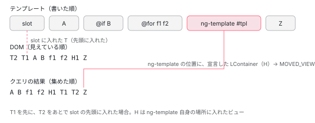

[目次](../README.md) › [クエリ（viewChild・contentChildren）の内側](README.md) › 第 4 回 / 全 7 回

# LQuery と結果の集め方：埋め込みビューと QueryList

> LView ごとの LQueries と LQuery\_。埋め込みビューの LQuery は宣言したビューの QueryList を共有する clone で、ビューを作り終えた・入れた・外したときに setDirty される。materializeViewResults と collectQueryResults が、書いた順に結果を集め、ng-template の中身を ng-template を書いた位置に（宣言した LContainer の順 → 別の場所に入れたビューは入れた時刻の順）差し込むこと。QueryList の reset・dirty・changes と emitDistinctChangesOnly。ページの上の本物で、ビューを足し引きして DOM の順と結果の順を比べる。

angular/angular · 読了 約 14 分 · 中核 · [サイトで読む（デモが動きます）](https://angular-deep-dive-cyan.vercel.app/chapter/qry-lquery-results)

---

この章では、クエリの結果を入れておく実行時の入れ物 `LQueries_` と `LQuery_` が、埋め込みビュー（`@if`・`@for`・`ng-template` から作られるビュー）を作る・入れる・外すたびに何をするかを読み、`materializeViewResults` と `collectQueryResults` が結果を**どの順で**集めるかを確かめます。最後に、集めた結果を受け取る `QueryList` の `reset`・`dirty`・`changes` と `emitDistinctChangesOnly` を読みます。

読む対象は `packages/core/src/render3/queries/query.ts`（37〜92 行目と 392〜463 行目、550〜561 行目）・`linker/query_list.ts`・`render3/view/container.ts`・`render3/view_manipulation.ts` です。どのノードが「合う」かを最初の作成のときに決める `TQuery_` の照合は[第 3 回](03-qry-tquery-match.md)、`LContainer`（ビューを入れる配列）は[LContainer の章](../ivy/11-ivy-lcontainer.md)、`DECLARATION_LCONTAINER` と `MOVED_VIEWS` の意味は[ビューの木の章](../ivy/12-ivy-view-tree.md)にあります。

1. [1. 1 行の viewChild が生むもの](01-qry-what-declared.md)
2. [2. コンパイラの側](02-qry-compile.md)
3. [3. TQuery の照合](03-qry-tquery-match.md)
4. **4. LQuery と結果の集め方**（この章）
5. [5. 更新の時機](05-qry-refresh-timing.md)
6. [6. コンテンツのクエリ](06-qry-content-projection.md)
7. [7. spec と issue](07-qry-tests-issues.md)

## 1. TQuery と LQuery：設計図と、ビューごとの入れ物

[第 3 回](03-qry-tquery-match.md)で読んだ `TQuery_` は TView（テンプレートの設計図、[TView の章](../ivy/05-ivy-tview.md)）に 1 つあり、`matches` に「合ったノードの番号と、何を読むか」を 2 つずつ並べて持っています。これは同じテンプレートのビューすべてに共通です。ビューごとに違うのは「そのビューで作られた本物の値（ElementRef やコンポーネントのインスタンス）」で、それを入れるのが LView（ビューのインスタンス、[LView の章](../ivy/06-ivy-lview.md)）の `QUERIES` の枠に置かれる `LQueries_` です。

📄 `angular/packages/core/src/render3/queries/query.ts` L37–46 （▶ の行: 38–41, 43–44）

```ts
37 │ class LQuery_<T> implements LQuery<T> {
38 ▶   matches: (T | null)[] | null = null;
39 ▶   constructor(public queryList: QueryList<T>) {}
40 ▶   clone(): LQuery<T> {
41 ▶     return new LQuery_(this.queryList);
42 │   }
43 ▶   setDirty(): void {
44 ▶     this.queryList.setDirty();
45 │   }
46 │ }
```

`LQuery_` は 2 つしか持っていません。38 行目の `matches` は、このビューで作った結果の配列（最初は `null`）。39 行目の `queryList` は、利用者に見える `QueryList` です。40〜41 行目の `clone()` が大事で、**同じ `queryList` を持つ新しい `LQuery_`** を返します。`matches` は新しい方では `null` に戻ります。43〜44 行目の `setDirty()` は、その `queryList` に「もう一度集め直す必要がある」と印を付けるだけです。

## 2. 埋め込みビューを作るとき：createEmbeddedView

📄 `angular/packages/core/src/render3/view_manipulation.ts` L57–63 （▶ の行: 57, 59–61, 63）

```ts
57 ▶     embeddedLView[DECLARATION_LCONTAINER] = declarationLContainer;
58 │ 
59 ▶     const declarationViewLQueries = declarationLView[QUERIES];
60 ▶     if (declarationViewLQueries !== null) {
61 ▶       embeddedLView[QUERIES] = declarationViewLQueries.createEmbeddedView(embeddedTView);
62 │     }
63 ▶ 
```

`createAndRenderEmbeddedLView` は、`@if` の分岐・`@for` の行・`ViewContainerRef.createEmbeddedView` のどれでも通る、埋め込みビューを作る関数です（[LContainer の章](../ivy/11-ivy-lcontainer.md)）。57 行目で新しいビューに「宣言した場所の LContainer」を覚えさせ、59〜61 行目で、**宣言したビュー**（テンプレートを書いたビュー）の `LQueries` から、新しいビューの `LQueries` を作ります。63 行目以降の `renderView` で中身が作られます。

📄 `angular/packages/core/src/render3/queries/query.ts` L48–72 （▶ の行: 52, 54–55, 62–65, 68, 71）

```ts
48 │ class LQueries_ implements LQueries {
49 │   constructor(public queries: LQuery<any>[] = []) {}
50 │ 
51 │   createEmbeddedView(tView: TView): LQueries | null {
52 ▶     const tQueries = tView.queries;
53 │     if (tQueries !== null) {
54 ▶       const noOfInheritedQueries =
55 ▶         tView.contentQueries !== null ? tView.contentQueries[0] : tQueries.length;
56 │       const viewLQueries: LQuery<any>[] = [];
57 │ 
58 │       // An embedded view has queries propagated from a declaration view at the beginning of the
59 │       // TQueries collection and up until a first content query declared in the embedded view. Only
60 │       // propagated LQueries are created at this point (LQuery corresponding to declared content
61 │       // queries will be instantiated from the content query instructions for each directive).
62 ▶       for (let i = 0; i < noOfInheritedQueries; i++) {
63 ▶         const tQuery = tQueries.getByIndex(i);
64 ▶         const parentLQuery = this.queries[tQuery.indexInDeclarationView];
65 ▶         viewLQueries.push(parentLQuery.clone());
66 │       }
67 │ 
68 ▶       return new LQueries_(viewLQueries);
69 │     }
70 │ 
71 ▶     return null;
72 │   }
```

1. **52 行目：埋め込みビューの TView の `queries` を見る**

   この `tQueries` は、[第 3 回](03-qry-tquery-match.md)の `embeddedTView` が、`ng-template` を越えて中まで届くクエリだけを写して作ったものです。`null` なら、どのクエリもこのテンプレートの中を見ないので、71 行目で `null` を返します。
2. **54〜55 行目：受け継ぐクエリの数を決める**

   埋め込みビューの `TQueries` には、外から写されたクエリが先頭に並び、そのあとに「このテンプレートの中のディレクティブが宣言したコンテンツのクエリ」が続きます。`contentQueries[0]` はその最初の番号なので、そこまでが受け継ぐ分です（並び方は[第 6 回](06-qry-content-projection.md)）。
3. **62〜65 行目：宣言したビューの LQuery を clone する**

   63 行目で i 番目の TQuery を取り、64 行目の `indexInDeclarationView`（写したときに覚えた、宣言したビューでの番号）で宣言したビューの `LQuery_` を引き、65 行目で `clone()` します。つまり、**埋め込みビューの LQuery は、宣言したビューの QueryList を共有**します。行が 10 個ある `@for` なら、同じ `QueryList` を指す `LQuery_` が 10 個できます。
4. **68 行目：新しい LQueries\_ を返す**

   ここで作られるのは「受け継いだ分」だけです。コメント（58〜61 行目）のとおり、中のディレクティブのコンテンツのクエリの LQuery は、そのディレクティブの `contentQueries` の作成の段で足されます。

## 3. いつ dirty になるか：3 つの呼び出し元

📄 `angular/packages/core/src/render3/queries/query.ts` L86–92 （▶ の行: 87–89）

```ts
86 │   private dirtyQueriesWithMatches(tView: TView) {
87 ▶     for (let i = 0; i < this.queries.length; i++) {
88 ▶       if (getTQuery(tView, i).matches !== null) {
89 ▶         this.queries[i].setDirty();
90 │       }
91 │     }
92 │   }
```

`LQueries_` の `insertView`・`detachView`・`finishViewCreation` の 3 つは、どれもこの `dirtyQueriesWithMatches` を呼ぶだけです（3 つの本体は[input と viewChild の章](../signals/11-authoring.md)で引用しました）。87〜89 行目で、そのビューの TView の i 番目の TQuery に `matches` が 1 つでもあれば、i 番目の `LQuery_` の `setDirty()`、つまり共有している `QueryList` の `setDirty()` を呼びます。合うノードが 1 つもないテンプレートのビュー（`@if` の中に `#it` が無い、など）を足し引きしても、クエリは dirty になりません。

呼んでいるのは 4 か所です。

📄 `angular/packages/core/src/render3/instructions/render.ts` L115–121 （▶ の行: 115–116, 121）

```ts
115 ▶     if (tView.firstCreatePass) {
116 ▶       tView.firstCreatePass = false;
117 │     }
118 │ 
119 │     // Mark all queries active in this view as dirty. This is necessary for signal-based queries to
120 │     // have a clear marking point where we can read query results atomically (for a given view).
121 ▶     lView[QUERIES]?.finishViewCreation(tView);
```

📄 `angular/packages/core/src/render3/view/container.ts` L214–218 （▶ の行: 215–217）

```ts
214 │   // track views where declaration and insertion points are different
215 ▶   const declarationLContainer = lView[DECLARATION_LCONTAINER];
216 ▶   if (declarationLContainer !== null && lContainer !== declarationLContainer) {
217 ▶     trackMovedView(declarationLContainer, lView);
218 │   }
```

📄 `angular/packages/core/src/render3/view/container.ts` L220–224 （▶ の行: 221, 223）

```ts
220 │   // notify query that a new view has been added
221 ▶   const lQueries = lView[QUERIES];
222 │   if (lQueries !== null) {
223 ▶     lQueries.insertView(tView);
224 │   }
```

📄 `angular/packages/core/src/render3/view/container.ts` L165–171 （▶ の行: 168, 170）

```ts
165 │     removeViewFromDOM(viewToDetach[TVIEW], viewToDetach);
166 │ 
167 │     // notify query that a view has been removed
168 ▶     const lQueries = removedLView[QUERIES];
169 │     if (lQueries !== null) {
170 ▶       lQueries.detachView(removedLView[TVIEW]);
171 │     }
```

📄 `angular/packages/core/src/render3/node_manipulation.ts` L369–375 （▶ の行: 372, 374）

```ts
369 │       }
370 │ 
371 │       // For embedded views still attached to a container: remove query result from this view.
372 ▶       const lQueries = lView[QUERIES];
373 │       if (lQueries !== null) {
374 ▶         lQueries.detachView(tView);
375 │       }
```

| いつ | 行 | 何をする |
| --- | --- | --- |
| ビューの作成の段が終わったとき | render.ts 121 行目 | `finishViewCreation`。116 行目で `firstCreatePass` を下ろしたあと、その LView のクエリをまとめて dirty にする。signal のクエリが「ビューを作り終えた時点の結果」を一度に読むための区切り（[第 5 回](05-qry-refresh-timing.md)） |
| ビューを LContainer に入れたとき | container.ts 223 行目 | `insertView`。`@if` の分岐が入る、`@for` の行が足される・動く、`ViewContainerRef` の `insert`・`createEmbeddedView`・`move` |
| ビューを LContainer から外したとき | container.ts 170 行目 | `detachView`。`remove`・`detach`・`move`・`@for` の行が消える・動く |
| 入ったままのビューを壊したとき | node\_manipulation.ts 374 行目 | 親のビューごと壊されるときなど、外されずに壊れるビュー。372 行目のコメントどおり「このビューの結果を取り除く」 |

215〜217 行目は、入れる先の LContainer が**宣言した場所の LContainer と違う**とき（`ng-template` を別の `ViewContainerRef` に入れたとき）に `trackMovedView` を呼び、宣言した LContainer の `MOVED_VIEWS` に覚えさせる行です。5 節で、この配列が結果の並びを決めます。

📄 `angular/packages/core/src/render3/view/container.ts` L255–259 （▶ の行: 256, 258）

```ts
255 │   if (movedViews === null) {
256 ▶     declarationContainer[MOVED_VIEWS] = [lView];
257 │   } else {
258 ▶     movedViews.push(lView);
259 │   }
```

`MOVED_VIEWS` には、入れた**時刻の順**に後ろへ足されます（256・258 行目）。入れた先の LContainer の中で何番目か、は見ていません。

## 4. 1 つのビューの結果：materializeViewResults

📄 `angular/packages/core/src/render3/queries/query.ts` L550–561 （▶ の行: 557–560）

```ts
550 │ /**
551 │  * A helper function collecting results from all the views where a given query was active.
552 │  * @param lView
553 │  * @param queryIndex
554 │  */
555 │ export function getQueryResults<V>(lView: LView, queryIndex: number): V[] {
556 │   const tView = lView[TVIEW];
557 ▶   const tQuery = getTQuery(tView, queryIndex);
558 ▶   return tQuery.crossesNgTemplate
559 ▶     ? collectQueryResults<V>(tView, lView, queryIndex, [])
560 ▶     : materializeViewResults<V>(tView, lView, tQuery, queryIndex);
561 │ }
```

結果を集める入口は `getQueryResults` です。decorator のクエリでは `ɵɵqueryRefresh`、signal のクエリでは `refreshSignalQuery` から呼ばれます（どちらも[第 5 回](05-qry-refresh-timing.md)）。558 行目の `crossesNgTemplate` は、照合のときに `ng-template` を越えたら `true` になる印です（[第 3 回](03-qry-tquery-match.md)）。越えていなければ 560 行目で 1 つのビューの結果だけ、越えていれば 559 行目で木をたどります。

📄 `angular/packages/core/src/render3/queries/query.ts` L392–420 （▶ の行: 398–399, 403, 405, 409, 412–413, 416, 419）

```ts
392 │ function materializeViewResults<T>(
393 │   tView: TView,
394 │   lView: LView,
395 │   tQuery: TQuery,
396 │   queryIndex: number,
397 │ ): T[] {
398 ▶   const lQuery = lView[QUERIES]!.queries![queryIndex];
399 ▶   if (lQuery.matches === null) {
400 │     const tViewData = tView.data;
401 │     const tQueryMatches = tQuery.matches;
402 │     const result: Array<T | null> = [];
403 ▶     for (let i = 0; tQueryMatches !== null && i < tQueryMatches.length; i += 2) {
404 │       const matchedNodeIdx = tQueryMatches[i];
405 ▶       if (matchedNodeIdx < 0) {
406 │         // we at the <ng-template> marker which might have results in views created based on this
407 │         // <ng-template> - those results will be in separate views though, so here we just leave
408 │         // null as a placeholder
409 ▶         result.push(null);
410 │       } else {
411 │         ngDevMode && assertIndexInRange(tViewData, matchedNodeIdx);
412 ▶         const tNode = tViewData[matchedNodeIdx] as TNode;
413 ▶         result.push(createResultForNode(lView, tNode, tQueryMatches[i + 1], tQuery.metadata.read));
414 │       }
415 │     }
416 ▶     lQuery.matches = result;
417 │   }
418 │ 
419 ▶   return lQuery.matches;
420 │ }
```

1. **398〜399 行目：このビューの LQuery の `matches` がまだ無いときだけ作る**

   関数の上のコメントのとおり、1 つのビューの結果は変わらないので、ビューごとに 1 回だけ作ります。2 回目からは 419 行目で同じ配列を返します。
2. **403 行目：TQuery の `matches` を 2 つずつ進む**

   偶数番がノードの番号、奇数番が「何を読むか」の番号です（[第 3 回](03-qry-tquery-match.md)）。
3. **405〜409 行目：番号が負なら `null` を置く**

   負の番号は「ここに `ng-template` がある」という目印です。中の結果は別のビューにあるので、場所だけ取っておきます。
4. **412〜413 行目：TNode を引いて、本物の値を作る**

   `createResultForNode` が ElementRef・TemplateRef・コンポーネントのインスタンスなどを作ります（read の扱いは[第 3 回](03-qry-tquery-match.md)）。
5. **416 行目：LQuery に覚えさせる**

   埋め込みビューの `LQuery_` は `clone()` で `matches` が `null` から始まるので、行ごとに自分の結果を持ちます。

## 5. ビューの木から集める：collectQueryResults

📄 `angular/packages/core/src/render3/queries/query.ts` L422–438 （▶ の行: 427, 430, 432, 434–435, 437）

```ts
422 │ /**
423 │  * A helper function that collects (already materialized) query results from a tree of views,
424 │  * starting with a provided LView.
425 │  */
426 │ function collectQueryResults<T>(tView: TView, lView: LView, queryIndex: number, result: T[]): T[] {
427 ▶   const tQuery = tView.queries!.getByIndex(queryIndex);
428 │   const tQueryMatches = tQuery.matches;
429 │   if (tQueryMatches !== null) {
430 ▶     const lViewResults = materializeViewResults<T>(tView, lView, tQuery, queryIndex);
431 │ 
432 ▶     for (let i = 0; i < tQueryMatches.length; i += 2) {
433 │       const tNodeIdx = tQueryMatches[i];
434 ▶       if (tNodeIdx > 0) {
435 ▶         result.push(lViewResults[i / 2] as T);
436 │       } else {
437 ▶         const childQueryIndex = tQueryMatches[i + 1];
438 │ 
```

430 行目でまず自分のビューの結果を作り、432 行目から TQuery の `matches` を**前から順に**見ます。434〜435 行目、番号が正ならこのビューの結果をそのまま積みます。負なら `ng-template` の目印で、437 行目の `childQueryIndex` は、中のビューの TQueries で同じクエリが何番目か、です。

その次の行（[入れ子・注入器・クエリの章](../defer/14-defer-nested-di.md)で引用）で、目印の場所にある LContainer、つまり**その ng-template を宣言した場所の LContainer** を取り、そこに入っているビューのうち `DECLARATION_LCONTAINER` と `PARENT` が同じもの（宣言した場所にそのまま入ったビュー）を、LContainer の中の順に、再帰で集めます。`@if` と `@for` のビューは、どれもこれです。

📄 `angular/packages/core/src/render3/queries/query.ts` L452–463 （▶ の行: 452–454, 456, 462）

```ts
452 ▶         if (declarationLContainer[MOVED_VIEWS] !== null) {
453 ▶           const embeddedLViews = declarationLContainer[MOVED_VIEWS]!;
454 ▶           for (let i = 0; i < embeddedLViews.length; i++) {
455 │             const embeddedLView = embeddedLViews[i];
456 ▶             collectQueryResults(embeddedLView[TVIEW], embeddedLView, childQueryIndex, result);
457 │           }
458 │         }
459 │       }
460 │     }
461 │   }
462 ▶   return result;
463 │ }
```

そのあと 452〜456 行目で、同じ ng-template から作られて**別の LContainer に入った**ビュー（3 節の `MOVED_VIEWS`）を、配列の順に集めます。つまり結果の並びは次の規則で決まります。

1. **テンプレートに書いた順**

   1 つのビューの中は、TQuery の `matches` の順、つまり照合したノードの順（テンプレートを上から読んだ順）です。
2. **ng-template の中身は、その ng-template を書いた場所に差し込まれる**

   DOM のどこに入ったかは関係ありません。別の `ViewContainerRef` に入れて画面の一番上に出しても、結果では ng-template の位置に来ます。
3. **同じ場所の中では、宣言した LContainer の中の順 → MOVED\_VIEWS の順**

   宣言した場所に入れたビューは LContainer の中の順（`@for` の行の順）。別の場所に入れたビューは、そのあとに**入れた時刻の順**です。



*結果は「書いた場所」の順。slot に入れた T は、DOM では一番上でも、結果では ng-template の位置に来る*

## 6. QueryList：reset・dirty・changes

📄 `angular/packages/core/src/linker/query_list.ts` L46–69 （▶ の行: 47–51, 60–61, 69）

```ts
46 │ export class QueryList<T> implements Iterable<T> {
47 ▶   public readonly dirty = true;
48 ▶   private _onDirty?: () => void = undefined;
49 ▶   private _results: Array<T> = [];
50 ▶   private _changesDetected: boolean = false;
51 ▶   private _changes: Subject<QueryList<T>> | undefined = undefined;
52 │ 
53 │   readonly length: number = 0;
54 │   readonly first: T = undefined!;
55 │   readonly last: T = undefined!;
56 │ 
57 │   /**
58 │    * Returns `Observable` of `QueryList` notifying the subscriber of changes.
59 │    */
60 ▶   get changes(): Observable<any> {
61 ▶     return (this._changes ??= new Subject());
62 │   }
63 │ 
64 │   /**
65 │    * @param emitDistinctChangesOnly Whether `QueryList.changes` should fire only when actual change
66 │    *     has occurred. Or if it should fire when query is recomputed. (recomputing could resolve in
67 │    *     the same result)
68 │    */
69 ▶   constructor(private _emitDistinctChangesOnly: boolean = false) {}
```

47 行目、`dirty` は `true` から始まります。作ったばかりの QueryList は「まだ一度も集めていない」からです。49 行目の `_results` が中身、50 行目の `_changesDetected` が「直前の `reset` で中身が変わったか」です。60〜61 行目の `changes` は、最初に読まれたときに初めて `Subject`（rxjs の、自分で値を流せる Observable）を作ります。誰も `changes` を読まなければ Subject は作られません。69 行目の `_emitDistinctChangesOnly` は、LQuery を作る `createLQuery`（query.ts）が、QueryFlags の `emitDistinctChangesOnly` の印を見て渡します。

📄 `angular/packages/core/src/linker/query_list.ts` L139–168 （▶ の行: 152–158, 166–167）

```ts
139 │   /**
140 │    * Updates the stored data of the query list, and resets the `dirty` flag to `false`, so that
141 │    * on change detection, it will not notify of changes to the queries, unless a new change
142 │    * occurs.
143 │    *
144 │    * @param resultsTree The query results to store
145 │    * @param identityAccessor Optional function for extracting stable object identity from a value
146 │    *    in the array. This function is executed for each element of the query result list while
147 │    *    comparing current query list with the new one (provided as a first argument of the `reset`
148 │    *    function) to detect if the lists are different. If the function is not provided, elements
149 │    *    are compared as is (without any pre-processing).
150 │    */
151 │   reset(resultsTree: Array<T | any[]>, identityAccessor?: (value: T) => unknown): void {
152 ▶     (this as {dirty: boolean}).dirty = false;
153 ▶     const newResultFlat = flatten(resultsTree);
154 ▶     if ((this._changesDetected = !arrayEquals(this._results, newResultFlat, identityAccessor))) {
155 ▶       this._results = newResultFlat;
156 ▶       (this as Writable<this>).length = newResultFlat.length;
157 ▶       (this as Writable<this>).last = newResultFlat[this.length - 1];
158 ▶       (this as Writable<this>).first = newResultFlat[0];
159 │     }
160 │   }
161 │ 
162 │   /**
163 │    * Triggers a change event by emitting on the `changes` {@link EventEmitter}.
164 │    */
165 │   notifyOnChanges(): void {
166 ▶     if (this._changes !== undefined && (this._changesDetected || !this._emitDistinctChangesOnly))
167 ▶       this._changes.next(this);
168 │   }
```

1. **152 行目：`dirty` を下ろす**

   中身が変わっても変わらなくても下ろします。
2. **153 行目：結果の木を平らにする**

   4 節の `matches` には `null` の目印が入らないよう集め直してありますが、multi の provider を読んだときなどは配列が入れ子になるので、`flatten` で 1 段にします。
3. **154 行目：前の中身と 1 つずつ比べる**

   違ったときだけ 155〜158 行目で中身・`length`・`first`・`last` を入れ替えます。同じなら **前の配列のまま**です。
4. **166〜167 行目：`notifyOnChanges` で流すかどうか**

   Subject が作られていて、かつ「中身が変わった」か「`emitDistinctChangesOnly` が `false`」のときだけ流します。

📄 `angular/packages/core/src/util/array_utils.ts` L19–40 （▶ の行: 20, 24–26, 28, 39）

```ts
19 │ export function arrayEquals<T>(a: T[], b: T[], identityAccessor?: (value: T) => unknown): boolean {
20 ▶   if (a.length !== b.length) return false;
21 │   for (let i = 0; i < a.length; i++) {
22 │     let valueA = a[i];
23 │     let valueB = b[i];
24 ▶     if (identityAccessor) {
25 ▶       valueA = identityAccessor(valueA) as any;
26 ▶       valueB = identityAccessor(valueB) as any;
27 │     }
28 ▶     if (valueB !== valueA) {
29 │       return false;
30 │     }
31 │   }
32 │   return true;
33 │ }
34 │ 
35 │ /**
36 │  * Flattens an array.
37 │  */
38 │ export function flatten(list: any[]): any[] {
39 ▶   return list.flat(Number.POSITIVE_INFINITY);
40 │ }
```

📄 `angular/packages/core/src/linker/element_ref.ts` L84–91 （▶ の行: 90）

```ts
84 │  * Unwraps `ElementRef` and return the `nativeElement`.
85 │  *
86 │  * @param value value to unwrap
87 │  * @returns `nativeElement` if `ElementRef` otherwise returns value as is.
88 │  */
89 │ export function unwrapElementRef<T, R>(value: T | ElementRef<R>): T | R {
90 ▶   return value instanceof ElementRef ? value.nativeElement : value;
91 │ }
```

比べ方は、長さが違えば 20 行目で「違う」、同じなら 28 行目で 1 つずつ `!==` です。24〜26 行目の `identityAccessor` には、集め直す側から `unwrapElementRef` が渡されます。90 行目のとおり ElementRef なら `nativeElement`（DOM の要素）を返すので、ElementRef の箱が別の物でも、**同じ DOM の要素なら同じ**と見なします。

📄 `angular/packages/core/src/metadata/di.ts` L82–84 （▶ の行: 84）

```ts
82 │ // Stores the default value of `emitDistinctChangesOnly` when the `emitDistinctChangesOnly` is not
83 │ // explicitly set.
84 ▶ export const emitDistinctChangesOnlyDefaultValue = true;
```

`@ViewChildren` と `@ContentChildren` の `emitDistinctChangesOnly` の既定は 84 行目の `true` です。`false` にすると、dirty で集め直した回は、中身が同じでも `changes` が流れます。signal のクエリは、コンパイラがいつも `true` にします（[第 2 回](02-qry-compile.md)）。

📄 `angular/packages/core/src/linker/query_list.ts` L175–187 （▶ の行: 177–178, 183–185）

```ts
175 │   /** internal */
176 │   setDirty() {
177 ▶     (this as {dirty: boolean}).dirty = true;
178 ▶     this._onDirty?.();
179 │   }
180 │ 
181 │   /** internal */
182 │   destroy(): void {
183 ▶     if (this._changes !== undefined) {
184 ▶       this._changes.complete();
185 ▶       this._changes.unsubscribe();
186 │     }
187 │   }
```

177 行目が 3 節の `setDirty()` の行き先です。178 行目の `_onDirty` は signal のクエリだけが登録するもので、dirty になったことを signal に伝えます（[第 5 回](05-qry-refresh-timing.md)）。183〜185 行目の `destroy` は、クエリを宣言したビューが壊れるときに呼ばれ、`changes` を complete します（`createLQuery` が cleanup に登録しています）。

## 7. DEMO：足し引きして並びを見る

> **🧪 DEMO — @ViewChildren('it') の並びと changes の回数**
>
> 部品 `qlr-stage` のテンプレートに、`#it` の付いた `<span>` を書きました：一番上の `slot`（`<ng-container #slot>`、ここに後からビューを入れる）、A、`@if` の B、`@for` の行、`<ng-template #tpl>` の中、Z。同じ `'it'` を、`@ViewChildren`（`emitDistinctChangesOnly` は既定の `true`）、`@ViewChildren`（`false`）、`viewChildren()` の 3 つで読んでいます。「slot の先頭に T を作る」は `slot` の `ViewContainerRef` の 0 番に、「ng-template の場所に H を作る」は `#tpl` 自身の `ViewContainerRef` の末尾に、`#tpl` のビューを作ります。どのボタンも、状態を変えてから `qlr-stage` の `detectChanges()` を 1 回だけ走らせ、並びと回数を読みます。DOM と結果の並びが違うと、結果の行が赤くなります。
>
> ▶ [このデモはサイトで動かせます](https://angular-deep-dive-cyan.vercel.app/chapter/qry-lquery-results)

確かめられることです（本番ビルドをヘッドレスの Chrome で開いて、ボタンを順に押して確かめました）。

1. **描く**

   結果は `A B f1 f2 Z`。changes は 0 回（購読は `ngAfterViewInit` で始めるので、最初に集めた回は数えていません）。
2. **@if の B を切り替える・@for に足す・@for の先頭を消す**

   どちらの changes も +1。3 節の `insertView` / `detachView` で dirty になり、中身が変わったからです。
3. **@for を逆に並べる**

   結果も `f2 f1` の順になり、どちらも +1。行のビューは宣言した LContainer の中で動き、5 節の規則の 3 つ目（LContainer の中の順）に従います。
4. **slot の先頭に T を作る（2 回）**

   DOM は `T2 T1 A …`、結果は `… f2 T1 T2 Z`（赤）。ng-template の位置に、入れた時刻の順で並びます。
5. **ng-template の場所に H を作る**

   結果は `… H1 T1 T2 Z`。宣言した LContainer の H が先、MOVED\_VIEWS の T があと。DOM では H は Z の直前です。
6. **slot の先頭を外して戻す**

   `true` の方は +0、`false` の方は +1。外す・入れるで dirty になって集め直しますが、中身は同じなので 154 行目で「変わっていない」になり、166 行目の条件が分かれます。
7. **何も変えずに detectChanges**

   どちらも +0。dirty でなければ集め直しもしません（[第 5 回](05-qry-refresh-timing.md)）。

## 8. ここまでを 1 本に

- 👤 `slot.createEmbeddedView(tpl, ctx, 0)` — あなたのコード
  - `createAndRenderEmbeddedLView` — view\_manipulation.ts L57・L61 — *宣言したビューの LQuery を clone（QueryList は共有）*
    - `renderView` → `finishViewCreation` — render.ts L121 — *合うノードがあれば setDirty*
  - `insertImpl` → `addLViewToLContainer` → `insertView` — view/container.ts
    - `trackMovedView` — view/container.ts L217・L258 — *宣言した場所と違うので MOVED\_VIEWS の末尾へ*
    - `lQueries.insertView` → `QueryList.setDirty` — view/container.ts L223 / query\_list.ts L177
- 👤 `detectChanges()` — あなたのコード
  - `viewQuery(RenderFlags.Update)` → `ɵɵqueryRefresh` — 第 5 回 — *dirty なときだけ*
    - `getQueryResults` → `collectQueryResults` — query.ts L559
      - `materializeViewResults` — query.ts L398・L416 — *ビューごとに 1 回だけ作る*
      - `MOVED_VIEWS` を配列の順に — query.ts L452〜L456
    - `QueryList.reset(result, unwrapElementRef)` → `notifyOnChanges` — query\_list.ts L154・L166

## テストと直し方

### spec

| spec | describe / it（行） | この章の節 |
| --- | --- | --- |
| core/test/acceptance/query\_spec.ts | describe `query order`（1150）の it `should register view query matches from top to bottom`（1156） | 5 節の規則 1 |
| describe `observable interface`（2253）の it `should allow observing changes to query list`（2254）・`should only fire if the content of the query changes`（2274） | 6 節 |   |
| describe `view boundaries`（2315）› `ViewContainerRef`（2316）の it `should report results in views inserted / removed by ngIf`（2338）・`by ngFor`（2372） | 3 節 |   |
| it `should NOT notify on changes when a given view is removed and re-inserted at the same index`（2418） | 6 節・DEMO の 6 |   |
| it `should report results when the same TemplateRef is inserted into different ViewContainerRefs`（2601） | 5 節の MOVED\_VIEWS |   |
| core/test/linker/query\_integration\_spec.ts | describe `query over moved templates`（665）の it `should update queries when a view is detached and re-inserted`（682） | 5 節の MOVED\_VIEWS |
| core/test/linker/query\_list\_spec.ts | describe `dirty and reset`（25）の 2 つの it（26・31）、`simple observable interface`（161） | 6 節 |

📄 `angular/packages/core/test/acceptance/query_spec.ts` L2447–2459 （▶ の行: 2450, 2453, 2455, 2457–2458）

```ts
2447 │         const queryList = fixture.componentInstance.query;
2448 │         const {tpl, vc} = fixture.componentInstance;
2449 │ 
2450 ▶         const viewRef = vc.insertTpl(tpl, {}, 0);
2451 │         fixture.detectChanges();
2452 │         expect(queryList.length).toBe(1);
2453 ▶         expect(fixture.componentInstance.queryListNotificationCounter).toBe(1);
2454 │ 
2455 ▶         vc.move(viewRef, 0);
2456 │         fixture.detectChanges();
2457 ▶         expect(queryList.length).toBe(1);
2458 ▶         expect(fixture.componentInstance.queryListNotificationCounter).toBe(1);
2459 │       });
```

2450 行目で 1 つ入れて 2453 行目で 1 回。2455 行目の `move(viewRef, 0)` は同じ場所への移動で、中では `detachView` と `insertView` が走るので dirty になりますが、2457〜2458 行目で数は 1 のままです。DEMO の「slot の先頭を外して戻す」の `true` の方と同じことを確かめています。

📄 `angular/packages/core/test/linker/query_integration_spec.ts` L691–714 （▶ の行: 692–693, 697, 699–700, 706–707, 713）

```ts
691 │ 
692 ▶       const view1 = q.vc.createEmbeddedView(q.template, {'x': '1'});
693 ▶       const view2 = q.vc.createEmbeddedView(q.template, {'x': '2'});
694 │ 
695 │       // 2 views were created and inserted so we've got 2 matching results
696 │       view.detectChanges();
697 ▶       expect(q.query.map((d: TextDirective) => d.text)).toEqual(['1', '2']);
698 │ 
699 ▶       q.vc.detach(1);
700 ▶       q.vc.detach(0);
701 │ 
702 │       // both views were detached so query results from those views should not be reported
703 │       view.detectChanges();
704 │       expect(q.query.map((d: TextDirective) => d.text)).toEqual([]);
705 │ 
706 ▶       q.vc.insert(view2);
707 ▶       q.vc.insert(view1);
708 │ 
709 │       // previously detached views are re-inserted in the different order so:
710 │       // - query results from the inserted views are reported again
711 │       // - the order results from views reflects orders of views
712 │       view.detectChanges();
713 ▶       expect(q.query.map((d: TextDirective) => d.text)).toEqual(['2', '1']);
714 │     });
```

692〜693 行目は、`manual-projecting` の中に書いた ng-template を、`manual-projecting` 自身のビューの `ViewContainerRef` に入れています。宣言した場所と違うので MOVED\_VIEWS の側です。699〜700 行目で両方を外し、706〜707 行目で view2 → view1 の順に入れ直すと、713 行目で `['2', '1']`。末尾に足しているので、DOM の順と入れた時刻の順が同じ形です。DEMO の T のように**先頭に**入れて、DOM の順と入れた時刻の順が食い違う形を固める it は、この 2 ファイルには見つかりませんでした（2601 行目の it も、入れる順と DOM の順が同じです）。

### 手元で走らせた結果

📄 `走らせたコマンド`

```
cd ~/angular-research/angular
pnpm bazel test //packages/core/test/acceptance:acceptance --nocache_test_results --test_output=all '--test_arg=--filter=^query logic'
pnpm bazel test //packages/core/test:test --nocache_test_results --test_output=all '--test_arg=--filter=^QueryList'
pnpm bazel test //packages/core/test:test --nocache_test_results --test_output=all '--test_arg=--filter=^Query API'
```

- `^query logic`（acceptance）：「Ran 104 of 2693 specs」「104 specs, 0 failures」（2026-11-10、qry-logs/b-acc-query.log）。query\_spec.ts の it の行も 104 で、全部が describe `query logic` の中です。
- `^QueryList`（core/test、4 つに分けて走る）：4 つの合計で 21 件、どれも 0 failures（b-core-querylist.log）。ファイルの it は 23 ですが、`simple observable interface` の 2 つは `if (getDOM().supportsDOMEvents)` の中なので Node では走りません。
- `^Query API`（query\_integration\_spec.ts）：4 つの合計で 46 件、0 failures（b-core-queryapi.log）。ファイルの it の行も 46 です。

### 直すとしたら

- 並びは query.ts の `collectQueryResults`（宣言した LContainer → `MOVED_VIEWS`）で決まります。並びの決まりを変える・固めるなら、it は query\_spec.ts の describe `view boundaries` › `ViewContainerRef` に、2601 行目の it の形（2 つの `ViewContainerRef` に入れて `toArray()` の順を見る）で足します。
- dirty にする場所は view/container.ts の `insertView`・`detachView` と node\_manipulation.ts、render.ts の `finishViewCreation` です。「合うノードが無いビューでは dirty にしない」は query.ts の `dirtyQueriesWithMatches` の 88 行目です。
- `changes` の流れ方は query\_list.ts の `reset` と `notifyOnChanges`。単体の振る舞いは query\_list\_spec.ts、ビューと組み合わせた振る舞いは query\_spec.ts の describe `observable interface` に足します。

## 聞かれそうな質問

**Q. @for の行が 10 個あると、QueryList も 10 個できますか？**

できません。行のビューごとに `LQuery_` は 10 個できますが、どれも 65 行目の `clone()` で宣言したビューの `queryList` を共有しています（40〜41 行目）。行ごとに違うのは `matches`（その行で作った結果）だけです。

**Q. ng-template を別の ViewContainerRef に入れて画面の上に出したのに、結果の順が DOM の順になりません。**

結果は「ng-template を書いた場所」に差し込まれます。collectQueryResults は ng-template の目印（405 行目の負の番号の場所）で、宣言した LContainer の中のビューと、`MOVED_VIEWS`（452〜456 行目）を集めます。DOM のどこにあるかは見ません。別の場所に入れたビューどうしは、入れた時刻の順です（3 節の 256・258 行目）。

**Q. @if の中に何も合う要素が無いとき、@if を切り替えるとクエリは集め直されますか？**

集め直されません。`dirtyQueriesWithMatches` は 88 行目で、そのビューの TView の TQuery に `matches` があるときだけ `setDirty` を呼びます。dirty でなければ `ɵɵqueryRefresh` は何もしません（[第 5 回](05-qry-refresh-timing.md)）。

**Q. QueryList.changes は、結果が同じでも流れることがありますか？**

`emitDistinctChangesOnly: false` のときだけ流れます。既定は 84 行目の `true` で、166 行目は「中身が変わった（154 行目）」か「`false`」のときに流します。中身の比べ方は ElementRef なら DOM の要素どうしです（90 行目）。

**Q. 同じビューの結果は、変更検知のたびに作り直されますか？**

作り直されません。`materializeViewResults` は 399 行目で `matches` が `null` のときだけ作り、416 行目で覚えます。集め直すのは「どのビューを、どの順で並べるか」だけです。

## 読み終えて

- TQuery は TView に 1 つ（どのノードが合うか）、LQuery は LView に 1 つ（そのビューの結果）。埋め込みビューの LQuery は clone で、QueryList を共有する。
- dirty になるのは、合うノードのあるビューを作り終えた・入れた・外した・入ったまま壊したとき。
- 結果の並びは書いた順。ng-template の中身は ng-template を書いた位置に、宣言した LContainer の順 → MOVED\_VIEWS（入れた時刻の順）で差し込まれる。
- QueryList.reset は中身が同じなら前の配列のまま。changes は既定では中身が変わったときだけ流れる。

---

← 前: [TQuery の照合：どのノードが「合う」のか、read で何を返すのか](03-qry-tquery-match.md)  
次: [更新の時機：static、ngAfterViewInit、ɵɵqueryRefresh と signal クエリ](05-qry-refresh-timing.md) →
