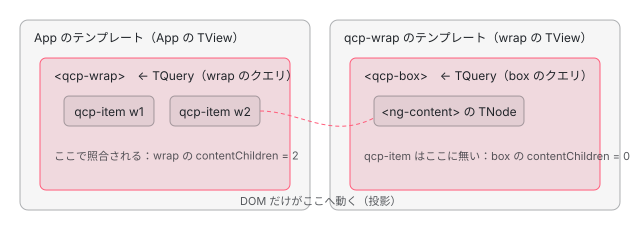

[目次](../README.md) › [クエリ（viewChild・contentChildren）の内側](README.md) › 第 6 回 / 全 7 回

# コンテンツのクエリ：投影されたノード、ディレクティブのクエリ、継承

> contentChildren が見るのは「ホストの要素の中に書かれたノード」で、ng-content でどこに投影されたかではないこと。createContentQuery と saveContentQueryAndDirectiveIndex、ホストのノードで contentQueries が作られて照合が始まる行。ディレクティブにもクエリが書けること、継承（InheritDefinitionFeature）でクエリ関数がつながる行。ページの上の本物で、投影の有無と descendants の違いを比べる。

angular/angular · 読了 約 13 分 · 中核 · [サイトで読む（デモが動きます）](https://angular-deep-dive-cyan.vercel.app/chapter/qry-content-projection)

---

この章では、`contentChildren` / `@ContentChildren` が「ホストの要素の**中に書かれた**ノード」を見ていて、`<ng-content>` でどこに投影されたかは見ていないことを、照合が始まる行から確かめます。コンテンツのクエリはホストのノードでディレクティブを作った直後に作られ、そこから先の、同じテンプレートの子のノードとだけ照合されます。ディレクティブにも書けること、継承でクエリ関数がつながる行も読みます。

読む対象は `packages/core/src/render3/queries/query_execution.ts`（`executeContentQueries`）・`queries/query.ts`（`createContentQuery`・`saveContentQueryAndDirectiveIndex`）・`instructions/element.ts`・`features/inherit_definition_feature.ts` です。`ɵɵcontentQuery` と `ɵɵcontentQuerySignal` の本体は[第 1 回](01-qry-what-declared.md)、`descendants` の照合（`isApplyingToNode`）は[第 3 回](03-qry-tquery-match.md)、投影そのもの（`ɵɵprojection`）は[ng-content の章](../template/02-projection.md)にあります。

1. [1. 1 行の viewChild が生むもの](01-qry-what-declared.md)
2. [2. コンパイラの側](02-qry-compile.md)
3. [3. TQuery の照合](03-qry-tquery-match.md)
4. [4. LQuery と結果の集め方](04-qry-lquery-results.md)
5. [5. 更新の時機](05-qry-refresh-timing.md)
6. **6. コンテンツのクエリ**（この章）
7. [7. spec と issue](07-qry-tests-issues.md)

## 1. コンパイルの出力：contentQueries 関数

📄 `angular/packages/compiler-cli/test/compliance/test_cases/r3_compiler_compliance/components_and_directives/queries/content_query_for_directive.js` L6–15 （▶ の行: 6, 8, 12–13）

```js
 6 ▶     contentQueries: function ContentQueryComponent_ContentQueries(rf, ctx, dirIndex) {
 7 │       if (rf & 1) {
 8 ▶       $r3$.ɵɵcontentQuery(dirIndex, SomeDirective, 5)(dirIndex, SomeDirective, 4);
 9 │       }
10 │       if (rf & 2) {
11 │         let $tmp$;
12 ▶         $r3$.ɵɵqueryRefresh($tmp$ = $r3$.ɵɵloadQuery()) && (ctx.someDir = $tmp$.first);
13 ▶         $r3$.ɵɵqueryRefresh($tmp$ = $r3$.ɵɵloadQuery()) && (ctx.someDirList = $tmp$);
14 │       }
15 │     },
```

`@ContentChild(SomeDirective)` と `@ContentChildren(SomeDirective)` を持つコンポーネントの期待値です。6 行目、ビューのクエリの `viewQuery(rf, ctx)` と違い、引数が 3 つ（`rf, ctx, dirIndex`）あります。`dirIndex` は、このディレクティブが LView の何番目に置かれたか、です。8 行目の 3 つ目の引数が QueryFlags で、`ContentChild` は `5`（`descendants` の 1 と `emitDistinctChangesOnly` の 4）、`ContentChildren` は `4` です。**descendants の既定は `ContentChildren` / `contentChildren` だけ `false`** で、ほかは `true` です（既定を決める行は[第 2 回](02-qry-compile.md)）。12〜13 行目は[第 5 回](05-qry-refresh-timing.md)の `ɵɵqueryRefresh` の行です。

この関数がいつ呼ばれるかは、ディレクティブの定義に `contentQueries` があるかどうかを、ノードに印として写すところから始まります。

📄 `angular/packages/core/src/render3/view/directives.ts` L218–221 （▶ の行: 219）

```ts
218 │ 
219 ▶     if (def.contentQueries !== null) tNode.flags |= TNodeFlags.hasContentQuery;
220 │     if (def.hostBindings !== null || def.hostAttrs !== null || def.hostVars !== 0)
221 │       tNode.flags |= TNodeFlags.hasHostBindings;
```

📄 `angular/packages/core/src/render3/interfaces/type_checks.ts` L31–33 （▶ の行: 32）

```ts
31 │ export function isContentQueryHost(tNode: TNode): boolean {
32 ▶   return (tNode.flags & TNodeFlags.hasContentQuery) !== 0;
33 │ }
```

ノードに合ったディレクティブを並べるとき（最初の作成のときだけ、[firstCreatePass の章](../ivy/08-ivy-first-create-pass.md)）、219 行目で、`contentQueries` を持つディレクティブが 1 つでもあれば TNode に `hasContentQuery` を立てます。32 行目の `isContentQueryHost` はその印を見るだけです。

## 2. ホストのノードで、ディレクティブを作った直後に作る

📄 `angular/packages/core/src/render3/instructions/element.ts` L140–146 （▶ の行: 140, 142, 144–145）

```ts
140 ▶   elementLikeStartShared(tNode, lView, index, name, _locateOrCreateElementNode);
141 │ 
142 ▶   if (isDirectiveHost(tNode)) {
143 │     const tView = lView[TVIEW];
144 ▶     createDirectivesInstances(tView, lView, tNode);
145 ▶     executeContentQueries(tView, tNode, lView);
146 │   }
```

📄 `angular/packages/core/src/render3/queries/query_execution.ts` L56–78 （▶ の行: 57–58, 60–62, 64–65, 71）

```ts
56 │ export function executeContentQueries(tView: TView, tNode: TNode, lView: LView) {
57 ▶   if (isContentQueryHost(tNode)) {
58 ▶     const prevConsumer = setActiveConsumer(null);
59 │     try {
60 ▶       const start = tNode.directiveStart;
61 ▶       const end = tNode.directiveEnd;
62 ▶       for (let directiveIndex = start; directiveIndex < end; directiveIndex++) {
63 │         const def = tView.data[directiveIndex] as DirectiveDef<any>;
64 ▶         if (def.contentQueries) {
65 ▶           const directiveInstance = lView[directiveIndex];
66 │           ngDevMode &&
67 │             assertDefined(
68 │               directiveIndex,
69 │               'Incorrect reference to a directive defining a content query',
70 │             );
71 ▶           def.contentQueries(RenderFlags.Create, directiveInstance, directiveIndex);
72 │         }
73 │       }
74 │     } finally {
75 │       setActiveConsumer(prevConsumer);
76 │     }
77 │   }
78 │ }
```

1. **element.ts 140 行目：要素を作る**

   `ɵɵelementStart` の中です。最初の作成のときは、この前の `directiveHostFirstCreatePass` で、この要素自身をクエリと照合しています（下の 65〜67 行目）。
2. **144 行目：ディレクティブのインスタンスを作る**

   コンポーネントのコンストラクタは、ここで動きます。
3. **145 行目 → 57 行目：ホストなら executeContentQueries**

   1 節の印があるときだけです。58 行目で `setActiveConsumer(null)` にして、クエリ関数の中で signal を読んでも外の consumer の依存にならないようにします。
4. **60〜62 行目：このノードのディレクティブを順に**

   `directiveStart` から `directiveEnd` の手前まで、1 つのノードに付いたディレクティブを全部見ます。コンポーネントだけでなく、属性で付けたディレクティブ（DEMO の ⑦ の `[qcpCount]`）も同じ扱いです。
5. **64〜71 行目：`contentQueries(RenderFlags.Create, instance, directiveIndex)`**

   1 節の関数の作成の段です。**テンプレート関数の作成の段の途中**、ホストの要素の `ɵɵelementStart` の中で呼ばれます。このあとテンプレート関数が、ホストの中に書かれた子の要素の命令を続けて実行し、その `ɵɵelementStart` ごとに、今作った TQuery と照合されます。

📄 `angular/packages/core/src/render3/view/elements.ts` L65–67 （▶ の行: 65–66）

```ts
65 ▶   if (tView.queries !== null) {
66 ▶     tView.queries.elementStart(tView, tNode);
67 │   }
```

📄 `angular/packages/core/src/render3/view/elements.ts` L74–77 （▶ の行: 75–76）

```ts
74 │   registerPostOrderHooks(tView, tNode);
75 ▶   if (isContentQueryHost(tNode)) {
76 ▶     tView.queries!.elementEnd(tNode);
77 │   }
```

65〜66 行目は、要素を作るたびに、その時点で TView にある全部の TQuery と照合する行です（照合の中身は[第 3 回](03-qry-tquery-match.md)）。ホストの要素自身は、この行が**コンテンツのクエリを作る前**に走るので、自分のコンテンツのクエリには入りません。75〜76 行目は `ɵɵelementEnd` から呼ばれ、ホストの要素を閉じたときに、そのホストで宣言したクエリに「ここで終わり」を伝えます（`TQuery_.elementEnd` が `_appliesToNextNode` を下ろす、[第 3 回](03-qry-tquery-match.md)）。つまりコンテンツのクエリが見るのは、**同じテンプレートの、ホストの開きタグから閉じタグまでの間に書かれたノード**です。

## 3. createContentQuery と、TView に残す 2 つの番号

📄 `angular/packages/core/src/render3/queries/query.ts` L505–523 （▶ の行: 513–518, 522）

```ts
505 │ export function createContentQuery<T>(
506 │   directiveIndex: number,
507 │   predicate: ProviderToken<unknown> | string[] | string,
508 │   flags: QueryFlags,
509 │   read?: ProviderToken<T>,
510 │ ): number {
511 │   ngDevMode && assertNumber(flags, 'Expecting flags');
512 │   const tView = getTView();
513 ▶   if (tView.firstCreatePass) {
514 ▶     const tNode = getCurrentTNode()!;
515 ▶     createTQuery(tView, new TQueryMetadata_(predicate, flags, read), tNode.index);
516 ▶     saveContentQueryAndDirectiveIndex(tView, directiveIndex);
517 ▶     if ((flags & QueryFlags.isStatic) === QueryFlags.isStatic) {
518 ▶       tView.staticContentQueries = true;
519 │     }
520 │   }
521 │ 
522 ▶   return createLQuery<T>(tView, getLView(), flags);
523 │ }
```

`ɵɵcontentQuery` と `ɵɵcontentQuerySignal` は、どちらもこの関数を呼びます（[第 1 回](01-qry-what-declared.md)）。513 行目、TQuery を作るのは最初の作成のときだけです。514〜515 行目で、**今の TNode（＝ホスト）の番号**を TQuery に渡します。ビューのクエリ（`createViewQuery`）は同じところで `-1` を渡すので、ここが 2 つの違いです。この番号が[第 3 回](03-qry-tquery-match.md)の `_declarationNodeIndex` になり、descendants が `false` のときの「ホストの直接の子か」の判定と、2 節の 75〜76 行目の「ホストを閉じたら終わり」に使われます。517〜518 行目は `static: true` のときに印を立てる行で、[第 5 回](05-qry-refresh-timing.md)の作成の段の static の処理につながります。522 行目の LQuery は、毎回（LView ごとに）作ります。

📄 `angular/packages/core/src/render3/queries/query.ts` L535–543 （▶ の行: 536–538, 540–541）

```ts
535 │ export function saveContentQueryAndDirectiveIndex(tView: TView, directiveIndex: number) {
536 ▶   const tViewContentQueries = tView.contentQueries || (tView.contentQueries = []);
537 ▶   const lastSavedDirectiveIndex = tViewContentQueries.length
538 ▶     ? tViewContentQueries[tViewContentQueries.length - 1]
539 │     : -1;
540 ▶   if (directiveIndex !== lastSavedDirectiveIndex) {
541 ▶     tViewContentQueries.push(tView.queries!.length - 1, directiveIndex);
542 │   }
543 │ }
```

📄 `angular/packages/core/src/render3/interfaces/view.ts` L846–855 （▶ の行: 848–850, 852–853）

```ts
846 │   /**
847 │    * An array of indices pointing to directives with content queries alongside with the
848 ▶    * corresponding query index. Each entry in this array is a tuple of:
849 ▶    * - index of the first content query index declared by a given directive;
850 ▶    * - index of a directive.
851 │    *
852 ▶    * We are storing those indexes so we can refresh content queries as part of a view refresh
853 ▶    * process.
854 │    */
855 │   contentQueries: number[] | null;
```

`TView.contentQueries` は、848〜850 行目のとおり「ディレクティブの最初のコンテンツのクエリの番号」と「ディレクティブの番号」の組を並べた配列です。540〜541 行目で、直前に記録したディレクティブと違うときだけ組を足すので、1 つのディレクティブがクエリを 3 つ持っていても組は 1 つです。変更検知のたびに `refreshContentQueries` がこの組を順に見て、番号をセットしてから `contentQueries(RenderFlags.Update, …)` を呼びます（行は[refreshView の章](../cd/03-cd-refresh-view.md)、時機は[第 5 回](05-qry-refresh-timing.md)の 4 節）。`@if` の中のビューでは、この配列の先頭の番号が「外から受け継いだクエリ」と「中で宣言したクエリ」の境目になります（[第 4 回](04-qry-lquery-results.md)の 2 節の「受け継ぐクエリの数」）。

## 4. 「書かれた場所」で決まる、投影の先ではない

投影（`<ng-content>`）は、親のテンプレートで作られたノードを、子のコンポーネントのビューの中の位置に DOM として**動かす**だけです（[ng-content の章](../template/02-projection.md)）。投影されたノードの TNode は、親のテンプレートの TView に属したままです。コンテンツのクエリの照合は、2 節のとおり、ホストが書かれたテンプレートの TView の中で、ホストの開きタグから閉じタグまでの間に起きます。そこから次のことが言えます。

| 書き方 | contentChildren（descendants: false） | descendants: true | 理由 |
| --- | --- | --- | --- |
| ホストの直下 | 入る | 入る | 親の TNode がホスト |
| `<div>` の中 | 入らない | 入る | 親が `div`。false のときは直接の子だけ |
| `<ng-container>` の中 | 入る | 入る | false の判定は `ng-container` を飛ばして親をたどる（[第 3 回](03-qry-tquery-match.md)） |
| ホストの直下の `@if` / `@for` の中 | 入る | 入る | 埋め込みビューの一番上のノードは、ホストの直接の子と同じに扱う |
| ng-content を置かない（投影しない） | 入る | 入る | 照合は投影と関係なく、作成の段で済んでいる |
| ラッパーのテンプレートの中で、もう一度 `<ng-content>` で渡した | 入らない | 入らない | 中の箱が書かれたのはラッパーのテンプレートで、そこにあるのは `<ng-content>` の TNode だけ（#16299） |
| 中のコンポーネントのテンプレートにある | 入らない | 入らない | 別の TView。コンテンツのクエリはコンポーネントのビューの中に降りない |
| 箱の外に書いた ng-template を、箱の中で描いた | 入らない | 入らない | ng-template を書いた場所が箱の外 |
| 箱の中に書いた ng-template を、箱の外で描いた | 入る | 入る | 書いた場所が箱の中。結果は[第 4 回](04-qry-lquery-results.md)の MOVED\_VIEWS から集まる |



*④ ラッパー：w1・w2 は App のテンプレートの qcp-wrap の中に書かれている。wrap のテンプレートの qcp-box の中にあるのは ng-content の TNode だけ*

## 5. 根のコンポーネントと、継承

📄 `angular/packages/core/src/render3/component_ref.ts` L410–414 （▶ の行: 411–413）

```ts
410 │       // TODO(pk): this logic is similar to the instruction code where a node can have directives
411 ▶       createDirectivesInstances(rootTView, rootLView, hostTNode);
412 ▶       executeContentQueries(rootTView, hostTNode, rootLView);
413 ▶       directiveHostEndFirstCreatePass(rootTView, hostTNode);
414 │ 
```

`createComponent` や `bootstrapApplication` で作る根のコンポーネントでも、412 行目で同じ `executeContentQueries` を呼びます。ただし根のホストのノードの中には、テンプレートに書かれた子のノードがありません（`projectableNodes` で渡すのは DOM のノードです）。だから根のコンポーネントのコンテンツのクエリは、いつも空です（テストと直し方の表の signal\_queries\_spec.ts 586 行目の it。この it は #54450 を参照しています）。

📄 `angular/packages/core/src/render3/features/inherit_definition_feature.ts` L84–93 （▶ の行: 88–92）

```ts
84 │         // Merge hostBindings
85 │         const superHostBindings = superDef.hostBindings;
86 │         superHostBindings && inheritHostBindings(definition, superHostBindings);
87 │ 
88 ▶         // Merge queries
89 ▶         const superViewQuery = superDef.viewQuery;
90 ▶         const superContentQueries = superDef.contentQueries;
91 ▶         superViewQuery && inheritViewQuery(definition, superViewQuery);
92 ▶         superContentQueries && inheritContentQueries(definition, superContentQueries);
93 │ 
```

📄 `angular/packages/core/src/render3/features/inherit_definition_feature.ts` L188–213 （▶ の行: 191–193, 196, 206–208, 211）

```ts
188 │ function inheritViewQuery(definition: WritableDef, superViewQuery: ViewQueriesFunction<any>) {
189 │   const prevViewQuery = definition.viewQuery;
190 │   if (prevViewQuery) {
191 ▶     definition.viewQuery = (rf, ctx) => {
192 ▶       superViewQuery(rf, ctx);
193 ▶       prevViewQuery(rf, ctx);
194 │     };
195 │   } else {
196 ▶     definition.viewQuery = superViewQuery;
197 │   }
198 │ }
199 │ 
200 │ function inheritContentQueries(
201 │   definition: WritableDef,
202 │   superContentQueries: ContentQueriesFunction<any>,
203 │ ) {
204 │   const prevContentQueries = definition.contentQueries;
205 │   if (prevContentQueries) {
206 ▶     definition.contentQueries = (rf, ctx, directiveIndex) => {
207 ▶       superContentQueries(rf, ctx, directiveIndex);
208 ▶       prevContentQueries(rf, ctx, directiveIndex);
209 │     };
210 │   } else {
211 ▶     definition.contentQueries = superContentQueries;
212 │   }
213 │ }
```

`ɵɵInheritDefinitionFeature` は、親のクラスの定義を順にたどり、88〜92 行目で `viewQuery` と `contentQueries` をつなぎます。206〜208 行目のとおり、つないだ関数は**親のクエリ関数を先に**、自分のものをあとに呼びます。作成の段でもこの順で TQuery と LQuery が作られるので、更新の段の番号（[第 5 回](05-qry-refresh-timing.md)の `currentQueryIndex`）も親の分が先です。自分のクエリが無ければ 196・211 行目で親の関数をそのまま使います。DEMO の箱は、`contentChildren` を持つ抽象の `@Directive()` を継承していて、「継承した」の数がそれです。

> [!NOTE]
> **ポイント**
>
> 新しい本家（angular-main、74961c66242）では、この関数の少し上の、ディレクティブがコンポーネントを継承したときに例外を投げる条件が「セレクタのあるディレクティブのときだけ」に変わり、抽象のディレクティブ（セレクタが無い）はコンポーネントを継承できるようになっています（コミット 2adfdf0f73b）。88〜92 行目のクエリのつなぎ方は変わっていません。

## 6. DEMO：7 つの場面で数える

> **🧪 DEMO — contentChildren・descendants・contentChild・継承したクエリ・ディレクティブのクエリ**
>
> 箱 `qcp-box` は、`contentChildren(QcpItem)`・`contentChildren(QcpItem, { descendants: true })`・`contentChild(QcpItem)` と、継承した `contentChildren(QcpItem, { descendants: true })` を持ち、数を自分のテンプレートで出します。⑦ は属性で付けるディレクティブ `[qcpCount]` の `contentChildren` です。チェックとボタンで、① の `@if` と `@for`、⑥b の `ngTemplateOutlet` を切り替えます。
>
> ▶ [このデモはサイトで動かせます](https://angular-deep-dive-cyan.vercel.app/chapter/qry-content-projection)

本番ビルドをヘッドレスの Chrome で開いて「描く」を押したときの数です（contentChildren ／ descendants: true ／ 継承した ／ contentChild）。

| 場面 | 数 | 読み方 |
| --- | --- | --- |
| ① 直下・div の中・ng-container の中・@for の f1 | 3 ／ 4 ／ 4 ／ 直下 | false では div の中だけが落ちる。`@if` の item を出すと 4 ／ 5、`@for` に足すと 1 ずつ増える |
| ② ng-content を置かない箱 | 2 ／ 2 ／ 2 ／ a | 投影しなくても数は同じ |
| ③ 外の箱（中に箱、その中に item 2 つ） | 0 ／ 2 ／ 2 ／ 内1 | 外の箱の直接の子は中の箱。`contentChild` は descendants の既定が true なので 内1 が取れる |
| ③ 中の箱 | 2 ／ 2 ／ 2 ／ 内1 | 同じ item を、外と中の両方のクエリが数える（spec の 974 行目と同じ形） |
| ④ qcp-wrap 自身 ／ wrap のビューの中の箱 | 2 ／ 0・0・0・undefined | 4 節の図 |
| ⑤ 中の部品のビューに item | 0 ／ 0 ／ 0 ／ undefined | 別の TView |
| ⑥a 外に書いて中で描く | 0 ／ 0 ／ 0 ／ undefined | 書いた場所が外 |
| ⑥b 中に書いて外で描く | 0 → **1** ／ 1 ／ 1 ／ 箱の中に書いた | チェックを入れて箱の外で描くと入る。外すと 0 に戻る |
| ⑦ \[qcpCount\] | 2 | ディレクティブのクエリも同じ仕組み |

## 7. ここまでを 1 本に

- 👤 `<qcp-box><qcp-item /></qcp-box>` — あなたのテンプレート
- `ɵɵelementStart(qcp-box)` — instructions/element.ts
  - `directiveHostFirstCreatePass` → `tView.queries.elementStart` — view/elements.ts L65〜L66 — *ホスト自身はまだコンテンツのクエリが無いので入らない*
  - `createDirectivesInstances` — element.ts L144 — *new QcpBox()*
  - `executeContentQueries` — element.ts L145 / query\_execution.ts L71
    - `QcpBox.contentQueries(Create)`（親の分 → 自分の分） — inherit\_definition\_feature.ts L207〜L208
      - `ɵɵcontentQuerySignal` → `createContentQuery` — query.ts L515・L516 — *ホストの番号を覚えた TQuery、contentQueries に組を足す*
- `ɵɵelementStart(qcp-item)` → `tView.queries.elementStart` — 第 3 回 — *ここで照合*
- `ɵɵelementEnd(qcp-box)` → `tView.queries.elementEnd` — view/elements.ts L76 — *このホストのクエリはここまで*
- `refreshView` → `refreshContentQueries` → `contentQueries(Update)` — 第 5 回

## テストと直し方

### spec

| spec | describe / it（行） | この章の節 |
| --- | --- | --- |
| core/test/acceptance/query\_spec.ts | describe `content queries`（450）の it `should not match directive host with content queries`（948） | 2 節の 65〜66 行目 |
| it `should report results to appropriate queries where deep content queries are nested`（974） | DEMO の ③ |   |
| it `should match shallow content queries in views inserted / removed by ngIf`（833）・`should support nested shallow content queries`（1009）・`should respect shallow flag on content queries when mixing deep and shallow queries`（1042） | 4 節の表 |   |
| it `should set static content child queries on directives`（611）・`should support ContentChildren query inherited from undecorated superclasses`（745） | 3 節・5 節 |   |
| describe `descendants: false (default)`（1232）の 8 つの it（1242〜1526） | 4 節の ng-container の行 |   |
| describe `query order`（1150）の it `should register content query matches from top to bottom`（1185） | 書いた順 |   |
| core/test/acceptance/authoring/signal\_queries\_spec.ts | describe `content queries`（304）の it `should run content queries defined on directives`（354）、describe `dynamic component creation`（585）の it `should return empty results for content queries of dynamically created components`（586） | 2 節の 60〜62 行目・5 節の根のコンポーネント |
| core/test/linker/query\_integration\_spec.ts | it `should contain all the elements in the light dom even if they get projected`（549） | 4 節（投影しても同じ） |
| core/test/acceptance/inherit\_definition\_feature\_spec.ts | it `should inherit ContentChildren queries`（1080 ほか 7 か所）・`should inherit ViewChildren queries`（3586 ほか 3 か所） | 5 節 |

📄 `angular/packages/core/test/acceptance/query_spec.ts` L948–972 （▶ の行: 953, 958, 971）

```ts
948 │     it('should not match directive host with content queries', () => {
949 │       @Directive({
950 │         selector: '[content-query]',
951 │       })
952 │       class ContentQueryDirective {
953 ▶         @ContentChildren('foo', {descendants: true}) foos!: QueryList<ElementRef>;
954 │       }
955 │ 
956 │       @Component({
957 │         imports: [ContentQueryDirective],
958 ▶         template: `<div content-query #foo></div>`,
959 │ 
960 │         changeDetection: ChangeDetectionStrategy.Eager,
961 │       })
962 │       class TestCmp {
963 │         @ViewChild(ContentQueryDirective, {static: true})
964 │         contentQueryDirective!: ContentQueryDirective;
965 │       }
966 │ 
967 │       const fixture = TestBed.createComponent(TestCmp);
968 │       fixture.detectChanges();
969 │ 
970 │       const qList = fixture.componentInstance.contentQueryDirective.foos;
971 ▶       expect(qList.length).toBe(0);
972 │     });
```

958 行目の `<div content-query #foo>` は、ホスト自身が `#foo` を持っています。953 行目は `descendants: true` でも、971 行目で 0 です。2 節の 65〜66 行目がコンテンツのクエリを作る前に走るからです。

📄 `angular/packages/core/test/acceptance/query_spec.ts` L974–1007 （▶ の行: 977, 983–986, 988, 1003, 1006）

```ts
 974 │     it('should report results to appropriate queries where deep content queries are nested', () => {
 975 │       @Directive({selector: '[content-query]', exportAs: 'query'})
 976 │       class ContentQueryDirective {
 977 ▶         @ContentChildren('foo, bar, baz', {descendants: true}) qlist!: QueryList<ElementRef>;
 978 │       }
 979 │ 
 980 │       @Component({
 981 │         imports: [ContentQueryDirective],
 982 │         template: `
 983 ▶           <div content-query #out="query">
 984 ▶             <span #foo></span>
 985 ▶             <div content-query #in="query">
 986 ▶               <span #bar></span>
 987 │             </div>
 988 ▶             <span #baz></span>
 989 │           </div>
 990 │         `,
 991 │ 
 992 │         changeDetection: ChangeDetectionStrategy.Eager,
 993 │       })
 994 │       class TestCmp {
 995 │         @ViewChild('in', {static: true}) in!: ContentQueryDirective;
 996 │         @ViewChild('out', {static: true}) out!: ContentQueryDirective;
 997 │       }
 998 │ 
 999 │       const fixture = TestBed.createComponent(TestCmp);
1000 │       fixture.detectChanges();
1001 │ 
1002 │       const inQList = fixture.componentInstance.in.qlist;
1003 ▶       expect(inQList.length).toBe(1);
1004 │ 
1005 │       const outQList = fixture.componentInstance.out.qlist;
1006 ▶       expect(outQList.length).toBe(3);
1007 │     });
```

983 行目の外のディレクティブと 985 行目の中のディレクティブが、どちらも `descendants: true` のクエリを持ちます。986 行目の `#bar` は 2 つのクエリの両方に入るので、1003 行目で中は 1、1006 行目で外は 3 です。DEMO の ③ と同じです。

### 手元で走らせた結果

📄 `走らせたコマンド`

```
cd ~/angular-research/angular
pnpm bazel test //packages/core/test/acceptance:acceptance --nocache_test_results --test_output=all '--test_arg=--filter=^query logic content queries'
pnpm bazel test //packages/core/test/acceptance:acceptance --nocache_test_results --test_output=all '--test_arg=--filter=^query logic descendants'
pnpm bazel test //packages/core/test/acceptance:acceptance --nocache_test_results --test_output=all '--test_arg=--filter=^inheritance'
```

- `^query logic` 全体は 104 specs, 0 failures（[第 4 回](04-qry-lquery-results.md)）。そのうち `^query logic content queries` は「Ran 23 of 2693 specs」「23 specs, 0 failures」、`^query logic descendants` は 8 specs, 0 failures（2026-11-10、qry-logs/b-acc-content-queries.log・b-acc-descendants.log）。describe `content queries` の it の行は 23、`descendants: false (default)` は 8 で、数が合います。
- `^inheritance`（inherit\_definition\_feature\_spec.ts）：「Ran 117 of 2693 specs」「117 specs, 0 failures」（2026-11-10、qry-logs/b-acc-inherit.log）。

### 直すとしたら

- どこから照合が始まるかは instructions/element.ts の `initializeElement`（144〜145 行目の順）と element\_container.ts の同じ形の行、query.ts の `createContentQuery`（515 行目で渡すホストの番号）です。it は query\_spec.ts の describe `content queries` に、948 行目の形で足します。
- 「直接の子か」の判定は query.ts の `isApplyingToNode`（[第 3 回](03-qry-tquery-match.md)）。it は describe `descendants: false (default)` に足します。
- 継承のつなぎ方は inherit\_definition\_feature.ts の `inheritContentQueries` / `inheritViewQuery`。it は inherit\_definition\_feature\_spec.ts の、継承の形ごとの describe（素のクラス・ディレクティブ・コンポーネント）にある `should inherit ContentChildren queries` の並びに足します。

## 聞かれそうな質問

**Q. ng-content で投影された要素は、投影先のコンポーネントの contentChildren に入りますか？**

投影されたかどうかは関係ありません。入るのは、そのコンポーネントのホストの要素の中に**書かれた**ノードです。照合はホストが書かれたテンプレートの TView の中で、ホストの `ɵɵelementStart`（element.ts 145 行目）から `ɵɵelementEnd`（view/elements.ts 75〜76 行目）の間に起きます。ng-content を置かなくても数は同じです（DEMO の ②）。

**Q. ラッパーのコンポーネントが ng-content で中身を渡しているのに、中のコンポーネントの contentChildren が空です。**

中のコンポーネントが書かれたのはラッパーのテンプレートで、その中にあるのは `<ng-content>` の TNode だけだからです（4 節の図、DEMO の ④）。issue #16299（2017-04、開いている）がこの話です。ラッパーの側でクエリして渡す、などの形になります。

**Q. contentChildren は孫の要素を数えますか？**

既定（descendants: false）では数えません。`contentChildren` / `@ContentChildren` だけ既定が false で（1 節の 8 行目のフラグ 4）、`contentChild` などは true です（フラグ 5）。ただし ng-container の中と、ホストの直下の @if / @for の中は、直接の子と同じに数えます。

**Q. ホストの要素自身にクエリの条件が合うと、自分のクエリに入りますか？**

入りません。ホストの要素の照合（view/elements.ts 65〜66 行目）は、ディレクティブを作ってコンテンツのクエリを作る（element.ts 144〜145 行目）より前に終わっています（spec 948 行目）。

**Q. 親のクラスに書いたクエリはどうなりますか？**

`ɵɵInheritDefinitionFeature` が 88〜92 行目で親の `viewQuery` / `contentQueries` をつなぎ、206〜208 行目のとおり親の分を先に呼ぶ関数にします。親が `@Directive()` の付いた抽象クラスでも、デコレーターの無いクラスでも、子の定義に足されます（spec 745 行目など）。

## 読み終えて

- コンテンツのクエリは、ホストの要素でディレクティブを作った直後（executeContentQueries）に、ホストの番号を覚えた TQuery として作られる。
- 照合されるのは、同じテンプレートの、ホストの開きタグから閉じタグまでの間に書かれたノード。投影の先は関係ない。ホスト自身も入らない。
- descendants の既定は contentChildren だけ false。ng-container と、直下の @if / @for の中は直接の子と同じ扱い。
- TView.contentQueries は「最初のクエリの番号・ディレクティブの番号」の組。継承では親のクエリ関数が先に呼ばれる。

---

← 前: [更新の時機：static、ngAfterViewInit、ɵɵqueryRefresh と signal クエリ](05-qry-refresh-timing.md)  
次: [spec と issue を読む：クエリの振る舞いを決めているテスト](07-qry-tests-issues.md) →
