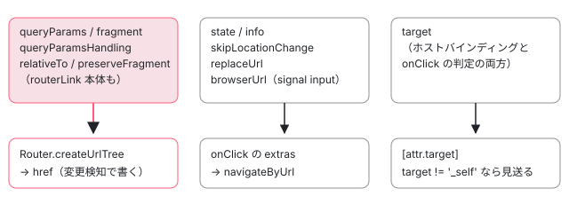

[目次](../README.md) › [Router のディレクティブとイベントの残り：RouterLink・RouterLinkActive・RouterOutlet・events.ts を行で埋める](README.md) › 第 1 回 / 全 6 回

# RouterLink の入力：queryParams から target まで、href とクリックに効く行

> router\_link.ts の入力（target・queryParams・fragment・queryParamsHandling・state・info・relativeTo・preserveFragment・skipLocationChange・replaceUrl・browserUrl）が、createUrlTree の options・navigateByUrl の extras・ホストの属性のどれに効くか。a / area とそれ以外で変わる href・tabindex・クリックの扱い、修飾キーと target でブラウザに任せる分岐（今の spec では固められていない）、開発モードだけの UrlTree の検査、22.2.6 との違い。

angular/angular · 読了 約 13 分 · 中核 · [サイトで読む（デモが動きます）](https://angular-deep-dive-cyan.vercel.app/chapter/rdir-link-inputs)

---

`<a routerLink="/team/7" [queryParams]="…" [state]="…" target="_blank">` の入力は、書けばどれも「リンクの設定」に見えます。ところが `RouterLink` の中では、入力は 3 つの行き先に分かれます。URL を作る `Router.createUrlTree` に渡るもの、クリックしたときの `Router.navigateByUrl` の extras に渡るもの、そしてホスト要素の属性になるものです。この章では、入力ごとにセッターの行を読み、どの行き先に効くかを確かめます。あわせて、`<a>`・`<area>` とそれ以外の要素で何が変わるか、修飾キー付きのクリックがどこで弾かれるかを読みます。

読む対象は `packages/router/src/directives/router_link.ts` です。href を作る computed と `ReactiveRouterState` は [router シリーズの RouterLink と RouterLinkActive の章](../router/18-router-link-active.md)で、クリックしてからの流れは [boot シリーズの最終章](../boot/13-boot-spa-navigation.md)で、配列から `UrlTree` を作る手順は [routerLink の配列 → UrlTree の章](../router/03-router-create-url-tree.md)で読んだので、ここでは繰り返しません。

1. **1. RouterLink の入力**（この章）
2. [2. RouterLinkActive の残り](02-rdir-link-active.md)
3. [3. RouterOutlet の入力と detach / attach](03-rdir-outlet.md)
4. [4. events.ts の各クラス](04-rdir-events.md)
5. [5. ExtraOptions と RouterModule](05-rdir-options.md)
6. [6. spec と issue](06-rdir-tests-issues.md)

## 1. 入力は 3 つの行き先に分かれる

先に全体を表にします。行番号はこの章で引く `router_link.ts` の行です。

| 入力 | セッター | 行き先 | 読まれる時機 |
| --- | --- | --- | --- |
| `queryParams`・`fragment`・`queryParamsHandling`・`relativeTo`・`preserveFragment` | （queryParams は router-link-active の章）・252・265・307・321 | `createUrlTree` の `UrlCreationOptions`（564〜568 行目） | href を計算するたび（computed の依存） |
| `state`・`info`・`skipLocationChange`・`replaceUrl`・`browserUrl` | 278・291・335・349・363 | `navigateByUrl` の extras（504〜510 行目） | クリックの瞬間だけ（依存にならない） |
| `target` | 218 | ホストの `target` 属性（187 行目）と、クリックを見送るかの判定（497 行目） | 変更検知のたび / クリックの瞬間 |



*RouterLink の入力の 3 つの行き先。左の列が href を変える入力、真ん中がクリックのときだけ使う入力*

## 2. セッターは signal に書くだけ

📄 `angular/packages/router/src/directives/router_link.ts` L213–229 （▶ の行: 218–219, 221–222, 229）

```ts
213 │   /**
214 │    * Represents the `target` attribute on a host element.
215 │    * This is only used when the host element is
216 │    * an `<a>`/`<area>` tag or a compatible custom element.
217 │    */
218 ▶   @Input() set target(value: string | undefined) {
219 ▶     this._target.set(value);
220 │   }
221 ▶   get target(): string | undefined {
222 ▶     return untracked(this._target);
223 │   }
224 │ 
225 │   /**
226 │    * @docs-private
227 │    * @internal
228 │    */
229 ▶   protected _target = signal<string | undefined>(undefined);
```

どの入力も同じ形です。218 行目、`@Input()` は**セッター**（代入されたときに呼ばれる関数）に付いていて、219 行目で private の signal に書くだけです。221〜222 行目のゲッターは `untracked` で読みます。`untracked` は「この読み取りを、いま動いている computed や effect の依存にしない」という意味です。外のコードが `link.target` を読んでも、その読み手が `_target` の変化に反応しないようにしています。229 行目の `_target` だけは `protected` で、ホストバインディングから読まれます。

📄 `angular/packages/router/src/directives/router_link.ts` L186–188 （▶ の行: 187）

```ts
186 │     '[attr.href]': 'reactiveHref()',
187 ▶     '[attr.target]': '_target()',
188 │   },
```

187 行目、`target` 属性は `_target()` のホストバインディングです。ホストバインディングはディレクティブが自分の付いた要素の属性を書く仕組みで、変更検知のたびに値を読み直します。このバインディングには `<a>` かどうかの条件がありません。下のデモで `target` を `'_blank'` にすると、`<button routerLink>` にも `target="_blank"` が付くのが見えます。

📄 `angular/packages/router/src/directives/router_link.ts` L246–271 （▶ の行: 248, 252–253, 258, 260, 265–266, 271）

```ts
246 │   /**
247 │    * Passed to {@link Router#createUrlTree} as part of the
248 ▶    * `UrlCreationOptions`.
249 │    * @see {@link UrlCreationOptions#fragment}
250 │    * @see {@link Router#createUrlTree}
251 │    */
252 ▶   @Input() set fragment(value: string | undefined) {
253 ▶     this._fragment.set(value);
254 │   }
255 │   get fragment(): string | undefined {
256 │     return untracked(this._fragment);
257 │   }
258 ▶   private _fragment = signal<string | undefined>(undefined);
259 │   /**
260 ▶    * Passed to {@link Router#createUrlTree} as part of the
261 │    * `UrlCreationOptions`.
262 │    * @see {@link UrlCreationOptions#queryParamsHandling}
263 │    * @see {@link Router#createUrlTree}
264 │    */
265 ▶   @Input() set queryParamsHandling(value: QueryParamsHandling | null | undefined) {
266 ▶     this._queryParamsHandling.set(value);
267 │   }
268 │   get queryParamsHandling(): QueryParamsHandling | null | undefined {
269 │     return untracked(this._queryParamsHandling);
270 │   }
271 ▶   private _queryParamsHandling = signal<QueryParamsHandling | null | undefined>(undefined);
```

248 行目と 260 行目のコメントが行き先を書いています。`fragment`（252 行目）と `queryParamsHandling`（265 行目）は `Router.createUrlTree` の `UrlCreationOptions` に渡ります。258 行目と 271 行目の signal は既定の等価判定（`Object.is`）なので、同じ文字列を書き直しても依存先には何も届きません。

📄 `angular/packages/router/src/directives/router_link.ts` L272–297 （▶ の行: 273, 278–279, 281–282, 284, 286, 291–292, 294–295, 297）

```ts
272 │   /**
273 ▶    * Passed to {@link Router#navigateByUrl} as part of the
274 │    * `NavigationBehaviorOptions`.
275 │    * @see {@link NavigationBehaviorOptions#state}
276 │    * @see {@link Router#navigateByUrl}
277 │    */
278 ▶   @Input() set state(value: {[k: string]: any} | undefined) {
279 ▶     this._state.set(value);
280 │   }
281 ▶   get state(): {[k: string]: any} | undefined {
282 ▶     return untracked(this._state);
283 │   }
284 ▶   private _state = signal<{[k: string]: any} | undefined>(undefined, {equal: () => false});
285 │   /**
286 ▶    * Passed to {@link Router#navigateByUrl} as part of the
287 │    * `NavigationBehaviorOptions`.
288 │    * @see {@link NavigationBehaviorOptions#info}
289 │    * @see {@link Router#navigateByUrl}
290 │    */
291 ▶   @Input() set info(value: unknown) {
292 ▶     this._info.set(value);
293 │   }
294 ▶   get info(): unknown {
295 ▶     return untracked(this._info);
296 │   }
297 ▶   private _info = signal<unknown>(undefined, {equal: () => false});
```

`state` と `info` は 273 行目・286 行目のコメントのとおり、`navigateByUrl` の `NavigationBehaviorOptions` に渡ります。284 行目と 297 行目の signal は `equal: () => false`（同じ値を書いても必ず「変わった」とみなす）ですが、`_state` と `_info` を読むのは 281〜282 行目と 294〜295 行目の `untracked` のゲッターだけです。href の computed は読まないので、`state` を変えても href は作り直されません。この 2 つの入力が効くのはクリックの瞬間だけです（5 節）。

📄 `angular/packages/router/src/directives/router_link.ts` L298–327 （▶ の行: 301–303, 307–308, 313, 321–322, 327）

```ts
298 │   /**
299 │    * Passed to {@link Router#createUrlTree} as part of the
300 │    * `UrlCreationOptions`.
301 ▶    * Specify a value here when you do not want to use the default value
302 ▶    * for `routerLink`, which is the current activated route.
303 ▶    * Note that a value of `undefined` here will use the `routerLink` default.
304 │    * @see {@link UrlCreationOptions#relativeTo}
305 │    * @see {@link Router#createUrlTree}
306 │    */
307 ▶   @Input() set relativeTo(value: ActivatedRoute | null | undefined) {
308 ▶     this._relativeTo.set(value);
309 │   }
310 │   get relativeTo(): ActivatedRoute | null | undefined {
311 │     return untracked(this._relativeTo);
312 │   }
313 ▶   private _relativeTo = signal<ActivatedRoute | null | undefined>(undefined);
314 │ 
315 │   /**
316 │    * Passed to {@link Router#createUrlTree} as part of the
317 │    * `UrlCreationOptions`.
318 │    * @see {@link UrlCreationOptions#preserveFragment}
319 │    * @see {@link Router#createUrlTree}
320 │    */
321 ▶   @Input({transform: booleanAttribute}) set preserveFragment(value: boolean) {
322 ▶     this._preserveFragment.set(value);
323 │   }
324 │   get preserveFragment(): boolean {
325 │     return untracked(this._preserveFragment);
326 │   }
327 ▶   private _preserveFragment = signal<boolean>(false);
```

301〜303 行目のコメントが `relativeTo` の約束です。指定しなければ「今の `ActivatedRoute`」が基準で、`undefined` を渡しても既定に戻ります。つまり `null` と `undefined` は別物です。どこで分けているかは次の引用の 564 行目で見ます。321 行目の `preserveFragment` は `transform: booleanAttribute` 付きです。`booleanAttribute` は「属性だけ書いた（空文字）」も `true` にする変換で、`<a routerLink="/x" preserveFragment>` と書けます。

📄 `angular/packages/router/src/directives/router_link.ts` L564–568 （▶ の行: 564–568）

```ts
564 ▶         relativeTo: this._relativeTo() !== undefined ? this._relativeTo() : this.route,
565 ▶         queryParams: this._queryParams(),
566 ▶         fragment: this._fragment(),
567 ▶         queryParamsHandling: this._queryParamsHandling(),
568 ▶         preserveFragment: this._preserveFragment(),
```

5 つの signal を読んで `createUrlTree` に渡す行です（この computed の全体は [router-link-active の章](../router/18-router-link-active.md)の 2 節）。564 行目、`_relativeTo()` が `undefined` のときだけ `this.route` を使い、`null` はそのまま渡します。`createUrlTree` は `relativeTo` が `null` だと `RouterState` の根から数えるので（[routerLink の配列 → UrlTree の章](../router/03-router-create-url-tree.md)）、`'../bob'` は `/bob` になります（下のデモの relativeTo を `null` にした行）。computed の中で読んでいるので、この 5 つのどれかが変わると href が作り直されます。

📄 `angular/packages/router/src/directives/router_link.ts` L328–363 （▶ の行: 335–336, 341, 349–350, 355, 363）

```ts
328 │ 
329 │   /**
330 │    * Passed to {@link Router#navigateByUrl} as part of the
331 │    * `NavigationBehaviorOptions`.
332 │    * @see {@link NavigationBehaviorOptions#skipLocationChange}
333 │    * @see {@link Router#navigateByUrl}
334 │    */
335 ▶   @Input({transform: booleanAttribute}) set skipLocationChange(value: boolean) {
336 ▶     this._skipLocationChange.set(value);
337 │   }
338 │   get skipLocationChange(): boolean {
339 │     return untracked(this._skipLocationChange);
340 │   }
341 ▶   private _skipLocationChange = signal<boolean>(false);
342 │ 
343 │   /**
344 │    * Passed to {@link Router#navigateByUrl} as part of the
345 │    * `NavigationBehaviorOptions`.
346 │    * @see {@link NavigationBehaviorOptions#replaceUrl}
347 │    * @see {@link Router#navigateByUrl}
348 │    */
349 ▶   @Input({transform: booleanAttribute}) set replaceUrl(value: boolean) {
350 ▶     this._replaceUrl.set(value);
351 │   }
352 │   get replaceUrl(): boolean {
353 │     return untracked(this._replaceUrl);
354 │   }
355 ▶   private _replaceUrl = signal<boolean>(false);
356 │ 
357 │   /**
358 │    * Passed to {@link Router#navigateByUrl} as part of the
359 │    * `NavigationBehaviorOptions`.
360 │    * @see {@link NavigationBehaviorOptions#browserUrl}
361 │    * @see {@link Router#navigateByUrl}
362 │    */
363 ▶   browserUrl = input<UrlTree | string | undefined>(undefined);
```

335 行目と 349 行目も `booleanAttribute` 付きのセッターです。363 行目の `browserUrl` だけは形が違い、`input()` で作る **signal input**（入力そのものが読み取り専用の signal になる書き方）です。セッターを持たないので、読むときは `this.browserUrl()` と関数として呼びます。これは 89d47d814de（2026-01-12）で他の入力が signal に書き換えられたあとに、3683902234a（2026-02-24）が足した入力だからです。

## 3. a と area とそれ以外

📄 `angular/packages/router/src/directives/router_link.ts` L364–375 （▶ の行: 369, 371–374）

```ts
364 │ 
365 │   /**
366 │    * Whether a host element is an `<a>`/`<area>` tag or a compatible custom
367 │    * element.
368 │    */
369 ▶   private readonly isAnchorElement: boolean;
370 │   /** @internal */
371 ▶   onChanges = new Subject<RouterLink>();
372 ▶   private readonly applicationErrorHandler = inject(ɵINTERNAL_APPLICATION_ERROR_HANDLER);
373 ▶   private readonly options = inject(ROUTER_CONFIGURATION, {optional: true});
374 ▶   private readonly reactiveRouterState = inject(ReactiveRouterState);
375 │ 
```

369 行目の `isAnchorElement` がこの章の分かれ道です。値はコンストラクタで 1 回だけ決まり（タグ名が `a` か `area`、または `href` を観測するカスタム要素。[router-link-active の章](../router/18-router-link-active.md)の 1 節）、`readonly` なのであとから変わりません。371 行目の `onChanges` は次章の `RouterLinkActive` が購読する Subject、372 行目はクリックの失敗を流す先、373 行目は `withRouterConfig` の設定（`defaultQueryParamsHandling` を読む）です。

📄 `angular/packages/router/src/directives/router_link.ts` L377–382 （▶ の行: 379, 382）

```ts
377 │     private router: Router,
378 │     private route: ActivatedRoute,
379 ▶     @Attribute('tabindex') private readonly tabIndexAttribute: string | null | undefined,
380 │     private readonly renderer: Renderer2,
381 │     private readonly el: ElementRef,
382 ▶     private locationStrategy?: LocationStrategy,
```

📄 `angular/packages/router/src/directives/router_link.ts` L420–431 （▶ の行: 425–427, 429）

```ts
420 │ 
421 │   /**
422 │    * Modifies the tab index if there was not a tabindex attribute on the element
423 │    * during instantiation.
424 │    */
425 ▶   private setTabIndexIfNotOnNativeEl(newTabIndex: string | null) {
426 ▶     if (this.tabIndexAttribute != null /* both `null` and `undefined` */ || this.isAnchorElement) {
427 ▶       return;
428 │     }
429 ▶     this.applyAttributeValue('tabindex', newTabIndex);
430 │   }
431 │ 
```

要素の種類で変わることは 3 つです。1 つ目は href で、`<button>` には付きません（router-link-active の章の 1 節）。2 つ目が `tabindex` です。379 行目の `@Attribute('tabindex')` は、テンプレートに**静的に書かれた**`tabindex` 属性の値をコンストラクタで 1 回だけ受け取ります。426 行目、その値が `null` でも `undefined` でもない（`tabindex` を自分で書いた）か、`<a>` なら何もしません。それ以外、つまり `tabindex` の無い `<button>` や `<div>` では、429 行目で `tabindex` を書きます。呼び出し元は `routerLink` のセッターで、リンクがあれば `'0'`、`null` なら外します。`<div routerLink>` でも Tab キーで届くようにするためです（逆に「届いてほしくない」という要望が #28345 で開いています）。

📄 `angular/packages/router/src/directives/router_link.ts` L523–536 （▶ の行: 527, 530–531, 533）

```ts
523 │ 
524 │   /** @docs-private */
525 │   ngOnDestroy(): any {}
526 │ 
527 ▶   private applyAttributeValue(attrName: string, attrValue: string | null) {
528 │     const renderer = this.renderer;
529 │     const nativeElement = this.el.nativeElement;
530 ▶     if (attrValue !== null) {
531 ▶       renderer.setAttribute(nativeElement, attrName, attrValue);
532 │     } else {
533 ▶       renderer.removeAttribute(nativeElement, attrName);
534 │     }
535 │   }
536 │ 
```

書き込みは 531 行目の `Renderer2.setAttribute` と 533 行目の `removeAttribute` です。href と target がホストバインディング（変更検知のたびに読み直す）なのに対し、`tabindex` だけはセッターの中で手続き的に書きます。382 行目の `locationStrategy` は href の文字列を作るときに `prepareExternalUrl` を呼ぶ相手で、下のデモではここを偽物に差し替えています。

## 4. onClick：ブラウザに任せる 2 つの条件

クリックは `@HostListener('click', ['$event.button', '$event.ctrlKey', '$event.shiftKey', '$event.altKey', '$event.metaKey'])` で `onClick` に届きます。全体の流れは [boot-spa-navigation](../boot/13-boot-spa-navigation.md) の 1 節で読んだので、ここでは条件の行だけ見ます。

📄 `angular/packages/router/src/directives/router_link.ts` L492–498 （▶ の行: 492–494, 497–498）

```ts
492 ▶     if (this.isAnchorElement) {
493 ▶       if (button !== 0 || ctrlKey || shiftKey || altKey || metaKey) {
494 ▶         return true;
495 │       }
496 │ 
497 ▶       if (typeof this.target === 'string' && this.target != '_self') {
498 ▶         return true;
```

1. **492 行目：a / area のときだけ調べる**

   `<button routerLink>` ではこの `if` 全体を飛ばします。Ctrl を押しながらクリックしても、そのまま `navigateByUrl` に進みます。
2. **493〜494 行目：左ボタン以外か、修飾キー付き**

   `button !== 0`（中ボタンなど）か、Ctrl・Shift・Alt・Meta（mac の Command）のどれかが押されていれば `true` を返して終わります。`true` なのでブラウザの既定の動作（href を新しいタブで開くなど）が止められません。
3. **497〜498 行目：target が文字列で '\_self' 以外**

   `target="_blank"` なら同じく `true`。比べ方は `!=` なので、空文字の `target=""` も「`'_self'` 以外」としてブラウザに任されます。`undefined` は 497 行目の `typeof` で外れるので、Router が移動します。

📄 `angular/packages/router/src/directives/router_link.ts` L504–510 （▶ の行: 504–507, 510）

```ts
504 ▶       skipLocationChange: this.skipLocationChange,
505 ▶       replaceUrl: this.replaceUrl,
506 ▶       state: this.state,
507 ▶       info: this.info,
508 │       // TODO: Remove conditional spread once all consumers handle `browserUrl`.
509 │       // Having this property always set broke some tests in G3.
510 ▶       ...(browserUrl !== undefined && {browserUrl}),
```

条件を抜けると、504〜507 行目で 4 つのゲッター（2 節の `untracked` のもの）をその場で読んで extras を作ります。510 行目、`browserUrl` は値があるときだけキーごと足します。508〜509 行目のコメントどおり、キーが常にあると Google 社内（G3）のテストが壊れたためです。この extras の行き先は [ブラウザの URL と履歴の章](../router/16-router-browser-url.md)で読んだ `StateManager` で、`skipLocationChange` なら履歴に書かず、`replaceUrl` なら `replaceState`、`state` は履歴の state に `navigationId` と並んで入ります。`info` は履歴に入らず、`Router.currentNavigation()` などの `Navigation.extras.info` でだけ読めます。

📄 `angular/packages/router/src/directives/router_link.ts` L518–522 （▶ の行: 521）

```ts
518 │     // Return `false` for `<a>` elements to prevent default action
519 │     // and cancel the native behavior, since the navigation is handled
520 │     // by the Router.
521 ▶     return !this.isAnchorElement;
522 │   }
```

521 行目、`<a>` なら `false` を返し、Angular の DOM レンダラーが `preventDefault()` を呼びます。`<button>` では `true` を返すので、`<form>` の中の `<button>` ならフォームの送信も起きます。逆向き、つまり利用者が先に `preventDefault()` を呼んでも `onClick` は見ません。リンクを止めたいときの答えは `routerLink` に `null` を渡すことで、この要望の #21457 はその変更（ccb09b4558a）で閉じられています。

## 5. 開発モードだけの検査

📄 `angular/packages/router/src/directives/router_link.ts` L401–419 （▶ の行: 402–403, 405–410, 412–413）

```ts
401 │ 
402 ▶     if (typeof ngDevMode !== 'undefined' && ngDevMode) {
403 ▶       effect(() => {
404 │         if (
405 ▶           isUrlTree(this.routerLinkInput()) &&
406 ▶           (this._fragment() !== undefined ||
407 ▶             this._queryParams() ||
408 ▶             this._queryParamsHandling() ||
409 ▶             this._preserveFragment() ||
410 ▶             this._relativeTo())
411 │         ) {
412 ▶           throw new RuntimeError(
413 ▶             RuntimeErrorCode.INVALID_ROUTER_LINK_INPUTS,
414 │             'Cannot configure queryParams or fragment when using a UrlTree as the routerLink input value.',
415 │           );
416 │         }
417 │       });
418 │     }
419 │   }
```

402 行目、`ngDevMode` が真のとき（開発ビルド）だけ、コンストラクタで `effect` を 1 つ作ります。405 行目、`routerLink` に `UrlTree` を渡したのに、406〜410 行目の 5 つの入力のどれかが設定されていれば、412 行目で `INVALID_ROUTER_LINK_INPUTS` を投げます。`UrlTree` はもう完成した URL なので、`queryParams` などを足す場所が無いからです。406 行目だけ `!== undefined` で、ほかは真偽で見ています。`fragment=""` は投げますが、`[queryParams]="null"` や `queryParamsHandling=""` は投げません。本番ビルドではこの effect が無いので、`UrlTree` がそのまま使われ、ほかの入力は黙って無視されます。

## 6. href を更新する時機と、22.2.6 との違い

href が作り直されるのは「1 節の表の左の列の入力が書かれたとき」と「`NavigationEnd` のあとに今の URL が変わったとき」の 2 通りです。後者を受け持つ `ReactiveRouterState` は [router-link-active の章](../router/18-router-link-active.md)の 3 節で読みました。1 節の表の真ん中の列（`state` など）は、どちらのきっかけにもなりません。

> [!NOTE]
> **さらに深く**
>
> このサイトが使っている `@angular/router` 22.2.6 には、本家の main の 319a3c4f326（2026-09-25「do not retain UrlTree instances in RouterLink」）が入っています。読んでいる 8576f161ae4 との違いは、`_urlTree` の computed が無くなり、`reactiveHref` が直接 `path` などを読んで href の文字列だけを持つことです。`UrlTree` を computed に持ち続けると、SSR でリンクの数だけクエリの辞書が残り、メモリが溢れた（#70908）のが理由です。`onClick` と公開の `urlTree` ゲッターは、そのたびに `createUrlTree()` で作り直します。入力の行き先そのものは変わりません。さらに main には 34ea5922bab（RouterLink の `scroll` 入力）が入っていますが、22.2.6 にはまだありません。

> **🧪 DEMO — 本物の RouterLink を子の Router につなぎ、入力を切り替える**
>
> このページの中に、サイトとは別の Router を 1 つ作ります。`createEnvironmentInjector` に `provideRouter(routes)` と、履歴に書く代わりに配列へ記録するだけの `LocationStrategy` の偽物を入れました（href の先頭の `#` はこの偽物の `prepareExternalUrl` が付けたもの）。リンクは子の Router の `/team/7/user/ann` に表示される UserCmp の中にあるので、相対リンクの基準はその `ActivatedRoute` です。下の 2 つ目の表のボタンは、`<a>` に修飾キー付きの `click` イベントを送ります。ページの URL と history.length が変わらないことも表の下に出ます。
>
> ▶ [このデモはサイトで動かせます](https://angular-deep-dive-cyan.vercel.app/chapter/rdir-link-inputs)

デモで確かめられることを並べます。`queryParamsHandling` を `'preserve'` にすると href のクエリが今の `?page=1` になり、`'merge'` では `{page: 2}` が勝ちます。`state` を変えても href は変わらず、クリックしたときの `pushState` の第 1 引数にだけ `{"from":"rdli","navigationId":…}` が出ます。`skipLocationChange` では子の URL は変わるのに `LocationStrategy` は呼ばれず、`replaceUrl` では `replaceState` になります。Ctrl+click などの 5 種類は defaultPrevented が `false` のまま子の URL も変わらず、`<button>` の Ctrl+click だけは移動します。

> [!TIP]
> **新卒エンジニアへ**
>
> 子の Router を作るときに `INJECTOR_SCOPE` を `'root'` にしているのは、`Router` や `StateManager` が `providedIn: 'root'` のサービスだからです。こうしないと、子の環境インジェクターで探しても親（サイト）の Router が見つかってしまいます。また、画面を作るときに `createComponent(…, {injector: env})` と要素側のインジェクターも子にしています。ページの側から辿ると、サイトの `OutletInjector`（[RouterOutlet への配置の章](../router/15-router-activate-routes.md)）がサイトの `ActivatedRoute` を答えてしまうからです。

## 7. 入れたコミット

| コミット | 日付 | 何を変えたか |
| --- | --- | --- |
| 112324a614d | 2020-11-16 | `relativeTo` を入力に足した（#39720） |
| ccb09b4558a | 2021-06-11 | `null` / `undefined` の `routerLink` で移動しない・a なら href を外す（#43087。#21457 を閉じた） |
| 422323cee00 / d55276aab06 | 2022-08-09 / 2023-06-06 | 真偽の入力の型を広げ、`transform: booleanAttribute` に置き換えた |
| a5a9b408e2e | 2024-01-03 | `info` 入力を足した（#53784。押した要素を渡してビュー遷移に使う例が本文にある） |
| ff98ccb1939 | 2025-03-08 | `observedAttributes` に href を持つカスタム要素を a と同じ扱いにした（#60290） |
| bcef77d9507 | 2025-12-19 | `queryParamsHandling` を付けたリンクの href が更新されない不具合を直した（#60875 の巻き戻し） |
| 89d47d814de | 2026-01-12 | 各入力を「`@Input` のフィールド + ngOnChanges で href を更新」から「セッター → signal → computed」に書き換えた |
| 3683902234a | 2026-02-24 | `browserUrl` 入力を足した（2026-01-29 に一度入って 5a0f2725197 で戻され、入れ直し） |

89d47d814de の前は、たとえば `@HostBinding('attr.target') @Input() target?: string;` のようにフィールドに直接入力を受け、a 要素なら `router.events` を購読して `NavigationEnd` のたびに `updateHref()` を呼んでいました。いまの形では、「どの入力が href に効くか」は 1 節の表の左の列、つまり computed の中で読んだ signal の集合として決まります。

## テストと直し方

### spec と it

| ファイル | describe / it | 行 | この章のどこ |
| --- | --- | --- | --- |
| router\_link\_spec.ts | `RouterLink` › `does not modify tabindex if already set on non-anchor element` | 16 | 3 節の 426 行目 |
| router\_link\_spec.ts | `on a non-anchor` › `null, removes tabIndex and does not navigate` ほか 3 つ | 38〜117 | 3 節 |
| router\_link\_spec.ts | `on an anchor` › `should coerce boolean input values` | 165 | 2 節の booleanAttribute |
| router\_link\_spec.ts | `on a custom element anchor` › `does not touch tabindex` ほか | 211〜284 | 3 節 |
| router\_link\_spec.ts | `cannot use a UrlTree with queryParams` | 302 | 5 節 |
| integration/router\_links.spec.ts | `router links` › `should support skipping location update for anchor router links` | 35 | 4 節の extras |
| integration/router\_links.spec.ts | `should correctly use the preserve strategy`・`merge strategy` | 201・222 | 2 節の queryParamsHandling |
| integration/router\_links.spec.ts | `should support history and state`・`should support browserUrl`（a と div の 2 つずつ） | 386・427 | 4 節の extras |

📄 `angular/packages/router/test/router_link_spec.ts` L302–315 （▶ の行: 304, 314）

```ts
302 │   it('cannot use a UrlTree with queryParams', () => {
303 │     @Component({
304 ▶       template: '<a [routerLink]="urlTree" [queryParams]="{}">link</a>',
305 │       imports: [RouterLink],
306 │     })
307 │     class WithUrlTree {
308 │       urlTree = inject(Router).createUrlTree(['/a/b/c']);
309 │     }
310 │     TestBed.configureTestingModule({providers: [provideRouter([])]});
311 │ 
312 │     const fixture = TestBed.createComponent(WithUrlTree);
313 │     expect(() => fixture.changeDetectorRef.detectChanges()).toThrow();
314 ▶   });
315 │ 
```

304 行目で `UrlTree` と `[queryParams]="{}"` を一緒に渡し、314 行目で `detectChanges()` が投げることを確かめています。5 節の effect は変更検知の中で走るので、投げるのは `createComponent` ではなく `detectChanges` です。テストは開発モードで走るので、この effect があります。

📄 `angular/packages/router/test/integration/router_links.spec.ts` L414–425 （▶ の行: 417–418, 424）

```ts
414 │         router.navigateByUrl('/team/22/link');
415 │         await advance(fixture);
416 │ 
417 ▶         const native = fixture.nativeElement.querySelector('#link');
418 ▶         native.click();
419 │         await advance(fixture);
420 │ 
421 │         expect(fixture.nativeElement).toHaveText('team 22 [ simple, right:  ]');
422 │ 
423 │         // Check the history entry
424 ▶         expect(location.getState()).toEqual({foo: 'bar', navigationId: 3});
425 │       });
```

417〜418 行目で `[state]="{foo: 'bar'}"` のリンクをクリックし、424 行目で履歴の state が `{foo: 'bar', navigationId: 3}` になったことを見ています。デモの `pushState` の第 1 引数と同じ形です。

### 手元で走らせた結果

📄 `走らせ方`

```
cd ~/angular-research/angular
pnpm bazel test //packages/router/test:test --nocache_test_results --test_output=all
# RouterLink と RouterLinkActive の it だけ
pnpm bazel test //packages/router/test:test --nocache_test_results --test_output=all \
  "--test_arg=--filter=RouterLink|router links|routerLinkActive|RouterLinkActive"
```

📄 `結果`

```
# 2026-11-19、手元の macOS（node v24.22.1）で、8576f161ae4
1170 specs, 0 failures
//packages/router/test:test                                              PASSED in 2.4s
# 絞り込み
Ran 76 of 1170 specs
76 specs, 0 failures
```

ここで気づくことがあります。4 節の 2 つの条件（493 行目と 497 行目）を固める it が、spec のどこにもありません。`grep -rn "ctrlKey\|metaKey" packages/router/test` は 0 件で、`target` を見ている it は、`[target]="'_self'"` のリンクに属性が付くことを確かめる `should support string router links`（router\_links.spec.ts 67 行目）だけです。作業木で条件を消して確かめました。

📄 `結果（作業木、8576f161ae4 から）`

```
[M1] router_link.ts 493 行目の条件を if (false) にする（修飾キーを見ない）
Ran 76 of 1170 specs
76 specs, 0 failures
//packages/router/test:test                                              PASSED

[M2] 497 行目の条件を if (false) にする（target を見ない）
Ran 76 of 1170 specs
76 specs, 0 failures
//packages/router/test:test                                              PASSED

[A1] 下の 3 つの it を router_link_spec.ts に足す（ソースはそのまま）
Ran 3 of 1173 specs
3 specs, 0 failures

[A1 + M1]
1) RouterLink onClick leaves non-primary and modified clicks on an anchor to the browser
    [1,false,false,false,false]: Expected false to be true.
    [0,true,false,false,false]: Expected false to be true.
    （5 通りとも同じ。続いて navigateByUrl が呼ばれたことも落ちる）
3 specs, 1 failure

[A1 + M2]
1) RouterLink onClick leaves clicks on an anchor whose target is not _self to the browser
    Expected false to be true.
    Expected spy navigateByUrl not to have been called.
3 specs, 1 failure
```

M1・M2 のどちらでも、RouterLink と RouterLinkActive にかかわる 76 個の it は全部通りました。条件を消すと、Ctrl+クリックしても新しいタブが開かずにページ内で移動するようになりますが、それを捕まえる it が無いということです。足すなら `router_link_spec.ts` の最後に、`onClick` を直接呼ぶ it を置きます。DOM のイベントを作らずに済むので、Node の jasmine（domino）でも同じに動きます。

📄 `足した it（A1）`

```
  describe('onClick', () => {
    @Component({
      template: `<a routerLink="/a" [target]="target()"></a><button routerLink="/a"></button>`,
      imports: [RouterLink],
    })
    class LinkComponent {
      target = signal<string | undefined>(undefined);
    }

    let fixture: ComponentFixture<LinkComponent>;
    let navigateSpy: jasmine.Spy;
    let anchor: RouterLink;
    let button: RouterLink;

    beforeEach(async () => {
      TestBed.configureTestingModule({providers: [provideRouter([])]});
      navigateSpy = spyOn(TestBed.inject(Router), 'navigateByUrl').and.resolveTo(true);
      fixture = TestBed.createComponent(LinkComponent);
      await fixture.whenStable();
      [anchor, button] = fixture.debugElement
        .queryAll(By.directive(RouterLink))
        .map((d) => d.injector.get(RouterLink));
    });

    it('leaves non-primary and modified clicks on an anchor to the browser', () => {
      const cases: [number, boolean, boolean, boolean, boolean][] = [
        [1, false, false, false, false],
        [0, true, false, false, false],
        [0, false, true, false, false],
        [0, false, false, true, false],
        [0, false, false, false, true],
      ];
      for (const args of cases) {
        expect(anchor.onClick(...args)).withContext(JSON.stringify(args)).toBeTrue();
      }
      expect(navigateSpy).not.toHaveBeenCalled();

      expect(anchor.onClick(0, false, false, false, false)).toBeFalse();
      expect(navigateSpy).toHaveBeenCalledTimes(1);
      const extras = navigateSpy.calls.mostRecent().args[1];
      expect(Object.keys(extras).sort()).toEqual(['info', 'replaceUrl', 'skipLocationChange', 'state']);
    });

    it('leaves clicks on an anchor whose target is not _self to the browser', async () => {
      fixture.componentInstance.target.set('_blank');
      await fixture.whenStable();
      expect(anchor.onClick(0, false, false, false, false)).toBeTrue();
      expect(navigateSpy).not.toHaveBeenCalled();

      fixture.componentInstance.target.set('_self');
      await fixture.whenStable();
      expect(anchor.onClick(0, false, false, false, false)).toBeFalse();
      expect(navigateSpy).toHaveBeenCalledTimes(1);
    });

    it('navigates on a modified click on a non-anchor and keeps the default action', () => {
      expect(button.onClick(0, true, false, false, false)).toBeTrue();
      expect(navigateSpy).toHaveBeenCalledTimes(1);
    });
  });
```

- 修飾キーの it は 5 通りの引数で `true`（ブラウザに任せる）を確かめ、最後に普通のクリックで `false` と extras のキーが 4 つ（`browserUrl` が無い）ことを見ます。
- `target` の it は `'_blank'` で移動しないこと、`'_self'` で移動することの両方を見ます。
- 3 つ目は `<button>` では修飾キーを見ないこと（492 行目）を固めます。

直すとしたら、という観点では、4 節の分岐を変える変更（たとえば空文字の `target` を `'_self'` と同じに扱う）は `onClick` の 497 行目で、固める it は上の 2 つ目の隣に足します。

## 聞かれそうな質問

**Q. `<a routerLink>` を Ctrl+クリックすると新しいタブで開けるのはなぜですか？**

`onClick` の 493〜494 行目で、修飾キーか左ボタン以外なら `true` を返して終わるからです。`true` なので `preventDefault` が呼ばれず、ブラウザが href（常にホストバインディングで付いている）を新しいタブで開きます。`<button routerLink>` は 492 行目でこの判定を飛ばすので、Ctrl+クリックでも同じタブで移動します。

**Q. `state` を変えたのに href が変わりません。**

`state` は 278 行目のセッターで `_state` に書かれますが、href の computed は `_state` を読みません（564〜568 行目に無い）。読まれるのは 506 行目、クリックの瞬間の extras だけです。`info`・`skipLocationChange`・`replaceUrl`・`browserUrl` も同じです。

**Q. `[relativeTo]="null"` と `[relativeTo]="undefined"` は同じですか？**

違います。564 行目は `undefined` のときだけ `this.route`（そのリンクの `ActivatedRoute`）を使い、`null` はそのまま `createUrlTree` に渡します。`null` だと根からの相対になり、デモでは `'../bob'` が `/bob` になりました。

**Q. `<div routerLink>` に `tabindex="0"` が付くのを止められますか？**

テンプレートに `tabindex` を静的に書けば止まります。379 行目の `@Attribute('tabindex')` がその値を受け取り、426 行目で何もしなくなるからです。`[attr.tabindex]` のようなバインディングは `@Attribute` には届かないので、426 行目では「書かれていない」扱いになります（spec の 16 行目は静的な `tabindex="1"` で確かめています）。

**Q. `target="_blank"` のリンクで Router が動かないのはなぜですか？**

497〜498 行目、`target` が文字列で `'_self'` 以外ならブラウザに任せるからです。比べ方が `!=` なので空文字の `target` も任されます。target そのものは 187 行目のホストバインディングで要素に書かれ、この判定は `<a>` と `<area>` のときだけ行われます。

**Q. 本番ビルドで `UrlTree` と `queryParams` を一緒に渡すとどうなりますか？**

投げません。検査は 402 行目の `ngDevMode` の中の effect だけなので、本番ビルドではその effect が作られず、`UrlTree` がそのまま使われてほかの入力は効きません。

## 読み終えて

- 入力のセッターは private の signal に書くだけ。href に効くのは computed が読む 5 つ（564〜568 行目）と `routerLink` 本体です。
- `state`・`info`・`skipLocationChange`・`replaceUrl`・`browserUrl` はクリックの瞬間に 504〜510 行目で extras になるだけで、href は変えません。
- `isAnchorElement` で変わるのは href、`tabindex`（426 行目）、クリックをブラウザに任せる判定（492〜498 行目）の 3 つです。
- 修飾キーと `target` の分岐は、今の spec では固められていません。消しても RouterLink・RouterLinkActive の 76 個の it が通ります。

---

← 前: [spec と issue を読む：型と時間の約束を固めているテスト](../sfty/06-sfty-tests-issues.md)  
次: [RouterLinkActive の残り：options・aria-current・isActiveChange](02-rdir-link-active.md) →
