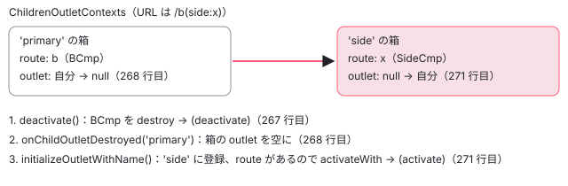

[目次](../README.md) › [Router のディレクティブとイベントの残り：RouterLink・RouterLinkActive・RouterOutlet・events.ts を行で埋める](README.md) › 第 3 回 / 全 6 回

# RouterOutlet の入力と detach / attach：名前付きの出口と routerOutletData

> router\_outlet.ts の未読の行：RouterOutletContract、name を変えたときの ngOnChanges（ngOnDestroy は deactivate を出さない）、4 つの出力がそれぞれ何の後に出るか、RouteReuseStrategy から detach / attach が呼ばれる場所、routerOutletData と ROUTER\_OUTLET\_DATA（未設定は undefined。文書の null は誤り）、RoutedComponentInputBinder の購読の持ち方と後始末。

angular/angular · 読了 約 13 分 · 発展 · [サイトで読む（デモが動きます）](https://angular-deep-dive-cyan.vercel.app/chapter/rdir-outlet)

---

`<router-outlet>` が自分を登録し、`ActivateRoutes` から `activateWith`・`deactivate`・`detach`・`attach` を呼ばれる流れは [RouterOutlet への配置の章](../router/15-router-activate-routes.md)で読みました。この章は、その章で読まなかった行を読みます。outlet が守る約束の型 `RouterOutletContract`、`name` を途中で変えたときの `ngOnChanges`、4 つの出力がそれぞれ処理のどの時点で出るか、`RouteReuseStrategy` の呼ばれ方、`routerOutletData` と `ROUTER_OUTLET_DATA`、そして `withComponentInputBinding()` の `RoutedComponentInputBinder` の残りの行です。

読む対象は `packages/router/src/directives/router_outlet.ts`、`route_reuse_strategy.ts` と、呼び出し側の `operators/activate_routes.ts` の数行です。

1. [1. RouterLink の入力](01-rdir-link-inputs.md)
2. [2. RouterLinkActive の残り](02-rdir-link-active.md)
3. **3. RouterOutlet の入力と detach / attach**（この章）
4. [4. events.ts の各クラス](04-rdir-events.md)
5. [5. ExtraOptions と RouterModule](05-rdir-options.md)
6. [6. spec と issue](06-rdir-tests-issues.md)

## 1. RouterOutletContract：Router が outlet に求めるもの

Router は `RouterOutlet` のクラスそのものではなく、この interface を通して outlet を扱います。自前の outlet を書きたい人のために a82fddf1ce6（2021、#40827）で入った公開の型です。

📄 `angular/packages/router/src/directives/router_outlet.ts` L81–105 （▶ の行: 87, 90, 95, 100, 105）

```ts
 81 │ export interface RouterOutletContract {
 82 │   /**
 83 │    * Whether the given outlet is activated.
 84 │    *
 85 │    * An outlet is considered "activated" if it has an active component.
 86 │    */
 87 ▶   isActivated: boolean;
 88 │ 
 89 │   /** The instance of the activated component or `null` if the outlet is not activated. */
 90 ▶   component: Object | null;
 91 │ 
 92 │   /**
 93 │    * The `Data` of the `ActivatedRoute` snapshot.
 94 │    */
 95 ▶   activatedRouteData: Data;
 96 │ 
 97 │   /**
 98 │    * The `ActivatedRoute` for the outlet or `null` if the outlet is not activated.
 99 │    */
100 ▶   activatedRoute: ActivatedRoute | null;
101 │ 
102 │   /**
103 │    * Called by the `Router` when the outlet should activate (create a component).
104 │    */
105 ▶   activateWith(activatedRoute: ActivatedRoute, environmentInjector: EnvironmentInjector): void;
```

📄 `angular/packages/router/src/directives/router_outlet.ts` L107–126 （▶ の行: 110–111, 113, 118–119, 121, 126）

```ts
107 │   /**
108 │    * A request to destroy the currently activated component.
109 │    *
110 ▶    * When a `RouteReuseStrategy` indicates that an `ActivatedRoute` should be removed but stored for
111 ▶    * later re-use rather than destroyed, the `Router` will call `detach` instead.
112 │    */
113 ▶   deactivate(): void;
114 │ 
115 │   /**
116 │    * Called when the `RouteReuseStrategy` instructs to detach the subtree.
117 │    *
118 ▶    * This is similar to `deactivate`, but the activated component should _not_ be destroyed.
119 ▶    * Instead, it is returned so that it can be reattached later via the `attach` method.
120 │    */
121 ▶   detach(): ComponentRef<unknown>;
122 │ 
123 │   /**
124 │    * Called when the `RouteReuseStrategy` instructs to re-attach a previously detached subtree.
125 │    */
126 ▶   attach(ref: ComponentRef<unknown>, activatedRoute: ActivatedRoute): void;
```

状態が 4 つ（87・90・95・100 行目）、操作が 4 つ（105・113・121・126 行目）です。110〜111 行目と 118〜119 行目が `deactivate` と `detach` の違いを書いています。`deactivate` はコンポーネントを壊し、`detach` は壊さずに `ComponentRef` を返します。返したものを後で `attach` に戻すのが `RouteReuseStrategy` の仕組みです（4 節）。

📄 `angular/packages/router/src/directives/router_outlet.ts` L128–158 （▶ の行: 131, 136, 142, 148, 154–156, 158）

```ts
128 │   /**
129 │    * Emits an activate event when a new component is instantiated
130 │    **/
131 ▶   activateEvents?: EventEmitter<unknown>;
132 │ 
133 │   /**
134 │    * Emits a deactivate event when a component is destroyed.
135 │    */
136 ▶   deactivateEvents?: EventEmitter<unknown>;
137 │ 
138 │   /**
139 │    * Emits an attached component instance when the `RouteReuseStrategy` instructs to re-attach a
140 │    * previously detached subtree.
141 │    **/
142 ▶   attachEvents?: EventEmitter<unknown>;
143 │ 
144 │   /**
145 │    * Emits a detached component instance when the `RouteReuseStrategy` instructs to detach the
146 │    * subtree.
147 │    */
148 ▶   detachEvents?: EventEmitter<unknown>;
149 │ 
150 │   /**
151 │    * Used to indicate that the outlet is able to bind data from the `Router` to the outlet
152 │    * component's inputs.
153 │    *
154 ▶    * When this is `undefined` or `false` and the developer has opted in to the
155 ▶    * feature using `withComponentInputBinding`, a warning will be logged in dev mode if this outlet
156 ▶    * is used in the application.
157 │    */
158 ▶   readonly supportsBindingToComponentInputs?: true;
```

131〜148 行目、4 つの出力は `?` 付きで、自前の outlet は持たなくてもかまいません。158 行目の `supportsBindingToComponentInputs` は、`withComponentInputBinding()` の入力の結び付け（6 節）に対応しているかの印です。154〜156 行目のとおり、対応していない outlet を使うと開発モードで警告が出ます。その行は `ActivateRoutes` の側にあります。

📄 `angular/packages/router/src/operators/activate_routes.ts` L226–242 （▶ の行: 226–227, 231–233, 235, 239）

```ts
226 ▶     if (typeof ngDevMode === 'undefined' || ngDevMode) {
227 ▶       const context = parentContexts.getOrCreateContext(future.outlet);
228 │       const outlet = context.outlet;
229 │       if (
230 │         outlet &&
231 ▶         this.inputBindingEnabled &&
232 ▶         !outlet.supportsBindingToComponentInputs &&
233 ▶         !warnedAboutUnsupportedInputBinding
234 │       ) {
235 ▶         console.warn(
236 │           `'withComponentInputBinding' feature is enabled but ` +
237 │             `this application is using an outlet that may not support binding to component inputs.`,
238 │         );
239 ▶         warnedAboutUnsupportedInputBinding = true;
240 │       }
241 │     }
242 │   }
```

226 行目、開発モードだけです。227 行目でこの Route の outlet 名の箱を取り、231〜233 行目、`withComponentInputBinding` が有効で、outlet が印を持っていないときに 235 行目で警告します。239 行目のモジュールの変数で、警告はアプリ全体で 1 回だけです。`RouterOutlet` 自身は印を `true` で持つので、この警告は出ません。

📄 `angular/packages/router/src/directives/router_outlet.ts` L313–344 （▶ の行: 313–314, 321–322, 327, 330, 339–340, 343）

```ts
313 ▶   get isActivated(): boolean {
314 ▶     return !!this.activated;
315 │   }
316 │ 
317 │   /**
318 │    * @returns The currently activated component instance.
319 │    * @throws An error if the outlet is not activated.
320 │    */
321 ▶   get component(): Object {
322 ▶     if (!this.activated)
323 │       throw new RuntimeError(
324 │         RuntimeErrorCode.OUTLET_NOT_ACTIVATED,
325 │         (typeof ngDevMode === 'undefined' || ngDevMode) && 'Outlet is not activated',
326 │       );
327 ▶     return this.activated.instance;
328 │   }
329 │ 
330 ▶   get activatedRoute(): ActivatedRoute {
331 │     if (!this.activated)
332 │       throw new RuntimeError(
333 │         RuntimeErrorCode.OUTLET_NOT_ACTIVATED,
334 │         (typeof ngDevMode === 'undefined' || ngDevMode) && 'Outlet is not activated',
335 │       );
336 │     return this._activatedRoute as ActivatedRoute;
337 │   }
338 │ 
339 ▶   get activatedRouteData(): Data {
340 ▶     if (this._activatedRoute) {
341 │       return this._activatedRoute.snapshot.data;
342 │     }
343 ▶     return {};
344 │   }
```

`RouterOutlet` での状態の 4 つの実装です。313〜314 行目の `isActivated` は「`activated`（`ComponentRef`）があるか」。321〜322 行目と 330〜331 行目、`component` と `activatedRoute` は activate されていないと `OUTLET_NOT_ACTIVATED` を投げます。339〜343 行目の `activatedRouteData` だけは投げずに、activate されていなければ `{}` を返します。テンプレートから `outlet.activatedRouteData` を読んでも、表示前に例外になりません。

## 2. name を途中で変える

📄 `angular/packages/router/src/directives/router_outlet.ts` L164–188 （▶ の行: 166–167, 175, 178, 188）

````ts
164 │  * Acts as a placeholder that Angular dynamically fills based on the current router state.
165 │  *
166 ▶  * Each outlet can have a unique name, determined by the optional `name` attribute.
167 ▶  * The name cannot be set or changed dynamically. If not set, default value is "primary".
168 │  *
169 │  * ```html
170 │  * <router-outlet></router-outlet>
171 │  * <router-outlet name='left'></router-outlet>
172 │  * <router-outlet name='right'></router-outlet>
173 │  * ```
174 │  *
175 ▶  * Named outlets can be the targets of secondary routes.
176 │  * The `Route` object for a secondary route has an `outlet` property to identify the target outlet:
177 │  *
178 ▶  * `{path: <base-path>, component: <component>, outlet: <target_outlet_name>}`
179 │  *
180 │  * Using named outlets and secondary routes, you can target multiple outlets in
181 │  * the same `RouterLink` directive.
182 │  *
183 │  * The router keeps track of separate branches in a navigation tree for each named outlet and
184 │  * generates a representation of that tree in the URL.
185 │  * The URL for a secondary route uses the following syntax to specify both the primary and secondary
186 │  * routes at the same time:
187 │  *
188 ▶  * `http://base-path/primary-route-path(outlet-name:route-path)`
````

167 行目に「名前は動的に設定も変更もできない」とあります。これは実装と合っていません。`name` は c3f857975d5（2022、#46569「make RouterOutlet name an Input so it can be set dynamically」）から入力で、次の `ngOnChanges` が変更を受けます。新しい本家の main では 2af465b71f3（2026-11-02「docs(router): fix the router outlet name note」）がこの文を「値を変えると、今のコンポーネントを壊して新しい名前の Route を表示する」に書き直しています。178 行目と 188 行目は名前付きの outlet に入る Route（`outlet` を持つ Route）と、URL の `(outlet-name:route-path)` の書き方です。

📄 `angular/packages/router/src/directives/router_outlet.ts` L255–273 （▶ の行: 257–259, 262, 266–268, 271）

```ts
255 │   /** @docs-private */
256 │   ngOnChanges(changes: SimpleChanges): void {
257 ▶     if (changes['name']) {
258 ▶       const {firstChange, previousValue} = changes['name'];
259 ▶       if (firstChange) {
260 │         // The first change is handled by ngOnInit. Because ngOnChanges doesn't get called when no
261 │         // input is set at all, we need to centrally handle the first change there.
262 ▶         return;
263 │       }
264 │ 
265 │       // unregister with the old name
266 ▶       if (this.isTrackedInParentContexts(previousValue)) {
267 ▶         this.deactivate();
268 ▶         this.parentContexts.onChildOutletDestroyed(previousValue);
269 │       }
270 │       // register the new name
271 ▶       this.initializeOutletWithName();
272 │     }
273 │   }
```

1. **259〜262 行目：最初の変更は無視する**

   260〜261 行目のコメントのとおり、入力を何も書かない `<router-outlet>` では `ngOnChanges` が呼ばれません。最初の登録はどちらの場合も `ngOnInit` の `initializeOutletWithName` に任せ、ここでは 2 回目以降だけを扱います。
2. **266〜268 行目：古い名前で登録されているのが自分なら、壊して登録を消す**

   `isTrackedInParentContexts(previousValue)` は「古い名前の箱の `outlet` が自分か」です。そうなら 267 行目で `deactivate()`（コンポーネントを destroy し、`(deactivate)` を出す）、268 行目で `onChildOutletDestroyed`（箱の `outlet` を空にする。箱そのものと `route` は残る）。
3. **271 行目：新しい名前で登録し直す**

   `ngOnInit` と同じ `initializeOutletWithName` です（中身は RouterOutlet への配置の章の 2 節）。新しい名前の箱にすでに `route` が書かれていれば、その場で `activateWith` して `(activate)` を出します。



*name を 'primary' から 'side' に変えたとき。箱（OutletContext）と route は残り、outlet の指す先だけが移る*

下のデモで `/b(side:x)` に移動してから name を `'side'` にすると、記録は「BCmp onDestroy → (deactivate) BCmp → SideCmp constructor → (activate) SideCmp」の順になります。Router のナビゲーションは起きていません。outlet の側だけで、今ある `route` を表示し直しています。

📄 `angular/packages/router/src/directives/router_outlet.ts` L276–281 （▶ の行: 278–279, 281）

```ts
276 │   ngOnDestroy(): void {
277 │     // Ensure that the registered outlet is this one before removing it on the context.
278 ▶     if (this.isTrackedInParentContexts(this.name)) {
279 ▶       this.parentContexts.onChildOutletDestroyed(this.name);
280 │     }
281 ▶     this.inputBinder?.unsubscribeFromRouteData(this);
```

名前の変更と違って、outlet 自身が消える `ngOnDestroy` は `deactivate()` を呼びません。登録を消して（279 行目）、入力の結び付けをやめる（281 行目）だけです。表示中のコンポーネントは outlet の `ViewContainerRef` と一緒に壊れますが、`(deactivate)` は出ません。デモで「&lt;router-outlet&gt; を置く」のチェックを外すと、記録には `ACmp onDestroy` だけが出ます。

## 3. 4 つの出力が出る時点

📄 `angular/packages/router/src/directives/router_outlet.ts` L228–234 （▶ の行: 228–229, 234）

```ts
228 ▶   @Output('activate') activateEvents = new EventEmitter<any>();
229 ▶   @Output('deactivate') deactivateEvents = new EventEmitter<any>();
230 │   /**
231 │    * Emits an attached component instance when the `RouteReuseStrategy` instructs to re-attach a
232 │    * previously detached subtree.
233 │    **/
234 ▶   @Output('attach') attachEvents = new EventEmitter<unknown>();
```

228〜229 行目、テンプレートでの名前は `(activate)` と `(deactivate)`、234 行目が `(attach)` で、`(detach)` も同じ形で続きます。どれも中身はコンポーネントのインスタンスです。それぞれ何の**後**に出るかを並べます。

📄 `angular/packages/router/src/directives/router_outlet.ts` L374–380 （▶ の行: 376–377, 380）

```ts
374 │   deactivate(): void {
375 │     if (this.activated) {
376 ▶       const c = this.component;
377 ▶       this.activated.destroy();
378 │       this.activated = null;
379 │       this._activatedRoute = null;
380 ▶       this.deactivateEvents.emit(c);
```

📄 `angular/packages/router/src/directives/router_outlet.ts` L411–413 （▶ の行: 411–413）

```ts
411 ▶     this.changeDetector.markForCheck();
412 ▶     this.inputBinder?.bindActivatedRouteToOutletComponent(this, this.location.injector);
413 ▶     this.activateEvents.emit(this.activated.instance);
```

📄 `angular/packages/router/src/directives/router_outlet.ts` L355–360 （▶ の行: 355, 357, 359）

```ts
355 ▶     this.location.detach();
356 │     const cmp = this.activated;
357 ▶     this.activated = null;
358 │     this._activatedRoute = null;
359 ▶     this.detachEvents.emit(cmp.instance);
360 │     return cmp;
```

📄 `angular/packages/router/src/directives/router_outlet.ts` L366–372 （▶ の行: 369–371）

```ts
366 │   attach(ref: ComponentRef<any>, activatedRoute: ActivatedRoute): void {
367 │     this.activated = ref;
368 │     this._activatedRoute = activatedRoute;
369 ▶     this.location.insert(ref.hostView);
370 ▶     this.inputBinder?.bindActivatedRouteToOutletComponent(this, this.location.injector);
371 ▶     this.attachEvents.emit(ref.instance);
372 │   }
```

| 出力 | emit の行 | その前に済んでいること | 受け取るインスタンス |
| --- | --- | --- | --- |
| `(deactivate)` | 380 | 377 行目の `ComponentRef.destroy()`（ngOnDestroy まで走った） | 壊れた後のインスタンス（376 行目で先に取っておいたもの） |
| `(activate)` | 413 | createComponent、411 行目の `markForCheck`、412 行目の入力の結び付け | 作ったばかりのインスタンス（まだ変更検知は走っていない） |
| `(detach)` | 359 | 355 行目で `ViewContainerRef` から外し、357 行目で参照を空にした | 生きたままのインスタンス |
| `(attach)` | 371 | 369 行目でビューを戻し、370 行目で入力を結び直した | 戻ってきた同じインスタンス |

Router のイベントとの順番は、デモの記録がそのまま見せます。`/a/1` から `/b` へ移動したときの抜粋です。

| # | 出どころ | 中身 |
| --- | --- | --- |
| 14 | Router.events | `ActivationStart(b)` |
| 15 | RouteReuseStrategy | `shouldAttach(b) → false` |
| 16 | RouteReuseStrategy | `shouldDetach(a/:id) → false` |
| 17 | ACmp | `onDestroy #1` |
| 18 | (deactivate) | `ACmp` |
| 19 | RouteReuseStrategy | `shouldAttach(b) → false` |
| 20 | BCmp | `constructor #2` |
| 21 | (activate) | `BCmp` |
| 22 | Router.events | `ActivationEnd(b)` |
| 23 | Router.events | `NavigationEnd(/b)` |

16〜18 行目が `ActivateRoutes` の deactivate、19〜21 行目が activate で、どちらも `ActivationEnd` の前、つまり同じナビゲーションの `ActivateRoutes` の中で同期に起きます。ただし最初のナビゲーション（記録の 1〜8 行目）は違い、`NavigationEnd` の後に `ACmp constructor` と `(activate)` が来ます。デモの `<router-outlet>` は、そのとき作ったばかりでまだ `ngOnInit` が走っておらず、箱に `route` だけが書かれ、後の変更検知の `ngOnInit` が `activateWith` したからです（RouterOutlet への配置の章の 2 節）。

## 4. detach と attach：RouteReuseStrategy から呼ばれる側

📄 `angular/packages/router/src/route_reuse_strategy.ts` L61–88 （▶ の行: 68, 71, 76, 78, 81, 84, 87）

```ts
61 │ /**
62 │  * @description
63 │  *
64 │  * Provides a way to customize when activated routes get reused.
65 │  *
66 │  * @publicApi
67 │  */
68 ▶ @Service({factory: () => inject(DefaultRouteReuseStrategy)})
69 │ export abstract class RouteReuseStrategy {
70 │   /** Determines if this route (and its subtree) should be detached to be reused later */
71 ▶   abstract shouldDetach(route: ActivatedRouteSnapshot): boolean;
72 │ 
73 │   /**
74 │    * Stores the detached route.
75 │    *
76 ▶    * Storing a `null` value should erase the previously stored value.
77 │    */
78 ▶   abstract store(route: ActivatedRouteSnapshot, handle: DetachedRouteHandle | null): void;
79 │ 
80 │   /** Determines if this route (and its subtree) should be reattached */
81 ▶   abstract shouldAttach(route: ActivatedRouteSnapshot): boolean;
82 │ 
83 │   /** Retrieves the previously stored route */
84 ▶   abstract retrieve(route: ActivatedRouteSnapshot): DetachedRouteHandle | null;
85 │ 
86 │   /** Determines if a route should be reused */
87 ▶   abstract shouldReuseRoute(future: ActivatedRouteSnapshot, curr: ActivatedRouteSnapshot): boolean;
88 │ 
```

📄 `angular/packages/router/src/route_reuse_strategy.ts` L89–107 （▶ の行: 92–93, 97, 106）

```ts
 89 │   /**
 90 │    * Returns a list of all currently stored `DetachedRouteHandle`s.
 91 │    *
 92 ▶    * This method is called by the router after navigations to identify which injectors
 93 ▶    * are still needed by detached routes.
 94 │    *
 95 │    * @see {@link withAutoCleanupInjectors}
 96 │    */
 97 ▶   retrieveStoredRouteHandles?(): Array<DetachedRouteHandle>;
 98 │ 
 99 │   /**
100 │    * Determines if the injector for the given route should be destroyed.
101 │    *
102 │    * If this method returns `true`, the router will destroy the injector for the given route.
103 │    *
104 │    * @see {@link withAutoCleanupInjectors}
105 │    */
106 ▶   shouldDestroyInjector?(route: Route): boolean;
107 │ }
```

68 行目、`RouteReuseStrategy` は `@Service` の抽象クラスで、何も provide しなければ `DefaultRouteReuseStrategy` になります。必須は 71〜87 行目の 5 つで、76 行目のとおり `store` に `null` を渡すと「消して」という意味です。97 行目と 106 行目の 2 つは任意で、`withAutoCleanupInjectors` が使います（92〜93 行目）。既定の答え（退避しない）は RouterOutlet への配置の章の 7 節で読みました。

📄 `angular/packages/router/src/operators/activate_routes.ts` L108–110 （▶ の行: 108–109）

```ts
108 ▶     if (context && context.outlet) {
109 ▶       const componentRef = context.outlet.detach();
110 │       // Reset child contexts so subsequent activations in this outlet do not mutate the detached
```

📄 `angular/packages/router/src/operators/activate_routes.ts` L202–206 （▶ の行: 202, 205）

```ts
202 ▶           if (context.outlet) {
203 │             // Attach right away when the outlet has already been instantiated
204 │             // Otherwise attach from `RouterOutlet.ngOnInit` when it is instantiated
205 ▶             context.outlet.attach(stored.componentRef, stored.route.value);
206 │           }
```

outlet の `detach()` を呼ぶのは `activate_routes.ts` の 109 行目、`attach()` は 205 行目だけです。108 行目と 202 行目、どちらも箱に outlet が居るときだけ呼びます。居なければ 205 行目は飛ばされ、outlet の `ngOnInit` が後で `attach` します（203〜204 行目のコメント）。

📄 `angular/packages/router/src/create_router_state.ts` L47–50 （▶ の行: 48, 50）

```ts
47 │   } else {
48 ▶     if (routeReuseStrategy.shouldAttach(curr.value)) {
49 │       // retrieve an activated route that is used to be displayed, but is not currently displayed
50 ▶       const detachedRouteHandle = routeReuseStrategy.retrieve(curr.value);
```

`shouldAttach` と `retrieve` はもう 1 か所、`RouterState` を作る `create_router_state.ts` の 48・50 行目でも呼ばれます。退避していた `ActivatedRoute` の木を新しい `RouterState` に入れるためです（[ActivatedRoute と Snapshot の章](../router/14-router-router-state.md)）。下のデモの記録で、戻ってくる Route に `shouldAttach` と `retrieve` が 2 回ずつ出るのはこのためです。自分で戦略を書くなら、この 2 つは何度呼ばれても同じ答えを返す必要があります。

| # | 出どころ | 中身 |
| --- | --- | --- |
| 40 | RouteReuseStrategy | `shouldDetach(a/:id) → true` |
| 41 | (detach) | `ACmp` |
| 42 | RouteReuseStrategy | `store(a/:id, handle)` |
| 44〜45 | BCmp / (activate) | `constructor #4` / `BCmp` |
| 50〜51 | RouteReuseStrategy | `shouldAttach(a/:id) → true`、`retrieve(a/:id) → handle`（create\_router\_state.ts） |
| 53〜54 | BCmp / (deactivate) | `onDestroy #4` / `BCmp` |
| 55〜57 | RouteReuseStrategy | `shouldAttach → true`、`retrieve → handle`、`store(a/:id, null)`（activate\_routes.ts） |
| 58 | (attach) | `ACmp`（画面は `ACmp #3` のまま。constructor は出ない） |

41 行目の `(detach)` は 42 行目の `store` より先です。outlet の 359 行目が先に走り、`ComponentRef` を受け取った `ActivateRoutes` が store するからです。戻ったときに `(activate)` ではなく `(attach)` が出て、ACmp の constructor も `onDestroy` も出ません。`id` 入力は 370 行目で結び直されるので、そのまま `/a/2` へ移動すると同じ `#3` の `id` が `2` に変わります。

## 5. routerOutletData と ROUTER\_OUTLET\_DATA

📄 `angular/packages/router/src/directives/router_outlet.ts` L43–66 （▶ の行: 47, 53, 58, 64）

````ts
43 │ /**
44 │  * An `InjectionToken` provided by the `RouterOutlet` and can be set using the `routerOutletData`
45 │  * input.
46 │  *
47 ▶  * When unset, this value is `null` by default.
48 │  *
49 │  * @usageNotes
50 │  *
51 │  * To set the data from the template of the component with `router-outlet`:
52 │  * ```html
53 ▶  * <router-outlet [routerOutletData]="{name: 'Angular'}" />
54 │  * ```
55 │  *
56 │  * To read the data in the routed component:
57 │  * ```ts
58 ▶  * data = inject(ROUTER_OUTLET_DATA) as Signal<{name: string}>;
59 │  * ```
60 │  *
61 │  * @publicApi
62 │  * @see [Page routerOutletData](guide/routing/show-routes-with-outlets#passing-contextual-data-to-routed-components)
63 │  */
64 ▶ export const ROUTER_OUTLET_DATA = new InjectionToken<Signal<unknown | undefined>>(
65 │   typeof ngDevMode !== 'undefined' && ngDevMode ? 'RouterOutlet data' : '',
66 │ );
````

📄 `angular/packages/router/src/directives/router_outlet.ts` L241–246 （▶ の行: 244, 246）

```ts
241 │   /**
242 │    * Data that will be provided to the child injector through the `ROUTER_OUTLET_DATA` token.
243 │    *
244 ▶    * When unset, the value of the token is `undefined` by default.
245 │    */
246 ▶   readonly routerOutletData = input<unknown>();
```

64 行目、トークンの型は `Signal<unknown | undefined>` です。値ではなく signal そのものを配ります。ここで 2 つの文書が食い違っています。47 行目は「設定しなければ `null`」、244 行目は「設定しなければ `undefined`」。246 行目は `input<unknown>()` で、初期値の無い signal input の値は `undefined` です。244 行目が正しく、47 行目が違います。spec も `undefined` を確かめています（「テストと直し方」）。この食い違いは最初の f271021e190（2024、#57051）からあり、新しい本家の main でも 47 行目に当たる行は `null` のままです。

📄 `angular/packages/router/src/directives/router_outlet.ts` L397–402 （▶ の行: 397, 401）

```ts
397 ▶     const injector = new OutletInjector(
398 │       activatedRoute,
399 │       childContexts,
400 │       location.injector,
401 ▶       this.routerOutletData,
402 │     );
```

📄 `angular/packages/router/src/directives/router_outlet.ts` L434–436 （▶ の行: 434–435）

```ts
434 ▶     if (token === ROUTER_OUTLET_DATA) {
435 ▶       return this.outletData;
436 │     }
```

401 行目、`activateWith` は `this.routerOutletData`（呼ばずに、signal input そのもの）を `OutletInjector` に渡し、434〜435 行目でそれをそのまま答えます。だから表示中のコンポーネントは、入力が変わるたびに作り直されなくても新しい値を読めます。デモで `[routerOutletData]` を切り替えると、BCmp の番号はそのままで表示だけが変わります。`OutletInjector` は自分の outlet の signal しか答えないので、入れ子の outlet で内側が `routerOutletData` を持たなければ、内側のコンポーネントは外側の値ではなく `undefined` を読みます。outlet の外で `inject(ROUTER_OUTLET_DATA)` すると、トークンに既定の factory が無いので見つからずに投げます。

## 6. INPUT\_BINDER と RoutedComponentInputBinder の残り

📄 `angular/packages/router/src/directives/router_outlet.ts` L442–472 （▶ の行: 442, 447, 452–453, 456, 458, 461, 463–465, 471）

```ts
442 ▶ export const INPUT_BINDER = new InjectionToken<RoutedComponentInputBinder>(
443 │   typeof ngDevMode !== 'undefined' && ngDevMode ? 'Router Input Binder' : '',
444 │ );
445 │ 
446 │ /**
447 ▶  * Injectable used as a tree-shakable provider for opting in to binding router data to component
448 │  * inputs.
449 │  *
450 │  * The RouterOutlet registers itself with this service when an `ActivatedRoute` is attached or
451 │  * activated. When this happens, the service subscribes to the `ActivatedRoute` observables (params,
452 ▶  * queryParams, data) and sets the inputs of the component using `ComponentRef.setInput`.
453 ▶  * Importantly, when an input does not have an item in the route data with a matching key, this
454 │  * input is set to `undefined` by default. If it were not done this way, the previous information would be
455 │  * retained if the data got removed from the route (i.e. if a query parameter is removed).
456 ▶  * The `unmatchedInputBehavior` option can be used to configure this behavior.
457 │  *
458 ▶  * The `RouterOutlet` should unregister itself when destroyed via `unsubscribeFromRouteData` so that
459 │  * the subscriptions are cleaned up.
460 │  */
461 ▶ @Injectable()
462 │ export class RoutedComponentInputBinder {
463 ▶   private outletDataSubscriptions = new Map<RouterOutlet, Subscription>();
464 ▶   private outletSeenKeys = new Map<RouterOutlet, Set<string>>();
465 ▶   private outletEffects = new Map<RouterOutlet, EffectRef[]>();
466 │ 
467 │   constructor(
468 │     private options: ComponentInputBindingOptions,
469 │     private feature: RouterResourcesFeatureImplementation | null = null,
470 │   ) {
471 ▶     this.options.queryParams ??= true;
472 │   }
```

442 行目の `INPUT_BINDER` は、`withComponentInputBinding()` を付けたときだけ `RoutedComponentInputBinder` が provide されるトークンです（provide する行は [provideRouter の中身の章](../router/05-router-provide-router.md)）。461 行目、`@Injectable()` で `providedIn` が無いので、付けなければツリーシェイクで消えます（447 行目のコメントの「tree-shakable」）。463〜465 行目、状態はすべて **outlet をキーにした Map** です。1 つの binder がアプリ中の outlet を全部受け持ちます。471 行目、`queryParams` の結び付けは既定で有効です（`withComponentInputBinding({queryParams: false})` で切れる）。452〜456 行目は、route に値の無い入力にも `undefined` を書く理由と、`unmatchedInputBehavior` で変えられることを書いています。

📄 `angular/packages/router/src/directives/router_outlet.ts` L474–486 （▶ の行: 474–476, 479–480, 482–483）

```ts
474 ▶   bindActivatedRouteToOutletComponent(outlet: RouterOutlet, injector: Injector): void {
475 ▶     this.unsubscribeFromRouteData(outlet);
476 ▶     this.subscribeToRouteData(outlet, injector);
477 │   }
478 │ 
479 ▶   unsubscribeFromRouteData(outlet: RouterOutlet): void {
480 ▶     this.outletDataSubscriptions.get(outlet)?.unsubscribe();
481 │     this.outletDataSubscriptions.delete(outlet);
482 ▶     this.outletSeenKeys.delete(outlet);
483 ▶     this.outletEffects.get(outlet)?.forEach((effect) => effect.destroy());
484 │     this.outletEffects.delete(outlet);
485 │   }
486 │ 
```

474〜477 行目、結び付けは毎回「その outlet の古い購読を外してから張る」です。呼ぶのは `activateWith` の 412 行目と `attach` の 370 行目でした。479〜485 行目は購読・覚えたキー・リソースの effect をまとめて捨てます。読んでいる 8576f161ae4 では、これを呼ぶのは `ngOnDestroy`（281 行目）と次の結び付けだけで、`deactivate` は呼びません。新しい本家の 664a9971e3c（2026-09-30「unsubscribe from route data when outlet deactivates」）が `deactivate` の中にも足し、このサイトの 22.2.6 にも入っています。

📄 `angular/packages/router/src/directives/router_outlet.ts` L532–556 （▶ の行: 533–534, 536–539, 541, 545–547, 551, 553–554）

```ts
532 │       .subscribe((data) => {
533 ▶         // Outlet may have been deactivated or changed names to be associated with a different
534 ▶         // route
535 │         if (
536 ▶           !outlet.isActivated ||
537 ▶           !outlet.activatedComponentRef ||
538 ▶           outlet.activatedRoute !== activatedRoute ||
539 ▶           activatedRoute.component === null
540 │         ) {
541 ▶           this.unsubscribeFromRouteData(outlet);
542 │           return;
543 │         }
544 │ 
545 ▶         const currentMirror = reflectComponentType(activatedRoute.component);
546 ▶         if (!currentMirror) {
547 ▶           this.unsubscribeFromRouteData(outlet);
548 │           return;
549 │         }
550 │ 
551 ▶         let seenKeys = this.outletSeenKeys.get(outlet);
552 │         if (!seenKeys) {
553 ▶           seenKeys = new Set<string>();
554 ▶           this.outletSeenKeys.set(outlet, seenKeys);
555 │         }
556 │ 
```

値が届くたびに、まず 536〜539 行目の 4 つで「この購読はまだ有効か」を確かめます。outlet が activate されていない、`ComponentRef` が無い、outlet の `activatedRoute` が購読したときの route と違う（533〜534 行目のコメントのとおり、名前の変更で別の route に移った場合）、route にコンポーネントが無い。どれかなら 541 行目で自分の購読を捨てます。8576f161ae4 で `deactivate` の後に購読が残っていても、次に値が届いた時点でここで消えていました。545〜549 行目、`reflectComponentType`（コンポーネントの入力の一覧などを返す関数）が何も返さなければ同じく捨てます。551〜555 行目は、これまでに届いたキーを outlet ごとに覚える `Set` です。

📄 `angular/packages/router/src/directives/router_outlet.ts` L563–569 （▶ の行: 563–564, 567–569）

```ts
563 ▶         for (const {templateName} of currentMirror.inputs) {
564 ▶           if (keysBoundToBlockingResources.includes(templateName)) {
565 │             continue;
566 │           }
567 ▶           const value = data[templateName];
568 ▶           if (value !== undefined || behavior === 'alwaysUndefined' || seenKeys.has(templateName)) {
569 ▶             outlet.activatedComponentRef.setInput(templateName, value);
```

568 行目が `unmatchedInputBehavior` の分かれ目です。値があれば書く。既定の `'alwaysUndefined'` なら値が無くても `undefined` を書く。もう 1 つの値 `'undefinedIfStale'` でも、一度でも届いたキー（`seenKeys`）なら `undefined` を書きます。「一度も来たことのないキーの入力は、コンポーネントの初期値のまま」にしつつ、「来ていたクエリが消えたら `undefined` に戻す」ためです。564 行目、ブロックするリソースが受け持つキーは飛ばします（[withRouterResources の章](../router/20-router-resources.md)）。オプションの型そのものは [第 5 回](05-rdir-options.md)で読みます。

> **🧪 DEMO — 本物の RouterOutlet を子の Router の上で動かし、出力の順番を記録する**
>
> サイトとは別の Router（偽の LocationStrategy つき、`withComponentInputBinding()` 入り）を作り、`<router-outlet [name] [routerOutletData] (activate) (deactivate) (attach) (detach)>` を 1 つ置きました。Route は `a/:id`（ACmp、`id` 入力あり）・`b`（BCmp）・`outlet: 'side'` の `x`（SideCmp）です。`RouteReuseStrategy` は記録を取る小さな実装に差し替えてあり、チェックを入れたときだけ `a/:id` を退避します。コンポーネントの `#` の番号は作られた順で、同じ番号なら同じインスタンスです。
>
> ▶ [このデモはサイトで動かせます](https://angular-deep-dive-cyan.vercel.app/chapter/rdir-outlet)

## テストと直し方

### spec と it

| ファイル | describe / it | 行 | この章のどこ |
| --- | --- | --- | --- |
| directives/router\_outlet.spec.ts | `router outlet name` › `should support name binding`・`should be able to change the name of the outlet` | 36・58 | 2 節 |
| directives/router\_outlet.spec.ts | `should support outlets in ngFor`・`should not activate if route is changed` | 102・160 | 2 節 |
| directives/router\_outlet.spec.ts | `component input binding`（12 個） | 201〜655 | 6 節 |
| directives/router\_outlet.spec.ts | `router outlet data` › `is injectable even when not set` ほか 3 つ | 730〜807 | 5 節 |
| integration/route\_reuse\_strategy.spec.ts | `Custom Route Reuse Strategy` › `should emit an event when an outlet gets attached/detached` | 102 | 3・4 節 |
| integration/route\_reuse\_strategy.spec.ts | `should not mount the component of the previously reused route when the outlet was not instantiated …` | 232 | 4 節（outlet が居ないとき） |

📄 `angular/packages/router/test/directives/router_outlet.spec.ts` L84–100 （▶ の行: 91, 93, 96, 98–99）

```ts
 84 │     });
 85 │     const router = TestBed.inject(Router);
 86 │     const fixture = await createRoot(router, RootCmp);
 87 │ 
 88 │     expect(fixture.nativeElement.innerHTML).not.toContain('goodbye');
 89 │     expect(fixture.nativeElement.innerHTML).not.toContain('hello');
 90 │ 
 91 ▶     fixture.componentInstance.name.set('greeting');
 92 │     await advance(fixture);
 93 ▶     expect(fixture.nativeElement.innerHTML).toContain('hello');
 94 │     expect(fixture.nativeElement.innerHTML).not.toContain('goodbye');
 95 │ 
 96 ▶     fixture.componentInstance.name.set('farewell');
 97 │     await advance(fixture);
 98 ▶     expect(fixture.nativeElement.innerHTML).toContain('goodbye');
 99 ▶     expect(fixture.nativeElement.innerHTML).not.toContain('hello');
100 │   });
```

91 行目で name を `'greeting'` にして 93 行目で表示を確かめ、96 行目で `'farewell'` に変えて、98〜99 行目で「新しい方が出て、古い方が消えた」ことを見ます。99 行目が 2 節の 267 行目（`deactivate()`）を固めています。下の M3 で 267 行目を消すと、この 2 行が落ちます。

📄 `angular/packages/router/test/directives/router_outlet.spec.ts` L729–750 （▶ の行: 730, 733, 744, 749）

```ts
729 │ describe('router outlet data', () => {
730 ▶   it('is injectable even when not set', async () => {
731 │     @Component({template: ''})
732 │     class MyComponent {
733 ▶       data = inject(ROUTER_OUTLET_DATA);
734 │     }
735 │ 
736 │     @Component({template: '<router-outlet />', imports: [RouterOutlet]})
737 │     class App {}
738 │ 
739 │     TestBed.configureTestingModule({
740 │       providers: [provideRouter([{path: '**', component: MyComponent}])],
741 │     });
742 │ 
743 │     const fixture = TestBed.createComponent(App);
744 ▶     await TestBed.inject(Router).navigateByUrl('/');
745 │     fixture.detectChanges();
746 │     const routedComponent = fixture.debugElement.query(
747 │       (v) => v.componentInstance instanceof MyComponent,
748 │     ).componentInstance as MyComponent;
749 ▶     expect(routedComponent.data()).toEqual(undefined);
750 │   });
```

730 行目の it は、`routerOutletData` を設定しない outlet で、749 行目 `routedComponent.data()` が `undefined` であることを確かめています。5 節の 47 行目の「`null`」は、この it とも合いません。

### 手元で走らせた結果

📄 `走らせ方`

```
cd ~/angular-research/angular
pnpm bazel test //packages/router/test:test --nocache_test_results --test_output=all \
  "--test_arg=--filter=router outlet|component input binding|Custom Route Reuse Strategy|injectors"
```

📄 `結果`

```
# 2026-11-19、手元の macOS（node v24.22.1）で、8576f161ae4
Ran 53 of 1170 specs
53 specs, 0 failures
//packages/router/test:test                                              PASSED in 1.2s
```

📄 `結果（作業木、8576f161ae4 から）`

```
[C1] 664a9971e3c が足した 2 つの it（と import）だけを当てる
1) component input binding unsubscribes from route data and cleans up binding effects on outlet deactivation
    Expected spy unsubscribeFromRouteData to have been called with: [ RouterOutlet(…) ] but it was never called.
2) component input binding unsubscribes from route data when deactivate() is called directly
    Expected spy unsubscribeFromRouteData to have been called with: …
14 specs, 2 failures

[C2] C1 に、664a9971e3c の router_outlet.ts の修正（deactivate の中の 1 行）も当てる
14 specs, 0 failures

[M3] ngOnChanges の 267 行目 this.deactivate(); を消す
1) router outlet name should be able to change the name of the outlet
    Expected '<router-outlet></router-outlet><ng-component>hello world</ng-component><!--container-->' to contain 'goodbye'.
    Expected '…hello world…' not to contain 'hello'.
4 specs, 1 failure

[M4] detach の 359 行目 this.detachEvents.emit(cmp.instance); を消す
1) navigation-based routing Custom Route Reuse Strategy should emit an event when an outlet gets attached/detached
    Expected 0 to equal 1.
2) history-based routing Custom Route Reuse Strategy should emit an event when an outlet gets attached/detached
20 specs, 2 failures

[D2] 下の it を directives/router_outlet.spec.ts に足す（ソースはそのまま）
Ran 1 of 1171 specs
1 spec, 0 failures
```

- C1 は 664a9971e3c が足した 2 つの it を修正前のソースに当てたもので、2 つとも落ちました。6 節で読んだ「`deactivate` は購読を外さない」の再現です。C2 で修正も当てると通ります。
- M3・M4 は、2 節の 267 行目と 3 節の 359 行目を消したものです。どちらも既存の it が捕まえます。
- D2 は 2 節の「outlet 自身が消えても `(deactivate)` は出ない」を固める it で、今のソースのままで通ります。今はこれを確かめる it がありません。

📄 `足した it（D2）`

```
describe('router outlet events', () => {
  it('does not emit deactivate when the outlet itself is destroyed', async () => {
    @Component({template: 'routed'})
    class Routed {}

    @Component({
      template: `@if (show()) {
        <router-outlet (activate)="log.push('activate')" (deactivate)="log.push('deactivate')" />
      }`,
      imports: [RouterOutlet],
    })
    class App {
      show = signal(true);
      log: string[] = [];
    }

    TestBed.configureTestingModule({
      providers: [provideRouter([{path: '**', component: Routed}])],
    });
    const fixture = TestBed.createComponent(App);
    fixture.autoDetectChanges();
    await TestBed.inject(Router).navigateByUrl('/');
    await fixture.whenStable();
    expect(fixture.nativeElement.textContent).toContain('routed');
    expect(fixture.componentInstance.log).toEqual(['activate']);

    fixture.componentInstance.show.set(false);
    await fixture.whenStable();
    expect(fixture.nativeElement.textContent).not.toContain('routed');
    expect(fixture.componentInstance.log).toEqual(['activate']);
  });
});
```

直すとしたら、5 節の文書の食い違いは `router_outlet.ts` の 47 行目を「`undefined`」にするだけで、730 行目の it がすでに固めています。2 節の 167 行目は、main の 2af465b71f3 と同じ書き直しです。`(deactivate)` を `ngOnDestroy` でも出すように変えるなら 276 行目の `ngOnDestroy` で、D2 の期待を逆にした it を置くことになります。

## 聞かれそうな質問

**Q. `<router-outlet [name]="n()">` の名前を途中で変えるとどうなりますか？**

`ngOnChanges` の 266〜268 行目で、古い名前で登録されているのが自分なら `deactivate()`（コンポーネントを壊して `(deactivate)`）と登録の削除をし、271 行目で新しい名前で登録し直します。新しい名前の箱に `route` があれば、ナビゲーション無しでその場で表示されます。167 行目の「変更できない」は古い記述で、main で直されています。

**Q. `(deactivate)` のハンドラーで受け取ったコンポーネントは、まだ生きていますか？**

いいえ。380 行目の emit は 377 行目の `destroy()` の後です。インスタンスは 376 行目で先に取っておいたもので、ngOnDestroy まで済んでいます。生きたまま受け取れるのは `(detach)`（359 行目、壊さずに外しただけ）です。

**Q. `@if` で `<router-outlet>` を消したとき `(deactivate)` は出ますか？**

出ません。`ngOnDestroy`（276〜281 行目）は登録の削除と入力の結び付けの解除だけで、`deactivate()` を呼ばないからです。コンポーネントはビューと一緒に壊れます。作業木で足した D2 の it が、この動きを確かめます。

**Q. 設定していない `routerOutletData` を `inject(ROUTER_OUTLET_DATA)()` で読むと何が返りますか？**

`undefined` です。246 行目は初期値の無い `input()` で、401 行目でその signal が渡ります。47 行目の文書は `null` と書いていますが、spec の 730 行目の it も `undefined` を確かめています。

**Q. 自前の `RouteReuseStrategy` で `shouldAttach` が 1 回のナビゲーションで 2 回呼ばれるのはなぜですか？**

`RouterState` を作る `create_router_state.ts` の 48 行目と、表示する `activate_routes.ts` の側（202 行目の手前）の 2 か所で聞くからです。退避した木を `RouterState` に入れるのと、outlet に `attach` するのは別の段です。両方で同じ答えを返す必要があります。

**Q. `withComponentInputBinding` で、クエリが消えたとき入力はどうなりますか？**

既定（`'alwaysUndefined'`）なら 568 行目の条件で `undefined` が書かれます。`'undefinedIfStale'` でも、一度届いたキーなら `seenKeys` に残っているので `undefined` が書かれ、前の値は残りません。

## 読み終えて

- `RouterOutletContract` の 4 つの状態と 4 つの操作が、Router と outlet の間の約束のすべてです。出力は任意です。
- name の変更は `ngOnChanges` で「壊して登録を消す → 新しい名前で登録」。outlet 自身が消える `ngOnDestroy` は `(deactivate)` を出しません。
- 4 つの出力は、それぞれ destroy・createComponent・detach・insert の**後**に出ます。
- `routerOutletData` は signal のまま配られ、未設定なら `undefined`（47 行目の `null` は誤り）。
- `RoutedComponentInputBinder` は outlet ごとの Map で購読を持ち、値が届くたびに 536〜539 行目で有効かを確かめます。

---

← 前: [RouterLinkActive の残り：options・aria-current・isActiveChange](02-rdir-link-active.md)  
次: [events.ts の各クラス：toString と stringifyEvent・取り消しの理由のコードと reason](04-rdir-events.md) →
