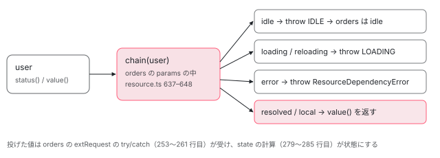

[目次](../README.md) › [resource の細部と新しい部品](README.md) › 第 1 回 / 全 6 回

# params から状態を返す：ResourceParamsStatus と chain()

> params の関数が値の代わりに ResourceParamsStatus.IDLE や LOADING や Error を投げると、extRequest の catch がそれを受けて resource をその状態にする仕組み（2206efa55fc）と、LOADING やエラーでは loader を呼ばない行。params に渡される context の chain() が、ほかの resource の status() を読み、resolved と local 以外は投げて前へ伝える行（reloading も LOADING になる）。params の中で resource を作ると NG0992 になる印と、それが入れ子で下りてしまうこと。params のエラーの後に idle になると value() も hasValue() も投げる穴（#71585 の reload も同じ）。ページの上の本物で 2 段につないだ resource の状態を見る。

angular/angular · 読了 約 13 分 · 中核 · [サイトで読む（デモが動きます）](https://angular-deep-dive-cyan.vercel.app/chapter/resx-params-status)

---

resource の `params` の関数は、値を返す代わりに **投げる** こともできます。`ResourceParamsStatus.IDLE` を投げれば `idle`、`LOADING` を投げれば `loading`、`Error` を投げれば `error` です。この章では、その投げた値を `ResourceImpl` のどの行が受け止めて状態に変えるのか、params に渡される `chain()` がほかの resource の状態をどう前へ伝えるのか、params の中で resource を作ると何が起きるのかを、2206efa55fc の差分と今の行と spec の順に読みます。

読む対象は `packages/core/src/resource/api.ts` と `resource.ts`、`core/src/errors.ts`、spec は `core/test/resource/chain_spec.ts` と `params_status_spec.ts` です。resource の大筋（`extRequest` と `state` の 2 つの linkedSignal、loadEffect、6 つの状態）は [resource の章](../signals/15-resource.md)で読んだので、ここでは繰り返しません。

1. **1. params から状態を返す**（この章）
2. [2. debounced()](02-resx-debounced.md)
3. [3. エラーの包み方](03-resx-errors.md)
4. [4. SSR と resource](04-resx-ssr-cache.md)
5. [5. 後片付けと漏れ](05-resx-cleanup-leaks.md)
6. [6. spec と issue](06-resx-tests-issues.md)

## 1. 何が足りなかったか：2206efa55fc の差分

2026 年 2 月の 2206efa55fc（feat(core): add special return statuses for resource params）の前は、params が状態を決める方法は 1 つだけでした。`undefined` を返せば `idle`、それ以外を返せば読み込み、です。「ほかの resource がまだ読み込み中なので、こちらも読み込み中として待ちたい」「params の段階で失敗が分かったので `error` にしたい」を言う手段がありませんでした。コミットの本文は、投げてよい値を 3 つ挙げています。`ResourceParamsStatus.IDLE`（`undefined` を返すのと同じ）、`ResourceParamsStatus.LOADING`、任意の `Error` です。あわせて params に context を渡し、その `chain` で「ほかの resource の値を読み、idle・loading・error ならそのまま前へ伝える」ことができるようにしました。

📄 `git show 2206efa55fc -- packages/core/src/resource/resource.ts（extRequest の部分の抜粋）`

```
@@ -225,12 +232,21 @@ export class ResourceImpl<T, R> extends BaseWritableResource<T> implements Resou
       debugName,
     );
 
-    // Extend `request()` to include a writable reload signal.
-    this.extRequest = linkedSignal({
-      source: request,
-      computation: (request) => ({request, reload: 0}),
-      ...(ngDevMode ? createDebugNameObject(debugName, 'extRequest') : undefined),
-    });
+    this.extRequest = linkedSignal<WrappedRequest>(
+      () => {
+        try {
+          return {request: request(paramsContext), reload: 0};
+        } catch (error) {
+          if (error === ResourceParamsStatus.IDLE) {
+            return {status: 'idle', reload: 0};
+          } else if (error === ResourceParamsStatus.LOADING) {
+            return {status: 'loading', reload: 0};
+          }
+          return {error: error as Error, reload: 0};
+        }
+      },
+      ngDevMode ? createDebugNameObject(debugName, 'extRequest') : undefined,
+    );
 
     // The main resource state is managed in a `linkedSignal`, which allows the resource to change
     // state instantaneously when the request signal changes.
```

消えた行（`-`）では、`extRequest` は `source: request` の linkedSignal でした。params が投げると、その例外は linkedSignal の中にしまわれ、読んだ人に投げ直されます。下の記録の \[0\] は、同じ形を `linkedSignal` と `computed` で組んで、params に投げさせたものです。`status()` を読んだ人に params の例外がそのまま飛びます。足された行（`+`）は、params の呼び出しを `try` で包み、投げられたものを 3 通りの「状態の材料」に変えて返します。**投げても、`status()` を読む人には例外が届かない**ようになったのが、このコミットの中心です。

## 2. 投げる値：ResourceParamsStatus と ResourceDependencyError

📄 `angular/packages/core/src/resource/api.ts` L13–40 （▶ の行: 14, 16, 19–21, 29–31, 36, 39）

```ts
13 │ /** Error thrown when a `Resource` dependency of another resource errors. */
14 ▶ export class ResourceDependencyError extends Error {
15 │   /** The dependency that errored. */
16 ▶   readonly dependency: Resource<unknown>;
17 │ 
18 │   constructor(dependency: Resource<unknown>) {
19 ▶     super('Dependency error', {cause: dependency.error()});
20 ▶     this.name = 'ResourceDependencyError';
21 ▶     this.dependency = dependency;
22 │   }
23 │ }
24 │ 
25 │ /**
26 │  * Special status codes that can be thrown from a resource's `params` or `request` function to
27 │  * indicate that the resource should transition to that status.
28 │  */
29 ▶ export class ResourceParamsStatus extends Error {
30 ▶   private readonly _brand: undefined;
31 ▶   private constructor(msg: string) {
32 │     super(msg);
33 │   }
34 │ 
35 │   /** Status code that transitions the resource to `idle` status. */
36 ▶   static readonly IDLE = new ResourceParamsStatus('IDLE');
37 │ 
38 │   /** Status code that transitions the resource to `loading` status. */
39 ▶   static readonly LOADING = new ResourceParamsStatus('LOADING');
40 │ }
```

- 29 行目、`ResourceParamsStatus` は `Error` の子クラスです。31 行目でコンストラクタが `private` なので、外から `new` できません。
- 36・39 行目の `static readonly` の 2 つが、**このクラスのインスタンスのすべて**です。受け取る側（3 節）は `===` で比べるので、投げるときはこの 2 つそのものを投げます。
- 30 行目の `_brand` は値を持たない private のフィールドで、形が同じだけの別のクラスを TypeScript がこの型として受け付けないようにする印です。
- 14〜22 行目の `ResourceDependencyError` は、4 節の `chain` が「つないだ先が error」のときに投げるものです。19 行目で `cause` に先の resource の `error()` を入れ、20 行目で `name` を決めています。`name` を文字列で入れているので、本番ビルドでクラス名が縮められても `'ResourceDependencyError'` と読めます。

## 3. extRequest が受け止める

📄 `angular/packages/core/src/resource/resource.ts` L106–111 （▶ の行: 107, 109–110）

```ts
106 │ type WrappedRequest = {
107 ▶   request?: unknown;
108 │   reload: number;
109 ▶   status?: ResourceInternalStatus;
110 ▶   error?: Error;
111 │ };
```

`extRequest` の値の型です。2206efa55fc の前は `{request, reload}` の 2 つでした。107 行目の `request` が省略可能になり、109 行目の `status` と 110 行目の `error` が足されました。3 つのどれが入っているかで、次の `state` の計算が分かれます。

📄 `angular/packages/core/src/resource/resource.ts` L204–216 （▶ の行: 205, 214–215）

```ts
204 │   constructor(
205 ▶     request: (ctx: ResourceParamsContext) => R,
206 │     private readonly loaderFn: ResourceStreamingLoader<T, R>,
207 │     defaultValue: T,
208 │     private readonly equal: ValueEqualityFn<T> | undefined,
209 │     private readonly debugName: string | undefined,
210 │     injector: Injector,
211 │     private transferCacheKey: StateKey<T> | undefined,
212 │     getInitialStream?: (request: R) => Signal<ResourceStreamItem<T>> | undefined,
213 │   ) {
214 ▶     if (isInParamsFunction()) {
215 ▶       throw invalidResourceCreationInParams();
216 │     }
```

205 行目、`ResourceImpl` が受け取る params は `(ctx: ResourceParamsContext) => R`、つまり context を 1 つ受け取る関数です。214〜215 行目の検査は 6 節で読みます。

📄 `angular/packages/core/src/resource/resource.ts` L252–258 （▶ の行: 252–253, 255–258）

```ts
252 ▶           setInParamsFunction(true);
253 ▶           return {request: request(paramsContext), reload: 0};
254 │         } catch (error) {
255 ▶           rethrowFatalErrors(error);
256 ▶           if (error === ResourceParamsStatus.IDLE) {
257 ▶             return {status: 'idle', reload: 0};
258 ▶           } else if (error === ResourceParamsStatus.LOADING) {
```

📄 `angular/packages/core/src/resource/resource.ts` L259–263 （▶ の行: 259, 261, 263）

```ts
259 ▶             return {status: 'loading', reload: 0};
260 │           }
261 ▶           return {error: error as Error, reload: 0};
262 │         } finally {
263 ▶           setInParamsFunction(false);
```

1. **253 行目：params に `paramsContext` を渡して呼ぶ**

   返した値は `request` に入ります。この関数全体が linkedSignal の計算なので、params の中で読んだ signal（5 節の `chain` が読む `status()` と `value()` も）はすべて `extRequest` の依存になります。
2. **255 行目：致命的なものだけは投げ直す**

   `rethrowFatalErrors` は NG0992（6 節）だけを外へ投げ直します。何を「致命的」とするかは[第 3 回](03-resx-errors.md)で読みます。
3. **256〜259 行目：特別な 2 つは `status` に**

   `IDLE` なら `{status: 'idle'}`、`LOADING` なら `{status: 'loading'}`。どちらも `request` を持ちません。
4. **261 行目：それ以外は全部 `error` に**

   `error as Error` と型を付けているだけで、文字列でも `undefined` でもそのまま入ります。これが 4 節の表の最後の行の原因です。
5. **262〜263 行目：`finally` で印を下ろす**

   252 行目で立てた「params の中にいる」印を、ここで `false` に戻します（6 節）。

## 4. state が状態にする

📄 `angular/packages/core/src/resource/resource.ts` L279–285 （▶ の行: 279–280, 282, 285）

```ts
279 ▶         if (error) {
280 ▶           status = 'resolved';
281 │           stream = signal(
282 ▶             {error: encapsulateResourceError(error)},
283 │             ngDevMode ? createDebugNameObject(this.debugName, 'stream') : undefined,
284 │           );
285 ▶         } else if (!status) {
```

`state` の linkedSignal の計算の先頭で、`extRequest` から `request`・`status`・`error` を取り出したところです。279 行目、`error` があれば 280 行目で内部の状態を `resolved` にし、282 行目で `encapsulateResourceError`（`Error` でないものを包む。[第 3 回](03-resx-errors.md)）を通したエラーを stream に入れます。外からは `resolved` + エラーの stream が `error` に見えます（[resource の章](../signals/15-resource.md)の 3 節の投影）。285 行目、`status` が入っていなければ、いつもの「`request` が `undefined` なら `idle`、それ以外は `loading`」の分岐に入ります。`status` が入っていれば、どちらの分岐にも入らずにその `status` のまま返ります。

📄 `angular/packages/core/src/resource/resource.ts` L419–425 （▶ の行: 419, 421–422, 424）

```ts
419 ▶     if (extRequest.request === undefined) {
420 │       // Nothing to load (and we should already be in a non-loading state).
421 ▶       return;
422 ▶     } else if (currentStatus !== 'loading') {
423 │       // We're not in a loading or reloading state, so this loading request is stale.
424 ▶       return;
425 │     }
```

loader を呼ぶ loadEffect の入口です。`LOADING` を投げたときは `request` が無いので、419〜421 行目で帰ります。**状態は `loading` なのに loader は呼ばれません**。`Error` を投げたときは内部の状態が `resolved` なので、422〜424 行目で帰ります。

| params がしたこと | extRequest（3 節） | status() | value() | loader |
| --- | --- | --- | --- | --- |
| 値 `v` を返す | `{request: v}` | loading → resolved | 読み込んだ値 | 呼ばれる |
| `undefined` を返す | `{request: undefined}` | idle | defaultValue | 419 行目で呼ばれない |
| `IDLE` を投げる | `{status: 'idle'}` | idle | defaultValue | 419 行目で呼ばれない |
| `LOADING` を投げる | `{status: 'loading'}` | loading | defaultValue | 419 行目で呼ばれない |
| `Error` を投げる | `{error}` | error | `ResourceValueError` を投げる | 422 行目で呼ばれない |
| 文字列などを投げる | `{error: '…'}` | error | 同上（282 行目で包まれる） | 422 行目で呼ばれない |
| `undefined`・`null`・`0`・`''` を投げる | `{error: undefined}` など | **idle** | defaultValue | 419 行目で呼ばれない |

最後の行が要注意です。261 行目はどんな値も `error` に入れますが、279 行目の `if (error)` は「偽になる値」を通さないので、285 行目の分岐に落ち、`request` が無いので `idle` になります。下の記録の \[1\] が、22.1.6 を Node で動かした結果です。params の中で呼んだ関数が理由を付けずに投げた（`throw undefined` や、受け取った `undefined` をそのまま `throw e` した）ときが、この行に当たります。新しい本家（9 節）では、この偽の値も `error` になります。

📄 `resx-demo/a/record-params.mjs の出力（@angular/core 22.1.6、Node）`

```
@angular/core 22.1.6

[0] 2206efa55fc より前の extRequest と state の形を linkedSignal で組み、params に投げさせる
  "ok" のとき status() = loading
  "x" のとき status() が投げた: params failed

[1] params が投げた値ごとの状態（その前は "ok" で resolved）
  throw "文字列"            status=error value=投げる ResourceValueError error=ResourceWrappedError(Resource returned an error that's not an)
  throw new Error("E")   status=error value=投げる ResourceValueError error=Error(E)
  throw undefined        status=idle value=undefined error=undefined
  throw null             status=idle value=undefined error=undefined
  throw 0                status=idle value=undefined error=undefined
  throw ""               status=idle value=undefined error=undefined

[2] params が Error を投げた後に reload()
  reload の前  status=error value=投げる ResourceValueError error=Error(bad params)
  reload() → true
  reload の後  status=idle value=投げる ResourceValueError error=Error(bad params) loader の回数=1 もう一度 reload() → false

[3] chain でつないだ 2 段目は、1 段目の reload と set でどうなるか
  始め                               user=resolved orders=resolved value="orders of 7" loader: user 1 回・orders 1 回
  user.reload() の直後                user=reloading orders=loading value=undefined loader: user 1 回・orders 1 回
  落ち着いた後                           user=resolved orders=resolved value="orders of 7" loader: user 2 回・orders 2 回
  user.set({id: 7}) の直後            user=local orders=loading value="orders of 7" loader: user 2 回・orders 2 回
  落ち着いた後                           user=local orders=resolved value="orders of 7" loader: user 2 回・orders 3 回

[4] params が Error を投げた後に、params が undefined を返すようにする
  params=err   status=error error=E hasValue()=false value()=投げる ResourceValueError snapshot()={"status":"error","error":{}}
  params=none  status=idle error=E hasValue()=投げる ResourceValueError value()=投げる ResourceValueError snapshot()=投げる ResourceValueError
  params=ok    status=resolved error=undefined hasValue()=true value()=1 snapshot()={"status":"resolved","value":1}

[5] params の中で resource を作る（NG0992）。ほかの resource の params を中で計算させた後はどうなるか（最後に置く。作った resource の effect が後の tick で NG0992 を投げるため）
  s=1: status() が投げた: NG0992: Cannot create a resource inside the `params` of another resour
  s=2: status() = error / error() = NG0602: effect() cannot be called from within a reactive context. Call
```

## 5. chain()：ほかの resource の状態を前へ伝える

📄 `angular/packages/core/src/resource/resource.ts` L632–652 （▶ の行: 637–638, 640, 642, 645, 647, 650–651）

```ts
632 │ /**
633 │  * Chains the current params off of the value of another resource, returning the value
634 │  * of the other resource only when its status is `resolved` or `local`, or propagating status to
635 │  * the current resource by throwing the appropriate status code when the value is not available.
636 │  */
637 ▶ export function chain<T>(resource: Resource<T>): T {
638 ▶   switch (resource.status()) {
639 │     case 'idle':
640 ▶       throw ResourceParamsStatus.IDLE;
641 │     case 'error':
642 ▶       throw new ResourceDependencyError(resource);
643 │     case 'loading':
644 │     case 'reloading':
645 ▶       throw ResourceParamsStatus.LOADING;
646 │   }
647 ▶   return resource.value();
648 │ }
649 │ 
650 ▶ export const paramsContext: ResourceParamsContext = {
651 ▶   chain,
652 │ };
```

1. **638 行目：つないだ先の `status()` を読む**

   params の中（3 節の 253 行目）で呼ばれるので、この読み取りがこちらの `extRequest` の依存になります。先の状態が変わるたびに、こちらの params がもう一度呼ばれます。
2. **639〜645 行目：値が無い状態なら投げる**

   `idle` → `IDLE`、`error` → `new ResourceDependencyError(resource)`、`loading` と `reloading` → `LOADING`。3 節の 256〜261 行目がそれぞれ受け止めます。
3. **647 行目：`resolved` と `local` だけ値を返す**

   `switch` に無い 2 つです。`value()` の読み取りも依存になります。
4. **650〜652 行目：`paramsContext` は `chain` 1 つだけを持つ定数**

   すべての resource が同じオブジェクトを受け取ります。`chain` は呼ばれた resource を覚えたりしない、ただの関数です。



*chain でつないだ 2 段の resource。user の状態は orders の params の中で投げられた値になり、orders の extRequest がそれを状態に変える。*

2026 年 7 月の 5ad937be5ec（#69330）は、この関数と `ResourceParamsContext` の doc コメントを直しました。前は「値があれば返す」と書いてあり、`reloading` のように値があるのに 645 行目で投げる状態と合っていなかったからです。今は「`resolved` か `local` のときだけ返す」です。`chain` が 650 行目の中から外へ出されて名前の付いた関数になったのは 0ea50ffe5ad（Signal Forms）で、`ɵchain` として forms から使うためです（[signal-forms](../signals/17-signal-forms.md) の 10 節）。

### reloading も LOADING になる

645 行目で `reloading` も `LOADING` になるので、**つないだ先を `reload()` すると、こちらは `reloading` ではなく `loading` になり、値は defaultValue に戻ります**。記録の \[3\] がそれです。user が `reloading` の間、orders は `loading` で値は `undefined`、user が落ち着くと orders の loader がもう一度呼ばれます（orders 2 回）。`LOADING` の間の `extRequest` には `request` が無いので、user が戻って同じ `7` を返しても、前の状態の `request`（`undefined`）と比べて「違う要求」になるからです（比べる行は [resource の章](../signals/15-resource.md)の 4 節 (b)）。

\[3\] の後半は、user に `set({id: 7})` で同じ id の新しいオブジェクトを入れたところです。`chain(user).id` は同じ `7` なのに、orders の loader が 3 回目を呼ばれました。`value()` が変わったので params がもう一度呼ばれ、253 行目が新しい `{request: 7, reload: 0}` を作り、loadEffect は「`extRequest` が変わった」として走るからです。新しい本家ではこれも変わっています（9 節）。

## 6. params の中で resource を作らない：NG0992

📄 `angular/packages/core/src/resource/resource.ts` L654–670 （▶ の行: 654, 656, 660, 664, 666–667）

```ts
654 ▶ let inParamsFunction = false;
655 │ 
656 ▶ export function isInParamsFunction() {
657 │   return inParamsFunction;
658 │ }
659 │ 
660 ▶ export function setInParamsFunction(value: boolean) {
661 │   inParamsFunction = value;
662 │ }
663 │ 
664 ▶ export function invalidResourceCreationInParams(): Error {
665 │   return new RuntimeError(
666 ▶     RuntimeErrorCode.INVALID_RESOURCE_CREATION_IN_PARAMS,
667 ▶     ngDevMode && `Cannot create a resource inside the \`params\` of another resource`,
668 │   );
669 │ }
670 │ 
```

📄 `angular/packages/core/src/errors.ts` L157–162 （▶ の行: 160）

```ts
157 │   // resource() API errors
158 │   MUST_PROVIDE_STREAM_OPTION = 990,
159 │   RESOURCE_COMPLETED_BEFORE_PRODUCING_VALUE = -991,
160 ▶   INVALID_RESOURCE_CREATION_IN_PARAMS = 992,
161 │ 
162 │   // Upper bounds for core runtime errors is 999
```

654 行目の `inParamsFunction` は、モジュールに 1 つだけある真偽値です。3 節の 252 行目が params を呼ぶ前に `true` にし、263 行目の `finally` で `false` に戻します。3 節の 214〜215 行目は、`ResourceImpl` のコンストラクタの先頭でこれを見て、`true` なら 664〜669 行目の `RuntimeError`（errors.ts 160 行目の 992、NG0992）を投げます。`debounced()` も同じ検査をします（[第 2 回](02-resx-debounced.md)）。この仕組みを足したのは 2206efa55fc ではなく、10 日後の b918beda323（debounced を足したコミット）です。

params は `extRequest` の linkedSignal の計算なので、中で resource を作ると、計算がやり直されるたびに新しい resource を作ろうとします。resource は中で effect を作りますが、effect は計算の中では作れません（NG0602。記録の \[5\] の `s=2`）。214〜215 行目の検査はコンストラクタの先頭にあるので、effect を作る行より前で NG0992 として止まります。普通の例外なら 3 節の 261 行目で `error` 状態にされて見えなくなるところを、255 行目の `rethrowFatalErrors` が NG0992 だけは投げ直すので、`status()` を読んだ人にすぐ届きます（記録の \[5\] の `s=1`）。

### 印は 1 つしかない

263 行目は、前の値に関係なく `false` にします。すると、ある resource の params の途中で、**別の resource の params が初めて計算される**と、内側の 263 行目で印が下り、外側の params の残りは「params の外」と見なされます。記録の \[5\] の `s=2` がそれで、外側の params が 2 回目に初めて `other.status()` を読み、other の params がその場で計算された後に resource を作っています。NG0992 は出ず、代わりに effect を計算の中で作ろうとした NG0602 が出て、それは致命的ではないので 261 行目で **外側の resource の `error()` にしまわれました**。Signal Forms は同じ印を、前の値を覚えてから一時的に下ろし、終わったら戻す形で使っています（`metadata.ts` の `runMetadataCreateLifecycle`、5cb8c733a39・#69620。行は [forms-sf-validation](../forms/17-forms-sf-validation.md) の章が引用しています）。

## 7. params のエラーの後の idle

📄 `angular/packages/core/src/resource/resource.ts` L305–310 （▶ の行: 306–308）

```ts
305 │           } else {
306 ▶             status = request === undefined ? 'idle' : 'loading';
307 ▶             if (previous.value.extRequest.request === request) {
308 ▶               stream = previous.value.stream;
309 │             }
310 │           }
```

2 回目以降の `state` の計算です。306 行目で `request` が `undefined` なら `idle`、307〜308 行目で「前の状態と `request` が同じなら前の stream を引き継ぐ」。`reload()` で前の値を残すための行です（[resource の章](../signals/15-resource.md)の 4 節 (b)）。ところが params が `Error` を投げた状態の `extRequest` にも `request` はありません（3 節の 261 行目）。そこから params が `undefined` を返す（か、偽になる値を投げる）と、307 行目は `undefined === undefined` で真になり、**エラーの stream が `idle` の状態に引き継がれます**。`IDLE` や `LOADING` を投げた場合は 285 行目の分岐に入らないので stream は空になり、こうはなりません。

記録の \[4\] がその結果です。`status()` は `idle` なのに、`error()` は前のエラーを返し、`value()` は `ResourceValueError` を投げます。さらに、`hasValue()` と `snapshot()` も投げます。どちらも `status()` が `error` かどうかを先に見てから `value()` を読む作りなので（[resource の章](../signals/15-resource.md)の 8 節）、`idle` では `value()` まで進んでしまうからです。テンプレートで `@if (res.hasValue())` と守っていても、変更検知の中で例外になります。このページの DEMO を作るときにも、2 段目の params を「new Error を投げる」から「undefined を返す」に切り替えたところで、`snapshot()` を読んでいたテンプレートが投げ、画面が更新されなくなりました（今の DEMO は `snapshot()` を `try` で読んでいます）。2026-11-13 に issue を「hasValue throws」「resource idle error」などで探しましたが、この形のものは見つかりませんでした。新しい本家の 74961c66242 でも 307 行目は同じです。

### reload() でも同じことが起きる

📄 `angular/packages/core/src/resource/resource.ts` L387–393 （▶ の行: 387–388, 393）

```ts
387 ▶     const {status} = untracked(this.state);
388 ▶     if (status === 'idle' || status === 'loading') {
389 │       return false;
390 │     }
391 │ 
392 │     // Increment the request reload to trigger the `state` linked signal to switch us to `Reload`
393 ▶     this.extRequest.update(({request, reload}) => ({request, reload: reload + 1}));
```

params が `Error` を投げて `error` になった resource に `reload()` すると、388 行目の検査は通ります（内部の状態は `resolved`）。393 行目は `extRequest` の今の値から `request` と `reload` だけを取り出して作り直すので、`error` が落ちます。新しい値は `{request: undefined, reload: 1}` で、4 節の 285 行目の分岐で `idle` になります。記録の \[2\] のとおり、`reload()` は `true` を返すのに loader は呼ばれず、状態は `idle`、`error()` は前のエラーを返し、`value()` は投げ、2 回目の `reload()` は 388 行目で `false` です。`error()` が残り `value()` が投げるのは、上の 307〜308 行目でエラーの stream が引き継がれるからです。これは開いている issue #71585 の内容と同じで、直そうとした PR #71588 は閉じられています（2026-11-13 時点、マージされていません）。

## 8. DEMO：2 段につないだ resource

> **🧪 DEMO — user → orders を chain でつなぎ、1 段目の状態と 2 段目の params を変える**
>
> このページの `@angular/core` 22.1.6 の本物の `resource()` です。loader は通信せず、`setTimeout` で遅らせた Promise を返します（abort が来たら止めて数えます）。orders の params は既定で `({ chain }) => chain(this.user)?.id` です（user の値の型が `RpsUser | undefined` なので `?.` を付けています。`resolved` と `local` では必ず値があります）。下の表は 2 つの `status()` を読む `effect` で 1 行ずつ足しているので、1 回の変更検知の間の途中の状態は見えません。orders の値は `snapshot()` から出しています（error でも投げないため。ただし 7 節の idle では投げるので、`try` で読んでいます）。「orders.value() を読むと」の欄だけ、`value()` を `try` で読んでいます。
>
> ▶ [このデモはサイトで動かせます](https://angular-deep-dive-cyan.vercel.app/chapter/resx-params-status)

試すとよい順番です。

1. **最初**

   user の params が `undefined` なので user は `idle`、`chain` が 640 行目で `IDLE` を投げるので orders も `idle`。どちらの loader も 0 回です。
2. **「id = 1」**

   user が `loading` になった瞬間に orders も `loading`（645 行目）。orders の loader はまだ 0 回で、user が `resolved` になってから 1 回呼ばれます（chain\_spec の 79〜81 行目と同じ並び）。
3. **読み込み中に「id = 2」**

   user の abort が 1 増えます。orders は user が落ち着くまで loader を呼ばないので、orders の abort は増えません。
4. **「id = -1（失敗）」**

   user が `error`、orders は `ResourceDependencyError` で `error`。cause に user のエラーが入っています（19 行目）。「orders.value() を読むと」は投げます。
5. **落ち着いてから「user.reload()」**

   user は `reloading` で値が残り、orders は `loading` で値が消えます（5 節）。
6. **「user.set(…)」**

   user は `local`、647 行目で値が返るので orders は読み込み直します。id が同じでも loader の回数が増えます。
7. **2 段目の params を切り替える**

   `LOADING` を投げると orders は `loading` のまま、loader の回数は増えません（419 行目）。`undefined` を投げると `idle`（4 節の表の最後の行。直前が「new Error を投げる」なら、7 節の「値の欄が投げる idle」になります）。`new Error` を投げてから「orders.reload()」を押すと、`true` が返って `idle` になります（7 節）。
8. **「new Error を投げる」→「undefined を返す」**

   orders は `idle` なのに、値の欄は「snapshot() が投げた」、「orders.value() を読むと」も投げます（7 節の 307 行目）。「chain(user)?.id を返す」に戻すと、普通に読み込み直します。

このページの本番ビルドを headless Chrome で開き、DEMO のボタンを全部押して、表示とコンソール（エラーと警告が 0 件）を確かめました（2026-11-13）。

## 9. 新しい本家（74961c66242）で変わったところ

📄 `git -C ../angular-main show 5c4b6a48679 -- packages/core/src/resource/resource.ts`

```ts
@@ -246,11 +246,25 @@ export class ResourceImpl<T, R> extends BaseWritableResource<T> implements Resou
 
     this.transferState = injector.get(TransferState, undefined, {optional: true}) ?? undefined;
 
+    const paramsSignal = isSignal(request)
+      ? request
+      : computed(
+          () => {
+            try {
+              setInParamsFunction(true);
+              return request(paramsContext);
+            } finally {
+              setInParamsFunction(false);
+            }
+          },
+          ngDevMode ? createDebugNameObject(debugName, 'params') : undefined,
+        );
+
     this.extRequest = linkedSignal<WrappedRequest>(
       () => {
         try {
           setInParamsFunction(true);
-          return {request: request(paramsContext), reload: 0};
+          return {request: paramsSignal(), reload: 0};
         } catch (error) {
           rethrowFatalErrors(error);
           if (error === ResourceParamsStatus.IDLE) {
@@ -258,7 +272,7 @@ export class ResourceImpl<T, R> extends BaseWritableResource<T> implements Resou
           } else if (error === ResourceParamsStatus.LOADING) {
             return {status: 'loading', reload: 0};
           }
-          return {error: error as Error, reload: 0};
+          return {error: encapsulateResourceError(error), reload: 0};
         } finally {
           setInParamsFunction(false);
         }
@@ -279,7 +293,7 @@ export class ResourceImpl<T, R> extends BaseWritableResource<T> implements Resou
         if (error) {
           status = 'resolved';
           stream = signal(
-            {error: encapsulateResourceError(error)},
+            {error},
             ngDevMode ? createDebugNameObject(this.debugName, 'stream') : undefined,
           );
         } else if (!status) {
```

2026 年 9 月の 5c4b6a48679（fix(core): avoid reloading a resource when params is unchanged）は、手元の ../angular（22.2.0-next.7）にはまだ無く、新しい本家にあります。2 つ変わっています。

- params を `computed`（`paramsSignal`）に包んでから `extRequest` で読みます。computed は前と同じ値なら読み手に知らせないので、5 節の後半の「同じ `7` なのに読み直す」が起きなくなります。params が投げたときも、computed は投げられたものをしまって同じものを投げ直すので（[computed の章](../signals/06-signals-computed.md)の 6 節）、`===` の比べ方はそのまま効きます。
- `encapsulateResourceError` を `state` の計算から `extRequest` の `catch` に移しました。偽になる値も包まれて `Error` になるので、4 節の表の最後の行も `error` になります。spec には `should distinguish between returning undefined and throwing undefined in params` などの 3 つの it が足されています。

もう 1 つ、params が値を出せなくなった（`undefined`・`IDLE`・`LOADING`・エラー）ときに、読み込み中の古い loader を止めない問題（#71765）は、2026-11-11 に #71766 で直されました。手元の 2 つの木のどちらよりも後なので、この章のコードにはまだ入っていません。abort と後片付けは[第 5 回](05-resx-cleanup-leaks.md)で読みます。

## 全体の流れ

- 👤 `orders.status()` — *テンプレートや effect が読む*
  - `state`（linkedSignal）→ `extRequest`（linkedSignal）の計算 — resource.ts 252–263
    - `setInParamsFunction(true)` — 252
    - 👤 `params(paramsContext)` — 253 — *利用者の関数*
      - `chain(user)` → `user.status()` — 637–638 — *依存になる*
        - `throw IDLE / LOADING / new ResourceDependencyError` または `return user.value()` — 639–647
    - `catch`：`rethrowFatalErrors` → `{status}` か `{error}` — 254–261
    - `finally`：`setInParamsFunction(false)` — 262–263
  - `state` の計算：`error` なら resolved + エラーの stream、`status` ならそのまま — 279–285
- `loadEffect()` — 419 — *変更検知の中*
  - `request === undefined` か `loading` でなければ帰る — 419–425 — *LOADING・エラーでは loader を呼ばない*

## テストと直し方

### spec と it

| ファイル | describe / it | 行 | この章のどこ |
| --- | --- | --- | --- |
| chain\_spec.ts | `chain` › `should throw idle if resource is idle`・`…loading if resource is loading`・`…loading if resource is reloading`・`…dependency error if resource is error`・`should return value when resolved` | 22・28・34・40・46 | 5 節の 639〜647 行目（`local` の it は無い） |
| chain\_spec.ts | `should chain resources together` | 52 | 5 節・DEMO |
| params\_status\_spec.ts | `resource with ResourceParamsStatus` › `should transition to idle when params throws ResourceParamsStatus.IDLE` | 23 | 3・4 節 |
| params\_status\_spec.ts | `should transition to loading when params throws ResourceParamsStatus.LOADING` | 44 | 4 節の 419 行目 |
| params\_status\_spec.ts | `should transition to error when params throws an Error` | 69 | 3 節の 261 行目・4 節の 279 行目 |
| params\_status\_spec.ts | `should recover from special statuses` | 89 | 4 節の表 |
| debounce\_spec.ts | `debounced` › `should throw if used in params of another resource` | 476 | 6 節（NG0992 の it はこの 1 つだけ） |

📄 `angular/packages/core/test/resource/chain_spec.ts` L65–97 （▶ の行: 66, 69, 73–74, 76, 79–81, 87, 94–96）

```ts
65 │     // Idle because res1 is idle
66 ▶     expect(res2.status()).toBe('idle');
67 │     expect(loaderSpy).not.toHaveBeenCalled();
68 │ 
69 ▶     state.set({status: 'loading', value: 0});
70 │     TestBed.tick();
71 │ 
72 │     // Loading because res1 is loading, res2 loader not run yet.
73 ▶     expect(res2.status()).toBe('loading');
74 ▶     expect(loaderSpy).not.toHaveBeenCalled();
75 │ 
76 ▶     state.set({status: 'resolved', value: 2});
77 │     TestBed.tick();
78 │ 
79 ▶     // Loading because res2 loader is running.
80 ▶     expect(res2.status()).toBe('loading');
81 ▶     expect(loaderSpy).toHaveBeenCalled();
82 │ 
83 │     await timeout();
84 │ 
85 │     // Resolved.
86 │     expect(res2.status()).toBe('resolved');
87 ▶     expect(res2.value()).toBe(4);
88 │ 
89 │     const error = Error('fail');
90 │     state.set({status: 'error', error});
91 │     TestBed.tick();
92 │ 
93 │     // Error due to error in res1.
94 ▶     expect(res2.status()).toBe('error');
95 ▶     expect(res2.error()).toBeInstanceOf(ResourceDependencyError);
96 ▶     expect(res2.error()?.cause).toBe(error);
97 │   });
```

chain\_spec.ts の 2 段目の it です。1 段目は `resourceFromSnapshots` で、状態を signal で直接決めています（[resource の章](../signals/15-resource.md)の 8 節）。69・73〜74 行目、1 段目が `loading` なら 2 段目も `loading` で loader は呼ばれていない。76・80〜81 行目、1 段目が `resolved` になったら 2 段目は自分の読み込みで `loading`。94〜96 行目、`error` なら `ResourceDependencyError` で、`cause` が 1 段目のエラーそのもの、を確かめています。

📄 `angular/packages/core/test/resource/params_status_spec.ts` L44–67 （▶ の行: 49, 62, 64–66）

```ts
44 │   it('should transition to loading when params throws ResourceParamsStatus.LOADING', async () => {
45 │     const s = signal<string | ResourceParamsStatus>('foo');
46 │     let loadCount = 0;
47 │     const res = await actAsync(() =>
48 │       resource({
49 ▶         params: throwStatusAndErrors(s),
50 │         loader: async ({params}) => {
51 │           loadCount++;
52 │           return params as string;
53 │         },
54 │         injector: TestBed.inject(Injector),
55 │       }),
56 │     );
57 │ 
58 │     expect(res.status()).toBe('resolved');
59 │     expect(res.value()).toBe('foo');
60 │     expect(loadCount).toBe(1);
61 │ 
62 ▶     await actAsync(() => s.set(ResourceParamsStatus.LOADING));
63 │ 
64 ▶     expect(res.status()).toBe('loading');
65 ▶     expect(res.value()).toBe(undefined);
66 ▶     expect(loadCount).toBe(1);
67 │   });
```

📄 `angular/packages/core/test/resource/params_status_spec.ts` L103–120 （▶ の行: 105, 107–108, 110, 112–113, 117, 119）

```ts
103 │     expect(res.status()).toBe('idle');
104 │ 
105 ▶     await actAsync(() => s.set(ResourceParamsStatus.LOADING));
106 │ 
107 ▶     expect(res.status()).toBe('loading');
108 ▶     expect(loadCount).toBe(0);
109 │ 
110 ▶     await actAsync(() => s.set(new Error('fail')));
111 │ 
112 ▶     expect(res.status()).toBe('error');
113 ▶     expect(loadCount).toBe(0);
114 │ 
115 │     await actAsync(() => s.set('foo'));
116 │ 
117 ▶     expect(res.status()).toBe('resolved');
118 │     expect(res.value()).toBe('foo');
119 ▶     expect(loadCount).toBe(1);
120 │   });
```

66 行目と 108・113 行目の `loadCount` が、「`LOADING` とエラーでは loader を呼ばない」（4 節の 419・422 行目）を固めています。119 行目、特別な状態から普通の値に戻ると、loader が初めて 1 回呼ばれます。どの it も「投げてから戻す」までで、**投げている間に `reload()` する it は無い**ので、7 節の振る舞いはどこでも確かめられていません。

### 手元で走らせた結果

📄 `走らせたコマンド`

```
cd ~/angular-research/angular
pnpm bazel test //packages/core/test/resource:resource --nocache_test_results --test_output=all
pnpm bazel test //packages/core/test/resource:resource --nocache_test_results --test_output=all '--test_arg=--filter=chain '
pnpm bazel test //packages/core/test/resource:resource --nocache_test_results --test_output=all '--test_arg=--filter=resource with ResourceParamsStatus'
```

../angular（22.2.0-next.7、8576f161ae4）で、`//packages/core/test/resource:resource`（Node の jasmine）の全体は「70 specs, 0 failures」、`--filter=chain ` は「6 specs, 0 failures」、`--filter=resource with ResourceParamsStatus` は「4 specs, 0 failures」でした（2026-11-13）。70 は core/test/resource の 5 つの spec の it の数（chain 6・params\_status 4・debounce 17・resource\_snapshot 5・resource 38）の合計と同じです。

### 直すとしたら

- 6 節の印：resource.ts の `ResourceImpl` のコンストラクタの 252・263 行目（と、[第 2 回](02-resx-debounced.md)で読む debounce.ts の 2 か所の `try` / `finally`）で、呼ぶ前の `isInParamsFunction()` を覚えておき、`finally` でその値に戻す形です。Signal Forms の `runMetadataCreateLifecycle` がすでにこの形です。spec は params\_status\_spec.ts に「別の resource の params が中で計算された後でも NG0992」を足す形で、記録の \[5\] がそのまま再現の手順になります。
- 7 節の idle：resource.ts 307 行目の「同じ要求か」の比べ方が、params のエラー（`request` を持たない `extRequest`）を前の状態に持つときに真にならないようにする形です。spec は params\_status\_spec.ts に「エラーを投げた後に `undefined` を返すと、`hasValue()` が `false` で `snapshot()` が `idle`」を足す形で、記録の \[4\] が再現の手順です。
- 7 節の `reload()`：resource.ts 393 行目が `extRequest` の `error` と `status` を落とさないようにするか、388 行目で「params 由来のエラー」を見分けて `false` を返すか、です。どちらにするかは #71585 でまだ決まっていません。spec は params\_status\_spec.ts の 89 行目の it の隣です。
- 4 節の偽の値：新しい本家の 5c4b6a48679 がすでに直しています（9 節）。

## 聞かれそうな質問

**Q. params がエラーを投げた後に `undefined` を返すと、きれいな `idle` に戻りますか？**

戻りません（22.1.6 と、手元の 2 つの本家の木）。307〜308 行目が `request` の無い 2 つの状態を「同じ要求」と見なし、エラーの stream を引き継ぐので、`status()` は `idle` でも `value()`・`hasValue()`・`snapshot()` が投げます（記録の \[4\]）。一度普通の値を返して読み込めば元に戻ります。

**Q. params で `undefined` を返すのと `ResourceParamsStatus.IDLE` を投げるのは同じですか？**

見た目の状態は同じ `idle` ですが、通る行が違います。返すと 253 行目で `{request: undefined}`、投げると 256〜257 行目で `{status: 'idle'}` になり、前者は 285 行目の分岐、後者はそのままの `status` で `idle` になります。投げる形は、`chain` のように「値を返す関数の途中から抜けたい」ときのためのものです。

**Q. LOADING を投げている間、loader は呼ばれますか？**

呼ばれません。`extRequest` に `request` が無いので、loadEffect の 419〜421 行目で帰ります。状態は `loading`、`isLoading()` も `true` ですが、何も読み込んでいません。params\_status\_spec.ts の 66 行目がこれを確かめています。

**Q. つないだ先が `reloading` のとき、chain は前の値を返しますか？**

返しません。643〜645 行目で `loading` と同じ `LOADING` を投げます。値を返すのは 647 行目に来る `resolved` と `local` だけです（5ad937be5ec で doc コメントもそう直されました）。そのためこちらは `loading` になり、値は defaultValue に戻ります。

**Q. つないだ先がエラーのとき、こちらの `error()` は何を返しますか？**

`ResourceDependencyError` です（642 行目）。api.ts 19 行目で `cause` に先の `error()` が入り、20 行目で `name` が `'ResourceDependencyError'`、21 行目の `dependency` で先の resource そのものも取れます。chain\_spec.ts の 95〜96 行目が確かめています。

**Q. params の中で resource を作るとどうなりますか？**

214〜215 行目で NG0992 が投げられ、255 行目の `rethrowFatalErrors` が投げ直すので、`status()` を読んだ人に届きます。ただし 263 行目の印は 1 つしかないので、その params の中で別の resource の params が初めて計算された後だと検査をすり抜け、NG0602 が `error()` にしまわれます（6 節、記録の \[5\]）。

## 読み終えて

- params が投げたものは `extRequest` の `catch`（254〜261 行目）で `{status}` か `{error}` になり、`state` の計算（279〜285 行目）で状態になる。2206efa55fc の前は、読んだ人にそのまま投げられていた
- `LOADING` とエラーでは loader は呼ばれない（419・422 行目）。偽になる値を投げると、22.1.6 では `idle` になる
- `chain` は `status()` を読んで、`resolved` と `local` 以外は投げる。`reloading` も `LOADING` になるので、先を reload するとこちらは値を失って読み直す
- NG0992 の印はモジュールに 1 つの真偽値で、`finally` で必ず `false` に戻す。入れ子になると下りてしまう
- params のエラーの後の `idle` は、307〜308 行目でエラーの stream を引き継ぐ。`undefined` を返しても `reload()` しても（#71585、開いている）、`hasValue()` と `snapshot()` まで投げる

> [!NOTE]
> **さらに深く**
>
> 記録のスクリプトの全文です。部品を描かずに `createEnvironmentInjector` で root の注入器だけを作り、`ApplicationRef.tick()` で loadEffect を走らせています。

📄 `resx-demo/a/record-params.mjs（記録スクリプトの全文）`

```
// 第 1 回 resx-params-status の記録: params が投げるもの・chain・reload を、@angular/core 22.1.6 を Node で直接動かして確かめる。
// 使い方: angular-deep-dive の node_modules が見える場所で node record-params.mjs
import { linkedSignal, computed, DOCUMENT, createEnvironmentInjector, ApplicationRef, resource, signal, provideZonelessChangeDetection,
  ɵINJECTOR_SCOPE as INJECTOR_SCOPE, Injector, VERSION } from '@angular/core';

// 部品を描かないので、root の注入器だけを作る（TransferState が DOCUMENT を読むので、空の代わりを渡す）
const root = createEnvironmentInjector([
  { provide: INJECTOR_SCOPE, useValue: 'root' },
  provideZonelessChangeDetection(),
  { provide: DOCUMENT, useValue: { getElementById: () => null, querySelector: () => null } },
], Injector.NULL);
const appRef = root.get(ApplicationRef);
// tick() で root の effect（resource の loadEffect）を走らせ、loader の Promise が落ち着くまで待つ
const settle = async () => { for (let i = 0; i < 2; i++) { appRef.tick(); await new Promise((r) => setTimeout(r, 5)); } };
const desc = (r) => {
  let v; try { v = JSON.stringify(r.value()); } catch (e) { v = `投げる ${e.constructor.name}`; }
  return `status=${r.status()} value=${v} error=${r.error() ? r.error().constructor.name + '(' + r.error().message.slice(0, 40) + ')' : 'undefined'}`;
};
console.log(`@angular/core ${VERSION.full}`);

console.log('\n[0] 2206efa55fc より前の extRequest と state の形を linkedSignal で組み、params に投げさせる');
{
  const p = signal('ok');
  const params = () => { if (p() === 'x') throw new Error('params failed'); return p(); };
  const extRequest = linkedSignal({ source: params, computation: (request) => ({ request, reload: 0 }) });
  const state = linkedSignal({ source: extRequest, computation: (ext) => ({ status: ext.request === undefined ? 'idle' : 'loading' }) });
  const status = computed(() => state().status);
  console.log('  "ok" のとき status() =', status());
  p.set('x');
  try { console.log('  "x" のとき status() =', status()); } catch (e) { console.log('  "x" のとき status() が投げた:', e.message); }
}

console.log('\n[1] params が投げた値ごとの状態（その前は "ok" で resolved）');
for (const thrown of ['文字列', new Error('E'), undefined, null, 0, '']) {
  const p = signal('ok');
  const r = resource({ params: () => { if (p() === 'x') throw thrown; return p(); }, loader: async ({ params }) => params, injector: root });
  await settle();
  p.set('x');
  await settle();
  console.log(`  throw ${thrown instanceof Error ? 'new Error("E")' : JSON.stringify(thrown)}`.padEnd(24), desc(r));
}

console.log('\n[2] params が Error を投げた後に reload()');
{
  const s = signal('a'); let loads = 0;
  const r = resource({ params: () => { if (s() === 'bad') throw new Error('bad params'); return s(); },
    loader: async ({ params }) => { loads++; return params; }, injector: root });
  await settle(); s.set('bad'); await settle();
  console.log('  reload の前 ', desc(r));
  console.log('  reload() →', r.reload()); await settle();
  console.log('  reload の後 ', desc(r), `loader の回数=${loads}`, `もう一度 reload() → ${r.reload()}`);
}

console.log('\n[3] chain でつないだ 2 段目は、1 段目の reload と set でどうなるか');
{
  let up = 0, down = 0;
  const user = resource({ params: () => 1, loader: async () => { up++; return { id: 7 }; }, injector: root });
  const orders = resource({ params: ({ chain }) => chain(user).id, loader: async ({ params }) => { down++; return `orders of ${params}`; }, injector: root });
  await settle();
  const line = (label) => console.log(`  ${label}`.padEnd(34), `user=${user.status()} orders=${orders.status()} value=${JSON.stringify(orders.value())} loader: user ${up} 回・orders ${down} 回`);
  line('始め');
  user.reload(); line('user.reload() の直後');
  await settle(); line('落ち着いた後');
  user.set({ id: 7 }); line('user.set({id: 7}) の直後');
  await settle(); line('落ち着いた後');
}

console.log('\n[4] params が Error を投げた後に、params が undefined を返すようにする');
{
  const tryIt = (f) => { try { return JSON.stringify(f()); } catch (e) { return `投げる ${e.constructor.name}`; } };
  const mode = signal('ok');
  const r = resource({ params: () => { const m = mode(); if (m === 'err') throw new Error('E'); if (m === 'none') return undefined; return 1; },
    loader: async () => 1, injector: root });
  await settle();
  for (const m of ['err', 'none', 'ok']) {
    mode.set(m); await settle();
    console.log(`  params=${m}`.padEnd(14), `status=${r.status()} error=${r.error()?.message} hasValue()=${tryIt(() => r.hasValue())} value()=${tryIt(() => r.value())} snapshot()=${tryIt(() => r.snapshot())}`);
  }
}
console.log('\n[5] params の中で resource を作る（NG0992）。ほかの resource の params を中で計算させた後はどうなるか（最後に置く。作った resource の effect が後の tick で NG0992 を投げるため）');
{
  const s = signal(1);
  const other = resource({ params: () => s(), loader: async ({ params }) => params, injector: root });
  await settle();
  const outer = resource({
    params: () => {
      if (s() === 2) other.status(); // 2 回目で初めて読む → other の params がこの中で計算される
      resource({ params: () => 1, loader: async () => 1, injector: root });
      return s();
    },
    loader: async ({ params }) => params, injector: root,
  });
  for (const v of [1, 2]) {
    s.set(v);
    try { console.log(`  s=${v}: status() = ${outer.status()} / error() = ${outer.error()?.message.slice(0, 70)}`); }
    catch (e) { console.log(`  s=${v}: status() が投げた: ${e.message.slice(0, 70)}`); }
  }
}
process.exit(0);
```

---

← 前: [spec と issue を読む：投影の振る舞いを決めているテスト](../proj/06-proj-tests-issues.md)  
次: [debounced()：signal を遅らせて resource の params にする](02-resx-debounced.md) →
