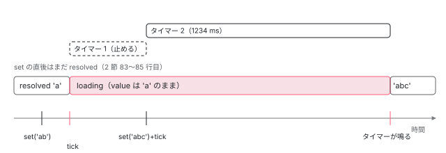

[目次](../README.md) › [resource の細部と新しい部品](README.md) › 第 2 回 / 全 6 回

# debounced()：signal を遅らせて resource の params にする

> debounce.ts の debounced() が、元の signal の変化を時間か Promise で遅らせ、その間を loading の Resource として見せる行。状態は linkedSignal で持ち、動かすのは effect だけなので、set の直後はまだ resolved のまま（#71636）。古いタイマーを止める修正（0904f90b13a、数で待つときだけ）、計算の循環を避けるための遅い初期化（50e599e73ec）。chain(debounced) と Signal Forms の validateAsync の debounce との関係。ページの上で打った回数・タイマー・loader の回数を数える。

angular/angular · 読了 約 12 分 · 中核 · [サイトで読む（デモが動きます）](https://angular-deep-dive-cyan.vercel.app/chapter/resx-debounced)

---

`debounced(source, wait)` は、signal の変化を「落ち着くまで」遅らせ、その遅らせた値を **Resource** として返す関数です。待っている間は `loading`、落ち着いたら `resolved` なので、次の resource の params に `chain` でつなげば「打ち終わってから検索する」が書けます。この章では、debounce.ts の 165 行を頭から読み、状態がいつ（どの effect の中で）変わるのか、タイマーをいつ作っていつ止めるのか（0904f90b13a）、なぜ状態を linkedSignal で持つのか（50e599e73ec）を、コミットと spec と一緒に確かめます。

読む対象は `packages/core/src/resource/debounce.ts` と `api.ts` の型、spec は `core/test/resource/debounce_spec.ts` と `forms/signals/test/web/debounce_async_validation_bug.spec.ts` です。debounce.ts の effect の後半（待ち関数を呼び、待ち始めたら `loading` にする部分）は [resource の章](../signals/15-resource.md)の 8 節が引用しています。そこで読んだ「待ち始めたら `loading`、待ちが終わったら `resolved`」は繰り返さず、その前後とコミットの差分を読みます。`chain` の仕組みは[第 1 回](01-resx-params-status.md)で読みました。

1. [1. params から状態を返す](01-resx-params-status.md)
2. **2. debounced()**（この章）
3. [3. エラーの包み方](03-resx-errors.md)
4. [4. SSR と resource](04-resx-ssr-cache.md)
5. [5. 後片付けと漏れ](05-resx-cleanup-leaks.md)
6. [6. spec と issue](06-resx-tests-issues.md)

## 1. 形：何を受け取り、何を返すか

📄 `angular/packages/core/src/resource/api.ts` L311–335 （▶ の行: 318, 320, 322, 333–335）

```ts
311 │ /**
312 │  * Options for `debounced`.
313 │  *
314 │  * @see [Debouncing signals with `debounced`](guide/signals/debounced)
315 │  *
316 │  * @experimental 22.0
317 │  */
318 ▶ export interface DebouncedOptions<T> {
319 │   /** The `Injector` to use for the debounced resource. */
320 ▶   injector?: Injector;
321 │   /** The equality function to use for comparing values. */
322 ▶   equal?: ValueEqualityFn<T>;
323 │ }
324 │ 
325 │ /**
326 │  * Represents the wait condition for item debouncing.
327 │  * Can be a number of milliseconds or a function that returns a Promise.
328 │  *
329 │  * @see [Debouncing signals with `debounced`](guide/signals/debounced)
330 │  *
331 │  * @experimental 22.0
332 │  */
333 ▶ export type DebounceTimer<T> =
334 ▶   | number
335 ▶   | ((value: T, lastValue: ResourceSnapshot<T>) => Promise<void> | void);
```

333〜335 行目、`wait`（`DebounceTimer`）は 2 通りです。334 行目の数（ミリ秒）か、335 行目の「新しい値と今の状態を受け取り、Promise か何も返さない関数」です。関数の形にすると「Enter が押されるまで待つ」「フォーカスが外れるまで待つ」のように、時間でない条件でも待てます。何も返さなければ待ちません。318〜323 行目の `DebouncedOptions` は `injector` と `equal` の 2 つだけです。この型は 2026 年 3 月の 24e52d450d2（validateAsync に debounce を足したコミット）で、forms からも使えるように api.ts に置かれました。

📄 `angular/packages/core/src/resource/debounce.ts` L24–63 （▶ の行: 32, 37–38, 40–42, 44, 47, 49–51, 53, 55, 60–62）

```ts
24 │ /**
25 │  * Creates a resource representing a debounced version of the source signal.
26 │  *
27 │  * @param source The source signal to debounce.
28 │  * @param wait The amount of time to wait before calling the source signal, or a function that
29 │  *   returns a promise that resolves when the debounced value should be updated.
30 │  * @param options The options to use for the debounced signal.
31 │  * @returns A resource representing the debounced signal.
32 ▶  * @experimental 22.0
33 │  *
34 │  * @see [Debouncing signals with `debounced`](guide/signals/debounced)
35 │  */
36 │ export function debounced<T>(
37 ▶   source: () => T,
38 ▶   wait: NoInfer<DebounceTimer<T>>,
39 │   options?: NoInfer<DebouncedOptions<T>>,
40 ▶ ): Resource<T> {
41 ▶   if (isInParamsFunction()) {
42 ▶     throw invalidResourceCreationInParams();
43 │   }
44 ▶   if (ngDevMode && !options?.injector) {
45 │     assertInInjectionContext(debounced);
46 │   }
47 ▶   const injector = options?.injector ?? inject(Injector);
48 │ 
49 ▶   let active: Promise<void> | void | undefined;
50 ▶   let pendingValue: T | undefined;
51 ▶   let activeTimer: ReturnType<typeof setTimeout> | undefined;
52 │ 
53 ▶   const cancelTimer = () => {
54 │     if (activeTimer !== undefined) {
55 ▶       clearTimeout(activeTimer);
56 │       activeTimer = undefined;
57 │     }
58 │   };
59 │ 
60 ▶   injector.get(DestroyRef).onDestroy(() => {
61 ▶     cancelTimer();
62 ▶     active = undefined;
63 │   });
```

1. **37・40 行目：受け取るのは関数、返すのは `Resource<T>`**

   `source` は `() => T` なので、signal でも、signal を読む普通の関数でもかまいません。返すのは読むだけの `Resource` で、`set` も `reload` もありません。32 行目のとおり、22.0 からの experimental です（resource 本体は 22.0 で stable）。
2. **41〜43 行目：params の中では作れない**

   [第 1 回](01-resx-params-status.md)の 6 節と同じ検査で、NG0992 です。
3. **44〜47 行目：注入器**

   `injector` を渡さなければ注入コンテキストの中で呼ぶ必要があります。この注入器が、2 つ目の effect と 60 行目の後片付けの持ち主になります。
4. **49〜51 行目：クロージャに置く 3 つの変数**

   `active` は「今待っている Promise」、`pendingValue` は「待っている値」、`activeTimer` は「数で待つときの setTimeout の ID」です。どれも signal ではないので、変わっても誰にも知らせません。
5. **53〜63 行目：タイマーを止める関数と、壊れたときの後片付け**

   55 行目の `clearTimeout` は `activeTimer` があるときだけ。60〜63 行目、注入器が壊れたらタイマーを止め、`active` を空にします。`active` が空なら、後で Promise が解決しても 5 節の 154 行目で何もしません。

## 2. 状態は linkedSignal：遅い初期化（50e599e73ec）

📄 `angular/packages/core/src/resource/debounce.ts` L65–93 （▶ の行: 65, 69, 71–72, 74–75, 77, 80, 83–84, 88–89, 91）

```ts
65 ▶   const state = linkedSignal<
66 │     {value: T; thrown: false} | {error: unknown; thrown: true},
67 │     ResourceSnapshot<T>
68 │   >({
69 ▶     source: () => {
70 │       try {
71 ▶         setInParamsFunction(true);
72 ▶         return {value: source(), thrown: false};
73 │       } catch (err) {
74 ▶         rethrowFatalErrors(err);
75 ▶         return {error: err, thrown: true};
76 │       } finally {
77 ▶         setInParamsFunction(false);
78 │       }
79 │     },
80 ▶     computation: (res, previous) => {
81 │       // If we already have a state from the effect or a previous read, keep it!
82 │       // The effect is responsible for timing and state transitions.
83 ▶       if (previous !== undefined) {
84 ▶         return previous.value;
85 │       }
86 │ 
87 │       // On the very first evaluation, determine the initial state synchronously.
88 ▶       if (res.thrown) {
89 ▶         return {status: 'error', error: res.error as Error};
90 │       }
91 ▶       return {status: 'resolved', value: res.value};
92 │     },
93 │   });
```

1. **69〜79 行目：source を読む関数**

   71・77 行目で NG0992 の印を立てて下ろし、72 行目で `source()` を呼びます。投げたら 74 行目で NG0992 だけは投げ直し、それ以外は 75 行目で `{error, thrown: true}` という値にします。
2. **83〜85 行目：2 回目からは前の値をそのまま返す**

   source が変わると linkedSignal はもう一度計算しますが、前の値（`previous.value`）を返すだけです。82 行目のコメントのとおり、**時間と状態の移り変わりは 4 節の effect の担当**で、ここは何もしません。
3. **88〜91 行目：最初の 1 回だけ、source から状態を作る**

   投げていれば `error`、そうでなければ `resolved` とその値。**最初の値は待たずに `resolved`** です（spec の `should start in resolved state`）。

📄 `git show 50e599e73ec -- packages/core/src/resource/debounce.ts（抜粋）`

```
@@ -43,23 +44,41 @@ export function debounced<T>(
   }
   const injector = options?.injector ?? inject(Injector);
 
-  const state = signal<ResourceSnapshot<T>>({
-    status: 'resolved',
-    value: untracked(() => {
+  let active: Promise<void> | void | undefined;
+  let pendingValue: T | undefined;
+
+  injector.get(DestroyRef).onDestroy(() => {
+    active = undefined;
+  });
+
+  const state = linkedSignal<
+    {value: T; thrown: false} | {error: unknown; thrown: true},
+    ResourceSnapshot<T>
+  >({
+    source: () => {
       try {
         setInParamsFunction(true);
-        return source();
+        return {value: source(), thrown: false};
+      } catch (err) {
+        rethrowFatalErrors(err);
+        return {error: err, thrown: true};
       } finally {
         setInParamsFunction(false);
       }
-    }),
-  });
-
-  let active: Promise<void> | void | undefined;
-  let pendingValue: T | undefined;
+    },
+    computation: (res, previous) => {
+      // If we already have a state from the effect or a previous read, keep it!
+      // The effect is responsible for timing and state transitions.
+      if (previous !== undefined) {
+        return previous.value;
+      }
 
-  injector.get(DestroyRef).onDestroy(() => {
-    active = undefined;
+      // On the very first evaluation, determine the initial state synchronously.
+      if (res.thrown) {
+        return {status: 'error', error: res.error as Error};
+      }
+      return {status: 'resolved', value: res.value};
+    },
   });
 
   effect(
@@ -82,7 +101,7 @@ export function debounced<T>(
 
       // Check if the value is the same as the previous one.
       const equal = options?.equal ?? Object.is;
-      if (currentState.status === 'reloading') {
+      if (currentState.status === 'reloading' || currentState.status === 'loading') {
         if (equal(value, pendingValue!)) return;
       } else if (currentState.status === 'resolved') {
         if (equal(value, currentState.value!)) return;
```

50e599e73ec の前は、状態は普通の `signal` で、初期値を作るために **`debounced()` を呼んだその場で**`untracked(() => source())` を読んでいました。コミットの本文によると、Signal Forms の `validateAsync` のように、debounced を「計算の途中」で作ると、まだ計算が終わっていない signal をその場で読むことになり、循環として扱われることがありました。linkedSignal は読まれるまで計算しないので、69 行目の source を読むのは最初に誰かが状態を読んだときです。そのころには周りの計算は終わっています。

📄 `angular/packages/forms/signals/test/web/debounce_async_validation_bug.spec.ts` L26–49 （▶ の行: 27–30, 32, 48–49）

```ts
26 │       protected readonly form = form(this.model, (path) => {
27 ▶         validateAsync(path.hello, {
28 ▶           params: ({value}) => value(),
29 ▶           factory: (params) => {
30 ▶             const debounce = debounced(params, 300);
31 │             return resource({
32 ▶               params: ({chain}) => chain(debounce),
33 │               loader: async ({params}) => {
34 │                 return new Promise<string>((resolve) =>
35 │                   setTimeout(() => {
36 │                     resolve('hi');
37 │                   }, 400),
38 │                 );
39 │               },
40 │             });
41 │           },
42 │           onSuccess: (response) => null,
43 │           onError: (error) => null,
44 │         });
45 │       });
46 │     }
47 │ 
48 ▶     const fixture = TestBed.createComponent(DebounceBug);
49 ▶     await fixture.whenStable();
```

このコミットが足した spec です。27 行目の `validateAsync` の `factory`（29 行目）の中で、30 行目で debounced を作り、32 行目で `chain` します。`factory` は forms がフィールドの metadata を作るときに呼びます（[forms-sf-validation](../forms/17-forms-sf-validation.md) の章）。48〜49 行目でコンポーネントを作って安定を待つだけの it で、修正の前はここで循環のエラーになっていました。`expect` は 1 つもなく、「投げないこと」を確かめています。差分にはもう 1 つ、4 節の 116 行目の条件に `'loading'` を足した変更があります。前は `'reloading'` しか見ていなかったので、待っている間に同じ値がもう一度来ても待ち直していました（debounced は自分で `reloading` にすることがないので、前の条件はいつも偽でした）。

## 3. effect の前半：source を読み、同じなら何もしない

📄 `angular/packages/core/src/resource/debounce.ts` L95–121 （▶ の行: 95, 100–101, 103–106, 112, 115–119）

```ts
 95 ▶   effect(
 96 │     () => {
 97 │       // Enter error state if the source throws.
 98 │       let value: T;
 99 │       try {
100 ▶         setInParamsFunction(true);
101 ▶         value = source();
102 │       } catch (err) {
103 ▶         rethrowFatalErrors(err);
104 ▶         state.set({status: 'error', error: err as Error});
105 ▶         cancelTimer();
106 ▶         active = pendingValue = undefined;
107 │         return;
108 │       } finally {
109 │         setInParamsFunction(false);
110 │       }
111 │ 
112 ▶       const currentState = untracked(state);
113 │ 
114 │       // Check if the value is the same as the previous one.
115 ▶       const equal = options?.equal ?? Object.is;
116 ▶       if (currentState.status === 'reloading' || currentState.status === 'loading') {
117 ▶         if (equal(value, pendingValue!)) return;
118 ▶       } else if (currentState.status === 'resolved') {
119 ▶         if (equal(value, currentState.value!)) return;
120 │       }
121 │ 
```

1. **95・101 行目：effect の中で source を読む**

   ここで読むので、source が変わるとこの effect がもう一度走ります。**debounced の状態を動かすのはこの effect だけ**です（2 節の 83〜85 行目）。effect なので、走るのは次の変更検知（`ApplicationRef.tick()`）の中です。1 節の注入器が環境の注入器なら root effect、コンポーネントの注入器なら view effect になります（[cd-effects](../cd/09-cd-effects.md)）。
2. **102〜107 行目：source が投げたら、すぐ `error`**

   104 行目で `error` にし、105 行目で待っているタイマーを止め（0904f90b13a）、106 行目で待ちを忘れます。待たずにすぐ `error` になるのは、エラーを遅らせる理由が無いからです。
3. **112 行目：今の状態は `untracked` で読む**

   状態はこの effect が書くものなので、依存にすると自分で自分を走らせてしまいます。
4. **115〜120 行目：同じ値なら何もしない**

   待っている間（116 行目）は「待っている値」と、落ち着いているとき（118 行目）は「今の値」と比べます。比べ方は 115 行目、`options.equal` か `Object.is`。`error` のときは比べないので、同じ値に戻っても待ち直します（spec の `should remain in error state until successfully recovered`）。

## 4. 待つ：タイマーと Promise（0904f90b13a）

📄 `git show 0904f90b13a -- packages/core/src/resource/debounce.ts`

```ts
@@ -48,8 +48,17 @@ export function debounced<T>(
 
   let active: Promise<void> | void | undefined;
   let pendingValue: T | undefined;
+  let activeTimer: ReturnType<typeof setTimeout> | undefined;
+
+  const cancelTimer = () => {
+    if (activeTimer !== undefined) {
+      clearTimeout(activeTimer);
+      activeTimer = undefined;
+    }
+  };
 
   injector.get(DestroyRef).onDestroy(() => {
+    cancelTimer();
     active = undefined;
   });
 
@@ -93,6 +102,7 @@ export function debounced<T>(
       } catch (err) {
         rethrowFatalErrors(err);
         state.set({status: 'error', error: err as Error});
+        cancelTimer();
         active = pendingValue = undefined;
         return;
       } finally {
@@ -109,9 +119,18 @@ export function debounced<T>(
         if (equal(value, currentState.value!)) return;
       }
 
+      // The value has changed, so any pending timer from a previous wait is now obsolete.
+      cancelTimer();
+
       const waitFn =
         typeof wait === 'number'
-          ? () => new Promise<void>((resolve) => setTimeout(resolve, wait))
+          ? () =>
+              new Promise<void>((resolve) => {
+                activeTimer = setTimeout(() => {
+                  activeTimer = undefined;
+                  resolve();
+                }, wait);
+              })
           : wait;
 
       const result = waitFn(value, currentState);
```

2026 年 8 月の 0904f90b13a（fix(core): cancel stale debounce timers to prevent timer leaks）の前は、数で待つ関数が `() => new Promise((resolve) => setTimeout(resolve, wait))` の 1 行で、タイマーの ID をどこにも取っていませんでした。新しい値が来ても、source が投げても、注入器が壊れても、前のタイマーは最後まで走りました。古いタイマーが鳴っても 154 行目の `active === result` が偽なので状態は変わりませんが、タイマーとその中のクロージャ（値を含む）は鳴るまで残ります。修正は 51 行目の `activeTimer` に ID を取り、3 か所で止めるようにしました。新しい値が来たとき（effect の後半の先頭）、source が投げたとき（105 行目）、注入器が壊れたとき（61 行目）です。

📄 `angular/packages/core/src/resource/debounce.ts` L129–135 （▶ の行: 129–132, 134）

```ts
129 ▶                 activeTimer = setTimeout(() => {
130 ▶                   activeTimer = undefined;
131 ▶                   resolve();
132 ▶                 }, wait);
133 │               })
134 ▶           : wait;
135 │ 
```

129 行目で ID を覚え、130 行目、鳴ったら自分で消してから 131 行目で Promise を解決します。鳴った後に新しい値が来ても、終わったタイマーに `clearTimeout` を呼ばないためです（spec の `should not clear a timer that has already fired`）。134 行目、`wait` が関数ならそのまま使います。**関数の形のときは `activeTimer` が入らないので、止める仕組みは働きません**。返した Promise は最後まで生き、鳴っても 154 行目で捨てられます（記録の \[3\]）。

📄 `angular/packages/core/src/resource/debounce.ts` L152–158 （▶ の行: 153–156）

```ts
152 │         // Once the promise resolves, update the state to resolved.
153 ▶         result.then(() => {
154 ▶           if (active === result) {
155 ▶             state.set({status: 'resolved', value});
156 ▶             active = pendingValue = undefined;
157 │           }
158 │         });
```

待ちが終わると 153 行目の `then` が走ります。154 行目、`active` が今回の Promise のときだけ 155 行目で `resolved` にします。新しい値で待ち直した、source が投げた、注入器が壊れた、のどれかなら `active` はもう別物か空です。その結果、**注入器が壊れた後の debounced は `loading` のまま止まります**（記録の \[2\]。spec の `should cleanup timer when injector is destroyed` も最後に `loading` を確かめています）。

📄 `resx-demo/a/record-debounced.mjs の出力（@angular/core 22.1.6、Node）`

```
@angular/core 22.1.6

[1] 数で待つ（1234 ms）。set の直後・tick の後・待った後
  作った直後（tick 前）                status=resolved value="a" タイマー: 待っている 0・止めた 0・鳴った 0
  最初の tick の後                  status=resolved value="a" タイマー: 待っている 0・止めた 0・鳴った 0
  set('ab') の直後                status=resolved value="a" タイマー: 待っている 0・止めた 0・鳴った 0
  tick の後                      status=loading value="a" タイマー: 待っている 1・止めた 0・鳴った 0
  300 ms 後に set('abc') + tick  status=loading value="a" タイマー: 待っている 1・止めた 1・鳴った 0
  さらに 1284 ms 後                status=resolved value="abc" タイマー: 待っている 0・止めた 1・鳴った 1

[2] 待っている間に注入器を壊す
  set('abcd') + tick           status=loading value="abc" タイマー: 待っている 1・止めた 1・鳴った 1
  injector.destroy() の直後       status=loading value="abc" タイマー: 待っている 0・止めた 2・鳴った 1
  1284 ms 後                    status=loading value="abc" タイマー: 待っている 0・止めた 2・鳴った 1

[3] Promise を返す関数で待つ（タイマーは自分で作る）
  3 回 set + tick（関数は 3 回）      status=loading value="x" タイマー: 待っている 3・止めた 2・鳴った 1
  1284 ms 後                    status=resolved value="x3" タイマー: 待っている 0・止めた 2・鳴った 4

[4] source が Error でないもの（文字列）を投げる
  status=error error() の typeof=string 値="boom"
  value() が投げた message: Resource is currently in an error state (see Error.cause for details): undefined

[5] chain(debounced) を params にした resource
  始め                       debounced=resolved resource=resolved value="結果 q" loader=1 回
  10 ms ごとに 3 回 set        debounced=loading resource=loading value=undefined loader=1 回
  落ち着いた後                   debounced=resolved resource=resolved value="結果 q123" loader=2 回
```

## 5. 状態が変わるのは effect の中だけ

記録の \[1\] の「set('ab') の直後」の行を見てください。`text.set('ab')` の直後、`status()` はまだ `resolved` で値も `'a'`、タイマーも 0 です。`tick()` の後で初めて `loading` になり、タイマーが 1 つできます。resource 本体は params が変わると linkedSignal の計算で**読んだ瞬間に**`loading` になりますが（[resource の章](../signals/15-resource.md)の 4 節）、debounced は 2 節の 83〜85 行目が前の状態を返すだけなので、3 節の effect（95 行目）が走るまで変わりません。「値を書いて、同じ処理の中で状態を読む」コードは、古い `resolved` を見ます。Signal Forms で `validateAsync({ debounce })` を使い、値を変えてすぐ `submit()` すると前の値の検証結果で判断される、という開いている issue #71636 は、この並びが原因だと issue に書かれています。issue には「テンプレートではまず見えない。effect が画面の描き直しより先に走るから」とも書かれています。



*数で待つときの時間の流れ（記録の \[1\]）。状態が変わるのは effect が走る tick の中で、set の直後ではない。*

## 6. Resource として見せる：resourceFromSnapshots

📄 `angular/packages/core/src/resource/debounce.ts` L160–165 （▶ の行: 161, 164）

```ts
160 │     },
161 ▶     {injector},
162 │   );
163 │ 
164 ▶   return resourceFromSnapshots(state);
165 │ }
```

164 行目、状態の linkedSignal をそのまま `resourceFromSnapshots` に渡して返します。`value()`・`status()`・`error()` はその中の computed で、`error` のときに `value()` を読むと `ResourceValueError` を投げます（[resource の章](../signals/15-resource.md)の 8 節）。161 行目、effect は 1 節の注入器で作るので、注入器が壊れると effect も止まります。

1 つ注意があります。2 節の 75 行目と 3 節の 104 行目は、source が投げたものを `Error` に包まずにそのまま状態に入れます（`as Error` は型を付けているだけ）。記録の \[4\] は source が文字列を投げた場合で、`error()` は文字列 `'boom'` を返し、`value()` が投げる `ResourceValueError` のメッセージは末尾が `undefined` になります。resource 本体が包む仕組みは[第 3 回](03-resx-errors.md)で読みます。

## 7. chain(debounced) と Signal Forms

記録の \[5\] は、`params: ({ chain }) => chain(d)` の resource です。10 ms ごとに 3 回書いても、debounced が `loading` の間は `chain` が `LOADING` を投げるので（第 1 回の 5 節）resource は `loading` のまま loader を呼ばず、落ち着いてから 1 回だけ呼びます（合わせて 2 回）。ただし debounced が `loading` の間は resource の値も defaultValue に戻ります。前の検索結果を出したまま待ちたいなら、テンプレートで debounced の `status()` を別に見るなどの工夫が要ります。

Signal Forms の `validateAsync` と `validateHttp` の `debounce` オプションは、この組み合わせを forms の中で作っています。debounced で params を遅らせ、`ɵchain` を `computed` の中で呼んでから、その computed を factory に渡します（行は [signal-forms](../signals/17-signal-forms.md) の 10 節が引用しています）。`ɵchain` を使うようにしたのは 0ea50ffe5ad（#68105）で、それまでは debounce している間に検証の状態が `pending` にならなかったからです。forms の `debounce(path, …)` という*規則*は別物で、こちらは入力欄からモデルへの書き込みを遅らせます（[forms-sf-rules-metadata](../forms/18-forms-sf-rules-metadata.md) の 7 節）。debounced はモデルに入った後の値から作った params を遅らせます。`ɵchain` を resource の params の外（computed の中）で呼んでいるため、factory が受け取る signal を resource の params 以外（`resourceFromSnapshots` や effect）で読むと、debounce している間は `ResourceParamsStatus.LOADING` がそのまま例外として飛ぶ、という issue #70884 が開いています。

## 8. DEMO：入力欄 → debounced → resource

> **🧪 DEMO — 打った回数・タイマー・loader の回数を数える**
>
> 「作って動かす」で、このページの `@angular/core` 22.1.6 の本物の `debounced(text, wait, { injector })` と、`params: ({ chain }) => chain(deb)` の `resource` を、新しく作った注入器の中に作ります。loader は通信せず、400 ms 後に解決する Promise です。タイマーは、debounce\_spec.ts の `describe('timer cleanup')` と同じ考え方で数えます。動かしている間だけ `setTimeout` と `clearTimeout` を包み、待ち時間が 777 ms のものだけを記録します（「注入器を壊す」で元に戻します）。
>
> ▶ [このデモはサイトで動かせます](https://angular-deep-dive-cyan.vercel.app/chapter/resx-debounced)

1. **数（777 ms）で、続けて 5 文字打つ**

   タイマーは打つたびに 1 つ作られ、前のものは clearTimeout で止められます（作った 5・止めた 4）。最後のタイマーが鳴ってから loader が 1 回だけ呼ばれます。
2. **打っている途中で「注入器を壊す」**

   待っていたタイマーが止められ（61 行目）、debounced は `loading` のままです（4 節）。同じ注入器で作った resource のほうは、壊されて `idle` に戻ります（resource の後片付けは[第 5 回](05-resx-cleanup-leaks.md)）。
3. **「Promise を返す関数」に切り替えて同じように打つ**

   タイマーは打った数だけ作られ、1 つも止められません。全部鳴りますが、状態を変えるのは最後の 1 つだけです（134・154 行目）。
4. **「何も返さない関数」**

   待たないので、1 文字ごとに loader が呼ばれ、前の読み込みは abort されます。
5. **「書いてすぐ読む」**

   末尾に `!` を足した直後に読んだ `status()` は、待っていなければ `resolved` で前の値です（5 節）。

このページの本番ビルドを headless Chrome で開き、DEMO のボタンを全部押して、表示とコンソール（エラーと警告が 0 件）を確かめました（2026-11-13）。

## 全体の流れ

- 👤 `debounced(text, 300, { injector })` — debounce.ts 36
  - `isInParamsFunction()` → NG0992 — 41–43
  - `DestroyRef.onDestroy(cancelTimer)` — 60–63
  - `state = linkedSignal({ source, computation })` — 65 — *まだ source を読まない*
  - `effect(…, { injector })` → `resourceFromSnapshots(state)` — 95 / 164
- 👤 `text.set('ab')` — *この時点で status はまだ resolved*
- `ApplicationRef.tick()` → effect — *cd-effects*
  - `source()` → 同じ値なら帰る — 101 / 115–120
  - `cancelTimer()` → `setTimeout(…, wait)` — effect の後半 / 129
  - `state.set({ status: 'loading', value: 前の値 })` — *resource の章 8 節*
- `setTimeout` が鳴る → `result.then` — 130–131 / 153
  - `active === result` なら `state.set({ status: 'resolved', value })` — 154–156

## テストと直し方

### spec と it

| ファイル | describe / it | 行 | この章のどこ |
| --- | --- | --- | --- |
| debounce\_spec.ts | `debounced` › `should start in resolved state` | 26 | 2 節の 88〜91 行目 |
| debounce\_spec.ts | `should debounce updates`・`should restart debounce on rapid updates` | 42・69 | 4 節 |
| debounce\_spec.ts | `should transition to error state if source throws`・`should remain in error state until successfully recovered` | 96・305 | 3 節の 102〜107 行目・115〜120 行目 |
| debounce\_spec.ts | `should cleanup timer when injector is destroyed` | 116 | 4 節の 154 行目（状態だけを見る。タイマーは見ない） |
| debounce\_spec.ts | `should support a custom wait function returning a promise`・`…returning void (synchronous)`・`should cancel previous promise when new value arrives` | 138・176・194 | 4 節の 134 行目 |
| debounce\_spec.ts | `should not reload if value is equal…`・`should not restart debounce if value is equal to current pending value…`・`should use custom equality function` | 246・262・286 | 3 節の 115〜120 行目 |
| debounce\_spec.ts | `timer cleanup` › 4 つの it | 337〜474 | 4 節（0904f90b13a が足した） |
| debounce\_spec.ts | `should throw if used in params of another resource` | 476 | 1 節の 41〜43 行目 |
| debounce\_async\_validation\_bug.spec.ts | `debounced inside validateAsync bug` › `should not throw a cycle error…` | 15 | 2 節（50e599e73ec が足した） |

📄 `angular/packages/core/test/resource/debounce_spec.ts` L51–66 （▶ の行: 51–52, 55–56, 60–61, 65–66）

```ts
51 ▶     source.set('updated');
52 ▶     TestBed.tick();
53 │ 
54 │     // Should be loading, but retain previous value.
55 ▶     expect(res.status()).toBe('loading');
56 ▶     expect(res.value()).toBe('initial');
57 │ 
58 │     await timeout(5);
59 │ 
60 ▶     expect(res.status()).toBe('loading');
61 ▶     expect(res.value()).toBe('initial');
62 │ 
63 │     await timeout(5);
64 │ 
65 ▶     expect(res.status()).toBe('resolved');
66 ▶     expect(res.value()).toBe('updated');
```

51〜52 行目で値を変えて `TestBed.tick()` してから 55〜56 行目を確かめています。`tick()` の前に読む it は無いので、5 節の「set の直後はまだ `resolved`」はどの it も確かめていません。

📄 `angular/packages/core/test/resource/debounce_spec.ts` L372–408 （▶ の行: 378, 386, 391, 395, 400, 404–405, 407）

```ts
372 │     it('should clear the previous timer when a newer value supersedes it', () => {
373 │       const source = signal('initial');
374 │       debounced(source, WAIT, {injector});
375 │ 
376 │       TestBed.tick();
377 │ 
378 ▶       expect(lastTimerId()).toBeUndefined();
379 │ 
380 │       source.set('a');
381 │       TestBed.tick();
382 │ 
383 │       const firstTimer = lastTimerId();
384 │ 
385 │       expect(firstTimer).toBeDefined();
386 ▶       expect(wasCleared(firstTimer)).withContext('timer for "a" cleared too early').toBe(false);
387 │ 
388 │       source.set('b');
389 │       TestBed.tick();
390 │ 
391 ▶       expect(wasCleared(firstTimer)).withContext('timer for "a" not cleared').toBe(true);
392 │ 
393 │       const secondTimer = lastTimerId();
394 │ 
395 ▶       expect(secondTimer).not.toBe(firstTimer);
396 │ 
397 │       source.set('c');
398 │       TestBed.tick();
399 │ 
400 ▶       expect(wasCleared(secondTimer)).withContext('timer for "b" not cleared').toBe(true);
401 │ 
402 │       const ids = timerIds();
403 │ 
404 ▶       expect(ids.length).toBe(3);
405 ▶       expect(ids.filter((id) => wasCleared(id)).length)
406 │         .withContext('exactly one timer should still be queued')
407 ▶         .toBe(2);
408 │     });
```

0904f90b13a が足した it の 1 つです。describe の先頭で待ち時間を 1234 という目立つ数にして、`setTimeout` と `clearTimeout` の呼び出しを spyOn で記録し、その数だけを見ます。378 行目、最初は（2 節の 88〜91 行目のとおり）タイマーを作らない。391・400 行目、新しい値が来るたびに前のタイマーが止められる。404〜407 行目、作ったのは 3 つで、止めたのは 2 つ（最後の 1 つは待っている）。

📄 `angular/packages/core/test/resource/debounce_spec.ts` L476–485 （▶ の行: 478, 482–483）

```ts
476 │   it('should throw if used in params of another resource', () => {
477 │     const res = resource({
478 ▶       params: () => debounced(signal(1), 1),
479 │       loader: async () => {},
480 │       injector,
481 │     });
482 ▶     expect(() => res.status()).toThrowError(
483 ▶       /Cannot create a resource inside the `params` of another resource/,
484 │     );
485 │   });
```

478 行目、params の中で debounced を作ると、482〜483 行目で `status()` を読んだときに NG0992 のメッセージで投げます。

### 手元で走らせた結果

📄 `走らせたコマンド`

```
cd ~/angular-research/angular
pnpm bazel test //packages/core/test/resource:resource --nocache_test_results --test_output=all '--test_arg=--filter=debounced'
pnpm bazel test //packages/forms/signals/test/web:test --nocache_test_results --test_output=all
# 0904f90b13a の src だけを戻した作業木（git worktree add … 8576f161ae4 → git show 0904f90b13a -- …/debounce.ts | git apply -R）
bazel test //packages/core/test/resource:resource --nocache_test_results --test_output=all '--test_arg=--filter=debounced'
```

- ../angular（22.2.0-next.7、8576f161ae4）で `--filter=debounced` は「17 specs, 0 failures」（Node の jasmine、2026-11-13）。
- `//packages/forms/signals/test/web:test` は Chromium「350 passed, 0 failed」、Firefox「346 passed, 0 failed, 4 skipped」。この中に 2 節の forms の it が入っています。
- 8576f161ae4 の作業木で **0904f90b13a の src だけを戻して**同じ `--filter=debounced` を走らせると「17 specs, 3 failures」でした。落ちたのは `should clear the previous timer when a newer value supersedes it`（timer for "a" not cleared）、`…when the source throws`（timer survived the error）、`…when the injector is destroyed`（timer outlived the injector）の 3 つで、`should not clear a timer that has already fired` は修正の前でも通ります（止める処理がそもそも無いので）。
- 新しい本家（74961c66242）の debounce\_spec.ts には、この `describe('timer cleanup')` がありません。2026 年 10 月の ecbc89b465c（refactor(core): modernize unit tests across all packages、175 ファイル）の差分で、139 行がまとめて消えています。debounce.ts の修正そのものは残っています。

### 直すとしたら

- 5 節の「set の直後はまだ resolved」（#71636）：変えるなら debounce.ts の状態の linkedSignal の計算（2 節の 83〜85 行目）で、source の新しい値が今の値と違えばその場で `loading` を返す形になります。spec は debounce\_spec.ts に「`source.set` の直後、`tick()` の前に `status()` が `loading`」の it を足す形です。effect との二重の書き込みにならないかを、4 節の `pendingValue` と合わせて見る必要があります。
- 6 節の包まないエラー：2 節の 75 行目と 3 節の 104 行目で、resource.ts の `encapsulateResourceError` を通す形です。spec は `should transition to error state if source throws` の隣に「文字列を投げたら `error()` が `Error`」を足します。
- 消えた timer cleanup の it：新しい本家で 0904f90b13a の 4 つの it が戻っていないかは、debounce\_spec.ts を `git log -S "timer cleanup"` で追えます。

## 聞かれそうな質問

**Q. debounced を作った直後の状態は何ですか？最初の値も待たされますか？**

待たされません。2 節の 88〜91 行目、最初に状態が読まれたときに source を読み、そのまま `resolved` にします。待つのは 2 回目以降の変化だけで、それは 3 節の effect が扱います。

**Q. 値を set した直後に `status()` を読むと `loading` ですか？**

まだ `resolved` で、値も前のままです。状態の linkedSignal は 83〜85 行目で前の値を返すだけで、`loading` にするのは effect（95 行目）が走る次の `tick()` の中です（記録の \[1\]、issue #71636）。

**Q. wait に Promise を返す関数を渡したとき、古い待ちは止まりますか？**

止まりません。止める仕組み（53〜58 行目の `cancelTimer`）は 129 行目で ID を覚える数の形のときだけ働きます。関数が返した Promise は最後まで生き、解決しても 154 行目の `active === result` が偽なので状態は変わりません。止めたいなら、関数の側で前のタイマーを覚えておく必要があります。

**Q. コンポーネントが壊れたら debounced はどうなりますか？**

注入器の `onDestroy`（60〜63 行目）がタイマーを止めて `active` を空にし、effect も止まります。状態はその時点のまま残り、待っている途中なら `loading` のままです（154 行目、spec の `should cleanup timer when injector is destroyed`）。

**Q. source が投げたら、待ってから error になりますか？**

すぐ（次の effect で）`error` です。102〜107 行目で状態を `error` にし、待っているタイマーも止めます。ただしエラーは `Error` に包まれないので、文字列を投げると `error()` は文字列を返します（記録の \[4\]）。

## 読み終えて

- debounced は「状態の linkedSignal（65 行目）」と「状態を動かす effect（95 行目）」と「resourceFromSnapshots（164 行目）」の 3 つでできている
- linkedSignal は最初の 1 回だけ source から `resolved` を作り、後は前の値を返すだけ。だから状態は effect が走るまで変わらない
- 数で待つときだけ、タイマーの ID を覚えて 3 か所で止める（0904f90b13a）。関数で待つときの Promise は止めない
- source を読むのを最初に読まれるときまで遅らせたのが 50e599e73ec。計算の途中で作っても循環にならない
- `chain(debounced)` で次の resource の params にすると、待っている間は loader を呼ばずに `loading` になる。Signal Forms の validateAsync の debounce はこの形

> [!NOTE]
> **さらに深く**
>
> 記録のスクリプトの全文です。`setTimeout` と `clearTimeout` を包み、debounce\_spec.ts と同じく待ち時間 1234 ms のものだけを数えています。

📄 `resx-demo/a/record-debounced.mjs（記録スクリプトの全文）`

```
// 第 2 回 resx-debounced の記録: debounced() の状態がいつ変わるか、タイマーがいつ作られ・止められるかを、@angular/core 22.1.6 を Node で動かして確かめる。
// 使い方: angular-deep-dive の node_modules が見える場所で node record-debounced.mjs
import { DOCUMENT, createEnvironmentInjector, ApplicationRef, debounced, resource, signal, computed, provideZonelessChangeDetection,
  ɵINJECTOR_SCOPE as INJECTOR_SCOPE, Injector, VERSION } from '@angular/core';

const root = createEnvironmentInjector([
  { provide: INJECTOR_SCOPE, useValue: 'root' },
  provideZonelessChangeDetection(),
  { provide: DOCUMENT, useValue: { getElementById: () => null, querySelector: () => null } },
], Injector.NULL);
const appRef = root.get(ApplicationRef);
const sleep = (ms) => new Promise((r) => setTimeout(r, ms));

// debounce_spec.ts の timer cleanup と同じく、目立つ待ち時間（1234 ms）の setTimeout だけを数える
const WAIT = 1234;
const made = new Set(); let cleared = 0; let fired = 0;
const realSet = globalThis.setTimeout, realClear = globalThis.clearTimeout;
globalThis.setTimeout = (fn, ms, ...a) => {
  if (ms !== WAIT) return realSet(fn, ms, ...a);
  const id = realSet(() => { made.delete(id); fired++; fn(...a); }, ms);
  made.add(id); return id;
};
globalThis.clearTimeout = (id) => { if (made.delete(id)) cleared++; return realClear(id); };
const timers = () => `タイマー: 待っている ${made.size}・止めた ${cleared}・鳴った ${fired}`;
const show = (label, r) => {
  let v; try { v = JSON.stringify(r.value()); } catch (e) { v = `投げる(${e.message})`; }
  console.log(`  ${label}`.padEnd(30), `status=${r.status()} value=${v}`, timers());
};
console.log(`@angular/core ${VERSION.full}`);

console.log('\n[1] 数で待つ（1234 ms）。set の直後・tick の後・待った後');
const text = signal('a');
const injector = createEnvironmentInjector([], root);
const d = debounced(text, WAIT, { injector });
show('作った直後（tick 前）', d);
appRef.tick(); show('最初の tick の後', d);
text.set('ab'); show("set('ab') の直後", d);
appRef.tick(); show('tick の後', d);
await sleep(300);
text.set('abc'); appRef.tick(); show("300 ms 後に set('abc') + tick", d);
await sleep(WAIT + 50); show('さらに 1284 ms 後', d);

console.log('\n[2] 待っている間に注入器を壊す');
text.set('abcd'); appRef.tick(); show("set('abcd') + tick", d);
injector.destroy(); show('injector.destroy() の直後', d);
await sleep(WAIT + 50); show('1284 ms 後', d);

console.log('\n[3] Promise を返す関数で待つ（タイマーは自分で作る）');
{
  const t = signal('x');
  let made2 = 0;
  const d2 = debounced(t, () => new Promise((r) => { made2++; setTimeout(r, WAIT); }), { injector: root });
  appRef.tick();
  for (const v of ['x1', 'x2', 'x3']) { t.set(v); appRef.tick(); }
  show(`3 回 set + tick（関数は ${made2} 回）`, d2);
  await sleep(WAIT + 50); show('1284 ms 後', d2);
}

console.log('\n[4] source が Error でないもの（文字列）を投げる');
{
  const t = signal('ok');
  const d3 = debounced(computed(() => { if (t() === 'bad') throw 'boom'; return t(); }), 10, { injector: root });
  appRef.tick(); t.set('bad'); appRef.tick();
  const e = d3.error();
  console.log(`  status=${d3.status()} error() の typeof=${typeof e} 値=${JSON.stringify(e)}`);
  try { d3.value(); } catch (err) { console.log(`  value() が投げた message: ${err.message}`); }
}

console.log('\n[5] chain(debounced) を params にした resource');
{
  const t = signal('q');
  let loads = 0;
  const d4 = debounced(t, 50, { injector: root });
  const r = resource({ params: ({ chain }) => chain(d4), loader: async ({ params }) => { loads++; return `結果 ${params}`; }, injector: root });
  appRef.tick(); await sleep(10); appRef.tick();
  const line = (l) => console.log(`  ${l}`.padEnd(26), `debounced=${d4.status()} resource=${r.status()} value=${JSON.stringify(r.value())} loader=${loads} 回`);
  line('始め');
  for (const v of ['q1', 'q12', 'q123']) { t.set(v); appRef.tick(); await sleep(10); }
  line('10 ms ごとに 3 回 set');
  await sleep(60); appRef.tick(); await sleep(10); appRef.tick();
  line('落ち着いた後');
}
globalThis.setTimeout = realSet; globalThis.clearTimeout = realClear;
process.exit(0);
```

---

← 前: [params から状態を返す：ResourceParamsStatus と chain()](01-resx-params-status.md)  
次: [エラーの包み方：value() が投げるとき、ResourceValueError と rethrowFatalErrors](03-resx-errors.md) →
