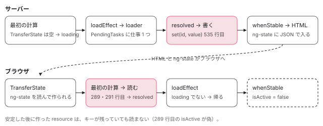

[目次](../README.md) › [resource の細部と新しい部品](README.md) › 第 4 回 / 全 6 回

# SSR と resource：id で TransferState に値を残す、待ってから描く

> resource と rxResource の id オプション（5a7c1e62dc2）が、サーバーの loadEffect で resolved にした直後に値を TransferState に 1 回だけ書き（saveToTransferState）、ブラウザでは状態の linkedSignal の最初の計算で読んで resolved から始め、loader を呼ばない行。provideClientHydration が入れる CACHE\_ACTIVE が、アプリが最初に安定したところで止まること。サーバーが PendingTasks の仕事が外れるまで whenStable で待ってから HTML を作る行と、httpResource の転送キャッシュ（88685cb3b6d）との違い。Node でサーバー描画とハイドレーションを動かした記録の再生。

angular/angular · 読了 約 14 分 · 中核 · [サイトで読む（デモが動きます）](https://angular-deep-dive-cyan.vercel.app/chapter/resx-ssr-cache)

---

サーバーで描いた HTML には resource の値が入っています。ところがブラウザでハイドレーション（サーバーの DOM を捨てずに使い回して、アプリを動かし始めること）をすると、同じ resource は最初 `loading` から始まり、loader をもう一度呼びます。この章では、resource の値をサーバーで `TransferState`（サーバーからブラウザへ値を渡す箱。HTML の中の `<script id="ng-state">` に JSON で入る）に残し、ブラウザの最初の描画で `resolved` から始める仕組み（5a7c1e62dc2）を、どのオプションで有効になり、どのキーで入り、いつ使われ、いつ使われなくなるかの順に追います。

読む対象は `packages/core/src/resource/api.ts`・`resource.ts`、`packages/core/src/hydration/cache.ts`、`packages/platform-browser/src/hydration.ts` のキャッシュの部分、`packages/platform-server/src/utils.ts` の待つ行です。resource の状態と loadEffect の大筋は[resource の章](../signals/15-resource.md)、`TransferState` の中身と HTML への書き出しは[転送キャッシュの章](../http/11-http-transfer-cache.md)と[renderApplication の章](../platform/02-ssr-render-application.md)、`provideClientHydration` が足すほかのプロバイダは[provideClientHydration の章](../platform/07-hydration-provide.md)で読みました。ここでは繰り返しません。

1. [1. params から状態を返す](01-resx-params-status.md)
2. [2. debounced()](02-resx-debounced.md)
3. [3. エラーの包み方](03-resx-errors.md)
4. **4. SSR と resource**（この章）
5. [5. 後片付けと漏れ](05-resx-cleanup-leaks.md)
6. [6. spec と issue](06-resx-tests-issues.md)

## 1. 何が困っていたか：ブラウザの最初の描画が loading になる

issue #62897（2025-07-30）の題は「TransferState のキャッシュがあるのに、resource の `hasValue()` が一瞬 false になり、ハイドレーションが壊れる」です。報告の形は `rxResource` + `HttpClient` の転送キャッシュ + `@if (res.hasValue()) { … } @else { … }` でした。

理由は resource の作りにあります。[resource の章](../signals/15-resource.md)の 4 節で読んだとおり、状態の `linkedSignal` は最初の計算で `loading` を返し、loader を呼ぶのは後で走る effect です。HttpClient の転送キャッシュが同期で応答を返せても、それを受け取るのは effect の中なので、**最初の変更検知のテンプレートは必ず `loading` を見ます**。サーバーの HTML は `@if` の側で描かれているのに、ブラウザの最初の描画は `@else` の側を選ぶ、という食い違いです。

この章の DEMO の記録（7 節）で「id なし」を選ぶと、ブラウザの最初の描画の後の `app-root` の中に、サーバーで描いた `<p class="v">` と、ブラウザで作った `<p class="l">loading</p>` が**同時に**並んでいるのが見えます。直し方は 2 本ありました。httpResource には 88685cb3b6d（2026-02-25）が `getInitialStream` を足し（[httpResource の型の章](../httpx/04-httpx-resource-types.md)の 4 節）、`resource` と `rxResource` には 5a7c1e62dc2（2026-05-06、PR #68226）が `id` を足しました。どちらも「fixes #62897」です。

## 2. id オプション

📄 `angular/packages/core/src/resource/api.ts` L234–243 （▶ の行: 240–241, 243）

```ts
234 │   /**
235 │    * Overrides the `Injector` used by `resource`.
236 │    */
237 │   injector?: Injector;
238 │ 
239 │   /**
240 ▶    * Identifier used to cache the resource data in the `TransferState` during server-side rendering and to retrieve it on the client side.
241 ▶    * This value value needs to be identical for both the client and server.
242 │    */
243 ▶   id?: string;
```

243 行目、`BaseResourceOptions` に `id?: string` が足されました。`RxResourceOptions` はこの型を `extends` しているので、`rxResource` にもそのまま付きます（`rxResource` は自分の `opts` を広げて `resource()` に渡すだけ）。241 行目のとおり、サーバーとブラウザで**同じ文字列**にする必要があります。コミットの本文は「`transferCacheKey` オプションを足す」と書いていますが、公開の名前は `id` で、`transferCacheKey` は次の内部の名前です。

📄 `angular/packages/core/src/resource/resource.ts` L80–86 （▶ の行: 84）

```ts
80 │     options.defaultValue,
81 │     options.equal ? wrapEqualityFn(options.equal) : undefined,
82 │     options.debugName,
83 │     options.injector ?? inject(Injector),
84 ▶     options.id as StateKey<T>,
85 │   );
86 │ }
```

84 行目、`resource()` は `id` を `StateKey<T>` に型だけ変えて、`ResourceImpl` の 7 番目の引数（`transferCacheKey`）に渡します。`StateKey` は印の付いた文字列で（[転送キャッシュの章](../http/11-http-transfer-cache.md)の `makeStateKey`）、**前に何かを付けたり、params を混ぜたりはしません**。`TransferState` のキーは、利用者が書いた文字列そのものです。resource のキーに接頭辞を付ける PR #70296（2026-08）は、取り込まれずに閉じられています。

## 3. サーバーで書く：saveToTransferState

📄 `angular/packages/core/src/resource/resource.ts` L462–477 （▶ の行: 462, 467, 474–476）

```ts
462 ▶       if (isSignal(stream)) {
463 │         if (shouldDiscard()) {
464 │           return;
465 │         }
466 │ 
467 ▶         this.state.set({
468 │           extRequest,
469 │           status: 'resolved',
470 │           previousStatus: 'resolved',
471 │           stream,
472 │         });
473 │ 
474 ▶         const result = untracked(stream);
475 ▶         if (typeof ngServerMode !== 'undefined' && ngServerMode) {
476 ▶           saveToTransferState(result, this.transferCacheKey, this.transferState);
477 │         }
```

📄 `angular/packages/core/src/resource/resource.ts` L490–496 （▶ の行: 492–494）

```ts
490 │ 
491 │         // Use a local variable for the result so TypeScript can narrow `resolvedStream` correctly.
492 ▶         const result = resolvedStream ? untracked(resolvedStream) : undefined;
493 ▶         if (typeof ngServerMode !== 'undefined' && ngServerMode) {
494 ▶           saveToTransferState(result, this.transferCacheKey, this.transferState);
495 │         }
496 │       }
```

📄 `angular/packages/core/src/resource/resource.ts` L529–537 （▶ の行: 534–535）

```ts
529 │ function saveToTransferState<R, T>(
530 │   result: ResourceStreamItem<T> | undefined,
531 │   transferCacheKey: StateKey<T> | undefined,
532 │   transferState: TransferState | undefined,
533 │ ): void {
534 ▶   if (transferCacheKey && transferState && result && isResolved(result)) {
535 ▶     transferState.set(transferCacheKey, result.value);
536 │   }
537 │ }
```

1. **書く場所は 2 か所、どちらも loadEffect の中で `resolved` にした直後**

   462〜477 行目は、loader（stream）が Promise ではなく signal を同期で返したときの枝です（`of(x)` を返す `rxResource` など）。467 行目で `resolved` にしてから、474 行目で stream の今の中身を `untracked` で読みます。490〜496 行目は `await` の後の枝で、492 行目で同じように中身を 1 回読みます。どちらも `ngServerMode`（サーバーで動いているときだけ真になる大域の値）が真のときだけ 476・494 行目で書きます。
2. **534 行目：キー・TransferState・結果があり、結果がエラーでないとき**

   `isResolved` は stream の中身に `error` が無いことを見る関数です（[resource の章](../signals/15-resource.md)の 3 節）。**サーバーで loader が失敗したら、何も書きません**。ブラウザは普通に loader を呼びます（DEMO の「サーバーで loader が失敗」）。
3. **535 行目：`id` の文字列をキーに、値をそのまま入れる**

   入った値は、サーバーの描画の最後に JSON にされて HTML の `ng-state` に入ります（[renderApplication の章](../platform/02-ssr-render-application.md)）。

ここで分かることが 2 つあります。1 つは、**書く側は 534 行目の 4 つしか見ていない**ことです。次の節の `CACHE_ACTIVE` は見ないので、`provideClientHydration` を付けずにサーバーで描いても値は HTML に入ります（DEMO の最後の記録）。もう 1 つは、**書くのは 1 回の読み込みにつき、resolved にした瞬間の 1 回だけ**なことです。stream が後から 2 つ目の値を出しても書き直しません。DEMO の「stream が 2 回値を出す」では、サーバーの HTML は 2 つ目の値、`ng-state` は 1 つ目の値になり、ブラウザは 1 つ目の値を出しました。

## 4. サーバーは読み込みを待ってから HTML を出す

📄 `angular/packages/platform-server/src/utils.ts` L367–373 （▶ の行: 370, 373）

```ts
367 │     const measuringLabel = 'whenStable';
368 │     startMeasuring(measuringLabel);
369 │     // Block until application is stable.
370 ▶     await applicationRef.whenStable();
371 │     stopMeasuring(measuringLabel);
372 │ 
373 ▶     const rendered = await renderInternal(platformRef, applicationRef);
```

`renderApplication` は 370 行目で `applicationRef.whenStable()` を待ち、それから 373 行目の `renderInternal` で HTML と `ng-state` を作ります。「安定」とは `PendingTasks` の仕事が 0 になり、変更検知の予定も無いことです（[PendingTasks の章](../zoneless/09-zoneless-pending-tasks.md)）。resource の loadEffect は loader を呼ぶ前に `pendingTasks.add()` し、`finally` で外します（[resource の章](../signals/15-resource.md)の 5 節）。

1. **loadEffect が仕事を 1 つ足す**

   この間 370 行目の `await` は終わりません。
2. **loader が終わり、`resolved` にし、3 節の行で `TransferState` に書く**

   書くのは `finally` で仕事を外すより前です。だから、HTML を作る時点で値は必ず `TransferState` に入っています。
3. **仕事が外れ、アプリが安定し、373 行目で HTML ができる**

逆に言うと、**仕事を外した後に stream が出した値は、HTML には入っても `ng-state` には入りません**。3 節の「2 回値を出す」の食い違いは、この順番から出ています。記録の stream は、1 つ目の値を返した後の `setTimeout(0)` で 2 つ目を出していて、仕事はもう外れていますが、HTML を作る前の変更検知には間に合いました。

## 5. ブラウザで読む：最初の 1 回の計算の中だけ

📄 `angular/packages/core/src/resource/resource.ts` L241–248 （▶ の行: 245, 247）

```ts
241 │       ),
242 │       debugName,
243 │     );
244 │ 
245 ▶     const cacheState = injector.get(CACHE_ACTIVE, undefined, {optional: true}) ?? {isActive: false};
246 │ 
247 ▶     this.transferState = injector.get(TransferState, undefined, {optional: true}) ?? undefined;
248 │ 
```

245 行目、`CACHE_ACTIVE` を任意で取り、無ければ `{isActive: false}` を使います。247 行目の `TransferState` も任意です（`providedIn: 'root'` なので普通はあります）。どちらも resource を作るときに 1 回だけ取り、`CACHE_ACTIVE` は**オブジェクトの参照**を持っておきます。後で `isActive` が書き換わると、この参照から見えます。

📄 `angular/packages/core/src/resource/resource.ts` L285–304 （▶ の行: 286, 289–293, 299–300, 304）

```ts
285 │         } else if (!status) {
286 ▶           if (!previous) {
287 │             const transferState = this.transferState;
288 │             const cacheKey = this.transferCacheKey;
289 ▶             if (cacheState.isActive && cacheKey && transferState && request !== undefined) {
290 ▶               const key = this.transferCacheKey;
291 ▶               if (transferState.hasKey(cacheKey)) {
292 ▶                 stream = signal(
293 ▶                   {value: transferState.get(cacheKey, defaultValue)},
294 │                   ngDevMode ? createDebugNameObject(this.debugName, 'stream') : undefined,
295 │                 );
296 │               }
297 │             }
298 │ 
299 ▶             if (!stream) {
300 ▶               stream = getInitialStream?.(extRequest.request as R);
301 │             }
302 │             // Clear getInitialStream so it doesn't hold onto memory
303 │             getInitialStream = undefined;
304 ▶             status = request === undefined ? 'idle' : stream ? 'resolved' : 'loading';
```

1. **286 行目：`previous` が無い＝状態の linkedSignal の最初の計算**

   読むのはここだけです。params が変わった後の計算（`previous` がある方の枝）では、`id` があっても見ません。
2. **289 行目：4 つの条件**

   `CACHE_ACTIVE` が有効、キーがある、`TransferState` がある、request が `undefined` でない（`idle` でない）。**request の中身は比べません**。サーバーで `params` が `'u1'` を返し、ブラウザで `'u2'` を返しても、同じ `id` なら 'u1' の値で `resolved` になります。ガイドが「`id` はアプリの中で一意に」と書くのはこのためです。
3. **291〜296 行目：キーがあれば `signal({value})` を stream にする**

   293 行目の `get` の第 2 引数は `defaultValue` です。290 行目の `const key` は、どこからも使われていません（5a7c1e62dc2 のときからそのまま）。
4. **299〜301 行目：無ければ `getInitialStream`**

   `httpResource` が渡す関数で、HttpClient の転送キャッシュを見ます（88685cb3b6d）。`resource` と `rxResource` は渡しません。
5. **304 行目：stream があれば `resolved`**

   状態は最初から `resolved` なので、テンプレートの最初の評価で `hasValue()` が真になり、サーバーと同じ `@if` の側を描きます。後で走る loadEffect は「状態が `loading` でなければ帰る」行（[resource の章](../signals/15-resource.md)の 5 節）で帰るので、**loader は呼ばれません**。

もう 1 つ、読んだ後に `TransferState` からキーを消す行はありません。DEMO の記録でも、ブラウザで安定した後に `hasKey` は真のままです。それでも 2 回目以降に使われないのは、次の節で `isActive` が偽になるからです。

## 6. いつ使われなくなるか：CACHE\_ACTIVE と whenStable

📄 `angular/packages/core/src/hydration/cache.ts` L9–16 （▶ の行: 14）

```ts
 9 │ import {InjectionToken} from '../di';
10 │ 
11 │ /**
12 │  * Token used to the determine if the transfer cache should be used, for example for resources.
13 │  */
14 ▶ export const CACHE_ACTIVE = new InjectionToken<{isActive: boolean}>(
15 │   typeof ngDevMode !== 'undefined' && ngDevMode ? 'STATE_CACHE_ACTIVE' : '',
16 │ );
```

14 行目、`CACHE_ACTIVE` は `{isActive: boolean}` という書き換えられるオブジェクトのトークンです。signal ではないので、`isActive` が変わっても誰にも知らせは行きません。読むのは 5 節の 289 行目だけです。

📄 `angular/packages/platform-browser/src/hydration.ts` L293–303 （▶ の行: 294–295, 298, 301–302）

```ts
293 │     {
294 ▶       provide: CACHE_ACTIVE,
295 ▶       useValue: {isActive: true},
296 │     },
297 │     {
298 ▶       provide: APP_BOOTSTRAP_LISTENER,
299 │       multi: true,
300 │       useFactory: () => {
301 ▶         const appRef = inject(ApplicationRef);
302 ▶         const cacheState = inject(CACHE_ACTIVE);
303 │ 
```

`provideClientHydration()` の最後に 2 つ足されました。294〜295 行目で `{isActive: true}` を入れ、298 行目の `APP_BOOTSTRAP_LISTENER`（ルートコンポーネントを作り終えた直後に呼ばれる関数）で、301〜302 行目のように `ApplicationRef` と同じオブジェクトを取ります。リスナーの中身は引用の範囲の外なので、コミットの差分で見ます（同じ行は[provideClientHydration の章](../platform/07-hydration-provide.md)でも読みました）。

📄 `git show 5a7c1e62dc2 -- packages/platform-browser/src/hydration.ts（2 つ目の hunk）`

```
commit 5a7c1e62dc2（8576f161ae4 の祖先）
Date:   2026-05-06

    feat(core): add ability to cache resources for SSR

diff --git a/packages/platform-browser/src/hydration.ts b/packages/platform-browser/src/hydration.ts
--- a/packages/platform-browser/src/hydration.ts
+++ b/packages/platform-browser/src/hydration.ts
@@ -287,5 +290,23 @@ export function provideClientHydration(
       ? []
       : ɵwithIncrementalHydration(),
     providers,
+    {
+      provide: CACHE_ACTIVE,
+      useValue: {isActive: true},
+    },
+    {
+      provide: APP_BOOTSTRAP_LISTENER,
+      multi: true,
+      useFactory: () => {
+        const appRef = inject(ApplicationRef);
+        const cacheState = inject(CACHE_ACTIVE);
+
+        return () => {
+          appRef.whenStable().then(() => {
+            cacheState.isActive = false;
+          });
+        };
+      },
+    },
   ]);
 }

```

差分の最後の 5 行、**アプリが最初に安定したら `cacheState.isActive = false`** にします。つまり「キャッシュを使う」のは、ブラウザで最初に安定するまでに**最初の計算をした** resource だけです。安定した後に作られた resource（遅れて読み込まれたルートの中、ボタンで開いたダイアログの中など）は、同じ `id` でキーが残っていても `loading` から始まり、loader を呼びます。DEMO の記録の「安定した後に同じ id で作った resource」がこれです。

> [!NOTE]
> **ポイント**
>
> 記録では、「id あり」のときブラウザの `bootstrapApplication` が返った時点で `isActive` はもう `false` でした。読み込みが 1 つも無いので、すぐ安定したからです。それでも値が使われたのは、resource の最初の計算が、ブートストラップの中の最初の変更検知（テンプレートの `res.hasValue()`）で、まだ `true` のうちに行われたからです。



*id を付けた resource の値の流れ。サーバーは resolved にした直後に 1 回だけ書き、ブラウザは最初の計算でだけ読む。安定したら isActive が偽になる。*

## 7. httpResource の転送キャッシュとの違い

|   | `resource` / `rxResource` の `id` | `httpResource` |
| --- | --- | --- |
| コミット | 5a7c1e62dc2（2026-05-06） | 88685cb3b6d（2026-02-25） |
| 有効にするもの | `id` を書く + `provideClientHydration()` | `provideClientHydration()` だけ（`withNoHttpTransferCache()` で外せる） |
| キー | `id` の文字列そのもの（84 行目） | メソッド・URL・params・本文などから作るハッシュ（[キーの章](../httpx/05-httpx-transfer-cache-key.md)） |
| サーバーで書く人 | loadEffect（476・494 行目） | HttpClient の転送キャッシュのインターセプタ |
| ブラウザで読む人 | 状態の linkedSignal の最初の計算（291 行目） | 同じ場所の `getInitialStream`（300 行目） |
| 止める旗 | `CACHE_ACTIVE.isActive` | `CACHE_OPTIONS` の `isCacheActive`（[転送キャッシュの章](../http/11-http-transfer-cache.md)） |

`HttpResourceImpl` は `ResourceImpl` の 7 番目の引数（`transferCacheKey`）に `undefined` を渡すので（5a7c1e62dc2 が common/http の resource.ts に足した 1 行）、`httpResource` には `id` がありません。`HttpResourceOptions` も `BaseResourceOptions` を `extends` していません。

## 8. DEMO：サーバーで描いて、ブラウザでハイドレーションする（Node の記録の再生）

> **🧪 DEMO — 記録を選ぶと、サーバーの HTML と ng-state、ブラウザで loader が呼ばれたかが出ます**
>
> このサイトの依存の @angular/\* 22.1.6 を Node（v24.22.1）で動かした記録です。サーバーは `renderApplication`、ブラウザの側は platform-server の spec の `hydrate()` と同じく、domino（Node の中の DOM）の document の上で `bootstrapApplication(…, provideClientHydration())` を動かしました。コンポーネントは `@if (res.hasValue()) {<p class="v">…} @else {<p class="l">…}` の 1 つで、loader は 10 ミリ秒待って「server で読んだ値」か「browser で読んだ値」を返します。
>
> ▶ [このデモはサイトで動かせます](https://angular-deep-dive-cyan.vercel.app/chapter/resx-ssr-cache)

「id あり」では、ブラウザの loader は 0 回、テンプレートは最初から `resolved` を見て、サーバーの `<p>` をそのまま使いました。「id なし」では、最初の描画の後に `<p class="v">`（サーバーの DOM）と `<p class="l">loading</p>`（ブラウザで作った DOM）が並び、loader が 1 回呼ばれた後に「browser で読んだ値」になりました。最後の `<p class="v">` がサーバーと同じノードなのは、使われなかったサーバーの DOM を片付けるのが安定した後（[provideClientHydration の章](../platform/07-hydration-provide.md)の 8 節）で、それより前に `@if` の側へ戻ったからです。1 節の #62897 の「一瞬」は、この 1 つ目の描画です。

📄 `scratchpad/resx-demo/b/ssr/record.ts`

```ts
// このサイトの依存の @angular/* 22.1.6 を Node で動かし、resource の id（5a7c1e62dc2）が
// 「サーバーで TransferState に何を書くか」と「ハイドレーションで loader を呼ぶか」を書き留める。
// サーバーは renderApplication、ブラウザの側は platform-server/test/dom_utils.ts の hydrate() と同じく、
// domino の document の上で bootstrapApplication(provideClientHydration()) を動かす。外へは通信しない。
import '@angular/compiler';
import '@angular/platform-server/init';
import domino from 'site-domino';
import { DOCUMENT } from '@angular/common';
import {
  ApplicationRef, Component, afterEveryRender, Injector, PLATFORM_ID, TransferState, VERSION, inject, makeStateKey,
  resource, runInInjectionContext, signal, ɵCACHE_ACTIVE as CACHE_ACTIVE, ɵsetDocument as setDocument,
  type ResourceRef,
} from '@angular/core';
import { bootstrapApplication, provideClientHydration, type BootstrapContext } from '@angular/platform-browser';
import { provideServerRendering, renderApplication } from '@angular/platform-server';
import { writeFileSync } from 'node:fs';

type Kind = 'with-id' | 'no-id' | 'server-error' | 'stream-two-values';
const KEY = 'resx-user';
const wait = (ms: number) => new Promise((r) => setTimeout(r, ms));
const side = () => (typeof ngServerMode !== 'undefined' && ngServerMode ? 'server' : 'browser');

// 1 回の描画（サーバーかブラウザ）で起きたこと
let log: { loaderCalls: number; seen: string[]; dom: string[] } = { loaderCalls: 0, seen: [], dom: [] };
let kind: Kind = 'with-id';

function makeResource(): ResourceRef<string | undefined> {
  const id = kind === 'no-id' ? undefined : KEY;
  if (kind === 'stream-two-values') {
    return resource({
      params: () => 'u1',
      stream: async () => {
        log.loaderCalls++;
        await wait(10);
        const s = signal<{ value: string }>({ value: `${side()} の 1 つ目の値` });
        setTimeout(() => s.set({ value: `${side()} の 2 つ目の値` }), 0);
        return s;
      },
      id,
    });
  }
  return resource({
    params: () => 'u1',
    loader: async ({ params }) => {
      log.loaderCalls++;
      await wait(10);
      if (kind === 'server-error' && side() === 'server') throw new Error('サーバーで失敗');
      return `${side()} で読んだ値（${params}）`;
    },
    id,
  });
}

@Component({
  selector: 'app-root',
  template: `@if (res.hasValue()) {<p class="v">{{ res.value() }}</p>} @else {<p class="l">{{ res.status() }}</p>}{{ mark(res.status()) }}`,
})
class App {
  readonly res = makeResource();
  constructor() {
    // ブラウザの側だけ、描画のたびに app-root の中の <p> を書き留める（コメントのノードは省く）
    if (side() === 'browser') {
      afterEveryRender(() => {
        const ps = Array.from(document.querySelectorAll('app-root p')).map((p) => p.outerHTML).join('');
        if (log.dom.at(-1) !== ps) log.dom.push(ps);
      });
    }
  }
  mark(status: string): string {
    if (log.seen.at(-1) !== status) log.seen.push(status);
    return '';
  }
}

const DOC = '<html><head></head><body><app-root></app-root></body></html>';

async function serverRender(hydration: boolean) {
  log = { loaderCalls: 0, seen: [], dom: [] };
  const bootstrap = (context: BootstrapContext) =>
    bootstrapApplication(App, { providers: [provideServerRendering(), hydration ? provideClientHydration() : []] }, context);
  const html = await renderApplication(bootstrap, { document: DOC });
  const app = /<app-root[\s\S]*<\/app-root>/.exec(html)?.[0] ?? '';
  const state = /<script id="ng-state" type="application\/json">([\s\S]*?)<\/script>/.exec(html)?.[1] ?? '';
  let stateObj: Record<string, unknown> = {};
  try { stateObj = JSON.parse(state); } catch {}
  const { __nghData__, ...rest } = stateObj as any;
  return { html, app, ngState: rest, hasNghData: __nghData__ !== undefined, ...log };
}

async function browserHydrate(serverHtml: string) {
  log = { loaderCalls: 0, seen: [], dom: [] };
  globalThis['ngServerMode'] = false;
  // 開発モードの数（hydratedComponents など）は前の回から足されていくので 0 に戻す
  for (const k of Object.keys(ngDevMode as object)) if (typeof (ngDevMode as any)[k] === 'number') (ngDevMode as any)[k] = 0;
  const window = domino.createWindow(serverHtml, 'http://localhost/');
  const doc = window.document as unknown as Document;
  setDocument(doc);
  (globalThis as any).document = doc;
  (globalThis as any).window = window;
  const before = doc.querySelector('app-root p');
  const consoleLines: string[] = [];
  const orig = { log: console.log, warn: console.warn, error: console.error };
  for (const k of ['log', 'warn', 'error'] as const) console[k] = (...a: unknown[]) => consoleLines.push(`${k}: ${a.map(String).join(' ')}`);
  let appRef: ApplicationRef | undefined;
  try {
    appRef = await bootstrapApplication(App, {
      providers: [{ provide: PLATFORM_ID, useValue: 'browser' }, { provide: DOCUMENT, useFactory: () => doc }, provideClientHydration()],
    });
    const cache = appRef.injector.get(CACHE_ACTIVE);
    const ts = appRef.injector.get(TransferState);
    const activeAtBootstrap = cache.isActive;
    const hasKeyAtBootstrap = ts.hasKey(makeStateKey(KEY));
    await appRef.whenStable();
    await wait(30);
    await appRef.whenStable();
    const after = doc.querySelector('app-root p');
    // 安定した後に、同じ id で 2 つ目の resource を作る
    const late = runInInjectionContext(appRef.injector, () =>
      resource({ params: () => 'u1', loader: async () => (log.loaderCalls++, 'late'), id: KEY }),
    );
    const lateStatusAtCreate = late.status();
    const loaderCallsBeforeLate = log.loaderCalls;
    await appRef.whenStable();
    return {
      ...log,
      loaderCalls: loaderCallsBeforeLate,
      activeAtBootstrap,
      hasKeyAtBootstrap,
      activeAfterStable: cache.isActive,
      hasKeyAfterStable: ts.hasKey(makeStateKey(KEY)),
      sameNode: before !== null && before === after,
      text: after?.textContent ?? '',
      lateStatusAtCreate,
      lateLoaderCalled: log.loaderCalls > loaderCallsBeforeLate,
      console: consoleLines,
    };
  } finally {
    Object.assign(console, orig);
    appRef?.destroy();
    globalThis['ngServerMode'] = undefined;
    delete (globalThis as any).window;
  }
}

const runs = [];
for (const k of ['with-id', 'no-id', 'server-error', 'stream-two-values'] as Kind[]) {
  kind = k;
  const server = await serverRender(true);
  const browser = await browserHydrate(server.html);
  const { html, ...serverRest } = server;
  runs.push({ kind: k, server: serverRest, browser });
}
// provideClientHydration を付けずにサーバーで描いたとき、TransferState に書くか
kind = 'with-id';
const noHydration = await serverRender(false);
const { html: _h, ...noHydrationRest } = noHydration;

writeFileSync('record.json', JSON.stringify({ node: process.version, angular: VERSION.full, runs, serverWithoutHydration: noHydrationRest }, null, 1));

```
*記録を取ったスクリプトの全文*

📄 `scratchpad/resx-demo/b/ssr/build.mjs`

```js
// 使い方: RESEARCH_ROOT=<angular-research の場所> node build.mjs <記録のスクリプト.ts> <出力.mjs>
// 記録のスクリプトを 1 つの ESM に束ねる。'@angular/*' と 'rxjs' は angular-deep-dive/node_modules（22.1.6）から読む。
// 'site-domino' は、platform-server が中に持っている domino（同じファイル）を指す。
import { createRequire } from 'node:module';
const ROOT = process.env.RESEARCH_ROOT;
const SITE = `${ROOT}/angular-deep-dive`;
const { build } = createRequire(`${SITE}/package.json`)('esbuild');
const [entry, out] = process.argv.slice(2);
const sitePackages = {
  name: 'site-packages',
  setup(b) {
    b.onResolve({ filter: /^site-domino$/ }, () => ({
      path: `${SITE}/node_modules/@angular/platform-server/third_party/domino/bundled-domino.mjs`,
    }));
    b.onResolve({ filter: /^(@angular\/|rxjs)/ }, async (args) => {
      if (args.pluginData === 'site') return undefined;
      const r = await b.resolve(args.path, { kind: args.kind, resolveDir: SITE, pluginData: 'site' });
      return r.errors.length ? undefined : r;
    });
  },
};
await build({
  entryPoints: [entry], outfile: out, bundle: true, platform: 'node', format: 'esm', target: 'es2022',
  plugins: [sitePackages], logLevel: 'warning',
  tsconfigRaw: { compilerOptions: { experimentalDecorators: true, useDefineForClassFields: false } },
  banner: { js: "import { createRequire as __cr } from 'module'; const require = __cr(import.meta.url);" },
});

```
*束ねるスクリプトの全文（node\_modules の 22.1.6 を束ねる）*

## 全体の流れ

- `renderApplication(bootstrap)` — platform-server utils.ts — *サーバー*
  - 👤 `resource({ params, loader, id })` — resource.ts 84 — *id → transferCacheKey*
    - `injector.get(CACHE_ACTIVE)` / `injector.get(TransferState)` — 245・247
  - `state` の最初の計算 — 286〜304 — *サーバーの TransferState は空 → loading*
  - `loadEffect()` → `pendingTasks.add()` → loader — resource の章 5 節
    - `state.set(resolved)` → `saveToTransferState()` — 490〜496 → 534〜535
  - `await applicationRef.whenStable()` → `renderInternal()` — utils.ts 370・373 — *ng-state に入る*
- `bootstrapApplication(App, provideClientHydration())` — *ブラウザ*
  - `{provide: CACHE_ACTIVE, useValue: {isActive: true}}` — hydration.ts 294〜295
  - `state` の最初の計算 — 289 → 291 → 292 — *キーがある → resolved（304）*
  - `loadEffect()` — resource の章 5 節 — *loading でないので帰る。loader は呼ばない*
  - `APP_BOOTSTRAP_LISTENER` → `whenStable()` → `isActive = false` — hydration.ts 298 — *以後に作る resource は読まない*

## テストと直し方

### spec と it

| ファイル | describe / it | 行 | この章のどこ |
| --- | --- | --- | --- |
| core/test/resource/resource\_spec.ts | `with TransferState`（一番外の describe） | 1120 | — |
|   | › `should read from TransferState if a key is present` | 1130 | 5 節 |
|   | › `should write to TransferState on server when resolved` | 1149 | 3 節（await の枝） |
|   | › `should not write to TransferState on client when resolved` | 1169 | 3 節（ngServerMode） |
| core/rxjs-interop/test/rx\_resource\_spec.ts | `rxResource()` › `with TransferState` | 235 | — |
|   | › `should read from TransferState if a key is present` | 247 | 5 節 |
|   | › `should write to TransferState on server when resolved (sync)` ／ `(async)` | 267 ／ 287 | 3 節（同期の枝 ／ await の枝） |
|   | › `should not write to TransferState on client when resolved` | 312 | 3 節 |
| common/http/test/resource\_spec.ts | `httpResource` › `TransferCache integration` | 448（it は 456・482） | 7 節（httpResource の側） |

📄 `angular/packages/core/test/resource/resource_spec.ts` L1120–1147 （▶ の行: 1125, 1132, 1136, 1141, 1145–1146）

```ts
1120 │ describe('with TransferState', () => {
1121 │   let transferState: TransferState;
1122 │ 
1123 │   beforeEach(() => {
1124 │     TestBed.configureTestingModule({
1125 ▶       providers: [TransferState, {provide: CACHE_ACTIVE, useValue: {isActive: true}}],
1126 │     });
1127 │     transferState = TestBed.inject(TransferState);
1128 │   });
1129 │ 
1130 │   it('should read from TransferState if a key is present', async () => {
1131 │     const key = makeStateKey<number>('test-key');
1132 ▶     transferState.set(key, 123);
1133 │ 
1134 │     const testResource = resource({
1135 │       loader: async () => 456,
1136 ▶       id: key,
1137 │       injector: TestBed.inject(Injector),
1138 │     });
1139 │ 
1140 │     // Should be synchronously resolved from cache
1141 ▶     expect(testResource.status()).toBe('resolved');
1142 │     expect(testResource.value()).toBe(123);
1143 │ 
1144 │     // Should prevent loader from running
1145 ▶     await timeout();
1146 ▶     expect(testResource.value()).toBe(123);
1147 │   });
```

1125 行目で `CACHE_ACTIVE` を `{isActive: true}` で直接入れ、1132 行目でサーバーから来たことにした値を先に入れます。1136 行目の `id` には `makeStateKey` の結果をそのまま渡しています（中身は文字列）。1141 行目で、作った直後に同期で `resolved` を確かめ、1145〜1146 行目で、待った後も loader の 456 ではなく 123 のままであることを確かめます。

📄 `angular/packages/core/test/resource/resource_spec.ts` L1149–1183 （▶ の行: 1150, 1159, 1165–1166, 1169, 1182）

```ts
1149 │   it('should write to TransferState on server when resolved', async () => {
1150 ▶     (globalThis as any).ngServerMode = true;
1151 │     const key = 'server-key';
1152 │ 
1153 │     const testResource = resource({
1154 │       loader: async () => 789,
1155 │       id: key,
1156 │       injector: TestBed.inject(Injector),
1157 │     });
1158 │ 
1159 ▶     expect(testResource.status()).toBe('loading');
1160 │ 
1161 │     await timeout();
1162 │ 
1163 │     expect(testResource.status()).toBe('resolved');
1164 │     expect(testResource.value()).toBe(789);
1165 ▶     expect(transferState.get(makeStateKey<number>(key), null!)).toBe(789);
1166 ▶     (globalThis as any).ngServerMode = undefined;
1167 │   });
1168 │ 
1169 ▶   it('should not write to TransferState on client when resolved', async () => {
1170 │     const key = 'client-key';
1171 │ 
1172 │     const testResource = resource({
1173 │       loader: async () => 101112,
1174 │       id: key,
1175 │       injector: TestBed.inject(Injector),
1176 │     });
1177 │ 
1178 │     await timeout();
1179 │ 
1180 │     expect(testResource.status()).toBe('resolved');
1181 │     expect(testResource.value()).toBe(101112);
1182 ▶     expect(transferState.hasKey(makeStateKey(key))).toBeFalse();
1183 │   });
```

1150 行目で `ngServerMode` を大域に立て、1166 行目で戻します。途中の `expect` が落ちても 1166 行目まで進むので戻りますが、例外が投げられると戻りません。rx\_resource\_spec.ts の方は `afterEach` で戻しています。1169 行目の it は `ngServerMode` を立てないこと（`undefined`）でブラウザを表し、1182 行目で書かれていないことを確かめます。

📄 `angular/packages/core/rxjs-interop/test/rx_resource_spec.ts` L267–285 （▶ の行: 268, 273, 278, 284）

```ts
267 │     it('should write to TransferState on server when resolved (sync)', async () => {
268 ▶       (globalThis as any).ngServerMode = true;
269 │       const key = makeStateKey<number>('server-key');
270 │ 
271 │       const injector = TestBed.inject(Injector);
272 │       const testResource = rxResource({
273 ▶         stream: () => of(789),
274 │         id: key,
275 │         injector,
276 │       });
277 │ 
278 ▶       expect(testResource.status()).toBe('loading');
279 │ 
280 │       await flushMicrotasks();
281 │ 
282 │       expect(testResource.status()).toBe('resolved');
283 │       expect(testResource.value()).toBe(789);
284 ▶       expect(transferState.get(key, null!)).toBe(789);
285 │     });
```

273 行目の `of(789)` は同期で値を出すので、3 節の 462 行目の枝（signal をそのまま返す）を通ります。それでも 278 行目で `loading` なのは、loadEffect がまだ走っていないからです。

### 手元で走らせた結果

../angular（8576f161ae4）で `pnpm bazel test //packages/core/test/resource:resource --nocache_test_results --test_output=all` は「70 specs, 0 failures」、`//packages/core/rxjs-interop/test:test` は「77 specs, 0 failures」でした（2026-11-13、res-logs/b-core-resource.log・b-rxjs-interop.log）。`--test_arg=--filter=rxResource` で絞ると「Ran 17 of 77 specs」です。

作業木で、5 節の 289 行目から `cacheState.isActive &&` を消して両方を走らせても、**70 件と 77 件はすべて通りました**（b-exp-f-no-isactive.log）。「安定した後に作った resource はキャッシュを読まない」を固める it はありません。同じく、サーバーで失敗したときに書かないこと（534 行目の `isResolved`）、stream の 2 つ目の値を書かないこと、`provideClientHydration` が無いときに読まないこと（245 行目の既定値）にも it はありません。この 4 つは DEMO の記録で確かめました。

### 直すとしたら

- キャッシュを止める旗の it は、resource\_spec.ts の `with TransferState` の中に、`{isActive: false}` を入れた `TestBed` で「キーがあっても `loading` から始まり loader が呼ばれる」を足す形です。src は変えません。
- stream の 2 つ目以降の値も書くなら、変えるのは `ResourceImpl.loadEffect` の 474〜477 行目と 492〜495 行目です。今はどちらも 1 回読むだけなので、stream を見続ける仕組みが要ります。サーバーで描いた HTML と `ng-state` が食い違う記録（DEMO）は、その it の期待値の元になります。
- 新しい本家（angular-main、74961c66242）では、5c4b6a48679（2026-09、params を `computed` で包む）のために `ResourceImpl` のコンストラクタに 14 行が足され、この章で引用した 247 行目より後ろの行は 14 行ずつ後ろにずれます。`id` の読み書きの行の中身は同じです。

## 聞かれそうな質問

**Q. id を付けたのに、ブラウザで loader が呼ばれるのはどんなときですか？**

5 節の 289・291 行目のどれかが偽のときです。`provideClientHydration` が無い（245 行目で `isActive: false`）、アプリが一度安定した後に resource を作った（6 節の差分で `isActive = false`）、サーバーで loader が失敗して書かれなかった（534 行目）、サーバーとブラウザで `id` の文字列が違う（291 行目の `hasKey` が偽）、の 4 つです。また 286 行目のとおり、読むのは最初の計算だけなので、params が変われば普通に読み込みます。

**Q. params が違っても、同じ id ならサーバーの値が使われますか？**

使われます。289 行目は request が `undefined` でないことしか見ず、535 行目のキーは 84 行目の `id` の文字列だけです。params ごとに値を分けたいなら、`id` の文字列に params を入れて作る必要があります（`id` は resource を作るときに 1 回だけ読まれます）。

**Q. サーバーは resource の読み込みが終わるまで待ちますか？**

待ちます。loadEffect が `PendingTasks` に仕事を足し、終わるまで外さないので、utils.ts 370 行目の `whenStable()` が終わりません。値は仕事を外す前に 494 行目で `TransferState` に入るので、373 行目で作る HTML に必ず入ります。ただし stream が仕事を外した後に出した値は、`ng-state` には入りません（3 節）。

**Q. httpResource にも id を付けるべきですか？**

付けられません。`HttpResourceOptions` に `id` は無く、`HttpResourceImpl` は `transferCacheKey` に `undefined` を渡します。`httpResource` は HttpClient の転送キャッシュを 300 行目の `getInitialStream` で読むので、`provideClientHydration()` だけで最初から `resolved` になります（88685cb3b6d）。

**Q. ユーザーごとのデータに id を付けても大丈夫ですか？**

値は 535 行目でそのまま `TransferState` に入り、HTML の `ng-state` に JSON で書き出されます。ガイド（adev の guide/signals/resource.md）は、描いた HTML をキャッシュしたり共有したりするなら、ユーザーごとのデータの resource に `id` を付けないように注意しています。

## 読み終えて

- `id` は `BaseResourceOptions` のオプション（api.ts 243 行目）で、文字列のまま `TransferState` のキーになる（84・535 行目）
- サーバーは loadEffect で `resolved` にした直後に 1 回だけ書く（476・494 行目）。エラーは書かない（534 行目）
- サーバーは `PendingTasks` の仕事が外れるまで `whenStable()` で待ち、それから HTML と ng-state を作る（utils.ts 370・373 行目）
- ブラウザは状態の linkedSignal の最初の計算でだけ読み（286・289 行目）、あれば最初から `resolved` にして loader を呼ばない
- `CACHE_ACTIVE.isActive` は `provideClientHydration()` が入れ、アプリが最初に安定したら偽になる。キーは消えない

---

← 前: [エラーの包み方：value() が投げるとき、ResourceValueError と rethrowFatalErrors](03-resx-errors.md)  
次: [後片付けと漏れ：destroy、abort、購読の漏れの修正](05-resx-cleanup-leaks.md) →
