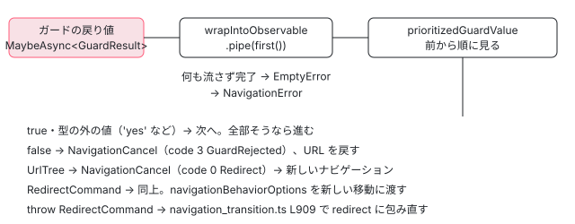

[目次](../README.md) › [Router の型と説明文の読み残し](README.md) › 第 1 回 / 全 9 回

# models.ts の小さな型：GuardResult・RedirectCommand・UrlMatcher・Data・LoadChildren

> models.ts の前半の型と説明文：OnSameUrlNavigation、DeprecatedGuard と DeprecatedResolve、GuardResult と RedirectCommand（返しても投げても redirect）、MaybeAsync、UrlMatchResult と UrlMatcher、Data と ResolveData、LoadChildrenCallback、QueryParamsHandling。ガードの戻り値を替えて本物の Router に移らせ、説明に書かれた約束を確かめる。

angular/angular · 読了 約 12 分 · 中核 · [サイトで読む（デモが動きます）](https://angular-deep-dive-cyan.vercel.app/chapter/rmd-basic-types)

---

`packages/router/src/models.ts` の前半には、ルートの設定とガードで使う小さな型が並んでいます。`GuardResult`・`RedirectCommand`・`MaybeAsync`・`UrlMatcher`・`Data`・`LoadChildrenCallback`・`QueryParamsHandling` などです。型はコンパイルのあとに消えるので、この章では**説明文（JSDoc、angular.dev の API リファレンスになる文）に書かれた約束**を 1 つずつ取り出し、その型の値を本物の Router に渡したときに何が起きるかで確かめます。説明と実装が合っているか、合っていないならどの行か、をこの章の答えにします。

読む対象は `packages/router/src/models.ts` の 9〜330 行目のうち、まだどの章も引いていない行です（../angular、8576f161ae4）。ガードの実行順は[ガードの実行順](../router/12-router-guards.md)、redirect は[redirectTo の章](../router/10-router-redirects.md)、遅延読み込みは[loadChildren の章](../router/11-router-lazy-loading.md)が本体を読んでいるので、ここでは型と説明文の側から入ります。

1. **1. models.ts の小さな型**（この章）
2. [2. Route の説明文](02-rmd-route.md)
3. [3. ガードの型](03-rmd-guards.md)
4. [4. Resolve と NavigationBehaviorOptions](04-rmd-resolve-nav.md)
5. [5. provideRouter の機能](05-rmd-features.md)
6. [6. ルーターのイベント](06-rmd-events.md)
7. [7. RouterLink と RouterOutlet](07-rmd-directives.md)
8. [8. URL とナビゲーションの小道具](08-rmd-url-rest.md)
9. [9. spec と issue](09-rmd-tests-issues.md)

> [!TIP]
> **新卒エンジニアへ**
>
> JSDoc は `/** … */` の形のコメントです。Angular はこれを抜き出して angular.dev の API のページを作ります。説明文が実装と食い違うと、読む人みなが同じ思い違いをします。だからこのシリーズは、説明文を「仕様の約束」として読み、本物で答え合わせをします。

## 1. 冒頭の import：型だけを読む行と、値も読む行

📄 `angular/packages/router/src/models.ts` L9–26 （▶ の行: 10, 13, 18, 21, 23–25）

```ts
 9 │ import {
10 ▶   DefaultExport,
11 │   EnvironmentInjector,
12 │   EnvironmentProviders,
13 ▶   NgModuleFactory,
14 │   Provider,
15 │   ProviderToken,
16 │   Signal,
17 │   Type,
18 ▶   Resource,
19 │ } from '@angular/core';
20 │ import {Observable} from 'rxjs';
21 ▶ export {DefaultExport} from '@angular/core';
22 │ 
23 ▶ import type {ActivatedRouteSnapshot, RouterStateSnapshot} from './router_state';
24 ▶ import {Params} from './shared';
25 ▶ import type {UrlSegment, UrlSegmentGroup, UrlTree} from './url_tree';
26 │ 
```

21 行目は `DefaultExport` を @angular/core から**そのまま export し直す**行です。`loadChildren: () => import('./x.routes')` が返す「`default` を持つモジュール」の型で、10 行目で読み込んで 302・304 行目の `LoadChildrenCallback`（7 節）で使い、同時に @angular/router の利用者にも同じ名前で見せています。23 行目と 25 行目は `import type` です。router\_state.ts と url\_tree.ts は models.ts を読み返すので、値として読むと循環の import になります。型だけなら JS に残らないので循環しません。24 行目の `Params` も型ですが、shared.ts は models.ts を読まないので普通の import のままです。13 行目の `NgModuleFactory` と 18 行目の `Resource` は、それぞれ `LoadChildrenCallback` と L31 の `ResourceResult`（[withRouterResources の章](../router/20-router-resources.md)）のためです。

📄 `angular/packages/router/src/models.ts` L32–39 （▶ の行: 33–35）

```ts
32 │ 
33 ▶ // Developer notes: properties are exposed as a plain Record (`Params`) rather than a `ParamMap`
34 ▶ // to allow future type-check layers to infer exact keys (e.g., `{ id: string }`).
35 ▶ // Same applies to data and queryparams.
36 │ /**
37 │  * The contextual information provided to a `resources` function.
38 │  * @developerPreview 22.2
39 │  */
```

33〜35 行目は JSDoc ではない `//` のコメントで、API のページには出ません。`ResourceContext` の `params` を `ParamMap` ではなく素の `Record`（`Params`）にしたのは、「後で型の層が `{ id: string }` のような正確なキーを推論できるように」と書いています。origin/main では 1e6afa4cb84 が `ResourceContext` の `data` を google3 だけ外し、ここに `// TODO(v23): Remove data from ResourceContext` を足しています（35 行目の「data にも同じ」は main でもそのままです）。

## 2. OnSameUrlNavigation：同じ URL への移動

📄 `angular/packages/router/src/models.ts` L65–91 （▶ の行: 69–73, 75–76, 79–82, 90）

```ts
65 │ 
66 │ /**
67 │  * How to handle a navigation request to the current URL. One of:
68 │  *
69 ▶  * - `'ignore'` : The router ignores the request if it is the same as the current state.
70 ▶  * - `'reload'` : The router processes the URL even if it is not different from the current state.
71 ▶  * One example of when you might want to use this option is if a `canMatch` guard depends on the
72 ▶  * application state and initially rejects navigation to a route. After fixing the state, you want
73 ▶  * to re-navigate to the same URL so that the route with the `canMatch` guard can activate.
74 │  *
75 ▶  * Note that this only configures whether or not the Route reprocesses the URL and triggers related
76 ▶  * actions and events like redirects, guards, and resolvers. By default, the router re-uses a
77 │  * component instance when it re-navigates to the same component type without visiting a different
78 │  * component first. This behavior is configured by the `RouteReuseStrategy`. In order to reload
79 ▶  * routed components on same url navigation, you need to set `onSameUrlNavigation` to `'reload'`
80 ▶  * _and_ provide a `RouteReuseStrategy` which returns `false` for `shouldReuseRoute`. Additionally,
81 ▶  * resolvers and most guards for routes do not run unless the path or path params have changed
82 ▶  * (configured by `runGuardsAndResolvers`).
83 │  *
84 │  * @publicApi
85 │  * @see {@link RouteReuseStrategy}
86 │  * @see {@link RunGuardsAndResolvers}
87 │  * @see {@link NavigationBehaviorOptions}
88 │  * @see {@link RouterConfigOptions}
89 │  */
90 ▶ export type OnSameUrlNavigation = 'reload' | 'ignore';
91 │ 
```

説明文の約束は 3 つです。

1. **69〜70 行目: 'ignore' は無視、'reload' は処理する**

   実装は navigation\_transition.ts L505〜506 の 2 行です。`t.extras.onSameUrlNavigation ?? router.onSameUrlNavigation` を取り、URL が変わらず、それが `'reload'` でなければ `NavigationSkipped` を流して終わります（パイプラインの中の位置は[setupNavigations の章](../router/08-router-pipeline.md)）。Router 側の既定は router.ts L160 の `|| 'ignore'` です。
2. **71〜73 行目: canMatch の状態が変わったら 'reload' で入り直せる**

   下の DEMO 2 の「OnSameUrlNavigation」の 3 行がこの例です。`canMatch: [() => allowed]` の 1 つ目と、ガードの無い 2 つ目の `'p'` を並べ、`allowed = false` で `'/p'` に入ると 2 つ目になります。`allowed = true` にして同じ `'/p'` へ移っても、既定の `'ignore'` では `NavigationSkipped` だけが出て 2 つ目のままです。`{onSameUrlNavigation: 'reload'}` を渡すと、照合をやり直して 1 つ目に変わります。
3. **75〜82 行目: 'reload' は部品も、ガードと resolver も作り直すとは限らない**

   部品の再利用は `RouteReuseStrategy` が決め（[前のシリーズの第 5 回](../rtl/05-rtl-load-guard.md)の 3 節）、ガードと resolver は `runGuardsAndResolvers` が決めます。[次の章](02-rmd-route.md)の DEMO 1 で、同じ URL を `'reload'` で移ったときに canActivate と resolver が走るのは `'always'` だけだと数えます。

## 3. DeprecatedGuard と DeprecatedResolve：トークンのガードは非推奨

📄 `angular/packages/router/src/models.ts` L92–109 （▶ の行: 93–94, 96–97, 99, 108）

```ts
 92 │ /**
 93 ▶  * The `InjectionToken` and `@Injectable` classes for guards are deprecated in favor
 94 ▶  * of plain JavaScript functions instead. Dependency injection can still be achieved using the
 95 │  * [`inject`](api/core/inject) function from `@angular/core` and an injectable class can be used as
 96 ▶  * a functional guard using [`inject`](api/core/inject): `canActivate: [() =>
 97 ▶  * inject(myGuard).canActivate()]`.
 98 │  *
 99 ▶  * @deprecated
100 │  * @see {@link CanMatchFn}
101 │  * @see {@link CanLoadFn}
102 │  * @see {@link CanActivateFn}
103 │  * @see {@link CanActivateChildFn}
104 │  * @see {@link CanDeactivateFn}
105 │  * @see {@link /api/core/inject inject}
106 │  * @publicApi
107 │  */
108 ▶ export type DeprecatedGuard = ProviderToken<any> | string;
109 │ 
```

📄 `angular/packages/router/src/models.ts` L110–128 （▶ の行: 114, 116, 121）

```ts
110 │ /**
111 │  * The `InjectionToken` and `@Injectable` classes for resolvers are deprecated in favor
112 │  * of plain JavaScript functions instead. Dependency injection can still be achieved using the
113 │  * [`inject`](api/core/inject) function from `@angular/core` and an injectable class can be used as
114 ▶  * a functional guard using [`inject`](api/core/inject): `myResolvedData: () => inject(MyResolver).resolve()`.
115 │  *
116 ▶  * @deprecated
117 │  * @see {@link ResolveFn}
118 │  * @see {@link /api/core/inject inject}
119 │  * @publicApi
120 │  */
121 ▶ export type DeprecatedResolve = DeprecatedGuard | any;
122 │ 
123 │ /**
124 │  * The supported types that can be returned from a `Router` guard.
125 │  *
126 │  * @see [Routing guide](guide/routing/route-guards)
127 │  * @publicApi
128 │  */
```

108 行目の `DeprecatedGuard` は「DI のトークン（クラスや `InjectionToken`）か文字列」です。`canActivate: [AuthGuard]` のようにクラスを書く古い形は、この型を通って入ります。実行するときは `getTokenOrFunctionIdentity`（preactivation.ts L66〜82、[ガードの章](../router/12-router-guards.md)）が注入器から引き、見つからなければ関数としてそのまま使います。引いた物がクラスのインスタンスか関数かは、type\_guards.ts の `isCanActivate` などが「そのメソッドを持っているか」で決めます（[第 4 回](04-rmd-resolve-nav.md)の 5 節）。

121 行目の `DeprecatedResolve` は `DeprecatedGuard | any` で、`any` を含むので型としては何でも通ります。`{path: 'a', resolve: {x: 42}}` は TypeScript 6.0.3 の `--strict` で通り、`canActivate: [42]` だけが `TS2322` になりました（記録は テストの節）。96〜97 行目の例の `inject(myGuard).canActivate()` は引数を渡していませんが、移し替えの形を示すための 1 行です。関数の中でクラスを呼ぶ形は、`mapToCanActivate`（[前のシリーズの第 5 回](../rtl/05-rtl-load-guard.md)の 4 節）が同じことをします。

## 4. GuardResult と RedirectCommand：ガードが返してよい値

📄 `angular/packages/router/src/models.ts` L130–159 （▶ の行: 131–135, 147–150）

````ts
130 │ 
131 ▶ /**
132 ▶  * Can be returned by a `Router` guard to instruct the `Router` to redirect rather than continue
133 ▶  * processing the path of the in-flight navigation. The `redirectTo` indicates _where_ the new
134 ▶  * navigation should go to and the optional `navigationBehaviorOptions` can provide more information
135 ▶  * about _how_ to perform the navigation.
136 │  *
137 │  * ```ts
138 │  * const route: Route = {
139 │  *   path: "user/:userId",
140 │  *   component: User,
141 │  *   canActivate: [
142 │  *     () => {
143 │  *       const router = inject(Router);
144 │  *       const authService = inject(AuthenticationService);
145 │  *
146 │  *       if (!authService.isLoggedIn()) {
147 ▶  *         const loginPath = router.parseUrl("/login");
148 ▶  *         return new RedirectCommand(loginPath, {
149 ▶  *           skipLocationChange: true,
150 ▶  *         });
151 │  *       }
152 │  *
153 │  *       return true;
154 │  *     },
155 │  *   ],
156 │  * };
157 │  * ```
158 │  * @see [Routing guide](guide/routing/route-guards)
159 │  *
````

L129 の `GuardResult` は `boolean | UrlTree | RedirectCommand` です（[ガードの章](../router/12-router-guards.md)が引いています）。132〜135 行目の約束は「`redirectTo` は**どこへ**、省略できる `navigationBehaviorOptions` は**どう**移るか」で、148〜150 行目の例は `skipLocationChange: true` で `/login` へ移します。クラスの本体（L162〜170）は `extends Error` で、コンストラクタで `super()` と `Object.setPrototypeOf(this, RedirectCommand.prototype)` を呼びます。b65dea4f03e（2026-06-25、「allow throwing RedirectCommand to trigger redirects」）が入れた形で、ガードや resolver の中から**投げても** redirect になるようにしたものです。navigation\_transition.ts L909〜911 が、捕まえた例外が `RedirectCommand` なら `redirectingNavigationError` に包み直します。

ここで説明文と実装に小さなずれがあります。131 行目は「Can be returned by a `Router` guard」とだけ書き、投げてもよいことは書いていません。origin/main の同じ段落も同じ文のままです（main では 149 行目）。

📄 `angular/packages/router/src/models.ts` L171–190 （▶ の行: 177, 189）

```ts
171 │ 
172 │ /**
173 │  * Type used to represent a value which may be synchronous or async.
174 │  *
175 │  * @publicApi
176 │  */
177 ▶ export type MaybeAsync<T> = T | Observable<T> | Promise<T>;
178 │ 
179 │ /**
180 │  * Represents a route configuration for the Router service.
181 │  * An array of `Route` objects, used in `Router.config` and for nested route configurations
182 │  * in `Route.children`.
183 │  *
184 │  * @see {@link Route}
185 │  * @see {@link Router}
186 │  * @see [Router configuration guide](guide/routing/router-reference)
187 │  * @publicApi
188 │  */
189 ▶ export type Routes = Route[];
190 │ 
```

177 行目の `MaybeAsync<T>` は「そのまま・Observable・Promise のどれか」です。ガードの戻り値は `wrapIntoObservable(guardVal).pipe(first())`（check\_guards.ts L168）で Observable にそろえ、`first()` で**最初の 1 つだけ**を使います。何も流さずに完了する Observable は `first()` が `EmptyError` を投げます。そろえた値は `prioritizedGuardValue`（prioritized\_guard\_value.ts L18〜45、[ガードの章](../router/12-router-guards.md)）が配列の前から順に見て、`true` なら次へ、`false` か redirect ならそれを答えにします。L33〜34 のコメントのとおり、それ以外の値は「無効として無視」され、`true` と同じに次へ進みます。



*ガードの戻り値が、どの道を通ってナビゲーションの結果になるか（DEMO 1 で確かめた形）*

> **🧪 DEMO 1 — ガードが返す値を替えて、本物の Router に移らせる**
>
> 押すたびに `createApplication` で、このサイトとは別のアプリを作ります。ルートは `''`・`'home'`・`'login'` と、`canActivate` を付けた `'guarded'` です。`'/home'` に入ってから `'/guarded'` へ移り、そのあいだの `router.events` を記録します。`PlatformLocation` は pushState / replaceState を配列に積むだけの偽物で、「偽物の履歴への操作」の列がその記録です。
>
> ▶ [このデモはサイトで動かせます](https://angular-deep-dive-cyan.vercel.app/chapter/rmd-basic-types)

開発モードの Node（同じ関数を domino の上で呼ぶ記録）と、このページの本番ビルドで、同じ結果になりました。

- **false**: `GuardsCheckEnd` のあと `NavigationCancel`（code 3 = `GuardRejected`）。偽物の履歴には `replace /home` が 1 回入ります。これは取り消したあとに URL を戻す操作で、既定の `urlUpdateStrategy: 'deferred'` ではもともと何も積んでいないので、同じ URL で置き換えるだけです（[ブラウザの URL と履歴](../router/16-router-browser-url.md)の章）。
- **UrlTree・RedirectCommand・Observable の UrlTree**: `GuardsCheckEnd` を出さずに `NavigationCancel`（code 0 = `Redirect`）、続けて `/login` の `NavigationStart` から `NavigationEnd` までが流れ、Promise は `true` です。最初の `navigateByUrl` の Promise は、redirect 先のナビゲーションの結果で解決します。
- **RedirectCommand（skipLocationChange）**: `router.url` は `/login` なのに、偽物の履歴への操作は 0 回で、偽物の URL は `/home` のままです。148〜150 行目の約束どおり、`navigationBehaviorOptions` が新しい移動に渡っています。`state: {from: 'guard'}` も渡しましたが、履歴に書かないので state は前の `{"navigationId":1}` のままです。
- **同じ RedirectCommand を 2 回**: 2 回とも `/login` へ移ります。同じインスタンスを使い回すと 2 回目に redirect しなくなるという issue #72027 は、22.3.0-rc.0 の「ルートのエラー境界」（部品が投げた `RedirectCommand` に印を付ける）の話で、8576f161ae4 のガードの道にはその印がありません。
- **throw**: 返したときと同じ `NavigationCancel`（code 0）から `/login` です。
- **true → false と流す Observable**: `first()` が最初の `true` だけを取るので、移動は成功します。
- **空の Observable**: `NavigationError（EmptyError: no elements in sequence）` になり、Promise は reject します。取り消し（Cancel）ではなくエラーです。
- **文字列 'yes'**: 型の外の値は無視され、移動は成功します。開発モードでも警告は出ません。

## 5. Routes・UrlMatchResult・UrlMatcher：自前の照合

📄 `angular/packages/router/src/models.ts` L191–204 （▶ の行: 194–195, 200–202）

```ts
191 │ /**
192 │  * Represents the result of matching URLs with a custom matching function.
193 │  *
194 ▶  * * `consumed` is an array of the consumed URL segments.
195 ▶  * * `posParams` is a map of positional parameters.
196 │  *
197 │  * @see {@link UrlMatcher}
198 │  * @publicApi
199 │  */
200 ▶ export type UrlMatchResult = {
201 ▶   consumed: UrlSegment[];
202 ▶   posParams?: {[name: string]: UrlSegment};
203 │ };
204 │ 
```

📄 `angular/packages/router/src/models.ts` L205–233 （▶ の行: 207–208, 211–213, 218–219, 222, 228–232）

````ts
205 │ /**
206 │  * A function for matching a route against URLs. Implement a custom URL matcher
207 ▶  * for `Route.matcher` when a combination of `path` and `pathMatch`
208 ▶  * is not expressive enough. Cannot be used together with `path` and `pathMatch`.
209 │  *
210 │  * The function takes the following arguments and returns a `UrlMatchResult` object.
211 ▶  * * *segments* : An array of URL segments.
212 ▶  * * *group* : A segment group.
213 ▶  * * *route* : The route to match against.
214 │  *
215 │  * The following example implementation matches HTML files.
216 │  *
217 │  * ```ts
218 ▶  * export function htmlFiles(url: UrlSegment[]) {
219 ▶  *   return url.length === 1 && url[0].path.endsWith('.html') ? ({consumed: url}) : null;
220 │  * }
221 │  *
222 ▶  * export const routes = [{ matcher: htmlFiles, component: AnyComponent }];
223 │  * ```
224 │  *
225 │  * @see [Creating custom route matches](guide/routing/routing-with-urlmatcher)
226 │  * @publicApi
227 │  */
228 ▶ export type UrlMatcher = (
229 ▶   segments: UrlSegment[],
230 ▶   group: UrlSegmentGroup,
231 ▶   route: Route,
232 ▶ ) => UrlMatchResult | null;
233 │ 
````

`UrlMatcher` は「残りの URL のセグメント・そのグループ・照合中の Route」を受け、一致すれば 201 行目の `consumed`（使ったセグメント）と 202 行目の `posParams`（`:id` の代わりの名前つきの値）を返し、しなければ `null` を返します。208 行目の「`path` と `pathMatch` とは一緒に使えない」は、validateConfig の L167〜170 が `if (route.path && route.matcher)` で `path and matcher cannot be used together` を投げて守ります（[Route 設定の検証](../router/04-router-route-config.md)の章）。ただしこの条件は `route.path` が真のときだけ働くので、`path: ''` と `matcher` の組は通ります。そのうえ `match`（config\_matching.ts L87〜99、[recognize](../router/09-router-recognize.md)の章）は `route.path === ''` の枝を先に見るので、matcher は呼ばれません。DEMO 2 の 5 行目で、`{path: '', pathMatch: 'full', matcher: () => null}` が `'/'` に一致し、matcher は 0 回でした。`pathMatch` を読むのは L101 の既定の `defaultUrlMatcher` だけで、自前の matcher と一緒に書いても検査も警告もありません。この「空の path なら matcher を呼ばない」は issue #58507（2024 年、閉じたもの）が指摘し、「path と matcher は一緒に使えない、が公開 API の約束」という答えで閉じられています。218〜219 行目の例は、型を付けない `url: UrlSegment[]` 1 つだけの関数です。TypeScript は引数の少ない関数を `UrlMatcher` に代入できるので、`--strict` でそのまま通りました。

## 6. Data と ResolveData：キーに symbol も使える

📄 `angular/packages/router/src/models.ts` L234–245 （▶ の行: 242–243）

```ts
234 │ /**
235 │  *
236 │  * Represents static data associated with a particular route.
237 │  *
238 │  * @see {@link Route#data}
239 │  *
240 │  * @publicApi
241 │  */
242 ▶ export type Data = {
243 ▶   [key: string | symbol]: any;
244 │ };
245 │ 
```

📄 `angular/packages/router/src/models.ts` L257–286 （▶ の行: 259–260, 266–269）

````ts
257 │  * @publicApi
258 │  */
259 ▶ export type ResolveData = {
260 ▶   [key: string | symbol]: ResolveFn<unknown> | DeprecatedResolve;
261 │ };
262 │ 
263 │ /**
264 │  *
265 │  * A function that is called to resolve a collection of lazy-loaded routes.
266 ▶  * Must be an arrow function of the following form:
267 ▶  * `() => import('...').then(mod => mod.MODULE)`
268 ▶  * or
269 ▶  * `() => import('...').then(mod => mod.ROUTES)`
270 │  *
271 │  * For example:
272 │  *
273 │  * ```ts
274 │  * [{
275 │  *   path: 'lazy',
276 │  *   loadChildren: () => import('./lazy-route/lazy.module').then(mod => mod.LazyModule),
277 │  * }];
278 │  * ```
279 │  * or
280 │  * ```ts
281 │  * [{
282 │  *   path: 'lazy',
283 │  *   loadChildren: () => import('./lazy-route/lazy.routes').then(mod => mod.ROUTES),
284 │  * }];
285 │  * ```
286 │  *
````

243 行目と 260 行目のキーは `string | symbol` です。`resolveData` はキーを `getDataKeys`（`Object.keys` と `Object.getOwnPropertySymbols` をつなぐ、[resolve と data の章](../router/13-router-resolvers.md)）で集め、継承のときの `{...parent.data, ...route.data}` の広げも symbol のキーを写します。DEMO 2 の 6 行目で、`data` と `resolve` の両方に symbol のキーを置くと、`snapshot.data` に 4 つのキーがそろいます。260 行目の値の型は 3 節の `DeprecatedResolve` を含むので `any` です。

## 7. LoadChildrenCallback：「アロー関数でなければならない」

📄 `angular/packages/router/src/models.ts` L287–315 （▶ の行: 287, 291, 298–304, 314）

````ts
287 ▶  * If the lazy-loaded routes are exported via a `default` export, the `.then` can be omitted:
288 │  * ```ts
289 │  * [{
290 │  *   path: 'lazy',
291 ▶  *   loadChildren: () => import('./lazy-route/lazy.routes'),
292 │  * }];
293 │  * ```
294 │  *
295 │  * @see {@link Route#loadChildren}
296 │  * @publicApi
297 │  */
298 ▶ export type LoadChildrenCallback = () =>
299 ▶   | Type<any>
300 ▶   | NgModuleFactory<any>
301 ▶   | Routes
302 ▶   | Observable<Type<any> | Routes | DefaultExport<Type<any>> | DefaultExport<Routes>>
303 ▶   | Promise<
304 ▶       NgModuleFactory<any> | Type<any> | Routes | DefaultExport<Type<any>> | DefaultExport<Routes>
305 │     >;
306 │ 
307 │ /**
308 │  *
309 │  * A function that returns a set of routes to load.
310 │  *
311 │  * @see {@link LoadChildrenCallback}
312 │  * @publicApi
313 │  */
314 ▶ export type LoadChildren = LoadChildrenCallback;
315 │ 
````

266 行目は「Must be an arrow function of the following form」と書き、`import('...').then(mod => mod.X)` の 2 つの形を挙げます。298〜305 行目の型はもっと広く、部品のクラス・`NgModuleFactory`・`Routes` を**そのまま**返してもよく、Observable でもよいとしています。読んだ値は `RouterConfigLoader` の `wrapIntoPromise` と `maybeUnwrapDefaultExport` を通るので（[前のシリーズの第 5 回](../rtl/05-rtl-load-guard.md)の 1 節）、DEMO 2 の 4 つの形はどれも移動に成功します。266 行目の「Must」は書き方の勧めで、実装の制約ではありません。287 行目の「`default` で export すれば `.then` を省ける」は、21 行目で読み直した `DefaultExport` の型と `maybeUnwrapDefaultExport` の組で成り立ちます。

## 8. QueryParamsHandling：既定は 'replace'

📄 `angular/packages/router/src/models.ts` L316–330 （▶ の行: 320–323, 329）

```ts
316 │ /**
317 │  *
318 │  * How to handle query parameters in a router link.
319 │  * One of:
320 ▶  * - `"merge"` : Merge new parameters with current parameters.
321 ▶  * - `"preserve"` : Preserve current parameters.
322 ▶  * - `"replace"` : Replace current parameters with new parameters. This is the default behavior.
323 ▶  * - `""` : For legacy reasons, the same as `'replace'`.
324 │  *
325 │  * @see {@link UrlCreationOptions#queryParamsHandling}
326 │  * @see {@link RouterLink}
327 │  * @publicApi
328 │  */
329 ▶ export type QueryParamsHandling = 'merge' | 'preserve' | 'replace' | '';
330 │ 
```

322 行目の「`'replace'` が既定」と 323 行目の「`''` は昔の事情で `'replace'` と同じ」は、router.ts L477 の `switch (queryParamsHandling ?? this.options.defaultQueryParamsHandling)` で決まります（[createUrlTree の章](../router/03-router-create-url-tree.md)）。`'merge'` と `'preserve'` 以外は default の枝に落ち、渡した `queryParams` だけを使います。「既定」は `withRouterConfig({defaultQueryParamsHandling})` で変えられます（[ExtraOptions の章](../rdir/05-rdir-options.md)）。322 行目はその設定をしていないときの話です。

> **🧪 DEMO 2 — UrlMatcher・symbol のキー・LoadChildren の形・QueryParamsHandling・OnSameUrlNavigation**
>
> 押すと、それぞれ別のアプリを作って移動させ、結果を 1 行ずつ並べます。`htmlFiles` は 218〜220 行目の例そのまま、`atUser` は `'@bob'` を `posParams: {name}` に変える自前の matcher です。
>
> ▶ [このデモはサイトで動かせます](https://angular-deep-dive-cyan.vercel.app/chapter/rmd-basic-types)

`'/docs/a.html'` は 2 セグメントなので、219 行目の `url.length === 1` で外れて `'**'` に落ちます。`QueryParamsHandling` の 5 行は、`'merge'` が `?a=1&b=2`、`'preserve'` が渡した `b: 2` を捨てて `?a=1&b=1`、残りの 3 つが `?b=2` です。

## ここまでの呼び出し

- 👤 `router.navigateByUrl('/guarded')` — router.ts L546
  - `checkGuards → runCanActivateChecks` — check\_guards.ts L56・L93 — *ガードの段*
    - `runCanActivate` — check\_guards.ts L149
      - 👤 `guard(route, state)` — runInInjectionContext の中 — *MaybeAsync&lt;GuardResult&gt; を返す*
      - `wrapIntoObservable(guardVal).pipe(first())` — check\_guards.ts L168 — *空なら EmptyError*
    - `prioritizedGuardValue()` — prioritized\_guard\_value.ts L18 — *true・型の外は次へ、false・redirect で決まる*
  - `catchError → e instanceof RedirectCommand` — navigation\_transition.ts L909 — *投げた RedirectCommand を redirect に*
  - `NavigationCancel（code 0）→ scheduleNavigation(redirectTo, …navigationBehaviorOptions)` — router.ts L232〜236

## テストと直し方

| ファイル（packages/router/test/） | describe › it（行） | 固めている約束 | 走らせた数 |
| --- | --- | --- | --- |
| `operators/prioritized_guard_value.spec.ts` | `prioritizedGuardValue operator`（16）› `should ignore invalid values`（175）ほか 9 本 | 型の外の値（`undefined`・文字列）は無視して次へ | 9 / 9 |
| `integration/guards.spec.ts` | `should redirect when guard returns UrlTree`（326）› `can redirect to 404 without changing the URL`（482）・`can redirect while changing state object`（508） | `RedirectCommand` の `skipLocationChange` と `state` | 12（6 本 × navigation / history） |
| `integration/guards.spec.ts` | `throwing redirect`（2552）› 2553・2580 | ガードと resolver が **投げた**`RedirectCommand` | 4 |
| `integration/guards.spec.ts` | `guard completes before emitting a value`（82）› 100 | 値を出さずに完了するガードで未処理の reject が出ない | 2 |
| `recognize.spec.ts` | `custom path matchers`（996）› `should run once`（997）・1018 ほか | matcher が 1 回だけ呼ばれ、`posParams` が params になる | 5 |
| `integration/route_data.spec.ts` | `can resolve symbol keys`（673） | `resolve` の symbol のキー | 2 |
| `integration/navigation.spec.ts` | 90・120（`should override default onSameUrlNavigation with extras`） | 1 回ごとの `onSameUrlNavigation` | 4 |
| `create_url_tree.spec.ts` | `query parameters`（51）・`defaultQueryParamsHandling`（597） | `'merge'`・`'preserve'` と既定の変更 | 6・3 |
| （なし） | — | 空の Observable を返したガードが `NavigationError` になること、`data` の symbol のキー、`LoadChildrenCallback` の 4 つの形を並べた spec | — |

📄 `走らせたコマンド（2026-11-21、../angular の 8576f161ae4）`

```
$ cd ~/angular-research/angular      # 8576f161ae4、読むだけ
$ pnpm bazel test //packages/router/test:test --nocache_test_results --test_output=all \
    "--test_arg=--filter=<下の名前>"
--filter=prioritizedGuardValue operator              Ran 9 of 1170 specs、0 failures
--filter=should redirect when guard returns UrlTree  Ran 12 of 1170 specs、0 failures
--filter=throwing redirect                           Ran 4 of 1170 specs、0 failures
--filter=guard completes before emitting             Ran 2 of 1170 specs、0 failures
--filter=custom path matchers                        Ran 5 of 1170 specs、0 failures
--filter=can resolve symbol keys                     Ran 2 of 1170 specs、0 failures
--filter=onSameUrlNavigation with extras             Ran 4 of 1170 specs、0 failures
--filter=createUrlTree query parameters              Ran 6 of 1170 specs、0 failures
--filter=defaultQueryParamsHandling                  Ran 3 of 1170 specs、0 failures

# 説明文の例の型検査（models.ts の行を取り出した .ts、サイトの TypeScript 6.0.3）
$ tsc --strict --experimentalDecorators --noEmit ex-redirect-command.ts ex-url-matcher.ts   # エラー 0
$ tsc --strict --noEmit ex-deprecated.ts
ex-deprecated.ts(3,51): error TS2322: Type 'number' is not assignable to type 'DeprecatedGuard | CanActivateFn'.
  # resolve: {x: 42} の行（2 行目）はエラーにならない
```

上の表の数は、`--filter` ごとに走らせた `Ran N of 1170 specs` と `0 failures` です。integration の spec は `navigation` と `history` の 2 回ずつ走るので、it の数の 2 倍になります。説明文の例は、models.ts の行をそのまま取り出した .ts を TypeScript 6.0.3（サイトの依存）の `--strict` で型検査しました。138〜156 行目の `RedirectCommand` の例（`AuthenticationService` と `User` だけを足す）と 218〜222 行目の `htmlFiles` の例は、エラー 0 です。

直すとしたら、4 節の「投げてもよい」は models.ts の 131〜135 行目に 1 文を足す説明文の変更で、固める spec は `throwing redirect`（2552）がすでにあります。7 節の「Must be an arrow function」を「通常は次の形のアロー関数」のように弱めるなら、DEMO 2 の 4 つの形を `integration/lazy_loading.spec.ts` に足すと、型の 298〜305 行目と説明が同じことを言っているかを spec で見張れます。

## 聞かれそうな質問

**Q. ガードが `undefined` を返したら、移動は止まりますか？**

止まりません。`prioritizedGuardValue` は `true`・`false`・redirect 以外を無視して次へ進むので（L33〜34 のコメント）、全部がそうなら `true` と同じに進みます。spec の `should ignore invalid values`（175 行目）が `undefined` と文字列で固めています。DEMO 1 の「文字列 'yes'」も成功しました。

**Q. `RedirectCommand` が `Error` を継いでいるのはなぜですか？**

ガードや resolver から投げても redirect になるようにするためです（b65dea4f03e）。navigation\_transition.ts L909〜911 が、捕まえた例外が `RedirectCommand` なら redirect に包み直します。`Object.setPrototypeOf` は、`Error` を継いだクラスで `instanceof` が正しく効くようにするための定番の 1 行で、DEMO 1 の表で `rc instanceof RedirectCommand` が `true` です。

**Q. UrlTree と RedirectCommand は、ガードから返したとき何が違いますか？**

どちらも `NavigationCancel`（code 0）のあと新しいナビゲーションを始めます。違いは 134 行目の `navigationBehaviorOptions` で、`skipLocationChange` や `state`・`browserUrl` を新しい移動に渡せるのは `RedirectCommand` だけです。DEMO 1 で `skipLocationChange: true` を付けると、偽物の履歴への操作が 0 回になりました。

**Q. `Observable` を返すガードは、値をいくつ流してもよいですか？**

最初の 1 つだけが使われます（check\_guards.ts L168 の `first()`）。1 つも流さずに完了すると `EmptyError` で `NavigationError` になり、`navigateByUrl` の Promise は reject します。

**Q. `loadChildren` は `import()` を返さないといけませんか？**

いいえ。298〜305 行目の型どおり、`Routes` をそのまま返しても、Observable を返しても動きます。266 行目の「Must be an arrow function」は推奨の書き方で、DEMO 2 で 4 つの形がどれも成功しました。

## 読み終えて

- models.ts の小さな型は、値として Router に渡すと、check\_guards・prioritizedGuardValue・RouterConfigLoader・createUrlTree の行で意味が決まる。
- ガードの値は `first()` で 1 つだけ使われ、型の外の値は `true` と同じに扱われ、空の Observable はエラーになる。
- `RedirectCommand` は返しても投げても redirect になり、`navigationBehaviorOptions` を次の移動に渡す。説明文はまだ「返す」だけを書いている。
- `Data`・`ResolveData` のキーは symbol でもよく、`DeprecatedResolve` を含むので `resolve` の値の型は実質 `any`。
- `LoadChildrenCallback` の「Must be an arrow function」と `QueryParamsHandling` の「既定は replace」は、型と設定が許す範囲より狭い言い方になっている。

---

← 前: [spec と issue を読む：compilation と utils を固めているテスト](../bcu/10-bcu-tests-issues.md)  
次: [Route インターフェースの説明文：各プロパティの約束](02-rmd-route.md) →
