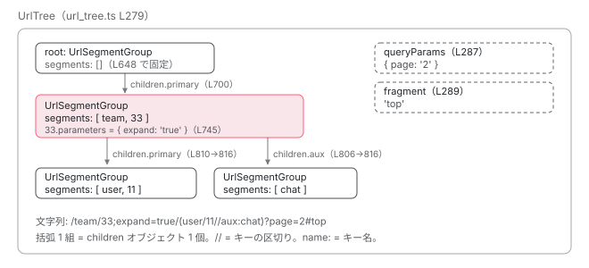

[目次](../README.md) › [Router の内側](README.md) › 第 2 回 / 全 21 回

# URL 文字列が UrlTree になるまで：UrlParser の 1 文字ずつの読み方

> DefaultUrlSerializer.parse → UrlParser.parseRootSegment → parseChildren → parseSegment。/a/b;x=1(aux:c)?q=1#f がどの関数でどの木になるか。マトリックスパラメータと副アウトレットの括弧の扱い、serialize で戻す手順まで。

angular/angular · 読了 約 14 分 · 中核 · [サイトで読む（デモが動きます）](https://angular-deep-dive-cyan.vercel.app/chapter/router-url-tree)

---

[概観](01-router.md)で「URL は木を直列化したもの」と確認しました。この章はその逆向き、**文字列を 1 文字ずつ読んで木を組み立てる手順**を追います。`/team/33;expand=true/(user/11//aux:chat)?page=2#top` という 1 本の URL を例に、「いま何文字目を読んでいて、どの関数が何を new したか」を全部書きます。最後に、できた木を `serialize` で元の文字列に戻す往復まで確認します。

読む対象は `packages/router/src/url_tree.ts` 1 ファイルです（入口だけ `router.ts`）。

1. 1 本の RxJS パイプライン
2. **URL → UrlTree**（この章）
3. routerLink の配列 → UrlTree
4. Route 設定の検証と正規化
5. provideRouter の中身
6. 最初のナビゲーション
7. navigateByUrl → NavigationTransition
8. setupNavigations の全段
9. Recognizer と match
10. redirectTo
11. loadChildren と loadComponent
12. ガードの実行順
13. resolve と data と title
14. ActivatedRoute と Snapshot
15. RouterOutlet への配置
16. ブラウザの URL と履歴
17. Router.events の全種類
18. RouterLink と RouterLinkActive
19. withViewTransitions
20. withRouterResources
21. Navigation API

## 1. 木を作る 3 つのクラス

先に「できあがるもの」を見ます。`UrlTree`、`UrlSegmentGroup`、`UrlSegment` の 3 クラスです。URL のどの記号がどのクラスのどのフィールドに入るかを、ここで決めておきます。

📄 `angular/packages/router/src/url_tree.ts` L279–311 （▶ の行: 285, 287, 289, 292–293）

```ts
279 │ export class UrlTree {
280 │   /** @internal */
281 │   _queryParamMap?: ParamMap;
282 │ 
283 │   constructor(
284 │     /** The root segment group of the URL tree */
285 ▶     public root: UrlSegmentGroup = new UrlSegmentGroup([], {}),
286 │     /** The query params of the URL */
287 ▶     public queryParams: Params = {},
288 │     /** The fragment of the URL */
289 ▶     public fragment: string | null = null,
290 │   ) {
291 │     if (typeof ngDevMode === 'undefined' || ngDevMode) {
292 ▶       if (root.segments.length > 0) {
293 ▶         throw new RuntimeError(
294 │           RuntimeErrorCode.INVALID_ROOT_URL_SEGMENT,
295 │           'The root `UrlSegmentGroup` should not contain `segments`. ' +
296 │             'Instead, these segments belong in the `children` so they can be associated with a named outlet.',
297 │         );
298 │       }
299 │     }
300 │   }
301 │ 
302 │   get queryParamMap(): ParamMap {
303 │     this._queryParamMap ??= convertToParamMap(this.queryParams);
304 │     return this._queryParamMap;
305 │   }
306 │ 
307 │   /** @docs-private */
308 │   toString(): string {
309 │     return DEFAULT_SERIALIZER.serialize(this);
310 │   }
311 │ }
```

285 行目 `root`、287 行目 `queryParams`、289 行目 `fragment`。**`?` 以降と `#` 以降は木の中ではなく、`UrlTree` 直下のフィールド**です。292〜293 行目、開発モードでは `root.segments` が空でないと例外になります。根ノードは自分ではパスを持たず、子だけを持ちます。この制約が 4 節のパーサの形を決めています。

📄 `angular/packages/router/src/url_tree.ts` L322–349 （▶ の行: 324, 328, 330, 332）

```ts
322 │ export class UrlSegmentGroup {
323 │   /** The parent node in the url tree */
324 ▶   parent: UrlSegmentGroup | null = null;
325 │ 
326 │   constructor(
327 │     /** The URL segments of this group. See `UrlSegment` for more information */
328 ▶     public segments: UrlSegment[],
329 │     /** The list of children of this group */
330 ▶     public children: {[key: string]: UrlSegmentGroup},
331 │   ) {
332 ▶     Object.values(children).forEach((v) => (v.parent = this));
333 │   }
334 │ 
335 │   /** Whether the segment has child segments */
336 │   hasChildren(): boolean {
337 │     return this.numberOfChildren > 0;
338 │   }
339 │ 
340 │   /** Number of child segments */
341 │   get numberOfChildren(): number {
342 │     return Object.keys(this.children).length;
343 │   }
344 │ 
345 │   /** @docs-private */
346 │   toString(): string {
347 │     return serializePaths(this);
348 │   }
349 │ }
```

328 行目 `segments` は `UrlSegment` の配列、330 行目 `children` は 「アウトレット名 → `UrlSegmentGroup`」のオブジェクトです。332 行目、コンストラクタの中で子の `parent`（324 行目）を自分に向けます。親子の両方向リンクはここで 1 回だけ張られます。[次章](03-router-create-url-tree.md)の `..` の解決がこの `parent` を使います。

📄 `angular/packages/router/src/url_tree.ts` L377–398 （▶ の行: 383, 386）

```ts
377 │ export class UrlSegment {
378 │   /** @internal */
379 │   _parameterMap?: ParamMap;
380 │ 
381 │   constructor(
382 │     /** The path part of a URL segment */
383 ▶     public path: string,
384 │ 
385 │     /** The matrix parameters associated with a segment */
386 ▶     public parameters: {[name: string]: string},
387 │   ) {}
388 │ 
389 │   get parameterMap(): ParamMap {
390 │     this._parameterMap ??= convertToParamMap(this.parameters);
391 │     return this._parameterMap;
392 │   }
393 │ 
394 │   /** @docs-private */
395 │   toString(): string {
396 │     return serializePath(this);
397 │   }
398 │ }
```

383 行目 `path`、386 行目 `parameters`。**`;key=value`（マトリックスパラメータ）は `UrlSegment` のフィールド**です。つまり `33;expand=true` の `expand` は「`33` というセグメントの持ち物」であって、URL 全体の持ち物ではありません。

| 記号 | 意味 | 入る場所 |
| --- | --- | --- |
| `/` | セグメントの区切り | `UrlSegmentGroup.segments` の要素が 1 つ増える |
| `;k=v` | 直前のセグメントのマトリックスパラメータ | `UrlSegment.parameters` |
| `(` … `)` | 副アウトレットのグループ | `UrlSegmentGroup.children`（名前付き） |
| `//` | 括弧の中でのグループ区切り | `children` の次のキーへ |
| `name:` | 括弧の中のアウトレット名 | `children` のキー |
| `?k=v&k2=v2` | クエリ | `UrlTree.queryParams` |
| `#f` | フラグメント | `UrlTree.fragment` |

## 2. 入口：DefaultUrlSerializer.parse は 3 回の呼び出し

📄 `angular/packages/router/src/url_tree.ts` L439–446 （▶ の行: 439, 442, 445）

```ts
439 ▶ @Service({factory: () => new DefaultUrlSerializer()})
440 │ export abstract class UrlSerializer {
441 │   /** Parse a url into a `UrlTree` */
442 ▶   abstract parse(url: string): UrlTree;
443 │ 
444 │   /** Converts a `UrlTree` into a url */
445 ▶   abstract serialize(tree: UrlTree): string;
446 │ }
```

📄 `angular/packages/router/src/url_tree.ts` L466–482 （▶ の行: 468–470, 475–477）

```ts
466 │ export class DefaultUrlSerializer implements UrlSerializer {
467 │   /** Parses a url into a `UrlTree` */
468 ▶   parse(url: string): UrlTree {
469 ▶     const p = new UrlParser(url);
470 ▶     return new UrlTree(p.parseRootSegment(), p.parseQueryParams(), p.parseFragment());
471 │   }
472 │ 
473 │   /** Converts a `UrlTree` into a url */
474 │   serialize(tree: UrlTree): string {
475 ▶     const segment = `/${serializeSegment(tree.root, true)}`;
476 ▶     const query = serializeQueryParams(tree.queryParams);
477 ▶     const fragment =
478 │       typeof tree.fragment === `string` ? `#${encodeUriFragment(tree.fragment)}` : '';
479 │ 
480 │     return `${segment}${query}${fragment}`;
481 │   }
482 │ }
```

439 行目、`UrlSerializer` は抽象クラスで、`@Service` の `factory` が `new DefaultUrlSerializer()` を返します。何も provide しなければこれが使われます （[5 章](05-router-provide-router.md)）。469 行目で `UrlParser` を 1 つ作り、470 行目で **`parseRootSegment()` → `parseQueryParams()` → `parseFragment()` の順に**呼びます。引数の評価順は左から右なので、文字列も「パス部 → `?` 以降 → `#` 以降」の順に消費されます。パーサは 1 本の文字列を先頭から削っていくだけで、後戻りはしません。

誰がこの `parse` を呼ぶかも押さえておきます。

📄 `angular/packages/router/src/router.ts` L596–614 （▶ の行: 598, 604, 612）

```ts
596 │   /** Serializes a `UrlTree` into a string */
597 │   serializeUrl(url: UrlTree): string {
598 ▶     return this.urlSerializer.serialize(url);
599 │   }
600 │ 
601 │   /** Parses a string into a `UrlTree` */
602 │   parseUrl(url: string): UrlTree {
603 │     try {
604 ▶       return this.urlSerializer.parse(url);
605 │     } catch (e) {
606 │       this.console.warn(
607 │         formatRuntimeError(
608 │           RuntimeErrorCode.ERROR_PARSING_URL,
609 │           ngDevMode && `Error parsing URL ${url}. Falling back to '/' instead. \n` + e,
610 │         ),
611 │       );
612 ▶       return this.urlSerializer.parse('/');
613 │     }
614 │   }
```

📄 `angular/packages/router/src/router.ts` L340–357 （▶ の行: 348–349）

```ts
340 │       delete stateCopy.navigationId;
341 │       delete stateCopy.ɵrouterPageId;
342 │       delete stateCopy.ɵrouterUrl;
343 │       if (Object.keys(stateCopy).length !== 0) {
344 │         extras.state = stateCopy;
345 │       }
346 │     }
347 │ 
348 ▶     const urlTree = this.parseUrl(routerUrl);
349 ▶     this.scheduleNavigation(urlTree, source, restoredState, extras, hasUAVisualTransition).catch(
350 │       (e) => {
351 │         if (this.disposed) {
352 │           return;
353 │         }
354 │         this.injector.get(ɵINTERNAL_APPLICATION_ERROR_HANDLER)(e);
355 │       },
356 │     );
357 │   }
```

604 行目、`Router.parseUrl` は `urlSerializer.parse` をそのまま呼び、例外が出たら警告を出して 612 行目で `'/'` を解析した結果にすり替えます。348 行目、ブラウザの URL（`location.path(true)` から来た文字列）はここで `parseUrl` を通って `UrlTree` になり、349 行目で `scheduleNavigation` に渡されます。`navigateByUrl('/x')` に文字列を渡したときも同じ `parseUrl` です （[クリックからの trace](../boot/13-boot-spa-navigation.md) の 552 行目）。

## 3. 道具：remaining を先頭から削る 3 つのメソッドと 4 つの正規表現

📄 `angular/packages/router/src/url_tree.ts` L824–845 （▶ の行: 825, 830–832, 838–839）

```ts
824 │   private peekStartsWith(str: string): boolean {
825 ▶     return this.remaining.startsWith(str);
826 │   }
827 │ 
828 │   // Consumes the prefix when it is present and returns whether it has been consumed
829 │   private consumeOptional(str: string): boolean {
830 ▶     if (this.peekStartsWith(str)) {
831 ▶       this.remaining = this.remaining.substring(str.length);
832 ▶       return true;
833 │     }
834 │     return false;
835 │   }
836 │ 
837 │   private capture(str: string): void {
838 ▶     if (!this.consumeOptional(str)) {
839 ▶       throw new RuntimeError(
840 │         RuntimeErrorCode.UNEXPECTED_VALUE_IN_URL,
841 │         (typeof ngDevMode === 'undefined' || ngDevMode) && `Expected "${str}".`,
842 │       );
843 │     }
844 │   }
845 │ }
```

`UrlParser` は `remaining` という 1 本の文字列を持ち、読んだぶんを前から削ります。825 行目 `peekStartsWith` は見るだけ。830〜832 行目 `consumeOptional` は、先頭が一致すれば `substring` で削って `true`、一致しなければ何もせず `false`。838〜839 行目 `capture` は「必ずあるはず」の文字で、無ければ `NG04011`（`UNEXPECTED_VALUE_IN_URL`）を投げます。この章に出てくる「読む」は、全部この 3 つのどれかです。

📄 `angular/packages/router/src/url_tree.ts` L603–627 （▶ の行: 603, 609, 615, 622）

```ts
603 ▶ const SEGMENT_RE = /^[^\/()?;#]+/;
604 │ function matchSegments(str: string): string {
605 │   const match = str.match(SEGMENT_RE);
606 │   return match ? match[0] : '';
607 │ }
608 │ 
609 ▶ const MATRIX_PARAM_SEGMENT_RE = /^[^\/()?;=#]+/;
610 │ function matchMatrixKeySegments(str: string): string {
611 │   const match = str.match(MATRIX_PARAM_SEGMENT_RE);
612 │   return match ? match[0] : '';
613 │ }
614 │ 
615 ▶ const QUERY_PARAM_RE = /^[^=?&#]+/;
616 │ // Return the name of the query param at the start of the string or an empty string
617 │ function matchQueryParams(str: string): string {
618 │   const match = str.match(QUERY_PARAM_RE);
619 │   return match ? match[0] : '';
620 │ }
621 │ 
622 ▶ const QUERY_PARAM_VALUE_RE = /^[^&#]+/;
623 │ // Return the value of the query param at the start of the string or an empty string
624 │ function matchUrlQueryParamValue(str: string): string {
625 │   const match = str.match(QUERY_PARAM_VALUE_RE);
626 │   return match ? match[0] : '';
627 │ }
```

603 行目 `SEGMENT_RE` は「`/ ( ) ? ; #` 以外の文字が続く限り」。セグメント名はこの 6 文字で終わります。`:` は含まれていないので、`aux:chat` は 1 つのセグメント名としてマッチします（7 節で分割します）。609 行目 `MATRIX_PARAM_SEGMENT_RE` はさらに `=` でも止まります（キーの切り出し用）。615 行目 `QUERY_PARAM_RE` は `= ? & #` で、622 行目 `QUERY_PARAM_VALUE_RE` は `& #` で止まります。クエリの値には `/` も `;` も `(` もそのまま入ります。

## 4. parseRootSegment：先頭の / を全部捨てる

📄 `angular/packages/router/src/url_tree.ts` L629–649 （▶ の行: 641, 643–644, 648）

```ts
629 │ class UrlParser {
630 │   private remaining: string;
631 │ 
632 │   constructor(private url: string) {
633 │     this.remaining = url;
634 │   }
635 │ 
636 │   parseRootSegment(): UrlSegmentGroup {
637 │     // Consume all leading slashes. Multiple consecutive leading slashes (e.g. `///path`)
638 │     // are not meaningful and would otherwise produce a `//path`-style serialized URL,
639 │     // which browsers interpret as protocol-relative (resolving to a different origin)
640 │     // and reject with a SecurityError when passed to `history.pushState`/`replaceState`.
641 ▶     while (this.consumeOptional('/')) {}
642 │ 
643 ▶     if (this.remaining === '' || this.peekStartsWith('?') || this.peekStartsWith('#')) {
644 ▶       return new UrlSegmentGroup([], {});
645 │     }
646 │ 
647 │     // The root segment group never has segments
648 ▶     return new UrlSegmentGroup([], this.parseChildren());
649 │   }
```

1. **641 行目：先頭の `/` を消費し続ける**

   `consumeOptional('/')` が `false` になるまで回します。`///path` も `path` から始まる状態になります。コメント（637〜640 行目）にあるとおり、`//path` のまま `pushState` に渡すとブラウザが別オリジンと解釈して `SecurityError` になるため、ここで潰します。例の URL では `remaining` が `team/33;expand=true/(user/11//aux:chat)?page=2#top` になります。
2. **643〜644 行目：パス部が無ければ空の根**

   残りが空、または `?` か `#` から始まるなら、子を持たない `UrlSegmentGroup([], {})` を返します。`/` や `/?a=1` がこれです。
3. **648 行目：根は `segments` を持たない**

   `new UrlSegmentGroup([], this.parseChildren())`。第 1 引数が固定で `[]` です。1 節の 292 行目の制約を、作る側で守っています。パスの中身は全部 `children`（次節）に入ります。

## 5. parseChildren：1 階層ぶんの segments と children を作る

📄 `angular/packages/router/src/url_tree.ts` L665–704 （▶ の行: 666, 676, 679–680, 683–685, 689–691, 695–696, 699–700）

```ts
665 │   private parseChildren(depth = 0): {[outlet: string]: UrlSegmentGroup} {
666 ▶     if (depth > 50) {
667 │       throw new RuntimeError(
668 │         RuntimeErrorCode.UNPARSABLE_URL,
669 │         (typeof ngDevMode === 'undefined' || ngDevMode) && 'URL is too deep',
670 │       );
671 │     }
672 │     if (this.remaining === '') {
673 │       return {};
674 │     }
675 │ 
676 ▶     this.consumeOptional('/');
677 │ 
678 │     const segments: UrlSegment[] = [];
679 ▶     if (!this.peekStartsWith('(')) {
680 ▶       segments.push(this.parseSegment());
681 │     }
682 │ 
683 ▶     while (this.peekStartsWith('/') && !this.peekStartsWith('//') && !this.peekStartsWith('/(')) {
684 ▶       this.capture('/');
685 ▶       segments.push(this.parseSegment());
686 │     }
687 │ 
688 │     let children: {[outlet: string]: UrlSegmentGroup} = {};
689 ▶     if (this.peekStartsWith('/(')) {
690 ▶       this.capture('/');
691 ▶       children = this.parseParens(true, depth);
692 │     }
693 │ 
694 │     let res: {[outlet: string]: UrlSegmentGroup} = {};
695 ▶     if (this.peekStartsWith('(')) {
696 ▶       res = this.parseParens(false, depth);
697 │     }
698 │ 
699 ▶     if (segments.length > 0 || Object.keys(children).length > 0) {
700 ▶       res[PRIMARY_OUTLET] = new UrlSegmentGroup(segments, children);
701 │     }
702 │ 
703 │     return res;
704 │   }
```

この関数が「1 つの `UrlSegmentGroup` の中身」を作ります。戻り値は `children` の形（アウトレット名 → グループ）で、自分が作った主系列は `primary` というキーに入れて返します（700 行目）。順に読みます。

1. **666 行目：深さ 50 で止める**

   `(((...)))` のネストは 50 まで。超えると `NG04010`（`UNPARSABLE_URL`）です。
2. **676 行目：先頭の `/` を 1 つだけ任意で消費**

   これがあるので `(/a)` のように括弧の直後に `/` があっても読めます。例の URL ではもう `/` は無いので何もしません。
3. **679〜680 行目：`(` で始まっていなければ最初のセグメント**

   `parseSegment()`（6 節）が `team` を切り出し、`remaining` は `/33;expand=true/(user/11//aux:chat)?page=2#top` になります。`(` で始まるとき（例: `/(a//b:c)`）は主系列が無いので読みません。
4. **683〜685 行目：`/` が続く限りセグメントを足す**

   条件は「`/` で始まる、かつ `//` でも `/(` でもない」。`capture('/')` してから `parseSegment()`。2 周目で `33;expand=true` を読み（6 節）、`remaining` は `/(user/11//aux:chat)?page=2#top`。次は `/(` で始まるのでループを抜けます。
5. **689〜691 行目：`/(` なら「このグループの子」**

   `/` を 1 つ消費して `parseParens(true, depth)`（7 節）。戻ってきたオブジェクトが変数 `children` です。第 1 引数 `true` は「名前の無いグループは `primary` として受け付ける」の意味です。例の URL では `{ primary: [user, 11], aux: [chat] }` が返ります。
6. **695〜696 行目：`(` なら「このグループの兄弟」**

   `/` を挟まずに `(` が来たときは `parseParens(false, depth)` で、結果は `children` ではなく `res` に入ります。`res` はこの関数の戻り値、つまり**親から見た子の集合**です。`/inbox/33(popup:compose)` の `popup` は `inbox/33` の子ではなく、根の直下で `primary` の隣に並びます。`/inbox/33/(popup:compose)` と 1 文字違うだけで木の形が変わります（デモで比べてください）。
7. **699〜700 行目：主系列を `primary` として詰める**

   `new UrlSegmentGroup(segments, children)`。`segments` は `[team, 33;expand=true]`、`children` は 5 で得た 2 つ。これが `res[PRIMARY_OUTLET]` に入り、4 節の 648 行目で根の `children` になります。

## 6. parseSegment と parseMatrixParams：33;expand=true を読む

📄 `angular/packages/router/src/url_tree.ts` L706–728 （▶ の行: 709–711, 718–719, 724–725）

```ts
706 │   // parse a segment with its matrix parameters
707 │   // ie `name;k1=v1;k2`
708 │   private parseSegment(): UrlSegment {
709 ▶     const path = matchSegments(this.remaining);
710 ▶     if (path === '' && this.peekStartsWith(';')) {
711 ▶       throw new RuntimeError(
712 │         RuntimeErrorCode.EMPTY_PATH_WITH_PARAMS,
713 │         (typeof ngDevMode === 'undefined' || ngDevMode) &&
714 │           `Empty path url segment cannot have parameters: '${this.remaining}'.`,
715 │       );
716 │     }
717 │ 
718 ▶     this.capture(path);
719 ▶     return new UrlSegment(decode(path), this.parseMatrixParams());
720 │   }
721 │ 
722 │   private parseMatrixParams(): {[key: string]: string} {
723 │     const params: {[key: string]: string} = {};
724 ▶     while (this.consumeOptional(';')) {
725 ▶       this.parseParam(params);
726 │     }
727 │     return params;
728 │   }
```

📄 `angular/packages/router/src/url_tree.ts` L730–746 （▶ の行: 731, 735, 737–738, 741, 745）

```ts
730 │   private parseParam(params: {[key: string]: string}): void {
731 ▶     const key = matchMatrixKeySegments(this.remaining);
732 │     if (!key) {
733 │       return;
734 │     }
735 ▶     this.capture(key);
736 │     let value = '';
737 ▶     if (this.consumeOptional('=')) {
738 ▶       const valueMatch = matchSegments(this.remaining);
739 │       if (valueMatch) {
740 │         value = valueMatch;
741 ▶         this.capture(value);
742 │       }
743 │     }
744 │ 
745 ▶     params[decode(key)] = decode(value);
746 │   }
```

1. **709 行目：`SEGMENT_RE` で名前を切る**

   `remaining` が `33;expand=true/(user/...` のとき、`;` で止まるので `path = '33'`。
2. **710〜711 行目：名前が空で `;` が来たらエラー**

   `/;x=1` のような「パラメータだけのセグメント」は `NG04009`（`EMPTY_PATH_WITH_PARAMS`）です。
3. **718〜719 行目：名前を消費し、`decode` してからパラメータを読む**

   `capture('33')` で `remaining` は `;expand=true/(user/...`。`new UrlSegment(decode(path), this.parseMatrixParams())`。`decode` は `decodeURIComponent` です（11 節）。
4. **724〜725 行目：`;` がある限り `parseParam`**

   `consumeOptional(';')` が `true` なので `remaining` は `expand=true/(user/...`。731 行目、`MATRIX_PARAM_SEGMENT_RE` は `=` で止まるのでキーは `expand`。735 行目で消費。737〜741 行目、`=` があれば値を `SEGMENT_RE` で切ります。値は `true`（`/` で止まる）。745 行目、`params['expand'] = 'true'`。**値は常に文字列**で、数値には変換されません。`remaining` は `/(user/11//aux:chat)?page=2#top`。次の `;` は無いので 724 行目のループが終わり、`UrlSegment('33', {expand: 'true'})` が返ります。

> [!TIP]
> **新卒エンジニアへ**
>
> `=` の無い `;flag` は 736 行目の初期値のまま `params['flag'] = ''` になります。「存在だけ伝えたいパラメータ」はこの形で書け、`paramMap.has('flag')` で判定できます。

## 7. parseParens：(user/11//aux:chat) を読む

📄 `angular/packages/router/src/url_tree.ts` L781–822 （▶ の行: 787–788, 790–791, 793, 797, 805–810, 813–818）

```ts
781 │   // parse `(a/b//outlet_name:c/d)`
782 │   private parseParens(allowPrimary: boolean, depth: number): {[outlet: string]: UrlSegmentGroup} {
783 │     // The outlet name is taken verbatim from the URL, so it can be `__proto__`. Indexing a plain
784 │     // object with that key assigns through the inherited `__proto__` setter instead of creating an
785 │     // outlet, which drops the outlet and mutates the map's prototype (and throws under Node's
786 │     // `--disable-proto=throw`). A null-prototype map makes `__proto__` an ordinary key.
787 ▶     const segments: {[key: string]: UrlSegmentGroup} = Object.create(null);
788 ▶     this.capture('(');
789 │ 
790 ▶     while (!this.consumeOptional(')') && this.remaining.length > 0) {
791 ▶       const path = matchSegments(this.remaining);
792 │ 
793 ▶       const next = this.remaining[path.length];
794 │ 
795 │       // if is is not one of these characters, then the segment was unescaped
796 │       // or the group was not closed
797 ▶       if (next !== '/' && next !== ')' && next !== ';') {
798 │         throw new RuntimeError(
799 │           RuntimeErrorCode.UNPARSABLE_URL,
800 │           (typeof ngDevMode === 'undefined' || ngDevMode) && `Cannot parse url '${this.url}'`,
801 │         );
802 │       }
803 │ 
804 │       let outletName: string | undefined;
805 ▶       if (path.indexOf(':') > -1) {
806 ▶         outletName = path.slice(0, path.indexOf(':'));
807 ▶         this.capture(outletName);
808 ▶         this.capture(':');
809 ▶       } else if (allowPrimary) {
810 ▶         outletName = PRIMARY_OUTLET;
811 │       }
812 │ 
813 ▶       const children = this.parseChildren(depth + 1);
814 ▶       segments[outletName ?? PRIMARY_OUTLET] =
815 ▶         Object.keys(children).length === 1 && children[PRIMARY_OUTLET]
816 ▶           ? children[PRIMARY_OUTLET]
817 ▶           : new UrlSegmentGroup([], children);
818 ▶       this.consumeOptional('//');
819 │     }
820 │ 
821 │     return segments;
822 │   }
```

5 節の 691 行目から来ました。`remaining` は `(user/11//aux:chat)?page=2#top`、`allowPrimary = true` です。

1. **787〜788 行目：null プロトタイプのマップを用意し、`(` を消費**

   コメントにあるとおり、アウトレット名は URL に書かれたままなので `__proto__` が来ても普通のキーとして扱えるように `Object.create(null)` です。`remaining` は `user/11//aux:chat)?page=2#top`。
2. **790 行目：`)` が来るまで繰り返す**

   `consumeOptional(')')` が `false` なので 1 周目に入ります。791 行目、`SEGMENT_RE` で `user` を切り出し（消費はしません）、793 行目で**その直後の 1 文字**を見ます。`/` です。797 行目、直後が `/`・`)`・`;` のどれでもなければ「閉じ括弧が無い」か「エスケープ漏れ」として `NG04010`。
3. **805〜810 行目：名前に `:` があればアウトレット名**

   `user` に `:` は無く、`allowPrimary` が `true` なので 810 行目、`outletName = 'primary'`。`remaining` はまだ `user/11//aux:chat)...` のままです（名前は消費していません）。
4. **813 行目：中身は parseChildren に任せる（再帰）**

   `parseChildren(depth + 1)` が 5 節と同じ手順で `user`、`/11` を読みます。683 行目の条件「`//` ではない」で止まるので、`remaining` は `//aux:chat)?page=2#top`。戻り値は `{ primary: UrlSegmentGroup([user, 11], {}) }`。
5. **814〜817 行目：1 段ほどく**

   戻ってきたオブジェクトのキーが `primary` 1 つだけなら、その中身をそのまま `segments['primary']` に入れます（816 行目）。そうしないと「primary の中に primary」という無駄な階層ができます。複数キーがあれば 817 行目、`segments` 空のグループで包みます。
6. **818 行目：`//` を消費して次のグループへ**

   `remaining` は `aux:chat)?page=2#top`。790 行目に戻り、`)` ではないので 2 周目。791 行目、`SEGMENT_RE` は `:` で止まらないので `path = 'aux:chat'`。直後は `)` で OK。805〜808 行目、`:` があるので `outletName = 'aux'`、`capture('aux')`、`capture(':')`。`remaining` は `chat)?page=2#top`。813 行目の `parseChildren` が `chat` を読み、`)` の前で止まります。816 行目で `segments['aux'] = UrlSegmentGroup([chat], {})`。818 行目、`//` は無いので何もせず、790 行目で `)` を消費してループ終了。`remaining` は `?page=2#top`、戻り値は `{ primary: [user, 11], aux: [chat] }`。

> [!NOTE]
> **ポイント**
>
> 「`(aux:chat)` の括弧は何か」と聞かれたら、**「`children` オブジェクトを文字列にした記法」**と答えます。`(` がオブジェクトの開き、`//` がキーの区切り、`name:` がキー、`)` が閉じです。名前の無い要素は `primary` キーになります（810 行目）。

## 8. parseQueryParams と parseFragment：?page=2#top

📄 `angular/packages/router/src/url_tree.ts` L651–663 （▶ の行: 653–656, 662）

```ts
651 │   parseQueryParams(): Params {
652 │     const params: Params = {};
653 ▶     if (this.consumeOptional('?')) {
654 ▶       do {
655 ▶         this.parseQueryParam(params);
656 ▶       } while (this.consumeOptional('&'));
657 │     }
658 │     return params;
659 │   }
660 │ 
661 │   parseFragment(): string | null {
662 ▶     return this.consumeOptional('#') ? decodeURIComponent(this.remaining) : null;
663 │   }
```

📄 `angular/packages/router/src/url_tree.ts` L748–779 （▶ の行: 750, 754, 756–757, 764–765, 767, 770–772, 774, 777）

```ts
748 │   // Parse a single query parameter `name[=value]`
749 │   private parseQueryParam(params: Params): void {
750 ▶     const key = matchQueryParams(this.remaining);
751 │     if (!key) {
752 │       return;
753 │     }
754 ▶     this.capture(key);
755 │     let value = '';
756 ▶     if (this.consumeOptional('=')) {
757 ▶       const valueMatch = matchUrlQueryParamValue(this.remaining);
758 │       if (valueMatch) {
759 │         value = valueMatch;
760 │         this.capture(value);
761 │       }
762 │     }
763 │ 
764 ▶     const decodedKey = decodeQuery(key);
765 ▶     const decodedVal = decodeQuery(value);
766 │ 
767 ▶     if (Object.hasOwn(params, decodedKey)) {
768 │       // Append to existing values
769 │       let currentVal = params[decodedKey];
770 ▶       if (!Array.isArray(currentVal)) {
771 ▶         currentVal = [currentVal];
772 ▶         params[decodedKey] = currentVal;
773 │       }
774 ▶       currentVal.push(decodedVal);
775 │     } else {
776 │       // Create a new value
777 ▶       params[decodedKey] = decodedVal;
778 │     }
779 │   }
```

1. **653 行目：`?` を消費できたときだけ**

   `remaining` は `page=2#top`。654〜656 行目、`parseQueryParam` を呼び、`&` が続く限り繰り返す `do-while` です。
2. **750〜757 行目：キーと値**

   `QUERY_PARAM_RE` で `page`（`=` で止まる）、754 行目で消費、756 行目で `=` を消費、757 行目 `QUERY_PARAM_VALUE_RE` で `2`（`#` で止まる）。`remaining` は `#top`。
3. **764〜765 行目：decodeQuery**

   `decode` ではなく `decodeQuery` です。11 節で見ますが、`+` を空白に戻す処理が 1 つ余分に入っています。
4. **767〜777 行目：同じキーが 2 回来たら配列**

   初回は 777 行目で文字列を入れます。2 回目以降は 770〜772 行目で既存の値を配列に包み直し、774 行目で `push`。`?tag=x&tag=y` は `{ tag: ['x', 'y'] }`、`?tag=x` は `{ tag: 'x' }`。**1 個のときと 2 個以上のときで型が変わる**ので、読む側は `queryParamMap.getAll('tag')` を使うと安全です。
5. **662 行目：`#` を消費できたら残り全部がフラグメント**

   `decodeURIComponent(this.remaining)`。`remaining` は `top` で、これで文字列は空になります。`#` が無ければ `null`（空文字ではありません）。

## 9. 全体の手順と、できあがった木

ここまでを 1 本につなぎます。「読んでいる位置」は `remaining` の先頭です。

| # | remaining の先頭 | 関数（行） | 作ったもの |
| --- | --- | --- | --- |
| 1 | `/team/33;…` | parseRootSegment（641） | 先頭の `/` を捨てる |
| 2 | `team/33;…` | parseChildren → parseSegment（680, 709） | `UrlSegment('team', {})` |
| 3 | `/33;expand=true/(…` | parseChildren（684〜685）→ parseSegment（709） | `path = '33'` |
| 4 | `;expand=true/(…` | parseMatrixParams → parseParam（724, 731〜745） | `UrlSegment('33', {expand:'true'})` |
| 5 | `/(user/11//aux:chat)?…` | parseChildren（689〜691） | `/` を消費、parseParens(true) へ |
| 6 | `(user/11//…` | parseParens（788） | `(` を消費 |
| 7 | `user/11//aux:chat)…` | parseParens（791〜810）→ parseChildren（813） | `primary: UrlSegmentGroup([user, 11], {})` |
| 8 | `//aux:chat)?…` | parseParens（818） | `//` を消費 |
| 9 | `aux:chat)?…` | parseParens（805〜808, 813） | `aux: UrlSegmentGroup([chat], {})` |
| 10 | `)?page=2#top` | parseParens（790） | `)` を消費、children 完成 |
| 11 | `?page=2#top` | parseChildren（700）→ parseRootSegment（648） | `root.children.primary = UrlSegmentGroup([team, 33;expand=true], children)` |
| 12 | `?page=2#top` | parseQueryParams（653〜656, 750〜777） | `queryParams = {page: '2'}` |
| 13 | `#top` | parseFragment（662） | `fragment = 'top'` |
| 14 | （空） | DefaultUrlSerializer.parse（470） | `new UrlTree(root, queryParams, fragment)` |



*例の URL から組み上がった UrlTree。根は segments を持たず、;expand=true は 33 というセグメントの中、(…) は team/33 グループの children、?と # は UrlTree 直下に入る。*

## 10. serialize：木を文字列に戻す

📄 `angular/packages/router/src/url_tree.ts` L486–524 （▶ の行: 491–492, 495–497, 501–503, 507, 509, 518–519, 522）

```ts
486 │ export function serializePaths(segment: UrlSegmentGroup): string {
487 │   return segment.segments.map((p) => serializePath(p)).join('/');
488 │ }
489 │ 
490 │ function serializeSegment(segment: UrlSegmentGroup, root: boolean): string {
491 ▶   if (!segment.hasChildren()) {
492 ▶     return serializePaths(segment);
493 │   }
494 │ 
495 ▶   if (root) {
496 ▶     const primary = segment.children[PRIMARY_OUTLET]
497 ▶       ? serializeSegment(segment.children[PRIMARY_OUTLET], false)
498 │       : '';
499 │     const children: string[] = [];
500 │ 
501 ▶     Object.entries(segment.children).forEach(([k, v]) => {
502 ▶       if (k !== PRIMARY_OUTLET) {
503 ▶         children.push(`${k}:${serializeSegment(v, false)}`);
504 │       }
505 │     });
506 │ 
507 ▶     return children.length > 0 ? `${primary}(${children.join('//')})` : primary;
508 │   } else {
509 ▶     const children = mapChildrenIntoArray(segment, (v: UrlSegmentGroup, k: string) => {
510 │       if (k === PRIMARY_OUTLET) {
511 │         return [serializeSegment(segment.children[PRIMARY_OUTLET], false)];
512 │       }
513 │ 
514 │       return [`${k}:${serializeSegment(v, false)}`];
515 │     });
516 │ 
517 │     // use no parenthesis if the only child is a primary outlet route
518 ▶     if (Object.keys(segment.children).length === 1 && segment.children[PRIMARY_OUTLET] != null) {
519 ▶       return `${serializePaths(segment)}/${children[0]}`;
520 │     }
521 │ 
522 ▶     return `${serializePaths(segment)}/(${children.join('//')})`;
523 │   }
524 │ }
```

2 節の 475 行目 `serializeSegment(tree.root, true)` から始まり、先頭に `/` を付けます。`root` フラグの有無で括弧の付け方が変わります。

1. **491〜492 行目：子が無ければ segments を `/` でつなぐだけ**

   `serializePaths`（486 行目）が各セグメントを `serializePath` して `/` で join します。葉はこれで終わりです。
2. **495〜507 行目：根のとき**

   496〜497 行目で `primary` の子を再帰（`root = false`）、501〜503 行目でそれ以外の子を `name:...` の形で集めます。507 行目、副アウトレットがあれば `primary(aux:...//other:...)`。**根の直下では `primary` と `(` の間に `/` が入りません**。5 節の 695 行目で読んだ「兄弟」の形（`/inbox/33(popup:compose)`）と対応しています。
3. **509〜522 行目：根以外のとき**

   509 行目の `mapChildrenIntoArray` は `primary` を先に、名前付きを後に並べます（順序を固定して文字列を安定させるため）。518〜519 行目、子が `primary` 1 つだけなら括弧を付けずに `a/b/c` と続けます。それ以外は 522 行目、`segments/(…//…)`。**根以外では `/` を挟んで `(`**。5 節の 689 行目で読んだ「子」の形です。例の木では `team/33;expand=true/(user/11//aux:chat)` になります。

📄 `angular/packages/router/src/url_tree.ts` L581–601 （▶ の行: 582, 587, 594–596, 600）

```ts
581 │ export function serializePath(path: UrlSegment): string {
582 ▶   return `${encodeUriSegment(path.path)}${serializeMatrixParams(path.parameters)}`;
583 │ }
584 │ 
585 │ function serializeMatrixParams(params: {[key: string]: string}): string {
586 │   return Object.entries(params)
587 ▶     .map(([key, value]) => `;${encodeUriSegment(key)}=${encodeUriSegment(value)}`)
588 │     .join('');
589 │ }
590 │ 
591 │ function serializeQueryParams(params: {[key: string]: any}): string {
592 │   const strParams: string[] = Object.entries(params)
593 │     .map(([name, value]) => {
594 ▶       return Array.isArray(value)
595 ▶         ? value.map((v) => `${encodeUriQuery(name)}=${encodeUriQuery(v)}`).join('&')
596 ▶         : `${encodeUriQuery(name)}=${encodeUriQuery(value)}`;
597 │     })
598 │     .filter((s) => s);
599 │ 
600 ▶   return strParams.length ? `?${strParams.join('&')}` : '';
601 │ }
```

582 行目、セグメントは `encodeUriSegment(path)` のあとにマトリックスパラメータ。587 行目、各パラメータは `;key=value` でキーも値もエンコードされます。594〜596 行目、クエリは配列なら `k=v1&k=v2` に展開（8 節の 774 行目の逆）、600 行目で `?` を先頭に付けます。例の木は `/team/33;expand=true/(user/11//aux:chat)?page=2#top` に戻ります。入力とまったく同じ文字列です。

## 11. encode と decode：なぜ encodeURIComponent をそのまま使わないか

📄 `angular/packages/router/src/url_tree.ts` L532–558 （▶ の行: 533–537, 547, 557）

```ts
532 │ function encodeUriString(s: string): string {
533 ▶   return encodeURIComponent(s)
534 ▶     .replace(/%40/g, '@')
535 ▶     .replace(/%3A/gi, ':')
536 ▶     .replace(/%24/g, '$')
537 ▶     .replace(/%2C/gi, ',');
538 │ }
539 │ 
540 │ /**
541 │  * This function should be used to encode both keys and values in a query string key/value. In
542 │  * the following URL, you need to call encodeUriQuery on "k" and "v":
543 │  *
544 │  * http://www.site.org/html;mk=mv?k=v#f
545 │  */
546 │ export function encodeUriQuery(s: string): string {
547 ▶   return encodeUriString(s).replace(/%3B/gi, ';');
548 │ }
549 │ 
550 │ /**
551 │  * This function should be used to encode a URL fragment. In the following URL, you need to call
552 │  * encodeUriFragment on "f":
553 │  *
554 │  * http://www.site.org/html;mk=mv?k=v#f
555 │  */
556 │ export function encodeUriFragment(s: string): string {
557 ▶   return encodeURI(s);
558 │ }
```

📄 `angular/packages/router/src/url_tree.ts` L560–579 （▶ の行: 568, 572, 578）

```ts
560 │ /**
561 │  * This function should be run on any URI segment as well as the key and value in a key/value
562 │  * pair for matrix params. In the following URL, you need to call encodeUriSegment on "html",
563 │  * "mk", and "mv":
564 │  *
565 │  * http://www.site.org/html;mk=mv?k=v#f
566 │  */
567 │ export function encodeUriSegment(s: string): string {
568 ▶   return encodeUriString(s).replace(/\(/g, '%28').replace(/\)/g, '%29').replace(/%26/gi, '&');
569 │ }
570 │ 
571 │ export function decode(s: string): string {
572 ▶   return decodeURIComponent(s);
573 │ }
574 │ 
575 │ // Query keys/values should have the "+" replaced first, as "+" in a query string is " ".
576 │ // decodeURIComponent function will not decode "+" as a space.
577 │ export function decodeQuery(s: string): string {
578 ▶   return decode(s.replace(/\+/g, '%20'));
579 │ }
```

533〜537 行目、`encodeURIComponent` してから `@ : $ ,` の 4 文字だけ元に戻します。直前のコメントにあるとおり、URL 仕様（WHATWG URL Standard）上これらはエンコード不要で、`encodeURIComponent` が過剰だからです。その上で用途別に 3 つに分かれます。

| 関数 | 使う場所 | 基本の encodeUriString に加えて |
| --- | --- | --- |
| `encodeUriSegment`（568） | セグメント名、マトリックスのキーと値 | `(``)` を `%28``%29` に（括弧は構文なので）、`&` は戻す |
| `encodeUriQuery`（547） | クエリのキーと値 | `;` を戻す（クエリでは `;` に意味が無い） |
| `encodeUriFragment`（557） | フラグメント | `encodeURI` を使う（`/``?` などもそのまま） |

読む側は 572 行目 `decode` が `decodeURIComponent`、578 行目 `decodeQuery` はその前に `+` を `%20` に置き換えます。`decodeURIComponent` は `+` を空白にしないので、フォームの `application/x-www-form-urlencoded` 形式（空白を `+` で書く）を受けるための一手間です。セグメント側（`decode`）にはこの置き換えが無いので、**パスの `+` はそのまま `+`** です。

> **🧪 DEMO — URL 文字列 → UrlTree → 文字列**
>
> このページの `inject(UrlSerializer)`（= `DefaultUrlSerializer`）に文字列を渡しています。木はそのまま描き、下に `serialize` で戻した文字列を出します。副作用はありません（ページは移動しません）。
>
> ▶ [このデモはサイトで動かせます](https://angular-deep-dive-cyan.vercel.app/chapter/router-url-tree)

## ここまでの呼び出し

- 👤 `router.navigateByUrl('/team/33;expand=true/(user/11//aux:chat)?page=2#top')` — あなたのコード
  - `Router.parseUrl(url)` — router.ts L602 — *失敗したら '/' にフォールバック*
    - `DefaultUrlSerializer.parse(url)` — url\_tree.ts L468 — *new UrlParser(url)*
      - `parseRootSegment()` — url\_tree.ts L636 — *先頭の / を捨て、new UrlSegmentGroup(\[\], children)*
        - `parseChildren(0)` — L665 — *team、/33;… を parseSegment*
          - `parseSegment()` × 2 — L708 — *matchSegments → capture → parseMatrixParams*
            - `parseParam(params)` — L730 — *expand=true*
          - `parseParens(true, 0)` — L782 — */( のあと。( を capture*
            - `parseChildren(1)` → primary — L813 — *user/11。// の前で止まる*
            - `parseChildren(1)` → aux — L813 — *aux: を capture してから chat*
      - `parseQueryParams()` — L651 — *? を消費、parseQueryParam を & で繰り返す*
      - `parseFragment()` — L661 — *# を消費、残り全部を decodeURIComponent*
    - `new UrlTree(root, queryParams, fragment)` — L470

## 聞かれそうな質問

**Q. URL の `;` と `?` の違いは何ですか？どちらがどの階層に属しますか？**

`;k=v` は**直前のセグメント 1 つ**の持ち物で、`UrlSegment.parameters`（url\_tree.ts 386 行目）に入ります。読むのは `parseSegment` の 719 行目から呼ばれる `parseMatrixParams`（724〜725 行目）です。`?k=v` は**URL 全体**の持ち物で、`UrlTree.queryParams`（287 行目）に入ります。読むのは `parse` の 470 行目で 2 番目に呼ばれる `parseQueryParams` です。だから `/team/33;expand=true/user/11` の `expand` は `team` ルートの `params` からしか見えず、`?expand=true` はどのルートからでも見えます。

**Q. `(aux:chat)` の括弧は何ですか？副アウトレットの URL はどこで木に入りますか？**

`UrlSegmentGroup.children`（330 行目）というオブジェクトを文字列にした記法です。`parseParens`（782 行目）が `(` を消費し、`name:` があれば 805〜808 行目でキー名として切り出し、中身を 813 行目の `parseChildren` で読んで 814〜817 行目で `segments[outletName]` に入れます。`//` は 818 行目で消費する「次のキー」の区切りです。どのグループの `children` になるかは `parseChildren` の 689〜691 行目（`/(` → 今のグループの子）と 695〜696 行目（`(` → 親から見た兄弟）で決まります。

**Q. `/a(aux:b)` と `/a/(aux:b)` は同じ URL ですか？**

違います。`/a(aux:b)` は 695 行目の分岐で `aux` が `res` に入り、根の `children` が `{primary: [a], aux: [b]}` になります。`/a/(aux:b)` は 689 行目の分岐で `children` に入り、`[a]` グループの `children` が `{aux: [b]}` になります。`serializeSegment` も根では 507 行目で `/` 無し、根以外では 522 行目で `/` 付きで書き出すので、往復しても形は保たれます。Route 設定で `outlet: 'aux'` をどの階層の `children` に書いたかと対応させる必要があります。

**Q. `?tag=x&tag=y` はどう入りますか？`?tag=x` だけのときと型は同じですか？**

同じではありません。`parseQueryParam` の 767 行目でキーの重複を見ていて、初回は 777 行目で文字列、2 回目は 770〜772 行目で配列に包み直して 774 行目で `push` します。1 個なら `'x'`、2 個なら `['x', 'y']` です。`queryParamMap.getAll('tag')` はどちらも配列で返すので、そちらを使います。

**Q. `/;x=1` や `/a/(b` のような壊れた URL を渡すとどうなりますか？**

`/;x=1` は `parseSegment` の 710〜711 行目で `NG04009`（`EMPTY_PATH_WITH_PARAMS`）、`/a/(b` は `parseParens` の 797 行目で、`b` の直後が文字列の終わり（`/ ) ;` のどれでもない）なので `NG04010`（`UNPARSABLE_URL`）です。`UrlSerializer.parse` を直接呼ぶと例外がそのまま出ます（上のデモで確認できます）。`Router.parseUrl` 経由なら router.ts 606〜612 行目で警告を出して `'/'` の解析結果に置き換えるので、ナビゲーションは根に向かいます。

**Q. マトリックスパラメータの値に数字を書いても数値にはなりませんか？**

なりません。`parseParam` の 745 行目は `params[decode(key)] = decode(value)` で、`decode` は `decodeURIComponent`（572 行目）です。型は `UrlSegment.parameters` の宣言どおり `{[name: string]: string}`（386 行目）。`Number(...)` は読む側の仕事です。

## 読み終えて

- `DefaultUrlSerializer.parse`（470 行目）は `parseRootSegment` → `parseQueryParams` → `parseFragment` の 3 呼び出し。`remaining` を先頭から `consumeOptional` / `capture` で削るだけで後戻りしない
- 根は `segments` を持たない（648 行目）。パスの中身はすべて `children.primary` 以下に入る
- `;k=v` は `UrlSegment.parameters`、`?k=v` は `UrlTree.queryParams`、`(…//name:…)` は `UrlSegmentGroup.children`。`/(` は子、`(` は兄弟
- `serializeSegment`（490 行目）は `root` フラグで括弧の前の `/` を切り替え、往復で同じ文字列に戻る
- 次章は逆方向の入口、`routerLink` の配列から `UrlTree` を作る `createUrlTree` を追う

---

← 前: [Router は 1 本の RxJS パイプライン](01-router.md)  
次: [routerLink の配列が UrlTree になるまで：createUrlTree と「..」の解決](03-router-create-url-tree.md) →
