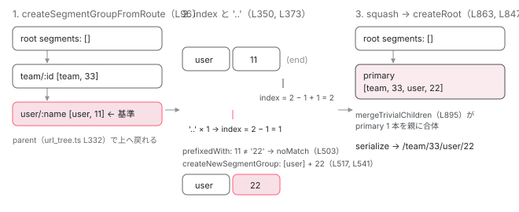

[目次](../README.md) › [Router の内側](README.md) › 第 3 回 / 全 21 回

# routerLink の配列が UrlTree になるまで：createUrlTree と「..」の解決

> Router.createUrlTree → createUrlTreeFromSnapshot → computeNavigation → tree → updateSegmentGroup。\['../x', {id: 1}\] がどう解釈されるか、相対パスの起点はどこか、queryParamsHandling の merge / preserve が何を足すか。

angular/angular · 読了 約 13 分 · 中核 · [サイトで読む（デモが動きます）](https://angular-deep-dive-cyan.vercel.app/chapter/router-create-url-tree)

---

[前章](02-router-url-tree.md)は文字列から `UrlTree` を作りました。`UrlTree` を作るもう 1 つの入口が `routerLink="['../22']"` や `router.navigate(['../22'])` の**配列（commands）**です。この章では、Route 設定 `team/:id` → `user/:name`、現在の URL `/team/33/user/11`、`UserCmp` の中で `['../22']` と書いたときに、どの関数が `..` をどう数えて `/team/33/user/22` に到達するかを 1 ステップずつ追います。`queryParamsHandling: 'merge'` が何と何を merge するかも、同じ関数の冒頭にあります。

読む対象は `packages/router/src/create_url_tree.ts` 全体と、入口の `router.ts`（`createUrlTree`）、`directives/router_link.ts`（commands を渡す側）です。

1. 1 本の RxJS パイプライン
2. URL → UrlTree
3. **routerLink の配列 → UrlTree**（この章）
4. Route 設定の検証と正規化
5. provideRouter の中身
6. 最初のナビゲーション
7. navigateByUrl → NavigationTransition
8. setupNavigations の全段
9. Recognizer と match
10. redirectTo
11. loadChildren と loadComponent
12. ガードの実行順
13. resolve と data と title
14. ActivatedRoute と Snapshot
15. RouterOutlet への配置
16. ブラウザの URL と履歴
17. Router.events の全種類
18. RouterLink と RouterLinkActive
19. withViewTransitions
20. withRouterResources
21. Navigation API

## 1. RouterLink が commands を渡すところ

📄 `angular/packages/router/src/directives/router_link.ts` L454–469 （▶ の行: 455, 460–461, 463–464）

```ts
454 │   @Input()
455 ▶   set routerLink(commandsOrUrlTree: readonly any[] | string | UrlTree | null | undefined) {
456 │     if (commandsOrUrlTree == null) {
457 │       this.routerLinkInput.set(null);
458 │       this.setTabIndexIfNotOnNativeEl(null);
459 │     } else {
460 ▶       if (isUrlTree(commandsOrUrlTree)) {
461 ▶         this.routerLinkInput.set(commandsOrUrlTree);
462 │       } else {
463 ▶         this.routerLinkInput.set(
464 ▶           Array.isArray(commandsOrUrlTree) ? commandsOrUrlTree : [commandsOrUrlTree],
465 │         );
466 │       }
467 │       this.setTabIndexIfNotOnNativeEl('0');
468 │     }
469 │   }
```

455 行目、`routerLink` 入力は文字列・配列・`UrlTree`・`null` のどれでも受けます。460〜461 行目、`UrlTree` ならそのまま保持。463〜464 行目、**文字列は要素 1 つの配列に包まれます**。つまり `routerLink="/user/bob"` は `['/user/bob']` と同じで、以降の処理は常に「配列」です。

📄 `angular/packages/router/src/directives/router_link.ts` L537–572 （▶ の行: 538, 541, 554, 557–558, 560, 564–568, 571）

```ts
537 │   /** @internal */
538 ▶   _urlTree = computed(
539 │     () => {
540 │       // Track path changes. It's knowing which segments we actually depend on is somewhat difficult
541 ▶       this.reactiveRouterState.path();
542 │       if (this._preserveFragment()) {
543 │         this.reactiveRouterState.fragment();
544 │       }
545 │       const shouldTrackParams = (handling: QueryParamsHandling | undefined | null) =>
546 │         handling === 'preserve' || handling === 'merge';
547 │       if (
548 │         shouldTrackParams(this._queryParamsHandling()) ||
549 │         shouldTrackParams(this.options?.defaultQueryParamsHandling)
550 │       ) {
551 │         this.reactiveRouterState.queryParams();
552 │       }
553 │ 
554 ▶       const routerLinkInput = this.routerLinkInput();
555 │       if (routerLinkInput === null || !this.router.createUrlTree) {
556 │         return null;
557 ▶       } else if (isUrlTree(routerLinkInput)) {
558 ▶         return routerLinkInput;
559 │       }
560 ▶       return this.router.createUrlTree(routerLinkInput, {
561 │         // If the `relativeTo` input is not defined, we want to use `this.route`
562 │         // by default.
563 │         // Otherwise, we should use the value provided by the user in the input.
564 ▶         relativeTo: this._relativeTo() !== undefined ? this._relativeTo() : this.route,
565 ▶         queryParams: this._queryParams(),
566 ▶         fragment: this._fragment(),
567 ▶         queryParamsHandling: this._queryParamsHandling(),
568 ▶         preserveFragment: this._preserveFragment(),
569 │       });
570 │     },
571 ▶     {equal: (a, b) => this.computeHref(a) === this.computeHref(b)},
572 │   );
```

538 行目、`_urlTree` は `computed` です。541 行目で `ReactiveRouterState.path` を読んで依存に入れているので、**ナビゲーションが終わって現在 URL が変わるたびに再計算**されます（相対リンクは「今どこにいるか」で結果が変わるため）。554〜558 行目、入力が `UrlTree` ならそれを返して終わり。配列なら 560 行目、`Router.createUrlTree` に渡します。564 行目、`relativeTo` を指定していなければ **`this.route`（このリンクを置いたコンポーネントの `ActivatedRoute`）**が基準です。565〜568 行目で `queryParams` / `fragment` / `queryParamsHandling` / `preserveFragment` の入力をそのまま渡します。571 行目、`equal` は href 文字列の比較なので、同じ URL に落ちる再計算では下流（`href` 属性）が更新されません。

📄 `angular/packages/router/src/directives/router_link.ts` L574–582 （▶ の行: 575, 580）

```ts
574 │   get urlTree(): UrlTree | null {
575 ▶     return untracked(this._urlTree);
576 │   }
577 │ 
578 │   private computeHref(urlTree: UrlTree | null): string | null {
579 │     return urlTree !== null && this.locationStrategy
580 ▶       ? (this.locationStrategy?.prepareExternalUrl(this.router.serializeUrl(urlTree)) ?? '')
581 │       : null;
582 │   }
```

📄 `angular/packages/router/src/router.ts` L588–594 （▶ の行: 592–593）

```ts
588 │   navigate(
589 │     commands: readonly any[],
590 │     extras: NavigationExtras = {skipLocationChange: false},
591 │   ): Promise<boolean> {
592 ▶     validateCommands(commands);
593 ▶     return this.navigateByUrl(this.createUrlTree(commands, extras), extras);
594 │   }
```

580 行目、`href` 属性は `router.serializeUrl(urlTree)`（前章 10 節）を `LocationStrategy.prepareExternalUrl` に通した文字列です （`<base href>` や `#` が付くのはここ）。`router.navigate(commands)` も 593 行目で同じ `createUrlTree` を呼んでから `navigateByUrl` に渡します。592 行目の `validateCommands` は要素に `null` / `undefined` が無いかだけを見ます（`NG04008`）。以降、`RouterLink` も `navigate` も経路は同じです。

## 2. Router.createUrlTree 前半：queryParams と fragment を決める

📄 `angular/packages/router/src/router.ts` L472–490 （▶ の行: 473, 475, 477–479, 481–482, 484–485, 487–488）

```ts
472 │   createUrlTree(commands: readonly any[], navigationExtras: UrlCreationOptions = {}): UrlTree {
473 ▶     const {relativeTo, queryParams, fragment, queryParamsHandling, preserveFragment} =
474 │       navigationExtras;
475 ▶     const f = preserveFragment ? this.currentUrlTree.fragment : fragment;
476 │     let q: Params | null = null;
477 ▶     switch (queryParamsHandling ?? this.options.defaultQueryParamsHandling) {
478 ▶       case 'merge':
479 ▶         q = {...this.currentUrlTree.queryParams, ...queryParams};
480 │         break;
481 ▶       case 'preserve':
482 ▶         q = this.currentUrlTree.queryParams;
483 │         break;
484 ▶       default:
485 ▶         q = queryParams || null;
486 │     }
487 ▶     if (q !== null) {
488 ▶       q = this.removeEmptyProps(q);
489 │     }
490 │ 
```

📄 `angular/packages/router/src/router.ts` L656–663 （▶ の行: 658）

```ts
656 │   private removeEmptyProps(params: Params): Params {
657 │     return Object.entries(params).reduce((result: Params, [key, value]: [string, any]) => {
658 ▶       if (value !== null && value !== undefined) {
659 │         result[key] = value;
660 │       }
661 │       return result;
662 │     }, {});
663 │   }
```

1. **475 行目：fragment**

   `preserveFragment` が真なら **`this.currentUrlTree.fragment`（今の URL のフラグメント）**、そうでなければ引数の `fragment`。`currentUrlTree` は `StateManager` が持つ「最後に成功したナビゲーションの `UrlTree`」です。
2. **477 行目：queryParamsHandling の switch**

   引数に無ければ `options.defaultQueryParamsHandling`（`withRouterConfig` で設定、[5 章](05-router-provide-router.md)）。どちらも無ければ `undefined` で `default` 節に入ります。
3. **478〜479 行目：'merge'**

   `{...this.currentUrlTree.queryParams, ...queryParams}`。**merge するのは「今の URL のクエリ」と「このリンクに書いたクエリ」**で、同じキーはリンク側が勝ちます（スプレッドの後勝ち）。Route 設定や親のクエリは関係ありません。
4. **481〜482 行目：'preserve'**

   今の URL のクエリをそのまま使い、**リンクに書いた `queryParams` は捨てられます**。
5. **484〜485 行目：既定（'replace' 相当）**

   リンクに書いたものだけ。何も書かなければ `null`。今の URL のクエリは引き継がれません。
6. **487〜488 行目：null / undefined の値を落とす**

   658 行目、値が `null` か `undefined` のキーは除外。`'merge'` で `{page: null}` を渡すと、今の URL の `page` を**消す**ことができるのはこの行のおかげです（スプレッドで `null` に上書き → ここで除外）。

| queryParamsHandling | 現在 `?a=1&b=2`、リンク `{b: 9, c: 3}` のとき | 行 |
| --- | --- | --- |
| （未指定） | `?b=9&c=3` | 484〜485 |
| `'merge'` | `?a=1&b=9&c=3` | 478〜479 |
| `'preserve'` | `?a=1&b=2`（リンク側は無視） | 481〜482 |
| `'merge'` + `{a: null}` | `?b=2`（a が消える） | 479 → 488 → 658 |

## 3. Router.createUrlTree 後半：relativeTo を UrlSegmentGroup に変える

📄 `angular/packages/router/src/router.ts` L491–520 （▶ の行: 493–494, 501, 509, 511, 513–518）

```ts
491 │     let relativeToUrlSegmentGroup: UrlSegmentGroup | undefined;
492 │     try {
493 ▶       const relativeToSnapshot = relativeTo ? relativeTo.snapshot : this.routerState.snapshot.root;
494 ▶       relativeToUrlSegmentGroup = createSegmentGroupFromRoute(relativeToSnapshot);
495 │     } catch (e: unknown) {
496 │       // This is strictly for backwards compatibility with tests that create
497 │       // invalid `ActivatedRoute` mocks.
498 │       // Note: the difference between having this fallback for invalid `ActivatedRoute` setups and
499 │       // just throwing is ~500 test failures. Fixing all of those tests by hand is not feasible at
500 │       // the moment.
501 ▶       if (typeof commands[0] !== 'string' || commands[0][0] !== '/') {
502 │         // Navigations that were absolute in the old way of creating UrlTrees
503 │         // would still work because they wouldn't attempt to match the
504 │         // segments in the `ActivatedRoute` to the `currentUrlTree` but
505 │         // instead just replace the root segment with the navigation result.
506 │         // Non-absolute navigations would fail to apply the commands because
507 │         // the logic could not find the segment to replace (so they'd act like there were no
508 │         // commands).
509 ▶         commands = [];
510 │       }
511 ▶       relativeToUrlSegmentGroup = this.currentUrlTree.root;
512 │     }
513 ▶     return createUrlTreeFromSegmentGroup(
514 ▶       relativeToUrlSegmentGroup,
515 ▶       commands,
516 ▶       q,
517 ▶       f ?? null,
518 ▶       this.urlSerializer,
519 │     );
520 │   }
```

493 行目、`relativeTo` があればその `snapshot`、無ければ `routerState.snapshot.root`（根）。494 行目、**その `ActivatedRouteSnapshot` を `UrlSegmentGroup` に変換**します。495〜511 行目の `catch` はテスト用の不正なモックのための後方互換で、本番の経路では通りません。513〜518 行目で本体の `createUrlTreeFromSegmentGroup` に、基準グループ・commands・2 節で決めた `q` と `f`・`UrlSerializer` を渡します。

📄 `angular/packages/router/src/create_url_tree.ts` L96–117 （▶ の行: 103–105, 107–109, 113–114, 116）

```ts
 96 │ export function createSegmentGroupFromRoute(route: ActivatedRouteSnapshot): UrlSegmentGroup {
 97 │   let targetGroup: UrlSegmentGroup | undefined;
 98 │ 
 99 │   function createSegmentGroupFromRouteRecursive(
100 │     currentRoute: ActivatedRouteSnapshot,
101 │   ): UrlSegmentGroup {
102 │     const childOutlets: {[outlet: string]: UrlSegmentGroup} = {};
103 ▶     for (const childSnapshot of currentRoute.children) {
104 ▶       const root = createSegmentGroupFromRouteRecursive(childSnapshot);
105 ▶       childOutlets[childSnapshot.outlet] = root;
106 │     }
107 ▶     const segmentGroup = new UrlSegmentGroup(currentRoute.url, childOutlets);
108 ▶     if (currentRoute === route) {
109 ▶       targetGroup = segmentGroup;
110 │     }
111 │     return segmentGroup;
112 │   }
113 ▶   const rootCandidate = createSegmentGroupFromRouteRecursive(route.root);
114 ▶   const rootSegmentGroup = createRoot(rootCandidate);
115 │ 
116 ▶   return targetGroup ?? rootSegmentGroup;
117 │ }
```

ここが `..` の意味を決める最重要の関数です。

1. **113 行目：根から再帰**

   `route.root`（`RouterStateSnapshot` の根の `ActivatedRouteSnapshot`）から始め、103〜105 行目で子ごとに再帰し、`childSnapshot.outlet`（`primary` か名前付き）をキーにします。
2. **107 行目：1 つの ActivatedRouteSnapshot = 1 つの UrlSegmentGroup**

   `new UrlSegmentGroup(currentRoute.url, childOutlets)`。`currentRoute.url` は**その Route が消費した URL セグメント**です。例では根が `[]`、`team/:id` が `[team, 33]`、`user/:name` が `[user, 11]`。前章で見た「パース結果の木」は `team/33/user/11` が 1 グループでしたが、**ここで作る木は Route の段ごとに分かれています**。`path: ''` の Route は `segments` が空のグループになります。
3. **108〜109 行目：基準のグループを覚える**

   `currentRoute === route`（引数の `relativeTo`）になった瞬間のグループを `targetGroup` に取っておきます。
4. **114〜116 行目：根を整えて、基準グループを返す**

   `createRoot`（9 節）は根に `segments` があれば 1 段包むだけ。戻り値は根ではなく `targetGroup` です。根へは `UrlSegmentGroup` のコンストラクタが張った `parent`（下の 332 行目）をたどって戻れます。

📄 `angular/packages/router/src/url_tree.ts` L322–333 （▶ の行: 324, 332）

```ts
322 │ export class UrlSegmentGroup {
323 │   /** The parent node in the url tree */
324 ▶   parent: UrlSegmentGroup | null = null;
325 │ 
326 │   constructor(
327 │     /** The URL segments of this group. See `UrlSegment` for more information */
328 │     public segments: UrlSegment[],
329 │     /** The list of children of this group */
330 │     public children: {[key: string]: UrlSegmentGroup},
331 │   ) {
332 ▶     Object.values(children).forEach((v) => (v.parent = this));
333 │   }
```

> [!NOTE]
> **ポイント**
>
> `..` が「1 つ上がる」基準は、**Route の階層ではなく、この関数が作ったグループの `segments`** です。`relativeTo` の Route が 2 セグメント消費していれば、カーソルは 2 の位置から始まり、`..` 1 つで 1 セグメント戻ります（6 節）。

## 4. createUrlTreeFromSegmentGroup：3 つの出口

📄 `angular/packages/router/src/create_url_tree.ts` L119–148 （▶ の行: 126–128, 133–134, 137, 139–140, 143–147）

```ts
119 │ export function createUrlTreeFromSegmentGroup(
120 │   relativeTo: UrlSegmentGroup,
121 │   commands: readonly any[],
122 │   queryParams: Params | null,
123 │   fragment: string | null,
124 │   urlSerializer: UrlSerializer,
125 │ ): UrlTree {
126 ▶   let root = relativeTo;
127 ▶   while (root.parent) {
128 ▶     root = root.parent;
129 │   }
130 │   // There are no commands so the `UrlTree` goes to the same path as the one created from the
131 │   // `UrlSegmentGroup`. All we need to do is update the `queryParams` and `fragment` without
132 │   // applying any other logic.
133 ▶   if (commands.length === 0) {
134 ▶     return tree(root, root, root, queryParams, fragment, urlSerializer);
135 │   }
136 │ 
137 ▶   const nav = computeNavigation(commands);
138 │ 
139 ▶   if (nav.toRoot()) {
140 ▶     return tree(root, root, new UrlSegmentGroup([], {}), queryParams, fragment, urlSerializer);
141 │   }
142 │ 
143 ▶   const position = findStartingPositionForTargetGroup(nav, root, relativeTo);
144 ▶   const newSegmentGroup = position.processChildren
145 ▶     ? updateSegmentGroupChildren(position.segmentGroup, position.index, nav.commands)
146 ▶     : updateSegmentGroup(position.segmentGroup, position.index, nav.commands);
147 ▶   return tree(root, position.segmentGroup, newSegmentGroup, queryParams, fragment, urlSerializer);
148 │ }
```

1. **126〜128 行目：parent を遡って根を見つける**
2. **133〜134 行目：commands が空なら木はそのまま**

   `[routerLink]="[]"` や `navigate([], {queryParams})` はここ。クエリとフラグメントだけ差し替えた `UrlTree` を 9 節の `tree` で作ります。
3. **137 行目：commands を正規化する（5 節）**
4. **139〜140 行目：`['/']` なら空の根**

   `toRoot()`（`isAbsolute` かつ commands が `'/'` 1 つ）なら、新しい根は `new UrlSegmentGroup([], {})`。
5. **143 行目：開始位置を決める（6 節）**
6. **144〜146 行目：グループを書き換える（7・8 節）**

   `processChildren` が真なら `updateSegmentGroupChildren`（絶対パスと根相対のとき）、偽なら `updateSegmentGroup`（相対のとき）。
7. **147 行目：古い木の中で基準グループだけ置き換えて UrlTree にする（9 節）**

## 5. computeNavigation：文字列を分解し、'..' を数える

📄 `angular/packages/router/src/create_url_tree.ts` L270–296 （▶ の行: 271–272, 279–280, 283, 285, 288–289, 293–294）

```ts
270 │ function computeNavigation(commands: readonly any[]): Navigation {
271 ▶   if (typeof commands[0] === 'string' && commands.length === 1 && commands[0] === '/') {
272 ▶     return new Navigation(true, 0, commands);
273 │   }
274 │ 
275 │   let numberOfDoubleDots = 0;
276 │   let isAbsolute = false;
277 │ 
278 │   const res: any[] = commands.reduce((res, cmd, cmdIdx) => {
279 ▶     if (typeof cmd === 'object' && cmd != null) {
280 ▶       if (cmd.outlets) {
281 │         const outlets: {[k: string]: any} = {};
282 │         Object.entries(cmd.outlets).forEach(([name, commands]) => {
283 ▶           outlets[name] = typeof commands === 'string' ? commands.split('/') : commands;
284 │         });
285 ▶         return [...res, {outlets}];
286 │       }
287 │ 
288 ▶       if (cmd.segmentPath) {
289 ▶         return [...res, cmd.segmentPath];
290 │       }
291 │     }
292 │ 
293 ▶     if (!(typeof cmd === 'string')) {
294 ▶       return [...res, cmd];
295 │     }
296 │ 
```

📄 `angular/packages/router/src/create_url_tree.ts` L297–319 （▶ の行: 297–299, 301, 303–304, 306–308, 315, 318）

```ts
297 ▶     if (cmdIdx === 0) {
298 ▶       cmd.split('/').forEach((urlPart, partIndex) => {
299 ▶         if (partIndex == 0 && urlPart === '.') {
300 │           // skip './a'
301 ▶         } else if (partIndex == 0 && urlPart === '') {
302 │           //  '/a'
303 ▶           isAbsolute = true;
304 ▶         } else if (urlPart === '..') {
305 │           //  '../a'
306 ▶           numberOfDoubleDots++;
307 ▶         } else if (urlPart != '') {
308 ▶           res.push(urlPart);
309 │         }
310 │       });
311 │ 
312 │       return res;
313 │     }
314 │ 
315 ▶     return [...res, cmd];
316 │   }, []);
317 │ 
318 ▶   return new Navigation(isAbsolute, numberOfDoubleDots, res);
319 │ }
```

1. **271〜272 行目：`['/']` だけ特別扱い**
2. **279〜290 行目：オブジェクトの command**

   280〜285 行目、`{outlets: {...}}` は各アウトレットの値が文字列なら `split('/')` して配列にし、`{outlets}` の形で残します。288〜289 行目、`{segmentPath: 'a/b'}` は `'a/b'` という**分割しない 1 セグメント**として積みます。それ以外のオブジェクト（`{id: 1}` のようなマトリックスパラメータ）は 293〜294 行目でそのまま積みます。
3. **297〜310 行目：最初の文字列だけ `/` で分割する**

   `cmdIdx === 0` のときだけです。`'../22'` は `['..', '22']` になり、299 行目 `'.'` は読み飛ばし、301〜303 行目 先頭が空文字（`'/a'` の `/` の前）なら `isAbsolute = true`、304〜306 行目 `'..'` は `numberOfDoubleDots++`、307〜308 行目 それ以外の空でない片は `res` に積みます。例では `numberOfDoubleDots = 1`、`res = ['22']`。
4. **315 行目：2 つ目以降の文字列は分割しない**

   `['team', 'a/b']` の `'a/b'` は 1 セグメント扱いです。`['/team/33/user', userId]` のように「先頭だけ縮めて書ける」のは 297 行目の条件があるからです。

📄 `angular/packages/router/src/create_url_tree.ts` L240–267 （▶ の行: 246–247, 254–256, 265）

```ts
240 │ class Navigation {
241 │   constructor(
242 │     public isAbsolute: boolean,
243 │     public numberOfDoubleDots: number,
244 │     public commands: readonly any[],
245 │   ) {
246 ▶     if (isAbsolute && commands.length > 0 && isMatrixParams(commands[0])) {
247 ▶       throw new RuntimeError(
248 │         RuntimeErrorCode.ROOT_SEGMENT_MATRIX_PARAMS,
249 │         (typeof ngDevMode === 'undefined' || ngDevMode) &&
250 │           'Root segment cannot have matrix parameters',
251 │       );
252 │     }
253 │ 
254 ▶     const cmdWithOutlet = commands.find(isCommandWithOutlets);
255 ▶     if (cmdWithOutlet && cmdWithOutlet !== last(commands)) {
256 ▶       throw new RuntimeError(
257 │         RuntimeErrorCode.MISPLACED_OUTLETS_COMMAND,
258 │         (typeof ngDevMode === 'undefined' || ngDevMode) &&
259 │           '{outlets:{}} has to be the last command',
260 │       );
261 │     }
262 │   }
263 │ 
264 │   public toRoot(): boolean {
265 ▶     return this.isAbsolute && this.commands.length === 1 && this.commands[0] == '/';
266 │   }
267 │ }
```

318 行目で作られる `Navigation` のコンストラクタが 2 つの検証をします。246〜247 行目、絶対パスの先頭がマトリックスパラメータ（`['/', {x: 1}]`）なら `NG04003`。根はセグメントを持てないからです。254〜256 行目、`{outlets}` は**最後の command でなければならない**（`NG04004`）。265 行目が 4 節の `toRoot()` です。

| commands | isAbsolute | numberOfDoubleDots | 正規化後の commands | 行 |
| --- | --- | --- | --- | --- |
| `['../22']` | false | 1 | `['22']` | 304〜308 |
| `['./details']` | false | 0 | `['details']` | 299 |
| `['/team', 33]` | true | 0 | `['team', 33]` | 301〜303, 315 |
| `['/team/33/user', 11]` | true | 0 | `['team', '33', 'user', 11]` | 298, 315 |
| `[{segmentPath: 'a/b'}]` | false | 0 | `['a/b']` | 288〜289 |
| `[{outlets: {aux: 'x/y'}}]` | false | 0 | `[{outlets: {aux: ['x', 'y']}}]` | 280〜285 |
| `['/']` | true | 0 | `['/']`（toRoot） | 271〜272 |

## 6. 開始位置：'..' はどこから何を数えるか

📄 `angular/packages/router/src/create_url_tree.ts` L321–352 （▶ の行: 334–335, 345–346, 349–351）

```ts
321 │ class Position {
322 │   constructor(
323 │     public segmentGroup: UrlSegmentGroup,
324 │     public processChildren: boolean,
325 │     public index: number,
326 │   ) {}
327 │ }
328 │ 
329 │ function findStartingPositionForTargetGroup(
330 │   nav: Navigation,
331 │   root: UrlSegmentGroup,
332 │   target: UrlSegmentGroup,
333 │ ): Position {
334 ▶   if (nav.isAbsolute) {
335 ▶     return new Position(root, true, 0);
336 │   }
337 │ 
338 │   if (!target) {
339 │     // `NaN` is used only to maintain backwards compatibility with incorrectly mocked
340 │     // `ActivatedRouteSnapshot` in tests. In prior versions of this code, the position here was
341 │     // determined based on an internal property that was rarely mocked, resulting in `NaN`. In
342 │     // reality, this code path should _never_ be touched since `target` is not allowed to be falsey.
343 │     return new Position(root, false, NaN);
344 │   }
345 ▶   if (target.parent === null) {
346 ▶     return new Position(target, true, 0);
347 │   }
348 │ 
349 ▶   const modifier = isMatrixParams(nav.commands[0]) ? 0 : 1;
350 ▶   const index = target.segments.length - 1 + modifier;
351 ▶   return createPositionApplyingDoubleDots(target, index, nav.numberOfDoubleDots);
352 │ }
```

📄 `angular/packages/router/src/create_url_tree.ts` L354–374 （▶ の行: 359–366, 371, 373）

```ts
354 │ function createPositionApplyingDoubleDots(
355 │   group: UrlSegmentGroup,
356 │   index: number,
357 │   numberOfDoubleDots: number,
358 │ ): Position {
359 ▶   let g = group;
360 ▶   let ci = index;
361 ▶   let dd = numberOfDoubleDots;
362 ▶   while (dd > ci) {
363 ▶     dd -= ci;
364 ▶     g = g.parent!;
365 ▶     if (!g) {
366 ▶       throw new RuntimeError(
367 │         RuntimeErrorCode.INVALID_DOUBLE_DOTS,
368 │         (typeof ngDevMode === 'undefined' || ngDevMode) && "Invalid number of '../'",
369 │       );
370 │     }
371 ▶     ci = g.segments.length;
372 │   }
373 ▶   return new Position(g, false, ci - dd);
374 │ }
```

1. **334〜335 行目：絶対パスなら根の先頭**

   `Position(root, true, 0)`。`processChildren = true` なので 8 節の `updateSegmentGroupChildren` に入り、根の `children.primary` が丸ごと差し替わります。
2. **345〜346 行目：relativeTo が根なら根の先頭**

   `relativeTo` を省略した `router.navigate(['x'])` はここです。
3. **349〜350 行目：カーソルの初期位置**

   `index = target.segments.length - 1 + modifier`。`modifier` は、正規化後の最初の command がマトリックスパラメータなら `0`、それ以外は `1`。例では `[user, 11]` の 2 セグメント、command は `'22'` なので `index = 2 - 1 + 1 = 2`。「`11` の次の位置」です。`[{x: 1}]` なら `index = 1`、「`11` の位置」になります（7 節でセグメント名を引き継ぎます）。
4. **362〜373 行目：'..' のぶんだけカーソルを戻す**

   `dd`（`..` の数）が `ci`（カーソル位置）以下なら、373 行目で `ci - dd`。例では `2 - 1 = 1`、「`11` の位置」です。`dd > ci` のときは 363〜364 行目、`ci` ぶん消費して**親グループに移り**、371 行目でカーソルを親の `segments.length`（末尾）に置き直してもう一度比べます。親が無くなれば 365〜366 行目で `NG04005`（`Invalid number of '../'`）。

この規則を実際の結果で確かめます（下のデモと同じ関数 `createUrlTreeFromSnapshot` で確認した値です）。

| relativeTo（消費した URL） | commands | index → 位置 | 結果 |
| --- | --- | --- | --- |
| `user/11`（親 `team/33`） | `['details']` | 2 → 同グループ 2 | `/team/33/user/11/details` |
| `user/11` | `['../22']` | 2 → 1 | `/team/33/user/22` |
| `user/11` | `['../../team/44/user/22']` | 2 → 0（同グループの先頭） | `/team/33/team/44/user/22` |
| `user/11` | `['../../../../team/44/user/22']` | 2 → 親へ、2 → 0 | `/team/44/user/22` |
| `user/11` | `['../../../../../x']` | 親の親（根、0 セグメント）でも足りない | `NG04005` |
| `''`（空パス、親 `team/33`） | `['x']` | 0 → 0 | `/team/33/x` |
| `''` | `['../x']` | 0 → 親へ、2 → 1 | `/team/x` |
| `''` | `['../../x']` | 0 → 親へ、2 → 0 | `/x` |

📄 `angular/packages/router/src/router.ts` L457–471 （▶ の行: 462–463, 465–466）

````ts
457 │    * // assuming the current url is `/team/33/user/11` and the route points to `user/11`
458 │    *
459 │    * // navigate to /team/33/user/11/details
460 │    * router.createUrlTree(['details'], {relativeTo: route});
461 │    *
462 ▶    * // navigate to /team/33/user/22
463 ▶    * router.createUrlTree(['../22'], {relativeTo: route});
464 │    *
465 ▶    * // navigate to /team/44/user/22
466 ▶    * router.createUrlTree(['../../team/44/user/22'], {relativeTo: route});
467 │    * ```
468 │    * Note that a value of `null` or `undefined` for `relativeTo` indicates that the
469 │    * tree should be created relative to the root.
470 │    *
471 │    */
````

> [!WARNING]
> **ハマりどころ**
>
> `router.ts` 465〜466 行目のドキュメントコメントには「`['../../team/44/user/22']` で `/team/44/user/22`」と書かれていますが、上の 362〜373 行目の計算では `..` 2 つはグループ `[user, 11]` の先頭（index 0）に止まり、結果は `/team/33/team/44/user/22` です （v22.1 のビルド済みパッケージで実行して確認しました）。`team/33` を越えるには `..` が 4 つ必要です。コメントではなく 371 行目を信じてください。

> [!TIP]
> **新卒エンジニアへ**
>
> `path: ''` の子コンポーネントから `routerLink="../sibling"` と書くと、自分のグループは 0 セグメントなので 363〜364 行目で即座に親へ移り、`..` が 1 つ残ったまま親の末尾セグメントを置き換えます（上の表 `/team/x`）。「空パスの子から `..` を書くと 1 段余計に上がる」と覚えておくとハマりません。

## 7. updateSegmentGroup：カーソル位置から commands を当てる

📄 `angular/packages/router/src/create_url_tree.ts` L384–412 （▶ の行: 389–391, 394–398, 402–408, 410）

```ts
384 │ function updateSegmentGroup(
385 │   segmentGroup: UrlSegmentGroup | undefined,
386 │   startIndex: number,
387 │   commands: readonly any[],
388 │ ): UrlSegmentGroup {
389 ▶   segmentGroup ??= new UrlSegmentGroup([], {});
390 ▶   if (segmentGroup.segments.length === 0 && segmentGroup.hasChildren()) {
391 ▶     return updateSegmentGroupChildren(segmentGroup, startIndex, commands);
392 │   }
393 │ 
394 ▶   const m = prefixedWith(segmentGroup, startIndex, commands);
395 ▶   const slicedCommands = commands.slice(m.commandIndex);
396 ▶   if (m.match && m.pathIndex < segmentGroup.segments.length) {
397 ▶     const g = new UrlSegmentGroup(segmentGroup.segments.slice(0, m.pathIndex), {});
398 ▶     g.children[PRIMARY_OUTLET] = new UrlSegmentGroup(
399 │       segmentGroup.segments.slice(m.pathIndex),
400 │       segmentGroup.children,
401 │     );
402 ▶     return updateSegmentGroupChildren(g, 0, slicedCommands);
403 ▶   } else if (m.match && slicedCommands.length === 0) {
404 ▶     return new UrlSegmentGroup(segmentGroup.segments, {});
405 ▶   } else if (m.match && !segmentGroup.hasChildren()) {
406 ▶     return createNewSegmentGroup(segmentGroup, startIndex, commands);
407 ▶   } else if (m.match) {
408 ▶     return updateSegmentGroupChildren(segmentGroup, 0, slicedCommands);
409 │   } else {
410 ▶     return createNewSegmentGroup(segmentGroup, startIndex, commands);
411 │   }
412 │ }
```

1. **390〜391 行目：segments が空で children があれば children 側へ**

   根（`segments: []`）に対して相対で呼ばれたときの経路です。8 節へ。
2. **394 行目：prefixedWith で「既存セグメントと一致する前置き」を数える**

   下で読みます。例では `index = 1` の `11` と `'22'` を比べて不一致、`match = false`。
3. **396〜402 行目：一致したが途中で止まった**

   一致した位置でグループを 2 つに割り、残りの commands を後半の `children` として処理します。`['a', {outlets: ...}]` のように前置きの後に outlets が来るケースです。
4. **403〜404 行目：全部一致して commands が尽きた**

   そのセグメント列だけの新グループ。`children` は捨てます（子のアウトレットが閉じます）。
5. **405〜406 行目：全部一致、子が無い、commands が残っている → 末尾に追加**

   `['details']` はここ。`index = 2` からは比べる既存セグメントが無いので `match = true`、`createNewSegmentGroup` で `[user, 11, details]`。
6. **407〜408 行目：全部一致、子がある → 子へ**
7. **410 行目：一致しない → カーソル以降を作り直す**

   例はここ。`createNewSegmentGroup(target, 1, ['22'])`。

📄 `angular/packages/router/src/create_url_tree.ts` L478–510 （▶ の行: 480, 483–486, 490–491, 493, 499–501, 503–504, 506, 509）

```ts
478 │ function prefixedWith(segmentGroup: UrlSegmentGroup, startIndex: number, commands: readonly any[]) {
479 │   let currentCommandIndex = 0;
480 ▶   let currentPathIndex = startIndex;
481 │ 
482 │   const noMatch = {match: false, pathIndex: 0, commandIndex: 0};
483 ▶   while (currentPathIndex < segmentGroup.segments.length) {
484 ▶     if (currentCommandIndex >= commands.length) return noMatch;
485 ▶     const path = segmentGroup.segments[currentPathIndex];
486 ▶     const command = commands[currentCommandIndex];
487 │     // Do not try to consume command as part of the prefixing if it has outlets because it can
488 │     // contain outlets other than the one being processed. Consuming the outlets command would
489 │     // result in other outlets being ignored.
490 ▶     if (isCommandWithOutlets(command)) {
491 ▶       break;
492 │     }
493 ▶     const curr = `${command}`;
494 │     const next =
495 │       currentCommandIndex < commands.length - 1 ? commands[currentCommandIndex + 1] : null;
496 │ 
497 │     if (currentPathIndex > 0 && curr === undefined) break;
498 │ 
499 ▶     if (curr && next && typeof next === 'object' && next.outlets === undefined) {
500 ▶       if (!compare(curr, next, path)) return noMatch;
501 ▶       currentCommandIndex += 2;
502 │     } else {
503 ▶       if (!compare(curr, {}, path)) return noMatch;
504 ▶       currentCommandIndex++;
505 │     }
506 ▶     currentPathIndex++;
507 │   }
508 │ 
509 ▶   return {match: true, pathIndex: currentPathIndex, commandIndex: currentCommandIndex};
510 │ }
```

480 行目、カーソルを `startIndex` に置き、483 行目で既存セグメントがある限り比べます。484 行目、commands が先に尽きたら `noMatch`。490〜491 行目、`{outlets}` に出会ったら比較を打ち切り（他のアウトレットを巻き込まないため）。499〜501 行目、command の次がマトリックスパラメータなら「名前 + パラメータ」の 2 つで 1 セグメントと比べ、503〜504 行目、そうでなければ名前だけ。`compare` は `path ==` と `parameters` の浅い比較です（下の 570 行目）。509 行目、ループを抜けたら `match: true` と「どこまで来たか」を返します。例では 485〜486 行目で `path = 11`、`command = '22'`、503 行目で不一致、482 行目の `noMatch` です。

📄 `angular/packages/router/src/create_url_tree.ts` L512–546 （▶ の行: 517, 522–524, 528–530, 535, 537–538, 541, 545）

```ts
512 │ function createNewSegmentGroup(
513 │   segmentGroup: UrlSegmentGroup,
514 │   startIndex: number,
515 │   commands: readonly any[],
516 │ ): UrlSegmentGroup {
517 ▶   const paths = segmentGroup.segments.slice(0, startIndex);
518 │ 
519 │   let i = 0;
520 │   while (i < commands.length) {
521 │     const command = commands[i];
522 ▶     if (isCommandWithOutlets(command)) {
523 ▶       const children = createNewSegmentChildren(command.outlets);
524 ▶       return new UrlSegmentGroup(paths, children);
525 │     }
526 │ 
527 │     // if we start with an object literal, we need to reuse the path part from the segment
528 ▶     if (i === 0 && isMatrixParams(commands[0])) {
529 ▶       const p = segmentGroup.segments[startIndex];
530 ▶       paths.push(new UrlSegment(p.path, stringify(commands[0])));
531 │       i++;
532 │       continue;
533 │     }
534 │ 
535 ▶     const curr = isCommandWithOutlets(command) ? command.outlets[PRIMARY_OUTLET] : `${command}`;
536 │     const next = i < commands.length - 1 ? commands[i + 1] : null;
537 ▶     if (curr && next && isMatrixParams(next)) {
538 ▶       paths.push(new UrlSegment(curr, stringify(next)));
539 │       i += 2;
540 │     } else {
541 ▶       paths.push(new UrlSegment(curr, {}));
542 │       i++;
543 │     }
544 │   }
545 ▶   return new UrlSegmentGroup(paths, {});
546 │ }
```

1. **517 行目：カーソルより前の既存セグメントは残す**

   `segments.slice(0, 1)` → `[user]`。
2. **522〜524 行目：`{outlets}` が来たら、そこから先は children**
3. **528〜530 行目：先頭がマトリックスパラメータなら、カーソル位置の既存セグメント名を使う**

   `[{x: 1}]`（6 節で `index = 1`）はここ。`segments[1] = 11` の名前を引き継いで `UrlSegment('11', {x: '1'})`。結果は `/team/33/user/11;x=1`。`stringify`（下の 565 行目）で値は全部文字列になります。
4. **535〜541 行目：名前と、次がパラメータなら一緒に 1 セグメント**

   `'22'` の次は無いので 541 行目、`UrlSegment('22', {})`。`['team', 33, {expand: true}]` なら 537〜538 行目で `33;expand=true` になります。
5. **545 行目：children 無しの新グループ**

   例では `UrlSegmentGroup([user, 22], {})`。

📄 `angular/packages/router/src/create_url_tree.ts` L563–571 （▶ の行: 565, 570）

```ts
563 │ function stringify(params: {[key: string]: any}): {[key: string]: string} {
564 │   const res: {[key: string]: string} = {};
565 ▶   Object.entries(params).forEach(([k, v]) => (res[k] = `${v}`));
566 │   return res;
567 │ }
568 │ 
569 │ function compare(path: string, params: {[key: string]: any}, segment: UrlSegment): boolean {
570 ▶   return path == segment.path && shallowEqual(params, segment.parameters);
571 │ }
```

## 8. outlets：updateSegmentGroupChildren

📄 `angular/packages/router/src/create_url_tree.ts` L376–382 （▶ の行: 377–378, 381）

```ts
376 │ function getOutlets(commands: readonly unknown[]): {[k: string]: readonly unknown[] | string} {
377 ▶   if (isCommandWithOutlets(commands[0])) {
378 ▶     return commands[0].outlets;
379 │   }
380 │ 
381 ▶   return {[PRIMARY_OUTLET]: commands};
382 │ }
```

📄 `angular/packages/router/src/create_url_tree.ts` L414–424 （▶ の行: 419–420, 422, 424）

```ts
414 │ function updateSegmentGroupChildren(
415 │   segmentGroup: UrlSegmentGroup,
416 │   startIndex: number,
417 │   commands: readonly any[],
418 │ ): UrlSegmentGroup {
419 ▶   if (commands.length === 0) {
420 ▶     return new UrlSegmentGroup(segmentGroup.segments, {});
421 │   } else {
422 ▶     const outlets = getOutlets(commands);
423 │     // Keyed by outlet name, which can be `__proto__`, so use a null-prototype map.
424 ▶     const children: {[key: string]: UrlSegmentGroup} = Object.create(null);
```

📄 `angular/packages/router/src/create_url_tree.ts` L446–476 （▶ の行: 446–450, 452, 457, 460–462, 464–465, 469–471, 474）

```ts
446 ▶     if (
447 ▶       Object.keys(outlets).some((o) => o !== PRIMARY_OUTLET) &&
448 ▶       segmentGroup.children[PRIMARY_OUTLET] &&
449 ▶       segmentGroup.numberOfChildren === 1 &&
450 ▶       segmentGroup.children[PRIMARY_OUTLET].segments.length === 0
451 │     ) {
452 ▶       const childrenOfEmptyChild = updateSegmentGroupChildren(
453 │         segmentGroup.children[PRIMARY_OUTLET],
454 │         startIndex,
455 │         commands,
456 │       );
457 ▶       return new UrlSegmentGroup(segmentGroup.segments, childrenOfEmptyChild.children);
458 │     }
459 │ 
460 ▶     Object.entries(outlets).forEach(([outlet, commands]) => {
461 ▶       if (typeof commands === 'string') {
462 ▶         commands = [commands];
463 │       }
464 ▶       if (commands !== null) {
465 ▶         children[outlet] = updateSegmentGroup(segmentGroup.children[outlet], startIndex, commands);
466 │       }
467 │     });
468 │ 
469 ▶     Object.entries(segmentGroup.children).forEach(([childOutlet, child]) => {
470 ▶       if (outlets[childOutlet] === undefined) {
471 ▶         children[childOutlet] = child;
472 │       }
473 │     });
474 ▶     return new UrlSegmentGroup(segmentGroup.segments, children);
475 │   }
476 │ }
```

1. **419〜420 行目：commands が空なら children を全部捨てる**
2. **422 行目 → 377〜381 行目：commands を「アウトレット名 → commands」にそろえる**

   先頭が `{outlets}` ならその中身、そうでなければ `{primary: commands}`。絶対パス `['/team', 33]` は `{primary: ['team', 33]}` になります。
3. **446〜457 行目：空パスの primary 子を 1 段飛ばす**

   名前付きアウトレットへの command で、今のグループの子が「`segments` が空の `primary` 1 つだけ」なら、その空の子に対して適用します。直前の長いコメント（省略しています）が理由で、`{path: '', children: [{path: '**', outlet: 'popup'}]}` という設定で `['/', {outlets: {popup: 'b'}}]` を 1 段上に当てると `//(popup:a)(popup:b)` になってしまうからです。
4. **460〜466 行目：アウトレットごとに updateSegmentGroup**

   値が文字列なら配列に包み、**`null` なら何もしない = そのアウトレットを消す**（464 行目）。`{outlets: {aux: null}}` で副アウトレットを閉じられるのはこの行です。465 行目、既存の子（無ければ `undefined` → 7 節 389 行目で空グループ）に対して 7 節を再帰します。
5. **469〜472 行目：触っていないアウトレットは残す**

   `outlets` に名前が無い既存の子はそのまま引き継ぎます。`[{outlets: {aux: 'chat'}}]` で `primary` が消えないのはここです。

## 9. tree：基準グループだけ差し替え、squash して UrlTree にする

📄 `angular/packages/router/src/create_url_tree.ts` L182–214 （▶ の行: 190–191, 200–202, 206–207, 209, 212–213）

```ts
182 │ function tree(
183 │   oldRoot: UrlSegmentGroup,
184 │   oldSegmentGroup: UrlSegmentGroup,
185 │   newSegmentGroup: UrlSegmentGroup,
186 │   queryParams: Params | null,
187 │   fragment: string | null,
188 │   urlSerializer: UrlSerializer,
189 │ ): UrlTree {
190 ▶   const qp: Params = {};
191 ▶   for (const [key, value] of Object.entries(queryParams ?? {})) {
192 │     // This retains old behavior where each item in the array was stringified individually This
193 │     // helps remove special-case handling for empty and single-item arrays where the default
194 │     // serializer removes empty arrays when serialized then parsed or converts them to non-arrays
195 │     // for single-item arrays. Changing this could have breaking change implications. Prior code
196 │     // always returned arrays of strings for array inputs so tests, applications, serializers,
197 │     // etc. may only be set up to handle string arrays. We could consider changing this in the
198 │     // future to serialize the entire array as a single value. For now, this feels safer and is
199 │     // at least a step in the right direction.
200 ▶     qp[key] = Array.isArray(value)
201 ▶       ? value.map((v) => normalizeQueryParams(key, v, urlSerializer))
202 ▶       : normalizeQueryParams(key, value, urlSerializer);
203 │   }
204 │ 
205 │   let rootCandidate: UrlSegmentGroup;
206 ▶   if (oldRoot === oldSegmentGroup) {
207 ▶     rootCandidate = newSegmentGroup;
208 │   } else {
209 ▶     rootCandidate = replaceSegment(oldRoot, oldSegmentGroup, newSegmentGroup);
210 │   }
211 │ 
212 ▶   const newRoot = createRoot(squashSegmentGroup(rootCandidate));
213 ▶   return new UrlTree(newRoot, qp, fragment);
214 │ }
```

1. **190〜202 行目：queryParams を serialize → parse で正規化**

   各値を `normalizeQueryParams` に通します。177〜179 行目、1 つだけのクエリを持つ `UrlTree` を作って `serialize` → `parse` し直すので、`{page: 2}` の数値は `'2'` に、ブラウザから来た URL と同じ型になります。配列は要素ごと（200〜201 行目）です。
2. **206〜209 行目：古い木の中の基準グループを新グループに置き換える**

   `replaceSegment` が根から再帰的にコピーしながら、231〜232 行目で `c === oldSegment` の子だけ `newSegment` にし、237 行目で新しいグループを返します。元の木を変更しないのは、3 節の `catch` 経路で `currentUrlTree` そのものを基準にすることがあるからです（`replaceSegment` の直前のコメント）。
3. **212 行目：squashSegmentGroup → createRoot**

📄 `angular/packages/router/src/create_url_tree.ts` L172–180 （▶ の行: 177–179）

```ts
172 │ function normalizeQueryParams(k: string, v: unknown, urlSerializer: UrlSerializer): unknown {
173 │   // Hack for empty string query param, which, for whatever reason, happens
174 │   // in a test. Parsing drops empty key params (which might not really be necessary).
175 │   // It's probably really a test issue but I don't have the time to fix it...
176 │   k ||= 'ɵ';
177 ▶   const tree = new UrlTree();
178 ▶   tree.queryParams = {[k]: v};
179 ▶   return urlSerializer.parse(urlSerializer.serialize(tree)).queryParams[k];
180 │ }
```

📄 `angular/packages/router/src/create_url_tree.ts` L223–238 （▶ の行: 231–232, 237）

```ts
223 │ function replaceSegment(
224 │   current: UrlSegmentGroup,
225 │   oldSegment: UrlSegmentGroup,
226 │   newSegment: UrlSegmentGroup,
227 │ ): UrlSegmentGroup {
228 │   // Keyed by outlet name, which can be `__proto__`, so use a null-prototype map.
229 │   const children: {[key: string]: UrlSegmentGroup} = Object.create(null);
230 │   Object.entries(current.children).forEach(([outletName, c]) => {
231 ▶     if (c === oldSegment) {
232 ▶       children[outletName] = newSegment;
233 │     } else {
234 │       children[outletName] = replaceSegment(c, oldSegment, newSegment);
235 │     }
236 │   });
237 ▶   return new UrlSegmentGroup(current.segments, children);
238 │ }
```

📄 `angular/packages/router/src/url_tree.ts` L863–901 （▶ の行: 866–867, 869–872, 874–875, 878–879, 882–883, 895–897）

```ts
863 │ export function squashSegmentGroup(segmentGroup: UrlSegmentGroup): UrlSegmentGroup {
864 │   // Keyed by outlet name, which can be `__proto__`, so use a null-prototype map (see `parseParens`).
865 │   const newChildren: Record<string, UrlSegmentGroup> = Object.create(null);
866 ▶   for (const [childOutlet, child] of Object.entries(segmentGroup.children)) {
867 ▶     const childCandidate = squashSegmentGroup(child);
868 │     // moves named children in an empty path primary child into this group
869 ▶     if (
870 ▶       childOutlet === PRIMARY_OUTLET &&
871 ▶       childCandidate.segments.length === 0 &&
872 ▶       childCandidate.hasChildren()
873 │     ) {
874 ▶       for (const [grandChildOutlet, grandChild] of Object.entries(childCandidate.children)) {
875 ▶         newChildren[grandChildOutlet] = grandChild;
876 │       }
877 │     } // don't add empty children
878 ▶     else if (childCandidate.segments.length > 0 || childCandidate.hasChildren()) {
879 ▶       newChildren[childOutlet] = childCandidate;
880 │     }
881 │   }
882 ▶   const s = new UrlSegmentGroup(segmentGroup.segments, newChildren);
883 ▶   return mergeTrivialChildren(s);
884 │ }
885 │ 
886 │ /**
887 │  * When possible, merges the primary outlet child into the parent `UrlSegmentGroup`.
888 │  *
889 │  * When a segment group has only one child which is a primary outlet, merges that child into the
890 │  * parent. That is, the child segment group's segments are merged into the `s` and the child's
891 │  * children become the children of `s`. Think of this like a 'squash', merging the child segment
892 │  * group into the parent.
893 │  */
894 │ function mergeTrivialChildren(s: UrlSegmentGroup): UrlSegmentGroup {
895 ▶   if (s.numberOfChildren === 1 && s.children[PRIMARY_OUTLET]) {
896 ▶     const c = s.children[PRIMARY_OUTLET];
897 ▶     return new UrlSegmentGroup(s.segments.concat(c.segments), c.children);
898 │   }
899 │ 
900 │   return s;
901 │ }
```

📄 `angular/packages/router/src/url_tree.ts` L847–851 （▶ の行: 848–849）

```ts
847 │ export function createRoot(rootCandidate: UrlSegmentGroup): UrlSegmentGroup {
848 ▶   return rootCandidate.segments.length > 0
849 ▶     ? new UrlSegmentGroup([], {[PRIMARY_OUTLET]: rootCandidate})
850 │     : rootCandidate;
851 │ }
```

3 節で作った木は「Route の段ごと」に分かれていました。前章のパーサが作る木は `primary` 1 本の子は親に吸収された形です。`squashSegmentGroup` がその差を埋めます。

1. **866〜867 行目：子を先に squash（深さ優先）**
2. **869〜875 行目：空パスの primary 子が持つ名前付き子は、自分の子に昇格**

   `/(a:a//b:b)` と書くべきものが `//(a:a)(b:b)` にならないようにする処理です。
3. **878〜879 行目：segments も children も無い子は捨てる**

   空パス Route のグループはここで消えます。`/a(aux:)` のような空アウトレットも出ません。
4. **882〜883 行目 → 895〜897 行目：primary 1 つだけの子は親に合体**

   `s.segments.concat(c.segments)`、children は子のもの。例では `team` グループ `[team, 33]` と子 `[user, 22]` が `[team, 33, user, 22]` に、さらに根 `[]` と合体して `[team, 33, user, 22]` になります。
5. **848〜849 行目：根に segments ができていたら 1 段包む**

   合体の結果、根が `segments` を持ってしまうので `UrlSegmentGroup([], {primary: ...})` で包み直します。前章で見た「根は `segments` を持たない」制約を満たして、213 行目で `new UrlTree(newRoot, qp, fragment)`。`serialize` すれば `/team/33/user/22` です。



*\['../22'\] の処理。左: createSegmentGroupFromRoute が Route の段ごとに作った木（基準は user/11）。中: カーソル 2 から '..' で 1 へ戻り、11 以降を 22 で作り直す。右: squash で primary 1 本が合体し、createRoot で包み直す。*

📄 `angular/packages/router/src/create_url_tree.ts` L79–94 （▶ の行: 79, 86–87）

```ts
79 ▶ export function createUrlTreeFromSnapshot(
80 │   relativeTo: ActivatedRouteSnapshot,
81 │   commands: readonly any[],
82 │   queryParams: Params | null = null,
83 │   fragment: string | null = null,
84 │   urlSerializer = new DefaultUrlSerializer(),
85 │ ): UrlTree {
86 ▶   const relativeToUrlSegmentGroup = createSegmentGroupFromRoute(relativeTo);
87 ▶   return createUrlTreeFromSegmentGroup(
88 │     relativeToUrlSegmentGroup,
89 │     commands,
90 │     queryParams,
91 │     fragment,
92 │     urlSerializer,
93 │   );
94 │ }
```
*デモが使う公開 API。86 行目で 3 節の createSegmentGroupFromRoute、87 行目で 4 節の createUrlTreeFromSegmentGroup を呼ぶだけで、Router.createUrlTree の後半と同じ経路。*

> **🧪 DEMO — relativeTo と commands から URL を計算する**
>
> 公開 API の `createUrlTreeFromSnapshot`（create\_url\_tree.ts 79 行目）に渡しています。この関数が `ActivatedRouteSnapshot` から読むのは `root` / `children` / `url` / `outlet` の 4 つだけ（96〜117 行目）なので、「現在の URL」を Route の段ごとに `|` で区切って入力し、その 4 つだけを持つ木を組んで渡します。最後の段が `relativeTo` です。段を空にすると `path: ''` の Route になります。ページは移動しません。
>
> ▶ [このデモはサイトで動かせます](https://angular-deep-dive-cyan.vercel.app/chapter/router-create-url-tree)

## ここまでの呼び出し

- 👤 `<a [routerLink]="['../22']">` — UserCmp のテンプレート
  - `RouterLink.routerLink` setter — router\_link.ts L455 — *配列なら signal にそのまま*
  - `RouterLink._urlTree` computed — L538 — *relativeTo: this.route を補う*
    - `Router.createUrlTree(['../22'], {relativeTo: route, ...})` — router.ts L472 — *queryParamsHandling の switch、fragment*
      - `createSegmentGroupFromRoute(route.snapshot)` — create\_url\_tree.ts L96 — *Route の段ごとの UrlSegmentGroup 木。基準 = \[user, 11\]*
      - `createUrlTreeFromSegmentGroup(group, commands, q, f, serializer)` — L119
        - `computeNavigation(['../22'])` — L270 — *Navigation(false, 1, \['22'\])*
        - `findStartingPositionForTargetGroup(nav, root, target)` — L329 — *index = 2*
          - `createPositionApplyingDoubleDots(target, 2, 1)` — L354 — *Position(target, false, 1)*
        - `updateSegmentGroup(target, 1, ['22'])` — L384
          - `prefixedWith(target, 1, ['22'])` — L478 — *11 ≠ 22 → noMatch*
          - `createNewSegmentGroup(target, 1, ['22'])` — L512 — *\[user, 22\]*
        - `tree(root, target, newGroup, q, f, serializer)` — L182
          - `replaceSegment(root, target, newGroup)` — L223
          - `squashSegmentGroup(rootCandidate)` → `createRoot` — url\_tree.ts L863, L847 — *\[team, 33, user, 22\] を primary に*
  - `RouterLink.computeHref(urlTree)` — router\_link.ts L578 — *serializeUrl → prepareExternalUrl → href 属性*

## 聞かれそうな質問

**Q. `routerLink="../x"` の `..` は何を基準に 1 つ上がりますか？**

基準は `relativeTo`（省略時はリンクを置いたコンポーネントの `ActivatedRoute`、router\_link.ts 564 行目）の Route が**消費した URL セグメント列**です。`createSegmentGroupFromRoute`（create\_url\_tree.ts 107 行目）が Route の段ごとに `UrlSegmentGroup(currentRoute.url, ...)` を作り、350 行目で `index = segments.length - 1 + 1`、373 行目で `..` の数を引きます。`user/:name` が `[user, 11]` を消費していれば index は 2、`..` 1 つで 1 になり、`11` から先が置き換わります。Route の階層を 1 つ上がるのではありません。

**Q. 空パス（`path: ''`）のルートの中で `../x` と書くとどうなりますか？**

そのグループは `segments` が空なので index は 0 です。362〜364 行目の `while (dd > ci)` が `1 > 0` で成立し、`ci`（0）を引いても `dd` は 1 のまま親グループへ移ります。371 行目で `ci` は親の `segments.length` になり、373 行目で親の末尾セグメントの位置に止まります。親が `team/33` なら結果は `/team/x`（`33` が `x` に置き換わる）です。「自分の隣」に行きたいなら `['x']`（index 0 のまま、`/team/33/x`）と書きます。

**Q. `queryParamsHandling: 'merge'` は何と何を merge しますか？**

router.ts 479 行目、`{...this.currentUrlTree.queryParams, ...queryParams}`。**現在の URL のクエリ**と**このリンク（または `navigate`）に渡した `queryParams`** です。同じキーはリンク側が勝ちます。488 行目で `null` / `undefined` の値が落とされるので（656〜663 行目）、`{page: null}` を渡すと現在の `page` を消せます。`'preserve'`（482 行目）はリンク側を無視して現在のクエリだけを使います。

**Q. `['/team', 33, {expand: true}, 'user', 11]` はどう URL になりますか？**

`computeNavigation`（301〜303 行目）で `isAbsolute = true`、正規化後は `['team', 33, {expand: true}, 'user', 11]`。絶対なので 334〜335 行目で `Position(root, true, 0)`、8 節の `updateSegmentGroupChildren` → `getOutlets`（381 行目）で `{primary: [...]}`、465 行目で根の `children.primary` に対して `updateSegmentGroup`。既存と一致しなければ `createNewSegmentGroup` の 537〜538 行目で `33` の次がマトリックスパラメータなので `UrlSegment('33', {expand: 'true'})`。結果は `/team/33;expand=true/user/11` です。

**Q. 副アウトレットを閉じるにはどう書きますか？**

`[{outlets: {aux: null}}]`。`updateSegmentGroupChildren` の 464 行目 `if (commands !== null)` で `null` のアウトレットは新しい `children` に入れられず、469〜472 行目の「触っていないアウトレットを残す」でも `outlets[childOutlet]` が `null`（`undefined` ではない）なので残されません。`{outlets}` は 254〜256 行目のとおり最後の command に置く必要があります。

**Q. `queryParams: {page: 2}` の 2 は数値のまま `UrlTree` に入りますか？**

入りません。`tree`（190〜202 行目）が各値を `normalizeQueryParams` に通し、`serialize` → `parse` の往復で `'2'` にします。ブラウザのアドレスバーから来た URL と、`navigate` から来た URL で `queryParams` の型が食い違わないようにするためです（`normalizeQueryParams` の直前のコメント）。

## 読み終えて

- `RouterLink` は commands を配列にそろえ（464 行目）、`relativeTo: this.route` を補って `Router.createUrlTree` に渡す（560〜568 行目）。`navigate` も同じ関数
- `createUrlTree` の前半は `queryParamsHandling` の switch（477〜485 行目）。`'merge'` は現在 URL のクエリとリンクのクエリ
- `createSegmentGroupFromRoute`（107 行目）は Route の段ごとにグループを作る。`..` はそのグループの `segments` を 1 つずつ戻し、足りなければ親へ（362〜373 行目）
- `updateSegmentGroup` は `prefixedWith` で既存と一致する前置きを数え、一致しない位置から `createNewSegmentGroup` で作り直す
- 最後に `squashSegmentGroup` と `createRoot` で前章のパーサと同じ形の木に戻し、`new UrlTree`

---

← 前: [URL 文字列が UrlTree になるまで：UrlParser の 1 文字ずつの読み方](02-router-url-tree.md)  
次: [Route 設定の検証と正規化：validateConfig と EmptyOutletComponent](04-router-route-config.md) →
