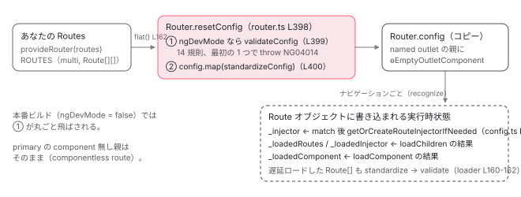

[目次](../README.md) › [Router の内側](README.md) › 第 4 回 / 全 21 回

# Route 設定の検証と正規化：validateConfig と EmptyOutletComponent

> アプリが渡した Routes に Router が最初にすること。validateNode が弾く組み合わせ（redirectTo と children など）、standardizeConfig が component の無い親に ɵEmptyOutletComponent を差し込む理由、route.providers が EnvironmentInjector になる場所。

angular/angular · 読了 約 12 分 · 中核 · [サイトで読む（デモが動きます）](https://angular-deep-dive-cyan.vercel.app/chapter/router-route-config)

---

`provideRouter(routes)` に渡した `Routes` 配列は、そのまま使われるわけではありません。`Router` が最初にすることは 2 つ、**検証**（`validateConfig`）と**正規化**（`standardizeConfig`）です。この章では、どの組み合わせがどの行で弾かれるか、`component` の無い親に何が差し込まれるか、`route.providers` がいつ `EnvironmentInjector` になるかを、行番号で確認します。

読む対象は `packages/router/src/utils/config.ts`、`components/empty_outlet.ts`、呼び出し側の `router.ts`（`resetConfig`）と `router_config_loader.ts`、そして `models.ts` の `Route` インターフェイスです。

1. 1 本の RxJS パイプライン
2. URL → UrlTree
3. routerLink の配列 → UrlTree
4. **Route 設定の検証と正規化**（この章）
5. provideRouter の中身
6. 最初のナビゲーション
7. navigateByUrl → NavigationTransition
8. setupNavigations の全段
9. Recognizer と match
10. redirectTo
11. loadChildren と loadComponent
12. ガードの実行順
13. resolve と data と title
14. ActivatedRoute と Snapshot
15. RouterOutlet への配置
16. ブラウザの URL と履歴
17. Router.events の全種類
18. RouterLink と RouterLinkActive
19. withViewTransitions
20. withRouterResources
21. Navigation API

## 1. Route インターフェイス：公開フィールドと \_ 付きフィールド

📄 `angular/packages/router/src/models.ts` L598–637 （▶ の行: 598, 606, 615, 637）

```ts
598 ▶ export interface Route {
599 │   /**
600 │    * Used to define a page title for the route. This can be a static string or an `Injectable` that
601 │    * implements `Resolve`.
602 │    *
603 │    * @see {@link TitleStrategy}
604 │    * @see [Page titles](guide/routing/define-routes#page-titles)
605 │    */
606 ▶   title?: string | Type<Resolve<string>> | ResolveFn<string>;
607 │ 
608 │   /**
609 │    * The path to match against. Cannot be used together with a custom `matcher` function.
610 │    * A URL string that uses router matching notation.
611 │    * Can be a wild card (`**`) that matches any URL (see Usage Notes below).
612 │    * Default is "/" (the root path).
613 │    *
614 │    */
615 ▶   path?: string;
616 │   /**
617 │    * The path-matching strategy, one of 'prefix' or 'full'.
618 │    * Default is 'prefix'.
619 │    *
620 │    * By default, the router checks URL elements from the left to see if the URL
621 │    * matches a given path and stops when there is a config match. Importantly there must still be a
622 │    * config match for each segment of the URL. For example, '/team/11/user' matches the prefix
623 │    * 'team/:id' if one of the route's children matches the segment 'user'. That is, the URL
624 │    * '/team/11/user' matches the config
625 │    * `{path: 'team/:id', children: [{path: ':user', component: User}]}`
626 │    * but does not match when there are no children as in `{path: 'team/:id', component: Team}`.
627 │    *
628 │    * The path-match strategy 'full' matches against the entire URL.
629 │    * It is important to do this when redirecting empty-path routes.
630 │    * Otherwise, because an empty path is a prefix of any URL,
631 │    * the router would apply the redirect even when navigating
632 │    * to the redirect destination, creating an endless loop.
633 │    *
634 │    * @see [Redirecting Routes](guide/routing/redirecting-routes)
635 │    *
636 │    */
637 ▶   pathMatch?: 'prefix' | 'full';
```

📄 `angular/packages/router/src/models.ts` L644–665 （▶ の行: 644, 649, 657, 665）

```ts
644 ▶   matcher?: UrlMatcher;
645 │   /**
646 │    * The component to instantiate when the path matches.
647 │    * Can be empty if child routes specify components.
648 │    */
649 ▶   component?: Type<any>;
650 │ 
651 │   /**
652 │    * An object specifying a lazy-loaded component.
653 │    *
654 │    * @see [Injection context lazy loading](guide/routing/loading-strategies)
655 │    *
656 │    */
657 ▶   loadComponent?: () =>
658 │     | Type<unknown>
659 │     | Observable<Type<unknown> | DefaultExport<Type<unknown>>>
660 │     | Promise<Type<unknown> | DefaultExport<Type<unknown>>>;
661 │   /**
662 │    * Filled for routes `loadComponent` once the component is loaded.
663 │    * @internal
664 │    */
665 ▶   _loadedComponent?: Type<unknown>;
```

📄 `angular/packages/router/src/models.ts` L805–831 （▶ の行: 807, 813, 819, 825, 830）

```ts
805 │    * @see [Route providers](guide/di/defining-dependency-providers#route-providers)
806 │    */
807 ▶   providers?: Array<Provider | EnvironmentProviders>;
808 │ 
809 │   /**
810 │    * Injector created from the static route providers
811 │    * @internal
812 │    */
813 ▶   _injector?: EnvironmentInjector;
814 │ 
815 │   /**
816 │    * Filled for routes with `loadChildren` once the routes are loaded.
817 │    * @internal
818 │    */
819 ▶   _loadedRoutes?: Route[];
820 │ 
821 │   /**
822 │    * Filled for routes with `loadChildren` once the routes are loaded
823 │    * @internal
824 │    */
825 ▶   _loadedInjector?: EnvironmentInjector;
826 │   /**
827 │    * Filled if loadChildren retruns a module factory
828 │    * @internal
829 │    */
830 ▶   _loadedNgModuleFactory?: NgModuleFactory<any>;
831 │ }
```

`Route` は 598 行目から 831 行目まで続く 1 つのインターフェイスです（ドキュメントコメントが大半なので 3 か所だけ抜きました）。615 行目 `path`、637 行目 `pathMatch`、644 行目 `matcher`、649 行目 `component`、657 行目 `loadComponent`、807 行目 `providers` はあなたが書くフィールドです。注目してほしいのは `_` で始まる 5 つ、665 行目 `_loadedComponent`、813 行目 `_injector`、819 行目 `_loadedRoutes`、825 行目 `_loadedInjector`、830 行目 `_loadedNgModuleFactory` です。**Router は実行時の状態を、あなたが渡した Route オブジェクトそのものに書き込みます**。「`loadChildren` の結果をどこに覚えているか」「`providers` から作ったインジェクタはどこにあるか」の答えは全部ここです（6 節）。

## 2. 誰がいつ検証するか：Router のコンストラクタ → resetConfig

📄 `angular/packages/router/src/router_config_loader.ts` L34–47 （▶ の行: 38）

```ts
34 │  * `provideRouter`, or `Router.resetConfig()`.
35 │  *
36 │  * @publicApi
37 │  */
38 ▶ export const ROUTES = new InjectionToken<Route[][]>(
39 │   typeof ngDevMode !== 'undefined' && ngDevMode ? 'ROUTES' : '',
40 │ );
41 │ 
42 │ @Service()
43 │ export class RouterConfigLoader {
44 │   private componentLoaders = new WeakMap<Route, Promise<Type<unknown>>>();
45 │   private childrenLoaders = new WeakMap<Route, Promise<LoadedRouterConfig>>();
46 │   onLoadStartListener?: (r: Route) => void;
47 │   onLoadEndListener?: (r: Route) => void;
```

📄 `angular/packages/router/src/router.ts` L160–170 （▶ の行: 162）

```ts
160 │   onSameUrlNavigation: OnSameUrlNavigation = this.options.onSameUrlNavigation || 'ignore';
161 │ 
162 ▶   config: Routes = inject(ROUTES, {optional: true})?.flat() ?? [];
163 │ 
164 │   /**
165 │    * Indicates whether the application has opted in to binding Router data to component inputs.
166 │    *
167 │    * This option is enabled by the `withComponentInputBinding` feature of `provideRouter` or
168 │    * `bindToComponentInputs` in the `ExtraOptions` of `RouterModule.forRoot`.
169 │    */
170 │   readonly componentInputBindingEnabled: boolean = !!inject(INPUT_BINDER, {optional: true});
```

📄 `angular/packages/router/src/router.ts` L179–190 （▶ の行: 180）

```ts
179 │   constructor() {
180 ▶     this.resetConfig(this.config);
181 │ 
182 │     this.navigationTransitions.setupNavigations(this).subscribe({
183 │       error: (e) => {
184 │         // Note: This subscription is not unsubscribed when the `Router` is destroyed.
185 │         // This is intentional as the `Router` is generally never destroyed.
186 │         // If it is destroyed, the `events` subject is completed, which cleans up this subscription.
187 │       },
188 │     });
189 │     this.subscribeToNavigationEvents();
190 │   }
```

📄 `angular/packages/router/src/router.ts` L382–402 （▶ の行: 398–401）

````ts
382 │   /**
383 │    * Resets the route configuration used for navigation and generating links.
384 │    *
385 │    * @param config The route array for the new configuration.
386 │    *
387 │    * @usageNotes
388 │    *
389 │    * ```ts
390 │    * router.resetConfig([
391 │    *  { path: 'team/:id', component: TeamCmp, children: [
392 │    *    { path: 'simple', component: SimpleCmp },
393 │    *    { path: 'user/:name', component: UserCmp }
394 │    *  ]}
395 │    * ]);
396 │    * ```
397 │    */
398 ▶   resetConfig(config: Routes): void {
399 ▶     (typeof ngDevMode === 'undefined' || ngDevMode) && validateConfig(config);
400 ▶     this.config = config.map(standardizeConfig);
401 ▶     this.navigated = false;
402 │   }
````

1. **38 行目：ROUTES は `Route[][]`**

   配列の配列です。`provideRouter` が `multi: true` で provide するので（[次章](05-router-provide-router.md)）、複数回 provide されても全部集まります。
2. **162 行目：inject して flat()**

   `Router` のフィールド初期化で `ROUTES` を取り出し、1 段平らにして `config` に入れます。この時点ではまだ生の配列です。
3. **180 行目：コンストラクタの最初の 1 行が resetConfig**

   `Router` が最初に new されるのは `APP_BOOTSTRAP_LISTENER` の中（[6 章](06-router-initial-navigation.md)）。そこで即座に検証と正規化が走ります。
4. **399 行目：検証は開発モードだけ**

   `ngDevMode` が偽（本番ビルド）なら `validateConfig` は**呼ばれません**。つまり 4 節のエラーは本番では出ず、壊れた設定はそのまま次の段（recognize）に進みます。開発中に 1 回は起動して確認する理由がここにあります。
5. **400 行目：正規化は常に**

   `config.map(standardizeConfig)`。元の配列は変更せず、コピーを `this.config` に入れます（5 節）。
6. **401 行目：navigated = false**

   設定が変わったので「まだ一度もナビゲーションしていない」状態に戻します。

📄 `angular/packages/router/src/router_config_loader.ts` L142–164 （▶ の行: 148–150, 158, 160–162）

```ts
142 │   // This injector comes from the `NgModuleRef` when lazy loading an `NgModule`. There is
143 │   // no injector associated with lazy loading a `Route` array.
144 │   let injector: EnvironmentInjector | undefined;
145 │   let rawRoutes: Route[];
146 │   let requireStandaloneComponents = false;
147 │   let factory: NgModuleFactory<unknown> | undefined = undefined;
148 ▶   if (Array.isArray(factoryOrRoutes)) {
149 ▶     rawRoutes = factoryOrRoutes;
150 ▶     requireStandaloneComponents = true;
151 │   } else {
152 │     injector = factoryOrRoutes.create(parentInjector).injector;
153 │     factory = factoryOrRoutes;
154 │     // When loading a module that doesn't provide `RouterModule.forChild()` preloader
155 │     // will get stuck in an infinite loop. The child module's Injector will look to
156 │     // its parent `Injector` when it doesn't find any ROUTES so it will return routes
157 │     // for it's parent module instead.
158 ▶     rawRoutes = injector.get(ROUTES, [], {optional: true, self: true}).flat();
159 │   }
160 ▶   const routes = rawRoutes.map(standardizeConfig);
161 ▶   (typeof ngDevMode === 'undefined' || ngDevMode) &&
162 ▶     validateConfig(routes, route.path, requireStandaloneComponents);
163 │   return {routes, injector, factory};
164 │ }
```

`loadChildren` で後から読み込まれた配列も同じ 2 つを通ります。`RouterConfigLoader` の 160 行目で `standardizeConfig`、161〜162 行目で `validateConfig`。こちらは順番が逆（正規化 → 検証）で、第 2 引数に親の `route.path`、第 3 引数に `requireStandaloneComponents` を渡します。148〜150 行目、読み込んだものが `Route[]`（NgModule ではない）なら `requireStandaloneComponents = true`。158 行目、NgModule なら そのモジュールのインジェクタから `ROUTES` を `self: true` で取ります（親に遡らない。コメント 154〜157 行目が理由）。

## 3. validateConfig：fullPath を組んで 1 件ずつ validateNode

📄 `angular/packages/router/src/utils/config.ts` L60–71 （▶ の行: 65–69）

```ts
60 │ export function validateConfig(
61 │   config: Routes,
62 │   parentPath: string = '',
63 │   requireStandaloneComponents = false,
64 │ ): void {
65 ▶   // forEach doesn't iterate undefined values
66 ▶   for (let i = 0; i < config.length; i++) {
67 ▶     const route: Route = config[i];
68 ▶     const fullPath: string = getFullPath(parentPath, route);
69 ▶     validateNode(route, fullPath, requireStandaloneComponents);
70 │   }
71 │ }
```

📄 `angular/packages/router/src/utils/config.ts` L213–226 （▶ の行: 214, 217, 219, 221, 224）

```ts
213 │ function getFullPath(parentPath: string, currentRoute: Route): string {
214 ▶   if (!currentRoute) {
215 │     return parentPath;
216 │   }
217 ▶   if (!parentPath && !currentRoute.path) {
218 │     return '';
219 ▶   } else if (parentPath && !currentRoute.path) {
220 │     return `${parentPath}/`;
221 ▶   } else if (!parentPath && currentRoute.path) {
222 │     return currentRoute.path;
223 │   } else {
224 ▶     return `${parentPath}/${currentRoute.path}`;
225 │   }
226 │ }
```

65〜66 行目、`forEach` ではなく `for` です。コメントどおり `forEach` は配列の穴（`[a, , b]`）を飛ばすので、「余分なカンマで `undefined` が入った」ことを検出するために添字で回しています。68 行目、`getFullPath` は**エラーメッセージ用**に親からの `path` を `/` でつないだ文字列を作るだけです（217〜224 行目の 4 分岐）。マッチングには使いません。69 行目で 1 件ずつ `validateNode` へ。

## 4. validateNode：14 の規則を上から順に

`validateNode` は 88〜211 行目の 1 関数で、`if` → `throw` が並んでいます。**最初に当たった 1 つだけ**が投げられます。全部 `NG04014`（`INVALID_ROUTE_CONFIG`）で、違いはメッセージだけです。4 つに分けて読みます。

📄 `angular/packages/router/src/utils/config.ts` L88–111 （▶ の行: 89–90, 106）

```ts
 88 │ function validateNode(route: Route, fullPath: string, requireStandaloneComponents: boolean): void {
 89 ▶   if (typeof ngDevMode === 'undefined' || ngDevMode) {
 90 ▶     if (!route) {
 91 │       throw new RuntimeError(
 92 │         RuntimeErrorCode.INVALID_ROUTE_CONFIG,
 93 │         `
 94 │       Invalid configuration of route '${fullPath}': Encountered undefined route.
 95 │       The reason might be an extra comma.
 96 │ 
 97 │       Example:
 98 │       const routes: Routes = [
 99 │         { path: '', redirectTo: '/dashboard', pathMatch: 'full' },
100 │         { path: 'dashboard',  component: DashboardComponent },, << two commas
101 │         { path: 'detail/:id', component: HeroDetailComponent }
102 │       ];
103 │     `,
104 │       );
105 │     }
106 ▶     if (Array.isArray(route)) {
107 │       throw new RuntimeError(
108 │         RuntimeErrorCode.INVALID_ROUTE_CONFIG,
109 │         `Invalid configuration of route '${fullPath}': Array cannot be specified`,
110 │       );
111 │     }
```

89 行目、ここから 207 行目まで全部 `ngDevMode` の中です。90 行目、`route` が `undefined`（余分なカンマ）。106 行目、要素が配列（`[[...]]` と書いた）。

📄 `angular/packages/router/src/utils/config.ts` L112–149 （▶ の行: 112–113, 118–119, 126, 132, 138, 144）

```ts
112 ▶     if (
113 ▶       !route.redirectTo &&
114 │       !route.component &&
115 │       !route.loadComponent &&
116 │       !route.children &&
117 │       !route.loadChildren &&
118 ▶       route.outlet &&
119 ▶       route.outlet !== PRIMARY_OUTLET
120 │     ) {
121 │       throw new RuntimeError(
122 │         RuntimeErrorCode.INVALID_ROUTE_CONFIG,
123 │         `Invalid configuration of route '${fullPath}': a componentless route without children or loadChildren cannot have a named outlet set`,
124 │       );
125 │     }
126 ▶     if (route.redirectTo && route.children) {
127 │       throw new RuntimeError(
128 │         RuntimeErrorCode.INVALID_ROUTE_CONFIG,
129 │         `Invalid configuration of route '${fullPath}': redirectTo and children cannot be used together`,
130 │       );
131 │     }
132 ▶     if (route.redirectTo && route.loadChildren) {
133 │       throw new RuntimeError(
134 │         RuntimeErrorCode.INVALID_ROUTE_CONFIG,
135 │         `Invalid configuration of route '${fullPath}': redirectTo and loadChildren cannot be used together`,
136 │       );
137 │     }
138 ▶     if (route.children && route.loadChildren) {
139 │       throw new RuntimeError(
140 │         RuntimeErrorCode.INVALID_ROUTE_CONFIG,
141 │         `Invalid configuration of route '${fullPath}': children and loadChildren cannot be used together`,
142 │       );
143 │     }
144 ▶     if (route.component && route.loadComponent) {
145 │       throw new RuntimeError(
146 │         RuntimeErrorCode.INVALID_ROUTE_CONFIG,
147 │         `Invalid configuration of route '${fullPath}': component and loadComponent cannot be used together`,
148 │       );
149 │     }
```

112〜119 行目、`component` も `children` も何も無いのに `outlet` が `primary` 以外（描く場所だけ指定されて中身が無い）。126 行目 `redirectTo` と `children`、132 行目 `redirectTo` と `loadChildren`、138 行目 `children` と `loadChildren`、144 行目 `component` と `loadComponent`。どれも「2 つ書いたらどちらを使うか決められない」組み合わせです。

📄 `angular/packages/router/src/utils/config.ts` L150–172 （▶ の行: 151–152, 158, 161–162, 167）

```ts
150 │ 
151 ▶     if (route.redirectTo) {
152 ▶       if (route.component || route.loadComponent) {
153 │         throw new RuntimeError(
154 │           RuntimeErrorCode.INVALID_ROUTE_CONFIG,
155 │           `Invalid configuration of route '${fullPath}': redirectTo and component/loadComponent cannot be used together`,
156 │         );
157 │       }
158 ▶       if (route.canMatch || route.canActivate) {
159 │         throw new RuntimeError(
160 │           RuntimeErrorCode.INVALID_ROUTE_CONFIG,
161 ▶           `Invalid configuration of route '${fullPath}': redirectTo and ${route.canMatch ? 'canMatch' : 'canActivate'} cannot be used together.` +
162 ▶             `Redirects happen before guards are executed.`,
163 │         );
164 │       }
165 │     }
166 │ 
167 ▶     if (route.path && route.matcher) {
168 │       throw new RuntimeError(
169 │         RuntimeErrorCode.INVALID_ROUTE_CONFIG,
170 │         `Invalid configuration of route '${fullPath}': path and matcher cannot be used together`,
171 │       );
172 │     }
```

151〜164 行目は `redirectTo` があるときの追加規則。152 行目、`component` / `loadComponent` と同時はだめ。158 行目、`canMatch` / `canActivate` と同時もだめで、理由が 162 行目に書かれています。**リダイレクトはガードより前に処理される**ので、ガードを書いても絶対に走らないからです（[10 章](10-router-redirects.md)）。167 行目、`path` と `matcher` の同時指定。

📄 `angular/packages/router/src/utils/config.ts` L173–211 （▶ の行: 173–174, 185, 191, 197–198, 204–205, 208–209）

```ts
173 ▶     if (
174 ▶       route.redirectTo === void 0 &&
175 │       !route.component &&
176 │       !route.loadComponent &&
177 │       !route.children &&
178 │       !route.loadChildren
179 │     ) {
180 │       throw new RuntimeError(
181 │         RuntimeErrorCode.INVALID_ROUTE_CONFIG,
182 │         `Invalid configuration of route '${fullPath}'. One of the following must be provided: component, loadComponent, redirectTo, children or loadChildren`,
183 │       );
184 │     }
185 ▶     if (route.path === void 0 && route.matcher === void 0) {
186 │       throw new RuntimeError(
187 │         RuntimeErrorCode.INVALID_ROUTE_CONFIG,
188 │         `Invalid configuration of route '${fullPath}': routes must have either a path or a matcher specified`,
189 │       );
190 │     }
191 ▶     if (typeof route.path === 'string' && route.path.charAt(0) === '/') {
192 │       throw new RuntimeError(
193 │         RuntimeErrorCode.INVALID_ROUTE_CONFIG,
194 │         `Invalid configuration of route '${fullPath}': path cannot start with a slash`,
195 │       );
196 │     }
197 ▶     if (route.path === '' && route.redirectTo !== void 0 && route.pathMatch === void 0) {
198 ▶       const exp = `The default value of 'pathMatch' is 'prefix', but often the intent is to use 'full'.`;
199 │       throw new RuntimeError(
200 │         RuntimeErrorCode.INVALID_ROUTE_CONFIG,
201 │         `Invalid configuration of route '{path: "${fullPath}", redirectTo: "${route.redirectTo}"}': please provide 'pathMatch'. ${exp}`,
202 │       );
203 │     }
204 ▶     if (requireStandaloneComponents) {
205 ▶       assertStandalone(fullPath, route.component);
206 │     }
207 │   }
208 ▶   if (route.children) {
209 ▶     validateConfig(route.children, fullPath, requireStandaloneComponents);
210 │   }
211 │ }
```

173〜178 行目、`redirectTo` も `component` も `loadComponent` も `children` も `loadChildren` も無い（何をするか書いていない）。174 行目は `!route.redirectTo` ではなく `=== void 0` なので、`redirectTo: ''`（空文字へのリダイレクト）は「指定あり」として通ります（113 行目の `!route.redirectTo` とは条件が違います）。185 行目、`path` も `matcher` も無い。191 行目、`path` が `/` で始まる。197〜198 行目、`path: ''` に `redirectTo` があって `pathMatch` を書いていない。198 行目のメッセージどおり既定は `'prefix'` で、空文字は**どんな URL にも前方一致**するので、意図せずすべての URL がリダイレクト対象になります。だから明示を強制しています。204〜205 行目、2 節の `requireStandaloneComponents` が真なら `assertStandalone`。208〜209 行目、`children` があれば `fullPath` を親として再帰します。これは `ngDevMode` ブロックの外なので常に走ります。

📄 `angular/packages/router/src/utils/config.ts` L73–86 （▶ の行: 74, 80）

```ts
73 │ export function assertStandalone(fullPath: string, component: Type<unknown> | undefined): void {
74 ▶   if (component && isNgModule(component)) {
75 │     throw new RuntimeError(
76 │       RuntimeErrorCode.INVALID_ROUTE_CONFIG,
77 │       `Invalid configuration of route '${fullPath}'. You are using 'loadComponent' with a module, ` +
78 │         `but it must be used with standalone components. Use 'loadChildren' instead.`,
79 │     );
80 ▶   } else if (component && !isStandalone(component)) {
81 │     throw new RuntimeError(
82 │       RuntimeErrorCode.INVALID_ROUTE_CONFIG,
83 │       `Invalid configuration of route '${fullPath}'. The component must be standalone.`,
84 │     );
85 │   }
86 │ }
```

74 行目、`loadComponent` の結果が NgModule なら「`loadChildren` を使え」。80 行目、standalone でないコンポーネントなら「standalone にせよ」。この 2 つは `Route[]` を遅延ロードしたときだけ（2 節 150 行目）適用されます。

| # | 行 | 弾かれる組み合わせ | メッセージの要点 |
| --- | --- | --- | --- |
| 1 | 90 | `route` が `undefined` | Encountered undefined route（余分なカンマ） |
| 2 | 106 | `route` が配列 | Array cannot be specified |
| 3 | 112 | 中身ゼロ + 名前付き `outlet` | componentless route without children … cannot have a named outlet |
| 4 | 126 | `redirectTo` + `children` | redirectTo and children cannot be used together |
| 5 | 132 | `redirectTo` + `loadChildren` | redirectTo and loadChildren … |
| 6 | 138 | `children` + `loadChildren` | children and loadChildren … |
| 7 | 144 | `component` + `loadComponent` | component and loadComponent … |
| 8 | 152 | `redirectTo` + `component`/`loadComponent` | redirectTo and component/loadComponent … |
| 9 | 158 | `redirectTo` + `canMatch`/`canActivate` | Redirects happen before guards are executed |
| 10 | 167 | `path` + `matcher` | path and matcher … |
| 11 | 173 | 何をするかが 1 つも無い | One of the following must be provided: … |
| 12 | 185 | `path` も `matcher` も無い | routes must have either a path or a matcher |
| 13 | 191 | `path` が `/` 始まり | path cannot start with a slash |
| 14 | 197 | `path: ''` + `redirectTo`、`pathMatch` 無し | please provide 'pathMatch' |
| + | 204 → 74 / 80 | 遅延 `Route[]` 内の非 standalone / NgModule | must be standalone / Use 'loadChildren' instead |

> [!TIP]
> **新卒エンジニアへ**
>
> `canActivateChild` や `canDeactivate`、`resolve`、`data` と `redirectTo` の同時指定は**弾かれません**（158 行目の条件に無い）。書いても実行されないだけです。同僚に「`redirectTo` に `resolve` を付けたけど動かない」と聞かれたら、162 行目の「リダイレクトはガードより前」を根拠に、resolver はさらにその後だと答えられます。

## 5. standardizeConfig：component の無い親に ɵEmptyOutletComponent

📄 `angular/packages/router/src/components/empty_outlet.ts` L34–50 （▶ の行: 37–45, 47, 49）

```ts
34 │ /**
35 │  * Makes a copy of the config and adds any default required properties.
36 │  */
37 ▶ export function standardizeConfig(r: Route): Route {
38 ▶   const children = r.children && r.children.map(standardizeConfig);
39 ▶   const c = children ? {...r, children} : {...r};
40 ▶   if (
41 ▶     !c.component &&
42 ▶     !c.loadComponent &&
43 ▶     (children || c.loadChildren) &&
44 ▶     c.outlet &&
45 ▶     c.outlet !== PRIMARY_OUTLET
46 │   ) {
47 ▶     c.component = ɵEmptyOutletComponent;
48 │   }
49 ▶   return c;
50 │ }
```

1. **38 行目：children を先に再帰**

   子から順に正規化し、39 行目でスプレッドのコピーを作ります。**あなたの配列は変更されません**。`Router.config` はコピーのほうです。
2. **40〜45 行目：4 条件すべて**

   `component` が無い、`loadComponent` が無い、`children` か `loadChildren` がある、**`outlet` が指定されていて `primary` ではない**。
3. **47 行目：component = ɵEmptyOutletComponent**

   名前付きアウトレットの親で、自分では何も描かないものにだけ、空のコンポーネントが差し込まれます。

📄 `angular/packages/router/src/components/empty_outlet.ts` L16–32 （▶ の行: 20, 26–27, 30, 32）

```ts
16 │ /**
17 │  * This component is used internally within the router to be a placeholder when an empty
18 │  * router-outlet is needed. For example, with a config such as:
19 │  *
20 ▶  * `{path: 'parent', outlet: 'nav', children: [...]}`
21 │  *
22 │  * In order to render, there needs to be a component on this config, which will default
23 │  * to this `EmptyOutletComponent`.
24 │  */
25 │ @Component({
26 ▶   template: `<router-outlet />`,
27 ▶   imports: [RouterOutlet],
28 │   // Used to avoid component ID collisions with user code.
29 │   exportAs: 'emptyRouterOutlet',
30 ▶   changeDetection: ChangeDetectionStrategy.Eager,
31 │ })
32 ▶ export class ɵEmptyOutletComponent {}
```

26 行目、テンプレートは `<router-outlet />` 1 つだけ。30 行目、`changeDetection: Eager`（既定の OnPush ではなく、常に子を検査する側）です。20 行目のコメントが理由を言っています。`{path: 'parent', outlet: 'nav', children: [...]}` という設定で `children` を描くには、**`nav` アウトレットに何かコンポーネントを置き、その中に `<router-outlet>` が無いと子の置き場所が無い**。その「何か」がこのコンポーネントです。

> [!NOTE]
> **ポイント**
>
> では `outlet` を書かない（`primary` の）`component` 無しの親はどうなるか。40〜45 行目の条件を満たさないので**そのまま `component` 無し**です。これを Router は「componentless route」と呼び、子は**親と同じアウトレットの表に**置かれます。

📄 `angular/packages/router/src/operators/activate_routes.ts` L169–188 （▶ の行: 180–181, 183–187）

```ts
169 │   private activateRoutes(
170 │     futureNode: TreeNode<ActivatedRoute>,
171 │     currNode: TreeNode<ActivatedRoute>,
172 │     parentContexts: ChildrenOutletContexts,
173 │   ): void {
174 │     const future = futureNode.value;
175 │     const curr = currNode ? currNode.value : null;
176 │ 
177 │     advanceActivatedRoute(future);
178 │ 
179 │     // reusing the node
180 ▶     if (future === curr) {
181 ▶       if (future.component) {
182 │         // If we have a normal route, we need to go through an outlet.
183 ▶         const context = parentContexts.getOrCreateContext(future.outlet);
184 ▶         this.activateChildRoutes(futureNode, currNode, context.children);
185 ▶       } else {
186 ▶         // if we have a componentless route, we recurse but keep the same outlet map.
187 ▶         this.activateChildRoutes(futureNode, currNode, parentContexts);
188 │       }
```

`ActivateRoutes.activateRoutes`（[15 章](15-router-activate-routes.md)）の抜粋です。181〜184 行目、`component` があればそのアウトレットの `context.children`（1 段下の表）に子を置きます。185〜187 行目、**無ければ `parentContexts`（親と同じ表）をそのまま渡して再帰**します。だから `{path: 'admin', canActivate: [...], children: [...]}` のようにガードや `providers` をまとめるためだけの親は、DOM に何も足さず、子が親の `<router-outlet>` に直接描かれます。`primary` なら「置き場所」は親コンポーネントの outlet で既にあるので、空コンポーネントが要らないのです。

## 6. route.providers → EnvironmentInjector になる場所

📄 `angular/packages/router/src/utils/config.ts` L23–43 （▶ の行: 35–39, 42）

```ts
23 │ /**
24 │  * Creates an `EnvironmentInjector` if the `Route` has providers and one does not already exist
25 │  * and returns the injector. Otherwise, if the `Route` does not have `providers`, returns the
26 │  * `currentInjector`.
27 │  *
28 │  * @param route The route that might have providers
29 │  * @param currentInjector The parent injector of the `Route`
30 │  */
31 │ export function getOrCreateRouteInjectorIfNeeded(
32 │   route: Route,
33 │   currentInjector: EnvironmentInjector,
34 │ ): EnvironmentInjector {
35 ▶   if (route.providers && !route._injector) {
36 ▶     route._injector = createEnvironmentInjector(
37 ▶       route.providers,
38 ▶       currentInjector,
39 ▶       `Route: ${route.path}`,
40 │     );
41 │   }
42 ▶   return route._injector ?? currentInjector;
43 │ }
```

📄 `angular/packages/router/src/utils/config_matching.ts` L62–80 （▶ の行: 63–64, 69–72）

```ts
62 │ ): Observable<MatchResult> {
63 ▶   const result = match(segmentGroup, route, segments);
64 ▶   if (!result.matched) {
65 │     return of(result);
66 │   }
67 │ 
68 │   const currentSnapshot = createPreMatchRouteSnapshot(createSnapshot(result));
69 ▶   // Only create the Route's `EnvironmentInjector` if it matches the attempted
70 ▶   // navigation
71 ▶   injector = getOrCreateRouteInjectorIfNeeded(route, injector);
72 ▶   return runCanMatchGuards(
73 │     injector,
74 │     route,
75 │     segments,
76 │     urlSerializer,
77 │     currentSnapshot,
78 │     abortSignal,
79 │   ).pipe(map((v) => (v === true ? result : {...noMatch})));
80 │ }
```

1. **63〜64 行目：まず path のマッチ**

   `match`（[9 章](09-router-recognize.md)）が通らなければ 65 行目で終わり。インジェクタは作られません。
2. **69〜71 行目：マッチした Route だけインジェクタを作る**

   コメントどおり「ナビゲーション先に一致したときだけ」。`resetConfig` の時点では**作られていません**。35 行目、`providers` があり `_injector` がまだ無いときだけ、36〜40 行目で `createEnvironmentInjector(route.providers, currentInjector, 'Route: path')`。親は `currentInjector`（その時点のインジェクタ。遅延ロードされたモジュールのものか、アプリの `EnvironmentInjector`）です。結果は 1 節で見た `route._injector` に保存され、2 回目以降は 42 行目で再利用されます。
3. **72 行目：そのインジェクタで canMatch を実行**

   `canMatch` ガードは `route.providers` の中身を `inject` できる、ということです。

📄 `angular/packages/router/src/utils/config.ts` L45–58 （▶ の行: 46, 50, 53, 57）

```ts
45 │ export function getLoadedRoutes(route: Route): Route[] | undefined {
46 ▶   return route._loadedRoutes;
47 │ }
48 │ 
49 │ export function getLoadedInjector(route: Route): EnvironmentInjector | undefined {
50 ▶   return route._loadedInjector;
51 │ }
52 │ export function getLoadedComponent(route: Route): Type<unknown> | undefined {
53 ▶   return route._loadedComponent;
54 │ }
55 │ 
56 │ export function getProvidersInjector(route: Route): EnvironmentInjector | undefined {
57 ▶   return route._injector;
58 │ }
```

46・50・53・57 行目、`_` 付きフィールドを読むだけの小さな関数です。他のファイルは直接 `route._loadedRoutes` と書かず、これらを通します。`_loadedRoutes` / `_loadedInjector` / `_loadedComponent` を書き込むのは `RouterConfigLoader`（[11 章](11-router-lazy-loading.md)）、`_injector` を書き込むのは上の 36 行目だけです。`withAutoCleanupInjectors`（[次章](05-router-provide-router.md)）はこの `_injector` を破棄して `undefined` に戻します。



*あなたが書いた Routes から Router.config ができ、実行時に Route オブジェクトへ \_injector / \_loadedRoutes が書き込まれていく。*

## 7. getOutlet と sortByMatchingOutlets

📄 `angular/packages/router/src/utils/config.ts` L228–241 （▶ の行: 230, 238–239）

```ts
228 │ /** Returns the `route.outlet` or PRIMARY_OUTLET if none exists. */
229 │ export function getOutlet(route: Route): string {
230 ▶   return route.outlet || PRIMARY_OUTLET;
231 │ }
232 │ 
233 │ /**
234 │  * Sorts the `routes` such that the ones with an outlet matching `outletName` come first.
235 │  * The order of the configs is otherwise preserved.
236 │  */
237 │ export function sortByMatchingOutlets(routes: Routes, outletName: string): Routes {
238 ▶   const sortedConfig = routes.filter((r) => getOutlet(r) === outletName);
239 ▶   sortedConfig.push(...routes.filter((r) => getOutlet(r) !== outletName));
240 │   return sortedConfig;
241 │ }
```

230 行目、`outlet` を省いた Route は `'primary'` として扱われます。`standardizeConfig` は `outlet` を補いません（`c.outlet` は `undefined` のまま）。必要な場所がこの `getOutlet` で読み替えます。238〜239 行目、`sortByMatchingOutlets` は「探しているアウトレット名の Route を前に、それ以外を後ろに」並べ替えるだけで、**それ以外の順序はあなたが書いた順**です。Route は上から順に試されるという前提は、ここで崩れません（[9 章](09-router-recognize.md)）。

> **🧪 DEMO — Routes を validateNode の規則に順に通す**
>
> `component` / `loadComponent` / `loadChildren` はクラスや関数を JSON に書けないので、名前の文字列があれば「指定あり」として扱います。規則は 4 節の 14 個を `if` の順に適用し、最初に当たった行番号を出します。例外が出なければ `standardizeConfig` の結果（何が差し込まれるか）も出します。`assertStandalone`（204 行目）はクラスが無いので省いています。
>
> ▶ [このデモはサイトで動かせます](https://angular-deep-dive-cyan.vercel.app/chapter/router-route-config)

## ここまでの呼び出し

- 👤 `provideRouter(routes)` — src/app/app.config.ts — *{provide: ROUTES, multi: true, useValue: routes}*
  - `injector.get(Router)` — provide\_router.ts L283（APP\_BOOTSTRAP\_LISTENER） — *ここで初めて Router が new される*
    - `config = inject(ROUTES).flat()` — router.ts L162
    - `new Router()` → `this.resetConfig(this.config)` — router.ts L180
      - `validateConfig(config)`（ngDevMode のみ） — utils/config.ts L60
        - `getFullPath(parentPath, route)` → `validateNode(route, fullPath, false)` — L68-69 — *14 規則。children があれば L209 で validateConfig を再帰*
      - `config.map(standardizeConfig)` — router.ts L400
        - `standardizeConfig(r)` — components/empty\_outlet.ts L37 — *children を再帰 → コピー → 名前付き outlet の親に ɵEmptyOutletComponent*
  - （ナビゲーションごと）`matchWithChecks(...)` — utils/config\_matching.ts L54
    - `match(segmentGroup, route, segments)` — L63
    - `getOrCreateRouteInjectorIfNeeded(route, injector)` — utils/config.ts L31 — *route.providers → createEnvironmentInjector → route.\_injector*
  - （loadChildren のとき）`RouterConfigLoader.loadChildren` → `rawRoutes.map(standardizeConfig)` → `validateConfig(routes, route.path, requireStandalone)` — router\_config\_loader.ts L160-162

## 聞かれそうな質問

**Q. `children` があって `component` が無い Route は、実行時にはどんな Route になっていますか？**

`outlet` によって 2 通りです。`outlet` が `primary` 以外なら `standardizeConfig` の 40〜47 行目（empty\_outlet.ts）で `component = ɵEmptyOutletComponent`（テンプレートは `<router-outlet />` だけ、26 行目）が差し込まれます。`outlet` を書いていない（`primary`）なら条件 44〜45 行目を満たさず、`component` 無しのままです。その場合 `ActivateRoutes.activateRoutes` の 185〜187 行目で親と同じ `parentContexts` を使って子を配置するので、子は親コンポーネントの `<router-outlet>` に直接描かれます。

**Q. `redirectTo` と `children` を同時に書くとどのエラーが出ますか？何行目の規則ですか？**

utils/config.ts 126 行目の `if (route.redirectTo && route.children)` で `NG04014`、メッセージは「Invalid configuration of route '…': redirectTo and children cannot be used together」です。`validateNode` は上から順に見て最初の 1 つで投げるので、同じ Route に他の問題（たとえば 191 行目の `/` 始まり）があってもこれだけが出ます。開発モード限定（router.ts 399 行目）で、本番ビルドでは検証されません。

**Q. `{path: '', redirectTo: '/home'}` がエラーになるのはなぜですか？**

197 行目の規則です。`pathMatch` の既定は `'prefix'`（`Route.pathMatch` の定義は models.ts 637 行目、既定値はこの規則のメッセージ 198 行目に書かれています）で、空文字はどんな URL にも前方一致します。そのまま許すと `/home` を含むすべての URL がこの Route に一致してしまうので、`pathMatch: 'full'`（URL 全体が空のときだけ一致）を明示させています。

**Q. 検証は本番でも走りますか？**

走りません。router.ts 399 行目 `(typeof ngDevMode === 'undefined' || ngDevMode) && validateConfig(config)` と、`validateNode` の中身全体を包む utils/config.ts 89 行目の `if` の 2 重で守られています。208〜209 行目の `children` への再帰だけは `if` の外ですが、中で何もしないので実害はありません。`standardizeConfig`（400 行目）は本番でも走ります。

**Q. `route.providers` のインジェクタはいつ作られますか？`resetConfig` のときですか？**

違います。ナビゲーションで**その Route が URL にマッチした直後**です。utils/config\_matching.ts 63 行目で `match`、71 行目で `getOrCreateRouteInjectorIfNeeded`。中では utils/config.ts 35 行目で `providers` があって `_injector` が無いときだけ 36 行目の `createEnvironmentInjector` を呼び、`route._injector`（models.ts 813 行目）に保存します。2 回目以降は 42 行目で保存済みのものを返します。マッチしない Route のインジェクタは作られません。

**Q. 遅延ロードした子の `Routes` は検証されますか？**

されます。router\_config\_loader.ts 160〜162 行目で、読み込んだ配列を `standardizeConfig` してから `validateConfig(routes, route.path, requireStandaloneComponents)`。`Route[]` を直接ロードしたとき（148〜150 行目）は第 3 引数が `true` になり、utils/config.ts 204〜205 行目から `assertStandalone`（74・80 行目）も追加で走ります。エラーメッセージの `fullPath` は親の `route.path` から始まります。

## 読み終えて

- `Router` のコンストラクタ（router.ts 180 行目）→ `resetConfig`（398 行目）。開発モードだけ `validateConfig`、常に `config.map(standardizeConfig)`
- `validateNode`（utils/config.ts 88〜211 行目）は 14 の `if` を上から順に試し、最初の 1 つで `NG04014`。`children` は 209 行目で再帰
- `standardizeConfig` は**名前付き outlet** の `component` 無し親にだけ `ɵEmptyOutletComponent`（`<router-outlet />`）を差し込む。`primary` の親は componentless のまま、子は親の outlet 表を共有する
- `route.providers` は `resetConfig` では何もされず、URL にマッチした直後に `getOrCreateRouteInjectorIfNeeded`（36 行目）が `EnvironmentInjector` を作って `route._injector` に保存する
- `Route` オブジェクトの `_` 付きフィールド（models.ts 813〜830 行目）が、Router の実行時状態の置き場所

---

← 前: [routerLink の配列が UrlTree になるまで：createUrlTree と「..」の解決](03-router-create-url-tree.md)  
次: [provideRouter が provide するもの：ROUTES・Router・各 withX の中身](05-router-provide-router.md) →
