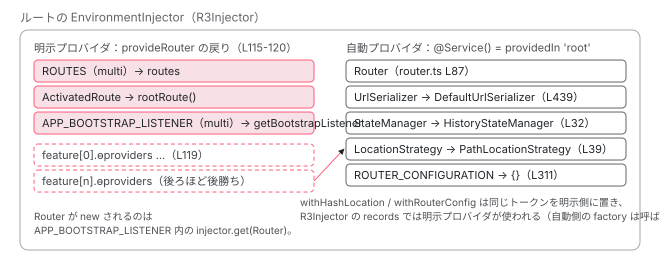

[目次](../README.md) › [Router の内側](README.md) › 第 5 回 / 全 21 回

# provideRouter が provide するもの：ROUTES・Router・各 withX の中身

> provideRouter(routes, ...features) が返す EnvironmentProviders の全要素。routerFeature がどう provider 配列を包むか、withRouterConfig / withPreloading / withHashLocation / withComponentInputBinding がそれぞれ何を上書きするか。ROUTER\_CONFIGURATION の既定値。

angular/angular · 読了 約 13 分 · 中核 · [サイトで読む（デモが動きます）](https://angular-deep-dive-cyan.vercel.app/chapter/router-provide-router)

---

`provideRouter(routes, withInMemoryScrolling())` と書くと Router が動き出します。この 1 行が**何を provide しているのか**を全部数えると、意外なことが分かります。`Router` も `UrlSerializer` も `StateManager` も、`provideRouter` の中には**出てきません**。この章では `provideRouter` が実際に返す 3 つのプロバイダ、各 `withX` が足す（または上書きする）トークン、そして provide されていないサービスがどこから来るのかを、行番号で確認します。

読む対象は `packages/router/src/provide_router.ts`、`router_module.ts`（比較用）、`router_config.ts`、そして `@Service` の定義 `packages/core/src/di/service.ts` です。

1. 1 本の RxJS パイプライン
2. URL → UrlTree
3. routerLink の配列 → UrlTree
4. Route 設定の検証と正規化
5. **provideRouter の中身**（この章）
6. 最初のナビゲーション
7. navigateByUrl → NavigationTransition
8. setupNavigations の全段
9. Recognizer と match
10. redirectTo
11. loadChildren と loadComponent
12. ガードの実行順
13. resolve と data と title
14. ActivatedRoute と Snapshot
15. RouterOutlet への配置
16. ブラウザの URL と履歴
17. Router.events の全種類
18. RouterLink と RouterLinkActive
19. withViewTransitions
20. withRouterResources
21. Navigation API

## 1. provideRouter が返すのは 3 つ + features

読者のアプリの例として、このサイト自身の `app.config.ts` を置いておきます。

📄 `src/app/app.config.ts`

```ts
export const appConfig: ApplicationConfig = {
  providers: [
    provideBrowserGlobalErrorListeners(),
    provideRouter(
      routes,
      withInMemoryScrolling({
        scrollPositionRestoration: 'enabled',
        anchorScrolling: 'enabled',
      }),
    ),
    provideClientHydration(),
  ],
};
```
*このサイトの設定。feature は withInMemoryScrolling の 1 つだけ。*

📄 `angular/packages/router/src/provide_router.ts` L107–121 （▶ の行: 107–108, 110–112, 115–119）

```ts
107 ▶ export function provideRouter(routes: Routes, ...features: RouterFeatures[]): EnvironmentProviders {
108 ▶   if (typeof ngDevMode === 'undefined' || ngDevMode) {
109 │     // Publish this util when the router is provided so that the devtools can use it.
110 ▶     ɵpublishNonCoreGlobalUtil('ɵgetLoadedRoutes', getLoadedRoutes);
111 ▶     ɵpublishNonCoreGlobalUtil('ɵgetRouterInstance', getRouterInstance);
112 ▶     ɵpublishNonCoreGlobalUtil('ɵnavigateByUrl', navigateByUrl);
113 │   }
114 │ 
115 ▶   return makeEnvironmentProviders([
116 ▶     {provide: ROUTES, multi: true, useValue: routes},
117 ▶     {provide: ActivatedRoute, useFactory: rootRoute},
118 ▶     {provide: APP_BOOTSTRAP_LISTENER, multi: true, useFactory: getBootstrapListener},
119 ▶     features.map((feature) => feature.ɵproviders),
120 │   ]);
121 │ }
```

1. **108〜112 行目：開発モードだけ、devtools 用の関数を window に公開**

   `ɵgetLoadedRoutes` など 3 つ。Angular DevTools がルーティング木を表示するために使います。provide とは無関係です。
2. **116 行目：ROUTES（multi）**

   `{provide: ROUTES, multi: true, useValue: routes}`。`multi` なので `Route[][]` になり、`Router` が `flat()` します（[前章](04-router-route-config.md)の 162 行目）。
3. **117 行目：ActivatedRoute（根）**

   `useFactory: rootRoute`。下の 124 行目、`inject(Router).routerState.root` を返します。`RouterOutlet` の外（`App` コンポーネントなど）で `inject(ActivatedRoute)` すると根が返るのはこの 1 行です。アウトレットの中では `OutletInjector` が自分の `ActivatedRoute` で上書きします（[クリックからの trace](../boot/13-boot-spa-navigation.md)の 5 節）。
4. **118 行目：APP\_BOOTSTRAP\_LISTENER（multi）**

   `useFactory: getBootstrapListener`。最初のコンポーネントが描かれた直後に呼ばれます。中身は [次章](06-router-initial-navigation.md)で読むので、ここでは「283 行目の `injector.get(Router)` で Router が生まれ、286〜288 行目で既定なら `initialNavigation()`、290〜291 行目で `ROUTER_PRELOADER` と `ROUTER_SCROLLER` を `optional` に取る」ことだけ押さえます。5 節の feature がこの 3 か所に効きます。
5. **119 行目：features の ɵproviders を順番に**

   `features.map((feature) => feature.ɵproviders)`。あなたが引数に並べた順に、後ろへ追加されます。
6. **115 行目：makeEnvironmentProviders で包む**

   戻り値の型は `EnvironmentProviders`。`@Component` の `providers` に入れるとコンパイルエラーになり、`bootstrapApplication` や `Route.providers` などの環境インジェクタにしか置けません（[DI の章](../di/10-di.md)）。

📄 `angular/packages/router/src/provide_router.ts` L274–299 （▶ の行: 283, 286–287, 290–291）

```ts
274 │ export function getBootstrapListener() {
275 │   const injector = inject(Injector);
276 │   return (bootstrappedComponentRef: ComponentRef<unknown>) => {
277 │     const ref = injector.get(ApplicationRef);
278 │ 
279 │     if (bootstrappedComponentRef !== ref.components[0]) {
280 │       return;
281 │     }
282 │ 
283 ▶     const router = injector.get(Router);
284 │     const bootstrapDone = injector.get(BOOTSTRAP_DONE);
285 │ 
286 ▶     if (injector.get(INITIAL_NAVIGATION) === InitialNavigation.EnabledNonBlocking) {
287 ▶       router.initialNavigation();
288 │     }
289 │ 
290 ▶     injector.get(ROUTER_PRELOADER, null, {optional: true})?.setUpPreloading();
291 ▶     injector.get(ROUTER_SCROLLER, null, {optional: true})?.init();
292 │     router.resetRootComponentType(ref.componentTypes[0]);
293 │     if (!bootstrapDone.closed) {
294 │       bootstrapDone.next();
295 │       bootstrapDone.complete();
296 │       bootstrapDone.unsubscribe();
297 │     }
298 │   };
299 │ }
```
*118 行目で登録される関数。詳細は次章。*

📄 `angular/packages/router/src/provide_router.ts` L123–145 （▶ の行: 123–124, 132–134, 140, 144）

```ts
123 ▶ export function rootRoute(): ActivatedRoute {
124 ▶   return inject(Router).routerState.root;
125 │ }
126 │ 
127 │ /**
128 │  * Helper type to represent a Router feature.
129 │  *
130 │  * @publicApi
131 │  */
132 ▶ export interface RouterFeature<FeatureKind extends RouterFeatureKind> {
133 ▶   ɵkind: FeatureKind;
134 ▶   ɵproviders: Array<Provider | EnvironmentProviders>;
135 │ }
136 │ 
137 │ /**
138 │  * Helper function to create an object that represents a Router feature.
139 │  */
140 ▶ function routerFeature<FeatureKind extends RouterFeatureKind>(
141 │   kind: FeatureKind,
142 │   providers: Array<Provider | EnvironmentProviders>,
143 │ ): RouterFeature<FeatureKind> {
144 ▶   return {ɵkind: kind, ɵproviders: providers};
145 │ }
```

132〜134 行目、`RouterFeature` は `ɵkind` と `ɵproviders` の 2 フィールドだけのオブジェクトです。140〜144 行目の `routerFeature` がそれを作ります。すべての `withX` は**「プロバイダ配列に名前を付けたもの」**を返しているだけで、`provideRouter` はその配列を取り出して並べます（119 行目）。`ɵkind` を読むコードは `packages/router/src` に 1 つも無く、`RouterFeatures` 型の判別にだけ使われています。

## 2. provide されていない Router はどこから来るのか

1 節の一覧に `Router` はありません。それでも `APP_BOOTSTRAP_LISTENER` の中の `injector.get(Router)` は成功します。比較のために、NgModule 時代の `RouterModule.forRoot` が使う配列を見ます。

📄 `angular/packages/router/src/router_module.ts` L64–75 （▶ の行: 64–65, 68–74）

```ts
64 ▶ // TODO(atscott): All of these except `ActivatedRoute` are `providedIn: 'root'`. They are only kept
65 ▶ // here to avoid a breaking change whereby the provider order matters based on where the
66 │ // `RouterModule`/`RouterTestingModule` is imported. These can/should be removed as a "breaking"
67 │ // change in a major version.
68 ▶ export const ROUTER_PROVIDERS: Provider[] = [
69 ▶   Location,
70 ▶   {provide: UrlSerializer, useClass: DefaultUrlSerializer},
71 ▶   Router,
72 ▶   ChildrenOutletContexts,
73 ▶   {provide: ActivatedRoute, useFactory: rootRoute},
74 ▶   RouterConfigLoader,
75 │ ];
```

68〜75 行目、`Location`・`UrlSerializer`・`Router`・`ChildrenOutletContexts`・`ActivatedRoute`・`RouterConfigLoader` の 6 つ。64〜65 行目の TODO コメントが答えです。**「`ActivatedRoute` 以外は全部 `providedIn: 'root'` だ。ここに残しているのは後方互換のためだけ」**。`provideRouter` はその互換性を背負っていないので、`ActivatedRoute` だけ provide し、残りはクラス側の宣言に任せています。

📄 `angular/packages/router/src/router.ts` L87–107 （▶ の行: 87–88, 98–101, 103–107）

```ts
 87 ▶ @Service()
 88 ▶ export class Router {
 89 │   private get currentUrlTree() {
 90 │     return this.stateManager.getCurrentUrlTree();
 91 │   }
 92 │   private get rawUrlTree() {
 93 │     return this.stateManager.getRawUrlTree();
 94 │   }
 95 │   private disposed = false;
 96 │   private nonRouterCurrentEntryChangeSubscription?: SubscriptionLike;
 97 │ 
 98 ▶   private readonly console = inject(Console);
 99 ▶   private readonly stateManager = inject(StateManager);
100 ▶   private readonly options = inject(ROUTER_CONFIGURATION, {optional: true}) || {};
101 ▶   private readonly pendingTasks = inject(PendingTasks);
102 │   private readonly urlUpdateStrategy = this.options.urlUpdateStrategy || 'deferred';
103 ▶   private readonly navigationTransitions = inject(NavigationTransitions);
104 ▶   private readonly urlSerializer = inject(UrlSerializer);
105 ▶   private readonly location = inject(Location);
106 ▶   private readonly urlHandlingStrategy = inject(UrlHandlingStrategy);
107 ▶   private readonly injector = inject(EnvironmentInjector);
```

87 行目、`Router` には `@Service()` が付いています。98〜107 行目、依存はすべてフィールド初期化子の `inject()` です。`StateManager`、`ROUTER_CONFIGURATION`（`optional`）、`NavigationTransitions`、`UrlSerializer`、`Location`、`UrlHandlingStrategy`。これらも `provideRouter` には出てきません。`@Service` が何をするかを `core` で確認します。

📄 `angular/packages/core/src/di/service.ts` L29–50 （▶ の行: 30–31, 33, 36–37, 39, 41, 47, 49）

```ts
29 │   /**
30 ▶    * When `autoProvided` is set to `false`, the service won't be exposed to the dependency
31 ▶    * injection system automatically. It is up to the user to expose it in a providers list.
32 │    */
33 ▶   (options: {autoProvided: false}): TypeDecorator;
34 │ 
35 │   /**
36 ▶    * Creates a service that is automatically provided and uses
37 ▶    * the value returned from the `factory` function.
38 │    */
39 ▶   <T>(options: {
40 │     autoProvided?: true;
41 ▶     factory: () => T;
42 │   }): <C extends Type<unknown> | AbstractType<unknown>>(
43 │     target: C,
44 │   ) => C extends Type<unknown> ? Type<T> : abstract new (...args: any[]) => T;
45 │ 
46 │   /**
47 ▶    * Creates a service that is automatically provided.
48 │    */
49 ▶   (options?: {autoProvided?: true}): TypeDecorator;
50 │ }
```

📄 `angular/packages/core/src/di/interface/service.ts` L25–36 （▶ の行: 25, 27–28, 32–33）

```ts
25 ▶ export function ɵɵdefineService<T>(opts: {
26 │   token: unknown;
27 ▶   autoProvided?: boolean;
28 ▶   factory: (parent?: Type<unknown>) => T;
29 │ }): ɵɵInjectableDeclaration<T> {
30 │   return {
31 │     token: opts.token,
32 ▶     providedIn: opts.autoProvided === false ? null : 'root',
33 ▶     factory: opts.factory,
34 │     value: undefined,
35 │   };
36 │ }
```

1. **47〜49 行目：`@Service()` は「自動で provide される」**

   引数無しの形。30〜33 行目、`{autoProvided: false}` を渡したときだけ利用者が providers に書く必要があります。
2. **36〜44 行目：`{factory}` を渡すと、そのクラスを inject したときに factory の戻り値が返る**

   抽象クラスをトークンにして、既定の実装を factory で差し込む形です。次の節で `UrlSerializer` など 5 つがこれを使っています。
3. **32 行目：コンパイル結果の `providedIn` は `'root'`**

   デコレータは `ɵɵdefineService` を生成し、25〜28 行目の `opts` を受けて 32 行目で `providedIn: autoProvided === false ? null : 'root'` に変換します。つまり **`@Service()` は `@Injectable({providedIn: 'root'})` と同じ ɵprov** です。ルートの `EnvironmentInjector`（[2 段の DI 木](../boot/08-boot-injectors.md)）が、最初に `get` された瞬間に 33 行目の `factory` で作ります。

> [!NOTE]
> **ポイント**
>
> 「`provideRouter` を書かないと `Router` を inject できない」は正確ではありません。`@Service()` なので inject 自体はできます。ただし `ROUTES` が無いので `config` は `[]`（前章 162 行目の `?? []`）、`APP_BOOTSTRAP_LISTENER` も無いので `initialNavigation()` は呼ばれません。`provideRouter` が足しているのは「設定」と「起動のきっかけ」です。

## 3. 既定の実装はどこで決まるか：抽象クラス + factory

📄 `angular/packages/router/src/url_tree.ts` L439–446 （▶ の行: 439–440）

```ts
439 ▶ @Service({factory: () => new DefaultUrlSerializer()})
440 ▶ export abstract class UrlSerializer {
441 │   /** Parse a url into a `UrlTree` */
442 │   abstract parse(url: string): UrlTree;
443 │ 
444 │   /** Converts a `UrlTree` into a url */
445 │   abstract serialize(tree: UrlTree): string;
446 │ }
```

📄 `angular/packages/router/src/statemanager/state_manager.ts` L32–42 （▶ の行: 32–35, 38–39）

```ts
32 ▶ @Service({factory: () => inject(HistoryStateManager)})
33 ▶ export abstract class StateManager {
34 ▶   protected readonly urlSerializer = inject(UrlSerializer);
35 ▶   private readonly options = inject(ROUTER_CONFIGURATION, {optional: true}) || {};
36 │   protected readonly canceledNavigationResolution =
37 │     this.options.canceledNavigationResolution || 'replace';
38 ▶   protected location = inject(Location);
39 ▶   protected urlHandlingStrategy = inject(UrlHandlingStrategy);
40 │   protected urlUpdateStrategy = this.options.urlUpdateStrategy || 'deferred';
41 │ 
42 │   protected currentUrlTree = new UrlTree();
```

📄 `angular/packages/router/src/route_reuse_strategy.ts` L68–70 （▶ の行: 68）

```ts
68 ▶ @Service({factory: () => inject(DefaultRouteReuseStrategy)})
69 │ export abstract class RouteReuseStrategy {
70 │   /** Determines if this route (and its subtree) should be detached to be reused later */
```

📄 `angular/packages/router/src/route_reuse_strategy.ts` L172–173 （▶ の行: 172–173）

```ts
172 ▶ @Service()
173 ▶ export class DefaultRouteReuseStrategy extends BaseRouteReuseStrategy {}
```

📄 `angular/packages/router/src/page_title_strategy.ts` L38–42 （▶ の行: 38–39）

```ts
38 ▶ @Service({factory: () => inject(DefaultTitleStrategy)})
39 ▶ export abstract class TitleStrategy {
40 │   /** Performs the application title update. */
41 │   abstract updateTitle(snapshot: RouterStateSnapshot): void;
42 │ 
```

同じ形が 5 回出てきます。439 行目 `UrlSerializer` → `new DefaultUrlSerializer()`。32 行目 `StateManager` → `inject(HistoryStateManager)`（34〜39 行目、`StateManager` 自身も `UrlSerializer`・`Location`・`UrlHandlingStrategy` を inject します）。68 行目 `RouteReuseStrategy` → `inject(DefaultRouteReuseStrategy)`（172〜173 行目、中身の無いサブクラス）。38 行目 `TitleStrategy` → `inject(DefaultTitleStrategy)`。`UrlHandlingStrategy` も url\_handling\_strategy.ts で同じ形です。

**差し替え方も全部同じ**です。`{provide: UrlSerializer, useClass: MyUrlSerializer}` を `bootstrapApplication` の `providers` に書けば、`R3Injector` はトークンの record を明示 provider のほうで登録し、`providedIn: 'root'` の factory は使われません （[zoneless 既定の章](../zoneless/01-zoneless-default.md)で見た `records.set` の後勝ちと同じ仕組み）。

📄 `angular/packages/common/src/location/location.ts` L52–57 （▶ の行: 52–53, 55）

```ts
52 ▶ @Injectable({
53 ▶   providedIn: 'root',
54 │   // See #23917
55 ▶   useFactory: createLocation,
56 │ })
57 │ export class Location implements OnDestroy {
```

📄 `angular/packages/common/src/location/location_strategy.ts` L39–40 （▶ の行: 39）

```ts
39 ▶ @Injectable({providedIn: 'root', useFactory: () => inject(PathLocationStrategy)})
40 │ export abstract class LocationStrategy {
```

`common` 側は古い書き方の `@Injectable({providedIn: 'root'})` ですが意味は同じです。53〜55 行目 `Location` は `useFactory: createLocation`、39 行目 `LocationStrategy` は `useFactory: () => inject(PathLocationStrategy)`。`withHashLocation`（5 節）が上書きするのはこの 39 行目の既定です。

| inject するトークン | 既定で返るもの | 決まっている場所 |
| --- | --- | --- |
| `Router` | Router | @Service() router.ts L87 |
| `UrlSerializer` | new DefaultUrlSerializer() | @Service({factory}) url\_tree.ts L439 |
| `StateManager` | inject(HistoryStateManager) | @Service({factory}) state\_manager.ts L32 |
| `NavigationTransitions` | NavigationTransitions | @Service() navigation\_transition.ts L343 |
| `RouterConfigLoader` | RouterConfigLoader | @Service() router\_config\_loader.ts L42 |
| `RouteReuseStrategy` | inject(DefaultRouteReuseStrategy) | @Service({factory}) route\_reuse\_strategy.ts L68 |
| `TitleStrategy` | inject(DefaultTitleStrategy) | @Service({factory}) page\_title\_strategy.ts L38 |
| `UrlHandlingStrategy` | inject(DefaultUrlHandlingStrategy) | @Service({factory}) url\_handling\_strategy.ts L22 |
| `ChildrenOutletContexts` | ChildrenOutletContexts | @Injectable({providedIn: root}) router\_outlet\_context.ts L46 |
| `Location` | createLocation() → new Location(inject(LocationStrategy)) | @Injectable({providedIn: root, useFactory}) location.ts L52 |
| `LocationStrategy` | inject(PathLocationStrategy) | @Injectable({providedIn: root, useFactory}) location\_strategy.ts L39 |
| `ROUTER_CONFIGURATION` | {}（factory） | InjectionToken router\_config.ts L308 |
| `INITIAL_NAVIGATION` | EnabledNonBlocking（factory） | InjectionToken provide\_router.ts L339 |

## 4. ROUTER\_CONFIGURATION と既定値

📄 `angular/packages/router/src/router_config.ts` L308–313 （▶ の行: 308, 311）

```ts
308 ▶ export const ROUTER_CONFIGURATION = new InjectionToken<ExtraOptions>(
309 │   typeof ngDevMode === 'undefined' || ngDevMode ? 'router config' : '',
310 │   {
311 ▶     factory: () => ({}),
312 │   },
313 │ );
```

📄 `angular/packages/router/src/router.ts` L160–170 （▶ の行: 160, 162）

```ts
160 ▶   onSameUrlNavigation: OnSameUrlNavigation = this.options.onSameUrlNavigation || 'ignore';
161 │ 
162 ▶   config: Routes = inject(ROUTES, {optional: true})?.flat() ?? [];
163 │ 
164 │   /**
165 │    * Indicates whether the application has opted in to binding Router data to component inputs.
166 │    *
167 │    * This option is enabled by the `withComponentInputBinding` feature of `provideRouter` or
168 │    * `bindToComponentInputs` in the `ExtraOptions` of `RouterModule.forRoot`.
169 │    */
170 │   readonly componentInputBindingEnabled: boolean = !!inject(INPUT_BINDER, {optional: true});
```

📄 `angular/packages/router/src/statemanager/state_manager.ts` L34–40 （▶ の行: 35–37, 40）

```ts
34 │   protected readonly urlSerializer = inject(UrlSerializer);
35 ▶   private readonly options = inject(ROUTER_CONFIGURATION, {optional: true}) || {};
36 ▶   protected readonly canceledNavigationResolution =
37 ▶     this.options.canceledNavigationResolution || 'replace';
38 │   protected location = inject(Location);
39 │   protected urlHandlingStrategy = inject(UrlHandlingStrategy);
40 ▶   protected urlUpdateStrategy = this.options.urlUpdateStrategy || 'deferred';
```

📄 `angular/packages/router/src/router_state.ts` L294–297 （▶ の行: 296–297）

```ts
294 │ export type ParamsInheritanceStrategy = 'emptyOnly' | 'always';
295 │ 
296 ▶ // g3-only export const DEFAULT_PARAMS_INHERITANCE_STRATEGY: ParamsInheritanceStrategy = 'emptyOnly';
297 ▶ export const DEFAULT_PARAMS_INHERITANCE_STRATEGY: ParamsInheritanceStrategy = 'always'; // 3p-only
```

311 行目、`ROUTER_CONFIGURATION` の factory は空オブジェクトです。`withRouterConfig` を書かなければ `{}` が返り、**既定値はトークン側ではなく読む側の `||` で決まります**。2 節の 100〜102 行目で `Router` が `options.urlUpdateStrategy || 'deferred'`、160 行目で `options.onSameUrlNavigation || 'ignore'`。36〜37 行目で `StateManager` が `canceledNavigationResolution || 'replace'`、40 行目で同じ `urlUpdateStrategy || 'deferred'`。`paramsInheritanceStrategy` の既定は 297 行目の定数 `'always'`（296 行目のコメントは Google 社内ビルドでは `'emptyOnly'` になるという注記）。

| RouterConfigOptions | 既定値 | 読む場所 | 効く章 |
| --- | --- | --- | --- |
| `canceledNavigationResolution` | `'replace'` | state\_manager.ts 36〜37 | [16](16-router-browser-url.md) |
| `onSameUrlNavigation` | `'ignore'` | router.ts 160 | [8](08-router-pipeline.md) |
| `paramsInheritanceStrategy` | `'always'` | router\_state.ts 297 | [14](14-router-router-state.md) |
| `urlUpdateStrategy` | `'deferred'` | router.ts 102、state\_manager.ts 40 | [16](16-router-browser-url.md) |
| `defaultQueryParamsHandling` | `undefined`（= replace） | router.ts createUrlTree の switch | [3](03-router-create-url-tree.md) |
| `resolveNavigationPromiseOnError` | `undefined`（= reject） | navigation\_transition.ts の catchError | [8](08-router-pipeline.md) |

## 5. 各 withX が provide するもの

### withInMemoryScrolling

📄 `angular/packages/router/src/provide_router.ts` L182–192 （▶ の行: 187–188, 191）

```ts
182 │ export function withInMemoryScrolling(
183 │   options: InMemoryScrollingOptions = {},
184 │ ): InMemoryScrollingFeature {
185 │   const providers = [
186 │     {
187 ▶       provide: ROUTER_SCROLLER,
188 ▶       useFactory: () => new RouterScroller(options),
189 │     },
190 │   ];
191 ▶   return routerFeature(RouterFeatureKind.InMemoryScrollingFeature, providers);
192 │ }
```

187〜188 行目、`ROUTER_SCROLLER` に `new RouterScroller(options)`。このトークンは既定では provide されておらず、`getBootstrapListener` が `optional` で取って `init()` を呼びます（次章）。provide しなければスクロール位置には何も起きません。このサイトが唯一使っている feature です。

### withEnabledBlockingInitialNavigation / withDisabledInitialNavigation

📄 `angular/packages/router/src/provide_router.ts` L333–342 （▶ の行: 333–336, 339, 341）

```ts
333 ▶ const enum InitialNavigation {
334 ▶   EnabledBlocking,
335 ▶   EnabledNonBlocking,
336 ▶   Disabled,
337 │ }
338 │ 
339 ▶ const INITIAL_NAVIGATION = new InjectionToken<InitialNavigation>(
340 │   typeof ngDevMode === 'undefined' || ngDevMode ? 'initial navigation' : '',
341 ▶   {factory: () => InitialNavigation.EnabledNonBlocking},
342 │ );
```

📄 `angular/packages/router/src/provide_router.ts` L395–429 （▶ の行: 397–399, 408, 410, 416, 420, 423）

```ts
395 │ export function withEnabledBlockingInitialNavigation(): EnabledBlockingInitialNavigationFeature {
396 │   const providers = [
397 ▶     {provide: IS_ENABLED_BLOCKING_INITIAL_NAVIGATION, useValue: true},
398 ▶     {provide: INITIAL_NAVIGATION, useValue: InitialNavigation.EnabledBlocking},
399 ▶     provideAppInitializer(() => {
400 │       const injector = inject(Injector);
401 │       const locationInitialized: Promise<any> = injector.get(
402 │         LOCATION_INITIALIZED,
403 │         Promise.resolve(),
404 │       );
405 │ 
406 │       return locationInitialized.then(() => {
407 │         return new Promise((resolve) => {
408 ▶           const router = injector.get(Router);
409 │           const bootstrapDone = injector.get(BOOTSTRAP_DONE);
410 ▶           afterNextNavigation(router, () => {
411 │             // Unblock APP_INITIALIZER in case the initial navigation was canceled or errored
412 │             // without a redirect.
413 │             resolve(true);
414 │           });
415 │ 
416 ▶           injector.get(NavigationTransitions).afterPreactivation = () => {
417 │             // Unblock APP_INITIALIZER once we get to `afterPreactivation`. At this point, we
418 │             // assume activation will complete successfully (even though this is not
419 │             // guaranteed).
420 ▶             resolve(true);
421 │             return bootstrapDone.closed ? of(void 0) : bootstrapDone;
422 │           };
423 ▶           router.initialNavigation();
424 │         });
425 │       });
426 │     }),
427 │   ];
428 │   return routerFeature(RouterFeatureKind.EnabledBlockingInitialNavigationFeature, providers);
429 │ }
```

📄 `angular/packages/router/src/provide_router.ts` L469–477 （▶ の行: 471–472, 474）

```ts
469 │ export function withDisabledInitialNavigation(): DisabledInitialNavigationFeature {
470 │   const providers = [
471 ▶     provideAppInitializer(() => {
472 ▶       inject(Router).setUpLocationChangeListener();
473 │     }),
474 ▶     {provide: INITIAL_NAVIGATION, useValue: InitialNavigation.Disabled},
475 │   ];
476 │   return routerFeature(RouterFeatureKind.DisabledInitialNavigationFeature, providers);
477 │ }
```

341 行目、`INITIAL_NAVIGATION` の既定は `EnabledNonBlocking`（333〜336 行目の `const enum`、値は 1）。398 行目で `EnabledBlocking` に、474 行目で `Disabled` に上書きします。397 行目の `IS_ENABLED_BLOCKING_INITIAL_NAVIGATION` は `core` の hydration 用トークンで、`provideClientHydration` 側が `ENVIRONMENT_INITIALIZER` で `optional` に読み、真なら「hydration と enabledBlocking initial navigation の両方があるのは矛盾」という警告を出します（platform-browser/src/hydration.ts。[hydration の章](../platform/09-hydration.md)）。399〜426 行目、Blocking は `provideAppInitializer` で**最初のナビゲーションが `afterPreactivation`（416 行目）に達するまでアプリの起動を止める** Promise を登録し、423 行目で自分から `router.initialNavigation()` を呼びます。471〜472 行目、Disabled は `APP_INITIALIZER` で `setUpLocationChangeListener`（戻るボタンの監視）だけ仕掛け、ナビゲーションは利用者が `navigate` するまで起きません。どの値がどう使われるかは [次章](06-router-initial-navigation.md)です。

### withDebugTracing

📄 `angular/packages/router/src/provide_router.ts` L513–538 （▶ の行: 515, 518–519, 521, 523, 525, 534–535）

```ts
513 │ export function withDebugTracing(): DebugTracingFeature {
514 │   let providers: Provider[] = [];
515 ▶   if (typeof ngDevMode === 'undefined' || ngDevMode) {
516 │     providers = [
517 │       {
518 ▶         provide: ENVIRONMENT_INITIALIZER,
519 ▶         multi: true,
520 │         useFactory: () => {
521 ▶           const router = inject(Router);
522 │           return () =>
523 ▶             router.events.subscribe((e: Event) => {
524 │               // tslint:disable:no-console
525 ▶               console.group?.(`Router Event: ${(<any>e.constructor).name}`);
526 │               console.log(stringifyEvent(e));
527 │               console.log(e);
528 │               console.groupEnd?.();
529 │               // tslint:enable:no-console
530 │             });
531 │         },
532 │       },
533 │     ];
534 ▶   } else {
535 ▶     providers = [];
536 │   }
537 │   return routerFeature(RouterFeatureKind.DebugTracingFeature, providers);
538 │ }
```

515 行目、開発モードのときだけ。518〜519 行目、`ENVIRONMENT_INITIALIZER`（`multi`）。インジェクタの初期化時に 521 行目で `Router` を取り、523 行目で `router.events` を購読して 525 行目 `console.group` に流します。534〜535 行目、本番ビルドでは空配列です。**ここで `inject(Router)` するので、Router が生まれるタイミングが `APP_BOOTSTRAP_LISTENER` より前（インジェクタ初期化時）に早まります**。

### withPreloading

📄 `angular/packages/router/src/provide_router.ts` L583–589 （▶ の行: 585–586）

```ts
583 │ export function withPreloading(preloadingStrategy: Type<PreloadingStrategy>): PreloadingFeature {
584 │   const providers = [
585 ▶     {provide: ROUTER_PRELOADER, useExisting: RouterPreloader},
586 ▶     {provide: PreloadingStrategy, useExisting: preloadingStrategy},
587 │   ];
588 │   return routerFeature(RouterFeatureKind.PreloadingFeature, providers);
589 │ }
```

585 行目、`ROUTER_PRELOADER` → `RouterPreloader`（`providedIn: 'root'` のクラス）を `useExisting`。586 行目、抽象 `PreloadingStrategy` → 引数のクラス（`PreloadAllModules` など）。`ROUTER_PRELOADER` も `ROUTER_SCROLLER` と同じく、`getBootstrapListener` が `optional` で取って `setUpPreloading()` を呼びます。

### withRouterConfig / withHashLocation

📄 `angular/packages/router/src/provide_router.ts` L631–634 （▶ の行: 632）

```ts
631 │ export function withRouterConfig(options: RouterConfigOptions): RouterConfigurationFeature {
632 ▶   const providers = [{provide: ROUTER_CONFIGURATION, useValue: options}];
633 │   return routerFeature(RouterFeatureKind.RouterConfigurationFeature, providers);
634 │ }
```

📄 `angular/packages/router/src/provide_router.ts` L670–673 （▶ の行: 671）

```ts
670 │ export function withHashLocation(): RouterHashLocationFeature {
671 ▶   const providers = [{provide: LocationStrategy, useClass: HashLocationStrategy}];
672 │   return routerFeature(RouterFeatureKind.RouterHashLocationFeature, providers);
673 │ }
```

632 行目、`ROUTER_CONFIGURATION` を `useValue: options` で上書き。4 節の factory `{}` の代わりにこれが返ります。**マージはされません**。2 回書けば後のものだけが残ります。671 行目、`LocationStrategy` を `HashLocationStrategy` に。3 節で見た 39 行目の既定 `PathLocationStrategy` を置き換えます。`Location` は `createLocation` で `inject(LocationStrategy)` するので、`Location` 側は触らずに済みます。

### withNavigationErrorHandler / withAutoCleanupInjectors

📄 `angular/packages/router/src/provide_router.ts` L722–732 （▶ の行: 727–728）

```ts
722 │ export function withNavigationErrorHandler(
723 │   handler: (error: NavigationError) => unknown | RedirectCommand,
724 │ ): NavigationErrorHandlerFeature {
725 │   const providers = [
726 │     {
727 ▶       provide: NAVIGATION_ERROR_HANDLER,
728 ▶       useValue: handler,
729 │     },
730 │   ];
731 │   return routerFeature(RouterFeatureKind.NavigationErrorHandlerFeature, providers);
732 │ }
```

📄 `angular/packages/router/src/provide_router.ts` L760–764 （▶ の行: 762）

```ts
760 │ export function withAutoCleanupInjectors(): AutoCleanupInjectorsFeature {
761 │   return routerFeature(RouterFeatureKind.AutoCleanupInjectorsFeature, [
762 ▶     {provide: ROUTE_INJECTOR_CLEANUP, useValue: routeInjectorCleanup},
763 │   ]);
764 │ }
```

727〜728 行目、`NAVIGATION_ERROR_HANDLER` に関数を `useValue`。パイプラインの `catchError` が `optional` で取り、`NavigationError` を渡して `RedirectCommand` が返ればリダイレクトします（[8 章](08-router-pipeline.md)）。762 行目、`ROUTE_INJECTOR_CLEANUP` に `routeInjectorCleanup` 関数。`Router` が `optional` で inject し、`NavigationEnd` のたびに使われなくなった `route._injector`（前章 6 節）を破棄します。

### withComponentInputBinding / withViewTransitions / withRouterResources

📄 `angular/packages/router/src/provide_router.ts` L850–862 （▶ の行: 855–857）

```ts
850 │ export function withComponentInputBinding(
851 │   options: ComponentInputBindingOptions = {},
852 │ ): ComponentInputBindingFeature {
853 │   const providers = [
854 │     {
855 ▶       provide: INPUT_BINDER,
856 ▶       useFactory: () =>
857 ▶         new RoutedComponentInputBinder(options, inject(ROUTER_RESOURCES_FEATURE, {optional: true})),
858 │     },
859 │   ];
860 │ 
861 │   return routerFeature(RouterFeatureKind.ComponentInputBindingFeature, providers);
862 │ }
```

📄 `angular/packages/router/src/provide_router.ts` L892–904 （▶ の行: 895, 897–898, 900）

```ts
892 │ export function withViewTransitions(
893 │   options?: ViewTransitionsFeatureOptions,
894 │ ): ViewTransitionsFeature {
895 ▶   performanceMarkFeature('NgRouterViewTransitions');
896 │   const providers = [
897 ▶     {provide: CREATE_VIEW_TRANSITION, useValue: createViewTransition},
898 ▶     {
899 │       provide: VIEW_TRANSITION_OPTIONS,
900 ▶       useValue: {skipNextTransition: !!options?.skipInitialTransition, ...options},
901 │     },
902 │   ];
903 │   return routerFeature(RouterFeatureKind.ViewTransitionsFeature, providers);
904 │ }
```

📄 `angular/packages/router/src/provide_router.ts` L936–947 （▶ の行: 939, 941–942）

```ts
936 │ export function withRouterResources(): RouterResourcesFeature {
937 │   const providers = [
938 │     {
939 ▶       provide: ROUTER_RESOURCES_FEATURE,
940 │       useValue: {
941 ▶         setupAndRunResources,
942 ▶         createResourceOutletBindingEffects,
943 │       },
944 │     },
945 │   ];
946 │   return routerFeature(RouterFeatureKind.RouterResourcesFeature, providers);
947 │ }
```

855〜857 行目、`INPUT_BINDER` に `RoutedComponentInputBinder`。4 節で引いた router.ts 170 行目の `componentInputBindingEnabled` は `!!inject(INPUT_BINDER, {optional: true})`、つまり「このトークンが provide されているか」だけを見ます。`RouterOutlet` がこれを使って `params` / `data` / `resolve` をコンポーネントの `input` に流します（[15 章](15-router-activate-routes.md)）。897〜900 行目、`CREATE_VIEW_TRANSITION` に関数、`VIEW_TRANSITION_OPTIONS` にオプション（`skipInitialTransition` を `skipNextTransition` に写す）。895 行目の `performanceMarkFeature` は、機能が使われたことを `performance.mark` で記録します（[19 章](19-router-view-transitions.md)）。939〜943 行目、`ROUTER_RESOURCES_FEATURE` に 2 つの関数をまとめたオブジェクト。パイプラインの `setupAndRunResources` 段と `RouterOutlet` の両方がこれを `optional` で取ります（[20 章](20-router-resources.md)）。3 つとも「トークンが無ければ機能オフ」の作りです。

### withExperimentalPlatformNavigation

📄 `angular/packages/router/src/provide_router.ts` L247–272 （▶ の行: 251–253, 267–268）

```ts
247 │ export function withExperimentalPlatformNavigation(): ExperimentalPlatformNavigationFeature {
248 │   const devModeLocationCheck =
249 │     typeof ngDevMode === 'undefined' || ngDevMode
250 │       ? [
251 ▶           provideEnvironmentInitializer(() => {
252 ▶             const locationInstance = inject(Location);
253 ▶             if (!(locationInstance instanceof ɵNavigationAdapterForLocation)) {
254 │               const locationConstructorName = (locationInstance as any).constructor.name;
255 │               let message =
256 │                 `'withExperimentalPlatformNavigation' provides a 'Location' implementation that ensures navigation APIs are consistently used.` +
257 │                 ` An instance of ${locationConstructorName} was found instead.`;
258 │               if (locationConstructorName === 'SpyLocation') {
259 │                 message += ` One of 'RouterTestingModule' or 'provideLocationMocks' was likely used. 'withExperimentalPlatformNavigation' does not work with these because they override the Location implementation.`;
260 │               }
261 │               throw new Error(message);
262 │             }
263 │           }),
264 │         ]
265 │       : [];
266 │   const providers = [
267 ▶     {provide: StateManager, useExisting: NavigationStateManager},
268 ▶     {provide: Location, useClass: ɵNavigationAdapterForLocation},
269 │     devModeLocationCheck,
270 │   ];
271 │   return routerFeature(RouterFeatureKind.ExperimentalPlatformNavigationFeature, providers);
272 │ }
```

267 行目、`StateManager` を `NavigationStateManager` に、268 行目、`Location` を `ɵNavigationAdapterForLocation` に。3 節の 32 行目の既定 `HistoryStateManager` と、52〜55 行目の既定 `Location` を両方上書きする、唯一の feature です。251〜253 行目、開発モードでは `ENVIRONMENT_INITIALIZER` で `Location` が本当に差し替わっているかを検査します（`provideLocationMocks` と併用すると例外）。中身は [21 章](21-router-platform-navigation.md)です。

📄 `angular/packages/router/src/provide_router.ts` L976–990 （▶ の行: 976–979, 989）

```ts
976 ▶ export const enum RouterFeatureKind {
977 ▶   PreloadingFeature,
978 ▶   DebugTracingFeature,
979 ▶   EnabledBlockingInitialNavigationFeature,
980 │   DisabledInitialNavigationFeature,
981 │   InMemoryScrollingFeature,
982 │   RouterConfigurationFeature,
983 │   RouterHashLocationFeature,
984 │   NavigationErrorHandlerFeature,
985 │   ComponentInputBindingFeature,
986 │   ViewTransitionsFeature,
987 │   AutoCleanupInjectorsFeature,
988 │   ExperimentalPlatformNavigationFeature,
989 ▶   RouterResourcesFeature,
990 │ }
```

976〜990 行目、13 種類の `RouterFeatureKind`。`const enum` なのでコンパイル後は数値になり、実行時にこの名前は残りません。直前に定義されている `RouterFeatures` 型の union に入っていないものは `provideRouter` の引数にできない、という型チェックのための列挙です。

> **🧪 DEMO — features を選ぶと provide される token が変わる**
>
> 上の表は `provideRouter(routes, ...features)` が返す配列の中身（119 行目の順）、下の表は provide されていないが inject できるもの（3 節）。feature が既定を上書きするトークンは下の表で印を付けます。静的な表データで、Router は動かしていません。
>
> ▶ [このデモはサイトで動かせます](https://angular-deep-dive-cyan.vercel.app/chapter/router-provide-router)



*provideRouter が置くのは ROUTES / ActivatedRoute / APP\_BOOTSTRAP\_LISTENER と features の配列だけ。Router 本体や既定の実装は @Service()（providedIn: 'root'）としてクラス側に宣言され、最初の inject で同じルートインジェクタに作られる。*

## ここまでの呼び出し

- 👤 `provideRouter(routes, withInMemoryScrolling({...}))` — src/app/app.config.ts
  - `withInMemoryScrolling(options)` — provide\_router.ts L182 — *routerFeature(kind, \[{provide: ROUTER\_SCROLLER, useFactory}\])*
  - `makeEnvironmentProviders([ROUTES, ActivatedRoute, APP_BOOTSTRAP_LISTENER, features.map(f => f.ɵproviders)])` — L115-120
- 👤 `bootstrapApplication(App, appConfig)` — src/main.ts
  - `new R3Injector(providers, ...)` — core/src/di/r3\_injector.ts L216 — *明示プロバイダを records に。@Service のクラスはまだ何もしない*
  - （最初の描画後）`APP_BOOTSTRAP_LISTENER` → `getBootstrapListener()(componentRef)` — provide\_router.ts L276
    - `injector.get(Router)` — L283 — *records に無い → Router.ɵprov（providedIn 'root'）の factory で new*
      - `inject(StateManager)` → factory → `inject(HistoryStateManager)` — router.ts L99 / state\_manager.ts L32
      - `inject(ROUTER_CONFIGURATION, {optional: true}) || {}` — router.ts L100 — *withRouterConfig があればその値*
      - `inject(UrlSerializer)` → factory → `new DefaultUrlSerializer()` — router.ts L104 / url\_tree.ts L439
      - `inject(Location)` → `createLocation()` → `inject(LocationStrategy)` → `PathLocationStrategy` — location.ts L52 / location\_strategy.ts L39
      - `inject(ROUTES).flat()` → `resetConfig` — router.ts L162 / L180 — *前章*
    - `injector.get(INITIAL_NAVIGATION)` → `EnabledNonBlocking` → `router.initialNavigation()` — L286-288 — *次章*
    - `injector.get(ROUTER_PRELOADER, null, {optional})?.setUpPreloading()` / `ROUTER_SCROLLER?.init()` — L290-291

## 聞かれそうな質問

**Q. `provideRouter` に何も feature を渡さないとき、`UrlSerializer` と `StateManager` の実装は何ですか？**

`UrlSerializer` は `DefaultUrlSerializer`、`StateManager` は `HistoryStateManager` です。どちらも `provideRouter` が provide しているのではなく、抽象クラス側の `@Service({factory})` が決めています （url\_tree.ts 439 行目 `factory: () => new DefaultUrlSerializer()`、state\_manager.ts 32 行目 `factory: () => inject(HistoryStateManager)`）。`@Service` は core/src/di/interface/service.ts 32 行目で `providedIn: 'root'` に変換されるので、ルートインジェクタが最初の inject で factory を呼びます。feature で変わるのは `StateManager` だけで、`withExperimentalPlatformNavigation`（267 行目）が `NavigationStateManager` に差し替えます。

**Q. なぜ `provideRouter` の配列に `Router` が無いのですか？**

`Router` に `@Service()`（router.ts 87 行目）が付いていて、自動で provide されるからです。router\_module.ts 64〜65 行目の TODO コメントに「`ActivatedRoute` 以外はすべて `providedIn: 'root'`。`ROUTER_PROVIDERS` に残しているのは、`RouterModule` の import 位置でプロバイダ順が変わる既存アプリを壊さないため」と書かれています。`provideRouter` は新しい API なのでその互換性を持たず、本当に必要な `ROUTES`・`ActivatedRoute`・`APP_BOOTSTRAP_LISTENER`（115〜118 行目）だけを置いています。

**Q. `withRouterConfig` を 2 回渡すとマージされますか？**

されません。632 行目は `{provide: ROUTER_CONFIGURATION, useValue: options}` の単純な provider で、`R3Injector` は同じトークンを `records.set` で後勝ちにします（[zoneless 既定の章](../zoneless/01-zoneless-default.md) 4 節）。119 行目で features は引数の順に並ぶので、**後ろに書いた `withRouterConfig` のオブジェクトだけ**が `Router`（router.ts 100 行目）と `StateManager`（state\_manager.ts 35 行目）に見えます。1 つにまとめて書いてください。

**Q. `withHashLocation()` は何を上書きしますか？`Location` も変わりますか？**

671 行目、`LocationStrategy` を `HashLocationStrategy` に上書きするだけです。既定は location\_strategy.ts 39 行目の `useFactory: () => inject(PathLocationStrategy)`。`Location` 自身（location.ts 52〜55 行目）は `createLocation` で `LocationStrategy` を inject して包むだけなので、変更しなくても `#` 付きの URL を扱うようになります。`RouterLink` の `href` が `#/...` になるのは、[3 章](03-router-create-url-tree.md)で見た `prepareExternalUrl` がこの `HashLocationStrategy` のものになるからです。

**Q. `provideRouter` を 2 か所（ルートと遅延ロードの `Route.providers`）に書くとどうなりますか？**

ルートに 2 回書いた場合、`ROUTES` は `multi: true`（116 行目）なので両方の配列が集まり、`Router` が 162 行目で `flat()` して 1 つの設定になります。`APP_BOOTSTRAP_LISTENER` も `multi` なので 2 回登録されますが、`Router` は `providedIn: 'root'` のシングルトンなので 2 つは作られません。`Route.providers`（前章 6 節の `EnvironmentInjector`）に書くと、その子インジェクタに別の `ROUTES` ができますが、`Router.config` はルートインジェクタの時点で確定しているので子の `ROUTES` は読まれません。遅延ロードの子ルートは `loadChildren` で渡します。

**Q. `withDebugTracing()` を付けると起動順が変わると聞きました。本当ですか？**

`Router` が作られるタイミングが早まります。518〜521 行目、`ENVIRONMENT_INITIALIZER` の中で `inject(Router)` しているので、ルートインジェクタの初期化時点（`bootstrapApplication` の中、最初の描画より前）で `Router` のコンストラクタと `resetConfig` が走ります。付けないときは `APP_BOOTSTRAP_LISTENER` の 283 行目が最初の `get(Router)` です。`initialNavigation()` の時点は変わりません（286〜288 行目）。

## 読み終えて

- `provideRouter`（provide\_router.ts 115〜120 行目）が置くのは `ROUTES`（multi）・`ActivatedRoute`（`rootRoute`）・`APP_BOOTSTRAP_LISTENER` と、features の `ɵproviders` を引数の順に並べたもの
- `Router`・`UrlSerializer`・`StateManager` などは `@Service()` = `providedIn: 'root'`（core/src/di/interface/service.ts 32 行目）。既定の実装は抽象クラスの `factory` が決める
- `ROUTER_CONFIGURATION` の factory は `{}`（router\_config.ts 311 行目）。既定値は読む側の `||`（`'deferred'` / `'ignore'` / `'replace'`）と定数（`'always'`）
- `withX` はすべて `routerFeature(kind, providers)`。足すだけのもの（`ROUTER_SCROLLER`、`INPUT_BINDER` …）と、既定を上書きするもの（`LocationStrategy`、`ROUTER_CONFIGURATION`、`StateManager`）がある
- `Router` が new されるのは `APP_BOOTSTRAP_LISTENER` の `injector.get(Router)`。次章でその中身、`initialNavigation()` を追う

---

← 前: [Route 設定の検証と正規化：validateConfig と EmptyOutletComponent](04-router-route-config.md)  
次: [最初のナビゲーションはいつ走るか：enabledNonBlocking と enabledBlocking](06-router-initial-navigation.md) →
