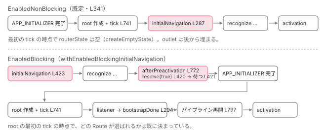

[目次](../README.md) › [Router の内側](README.md) › 第 6 回 / 全 21 回

# 最初のナビゲーションはいつ走るか：enabledNonBlocking と enabledBlocking

> getBootstrapListener → Router.initialNavigation → setUpLocationChangeListener。既定の enabledNonBlocking と withEnabledBlockingInitialNavigation の違いを、APP\_INITIALIZER と BOOTSTRAP\_DONE の行で追う。SSR で blocking が要る理由。

angular/angular · 読了 約 12 分 · 中核 · [サイトで読む（デモが動きます）](https://angular-deep-dive-cyan.vercel.app/chapter/router-initial-navigation)

---

アプリを開いた直後、URL バーの `/team/33` を誰が読んで最初の画面を出すのでしょうか。[boot シリーズの最終章](../boot/13-boot-spa-navigation.md)では「`APP_BOOTSTRAP_LISTENER` から `router.initialNavigation()` が呼ばれる」までを確認しました。この章はその続きです。**最初のナビゲーションには 3 つのモードがあり、どれを選ぶかで 「APP\_INITIALIZER の完了」「ルートコンポーネントの描画」「最初のナビゲーション」の順番が入れ替わります**。どの行がその順番を決めているかを追い、SSR のときに `enabledBlocking` が勧められる理由を `ApplicationRef.isStable` との関係で確かめます。

読む対象は `packages/router/src/provide_router.ts`、`packages/router/src/router.ts`、`packages/core/src/platform/bootstrap.ts`、`packages/core/src/application/application_ref.ts` です。

1. 1 本の RxJS パイプライン
2. URL → UrlTree
3. routerLink の配列 → UrlTree
4. Route 設定の検証と正規化
5. provideRouter の中身
6. **最初のナビゲーション**（この章）
7. navigateByUrl → NavigationTransition
8. setupNavigations の全段
9. Recognizer と match
10. redirectTo
11. loadChildren と loadComponent
12. ガードの実行順
13. resolve と data と title
14. ActivatedRoute と Snapshot
15. RouterOutlet への配置
16. ブラウザの URL と履歴
17. Router.events の全種類
18. RouterLink と RouterLinkActive
19. withViewTransitions
20. withRouterResources
21. Navigation API

## 1. 3 つのモードは 1 つのトークンの値

📄 `angular/packages/router/src/provide_router.ts` L315–342 （▶ の行: 333–336, 339, 341）

```ts
315 │ /**
316 │  * This and the INITIAL_NAVIGATION token are used internally only. The public API side of this is
317 │  * configured through the `ExtraOptions`.
318 │  *
319 │  * When set to `EnabledBlocking`, the initial navigation starts before the root
320 │  * component is created. The bootstrap is blocked until the initial navigation is complete. This
321 │  * value should be set in case you use [server-side rendering](guide/ssr), but do not enable
322 │  * [hydration](guide/hydration) for your application.
323 │  *
324 │  * When set to `EnabledNonBlocking`, the initial navigation starts after the root component has been
325 │  * created. The bootstrap is not blocked on the completion of the initial navigation.
326 │  *
327 │  * When set to `Disabled`, the initial navigation is not performed. The location listener is set up
328 │  * before the root component gets created. Use if there is a reason to have more control over when
329 │  * the router starts its initial navigation due to some complex initialization logic.
330 │  *
331 │  * @see {@link ExtraOptions}
332 │  */
333 ▶ const enum InitialNavigation {
334 ▶   EnabledBlocking,
335 ▶   EnabledNonBlocking,
336 ▶   Disabled,
337 │ }
338 │ 
339 ▶ const INITIAL_NAVIGATION = new InjectionToken<InitialNavigation>(
340 │   typeof ngDevMode === 'undefined' || ngDevMode ? 'initial navigation' : '',
341 ▶   {factory: () => InitialNavigation.EnabledNonBlocking},
342 │ );
```

333〜337 行目、`InitialNavigation` は `EnabledBlocking` / `EnabledNonBlocking` / `Disabled` の 3 値です。339〜342 行目の `INITIAL_NAVIGATION` トークンがその値を持ち、**341 行目の `factory` が `EnabledNonBlocking` を返す**ので、何も指定しなければ非ブロッキングです。316〜317 行目のコメントどおり、この enum とトークンは内部用で、利用者は `withEnabledBlockingInitialNavigation()` と `withDisabledInitialNavigation()` の 2 関数（4 節・6 節）で値を差し替えます。

## 2. 既定（EnabledNonBlocking）：ルートコンポーネントの描画が先

まず「いつ」呼ばれるかを `bootstrapApplication` 側から確認します。[APP\_INITIALIZER の章](../boot/09-boot-app-initializer.md)と[ApplicationRef の章](../boot/10-boot-application-ref.md)で読んだ 2 か所です。

📄 `angular/packages/core/src/platform/bootstrap.ts` L137–147 （▶ の行: 139, 141, 143）

```ts
137 │     return _callAndReportToErrorHandler(exceptionHandler, ngZone, () => {
138 │       const pendingTasks = envInjector.get(PendingTasksInternal);
139 ▶       const taskId = pendingTasks.add();
140 │       const initStatus = envInjector.get(ApplicationInitStatus);
141 ▶       initStatus.runInitializers();
142 │ 
143 ▶       return initStatus.donePromise
144 │         .then(() => {
145 │           // If the `LOCALE_ID` provider is defined at bootstrap then we set the value for ivy
146 │           const localeId = envInjector.get(LOCALE_ID, DEFAULT_LOCALE_ID);
147 │           setLocaleId(localeId || DEFAULT_LOCALE_ID);
```

📄 `angular/packages/core/src/platform/bootstrap.ts` L167–178 （▶ の行: 170, 178）

```ts
167 │           if (isApplicationBootstrapConfig(config)) {
168 │             const appRef = envInjector.get(ApplicationRef);
169 │             if (config.rootComponent !== undefined) {
170 ▶               appRef.bootstrap(config.rootComponent);
171 │             }
172 │             return appRef;
173 │           } else {
174 │             moduleBootstrapImpl?.(config.moduleRef, config.allPlatformModules);
175 │             return config.moduleRef;
176 │           }
177 │         })
178 ▶         .finally(() => void pendingTasks.remove(taskId));
```

141 行目で `ApplicationInitStatus.runInitializers()`、143 行目で `donePromise` を `then` し、170 行目で `appRef.bootstrap(rootComponent)`。つまり**APP\_INITIALIZER が全部終わるまでルートコンポーネントは作られません**。139 行目と 178 行目で `PendingTasksInternal` に 1 件積んで外しているのは 5 節で使います。

📄 `angular/packages/core/src/application/application_init.ts` L239–275 （▶ の行: 246–248, 263, 265, 271–272）

```ts
239 │   runInitializers() {
240 │     if (this.initialized) {
241 │       return;
242 │     }
243 │ 
244 │     const asyncInitPromises = [];
245 │     for (const appInits of this.appInits) {
246 ▶       const initResult = runInInjectionContext(this.injector, appInits);
247 ▶       if (isPromise(initResult)) {
248 ▶         asyncInitPromises.push(initResult);
249 │       } else if (isSubscribable(initResult)) {
250 │         const observableAsPromise = new Promise<void>((resolve, reject) => {
251 │           initResult.subscribe({complete: resolve, error: reject});
252 │         });
253 │         asyncInitPromises.push(observableAsPromise);
254 │       }
255 │     }
256 │ 
257 │     const complete = () => {
258 │       // @ts-expect-error overwriting a readonly
259 │       this.done = true;
260 │       this.resolve();
261 │     };
262 │ 
263 ▶     Promise.all(asyncInitPromises)
264 │       .then(() => {
265 ▶         complete();
266 │       })
267 │       .catch((e) => {
268 │         this.reject(e);
269 │       });
270 │ 
271 ▶     if (asyncInitPromises.length === 0) {
272 ▶       complete();
273 │     }
274 │     this.initialized = true;
275 │   }
```

246 行目で各 initializer を呼び、Promise を返したものだけ 248 行目で配列に集めます。263〜266 行目、`Promise.all` が終わったら `complete()`。1 つも Promise が無ければ 271〜272 行目で即座に完了です。**4 節の `enabledBlocking` は、ここに Promise を 1 つ足す**ことで順番を変えます。

📄 `angular/packages/core/src/application/application_ref.ts` L738–758 （▶ の行: 739, 741, 745, 747, 757）

```ts
738 │   private _loadComponent(componentRef: ComponentRef<any>): void {
739 ▶     this.attachView(componentRef.hostView);
740 │     try {
741 ▶       this.tick();
742 │     } catch (e) {
743 │       this.internalErrorHandler(e);
744 │     }
745 ▶     this.components.push(componentRef);
746 │     // Get the listeners lazily to prevent DI cycles.
747 ▶     const listeners = this._injector.get(APP_BOOTSTRAP_LISTENER, []);
748 │     if (ngDevMode && !Array.isArray(listeners)) {
749 │       throw new RuntimeError(
750 │         RuntimeErrorCode.INVALID_MULTI_PROVIDER,
751 │         'Unexpected type of the `APP_BOOTSTRAP_LISTENER` token value ' +
752 │           `(expected an array, but got ${typeof listeners}). ` +
753 │           'Please check that the `APP_BOOTSTRAP_LISTENER` token is configured as a ' +
754 │           '`multi: true` provider.',
755 │       );
756 │     }
757 ▶     listeners.forEach((listener) => listener(componentRef));
758 │   }
```

`appRef.bootstrap` の先にある `_loadComponent` です。739 行目でビューを登録、**741 行目で `tick()`（ルートコンポーネントの最初の描画）**、745 行目で `components` に push、747 行目で `APP_BOOTSTRAP_LISTENER` を取り出し、757 行目で順に呼びます。Router の listener が呼ばれるのは**最初の描画が終わった後**です。

📄 `angular/packages/router/src/provide_router.ts` L274–299 （▶ の行: 279, 283–284, 286–287, 292–295）

```ts
274 │ export function getBootstrapListener() {
275 │   const injector = inject(Injector);
276 │   return (bootstrappedComponentRef: ComponentRef<unknown>) => {
277 │     const ref = injector.get(ApplicationRef);
278 │ 
279 ▶     if (bootstrappedComponentRef !== ref.components[0]) {
280 │       return;
281 │     }
282 │ 
283 ▶     const router = injector.get(Router);
284 ▶     const bootstrapDone = injector.get(BOOTSTRAP_DONE);
285 │ 
286 ▶     if (injector.get(INITIAL_NAVIGATION) === InitialNavigation.EnabledNonBlocking) {
287 ▶       router.initialNavigation();
288 │     }
289 │ 
290 │     injector.get(ROUTER_PRELOADER, null, {optional: true})?.setUpPreloading();
291 │     injector.get(ROUTER_SCROLLER, null, {optional: true})?.init();
292 ▶     router.resetRootComponentType(ref.componentTypes[0]);
293 ▶     if (!bootstrapDone.closed) {
294 ▶       bootstrapDone.next();
295 ▶       bootstrapDone.complete();
296 │       bootstrapDone.unsubscribe();
297 │     }
298 │   };
299 │ }
```

📄 `angular/packages/router/src/provide_router.ts` L301–313 （▶ の行: 306, 309–310）

```ts
301 │ /**
302 │  * A subject used to indicate that the bootstrapping phase is done. When initial navigation is
303 │  * `enabledBlocking`, the first navigation waits until bootstrapping is finished before continuing
304 │  * to the activation phase.
305 │  */
306 ▶ const BOOTSTRAP_DONE = new InjectionToken<Subject<void>>(
307 │   typeof ngDevMode === 'undefined' || ngDevMode ? 'bootstrap done indicator' : '',
308 │   {
309 ▶     factory: () => {
310 ▶       return new Subject<void>();
311 │     },
312 │   },
313 │ );
```

1. **279〜281 行目：最初にブートストラップされたコンポーネントだけ**

   `ref.components[0]` と違えば何もしません。`appRef.bootstrap` を 2 回呼んでも Router は 1 回しか動きません。
2. **283〜284 行目：Router と BOOTSTRAP\_DONE を取り出す**

   `Router` は `@Service()` なので、誰も先に inject していなければ**ここで初めて new** されます。`BOOTSTRAP_DONE`（306〜313 行目）は 309〜310 行目の `factory` で `new Subject<void>()` を作る内部トークンです。302〜304 行目のコメントが用途を言っています。「`enabledBlocking` のとき、最初のナビゲーションは ブートストラップが終わるまで activation の前で待つ」。待つ側のコードは 4 節で見ます。
3. **286〜288 行目：EnabledNonBlocking のときだけ initialNavigation()**

   1 節のトークンを読んで比較します。既定値なのでこの分岐に入り、`router.initialNavigation()`（3 節）。`EnabledBlocking` と `Disabled` ではここを通りません。
4. **292 行目：resetRootComponentType**

   `routerState.root.component` にルートコンポーネントの型を入れます。3 節で見るとおり `initialNavigation()` は 287 行目で先に呼ばれていますが、パイプラインの中身は `Promise.resolve` で必ず非同期になる（[boot 13 章](../boot/13-boot-spa-navigation.md)の 541 行目）ので、`recognize` が走る時点では型は入っています。
5. **293〜297 行目：bootstrapDone を閉じる**

   `next()` → `complete()` → `unsubscribe()`。`closed` になるので 2 回目以降は何もしません。非ブロッキングのときはこの Subject を誰も待っていないので、ただ閉じるだけです。

## 3. Router.initialNavigation の中身

📄 `angular/packages/router/src/router.ts` L272–302 （▶ の行: 276–279, 281–282, 296–297）

```ts
272 │   /**
273 │    * Sets up the location change listener and performs the initial navigation.
274 │    */
275 │   initialNavigation(): void {
276 ▶     this.setUpLocationChangeListener();
277 ▶     if (!this.navigationTransitions.hasRequestedNavigation) {
278 ▶       this.navigateToSyncWithBrowser(
279 ▶         this.location.path(true),
280 │         IMPERATIVE_NAVIGATION,
281 ▶         this.stateManager.restoredState(),
282 ▶         {replaceUrl: true},
283 │       );
284 │     }
285 │   }
286 │ 
287 │   /**
288 │    * Sets up the location change listener. This listener detects navigations triggered from outside
289 │    * the Router (the browser back/forward buttons, for example) and schedules a corresponding Router
290 │    * navigation so that the correct events, guards, etc. are triggered.
291 │    */
292 │   setUpLocationChangeListener(): void {
293 │     // Don't need to use Zone.wrap any more, because zone.js
294 │     // already patch onPopState, so location change callback will
295 │     // run into ngZone
296 ▶     this.nonRouterCurrentEntryChangeSubscription ??=
297 ▶       this.stateManager.registerNonRouterCurrentEntryChangeListener(
298 │         (url, state, source, extras, hasUAVisualTransition) => {
299 │           this.navigateToSyncWithBrowser(url, source, state, extras, hasUAVisualTransition);
300 │         },
301 │       );
302 │   }
```

📄 `angular/packages/router/src/navigation_transition.ts` L378–389 （▶ の行: 378–380）

```ts
378 ▶   navigationId = 0;
379 ▶   get hasRequestedNavigation() {
380 ▶     return this.navigationId !== 0;
381 │   }
382 │   private transitions?: BehaviorSubject<NavigationTransition | null>;
383 │   /**
384 │    * Hook that enables you to pause navigation after the preactivation phase.
385 │    * Used by `RouterModule`.
386 │    *
387 │    * @internal
388 │    */
389 │   afterPreactivation: () => Observable<void> = () => of(void 0);
```

📄 `angular/packages/router/src/statemanager/state_manager.ts` L140–143 （▶ の行: 142）

```ts
140 │   /** Returns the current state stored by the browser for the current history entry. */
141 │   restoredState(): RestoredState | null | undefined {
142 ▶     return this.location.getState() as RestoredState | null | undefined;
143 │   }
```

1. **276 行目：setUpLocationChangeListener()**

   296〜301 行目。`??=` なので**1 回しか登録されません**。登録先の `registerNonRouterCurrentEntryChangeListener` は `popstate` を `setTimeout` 1 つ挟んで `navigateToSyncWithBrowser` に流す処理で、[boot 13 章 6 節](../boot/13-boot-spa-navigation.md)で読みました。詳細は[第 16 回](16-router-browser-url.md)に委ねます。
2. **277 行目：hasRequestedNavigation が false のときだけ**

   378〜381 行目、`navigationId !== 0` です。`navigationId` は `handleNavigationRequest` が 1 件受けるごとに `++` されます（[次章](07-router-navigation-request.md)）。つまり**アプリ起動時に誰かが既に `navigate()` していたら、最初のナビゲーションは行いません**。`APP_INITIALIZER` の中で `router.navigateByUrl('/login')` を呼ぶアプリで、URL バーの値へ戻されないのはこの行のためです。
3. **278〜283 行目：URL バーの値へ navigateToSyncWithBrowser**

   279 行目 `this.location.path(true)` は `<base href>` を除いた現在のパス（`true` はハッシュも含める指定）。280 行目 `IMPERATIVE_NAVIGATION`（`'imperative'`）が `NavigationStart.navigationTrigger` になります。281 行目 `stateManager.restoredState()` は 142 行目のとおり `location.getState()`、つまり `history.state` です。リロード直後なら前回のナビゲーションが書いた `navigationId` 等が入っています。282 行目 `replaceUrl: true` なので、最初のナビゲーションは**履歴を増やしません**（`pushState` ではなく `replaceState`）。

> [!NOTE]
> **ポイント**
>
> `navigateToSyncWithBrowser` の先は `parseUrl` → `scheduleNavigation` で、クリック時と同じパイプラインに入ります。その先頭で何が起きるかは[次章](07-router-navigation-request.md)、全段は[第 8 回](08-router-pipeline.md)です。

## 4. enabledBlocking：APP\_INITIALIZER の中でナビゲーションを進める

📄 `angular/packages/router/src/provide_router.ts` L395–429 （▶ の行: 397–399, 401, 406–407, 410, 413, 416, 420–421, 423）

```ts
395 │ export function withEnabledBlockingInitialNavigation(): EnabledBlockingInitialNavigationFeature {
396 │   const providers = [
397 ▶     {provide: IS_ENABLED_BLOCKING_INITIAL_NAVIGATION, useValue: true},
398 ▶     {provide: INITIAL_NAVIGATION, useValue: InitialNavigation.EnabledBlocking},
399 ▶     provideAppInitializer(() => {
400 │       const injector = inject(Injector);
401 ▶       const locationInitialized: Promise<any> = injector.get(
402 │         LOCATION_INITIALIZED,
403 │         Promise.resolve(),
404 │       );
405 │ 
406 ▶       return locationInitialized.then(() => {
407 ▶         return new Promise((resolve) => {
408 │           const router = injector.get(Router);
409 │           const bootstrapDone = injector.get(BOOTSTRAP_DONE);
410 ▶           afterNextNavigation(router, () => {
411 │             // Unblock APP_INITIALIZER in case the initial navigation was canceled or errored
412 │             // without a redirect.
413 ▶             resolve(true);
414 │           });
415 │ 
416 ▶           injector.get(NavigationTransitions).afterPreactivation = () => {
417 │             // Unblock APP_INITIALIZER once we get to `afterPreactivation`. At this point, we
418 │             // assume activation will complete successfully (even though this is not
419 │             // guaranteed).
420 ▶             resolve(true);
421 ▶             return bootstrapDone.closed ? of(void 0) : bootstrapDone;
422 │           };
423 ▶           router.initialNavigation();
424 │         });
425 │       });
426 │     }),
427 │   ];
428 │   return routerFeature(RouterFeatureKind.EnabledBlockingInitialNavigationFeature, providers);
429 │ }
```

397 行目で `IS_ENABLED_BLOCKING_INITIAL_NAVIGATION` を `true` に（5 節で hydration 側が読みます）、398 行目で 1 節のトークンを `EnabledBlocking` に。これで 2 節 286 行目の分岐は false になり、listener は `initialNavigation()` を呼びません。代わりに **399 行目、`provideAppInitializer` で APP\_INITIALIZER を 1 つ追加**します。中身を順に読みます。

1. **401〜406 行目：LOCATION\_INITIALIZED を待つ**

   `injector.get(LOCATION_INITIALIZED, Promise.resolve())`。第 2 引数は「無ければこれ」の既定値です。`@angular/common` の `LOCATION_INITIALIZED` はトークンの定義だけで、ブラウザ用プラットフォームには provide するコードがありません （`packages/platform-browser/src` と `platform-server/src` を grep しても定義以外に現れません）。したがって通常は `Promise.resolve()` がそのまま使われ、次のマイクロタスクで 407 行目へ進みます。AngularJS 併用など、別のライブラリが provide したときだけ意味を持つ待ちです。
2. **407 行目：new Promise — これが APP\_INITIALIZER の戻り値**

   2 節 248 行目で集められ、263 行目の `Promise.all` がこれを待ちます。`resolve` を呼ぶ場所は 2 つ（413 行目と 420 行目）あり、どちらが先でも 1 回目で解決します。
3. **410〜414 行目：保険の afterNextNavigation**

   411〜412 行目のコメント、「最初のナビゲーションがリダイレクト無しで cancel または error したときに APP\_INITIALIZER を解放するため」。`afterNextNavigation` は次に見ます。
4. **416〜422 行目：afterPreactivation を差し替える**

   `NavigationTransitions.afterPreactivation` はパイプラインの途中で呼ばれるフック（下の 772 行目）です。差し替えた関数は、420 行目で `resolve(true)` して APP\_INITIALIZER を完了させ、**421 行目で `bootstrapDone`（2 節の Subject）を返します**。パイプラインはこの Observable が値を出すまで止まります。閉じていれば `of(void 0)` で即通過。
5. **423 行目：router.initialNavigation()**

   3 節と同じ関数です。違いは**呼ばれる時点**。APP\_INITIALIZER の中なので、ルートコンポーネントはまだ作られていません。ここで `Router` が初めて new されます。

📄 `angular/packages/router/src/utils/navigations.ts` L27–66 （▶ の行: 36, 41–44, 47–48, 52–53, 59, 61, 64）

```ts
27 │ /**
28 │  * Performs the given action once the router finishes its next/current navigation.
29 │  *
30 │  * The navigation is considered complete under the following conditions:
31 │  * - `NavigationCancel` event emits and the code is not `NavigationCancellationCode.Redirect` or
32 │  * `NavigationCancellationCode.SupersededByNewNavigation`. In these cases, the
33 │  * redirecting/superseding navigation must finish.
34 │  * - `NavigationError`, `NavigationEnd`, or `NavigationSkipped` event emits
35 │  */
36 ▶ export function afterNextNavigation(router: {events: Observable<Event>}, action: () => void): void {
37 │   router.events
38 │     .pipe(
39 │       filter(
40 │         (e): e is NavigationEnd | NavigationCancel | NavigationError | NavigationSkipped =>
41 ▶           e instanceof NavigationEnd ||
42 ▶           e instanceof NavigationCancel ||
43 ▶           e instanceof NavigationError ||
44 ▶           e instanceof NavigationSkipped,
45 │       ),
46 │       map((e) => {
47 ▶         if (e instanceof NavigationEnd || e instanceof NavigationSkipped) {
48 ▶           return NavigationResult.COMPLETE;
49 │         }
50 │         const redirecting =
51 │           e instanceof NavigationCancel
52 ▶             ? e.code === NavigationCancellationCode.Redirect ||
53 ▶               e.code === NavigationCancellationCode.SupersededByNewNavigation
54 │             : false;
55 │         return redirecting ? NavigationResult.REDIRECTING : NavigationResult.FAILED;
56 │       }),
57 │       filter(
58 │         (result): result is NavigationResult.COMPLETE | NavigationResult.FAILED =>
59 ▶           result !== NavigationResult.REDIRECTING,
60 │       ),
61 ▶       take(1),
62 │     )
63 │     .subscribe(() => {
64 ▶       action();
65 │     });
66 │ }
```

41〜44 行目、`NavigationEnd` / `NavigationCancel` / `NavigationError` / `NavigationSkipped` の 4 種だけ通します。47〜48 行目、`NavigationEnd` と `NavigationSkipped` は完了。52〜53 行目、`NavigationCancel` でも code が `Redirect` か `SupersededByNewNavigation` なら「まだ続きがある」として 59 行目で捨てます。61 行目 `take(1)`、64 行目で `action()`。**リダイレクト先のナビゲーションが終わるまで待つ**のがこの関数の役目です。3 節 282 行目の後にある `scheduleNavigation` も同じ関数で `PendingTasks` を外しています（5 節）。

📄 `angular/packages/router/src/navigation_transition.ts` L769–800 （▶ の行: 771–772, 793, 796–797）

```ts
769 │           }),
770 │ 
771 ▶           this.routerResourcesFeature?.setupAndRunResources(abortController.signal) ?? ((t) => t),
772 ▶           switchTap(() => this.afterPreactivation()),
773 │ 
774 │           switchMap(() => {
775 │             const {currentSnapshot, targetSnapshot} = overallTransitionState;
776 │             const viewTransitionStarted = this.createViewTransition?.(
777 │               this.environmentInjector,
778 │               currentSnapshot.root,
779 │               targetSnapshot!.root,
780 │               overallTransitionState.hasUAVisualTransition,
781 │             );
782 │ 
783 │             // If view transitions are enabled, block the navigation until the view
784 │             // transition callback starts. Otherwise, continue immediately.
785 │             return viewTransitionStarted
786 │               ? from(viewTransitionStarted).pipe(map(() => overallTransitionState))
787 │               : of(overallTransitionState);
788 │           }),
789 │ 
790 │           // Ensure that if some observable used to drive the transition doesn't
791 │           // complete, the navigation still finalizes This should never happen, but
792 │           // this is done as a safety measure to avoid surfacing this error (#49567).
793 ▶           take(1),
794 │ 
795 │           switchMap((t: NavigationTransition) => {
796 ▶             abortable = false;
797 ▶             this.events.next(new BeforeActivateRoutes());
798 │             const deferred = overallTransitionState.beforeActivateHandler.deferredHandle;
799 │             return deferred ? from(deferred.then(() => t)) : of(t);
800 │           }),
```

パイプライン側です。772 行目 `switchTap(() => this.afterPreactivation())`。この位置は `recognize`・ガード・resolver・`loadComponent`・`createRouterState` の**後**で、797 行目 `BeforeActivateRoutes`（URL 更新と `RouterOutlet` への配置の直前）の**前**です。771 行目の `setupAndRunResources`（[第 20 回](20-router-resources.md)）も通過済みです。つまり `enabledBlocking` での APP\_INITIALIZER は「**どのコンポーネントを出すか決まり、必要な JS とデータがそろった時点**」で完了し、実際に画面へ置く作業は `bootstrapDone`（ルートコンポーネントの描画後）まで待ちます。417〜419 行目のコメントが「ここで activation が成功すると仮定する（保証はない）」と言っているのはこのためです。



*既定（上）では描画 → initialNavigation。enabledBlocking（下）では initialNavigation が APP\_INITIALIZER の中で始まり、afterPreactivation で initializer を解放し、bootstrapDone を待ってから activation に進む。*

> **🧪 DEMO — モードを選ぶと、起動時の順序がどう変わるか**
>
> bootstrap.ts L137-178、application\_ref.ts L738-758、provide\_router.ts L274-299 / L395-429 / L469-477 を読んで並べた順です。赤枠が Router 側の処理です。
>
> ▶ [このデモはサイトで動かせます](https://angular-deep-dive-cyan.vercel.app/chapter/router-initial-navigation)

## 5. SSR と isStable：何を待っているのか

📄 `angular/packages/router/src/provide_router.ts` L369–375 （▶ の行: 372–374）

```ts
369 │ /**
370 │  * Configures initial navigation to start before the root component is created.
371 │  *
372 ▶  * The bootstrap is blocked until the initial navigation is complete. This should be set in case
373 ▶  * you use [server-side rendering](guide/ssr), but do not enable [hydration](guide/hydration) for
374 ▶  * your application.
375 │  *
```

`withEnabledBlockingInitialNavigation` のコメント 372〜374 行目は「SSR を使い、hydration を使わないときに設定すべき」と言っています。サーバ側が何を待っているかを見ます。

📄 `angular/packages/platform-server/src/utils.ts` L360–375 （▶ の行: 362, 370, 373）

```ts
360 │   try {
361 │     startMeasuring(bootstrapLabel);
362 ▶     const applicationRef = await bootstrap({platformRef});
363 │     stopMeasuring(bootstrapLabel);
364 │ 
365 │     startMeasuring(_renderLabel);
366 │ 
367 │     const measuringLabel = 'whenStable';
368 │     startMeasuring(measuringLabel);
369 │     // Block until application is stable.
370 ▶     await applicationRef.whenStable();
371 │     stopMeasuring(measuringLabel);
372 │ 
373 ▶     const rendered = await renderInternal(platformRef, applicationRef);
374 │     stopMeasuring(_renderLabel);
375 │     return rendered;
```

📄 `angular/packages/core/src/application/application_ref.ts` L320–328 （▶ の行: 320, 327）

```ts
320 ▶   private internalPendingTask = inject(PendingTasksInternal);
321 │ 
322 │   /**
323 │    * Returns an Observable that indicates when the application is stable or unstable.
324 │    */
325 │   public get isStable(): Observable<boolean> {
326 │     // This is a getter because it might be invoked after the application has been destroyed.
327 ▶     return this.internalPendingTask.hasPendingTasksObservable.pipe(map((pending) => !pending));
328 │   }
```

📄 `angular/packages/core/src/application/application_ref.ts` L338–350 （▶ の行: 341, 343–344）

```ts
338 │   whenStable(): Promise<void> {
339 │     let subscription: Subscription;
340 │     return new Promise<void>((resolve) => {
341 ▶       subscription = this.isStable.subscribe({
342 │         next: (stable) => {
343 ▶           if (stable) {
344 ▶             resolve();
345 │           }
346 │         },
347 │       });
348 │     }).finally(() => {
349 │       subscription.unsubscribe();
350 │     });
```

📄 `angular/packages/router/src/router.ts` L694–702 （▶ の行: 696–697, 700）

```ts
694 │ 
695 │     // Indicate that the navigation is happening.
696 ▶     const taskId = this.pendingTasks.add();
697 ▶     afterNextNavigation(this, () => {
698 │       // Remove pending task in a microtask to allow for cancelled
699 │       // initial navigations and redirects within the same task.
700 ▶       queueMicrotask(() => this.pendingTasks.remove(taskId));
701 │     });
702 │ 
```

1. **362 行目 → 370 行目 → 373 行目：bootstrap → whenStable → render**

   サーバは `bootstrap`（2 節の bootstrap.ts と同じ関数）の Promise を `await` し、さらに `applicationRef.whenStable()` を `await` してから HTML を直列化します。
2. **327 行目：isStable は PendingTasksInternal の裏返し**

   `hasPendingTasksObservable` が `false` になった瞬間に `true`。341〜344 行目、`whenStable` はそれを待つ Promise です（[PendingTasks の章](../zoneless/09-zoneless-pending-tasks.md)）。
3. **696〜701 行目：Router は 1 ナビゲーションごとに PendingTasks を 1 件積む**

   `scheduleNavigation` が `pendingTasks.add()` し、4 節の `afterNextNavigation` で （リダイレクト先まで含めて）終わったら `queueMicrotask` で外します。したがって**非ブロッキングでも、サーバは最初のナビゲーションが終わるまで `whenStable` で待ちます**。3 節 282 行目の後の `scheduleNavigation` も同じ経路です。

では `enabledBlocking` は SSR で何を変えるのでしょうか。上の図の違いがそのまま答えです。非ブロッキングでは**ルートコンポーネントの最初の `tick`（2 節 741 行目）が、どの Route が選ばれるか決まる前**に走ります。その時点の `routerState` は `createEmptyState` が作った空の木で、`<router-outlet>` も空です。ルートコンポーネントがコンストラクタや最初の描画で `ActivatedRoute` や `router.routerState` を読むコードは、サーバでは空の状態を一度見てから、ナビゲーション完了後に再描画されます。ブロッキングでは 4 節 772 行目まで進んでからルートコンポーネントが作られるので、**最初の `tick` の時点で `targetSnapshot` も `loadComponent` の結果もそろっています**。「HTML にルートの中身が入るかどうか」ではなく、「ルートコンポーネントが空の状態を経験するかどうか」の違いです。

📄 `angular/packages/platform-browser/src/hydration.ts` L168–190 （▶ の行: 173, 177, 181–182）

```ts
168 │ function provideEnabledBlockingInitialNavigationDetector(): Provider[] {
169 │   return [
170 │     {
171 │       provide: ENVIRONMENT_INITIALIZER,
172 │       useValue: () => {
173 ▶         const isEnabledBlockingInitialNavigation = inject(IS_ENABLED_BLOCKING_INITIAL_NAVIGATION, {
174 │           optional: true,
175 │         });
176 │ 
177 ▶         if (isEnabledBlockingInitialNavigation) {
178 │           const console = inject(Console);
179 │           const message = formatRuntimeError(
180 │             RuntimeErrorCode.HYDRATION_CONFLICTING_FEATURES,
181 ▶             'Configuration error: found both hydration and enabledBlocking initial navigation ' +
182 ▶               'in the same application, which is a contradiction.',
183 │           );
184 │           console.warn(message);
185 │         }
186 │       },
187 │       multi: true,
188 │     },
189 │   ];
190 │ }
```

173 行目、`provideClientHydration()` 側が 4 節 397 行目のトークンを読み、`true` なら 181〜182 行目の警告 「hydration と enabledBlocking initial navigation が両方ある。これは矛盾だ」を出します。hydration はサーバが出した DOM をそのまま使うことが前提なので、クライアント側でルートコンポーネントの作成をナビゲーション完了まで遅らせる意味がないからです。このサイト自身は `provideClientHydration` を使っているので、既定の非ブロッキングのままです。

## 6. Disabled：監視だけ仕掛けて何もしない

📄 `angular/packages/router/src/provide_router.ts` L469–477 （▶ の行: 471–472, 474）

```ts
469 │ export function withDisabledInitialNavigation(): DisabledInitialNavigationFeature {
470 │   const providers = [
471 ▶     provideAppInitializer(() => {
472 ▶       inject(Router).setUpLocationChangeListener();
473 │     }),
474 ▶     {provide: INITIAL_NAVIGATION, useValue: InitialNavigation.Disabled},
475 │   ];
476 │   return routerFeature(RouterFeatureKind.DisabledInitialNavigationFeature, providers);
477 │ }
```

471〜473 行目、APP\_INITIALIZER で `setUpLocationChangeListener()` だけを呼びます。3 節 296 行目の `??=` により、後であなたが `router.initialNavigation()` を呼んでも二重登録にはなりません。474 行目でトークンを `Disabled` にするので、2 節 286 行目の分岐には入りません。**あなたが `router.initialNavigation()` か `navigate()` を呼ぶまで、`<router-outlet>` は空のままです**。戻るボタン（`popstate`）だけは監視されているので、ユーザーが履歴を動かせばナビゲーションが始まります。

## 7. navigated フラグ：最初のナビゲーションだけ特別扱い

📄 `angular/packages/router/src/router.ts` L132–136 （▶ の行: 136）

```ts
132 │   /**
133 │    * True if at least one navigation event has occurred,
134 │    * false otherwise.
135 │    */
136 ▶   navigated: boolean = false;
```

📄 `angular/packages/router/src/router.ts` L199–212 （▶ の行: 201–204, 209–211）

```ts
199 │         if (currentTransition !== null && currentNavigation !== null) {
200 │           this.stateManager.handleRouterEvent(e, currentNavigation);
201 ▶           if (
202 ▶             e instanceof NavigationCancel &&
203 ▶             e.code !== NavigationCancellationCode.Redirect &&
204 ▶             e.code !== NavigationCancellationCode.SupersededByNewNavigation
205 │           ) {
206 │             // It seems weird that `navigated` is set to `true` when the navigation is rejected,
207 │             // however it's how things were written initially. Investigation would need to be done
208 │             // to determine if this can be removed.
209 ▶             this.navigated = true;
210 ▶           } else if (e instanceof NavigationEnd) {
211 ▶             this.navigated = true;
212 │             this.injectorCleanup?.(this.routeReuseStrategy, this.routerState, this.config);
```

📄 `angular/packages/router/src/router.ts` L398–402 （▶ の行: 401）

```ts
398 │   resetConfig(config: Routes): void {
399 │     (typeof ngDevMode === 'undefined' || ngDevMode) && validateConfig(config);
400 │     this.config = config.map(standardizeConfig);
401 ▶     this.navigated = false;
402 │   }
```

📄 `angular/packages/router/src/navigation_transition.ts` L502–506 （▶ の行: 502–503）

```ts
502 ▶             const urlTransition =
503 ▶               !router.navigated || this.isUpdatingInternalState() || this.isUpdatedBrowserUrl();
504 │ 
505 │             const onSameUrlNavigation = t.extras.onSameUrlNavigation ?? router.onSameUrlNavigation;
506 │             if (!urlTransition && onSameUrlNavigation !== 'reload') {
```

136 行目、`Router.navigated` は `false` で始まります。210〜211 行目、`NavigationEnd` で `true`。201〜209 行目、`NavigationCancel` でも code が `Redirect` と `SupersededByNewNavigation` 以外（ガード拒否など）なら `true` です （206〜208 行目のコメントは「なぜ拒否で true なのかは初期の実装のままで、調査が必要」と正直に書いています）。401 行目、`resetConfig` で `false` に戻ります。

読んでいるのは 502〜503 行目です。`!router.navigated` が `true` なら、URL が現在と同じでも `urlTransition` は `true`。**最初のナビゲーションは「現在の URL と同じ URL」への移動ですが、この行のおかげで `NavigationSkipped` にならず先へ進みます**。この判定の全体は[次章](07-router-navigation-request.md)で読みます。

## ここまでの呼び出し（既定の EnabledNonBlocking）

- 👤 `bootstrapApplication(App, appConfig)` — src/main.ts
  - `bootstrap({...})` — core/src/platform/bootstrap.ts L78
    - `initStatus.runInitializers()` — bootstrap.ts L141 → application\_init.ts L239 — *Router の initializer は無い（既定）*
    - `initStatus.donePromise.then(...)` — bootstrap.ts L143 — *── マイクロタスク ──*
      - `appRef.bootstrap(rootComponent)` — bootstrap.ts L170
        - `_loadComponent(componentRef)` — core/src/application/application\_ref.ts L738
          - `this.tick()` — application\_ref.ts L741 — *ルートコンポーネントの最初の描画。outlet は空*
          - `listeners.forEach((l) => l(componentRef))` — application\_ref.ts L757
            - `getBootstrapListener の戻り値` — router/src/provide\_router.ts L276
              - `injector.get(Router)` — provide\_router.ts L283 — *Router を new → setupNavigations を subscribe*
              - `router.initialNavigation()` — provide\_router.ts L287 → router.ts L275
                - `setUpLocationChangeListener()` — router.ts L276 → L292 — *popstate の監視を 1 回だけ登録*
                - `navigateToSyncWithBrowser(location.path(true), 'imperative', history.state, {replaceUrl: true})` — router.ts L278
                  - `scheduleNavigation(urlTree, ...)` — router.ts L349 → L665 — *pendingTasks.add() → 次章へ*
              - `router.resetRootComponentType(...)` → `bootstrapDone.next()` — provide\_router.ts L292-297

## 聞かれそうな質問

**Q. enabledBlocking にすると何が遅くなりますか？どの Promise を待っているのですか？**

遅くなるのは**ルートコンポーネントの作成と最初の描画**です。provide\_router.ts 407 行目の `new Promise` が APP\_INITIALIZER の戻り値になり、application\_init.ts 263 行目の `Promise.all` がそれを待ち、bootstrap.ts 143 行目の `donePromise.then` の先にある 170 行目 `appRef.bootstrap` が後ろにずれます。その Promise を resolve するのは、パイプラインが navigation\_transition.ts 772 行目 `afterPreactivation` に達したとき （provide\_router.ts 420 行目）、または cancel / error で終わったとき（413 行目）です。つまり `recognize`・ガード・resolver・`loadComponent` がすべて終わるまで、ルートコンポーネントは作られません。

**Q. 既定はどれですか？何も書かなければブロッキングですか？**

非ブロッキングです。provide\_router.ts 341 行目、`INITIAL_NAVIGATION` の `factory` が `InitialNavigation.EnabledNonBlocking` を返します。286 行目の判定がこの値と一致するので、`APP_BOOTSTRAP_LISTENER` の中（ルートコンポーネントの最初の tick の後）で `initialNavigation()` が呼ばれます。

**Q. SSR では enabledBlocking にしないと HTML が空になりますか？**

なりません。platform-server/src/utils.ts 370 行目でサーバは `applicationRef.whenStable()` を待ち、`isStable`（application\_ref.ts 327 行目）は `PendingTasksInternal` を見ています。Router は router.ts 696 行目で 1 ナビゲーションごとに `pendingTasks.add()` するので、非ブロッキングでも 最初のナビゲーションが終わるまで直列化は始まりません。ブロッキングが変えるのは、ルートコンポーネントの最初の tick（application\_ref.ts 741 行目）が Route 決定の前に走るか後に走るかです。provide\_router.ts 372〜374 行目のコメントが勧めるのは「SSR あり・hydration なし」の構成で、hydration ありなら platform-browser/src/hydration.ts 177〜185 行目で矛盾の警告が出ます。

**Q. APP\_INITIALIZER の中で router.navigate() を呼んだら、URL バーの値へ戻されますか？**

戻されません。router.ts 277 行目、`initialNavigation()` は `hasRequestedNavigation` （navigation\_transition.ts 380 行目、`navigationId !== 0`）が `true` なら `navigateToSyncWithBrowser` を呼びません。先に `navigate()` が `navigationId` を 1 にしているからです。`setUpLocationChangeListener()`（276 行目）だけは実行されます。

**Q. withDisabledInitialNavigation() にすると戻るボタンも動かなくなりますか？**

戻るボタンは動きます。provide\_router.ts 471〜473 行目、APP\_INITIALIZER で `setUpLocationChangeListener()` を呼び、`popstate` の監視は仕掛けます。止めているのは 474 行目で `Disabled` にして 286 行目の分岐を外す、つまり起動時の `initialNavigation()` だけです。あなたが `router.initialNavigation()` を呼ぶまで `<router-outlet>` は空です。

**Q. 最初のナビゲーションは「今の URL と同じ URL」への移動なのに、なぜ NavigationSkipped にならないのですか？**

navigation\_transition.ts 502〜503 行目、`urlTransition` の計算に `!router.navigated` が入っているからです。`navigated` は router.ts 136 行目で `false` から始まり、210〜211 行目の `NavigationEnd` で初めて `true` になります。最初のナビゲーションではまだ `false` なので、URL が同じでも先へ進みます。

## 読み終えて

- モードは `INITIAL_NAVIGATION` トークン 1 つの値。既定は 341 行目の `EnabledNonBlocking`
- 既定では bootstrap.ts 170 行目 → application\_ref.ts 741 行目（最初の tick）→ 757 行目（listener）→ provide\_router.ts 287 行目 `initialNavigation()`。**描画が先、ナビゲーションが後**
- `enabledBlocking` は APP\_INITIALIZER に Promise を 1 つ足し（407 行目）、パイプラインの 772 行目 `afterPreactivation` で resolve、`bootstrapDone` を待って activation へ。**Route 決定が先、描画が後**
- サーバは `whenStable`（PendingTasks）を待つので、非ブロッキングでも HTML にはルートの中身が入る。ブロッキングの違いは、ルートコンポーネントが空の routerState を経験しないこと
- `initialNavigation()` は `hasRequestedNavigation`（navigationId !== 0）なら何もしない。`navigated` フラグが最初のナビゲーションを `NavigationSkipped` から守る

---

← 前: [provideRouter が provide するもの：ROUTES・Router・各 withX の中身](05-router-provide-router.md)  
次: [navigateByUrl から NavigationTransition が生まれるまで](07-router-navigation-request.md) →
