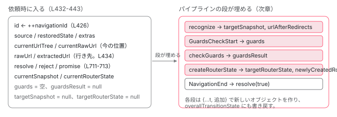

[目次](../README.md) › [Router の内側](README.md) › 第 7 回 / 全 21 回

# navigateByUrl から NavigationTransition が生まれるまで

> navigate / navigateByUrl / NavigationExtras → scheduleNavigation → handleNavigationRequest。navigationId、Promise の resolve/reject、PendingTasks への登録、UrlHandlingStrategy.extract、同じ URL のとき NavigationSkipped になる判定（onSameUrlNavigation）。

angular/angular · 読了 約 13 分 · 中核 · [サイトで読む（デモが動きます）](https://angular-deep-dive-cyan.vercel.app/chapter/router-navigation-request)

---

`router.navigate(['/team', 33])` と書いたとき、Router の内部には `NavigationTransition` という 1 つのオブジェクトが生まれ、それがパイプラインを流れていきます。[boot シリーズの最終章](../boot/13-boot-spa-navigation.md)では `navigateByUrl → scheduleNavigation → handleNavigationRequest` の呼び出し順を確認しました。この章では視点を変えて、**その 3 関数で何がオブジェクトに詰められるか**、**返ってくる Promise はどこで resolve / reject されるか**、そして**パイプラインの先頭で「このナビゲーションはやらない」と判断される 2 つの条件**（同じ URL と `UrlHandlingStrategy`）を行ごとに読みます。

読む対象は `packages/router/src/router.ts`、`packages/router/src/navigation_transition.ts`、`packages/router/src/models.ts`（`NavigationBehaviorOptions`）、`packages/router/src/url_handling_strategy.ts` です。

1. 1 本の RxJS パイプライン
2. URL → UrlTree
3. routerLink の配列 → UrlTree
4. Route 設定の検証と正規化
5. provideRouter の中身
6. 最初のナビゲーション
7. **navigateByUrl → NavigationTransition**（この章）
8. setupNavigations の全段
9. Recognizer と match
10. redirectTo
11. loadChildren と loadComponent
12. ガードの実行順
13. resolve と data と title
14. ActivatedRoute と Snapshot
15. RouterOutlet への配置
16. ブラウザの URL と履歴
17. Router.events の全種類
18. RouterLink と RouterLinkActive
19. withViewTransitions
20. withRouterResources
21. Navigation API

## 1. 入口は 3 つ、合流点は 1 つ

📄 `angular/packages/router/src/router.ts` L588–594 （▶ の行: 592–593）

```ts
588 │   navigate(
589 │     commands: readonly any[],
590 │     extras: NavigationExtras = {skipLocationChange: false},
591 │   ): Promise<boolean> {
592 ▶     validateCommands(commands);
593 ▶     return this.navigateByUrl(this.createUrlTree(commands, extras), extras);
594 │   }
```

📄 `angular/packages/router/src/router.ts` L725–736 （▶ の行: 728–729）

```ts
725 │ function validateCommands(commands: readonly string[]): void {
726 │   for (let i = 0; i < commands.length; i++) {
727 │     const cmd = commands[i];
728 ▶     if (cmd == null) {
729 ▶       throw new RuntimeError(
730 │         RuntimeErrorCode.NULLISH_COMMAND,
731 │         (typeof ngDevMode === 'undefined' || ngDevMode) &&
732 │           `The requested path contains ${cmd} segment at index ${i}`,
733 │       );
734 │     }
735 │   }
736 │ }
```

592 行目 `validateCommands` は、728〜729 行目のとおり `null` / `undefined` の要素があれば `NULLISH_COMMAND` を投げるだけです。`['team', undefined]` のような配列を早めに止めます。593 行目、`createUrlTree(commands, extras)`（[第 3 回](03-router-create-url-tree.md)）で `UrlTree` にしてから `navigateByUrl` へ。**`navigate` は `navigateByUrl` の薄い包み**です。`extras` は両方に同じオブジェクトが渡ります（2 節）。

📄 `angular/packages/router/src/router.ts` L546–556 （▶ の行: 548–549, 552–553, 555）

```ts
546 │   navigateByUrl(
547 │     url: string | UrlTree,
548 ▶     extras: NavigationBehaviorOptions = {
549 ▶       skipLocationChange: false,
550 │     },
551 │   ): Promise<boolean> {
552 ▶     const urlTree = isUrlTree(url) ? url : this.parseUrl(url);
553 ▶     const mergedTree = this.urlHandlingStrategy.merge(urlTree, this.rawUrlTree);
554 │ 
555 ▶     return this.scheduleNavigation(mergedTree, IMPERATIVE_NAVIGATION, null, extras);
556 │   }
```

📄 `angular/packages/router/src/router.ts` L601–614 （▶ の行: 604, 606, 612）

```ts
601 │   /** Parses a string into a `UrlTree` */
602 │   parseUrl(url: string): UrlTree {
603 │     try {
604 ▶       return this.urlSerializer.parse(url);
605 │     } catch (e) {
606 ▶       this.console.warn(
607 │         formatRuntimeError(
608 │           RuntimeErrorCode.ERROR_PARSING_URL,
609 │           ngDevMode && `Error parsing URL ${url}. Falling back to '/' instead. \n` + e,
610 │         ),
611 │       );
612 ▶       return this.urlSerializer.parse('/');
613 │     }
614 │   }
```

📄 `angular/packages/router/src/url_handling_strategy.ts` L46–60 （▶ の行: 51–52, 54–55, 57–58）

```ts
46 │ /**
47 │  * @publicApi
48 │  */
49 │ @Service()
50 │ export class DefaultUrlHandlingStrategy implements UrlHandlingStrategy {
51 ▶   shouldProcessUrl(url: UrlTree): boolean {
52 ▶     return true;
53 │   }
54 ▶   extract(url: UrlTree): UrlTree {
55 ▶     return url;
56 │   }
57 ▶   merge(newUrlPart: UrlTree, wholeUrl: UrlTree): UrlTree {
58 ▶     return newUrlPart;
59 │   }
60 │ }
```

1. **548〜550 行目：extras の既定値は `{skipLocationChange: false}`**

   引数を省略するとこのオブジェクトになります。`onSameUrlNavigation` などは `undefined` なので、6 節で Router の既定値に落ちます。
2. **552 行目：文字列なら parseUrl**

   604 行目で `UrlSerializer.parse`（[第 2 回](02-router-url-tree.md)）。606〜612 行目、**解析に失敗しても例外にならず、警告を出して `'/'` に差し替えます**。`navigateByUrl('%%%')` はルートへ移動します。
3. **553 行目：urlHandlingStrategy.merge(urlTree, this.rawUrlTree)**

   `UrlHandlingStrategy` は AngularJS 併用のためのフックで、既定の `DefaultUrlHandlingStrategy` は 57〜58 行目のとおり **`merge` は新しい方をそのまま返す**、54〜55 行目 `extract` は恒等、51〜52 行目 `shouldProcessUrl` は常に `true` です。この章では「何もしない」と読み替えて構いません。7 節で分岐だけ確認します。
4. **555 行目：scheduleNavigation(mergedTree, 'imperative', null, extras)**

   3 つ目の入口 `navigateToSyncWithBrowser`（[前章](06-router-initial-navigation.md)・戻るボタン）も 最後は同じ `scheduleNavigation` を呼びます。違いは第 2 引数が `'popstate'` になることと、第 3 引数に `history.state` が入ることです。

## 2. NavigationExtras：2 つのインターフェイスの合成

📄 `angular/packages/router/src/navigation_transition.ts` L197–213 （▶ の行: 213）

```ts
197 │ /**
198 │  * @description
199 │  *
200 │  * Options that modify the `Router` navigation strategy.
201 │  * Supply an object containing any of these properties to a `Router` navigation function to
202 │  * control how the target URL should be constructed or interpreted.
203 │  *
204 │  * @see {@link Router#navigate}
205 │  * @see {@link Router#navigateByUrl}
206 │  * @see {@link Router#createurltree}
207 │  * @see [Routing and Navigation guide](guide/routing/common-router-tasks)
208 │  * @see {@link UrlCreationOptions}
209 │  * @see {@link NavigationBehaviorOptions}
210 │  *
211 │  * @publicApi
212 │  */
213 ▶ export interface NavigationExtras extends UrlCreationOptions, NavigationBehaviorOptions {}
```

213 行目、`NavigationExtras` は `UrlCreationOptions`（URL をどう作るか）と `NavigationBehaviorOptions`（移動をどう扱うか）の合成です。`navigate` は両方を受け取り、`navigateByUrl` は後者だけを受け取ります（1 節 548 行目の型）。URL を作る側の項目を先に見ます。

📄 `angular/packages/router/src/navigation_transition.ts` L137–160 （▶ の行: 140, 150, 160）

````ts
137 │    * A value of `null` or `undefined` indicates that the navigation commands should be applied
138 │    * relative to the root.
139 │    */
140 ▶   relativeTo?: ActivatedRoute | null;
141 │ 
142 │   /**
143 │    * Sets query parameters to the URL.
144 │    *
145 │    * ```ts
146 │    * // Navigate to /results?page=1
147 │    * router.navigate(['/results'], { queryParams: { page: 1 } });
148 │    * ```
149 │    */
150 ▶   queryParams?: Params | null;
151 │ 
152 │   /**
153 │    * Sets the hash fragment for the URL.
154 │    *
155 │    * ```ts
156 │    * // Navigate to /results#top
157 │    * router.navigate(['/results'], { fragment: 'top' });
158 │    * ```
159 │    */
160 ▶   fragment?: string;
````

140 行目 `relativeTo`、150 行目 `queryParams`、160 行目 `fragment`。この後に `queryParamsHandling` と `preserveFragment` が続きます。5 つとも `createUrlTree` だけが読む項目で、`UrlTree` ができた後は使われません。中身は[第 3 回](03-router-create-url-tree.md)です。

📄 `angular/packages/router/src/models.ts` L1549–1579 （▶ の行: 1559, 1569, 1579）

````ts
1549 │ export interface NavigationBehaviorOptions {
1550 │   /**
1551 │    * How to handle a navigation request to the current URL.
1552 │    *
1553 │    * This value is a subset of the options available in `OnSameUrlNavigation` and
1554 │    * will take precedence over the default value set for the `Router`.
1555 │    *
1556 │    * @see {@link OnSameUrlNavigation}
1557 │    * @see {@link RouterConfigOptions}
1558 │    */
1559 ▶   onSameUrlNavigation?: OnSameUrlNavigation;
1560 │ 
1561 │   /**
1562 │    * When true, navigates without pushing a new state into history.
1563 │    *
1564 │    * ```ts
1565 │    * // Navigate silently to /view
1566 │    * this.router.navigate(['/view'], { skipLocationChange: true });
1567 │    * ```
1568 │    */
1569 ▶   skipLocationChange?: boolean;
1570 │ 
1571 │   /**
1572 │    * When true, navigates while replacing the current state in history.
1573 │    *
1574 │    * ```ts
1575 │    * // Navigate to /view
1576 │    * this.router.navigate(['/view'], { replaceUrl: true });
1577 │    * ```
1578 │    */
1579 ▶   replaceUrl?: boolean;
````

移動の扱い方を決める側です。1559 行目 `onSameUrlNavigation`、1569 行目 `skipLocationChange`、1579 行目 `replaceUrl`。この後に `state`・`info`・`browserUrl`・`scroll` が続きます。**誰がどの項目を読むか**を先にまとめておきます。この章で読むのは最初の 1 つと `browserUrl` の一部です。

| 項目 | 読む場所 | 何が変わるか | 詳しくは |
| --- | --- | --- | --- |
| `onSameUrlNavigation` | パイプライン先頭（6 節） | `'reload'` なら同じ URL でも進む。Router 全体の既定は `'ignore'` | この章 |
| `skipLocationChange` | `isUpdatedBrowserUrl`（6 節）と `HistoryStateManager` | URL バーを変えない。同一 URL 判定にも効く | [第 16 回](16-router-browser-url.md) |
| `replaceUrl` | `HistoryStateManager.setBrowserUrl` | `pushState` ではなく `replaceState` | [第 16 回](16-router-browser-url.md) |
| `state` | `HistoryStateManager.setBrowserUrl` | `history.state` に `navigationId` と一緒に書かれる | [第 16 回](16-router-browser-url.md) |
| `info` | 誰も読まない（`Navigation.extras` として公開されるだけ） | アプリが `router.currentNavigation()?.extras.info` で受け取る | 5 節 |
| `browserUrl` | `Navigation.targetBrowserUrl`（5 節）と `setBrowserUrl` | 照合に使う URL と URL バーに出す URL を分ける | [第 16 回](16-router-browser-url.md) |
| `scroll` | `RouterScroller` | `'manual'` なら `NavigationEnd` 後のスクロール復元を抑止 | [第 17 回](17-router-events.md) |

## 3. scheduleNavigation：Promise を作り、PendingTasks に積み、依頼を出す

📄 `angular/packages/router/src/router.ts` L665–693 （▶ の行: 671, 677–678, 684–687, 689）

```ts
665 │   private scheduleNavigation(
666 │     rawUrl: UrlTree,
667 │     source: NavigationTrigger,
668 │     restoredState: RestoredState | null,
669 │     extras: NavigationExtras,
670 │     hasUAVisualTransition?: boolean,
671 ▶     priorPromise?: {
672 │       resolve: (result: boolean | PromiseLike<boolean>) => void;
673 │       reject: (reason?: any) => void;
674 │       promise: Promise<boolean>;
675 │     },
676 │   ): Promise<boolean> {
677 ▶     if (this.disposed) {
678 ▶       return Promise.resolve(false);
679 │     }
680 │ 
681 │     let resolve: (result: boolean | PromiseLike<boolean>) => void;
682 │     let reject: (reason?: any) => void;
683 │     let promise: Promise<boolean>;
684 ▶     if (priorPromise) {
685 ▶       resolve = priorPromise.resolve;
686 ▶       reject = priorPromise.reject;
687 ▶       promise = priorPromise.promise;
688 │     } else {
689 ▶       promise = new Promise<boolean>((res, rej) => {
690 │         resolve = res;
691 │         reject = rej;
692 │       });
693 │     }
```

1. **677〜678 行目：dispose 後は false**

   `Router.dispose()` 済みなら何もせず `Promise.resolve(false)`。
2. **671〜675 行目・684〜687 行目：priorPromise（リダイレクトの引き継ぎ）**

   6 つ目の引数は、**リダイレクトで作り直されるナビゲーションが、元のナビゲーションの Promise をそのまま使う**ためのものです。ガードが `UrlTree` を返したとき、`Router.subscribeToNavigationEvents` が `RedirectRequest` を受けて 元の `resolve` / `reject` / `promise` を渡し直します（[次章](08-router-pipeline.md)）。だから `await router.navigate(['/admin'])` はリダイレクト先 `/login` への移動が終わるまで戻らず、結果はリダイレクト先の成否です。
3. **689〜692 行目：通常は新しい Promise**

   `resolve` と `reject` を外に取り出しておき、4 節で `NavigationTransition` に入れます。

📄 `angular/packages/router/src/router.ts` L694–722 （▶ の行: 696–697, 700, 703–704, 706–709, 711–715, 721）

```ts
694 │ 
695 │     // Indicate that the navigation is happening.
696 ▶     const taskId = this.pendingTasks.add();
697 ▶     afterNextNavigation(this, () => {
698 │       // Remove pending task in a microtask to allow for cancelled
699 │       // initial navigations and redirects within the same task.
700 ▶       queueMicrotask(() => this.pendingTasks.remove(taskId));
701 │     });
702 │ 
703 ▶     this.navigationTransitions.handleNavigationRequest({
704 ▶       source,
705 │       restoredState,
706 ▶       currentUrlTree: this.currentUrlTree,
707 ▶       currentRawUrl: this.currentUrlTree,
708 ▶       rawUrl,
709 ▶       extras,
710 │       hasUAVisualTransition,
711 ▶       resolve: resolve!,
712 ▶       reject: reject!,
713 ▶       promise,
714 ▶       currentSnapshot: this.routerState.snapshot,
715 ▶       currentRouterState: this.routerState,
716 │     });
717 │ 
718 │     // Make sure that the error is propagated even though `processNavigations` catch
719 │     // handler does not rethrow
720 │     // perf: Use `.bind` to avoid holding the other closures in this scope while this promise is unsettled.
721 ▶     return promise.catch(Promise.reject.bind(Promise));
722 │   }
```

1. **696〜701 行目：PendingTasks に 1 件**

   `pendingTasks.add()` で `ApplicationRef.isStable` が `false` になります （[PendingTasks の章](../zoneless/09-zoneless-pending-tasks.md)）。外すのは `afterNextNavigation`（[前章](06-router-initial-navigation.md) 4 節）の中、700 行目 `queueMicrotask` で 1 つ遅らせています。698〜699 行目のコメント、「取り消された最初のナビゲーションやリダイレクトが同じタスク内で続けて起きても、安定状態にならないように」。
2. **703〜716 行目：依頼の中身**

   `handleNavigationRequest` に渡すのは 11 項目です。704 行目 `source`（`'imperative'` / `'popstate'` / `'hashchange'`）、705 行目 `restoredState`（戻るボタンのときだけ `history.state`）、**706〜707 行目 `currentUrlTree` と `currentRawUrl` はどちらも今の `currentUrlTree`**、708 行目 `rawUrl` が遷移先、709 行目 `extras`、711〜713 行目 Promise の 3 点セット、714〜715 行目 現在の `RouterStateSnapshot` と `RouterState`。「今どこにいて、どこへ行くか」の両方を 1 つのオブジェクトに閉じ込めるので、途中で別のナビゲーションが始まっても値がずれません。
3. **721 行目：promise.catch(Promise.reject.bind(Promise))**

   718〜719 行目のコメントどおり、reject をそのまま伝え直すためだけの `catch` です。値は変えません。`navigateByUrl` が返すのはこの Promise で、**ここではまだ何も決まっていません**（8 節）。

## 4. handleNavigationRequest：NavigationTransition が生まれる行

📄 `angular/packages/router/src/navigation_transition.ts` L409–445 （▶ の行: 426, 431–432, 434–439, 441–442）

```ts
409 │   handleNavigationRequest(
410 │     request: Pick<
411 │       NavigationTransition,
412 │       | 'source'
413 │       | 'restoredState'
414 │       | 'currentUrlTree'
415 │       | 'currentRawUrl'
416 │       | 'rawUrl'
417 │       | 'extras'
418 │       | 'hasUAVisualTransition'
419 │       | 'resolve'
420 │       | 'reject'
421 │       | 'promise'
422 │       | 'currentSnapshot'
423 │       | 'currentRouterState'
424 │     >,
425 │   ) {
426 ▶     const id = ++this.navigationId;
427 │ 
428 │     // Navigation can happen as a side effect of template execution, as such we need to untrack signal updates
429 │     // (Writing to signals is not allowed while Angular renders the template)
430 │     // TODO: We might want to reconsider allowing navigation as side effect of template execution.
431 ▶     untracked(() => {
432 ▶       this.transitions?.next({
433 │         ...request,
434 ▶         extractedUrl: this.urlHandlingStrategy.extract(request.rawUrl),
435 ▶         targetSnapshot: null,
436 ▶         targetRouterState: null,
437 ▶         guards: {canActivateChecks: [], canDeactivateChecks: []},
438 ▶         guardsResult: null,
439 ▶         id,
440 │ 
441 ▶         routesRecognizeHandler: {},
442 ▶         beforeActivateHandler: {},
443 │       });
444 │     });
445 │   }
```

1. **426 行目：navigationId を進める**

   `++this.navigationId`。**依頼を受けた瞬間に番号が決まります**。パイプラインに入る前です。5 節で見るとおり、この番号と「今の最新番号」を比べて古い依頼を捨てます。前章の `hasRequestedNavigation`（`navigationId !== 0`）もこの値を見ています。
2. **431 行目：untracked**

   428〜430 行目のコメント。テンプレートの実行中（signal の追跡中）に `navigate` が呼ばれることがあるので、中で行う signal の書き込み（5 節 `currentNavigation.set`）が追跡に巻き込まれないようにしています。
3. **432〜443 行目：transitions.next**

   `transitions` は `BehaviorSubject`。`next` は同期なので、**この行の中でパイプラインの先頭（5 節）が走ります**。依頼の 11 項目に、434 行目 `extractedUrl`（既定の `extract` は恒等なので `rawUrl` と同じ）、435〜438 行目の**空の結果欄**、439 行目 `id`、441〜442 行目の 2 つのハンドラ置き場を足します。

📄 `angular/packages/router/src/navigation_transition.ts` L313–337 （▶ の行: 314, 316, 318–319, 322–324, 328, 330–333）

```ts
313 │ export interface NavigationTransition {
314 ▶   id: number;
315 │   currentUrlTree: UrlTree;
316 ▶   extractedUrl: UrlTree;
317 │   currentRawUrl: UrlTree;
318 ▶   urlAfterRedirects?: UrlTree;
319 ▶   rawUrl: UrlTree;
320 │   extras: NavigationExtras;
321 │   hasUAVisualTransition?: boolean;
322 ▶   resolve: (value: boolean | PromiseLike<boolean>) => void;
323 ▶   reject: (reason?: any) => void;
324 ▶   promise: Promise<boolean>;
325 │   source: NavigationTrigger;
326 │   restoredState: RestoredState | null;
327 │   currentSnapshot: RouterStateSnapshot;
328 ▶   targetSnapshot: RouterStateSnapshot | null;
329 │   currentRouterState: RouterState;
330 ▶   targetRouterState: RouterState | null;
331 ▶   guards: Checks;
332 ▶   guardsResult: GuardResult | null;
333 ▶   newlyCreatedRoutes?: Set<ActivatedRoute>;
334 │ 
335 │   routesRecognizeHandler: {deferredHandle?: Promise<void>};
336 │   beforeActivateHandler: {deferredHandle?: Promise<void>};
337 │ }
```

これが流れていくオブジェクトの全体です。**依頼時に入るもの**と**パイプラインの段が埋めるもの**に分けると、構造が見えます。

| 行 | フィールド | いつ入るか |
| --- | --- | --- |
| 314 | `id` | 依頼時（426 行目） |
| 315, 317, 319 | `currentUrlTree` / `currentRawUrl` / `rawUrl` | 依頼時（3 節 706〜708 行目） |
| 316 | `extractedUrl` | 依頼時（434 行目） |
| 320〜326 | `extras` / `resolve` / `reject` / `promise` / `source` / `restoredState` | 依頼時（3 節） |
| 327, 329 | `currentSnapshot` / `currentRouterState` | 依頼時（3 節 714〜715 行目） |
| 318, 328 | `urlAfterRedirects` / `targetSnapshot` | `recognize` の段（[第 9 回](09-router-recognize.md)）。それまで `undefined` / `null` |
| 331, 332 | `guards` / `guardsResult` | ガードの段（[第 12 回](12-router-guards.md)） |
| 330, 333 | `targetRouterState` / `newlyCreatedRoutes` | `createRouterState` の段（[第 14 回](14-router-router-state.md)） |
| 335, 336 | `routesRecognizeHandler` / `beforeActivateHandler` | Navigation API 連携用の置き場（[第 21 回](21-router-platform-navigation.md)） |



*NavigationTransition の中身。左の欄は handleNavigationRequest（L432-443）の時点で入っている。右の欄は空で始まり、パイプラインの段が順に埋める。*

## 5. パイプラインの先頭：古い依頼を捨て、Navigation を公開する

📄 `angular/packages/router/src/navigation_transition.ts` L461–477 （▶ の行: 466, 471, 474, 476）

```ts
461 │           switchMap((t) => {
462 │             // It is possible that `switchMap` fails to cancel previous navigations if a new one happens synchronously while the operator
463 │             // is processing the `next` notification of that previous navigation. This can happen when a new navigation (say 2) cancels a
464 │             // previous one (1) and yet another navigation (3) happens synchronously in response to the `NavigationCancel` event for (1).
465 │             // https://github.com/ReactiveX/rxjs/issues/7455
466 ▶             if (this.navigationId > overallTransitionState.id) {
467 │               const cancellationReason =
468 │                 typeof ngDevMode === 'undefined' || ngDevMode
469 │                   ? `Navigation ID ${overallTransitionState.id} is not equal to the current navigation id ${this.navigationId}`
470 │                   : '';
471 ▶               this.cancelNavigationTransition(
472 │                 overallTransitionState,
473 │                 cancellationReason,
474 ▶                 NavigationCancellationCode.SupersededByNewNavigation,
475 │               );
476 ▶               return EMPTY;
477 │             }
```

466 行目、`this.navigationId > overallTransitionState.id`。4 節で付けた番号が最新でなければ、471〜475 行目で `NavigationCancel`（code は `SupersededByNewNavigation`）を流して `resolve(false)`、476 行目で `EMPTY`（何も流さず完了）。外側の `switchMap` が取りこぼす場合（462〜465 行目のコメント。[概観](01-router.md) 5 節）の保険です。

📄 `angular/packages/router/src/navigation_transition.ts` L478–501 （▶ の行: 478, 481–485, 489–491, 497）

```ts
478 ▶             this.currentTransition = overallTransitionState;
479 │             const lastSuccessfulNavigation = this.lastSuccessfulNavigation();
480 │             // Store the Navigation object
481 ▶             this.currentNavigation.set({
482 ▶               id: t.id,
483 ▶               initialUrl: t.rawUrl,
484 ▶               extractedUrl: t.extractedUrl,
485 ▶               targetBrowserUrl:
486 │                 typeof t.extras.browserUrl === 'string'
487 │                   ? this.urlSerializer.parse(t.extras.browserUrl)
488 │                   : t.extras.browserUrl,
489 ▶               trigger: t.source,
490 ▶               extras: t.extras,
491 ▶               previousNavigation: !lastSuccessfulNavigation
492 │                 ? null
493 │                 : {
494 │                     ...lastSuccessfulNavigation,
495 │                     previousNavigation: null,
496 │                   },
497 ▶               abort: () => abortController.abort(),
498 │ 
499 │               routesRecognizeHandler: t.routesRecognizeHandler,
500 │               beforeActivateHandler: t.beforeActivateHandler,
501 │             });
```

478 行目で `currentTransition` に登録し、481〜501 行目で**公開用の `Navigation` オブジェクト**を signal に入れます。`router.currentNavigation()` が返すのはこれです。482〜484 行目 `id` / `initialUrl`（`rawUrl`）/ `extractedUrl`、485〜488 行目 `targetBrowserUrl`（2 節の `browserUrl` を `UrlTree` に）、489〜490 行目 `trigger` と `extras`、491〜496 行目 `previousNavigation`（1 つ前の成功したものだけ）、**497 行目 `abort` は `AbortController.abort()` を呼ぶ関数**。この `abort` がパイプラインをどう止めるかは[次章](08-router-pipeline.md)です。`finalUrl` はまだありません。`recognize` の後に埋まります。

## 6. 同じ URL のとき：NavigationSkipped になる条件

📄 `angular/packages/router/src/navigation_transition.ts` L502–521 （▶ の行: 502–503, 505–506, 511–512, 516, 519–520）

```ts
502 ▶             const urlTransition =
503 ▶               !router.navigated || this.isUpdatingInternalState() || this.isUpdatedBrowserUrl();
504 │ 
505 ▶             const onSameUrlNavigation = t.extras.onSameUrlNavigation ?? router.onSameUrlNavigation;
506 ▶             if (!urlTransition && onSameUrlNavigation !== 'reload') {
507 │               const reason =
508 │                 typeof ngDevMode === 'undefined' || ngDevMode
509 │                   ? `Navigation to ${t.rawUrl} was ignored because it is the same as the current Router URL.`
510 │                   : '';
511 ▶               this.events.next(
512 ▶                 new NavigationSkipped(
513 │                   t.id,
514 │                   this.urlSerializer.serialize(t.rawUrl),
515 │                   reason,
516 ▶                   NavigationSkippedCode.IgnoredSameUrlNavigation,
517 │                 ),
518 │               );
519 ▶               t.resolve(false);
520 ▶               return EMPTY;
521 │             }
```

📄 `angular/packages/router/src/router.ts` L151–160 （▶ の行: 160）

```ts
151 │   /**
152 │    * How to handle a navigation request to the current URL.
153 │    *
154 │    *
155 │    * @deprecated Configure this through `provideRouter` or `RouterModule.forRoot` instead.
156 │    * @see {@link withRouterConfig}
157 │    * @see {@link provideRouter}
158 │    * @see {@link RouterModule}
159 │    */
160 ▶   onSameUrlNavigation: OnSameUrlNavigation = this.options.onSameUrlNavigation || 'ignore';
```

1. **502〜503 行目：urlTransition の計算**

   3 つの OR です。`!router.navigated`（最初のナビゲーション。[前章](06-router-initial-navigation.md) 7 節）、`isUpdatingInternalState()`、`isUpdatedBrowserUrl()`。後ろ 2 つを下で読みます。
2. **505 行目：onSameUrlNavigation の決定**

   `t.extras.onSameUrlNavigation ?? router.onSameUrlNavigation`。**1 回の `navigate` に渡した値が、Router 全体の設定より優先**されます。Router 側の値は 160 行目、`withRouterConfig({onSameUrlNavigation})` が無ければ `'ignore'`。
3. **506 行目：URL が変わらず、かつ 'reload' でなければ skip**

   511〜518 行目で `NavigationSkipped` を流します。code は 516 行目 `IgnoredSameUrlNavigation`。**519 行目 `t.resolve(false)`**。`navigate` の Promise は `false` で解決します（reject ではありません）。520 行目 `EMPTY` なので、`NavigationStart` もそれ以降のイベントも出ません。

📄 `angular/packages/router/src/navigation_transition.ts` L1014–1029 （▶ の行: 1025–1027）

```ts
1014 │   /**
1015 │    * @returns Whether we're navigating to somewhere that is not what the Router is
1016 │    * currently set to.
1017 │    */
1018 │   private isUpdatingInternalState() {
1019 │     // TODO(atscott): The serializer should likely be used instead of
1020 │     // `UrlTree.toString()`. Custom serializers are often written to handle
1021 │     // things better than the default one (objects, for example will be
1022 │     // [Object object] with the custom serializer and be "the same" when they
1023 │     // aren't).
1024 │     // (Same for isUpdatedBrowserUrl)
1025 ▶     return (
1026 ▶       this.currentTransition?.extractedUrl.toString() !==
1027 ▶       this.currentTransition?.currentUrlTree.toString()
1028 │     );
1029 │   }
```

📄 `angular/packages/router/src/navigation_transition.ts` L1031–1050 （▶ の行: 1040–1041, 1045, 1047–1048）

```ts
1031 │   /**
1032 │    * @returns Whether we're updating the browser URL to something new (navigation is going
1033 │    * to somewhere not displayed in the URL bar and we will update the URL
1034 │    * bar if navigation succeeds).
1035 │    */
1036 │   private isUpdatedBrowserUrl() {
1037 │     // The extracted URL is the part of the URL that this application cares about. `extract` may
1038 │     // return only part of the browser URL and that part may have not changed even if some other
1039 │     // portion of the URL did.
1040 ▶     const currentBrowserUrl = this.urlHandlingStrategy.extract(
1041 ▶       this.urlSerializer.parse(this.location.path(true)),
1042 │     );
1043 │ 
1044 │     const currentNavigation = untracked(this.currentNavigation);
1045 ▶     const targetBrowserUrl = currentNavigation?.targetBrowserUrl ?? currentNavigation?.extractedUrl;
1046 │     return (
1047 ▶       currentBrowserUrl.toString() !== targetBrowserUrl?.toString() &&
1048 ▶       !currentNavigation?.extras.skipLocationChange
1049 │     );
1050 │   }
```

1025〜1028 行目、`isUpdatingInternalState` は `extractedUrl.toString()` と `currentUrlTree.toString()` の比較です。`UrlTree.toString()` は既定の直列化なので、`/team/33` と `/team/33/` のように**文字列が違っても木が同じなら「同じ」**と判定されます。1019〜1024 行目の TODO は、カスタムの `UrlSerializer` を使っている場合にこの比較が粗いことを認めています。

1040〜1049 行目、`isUpdatedBrowserUrl` は**URL バーの今の値**（1041 行目 `location.path(true)` を parse して extract）と 遷移先（1045 行目、`browserUrl` 指定があればそちら）を比べ、違っていて、かつ `skipLocationChange` でなければ `true`。Router の内部状態は同じでも URL バーがずれているとき（`skipLocationChange: true` で移動した後に、元の URL へ戻るなど）に 「URL バーを直すためのナビゲーション」として進めるための条件です。

📄 `angular/packages/router/src/events.ts` L204–222 （▶ の行: 214, 221）

```ts
204 │ /**
205 │  * A code for the `NavigationSkipped` event of the `Router` to indicate the
206 │  * reason a navigation was skipped.
207 │  *
208 │  * @publicApi
209 │  */
210 │ export enum NavigationSkippedCode {
211 │   /**
212 │    * A navigation was skipped because the navigation URL was the same as the current Router URL.
213 │    */
214 ▶   IgnoredSameUrlNavigation,
215 │   /**
216 │    * A navigation was skipped because the configured `UrlHandlingStrategy` return `false` for both
217 │    * the current Router URL and the target of the navigation.
218 │    *
219 │    * @see {@link UrlHandlingStrategy}
220 │    */
221 ▶   IgnoredByUrlHandlingStrategy,
222 │ }
```

`NavigationSkipped` の code は 2 種類だけです。214 行目 `IgnoredSameUrlNavigation`（この節）と 221 行目 `IgnoredByUrlHandlingStrategy`（7 節）。`reason` 文字列は開発モード専用で、本番では空です。判定には `code` を使います。

> **🧪 DEMO — この navigate は NavigationStart まで進むか、NavigationSkipped で終わるか**
>
> navigation\_transition.ts L502-521 と L1014-1050 の判定を手元で再現します。本物は UrlTree.toString() で比べますが、ここでは末尾の '/' をそろえた文字列比較です。UrlHandlingStrategy は既定とみなします。
>
> ▶ [このデモはサイトで動かせます](https://angular-deep-dive-cyan.vercel.app/chapter/router-navigation-request)

## 7. UrlHandlingStrategy.shouldProcessUrl：3 つの分岐

📄 `angular/packages/router/src/navigation_transition.ts` L523–542 （▶ の行: 523, 527, 530–532, 535–536, 541）

```ts
523 ▶             if (this.urlHandlingStrategy.shouldProcessUrl(t.rawUrl)) {
524 │               return of(t).pipe(
525 │                 // Fire NavigationStart event
526 │                 switchMap((t) => {
527 ▶                   this.events.next(
528 │                     new NavigationStart(
529 │                       t.id,
530 ▶                       this.urlSerializer.serialize(t.extractedUrl),
531 ▶                       t.source,
532 ▶                       t.restoredState,
533 │                     ),
534 │                   );
535 ▶                   if (t.id !== this.navigationId) {
536 ▶                     return EMPTY;
537 │                   }
538 │ 
539 │                   // This delay is required to match old behavior that forced
540 │                   // navigation to always be async
541 ▶                   return Promise.resolve(t);
542 │                 }),
```

523 行目、遷移先を処理すべきなら 527〜534 行目で `NavigationStart`。引数は `id`、**530 行目 `extractedUrl` を直列化した文字列**、531 行目 `source`（`navigationTrigger` になる）、532 行目 `restoredState`。535〜537 行目で再び最新 id か確認し、541 行目で `Promise.resolve(t)`。ここから先は[次章](08-router-pipeline.md)です。既定の `DefaultUrlHandlingStrategy` では必ずこの分岐に入ります。

📄 `angular/packages/router/src/navigation_transition.ts` L583–613 （▶ の行: 583–585, 591, 597–598, 603, 605, 607, 613）

```ts
583 ▶             } else if (
584 ▶               urlTransition &&
585 ▶               this.urlHandlingStrategy.shouldProcessUrl(t.currentRawUrl)
586 │             ) {
587 │               /* When the current URL shouldn't be processed, but the previous one
588 │                * was, we handle this "error condition" by navigating to the
589 │                * previously successful URL, but leaving the URL intact.*/
590 │               const {id, extractedUrl, source, restoredState, extras} = t;
591 ▶               const navStart = new NavigationStart(
592 │                 id,
593 │                 this.urlSerializer.serialize(extractedUrl),
594 │                 source,
595 │                 restoredState,
596 │               );
597 ▶               this.events.next(navStart);
598 ▶               const targetSnapshot = createEmptyState(
599 │                 this.rootComponentType,
600 │                 this.environmentInjector,
601 │               ).snapshot;
602 │ 
603 ▶               this.currentTransition = overallTransitionState = {
604 │                 ...t,
605 ▶                 targetSnapshot,
606 │                 urlAfterRedirects: extractedUrl,
607 ▶                 extras: {...extras, skipLocationChange: false, replaceUrl: false},
608 │               };
609 │               this.currentNavigation.update((nav) => {
610 │                 nav!.finalUrl = extractedUrl;
611 │                 return nav;
612 │               });
613 ▶               return of(overallTransitionState);
```

583〜585 行目、遷移先は処理しないが**今いる URL は処理していた**場合。587〜589 行目のコメント、「URL はそのままにして、前に成功した URL へ移動したことにする」。591〜597 行目で `NavigationStart` は出し、598〜601 行目で `createEmptyState` の**空の `RouterStateSnapshot`** を `targetSnapshot` にして、607 行目で `skipLocationChange` と `replaceUrl` を `false` に固定し、613 行目でそのまま次の段へ流します。`recognize` を飛ばして「全部の outlet を空にする」ナビゲーションになります。AngularJS 側のページへ移るときの処理です。

📄 `angular/packages/router/src/navigation_transition.ts` L614–635 （▶ の行: 625–626, 630, 633–634）

```ts
614 │             } else {
615 │               /* When neither the current or previous URL can be processed, do
616 │                * nothing other than update router's internal reference to the
617 │                * current "settled" URL. This way the next navigation will be coming
618 │                * from the current URL in the browser.
619 │                */
620 │               const reason =
621 │                 typeof ngDevMode === 'undefined' || ngDevMode
622 │                   ? `Navigation was ignored because the UrlHandlingStrategy` +
623 │                     ` indicated neither the current URL ${t.currentRawUrl} nor target URL ${t.rawUrl} should be processed.`
624 │                   : '';
625 ▶               this.events.next(
626 ▶                 new NavigationSkipped(
627 │                   t.id,
628 │                   this.urlSerializer.serialize(t.extractedUrl),
629 │                   reason,
630 ▶                   NavigationSkippedCode.IgnoredByUrlHandlingStrategy,
631 │                 ),
632 │               );
633 ▶               t.resolve(false);
634 ▶               return EMPTY;
635 │             }
```

614〜635 行目、どちらも処理しない場合。625〜632 行目で `NavigationSkipped`、code は 630 行目 `IgnoredByUrlHandlingStrategy`。**633 行目 `t.resolve(false)`**、634 行目 `EMPTY`。6 節と同じ終わり方です。

## 8. Promise はどこで決まるか

3 節で作った Promise の `resolve` / `reject` を呼ぶ場所を全部並べます。`navigateByUrl` の戻り値を `await` しているコードは、このどれかで戻ります。

📄 `angular/packages/router/src/navigation_transition.ts` L826–835 （▶ の行: 826, 833–834）

```ts
826 ▶             this.events.next(
827 │               new NavigationEnd(
828 │                 t.id,
829 │                 this.urlSerializer.serialize(t.extractedUrl),
830 │                 this.urlSerializer.serialize(t.urlAfterRedirects!),
831 │               ),
832 │             );
833 ▶             this.titleStrategy?.updateTitle(t.targetRouterState!.snapshot);
834 ▶             t.resolve(true);
835 │           }),
```

📄 `angular/packages/router/src/navigation_transition.ts` L998–1012 （▶ の行: 1003–1004, 1010–1011）

```ts
 998 │   private cancelNavigationTransition(
 999 │     t: NavigationTransition,
1000 │     reason: string,
1001 │     code: NavigationCancellationCode,
1002 │   ) {
1003 ▶     rollbackState(t);
1004 ▶     const navCancel = new NavigationCancel(
1005 │       t.id,
1006 │       this.urlSerializer.serialize(t.extractedUrl),
1007 │       reason,
1008 │       code,
1009 │     );
1010 ▶     this.events.next(navCancel);
1011 ▶     t.resolve(false);
1012 │   }
```

📄 `angular/packages/router/src/navigation_transition.ts` L972–991 （▶ の行: 982–983, 985）

```ts
972 │               } catch (ee) {
973 │                 // TODO(atscott): consider flipping the default behavior of
974 │                 // resolveNavigationPromiseOnError to be `resolve(false)` when
975 │                 // undefined. This is the most sane thing to do given that
976 │                 // applications very rarely handle the promise rejection and, as a
977 │                 // result, would get "unhandled promise rejection" console logs.
978 │                 // The vast majority of applications would not be affected by this
979 │                 // change so omitting a migration seems reasonable. Instead,
980 │                 // applications that rely on rejection can specifically opt-in to the
981 │                 // old behavior.
982 ▶                 if (this.options.resolveNavigationPromiseOnError) {
983 ▶                   overallTransitionState.resolve(false);
984 │                 } else {
985 ▶                   overallTransitionState.reject(ee);
986 │                 }
987 │               }
988 │             }
989 │ 
990 │             return EMPTY;
991 │           }),
```

| 結果 | 行 | いつ | 直前に流れるイベント |
| --- | --- | --- | --- |
| `resolve(true)` | 834 | activation が終わり、826 行目 `NavigationEnd`、833 行目 `updateTitle` の後 | `NavigationEnd` |
| `resolve(false)` | 519 / 633 | 同じ URL（6 節）、UrlHandlingStrategy が両方拒否（7 節） | `NavigationSkipped` |
| `resolve(false)` | 1011 | `cancelNavigationTransition`：古い id（5 節）、ガード拒否、resolver が値を出さない、`abort()`、新しいナビゲーションに追い越された | 1004〜1010 行目 `NavigationCancel`（1003 行目で `rollbackState`） |
| `resolve(false)` | 983 | 例外が投げられ、`withRouterConfig({resolveNavigationPromiseOnError: true})` のとき | `NavigationError` |
| `reject(e)` | 985 | 例外が投げられ、上のオプションが無いとき（既定） | `NavigationError` |
| （持ち越し） | — | ガードが `UrlTree` / `RedirectCommand` を返した。`NavigationCancel(Redirect)` の後、3 節の `priorPromise` として次のナビゲーションへ | `NavigationCancel` → `RedirectRequest`（内部） |

> [!WARNING]
> **ハマりどころ**
>
> 既定では**例外だけが reject**で、ガード拒否も同じ URL も `false` で resolve です。973〜981 行目の TODO コメントは「将来は既定を `resolve(false)` に変えたい。多くのアプリが reject を処理しておらず unhandled rejection になるから」と書いています。`navigate` の戻り値を `await` するなら `try / catch` を付けるか、`resolveNavigationPromiseOnError` を立ててください。

## ここまでの呼び出し

- 👤 `router.navigate(['/team', 33], extras)` — あなたのコード
  - `validateCommands(commands)` — router/src/router.ts L592 → L725 — *null / undefined の要素を弾く*
  - `this.createUrlTree(commands, extras)` — router.ts L593 → L472 — *第 3 回*
  - `this.navigateByUrl(urlTree, extras)` — router.ts L593 → L546
    - `urlHandlingStrategy.merge(urlTree, rawUrlTree)` — router.ts L553 → url\_handling\_strategy.ts L57 — *既定は新しい方を返すだけ*
    - `scheduleNavigation(mergedTree, 'imperative', null, extras)` — router.ts L555 → L665
      - `new Promise((res, rej) => ...)` — router.ts L689 — *resolve / reject を外へ取り出す*
      - `pendingTasks.add()` — router.ts L696 — *isStable が false に*
      - `navigationTransitions.handleNavigationRequest({...11 項目})` — router.ts L703 → navigation\_transition.ts L409
        - `const id = ++this.navigationId` — navigation\_transition.ts L426
        - `transitions.next({...request, extractedUrl, targetSnapshot: null, ..., id})` — navigation\_transition.ts L432 — *同期でパイプライン先頭へ*
          - `navigationId > id ?` → cancel — navigation\_transition.ts L466
          - `currentNavigation.set({id, initialUrl, extractedUrl, trigger, extras, abort, ...})` — navigation\_transition.ts L481
          - `urlTransition` / `onSameUrlNavigation` の判定 — navigation\_transition.ts L502-506 — *同じ URL → NavigationSkipped, resolve(false)*
          - `urlHandlingStrategy.shouldProcessUrl(rawUrl)` — navigation\_transition.ts L523 — *既定は true*
            - `events.next(new NavigationStart(id, url, source, restoredState))` — navigation\_transition.ts L527
            - `return Promise.resolve(t)` — navigation\_transition.ts L541 — *── ここから非同期。次章へ ──*
      - `return promise.catch(Promise.reject.bind(Promise))` — router.ts L721 — *呼び出し元に未解決の Promise が戻る*

## 聞かれそうな質問

**Q. 同じ URL に navigate したとき NavigationStart は出ますか？出ないとき何が出ますか？**

既定では出ません。navigation\_transition.ts 502〜503 行目の `urlTransition` が `false` （2 回目以降で、`extractedUrl` と `currentUrlTree` の `toString()` が同じで、URL バーも同じ）、505 行目の `onSameUrlNavigation` が `'reload'` でなければ、511〜518 行目の `NavigationSkipped` （code: `IgnoredSameUrlNavigation`、events.ts 214 行目）が流れ、519 行目で Promise が `false` に resolve されます。出したいなら `navigate(..., {onSameUrlNavigation: 'reload'})` か `withRouterConfig({onSameUrlNavigation: 'reload'})` （router.ts 160 行目の既定を上書き）です。

**Q. navigate() の Promise が reject されるのはどんなときですか？**

パイプラインの中で例外が投げられ、`navigationErrorHandler` が `RedirectCommand` を返さなかったときだけです （navigation\_transition.ts 985 行目）。ガードの `false`、同じ URL、追い越し、`abort()` はすべて `resolve(false)`（519 / 633 / 1011 行目）。`withRouterConfig({resolveNavigationPromiseOnError: true})` を立てると例外のときも 983 行目で `resolve(false)` になります。

**Q. ガードがリダイレクトしたとき、元の navigate() の Promise はどうなりますか？**

リダイレクト先のナビゲーションに引き継がれます。router.ts 671〜675 行目の `priorPromise` 引数がそのためのもので、684〜687 行目で元の `resolve` / `reject` / `promise` をそのまま使います。したがって `await router.navigate(['/admin'])` はリダイレクト先が `NavigationEnd`（834 行目）に達するまで待ち、結果はリダイレクト先の成否です。

**Q. navigationId はいつ決まりますか？パイプラインに入ってからですか？**

入る前です。navigation\_transition.ts 426 行目、`handleNavigationRequest` の最初の行で `++this.navigationId`。その後 432 行目の `transitions.next` で同期的にパイプラインの先頭が走り、466 行目で「自分の id が最新か」を見ます。同期区間で 2 回 `navigate` が呼ばれると、1 回目は 466 行目で捨てられて `NavigationCancel`（`SupersededByNewNavigation`）になります。

**Q. navigate を呼ぶと isStable が false になるのはなぜですか？**

router.ts 696 行目で `scheduleNavigation` が `pendingTasks.add()` するからです。外すのは 697〜701 行目、`afterNextNavigation` で `NavigationEnd` / `NavigationCancel`（リダイレクト以外）/ `NavigationError` / `NavigationSkipped` のどれかが流れた後、`queueMicrotask` 1 つ分遅れてです。リダイレクトの途中では外れません。

**Q. skipLocationChange: true で移動した後、元の URL に navigate したら skip されますか？**

されません。Router の内部 URL は移動先に変わっているので、navigation\_transition.ts 1025〜1028 行目の `isUpdatingInternalState()` が `true` になります。逆に、移動先と同じ URL にもう一度 `navigate` した場合は内部状態は同じですが、URL バーは元のままなので 1040〜1049 行目の `isUpdatedBrowserUrl()` が `true`（`skipLocationChange` を付けない限り）になり、やはり進みます。

## 読み終えて

- `navigate` は `validateCommands` → `createUrlTree` → `navigateByUrl`。3 つの入口はすべて `scheduleNavigation`（router.ts 665 行目）に合流する
- `scheduleNavigation` は Promise を作り（689 行目）、`pendingTasks.add()`（696 行目）し、「今どこにいて、どこへ行くか」の 11 項目を `handleNavigationRequest` に渡す
- `handleNavigationRequest` は 426 行目で `navigationId` を進め、432 行目の `transitions.next` で `NavigationTransition` を同期的にパイプラインへ流す。結果欄（`targetSnapshot` など）はまだ空
- 先頭で 2 つの skip 判定。同じ URL（502〜521 行目、`onSameUrlNavigation` 既定 `'ignore'`）と `UrlHandlingStrategy`（614〜635 行目）。どちらも `NavigationSkipped` + `resolve(false)`
- Promise は `NavigationEnd` で `true`（834 行目）、skip / cancel で `false`、例外のときだけ既定で reject（985 行目）

---

← 前: [最初のナビゲーションはいつ走るか：enabledNonBlocking と enabledBlocking](06-router-initial-navigation.md)  
次: [setupNavigations の全段：パイプラインの順番と中断のしくみ](08-router-pipeline.md) →
